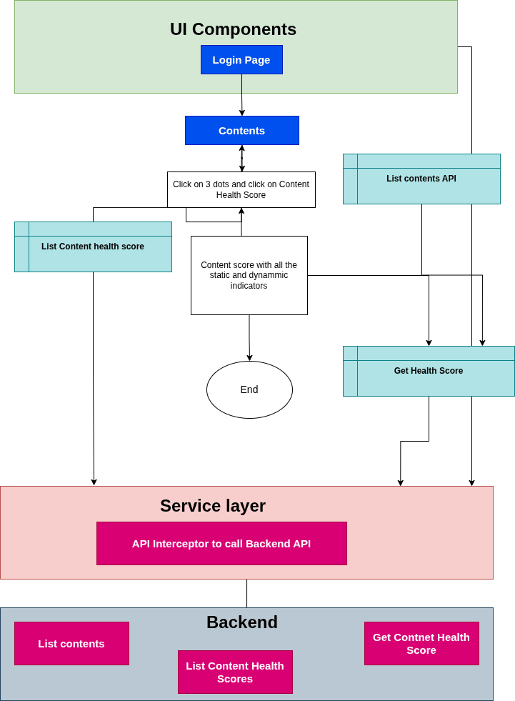

# Content Health Score — Software Requirements Specification (SRS)

## INTRODUCTION

### 3.1 PURPOSE

The Content Health Score (CHS) initiative introduces a standardized, data-driven framework to measure and improve course quality across the iGOT platform. Each course is assigned a score from 0–100 based on a combination of static content quality metrics and dynamic learner engagement indicators. The solution enables continuous monitoring, proactive quality management, and transparent quality signals for learners. Providers gain access to actionable insights, root-cause diagnostics, and trend analysis to improve their content systematically. Learners can make informed enrollment decisions using color-coded quality badges and detailed health indicators. SPV administrators receive platform-wide quality dashboards, intelligent alerts, and prioritized intervention recommendations. The system reduces manual oversight, improves governance efficiency, and supports quality-based content curation. Automated monthly score recalculation ensures quality signals remain current and relevant. Remediation activities can be tracked from identification through resolution. Overall, CHS creates a transparent ecosystem that drives continuous content quality improvement and enhances the learner experience.

### 3.2 SCOPE

The Content Health Score (CHS) initiative introduces a standardized, data-driven framework to measure and improve course quality across the iGOT platform. Each course is assigned a score from 0–100, comprising a Static Score (50 points) based on AI-evaluated content quality metrics and a Dynamic Score (50 points) derived from learner engagement and performance indicators. The Static Score is calculated within five working days of publication, while the Dynamic Score is refreshed monthly using metrics such as completion rate, drop-off rate, learner ratings, sentiment, and time spent versus expected duration. Courses are categorized using color-coded quality indicators: Green (70–100), Amber (40–69), and Red (0–39). Learners can view these quality signals before enrollment, enabling informed learning choices. Content providers receive detailed score breakdowns, trend analysis, and actionable recommendations to improve course quality. SPV administrators gain access to platform-wide quality dashboards, provider rankings, and automated alerts for declining course performance. The system enables proactive interventions, quality-based content curation, and remediation tracking. Monthly recalculation ensures scores remain accurate and reflective of current learner experiences. Overall, CHS establishes a transparent quality ecosystem that drives continuous improvement and enhances learner trust and engagement.

### 3.3 OVERVIEW

### 3.3.1 SYSTEM PERSPECTIVE

  **3.3.2 LIMITATIONS**

The **Content Health Score** feature, in its current phase, operates within defined functional, technical, and governance boundaries. The overall limitations are outlined below:

- **Dependence on Learner Data:** Dynamic scores rely on learner engagement and feedback data. Newly published courses or courses with low enrollments may not have sufficient data to generate reliable quality scores.
- **Monthly Refresh Cycle:** Dynamic metrics are updated monthly, which means recent improvements or quality issues may not be reflected immediately in the Content Health Score.
- **AI Assessment Constraints:** Static scores are based on AI-driven analysis and may not fully capture subject-matter accuracy, pedagogical effectiveness, or contextual relevance of the content.
- **Learner Behavior Variability:** Completion rates, ratings, and engagement metrics can be influenced by external factors such as mandatory enrollments, learner motivation, or organizational requirements, which may not always reflect actual content quality.
- **Potential Rating Bias:** Learner ratings and feedback can be subjective and may be affected by individual preferences, expectations, or isolated experiences.
- **Score Interpretation Challenges:** A single aggregated score may not fully represent all dimensions of content quality, and courses with similar scores may have different underlying strengths and weaknesses.
- **Limited Historical Data for New Courses:** Newly launched courses may initially receive scores based primarily on static metrics until sufficient learner interaction data becomes available.
- **Content-Type Variations:** Certain quality indicators may not be equally applicable across different content formats such as videos, assessments, webinars, blended programs, or reference materials.
- **No Direct Learning Outcome Measurement:** The score primarily measures content quality and learner engagement but does not directly assess knowledge transfer, skill acquisition, or workplace performance improvement.
- **Risk of Score Optimization:** Providers may focus on improving metrics that influence the score rather than addressing broader learning and instructional design objectives.

## 5. USER TYPES & CHARACTERISTICS

The following user types are identified with respect to the iGoT Karmayogi process:

| **Role** | **Function** |
|---|---|
| Learner | Display the bell icon in the top navbar with the unread count. |
| MDO | Display the bell icon in the top navbar with the unread count. |
| CBP | Display the bell icon in the top navbar with the unread count. |

## 6. System Behavior

### 6.1 Notification Engine | WEB

**6.1.1 Q12 | Content Health Score | Static & Dynamic Indicators**

| **User story Link** | [KB-13860: Q12 \| Content Health Score \| Static & Dynamic Indicators](https://karmayogibharat.atlassian.net/browse/KB-13860) (Prod Deployed) |
|---|---|
| **Epic name** | Q12 \| Content Health Score |
| **Use story Title** | Q12 \| Content Health Score \| Static & Dynamic Indicators |
| **Primary Usage** | I should be able to view the Content Health Score for my published courses so that I can improve the quality for my courses |
| **Actors** | SPV publisher |
| **Pre-Conditions** | A valid role is required for the user. |
| **Dependencies** | No |
| **Trigger** | 1. Login into CBP portal 2. User navigates to the **My content** |
| **Basic behaviour** | he Content Health Score (CHS) measures course quality based on learner engagement and feedback. • **Completion Rate** checks how many learners complete the course. Higher completion rates result in better scores. • **Time Spent vs Expected Time** checks whether learners spend a reasonable amount of time on the course. Spending too little may indicate skipped content, while spending too much may indicate difficulty understanding the content. • **Drop-off Rate** measures how many learners leave the course after the first module. Lower drop-off rates result in higher scores. • **Average Rating** reflects learner satisfaction. Courses with ratings above the platform average receive higher scores. • **Low Rating Alert** is triggered when a significant number of learners give 1-star or 2-star ratings, indicating potential quality issues. • Each metric is assigned a score from 1 to 5 based on predefined thresholds. • The scores are combined using their respective weights to calculate the overall Content Health Score. • Courses with higher CHS values are considered healthy and engaging, while lower scores indicate that improvements may be required. |
| **Alternate behaviour** | N/A |
| **Business Rule / Validations** | •  Content Health Score (CHS) is calculated only for **published and active courses**. Dynamic metrics are refreshed **once every month** based on learner activity from the previous reporting period. Courses must have a **minimum learner activity threshold** (enrollments/completions/ratings) before dynamic metrics are considered reliable. Completion Rate is calculated as: **(Number of Completions ÷ Number of Enrollments) × 100** Time Spent vs Expected Time is calculated as: **(Average Actual Time Spent ÷ Expected Course Duration) × 100** Drop-off Rate is calculated using learners who exit the course after the first module. Average Rating is evaluated relative to the **platform mean and standard deviation**, not fixed rating thresholds. A **Low Rating Red Flag** is triggered when: More than **5% of monthly ratings** are 1-star or 2-star ratings, and At least **20 low ratings** are received during the month. Each quality indicator is assigned a score between **1 and 5** based on predefined thresholds. Indicator scores are multiplied by their respective weights to derive the final Content Health Score. Courses are categorized as: **Green:** CHS ≥ 70 **Amber:** CHS 40–69 **Red:** CHS < 40 An alert is generated when: CHS drops by more than **15 points month-over-month**, or CHS remains below **40 for two consecutive months**. Newly published courses may initially display only the Static Score until sufficient learner data is available for Dynamic Score calculation. Any course flagged through Red Flag logic should be available for administrative review regardless of its overall CHS. Score calculations and thresholds must be applied consistently across all courses to ensure fair comparison and benchmarking. |
| **Exceptions / Alerts** | N/A |
| **Post Conditions** | N/A |
| **Frequency of Use** | 90% |
| **External linkages** | N/A |
| **API Reference** |  |
| **Issues** | N/A |

**6.1.2 Q12 | Content Health Score | SPV Publisher Listing page**

| **User story Link** | [KB-13896: Q12 \| Content Health Score \| SPV Publisher Listing page](https://karmayogibharat.atlassian.net/browse/KB-13896) (Prod Deployed) |
|---|---|
| **Epic name** | Q12 \| Content Health Score |
| **Use story Title** | Q12 \| Content Health Score \| Static & Dynamic Indicators |
| **Primary Usage** | I want to add a learning record through a structured form So that I can self-declare trainings, certifications, or programs completed outside the platform and have them reflected in my Learning Passbook. |
| **Actors** | SPV Publisher |
| **Pre-Conditions** | A valid role is required for the user. |
| **Dependencies** | No |
| **Trigger** | 1. Login into CBP portal 2. User navigates to the **My content** |
| **Basic behaviour** | 1. The listing page shall display only the **Final Content Health Score (CHS)** for each course. 2. Users can sort courses by Final Content Health Score in **ascending** or **descending** order. 3. Users can filter courses based on the Content Health Score status: **Green** – Final CHS is 70 or above. **Amber** – Final CHS is between 40 and 69. **Red** – Final CHS is below 40. **Not Applicable** – Content Health Score is not available (null) for the content. **Pending** – Course was published less than 90 days ago and is not yet eligible for score calculation. 4. Applying a filter shall display only the courses matching the selected status. 5. Users can apply sorting and filtering simultaneously. 6. The listing page shall refresh the displayed results based on the selected sort and filter criteria. 7. If no courses match the selected filter, an appropriate "No Records Found" message shall be displayed. |
| **Alternate behaviour** | N/A |
| **Business Rule / Validations** | 1. Final Content Health Score shall be displayed only when a valid score is available for the course. 2. A course shall be marked as **Pending** when: (Current Date - Publish Date) < 90 days. 3. A course shall be marked as **Not Applicable** when: Content Health Score is null, or The content type is not eligible for Content Health Score calculation. 4. Pending courses shall not be classified as Green, Amber, or Red. 5. Not Applicable courses shall not be classified as Green, Amber, or Red. 6. Green status shall be assigned when Final CHS ≥ 70. 7. Amber status shall be assigned when Final CHS is between 40 and 69. 8. Red status shall be assigned when Final CHS < 40. 9. Sorting shall be performed based on the Final Content Health Score value. 10. Courses with Pending or Not Applicable status shall be displayed according to the selected filter criteria. |
| **Exceptions / Alerts** | N/A |
| **Post Conditions** | N/A |
| **Frequency of Use** | 90% |
| **External linkages** | N/A |
| **API Reference** |  |
| **Issues** | N/A |

**6.1.3 Q12 | Content Health Score | SPV Publisher Detailed content health score**

| **User story Link** | [KB-13897: Q12 \| Content Health Score \| SPV Publisher Detailed content health score](https://karmayogibharat.atlassian.net/browse/KB-13897) (Prod Deployed) |
|---|---|
| **Epic name** | Q12 \| Content Health Score |
| **Use story Title** | Q12 \| Content Health Score \| SPV Publisher Detailed content health score |
| **Primary Usage** | I should be able to view the detailed content health score for individual courses |
| **Actors** | SPV Publisher |
| **Pre-Conditions** | A valid role is required for the user. |
| **Dependencies** | No |
| **Trigger** | 1. Login into CBP portal 2. User navigates to the **My content** 3. Click on 3 dots and click on content health score |
| **Basic behaviour** | For the Content health card meter (Overall Content Score) we need to show the score ranges (0, 40, 70, 100) and the respective Poor, Average and Excellent verbiage for the Red and Green side. Increase the needle size. In Content Score we need to provide the info icon at listing page. 1. Info Icon Text: This score is applicable for the courses live on portal for more than 3 months. The score gets updated every month. 2. For Dynamic Indicators we need to provide the proper definition for Rational & Overview and for others also we need to review and update. |
| **Alternate behaviour** | N/A |
| **Business Rule / Validations** | 1. The Overall Content Score meter shall display score range markers at **0, 40, 70, and 100**. 2. The Content Score meter shall display the following quality labels: **Poor** for scores between 0 and 39 (Red Zone) **Average** for scores between 40 and 69 (Amber Zone) **Excellent** for scores between 70 and 100 (Green Zone) 3. The meter needle shall be visually enhanced to ensure better visibility and accurate identification of the current score. 4. An **Info Icon** shall be displayed alongside the Content Score on the listing page. 5. On clicking or hovering over the Info Icon, the following tooltip shall be displayed: *"This score is applicable for courses that have been live on the portal for more than 3 months. The score is updated every month."* 6. The Info Icon tooltip shall be displayed consistently across all pages where the Overall Content Score is shown. 7. The Overall Content Score shall be calculated and displayed only for courses that have been live for more than 90 days. 8. Courses that have been live for less than 90 days shall display the **Pending** status instead of a score. 9. Dynamic Indicator definitions, descriptions, and tooltips shall be reviewed and updated to ensure they clearly explain the purpose, calculation logic, and business meaning of each indicator. 10. The **Rationale & Overview** section under Dynamic Indicators shall display the approved and updated definition provided by the business team. 11. Any changes to Dynamic Indicator descriptions shall be reflected consistently across the Content Health Card, dashboards, reports, and tooltips. 12. The score ranges, labels, tooltip text, and indicator definitions shall be configurable to support future updates without requiring application code changes. |
| **Exceptions / Alerts** | N/A |
| **Post Conditions** | N/A |
| **Frequency of Use** | 90% |
| **External linkages** | N/A |
| **API Reference** |  |
| **Issues** | N/A |

**6.1.4 Q12 | Content Health Score |** **UAT** **Feedbacks**

| **User story Link** | [KB-14170: Q12 \| Content Health Score \| UAT Feedbacks](https://karmayogibharat.atlassian.net/browse/KB-14170) (Prod Deployed) |
|---|---|
| **Epic name** | Q12 \| Content Health Score |
| **Use story Title** | Q12 \| Content Health Score \| UAT Feedbacks |
| **Primary Usage** | I should be able to see the feedbacks implemented provided in UAT |
| **Actors** | SPV Publisher |
| **Pre-Conditions** | A valid role is required for the user. |
| **Dependencies** | No |
| **Trigger** | 1. Login into CBP portal 2. User navigates to the **My content** 3. Click on 3 dots and click on content health score |
| **Basic behaviour** | 1. The Content Health Card shall display the **Overall Content Health Score** out of 100 for the selected course. 2. The overall score shall be presented as a combination of: **Static Score** (Maximum 50 points) **Dynamic Score** (Maximum 50 points) 3. The Content Health Meter shall visually represent the overall score using the following color ranges: **Red (Poor):** 0–39 **Amber (Average):** 40–69 **Green (Excellent):** 70–100 4. Users shall be able to view the individual scores for all Static and Dynamic indicators contributing to the overall score. 5. The card shall display the score achieved for each indicator along with its maximum possible score. 6. A **Critical Issue** shall be highlighted whenever an indicator receives a score of less than 3. 7. A **Content Review Warning** shall be displayed when more than 5% of the course ratings are 1-star or 2-star ratings and at least 20 such ratings exist. 8. Users shall be able to view the breakdown of Static and Dynamic indicators separately for better understanding of the score composition. 9. Tooltip information shall be available to explain the Overall Content Score, Static Indicators, and Dynamic Indicators. 10. If a score is not available for an indicator, the system shall display an appropriate status or message instead of the score. |
| **Alternate behaviour** | N/A |
| **Business Rule / Validations** | • Overall Content Health Score shall be calculated out of a maximum of 100 points. • Static Indicators shall contribute a maximum of 50 points and be derived from published course content. • Dynamic Indicators shall contribute a maximum of 50 points and be derived from learner engagement and performance data. • Dynamic indicators shall be refreshed monthly for courses that have been live for more than 90 days. • Any indicator with a score less than 3 shall be displayed under the Critical Issues section. • A Content Review Warning shall be triggered when: More than 5% of ratings are 1-star or 2-star ratings, and At least 20 such low ratings exist. • The health meter color shall be determined using the final overall score: 0–39: Red (Poor) 40–69: Amber (Average) 70–100: Green (Excellent) • Static and Dynamic scores shall always be displayed separately along with their individual contributing indicators. • Tooltip content shall match the predefined descriptions for Overall Content Score, Static Indicators, and Dynamic Indicators. • The overall score shall automatically update whenever the underlying static or dynamic scores are recalculated. |
| **Exceptions / Alerts** | N/A |
| **Post Conditions** | N/A |
| **Frequency of Use** | 90% |
| **External linkages** | N/A |
| **API Reference** |  |
| **Issues** | N/A |

## 7. References

| **Document Name** | **Document Version Number** | **Release date** |
|---|---|---|
| RFP Document | V1.1 | 01-May-2026 |
| BRD Document | V1.1 | 01-May-2026 |
| FRS Document | V1.1 | 01-May-2026 |

## 8. Specific Requirements

### 8.1 EXTERNAL INTERFACES

There are no external interfaces.

### 8.2 SYSTEM INTERFACE

Nginx will be used as a web server. The user inputs data via the web server using HTML forms. The actual program that will perform the operations is written in Java/J2EE 1.8

### 8.2.1 USER INTERFACE

The user interface shall be implemented using software packages like Java applet, MS Frontpage, Enterprise Java beans, etc on the following languages

| **Language** | **Description** |
|---|---|
| Angular | Angular is a TypeScript-based free and open-source single-page web application framework run on Node.js. |
| JavaScript | JavaScript is a light weight, object oriented, cross platform scripting language, will mainly be used within the webpages |
| HTML5 | HTML5 is the fifth revision of the HTML standard. |
| CSS | Cascading style sheets define style rules in a separate CSS file |

**8.2.1 USER INTERFACE** | **MOBILE**

| **Language** | **Description** |
|---|---|
| Dart | Dart is a general-purpose programming language that can be used for a wide range of applications, including web development, server-side programming, and mobile app development. Flutter, on the other hand, is a UI SDK specifically designed for building high-performance, cross-platform mobile apps. |

### 8.2.2 SOFTWARE INTERFACE

Server-side: An Apache web server will accept all requests from the client and forward it accordingly. A database will be hosted centrally using PostgreS and Teradata.

Client-side: A Windows/Linux OS which is capable of running a modern web browser that supports JavaScript and HTML5 will be used

Client-side-Mobile: An Android/iOS device

### 8.2.3 COMMUNICATION INTERFACES

The system shall use the HTTPS protocol(s) and TCP/IP protocol suite for communication over the intranet. The user must have an SSL certificate licensing registered web browser.

### 8.2.4 OPERATIONS

Recommended browsers for the system are Chrome, Firefox, and Internet Explorer 8 or higher.

| **Mozilla Version** | **Chrome Version** | **IE** **Version** |
|---|---|---|
| Version 122+ | Version 118+ | Version 11 |

| **Android Version** | **iOS Version** |
|---|---|
| Version 13 & below | Version 17 & below |

The system shall have operations to protect the database from being corrupted or accidentally altered during a system failure.

## 9. Non-Functional Requirements

### 9.1 USABILITY REQUIREMENTS

The user interface of Karmayogi Bharat shall provide a very intuitive and simple interface to the user so that the user can easily navigate through pages.

### 9.2 PERFORMANCE REQUIREMENTS

Response Time: Average response time shall be less than 3-5 seconds (Note: No SLA is defined in the RFP. However as per industry standard every page’s average response time should be between of 3 to 5 seconds)

Capacity: The system will be able to accommodate 25000 concurrent users in Production env.

| **Applications** | **Business Transaction** | **User Distribution**  **(%age of peak load)** | **Total Users Expected in Production env.** |
|---|---|---|---|
| Portal | Login, Registration, User Profile Views, Course consumption | 80% | 25000 |
| Help, Resources, Feedback | 20% |  |  |
| Mobile | AI based recommendation | 90% of total application features | 25000 |

### 9.3 SECURITY

The application will store data that are critical concerning security. Adequate safety measures are to be incorporated during the development stage to prevent vulnerabilities and build a secure code for these services.

The following security considerations are to be made:

**User Level Security: -**

Restricted areas of the application shall be accessible through pre-defined user access rights.

**Database Level Security:**

Database security should provide different layers of database users with overall control of the database security administrator, only authorized database administration users with assigned privileges shall be allowed to access the database. A separate audit trail should be maintained for any direct modification, deletion, and addition in Postgres and Teradata database in database structure or records. Users, even the database administrator should not be allowed to tamper with the audit log.

**Network Level Security:**

Network traffic shall be encrypted using SSL & secured connectivity between the ITD office and the data center where the application will be hosted.

**Infrastructure Level Security:**

Application infrastructure shall be hosted in a DMZ & firewall and IPS shall be installed to detect malicious activities.

The portal should also be tested against the[OWASP 2017 top 10 list](https://www.owasp.org/index.php/Category:OWASP_Top_Ten_Project)of security vulnerabilities.

<Refer to the security guidelines document >

### 9.4 MAINTAINABILITY

Maintainability is defined as the ease with which the software system and components can be modified to correct faults and improve performance or other attributes. It is envisaged that KB shall have a high degree of maintainability. RTO shall be 8 hours for business-critical systems and 48 hours for other systems

### 9.5 SCALABILITY

Scalability is the capability of the system and the underlying components to handle a growing amount of work, or its potential to be enlarged to accommodate that growth. It will be able to accommodate 25000 concurrent users in the Production environment.

| **Applications** | **Business Transaction** | **User Distribution**  **(%age of peak load)** | **Total Users Expected in Production env.** |
|---|---|---|---|
| Portal | Login, Registration, User Profile Views, Course consumption | 80% | 25000 |
| Help, Resources, Feedback | 20% |  |  |
| Mobile | AI based recommendation | 90% of total application features | 25000 |

### 9.6 PORTABILITY MOBILE

#### MOBILE

Upon the introduction of the Content Health Score, the system portability remains constant

| **Android Version** | **iOS Version** |
|---|---|
| Version 13 & below | Version 17 & below |

#### WEB:

Upon the introduction of the Learner Passbook, the system portability remains constant, The application and introduced feature are Windows/Linux-based and should be compatible with other systems. Apache, Java/Scala/J2EE and Postgres and programs are practically independent of the OS-system which they communicate with. The end-user part is fully portable and any system using any web browser should be able to use the features of the application.

| **Mozilla Version** | **Chrome Version** | **IE Version** |
|---|---|---|
| Version 122+ | Version 118+ | Version 11 |
