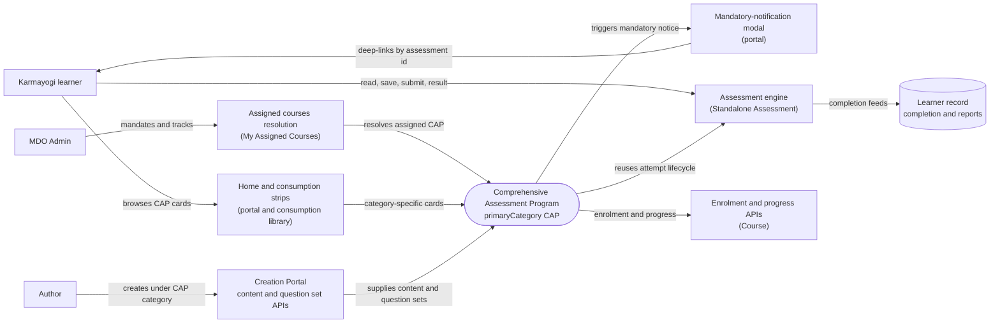

# Comprehensive Assessment Program — Context Diagram

## System boundary

Inside the feature is the Comprehensive Assessment Program (CAP) category itself: a
content category plus the client-side behaviour specific to it, namely the default
deep-link target of the mandatory-notification modal, the end-date exemption on its cards,
and its dedicated home-page strip handling. Outside it are the learner, the MDO admin and
the author, and the shared rails CAP rides on: the assessment engine, enrolment and
progress APIs, assigned-courses resolution, and the Creation Portal content and question
set APIs. No CAP-only backend endpoint is documented.

## Diagram

## Elements

| Element | Role | Detailed in |
|---|---|---|
| Comprehensive Assessment Program | Central system: assessment category configured over shared rails, with category-specific client branching | [index.md](index.md) |
| Karmayogi learner | Arrives by mandate, attempts and completes the program | [use-cases.md](use-cases.md) |
| MDO Admin | Mandates the program and tracks it through assignment and standard reports | [use-cases.md](use-cases.md) |
| Author | Creates the program in the Creation Portal with question sets attached | [use-cases.md](use-cases.md) |
| Mandatory-notification modal (portal) | Deep-links the learner into the program; CAP is its default category | [lld.md](lld.md) |
| Home and consumption strips | Dedicated CAP strip branch; end date suppressed on CAP cards | [lld.md](lld.md) |
| Assessment engine (Standalone Assessment) | Provides the attempt lifecycle and results | [apis.md](apis.md) |
| Enrolment and progress APIs (Course) | Shared enrolment and progress rails | [apis.md](apis.md) |
| Assigned courses resolution (My Assigned Courses) | Resolves assigned content for the learner | [apis.md](apis.md) |
| Creation Portal content and question set APIs | Authoring path for the category and its question sets | [use-cases.md](use-cases.md) |
| Learner record | Receives completion; feeds standard reports | [use-cases.md](use-cases.md) |

> **Verification boundary:** elements and interactions come from the feature's own pages
> (index, use cases, APIs, HLD, LLD). Source was spot-checked read-only only for the
> `Comprehensive Assessment Program` category reference in the portal's
> mandatory-notification modal component. The end-date exemption and strip branch in the
> consumption library were not re-verified, nor were the linked sibling features' pages
> or backends. The feature docs record no repo or version, and note that no CAP-specific
> enrolment or evaluation endpoint was found in the traced repos; a dedicated backend
> may exist in a repo not yet traced.
