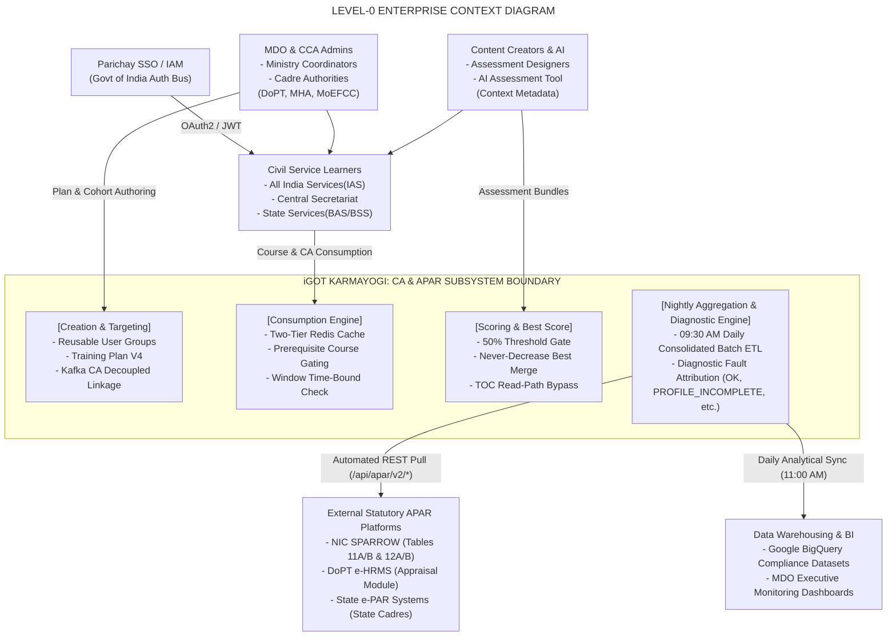
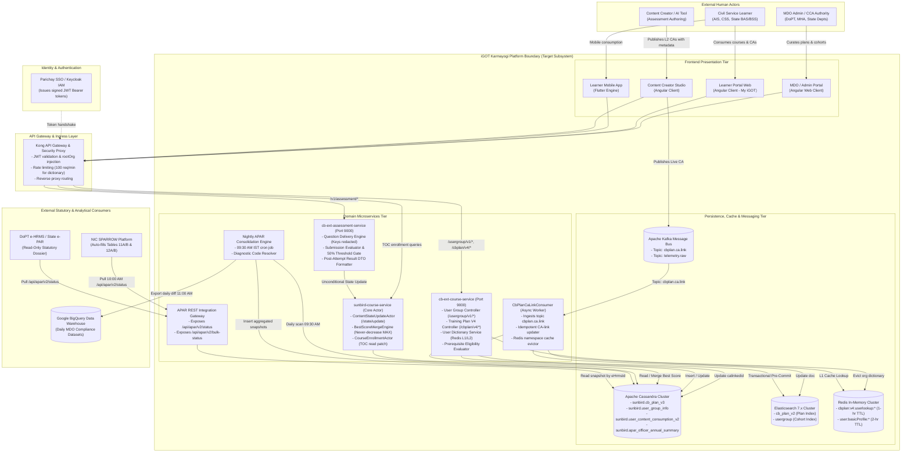
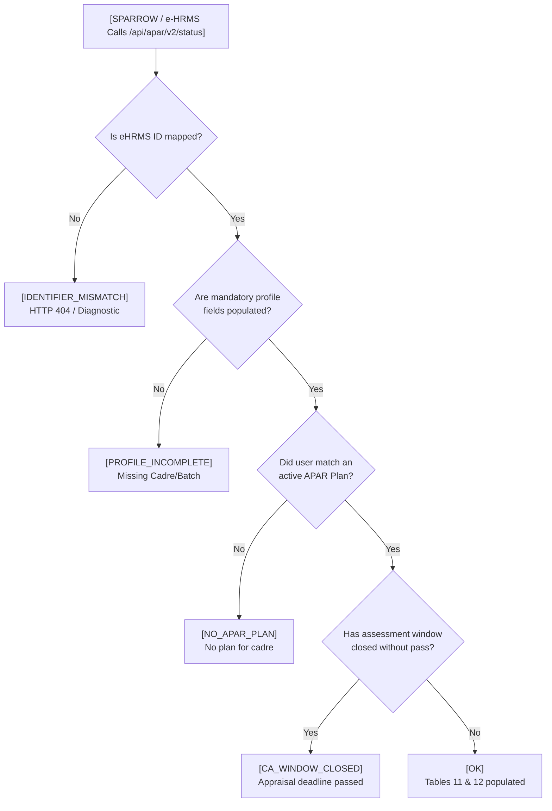

# Comprehensive Assessment — Context Diagrams

## 1. High-Level Enterprise System Context (C4 Model - Level 0)

This Level-0 context diagram establishes the platform boundary of the **iGOT Karmayogi CA & APAR Subsystem**, mapping all external actors, consuming statutory government systems, identity providers, and data warehousing sinks.

## 2. Detailed Subsystem System Context Diagram (Level 1)

This diagram details the interaction boundaries between the frontend clients, API gateway, core backend microservices, message brokers, caching/persistence tiers, and external integrations.

## 3. Subsystem Context Boundaries & Protocol Matrix

The following matrix documents the interaction contracts crossing the subsystem boundary:

| Boundary Interface | Source Component | Target Component | Transport Protocol | Payload / Schema | Security & Governance Gates | Related Jira / Task |
|---|---|---|---|---|---|---|
| **IF-01: Ingress Auth** | Client Portals | Kong Gateway | HTTPS / REST | Bearer JWT Header (`x-authenticated-user-token`) | Keycloak verification; role extraction (`MDO_ADMIN`, `CCA_ADMIN`). | `KB-10686` |
| **IF-02: User Group API** | Admin UI | `cb-ext-course-service` | HTTPS / REST | JSON: `{ userGroupName, criteria: [...] }` | Evaluated as AND within criteria, OR across groups; fail-closed deletion lock. | `KB-13866` |
| **IF-03: Plan Lifecycle** | Admin UI | `cb-ext-course-service` | HTTPS / REST | JSON: `{ name, contentList, userGroupIds, endDate }` | Transactional Elasticsearch pre-commit; staged mutation via `draftData`. | `KB-11524`, `KB-13077` |
| **IF-04: CA** **Decoupling** | Content Studio | Kafka Broker | Kafka TCP | Topic `cbplan.ca.link`: `{ action, cbPlanId, caLinkedId }` | Asynchronous decoupled linking; triggers org-scoped Redis eviction. | `cbrelease-``4.8.41` |
| **IF-05: Discovery Dict** | Learner Web / App | `cb-ext-course-service` | HTTPS / REST | POST: `{ planYear: "2026-27" }` | Two-tier resolution: Redis L1 () Cassandra profile fallback L2. | `KB-10684`, `KB-13086` |
| **IF-06: Prereq Gating** | Learner Web / App | `cb-ext-course-service` | HTTPS / REST | GET: `/assessment/eligibility/{doId}` | Validates 50% mandatory course quota satisfied & active window dates. | `KB-8065`, `KB-8066` |
| **IF-07: Submission** | Assessment Player | `cb-ext-assessment-service` | HTTPS / REST | POST: `{ submissionId, responses: [...] }` | Strips answer keys; server-side 50% pass threshold check. | `KB-12764`, `KB-13093` |
| **IF-08: State Merge** | Assessment Svc | `sunbird-course-service` | HTTP / REST | POST: `/v1/content/state/update` | Unconditional invocation; executes never-decrease Best Score merge. | `KB-15848`, Tech Design |
| **IF-09: TOC Read Path** | Learner UI | `sunbird-course-service` | HTTPS / REST | Akka Request: `getCourseTOC` | Bypasses completed-course skip-read optimization for CA content types. | `KB-15848` |
| **IF-10: Statutory Sync** | NIC SPARROW / e-HRMS | APAR Gateway | HTTPS / REST | GET: `/api/apar/v2/status?eHrmsId=...` | Sub-second SLA (); read-only auto-fill of Tables 11A/B & 12A/B. | `KB-10681`, `BRD-1031307285` |
| **IF-11: Data** **Pipeline** | Batch Worker | Google BigQuery | Cloud API / ETL | Streaming / Micro-batch JSON Rows | Exports compliance denominators and learner highest scores daily. | `KB-12923`, `KB-13111` |

## 4. Contextual Fault & Diagnostic Flow

When external consumers (SPARROW, e-HRMS, or Officers) interface with the system boundary, every request evaluates to exactly one deterministic diagnostic state:

