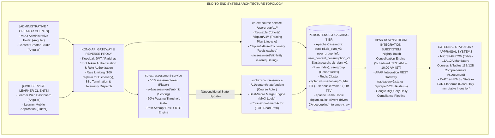
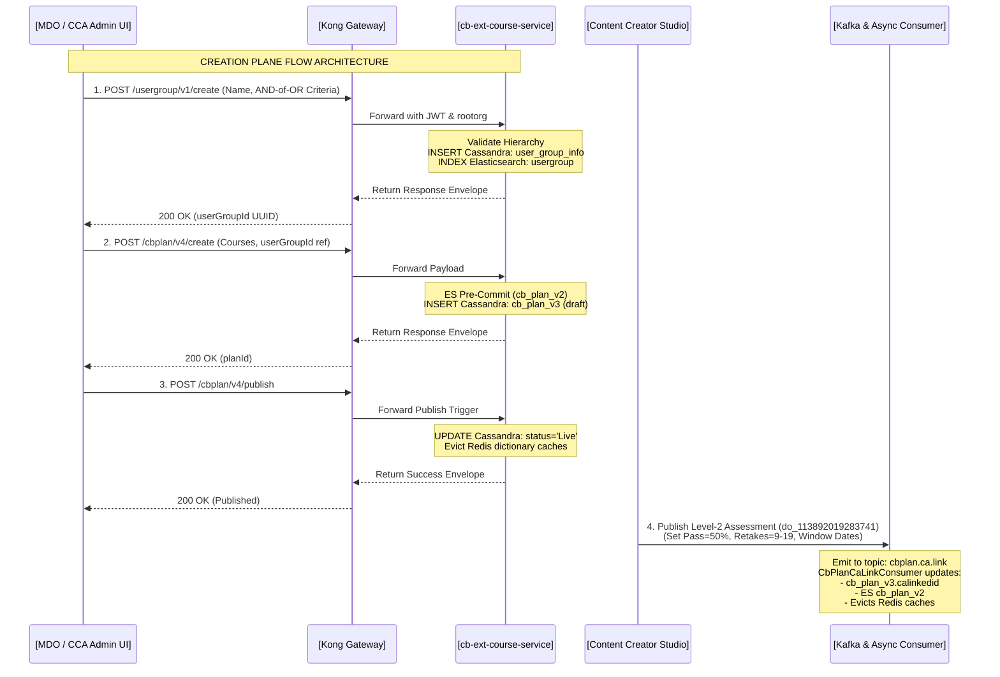
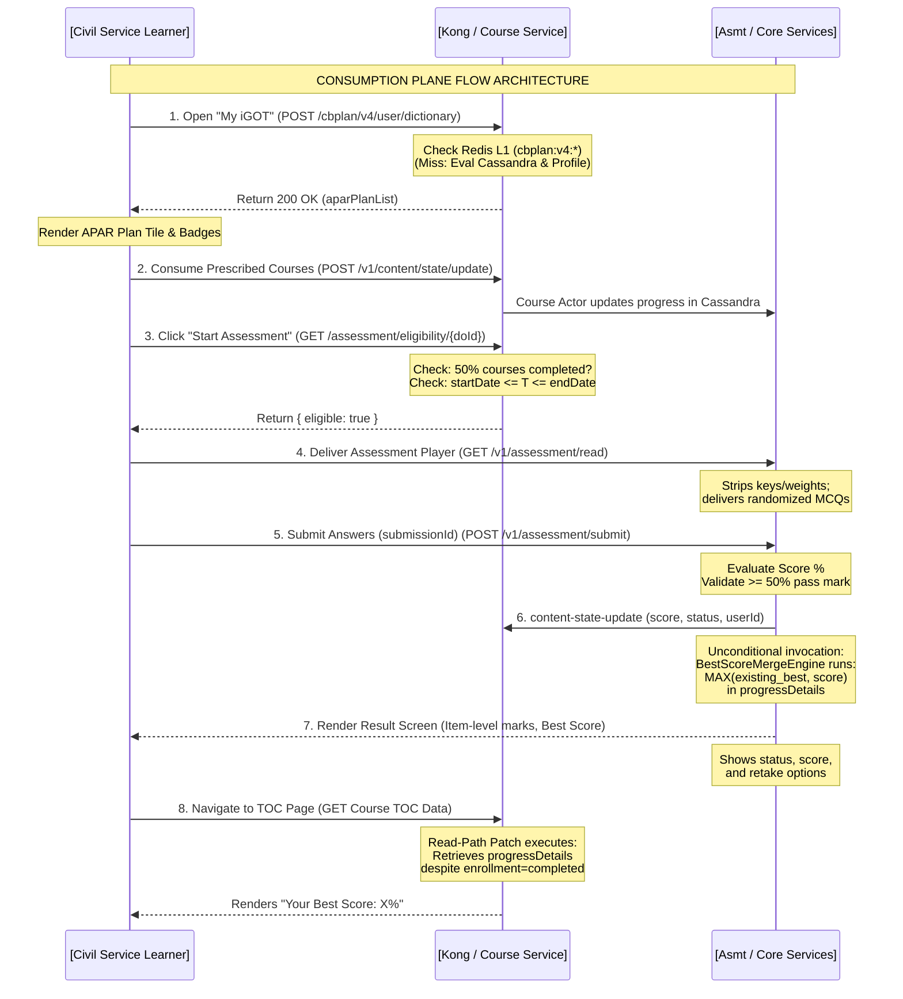
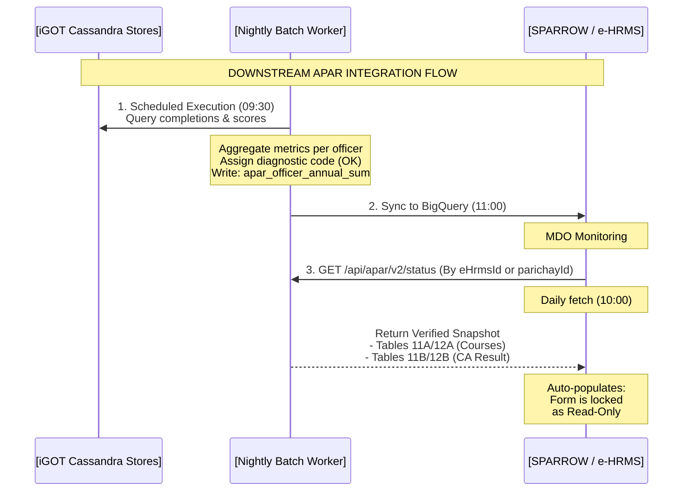

# Comprehensive Assessment — High-Level Design (HLD)

**End-to-End Creation to Consumption Architecture**

## 1. Executive Summary & Design Vision

The **Comprehensive Assessment (CA)** program on iGOT Karmayogi is the statutory evaluation mechanism linking continuous learning directly to the civil servant’s **Annual Performance Appraisal Report (APAR)** (integrated with NIC SPARROW, DoPT e-HRMS, and State e-PAR systems).

This High-Level Design (HLD) defines the end-to-end architecture across two core planes:

1. **The Administrative Creation Plane:** From the MDO/CCA Admin Web Portal down through Kong, `cb-ext-course-service`, Elasticsearch pre-commits, Cassandra `cb_plan_v3` / `user_group_info`, and Kafka-driven CA linkage.
2. **The Learner Consumption & Evaluation Plane:** From the Learner Portal (Angular Web / Flutter Mobile) "My iGOT" dashboard down through Redis L1/L2 dictionary evaluation, prerequisite course gating, question delivery, 50% pass-threshold server-side validation, never-decrease Best Score merge within `user_content_consumption_v2.progressDetails`, and downstream batch consolidation for APAR Tables 11A/B & 12A/B.

## 2. End-to-End System Architecture



## 3. End-to-End Creation Plane (Frontend to Backend)

The creation flow enables administrators to define targeting criteria, curate curriculum containers, link courses, and associate independent Level-2 (L2) assessments.



### 3.1 Step 1: Reusable User Group Creation

1. **Frontend (Admin Portal):** The administrator navigates to **User Groups**, selects Cadre (e.g., Central, All India Services, or State Civil Services like `BAS`/`BSS`), Batch Years, and Designations.
2. **Gateway:** Kong validates the Bearer token, checks that the user holds the `MDO_ADMIN` or `CCA_ADMIN` role, and injects the `rootOrgId` header.
3. **Backend** (`cb-ext-course-service`):
  - Enforces apex organization scoping (`L0` hierarchy validation).
  - Prevents duplicate group names within the same organization.
  - Generates a UUID `userGroupId`, writes the criteria JSON to Cassandra table `sunbird.user_group_info`, and synchronizes the document to the Elasticsearch `usergroup` index.

### 3.2 Step 2: APAR Training Plan Authoring & Staged Updates

1. **Frontend (Admin Portal):** The administrator initiates **Create Training Plan**, inputs plan name (e.g., *"DoPT Joint Secretary Mandatory Plan 2026-27"*), specifies the reporting period (`2026-27`), maps prescribed courses, marks them as `mandatory: true`, and selects the `userGroupId` created in Step 1.
2. **Backend** (`cb-ext-course-service`):
  - **Transactional ES Pre-Commit:** Indexes the plan into Elasticsearch `cb_plan_v2`. If Elasticsearch rejects or times out, the call fails closed and aborts the database write.
  - **Cassandra Persistence:** Writes the record into `sunbird.cb_plan_v3` with `status: "draft"`.
  - **Staged Mutability:** If an administrator later edits an active (`Live`) plan, the changes are stored in the `draftData` JSON column, preventing partial changes from affecting learners until formally published.

### 3.3 Step 3: Plan Publication & Asynchronous CA Decoupled Linkage

1. **Publish Call:** Invoking `POST /cbplan/v4/publish` updates `status: "Live"` in `cb_plan_v3`, flushes staged `draftData` to production fields, and invalidates the organization's Redis cache keys.
2. **Event-Driven Assessment Binding:** Content Creators independently author and publish Level-2 Comprehensive Assessments in the Content Portal. When an assessment transitions to `Live`:
  - A Kafka event is emitted to `cbplan.ca.link` carrying `{ action: "ADD", cbPlanId, caLinkedId }`.
  - The worker `CbPlanCaLinkConsumer` updates `cb_plan_v3.calinkedid`, updates Elasticsearch, and triggers an immediate eviction of Redis dictionary cache keys (`cbplan:v4:userlookup:{orgId}:*`).

## 4. End-to-End Consumption Plane (Frontend to Backend)

The consumption flow governs how civil servants discover mandatory obligations, complete courses, unlock assessments, attempt tests, and persist their Best Score.



### 4.1 Step 1: Learner Dashboard Discovery & Redis-Cached Dictionary

1. **Client Call:** Upon loading the "My iGOT" dashboard, the client issues `POST /cbplan/v4/user/dictionary` with payload `{"planYear": "2026-27"}`.
2. **Two-Tier Cache Resolution:**
  - **L1 (Redis):** Queries `cbplan:v4:userlookup:{rootOrgId}:{userId}:{planYear}`. If found, returns in .
  - **L2 (Cassandra Fallback):** On cache miss, fetches the learner’s profile (`cadre`, `batch`, `designation`, `isCentralDeputation`), retrieves candidate plans from `cb_plan_v3`, evaluates User Group rules using the **AND-of-OR** algorithm, caches the evaluated result in Redis (TTL = 3600 seconds), and returns the payload.

3. **Frontend Rendering:** Renders the APAR Training Plan card, displaying total required courses, individual course cards with "APAR" and "Comprehensive Assessment" visual pills, and the CA card.

### 4.2 Step 2: Course Consumption & Prerequisite Gating

1. **Consumption Tracking:** Learner completes courses. The player calls `sunbird-course-service` via `/v1/content/state/update`, updating progress to 100% in `sunbird.user_content_consumption_v2`.
2. **Assessment Gating:** When the learner clicks on the CA tile, the frontend invokes `GET /cbplan/v4/user/assessment/eligibility/{doId}`.
3. **Validation Gates:**
  - **Course Quota:** Verifies that at least 50% of the plan's mandatory courses have reached completion status.
  - **Time-Bound Window:** Checks that current server timestamp satisfies .
  - If prerequisites are incomplete, the API returns `eligible: false`, prompting the frontend to lock the "Start Assessment" button and display a progress warning badge.

### 4.3 Step 3: Assessment Player Delivery & Response Submission

1. **Delivery:** The Assessment Player calls `GET /v1/assessment/read/{doId}`. The question engine randomizes options and strips all answer keys and scoring weights.
2. **Submission:** Learner submits responses via `POST /v1/assessment/submit` with an idempotent UUID `submissionId`.
3. **Scoring:** `cb-ext-assessment-service` evaluates answers against server-side keys, computes the percentage score, records the raw audit log in `user_assessment_data_v2`, and checks against the passing standard ().

### 4.4 Step 4: Unconditional State Update & Never-Decrease Best-Score Merge

1. **Unconditional Invocation:** Regardless of whether the learner passed or failed, `cb-ext-assessment-service` calls `POST /v1/content/state/update` on `sunbird-course-service`.
2. **Atomic Merge in Cassandra:**
  - Course Actor reads the existing row in `sunbird.user_content_consumption_v2`.
  - Unpacks JSON column `progressDetails`.
  - Evaluates:
  - Writes the updated JSON back to Cassandra: `{"current": current_new, "best": best_new}`.

3. **Certificate Governance:** If , status transitions to `completed`, triggering `cert-service`. If , status is marked `failed`, and certificate generation is withheld.

### 4.5 Step 5: Post-Assessment Feedback & TOC Score Surfacing

1. **Result Screen** (`KB-13093` / `KB-13449`): Renders overall status (`Passed` or `Not Passed`), percentage score, item-level review indicating correct/incorrect marks (withholding correct answer keys), and remaining attempts. If failed, flags the mandatory retake modal (`KB-13402`).
2. **TOC Read-Path Patch** (`KB-15848`): When the learner revisits the Table of Contents (TOC) page, `CourseEnrollmentActor` bypasses the legacy completion check, fetches `user_content_consumption_v2.progressDetails`, and surfaces `"Your Best Score: X%"`.

## 5. Downstream APAR Synchronization Architecture



1. **Nightly Aggregation Pipeline:** Every morning at 09:30 AM IST, a scheduled batch job scans Cassandra consumption logs, compiling officer-year records into `sunbird.apar_officer_annual_summary`.
2. **Diagnostic Code Attribution:** The worker stamps each record with a diagnostic code:
  - `OK`: Compliant; plan matched, courses and CA recorded.
  - `NO_APAR_PLAN`: Officer profile valid, but no matching plan was published.
  - `PROFILE_INCOMPLETE`: Mandatory fields (`cadre`, `eHrmsId`, etc.) missing.
  - `CA_WINDOW_CLOSED`: Assessment deadline passed without a successful attempt.
  - `IDENTIFIER_MISMATCH`: e-HRMS ID does not resolve to an active iGOT profile.

3. **SPARROW / e-HRMS Population:** External systems invoke `GET /api/apar/v2/status` by 10:00 AM IST to auto-fill Tables 11A/12A (Course titles, competencies, completion dates) and Tables 11B/12B (CA applicability, pass/fail status, best score, passing date). Values are rendered read-only on the appraisal form.

## 6. Comprehensive API Interface Contracts

### 6.1 Admin Creation Plane APIs

#### 1. `POST /usergroup/v1/create`

- **Consumer:** MDO Admin Portal
- **Provider:** `cb-ext-course-service`
- **Headers:** `x-authenticated-user-token: <JWT>`, `rootorg: <ORG_ID>`
- **Request:**
  ```json
  {
    "userGroupName": "Bihar BAS 2022 Batch Joint Secretaries",
    "criteria": [
      {
        "cadre": [
          "BAS"
        ],
        "batch": [
          "2022"
        ],
        "designation": [
          "Joint Secretary"
        ]
      }
    ]
  }
  ```
- **Response** (`200 OK`):
  ```json
  {
    "id": "api.usergroup.create",
    "ver": "1.0",
    "params": {
      "status": "SUCCESSFUL"
    },
    "responseCode": "OK",
    "result": {
      "orgid": "org_bihar_001",
      "usergroupid": "ug_7c9e6679-7425-40de-944b-e07fc1f90ae7",
      "status": "ACTIVE"
    }
  }
  ```

#### 2. `POST /cbplan/v4/create`

- **Consumer:** MDO Admin Portal
- **Provider:** `cb-ext-course-service`
- **Request:**
  ```json
  {
    "name": "Civil Services Annual Capacity Building Plan 2026-27",
    "planYear": "2026-27",
    "endDate": "2027-03-31T23:59:59Z",
    "contentList": [
      {
        "identifier": "do_1138810293",
        "mandatory": true
      },
      {
        "identifier": "do_1138810294",
        "mandatory": true
      }
    ],
    "userGroupIds": [
      "ug_7c9e6679-7425-40de-944b-e07fc1f90ae7"
    ]
  }
  ```
- **Response** (`200 OK`):
  ```json
  {
    "id": "api.cbplan.v4.create",
    "ver": "4.0",
    "params": {
      "status": "success"
    },
    "responseCode": "OK",
    "result": {
      "id": "plan_d9a8b1c2-3e4f-4a5b-8c6d-7e8f9a0b1c2d",
      "status": "draft"
    }
  }
  ```

### 6.2 Learner Consumption Plane APIs

#### 3. `POST /cbplan/v4/user/dictionary`

- **Consumer:** Learner Web / Mobile Portal
- **Provider:** `cb-ext-course-service`
- **Request:**
  `{ "planYear": "2026-27" }`
- **Response** (`200 OK`):
  ```json
  {
    "id": "api.cbplan.v4.user.dictionary",
    "ver": "4.0",
    "params": {
      "status": "success"
    },
    "responseCode": "OK",
    "result": {
      "2026-27": {
        "aparPlanList": {
          "plan_d9a8b1c2-3e4f-4a5b-8c6d-7e8f9a0b1c2d": {
            "id": "plan_d9a8b1c2-3e4f-4a5b-8c6d-7e8f9a0b1c2d",
            "name": "Civil Services Annual Capacity Building Plan 2026-27",
            "caLinkedId": "do_113892019283741",
            "contentList": [
              "{\"identifier\":\"do_1138810293\",\"mandatory\":true}",
              "{\"identifier\":\"do_1138810294\",\"mandatory\":true}"
            ],
            "endDate": "2027-03-31T23:59:59Z"
          }
        },
        "nonAparPlanList": {}
      }
    }
  }
  ```

#### 4. `POST /v1/content/state/update` (Course Actor State Merge)

- **Consumer:** `cb-ext-assessment-service`
- **Provider:** `sunbird-course-service`
- **Request:**
  ```json
  {
    "request": {
      "userId": "usr_99881122-3344-5566-7788-99aabbccdde",
      "contents": [
        {
          "contentId": "do_113892019283741",
          "courseId": "do_113892019283741",
          "batchId": "batch_01928374192",
          "status": 2,
          "score": 45,
          "progressDetails": {
            "current": 45,
            "best": 80
          }
        }
      ]
    }
  }
  ```
- **Response** (`200 OK`):
  ```json
  {
    "id": "api.content.state.update",
    "ver": "1.0",
    "params": {
      "status": "successful"
    },
    "responseCode": "OK",
    "result": {
      "response": "SUCCESS"
    }
  }
  ```

### 6.3 External APAR REST Integration APIs

#### 5. `GET /api/apar/v2/status`

- **Consumer:** NIC SPARROW / DoPT e-HRMS
- **Provider:** APAR Integration Gateway
- **Query Params:** `eHrmsId=10928391`
- **Response** (`200 OK`):
  ```json
  {
    "id": "api.apar.v2.status",
    "ver": "2.0",
    "params": {
      "status": "success"
    },
    "responseCode": "OK",
    "result": {
      "officerDetails": {
        "eHrmsId": "10928391",
        "parichayId": "rajesh.sharma@gov.in",
        "name": "Rajesh Kumar Sharma",
        "cadre": "IAS",
        "batch": "2010"
      },
      "planYear": "2026-27",
      "trainingPlan": {
        "planId": "plan_d9a8b1c2-3e4f-4a5b-8c6d-7e8f9a0b1c2d",
        "totalPrescribedCourses": 4,
        "completedCoursesCount": 4,
        "quotaSatisfied": true,
        "courses": [
          {
            "courseId": "do_1138810293",
            "courseName": "Public Policy Analysis and Design",
            "competencyType": "Functional",
            "completionStatus": "Completed",
            "completionDate": "2026-06-15T10:30:00Z"
          }
        ]
      },
      "comprehensiveAssessment": {
        "applicable": true,
        "assessmentId": "do_113892019283741",
        "status": "Passed",
        "bestScorePercentage": 80.0,
        "passingMarkPercentage": 50.0,
        "completionDate": "2026-07-02T14:45:00Z",
        "certificateIssued": true
      },
      "diagnosticCode": "OK"
    }
  }
  ```

## 7. Storage and Caching Schemas

**PERSISTENCE ARCHITECTURE**

- **Cassandra: `sunbird.cb_plan_v3`**
    - `id` (text, PK): Unique training plan UUID
    - `name` (text): Display title of the plan
    - `status` (text): 'draft', 'Live', 'archived', 'retired'
    - `planyear` (text): e.g., '2026-27'
    - `contentlist` (list#lt;text#gt;): Serialized JSON objects with mandatory flag
    - `usergroupids` (set#lt;text#gt;): References to user_group_info.usergroupid
    - `calinkedid` (text): Linked Comprehensive Assessment do_id
    - `draftdata` (text): Staged JSON for live mutations
- **Cassandra: `sunbird.user_group_info`**
    - `usergroupid` (text, PK): Reusable cohort UUID
    - `orgid` (text): Apex organization identifier
    - `usergroupname` (text): Label (e.g., 'Bihar BAS 2022 Joint Sec')
    - `criteria` (text): JSON array of targeting criteria rules
    - `status` (text): 'ACTIVE', 'INACTIVE', 'ARCHIVED'
- **Cassandra: `sunbird.user_content_consumption_v2`**
    - `userid` (text, PK): Officer UUID
    - `courseid` (text, PK): Course or CA identifier
    - `batchid` (text, PK): Enrollment batch identifier
    - `contentid` (text, PK): Assessment content unit ID
    - `status` (int): 0=Not Started, 1=In Progress, 2=Completed
    - `progressdetails` (text): Extensible JSON: {"current": 45, "best": 80}
- **Redis Caching Namespace**
    - `cbplan:v4:userlookup:{org}:{user}:{year}`: Serialized dictionary payload (TTL=3600s)
    - `user:basicProfile:{user}`: Cached officer profile fields (TTL=7200s)

## 8. Requirements to Architecture Traceability

| Requirement ID | Summary | HLD Architectural Subsystem | Design Realization |
|---|---|---|---|
| `REQ-BR-PROF-001` | Profile completeness enforcement | `cb-ext-course-service` | Handled during cache-miss dictionary compilation in Step 4.1. |
| `REQ-BR-TARG-001` | Reusable User Group isolation | `user-group-module` | Independent Cassandra entity `user_group_info` detailed in Section 7. |
| `REQ-BR-TARG-002` | AND-of-OR rule evaluation | `AccessRuleEvaluator` | In-memory evaluation logic detailed in Step 4.1. |
| `REQ-BR-ASMT-001` | Prerequisite course locking | `cb-ext-course-service` | `/assessment/eligibility` endpoint gate detailed in Step 4.2. |
| `REQ-BR-ASMT-002` | Time-bound window checks | `cb-ext-assessment-service` | Timestamp validation filter detailed in Step 4.2. |
| `REQ-BR-SCOR-001` | 50% pass-threshold gate | `cb-ext-assessment-service` | Server-side evaluation gate detailed in Step 4.3. |
| `REQ-BR-SCOR-002` | Never-decrease Best Score | `sunbird-course-service` | `BestScoreMergeEngine` updating `progressDetails` in Step 4.4. |
| `REQ-FR-PLAN-004` | Transactional ES pre-commit | `cb-ext-course-service` | ES-first pre-commit index with rollback detailed in Step 3.2. |
| `REQ-FR-PLAN-005` | Kafka CA decoupled linkage | Kafka Broker (`cbplan.ca.link`) | Asynchronous consumer `CbPlanCaLinkConsumer` detailed in Step 3.3. |
| `REQ-FR-SCOR-004` | Completed-course TOC read patch | `CourseEnrollmentActor` | Bypasses enrollment completion check detailed in Step 4.5. |
| `REQ-FR-SYNC-001` | Daily 10:00 AM batch sync | Nightly Batch Consolidation Engine | 09:30 AM aggregation pipeline detailed in Section 5. |
| `REQ-FR-SYNC-002` | SPARROW REST API Gateway (V2) | APAR REST Gateway | `/api/apar/v2/status` endpoint detailed in Section 6.3. |

## 9. Non-Functional, Security & Operational Architecture

1. **High Concurrency & Load Profile:** The L1 Redis dictionary caching strategy maintains a cache hit ratio , ensuring that 95% of dictionary queries complete in during peak appraisal closing periods (25,000 concurrent sessions).
2. **Access Control & Organization Isolation:** Kong Gateway validates Bearer tokens. Administrative requests enforce organizational scoping against the caller's token `rootOrgId` unless the caller possesses verified `CCA_ADMIN` privileges.
3. **Question Security & Redaction:** The assessment delivery engine redacts all scoring keys, correct options, and weights from client responses. Post-assessment review screens provide item-level correctness without disclosing correct answers for missed questions.
4. **Disaster Recovery & Cache Re-population:** If Redis degrades, the system falls back directly to Cassandra reads. Scheduled cron tasks warm Redis caches for target cadre cohorts 48 hours prior to appraisal deadlines.
