## Section 1 — Executive Summary

### 1.1 Purpose of Comprehensive Assessment

The **Comprehensive Assessment (CA)** program on the iGOT Karmayogi platform is an enterprise evaluation mechanism designed to evaluate a civil servant’s holistic competencies across multi-course curricula. While standard course-level evaluations (Level-1 / L1 assessments) verify comprehension of isolated instructional modules, the Comprehensive Assessment evaluates competency acquisition across curated thematic learning tracks (Level-2 / L2 assessments) linked to national civil service capacity building.

### 1.2 Business Objectives

1. **Standardized Competency Verification:** Provide an objective, secure evaluation mechanism across behavioral, functional, and domain competencies prescribed for central, All India Services (AIS), and State civil servants.
2. **Mandatory Performance Appraisal Integration:** Formally connect annual continuous professional development on iGOT Karmayogi with the **Annual Performance Appraisal Report (APAR)** under Mission Karmayogi, populating civil servant records in SPARROW, e-HRMS, and State e-PAR systems without manual data entry.
3. **Role- and Cadre-Driven Targeting:** Empower Ministries, Departments, Organizations (MDOs), and Cadre Controlling Authorities (CCAs) to curate targeted annual training plans and linked assessments filtered by service, cadre, batch seniority, designation, and central deputation status.
4. **Assessment Integrity & Certificate Governance:** Enforce minimum passing standards (typically 50%), controlled retake policies, and prerequisite-driven access rules, ensuring credentials and appraisal records represent verified mastery.

### 1.3 Major Evolution Milestones (Q8 to Q13 & 2026–27 Cycle)

- **Q8 (Baseline, July 2025):** Introduction of Level-2 (L2) assessments and the Comprehensive Assessment Program (CAP) within the Content Portal. Established program-level assessment tagging, scheduled assessment windows, and initial course-completion locking logic (`KB-8065`, `KB-8066`, SRS `426311744`).
- **Q9 (APAR Integration Launch, July–August 2025):** Launch of the APAR initiative linking mandatory learning to performance appraisals. Introduced Cadre Controlling Authority (CCA) administrative hierarchies, Central Deputation profile attributes, MDO training plan allocation, and the first automated reporting integration with SPARROW (`KB-10686`, `KB-10684`, `KB-10681`, BRD `430964819`, FRS `432963599`).
- **Q10 (Training Plan Refinement, September–November 2025):** Introduction of the explicit APAR Assignment toggle, selective CA flagging on individual training plan courses, course duplication override rules, and MDO Leader/Admin role differentiation (`KB-11524`).
- **Q11 (Ad-Hoc Hardening & Evaluation Governance, January–March 2026):** Critical governance overhaul. Enforced server-side pass-threshold validation (50%) to block unauthorized certificates, introduced post-assessment result review screens, added CA tags to learner course tiles, integrated daily BigQuery compliance reporting, bounded retake counts (9–19 attempts), and instituted mandatory retake notifications for failing officers (`KB-12764`, `KB-13076`, `KB-13077`, `KB-13086`, `KB-13093`, `KB-13111`, `KB-13194`, `KB-13402`, `KB-13449`).
- **Q12 (Transitional Architecture, Q1–Q2 2026):** Stabilization of course consumption pipelines, alignment with Bharat KALP initiatives, and preparation for decoupled targeting.
- **Q13 (APAR & CA Architecture Revamp, May–October 2026):** Structural overhaul of training plans and targeting. Transitioned from embedded criteria (`/cbplan/v3/*`) to reusable User Groups (`/usergroup/v1/*`) and plan references (`/cbplan/v4/*`). Expanded targeting to State Civil Services (e.g., Bihar Administrative Service - BAS, Bihar Secretariat Service - BSS), integrated AI-assisted assessment generation with sector and target audience metadata (`KB-15357`), established APAR v2 push/pull API contracts (`/api/apar/v2/*`), and defined standardized diagnostic codes (`KB-13866`, BRD/PRD `1031307285`, API Specs `1350139929` & `1350467607`).
- **Q14 / 2026–27 Cycle (Best-Score & UI Modernization, October 2026):** Finalized architectural design for "Best Score" tracking (`Tech Design 1355612176`, `KB-15848`). Rejected redundant database tables in favor of persisting `current` and `best` scores within `user_content_consumption_v2.progressDetails`, surfaced best scores directly on the Table of Contents (TOC) page, and planned cross-organizational historical training plan visibility.

### 1.4 Relationship to APAR and Mandatory Courses

Under Mission Karmayogi and Department of Personnel and Training (DoPT) mandates, officers must complete prescribed online courses and the linked Comprehensive Assessment each reporting year. An officer's annual APAR dossier reflects this learning in structured, read-only tables:

- **Table 11A / 12A (Mandatory Courses):** Displays prescribed course titles, competency category (*Behavioral*, *Functional*, or *Domain*), completion status (*Completed* or *Not completed*), and completion timestamps.
- **Table 11B / 12B (Comprehensive Assessment):** Captures whether CA was applicable (*Yes/No*), attempt status, assessment result (*Passed* or *Not Passed*), and passing date.

Completing at least 50% of assigned courses is historically required to satisfy baseline training mandates, while passing the Comprehensive Assessment demonstrates competency acquisition.

### 1.5 Main Consumption Journey

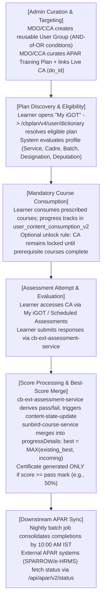

### 1.6 Major Technical Changes

- **Targeting Decoupling:** Replaced deeply nested inline JSON criteria inside Cassandra plans with centrally managed UUID references in `user_group_info`.
- **API Invocations & Envelope Normalization:** Migrated from `/cbplan/v3/*` (which returned plans grouped under content IDs) to `/cbplan/v4/*` (which returns a plan-centric dictionary cached in Redis with org-scoped invalidation).
- **High-Scale State Storage:** Superseded early proposals for separate Cassandra score tables; unified attempt tracking within the existing `progressDetails` column of `user_content_consumption_v2`.

### 1.7 Critical Findings and Gaps

1. **Completed-Course TOC Read Gap:** When an assessment is already marked as "completed" in `user_enrolment`, the frontend Table of Contents (TOC) page skips fetching `user_content_consumption_v2`. As a result, subsequent retakes that produce a new best score cannot be surfaced on the TOC page without an architectural read-path adjustment.
2. **Asynchronous External APAR Synchronization:** While iGOT computes internal training statuses near real-time, SPARROW and external APAR forms rely on a batch snapshot completed daily by 10:00 AM IST. Discrepancies reported by officers during appraisal deadlines often stem from this synchronization window.
3. **Inconsistent API Envelopes:** Differences persist between V3 and V4 API response conventions (e.g., lowercase `params.status: "success"` in CB Plan vs uppercase `"SUCCESSFUL"` in User Group; empty `result: {}` on plan publish).

## Section 2 — Feature Scope and Business Context

### 2.1 Purpose and Scope

Comprehensive Assessment (CA) evaluates officer proficiency across a group of related competencies. The system enforces:

- Restricted assessment access windows (start date to end date).
- Strict prerequisite course completion before assessment unlock (configurable).
- Rigorous pass-percentage thresholds (minimum 50%) to govern certificate generation.
- Auditable, tamper-proof reporting pipelines feeding central performance appraisal systems.

### 2.2 Stakeholders and Actors

- **Learners (Civil Servants / Officers):** Central Secretariat, All India Services (IAS, IPS, IFS), and State Civil Services (e.g., BAS, BSS). Responsible for maintaining an accurate profile, consuming mandatory courses, attempting CAs within active windows, and tracking their APAR compliance status.
- **MDO Administrators (Ministry/Department/Organization):** Curate annual training plans and link CAs for personnel within their organizational hierarchy.
- **Cadre Controlling Authorities (CCAs):** Specialized authorities (e.g., DoPT for IAS/CSS, MHA for IPS, MoEFCC for IFS) authorized to create pan-organizational plans targeting specific services and cadres, including officers serving on Central Deputation.
- **Content Creators & Reviewers:** Author questions, assemble assessments, define passing criteria, and publish assessments via the Content Portal.
- **External APAR Systems (SPARROW, e-HRMS, State e-PAR):** External government software systems that consume read-only training snapshots from iGOT APIs to auto-populate appraisal forms.
- **Platform Operations & Support War Rooms:** Monitor data consolidation jobs, resolve identifier mismatches (eHRMS ID / Parichay ID / email), and interpret diagnostic codes during appraisal cycles.

### 2.3 Business Entities

- **User Profile:** Master record containing eHRMS ID, Parichay ID, Service, Cadre, Batch Seniority Year, Designation, Organization (rootOrgId), Ministry/State (ministryOrStateId), and Central Deputation status.
- **User Group:** A reusable targeting entity composed of a set of criteria (`rootOrgId`, `cadre`, `designation`, `deputation`, etc.) combined using boolean logic.
- **APAR Training Plan (CB Plan):** A time-bound administrative container (e.g., `2026-27`) defining prescribed courses, linked CA, plan period, and targeted User Groups.
- **Comprehensive Assessment Program (CAP):** A specialized program-level content node (`do_id`) containing a Level-2 assessment with configured pass percentages, question counts, and retake rules.
- **Assessment Attempt:** An individual learner submission against a CA, yielding raw scores, percentage scores, pass/fail results, and answer logs.
- **Best Score Record:** The highest passing percentage achieved by a learner across all eligible attempts within an APAR reporting cycle.
- **APAR Training Snapshot:** A daily aggregated summary per officer-year recording mandatory course completion counts, CA status, completion dates, and a system diagnostic code.

### 2.4 CA and APAR Relationship

The Comprehensive Assessment is not a standalone academic exercise; it represents the formal evaluation phase of an officer’s annual capacity building mandate. The relationship is governed by the following operational principles:

1. **Single Source of Truth:** iGOT Karmayogi is the sole authority for course completion and assessment outcomes. External APAR systems are strictly read-only consumers.
2. **Cycle Binding:** Only course completions and CA attempts whose final submission timestamps fall within the official plan period (e.g., April 1 to March 31 of the reporting year) count toward that APAR cycle.
3. **Appraisal Form Reflection:** Assessment results directly dictate whether Table 11B/12B displays *Passed* or *Not Passed*.

## Section 3 — Source Inventory and Evidence

### 3.1 Jira Ticket Inventory

The table below details all 19 target Jira issues investigated, plus the key linked technical design issue `KB-15848`.

| Source ID | Source Title | Issue Type | Parent / Link | Documented Quarter / Cycle | Status | Key Business / Technical Capability | Evidence Confidence |
|---|---|---|---|---|---|---|---|
| **KB-8065** | Q8 \| L2 Assessments/CAP \| Creation of L2 Assessments/CAP | Epic | `KB-8064` | Q8 (2024–25 / Jul 2025) | KB Approved | Content portal authoring of L2 assessments; assessment locking until course completion; initial access control. | Confirmed (Jira & SRS) |
| **KB-8066** | Q8 \| L2 Assessments/CAP \| Learner consumption | Epic | `KB-8064` | Q8 (2024–25 / Jul 2025) | KB Approved | Learner visibility of L2 programs, scheduled assessment windows, program certification display. | Confirmed (Jira & SRS) |
| **KB-10681** | Q9 \| APAR \| APAR API Integration | Epic | `KB-10686` | Q9 (2025–26 / Jul 2025) | KB Review | Reporting API specification (`/report/org/enrolment/{orgId}`) carrying `is_apar`, `competency_type`, and CA status. | Confirmed (Jira & FRS) |
| **KB-10684** | Q9 \| APAR \| Learner Consumption | Epic | `KB-10686` | Q9 (2025–26 / Jul 2025) | KB Review | Profile enrichment (Central Deputation, Cadre mandatory), dual routing (MDO vs CCA plan). | Confirmed (Jira & FRS) |
| **KB-10686** | Q9 \| APAR \| Training Plan, CCA in Organization Selection, Central Deputation, CA | Initiative | None | Q9 (2025–26 / Jul 2025) | In Progress | Master APAR initiative; CCA organizational role; Central Deputation filtering; baseline SPARROW flow. | Confirmed (Jira, BRD, FRS) |
| **KB-11524** | Q10 \| APAR \| Additional Comprehensive Assessment Flag on APAR Training Plan Courses | Improvement | `KB-10682` | Q10 (2025–26 / Sep 2025) | Open | Selective CA flagging on APAR courses; course override logic; MDO Leader/Admin role permissions. | Confirmed (Jira) |
| **KB-12764** | Q11 \| Ad-Hoc \| Comprehensive Program Assessment Threshold Validation & Certificate Control | Epic | `KB-12763` | Q11 (2025–26 / Jan 2026) | Prod Deployed | Server-side pass threshold enforcement (50%); blocking certificate issuance on failure. | Confirmed (Jira & Prod Deployed) |
| **KB-12923** | Q11 \| ad-hoc \| Provide Comprehensive Assessment Program data in BQ | Task | `KB-12822` | Q11 (2025–26 / Jan 2026) | Grooming Completed | BigQuery ingestion pipeline for MDO CA compliance metrics and denominator tracking. | Confirmed (Jira) |
| **KB-12934** | Comprehensive Assessment Program \| The retake count for Comprehensive assessment should range from 9 to 19 | Improvement | None | Q11 (2025–26 / Jan 2026) | Open | Configuration validation bounding assessment retake limits between 9 and 19 attempts. | Confirmed (Jira) |
| **KB-13076** | Q11 \| Ad-Hoc \| Comprehensive Assessments and APAR Enhancements | Epic | `KB-12763` | Q11 (2025–26 / Feb 2026) | Open | Operational pain-point resolution: org search, CSV question upload auto-trim, question-type labeling. | Confirmed (Jira) |
| **KB-13077** | CBP Portal \| Comprehensive Assessment \| Edit functionality Improvements for Meta data editing | Improvement | `KB-13076` | Q11 (2025–26 / Feb 2026) | Prod Deployed | Non-mandatory org logo; start date locking for Live CAs; bulk org selection checkboxes. | Confirmed (Jira & Prod Deployed) |
| **KB-13086** | Q11 \| Ad-Hoc \| CA and APAR Enhancements \| Adding CA flag in APAR Courses | Improvement | `KB-13076` | Q11 (2025–26 / Feb 2026) | Prod Deployed | Visual CA badge on APAR course tiles and TOC pages for courses mapped to both plans. | Confirmed (Jira & Prod Deployed) |
| **KB-13093** | Q11 \| Ad-Hoc \| CA and APAR Enhancements \| Showing Pass/Fail Status and Assessment Result with Responses post attempting CA | Improvement | `KB-13076` | Q11 (2025–26 / Feb 2026) | Open | Post-attempt result screen; display of correct/incorrect status (omitting correct answers); certificate recall. | Confirmed (Jira) |
| **KB-13111** | Q11 \| Ad-hoc \| Comprehensive Assessment Program \| get users' highest score data to reports and BQ | Task | `KB-12822` | Q11 (2025–26 / Feb 2026) | Grooming Completed | Data pipeline requirement to extract learner highest score to reporting and BigQuery. | Confirmed (Jira) |
| **KB-13194** | Q11 \| Ad-Hoc \| Comprehensive Assessment Revaluation | Epic | `KB-12763` | Q11 (2025–26 / Feb 2026) | Open | Parent epic governing revaluation, failure pop-ups, and mobile result screen redesign. | Confirmed (Jira) |
| **KB-13402** | Mandatory Pop-up for Failed CA users | Task | `KB-13194` | Q11 (2025–26 / Mar 2026) | Grooming Completed | Platform-wide modal prompt for failed learners with "Re-attempt Now" and "Remind Me Later" CTAs. | Confirmed (Jira) |
| **KB-13449** | Mobile \| Comprehensive Assessment Revaluation - Result screen | Task | `KB-13194` | Q11 (2025–26 / Mar 2026) | To Do | Mobile Flutter implementation of redesigned result screen showing sectional pass/fail breakdown. | Confirmed (Jira) |
| **KB-13866** | Q13 \| APAR and CA Workflow Revamp | Epic | `KB-13844` | Q13 (2026–27 / May 2026) | DEV IN PROGRESS | Master architectural revamp for 2026–27: User Groups, State Cadres, APAR v2 APIs, diagnostic codes. | Confirmed (Jira & BRD/PRD) |
| **KB-15357** | Q13 \| AI Assessment Tool \| Comprehensive Assessment \| Need to add two fields "Sector" & "Target Audiences" | Story | `KB-14834` | Q13 (2026–27 / Sep 2026) | Open | Addition of contextual metadata (`Sector`, `Target Audiences`) to guide AI assessment generation. | Confirmed (Jira) |
| **KB-15848** | Q14 \| APAR and CA Workflow Revamp Phase III \| Learner | Story | Linked to Tech Design | Q14 (2026–27 / Oct 2026) | Open | Surfacing individual Best Score on TOC page; mandatory pills logic; past organization plan visibility. | Confirmed (Jira & Tech Design) |

### 3.2 Confluence Document Inventory

1. **SRS — Comprehensive Assessment Program** (`Page ID: 426311744`, Author: Sureshkannan, Revised: July 31, 2025). Defines initial system boundaries, 25,000 concurrent user scaling, and assessment window enforcement.
2. **Q8 Comprehensive Assessment Program** (`Page ID: 426311735`, Author: Sureshkannan, Revised: July 7, 2025). Establishes baseline L2 program concept.
3. **KB-10686 APAR BRD — Mandatory Courses and Comprehensive Assessment My iGOT Plan** (`Page ID: 430964819`, Author: Prakash Kumar Srivastava, Revised: July 15, 2025). Business objectives, stakeholder rules, and SPARROW table mappings for 2025–26.
4. **KB-10686 APAR FRS — Mandatory Courses and Comprehensive Assessment My iGOT Plan** (`Page ID: 432963599`, Author: Prakash Kumar Srivastava, Revised: July 15, 2025). Functional requirements for profile fields, course targeting, 50% completion rule, and SPARROW sync.
5. **APAR Training Plan and Comprehensive Assessment Program Process Flow** (`Page ID: 838664193`, Author: Prakash Kumar Srivastava, Revised: March 18, 2026). End-to-end visual step-by-step workflow for MDO plan creation, CA creation, and learner consumption.
6. **Lifecycle of the CA/APAR V3 APIs** (`Page ID: 1350139929`, Author: Mahesh Vakkund, Revised: October 12, 2026). Detailed backend contract for `/cbplan/v3/*` based on `cbrelease-4.8.41` source code.
7. **Lifecycle of the CA/APAR V4 APIs** (`Page ID: 1350467607`, Author: Mahesh Vakkund, Revised: October 12, 2026). Complete specification for `/cbplan/v4/*` and `/usergroup/v1/*` targeting and eligibility evaluation.
8. **Q13 APAR and CA 2026-27 BRD/PRD** (`Page ID: 1031307285`, Author: Prakash Kumar Srivastava, Revised: July 21, 2026). Comprehensive business requirements for the 2026–27 cycle, including State PCS, reusable User Groups, and APAR v2 API contracts.
9. **Tech Design for Best Score in Comprehensive Assessment** (`Page ID: 1355612176`, Author: Mahesh Vakkund, Revised: October 27, 2026). Architecture review decision rejecting dedicated tables and adopting `user_content_consumption_v2.progressDetails` storage.

## Section 4 — Feature Evolution: Q8 to Q13 & 2026–27 Cycle

### 4.1 Chronological Evolution Narrative

The architecture of Comprehensive Assessment evolved from a simple course-aggregation wrapper into a mission-critical, cadre-aware evaluation and appraisal engine.

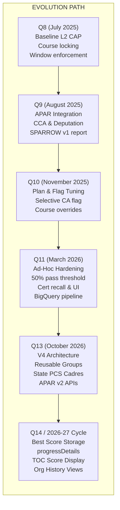

#### Q8: Baseline Program-Level Assessment (July 2025)

- **Context:** Curated programs on iGOT consisted solely of aggregated courses. Learners took isolated course tests without an overarching evaluation of cumulative competency.
- **Capabilities Introduced:** Created the Comprehensive Assessment Program (CAP) content type in the Content Portal (`KB-8065`). Introduced "Assessment Locking" to hold final evaluations locked until comprising courses were finished. Added strict time-bound window enforcement (`KB-8066`, SRS `426311744`).

#### Q9: APAR Linkage & Administrative Cadre Hierarchy (July–August 2025)

- **Context:** The central government mandated that online learning formally contribute to annual performance appraisals, necessitating a bridge between iGOT learning records and the SPARROW appraisal platform.
- **Capabilities Introduced:** Initiated the APAR Integration program (`KB-10686`). Enriched learner profiles with mandatory Cadre, Central Deputation, and eHRMS identifiers. Created Cadre Controlling Authority (CCA) privileges, enabling authorities like DoPT to issue mandatory training plans across ministry boundaries. Implemented the first automated reporting export (`/report/org/enrolment/{orgId}`) containing `is_apar` and CA pass/fail status (`KB-10681`, `KB-10684`).

#### Q10: Plan Customization & Multi-Plan Course Mapping (September–November 2025)

- **Context:** Officers assigned to multiple training plans experienced course duplication in their "My iGOT" views, and administrators lacked granular control to mark which specific courses carried CA requirements.
- **Capabilities Introduced:** Added the APAR Assignment toggle in Step 2 of training plan curation, allowing creators to map selective courses to CAs (`KB-11524`). Implemented course deduplication and last-date override rules in the learner dashboard. Established role boundaries allowing MDO Admins and Leaders to edit plans while restricting plan deletion exclusively to MDO Leaders.

#### Q11: Evaluation Governance, Retake Bounding & Data Observability (January–March 2026)

- **Context:** Operational pilots revealed critical vulnerabilities: certificates were generated upon assessment submission regardless of score; question-authoring CSV uploads failed on untrimmed spaces; and failing learners lacked clear remediation paths.
- **Capabilities Introduced:** Deployed server-side pass-threshold validation (50%), strictly withholding certificate generation for failed submissions (`KB-12764`). Deployed post-assessment review screens indicating item-level correct/incorrect marks without leaking correct options (`KB-13093`, `KB-13449`). Bounded assessment retakes between 9 and 19 attempts (`KB-12934`). Launched persistent retake pop-ups for failing officers (`KB-13402`). Automated BigQuery ingestion pipelines for real-time compliance monitoring (`KB-12923`, `KB-13111`).

#### Q12: Operational Stabilization & Content Maturation (Q1–Q2 2026)

- **Context:** Platform scaled to handle thousands of concurrent departmental assessments during fiscal year closing.
- **Capabilities Introduced:** Content pipeline stabilization, optimization of assessment submission queues, and refinement of caching layers ahead of the 2026–27 architecture overhaul.

#### Q13: Decoupled Reusable Targeting, State Cadres & V4 APIs (May–October 2026)

- **Context:** V3 training plans stored criteria inline inside Cassandra records. Re-targeting required recreating complex rules across multiple plans. Furthermore, State Civil Services were omitted from standard cadre targeting schemas.
- **Capabilities Introduced:** Complete workflow revamp (`KB-13866`, BRD/PRD `1031307285`). Extracted targeting into an independent User Group microservice (`/usergroup/v1/*`) and migrated plans to `/cbplan/v4/*`. User groups evaluate rules using an **AND-of-OR** structure (AND within criteria, OR across groups). Added State Civil Services, including Bihar Administrative Service (BAS) and Bihar Secretariat Service (BSS). Integrated the AI Assessment Tool to ingest `Sector` and `Target Audiences` metadata (`KB-15357`). Defined APAR v2 REST specifications (`/api/apar/v2/status`, `/api/apar/v2/bulk-status`) and standardized system diagnostic codes (`OK`, `NO_APAR_PLAN`, `PROFILE_INCOMPLETE`, `CA_WINDOW_CLOSED`, `IDENTIFIER_MISMATCH`).

#### Q14 / 2026–27 Cycle: Persistent Best Score & Holistic Profile History (October 2026 onwards)

- **Context:** If a learner passed a CA with 60% and subsequently retook it scoring 40%, the system risked recording a lower or failed state. Concurrently, learners who transferred between departments lost visibility into prior organizational training plans.
- **Capabilities Introduced:** Approved technical design for Best Score tracking (`Tech Design 1355612176`, `KB-15848`). Rejected a separate Cassandra table to avoid cross-table write failures; integrated `current` and `best` scores directly into `user_content_consumption_v2.progressDetails`. Established never-decrease score merge semantics in `sunbird-course-service`. Planned front-end UI updates to surface the historical best score on the TOC page and provide historical organization selectors.

### 4.2 Feature Evolution Matrix (Q8 to Q13 & 2026–27)

| Quarter / Release | Baseline State | New Capabilities Introduced | Changed Business Rules | Learner Experience Changes | API & Architecture Changes | Related Jira Tickets | Evidence Source | Confidence |
|---|---|---|---|---|---|---|---|---|
| **Q8** *(Jul 2025)* | Course-only curated programs; L1 assessments. | Comprehensive Assessment Program (CAP) content type; scheduled windows. | Assessments locked until course completion is satisfied. | Scheduled Assessment section on home page; assessment countdown timers. | Content Portal authoring extensions; initial assessment window validation. | `KB-8065`, `KB-8066` | SRS `426311744`, Page `426311735` | Confirmed |
| **Q9** *(Aug 2025)* | Academic assessment without formal civil service appraisal integration. | APAR Training Plan curation; CCA role; Central Deputation tracking; SPARROW report integration. | Cadre field mandatory; profile completeness gates plan assignment; 50% course completion rule. | "My iGOT" APAR tab; distinct routing for officers on Central Deputation vs Cadre posting. | Reporting API `/report/org/enrolment/{orgId}` with `is_apar` and CA status columns. | `KB-10686`, `KB-10684`, `KB-10681` | BRD `430964819`, FRS `432963599` | Confirmed |
| **Q10** *(Sep–Nov 2025)* | Uniform APAR course assignment without granular CA mapping. | Selective CA flagging on APAR courses; course deduplication; MDO Leader/Admin permissions. | Duplicate courses across plans merged with latest deadline; only MDO Leaders can delete plans. | APAR course tiles display individual CA mapping tags; consolidated dashboard targets. | Training plan schema updated with selective course tagging and last-date overrides. | `KB-11524` | Jira `KB-11524` | Confirmed |
| **Q11** *(Jan–Mar 2026)* | Certificates generated on submission; retakes unconstrained; manual issue diagnosis. | Server-side pass threshold (50%); retake limits (9–19); BigQuery export; failure pop-up. | Certificates blocked/revoked on failure (<50%); live CAs lock start dates; CSV auto-trimmed. | Post-assessment review screen (correct/incorrect marks); mandatory retake pop-up modals. | Server-side certificate control gates; BigQuery daily export jobs; mobile Flutter result screens. | `KB-12764`, `KB-13076`, `KB-13077`, `KB-13086`, `KB-13093`, `KB-13111`, `KB-13194`, `KB-13402`, `KB-13449` | Process Flow `838664193`, Jira issues | Confirmed |
| **Q12** *(Q1–Q2 2026)* | High-volume operational pain points during annual appraisals. | Consumption pipeline hardening; performance stabilization; Bharat KALP cross-alignment. | Strict cutoff enforcement for fiscal year reporting. | Improved page load times during peak traffic. | Optimization of Cassandra write queues and Elasticsearch indexing pipelines. | Bharat KALP cross-tickets | Confluence context | Confirmed |
| **Q13** *(May–Oct 2026)* | Inline plan criteria (`v3`); AIS/Central services only; raw reporting APIs. | Reusable User Groups (`/usergroup/v1/*`); `/cbplan/v4/*`; State PCS inclusion; AI Assessment metadata; APAR v2 APIs. | User Group criteria evaluated as AND within group, OR across groups; State cadres supported; diagnostic codes assigned. | Dashboard displays current reporting year by default with historical year selector; State cadre profiles. | Microservice `/usergroup/v1/*`; `/cbplan/v4/*` referencing `user_group_info`; `/api/apar/v2/*` push/pull endpoints. | `KB-13866`, `KB-15357` | BRD/PRD `1031307285`, API Specs `1350139929`, `1350467607` | Confirmed |
| **Q14 / 2026–27** *(Oct 2026+)* | Latest attempt overwrites state; potential score downgrade; no cross-org history. | Persistent Best Score logic; TOC score display; cross-organization historical plan view. | Best score never decreases; failed attempts record scores; completed course TOC read-path fix. | Table of Contents shows best passing percentage; pills to toggle previous organization plans. | Score storage inside `user_content_consumption_v2.progressDetails`; `sunbird-course-service` merge logic. | `KB-15848`, Tech Design | Tech Design `1355612176` | Confirmed (Design approved) |

## Section 5 — Comprehensive Assessment Business Rules

The rules governing the Comprehensive Assessment lifecycle are structured into a formal business-rule register.

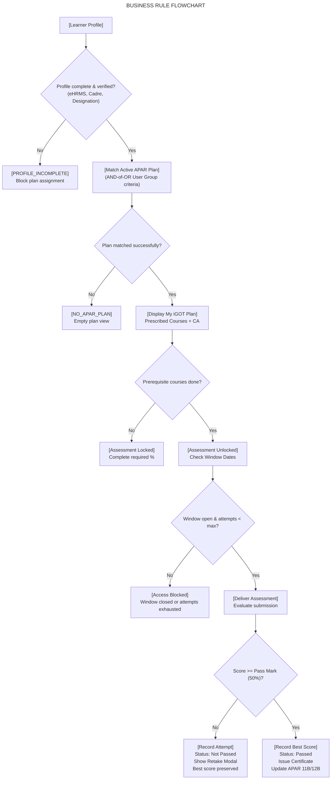

### 5.1 Business-Rule Register

| Rule ID | Domain | Business Rule Statement | Trigger / Condition | Expected System Behavior | Source Authority | Implementation Status |
|---|---|---|---|---|---|---|
| **BR-PROF-01** | Profile Eligibility | Mandatory Profile Fields for APAR Allocation | Plan assignment evaluation or dictionary API call | System checks for `eHRMS ID`, `Parichay ID`, `Service`, `Cadre`, `Batch`, `Designation`, and `Central Deputation` flag. If missing, plan assignment is blocked; diagnostic code `PROFILE_INCOMPLETE` is emitted. | BRD `1031307285`, FRS `432963599` | Implemented in V4 Profile Builder |
| **BR-PLAN-01** | Plan Assignment | Single Active APAR Plan Constraint | Plan evaluation per financial year | An officer can match at most one active APAR training plan and one CA per APAR year. Cadre-level (CCA) plans override general organizational plans. | BRD `1031307285` (FR-3) | Implemented in `/cbplan/v4/user/dictionary` |
| **BR-PLAN-02** | Plan Assignment | Cadre Controlling Authority Hierarchy | Plan assignment for AIS officers | AIS officers not on Central Deputation receive plans curated by their respective CCA (DoPT, MHA, MoEFCC). AIS officers on Central Deputation receive plans curated by their central ministry MDO. | BRD `430964819`, `KB-10686` | Implemented in V3/V4 Org Scope Resolver |
| **BR-PLAN-03** | Targeting Logic | User Group AND-of-OR Evaluation | Learner eligibility evaluation | Targeting criteria within a single User Group are evaluated as **AND** (all must match). Multiple User Groups attached to a plan are evaluated as **OR** (any group match qualifies the user). | BRD `1031307285`, V4 API Spec | Implemented in `AccessRuleEvaluator` |
| **BR-CRSE-01** | Mandatory Courses | 50% Prescribed Course Completion Standard | End-of-year APAR computation | To satisfy the mandatory course requirement, an officer must complete at least 50% of the prescribed courses tagged in their active APAR plan. | BRD `430964819`, FRS `432963599` | Implemented in APAR Consolidation Job |
| **BR-CRSE-02** | Course Mapping | Plan Course Deduplication & Override | Course mapped across multiple active plans | If a course appears in multiple plans assigned to an officer, it appears once in My iGOT, displaying the latest active end date. | `KB-11524` | Implemented in Learner Portal |
| **BR-ASMT-01** | CA Availability | Time-Bound Assessment Window Enforcement | Learner attempt launch | Learners can only initiate and submit an assessment between the plan's `startDate` and `endDate`. Submissions after `endDate` are rejected with `CA_WINDOW_CLOSED`. | SRS `426311744`, BRD `1031307285` | Implemented in Content & Assessment Services |
| **BR-ASMT-02** | CA Availability | Prerequisite Course Completion Lock | Learner navigates to CA | If "final assessment lock" is configured, the CA remains locked until the learner completes the required percentage of prescribed APAR courses. | `KB-8065`, FRS `432963599` | Implemented in TOC / Course Actor |
| **BR-ASMT-03** | Attempt Bounding | Maximum Retake Count Limits | Content creator configures CA | Assessment creators can configure retakes only within the system-enforced boundary of 9 to 19 attempts. | `KB-12934` | Implemented in Content Portal Validator |
| **BR-SCOR-01** | Passing Threshold | Passing Grade Threshold Enforcement | Assessment submission | Pass threshold is set at a minimum of 50%. Scores < 50% result in a *Failed* attempt and strictly block certificate issuance. | `KB-12764`, SRS `426311744` | Implemented in `cb-ext-assessment-service` |
| **BR-SCOR-02** | Best Score | Never-Decrease Best Score Retention | Assessment submission processing | When merging an attempt score into `user_content_consumption_v2.progressDetails`, `best` is set to `MAX(existing_best, incoming_score)`. A lower subsequent attempt never reduces `best`. | `Tech Design 1355612176` | Approved Tech Design / In Implementation |
| **BR-SCOR-03** | Score Persistence | Unconditional State Update on Failure | Assessment submission | Assessment service must trigger `content-state-update` on all submissions, including failed attempts, recording the raw score in `progressDetails.current` while deriving status from outcome. | `Tech Design 1355612176` | Approved Tech Design / In Implementation |
| **BR-APAR-01** | Downstream Sync | Daily Appraisal Data Consolidation | Scheduled batch run at 10:00 AM IST | The daily consolidation engine compiles course completions, CA results, and profile data into officer-year snapshots for SPARROW/e-HRMS auto-fill. | BRD `1031307285` (FR-20) | Implemented in Cron Batch Pipeline |
| **BR-APAR-02** | Downstream Sync | External Field Immutability | External APAR form rendering | Training and assessment fields in SPARROW/e-HRMS (Tables 11A/12A, 11B/12B) are strictly read-only and cannot be manually modified by the officer. | BRD `1031307285` (FR-11) | Implemented in SPARROW Integration |
| **BR-APAR-03** | Diagnostics | System Diagnostic Code Generation | Snapshot compilation | Every officer APAR record must carry exactly one diagnostic code (`OK`, `NO_APAR_PLAN`, `PROFILE_INCOMPLETE`, `CA_WINDOW_CLOSED`, `IDENTIFIER_MISMATCH`). | BRD `1031307285` (FR-8) | Implemented in APAR Service V2 |

## Section 6 — End-to-End Consumption Overview

The end-to-end Comprehensive Assessment lifecycle spans administrative preparation, runtime targeting, learner consumption, evaluation, and downstream performance appraisal synchronization.

```mermaid
flowchart LR
    subgraph R1["END-TO-END CA CONSUMPTION PIPELINE"]
        direction LR
        S1["STAGE 1: PLAN PREPARATION<br/>- MDO/CCA builds User Group<br/>- Creates CBP Plan (/v4)<br/>- Links Live CA (do_id)"] --> S2["STAGE 2: ELIGIBILITY EVAL<br/>- Learner profile resolved<br/>- AND-of-OR rule matching<br/>- Redis cache key stamped"] --> S3["STAGE 3: DISCOVERY<br/>- My iGOT Tab / Homepage<br/>- Displays APAR Plan tile<br/>- CA Card & due dates"] --> S4["STAGE 4: COURSE CONSUMPTION<br/>- Learner consumes courses<br/>- user_content_consumption<br/>- 50% completion target"]
        S5["STAGE 5: CA ACCESS<br/>- Prerequisite check passed<br/>- Window date verified<br/>- Attempt quota checked"] --> S6["STAGE 6: ATTEMPT & SUBMISSION<br/>- Assessment Player loads<br/>- MCQ / SCQ interaction<br/>- Submits JSON to cb-ext-asmt"] --> S7["STAGE 7: SCORE PROCESSING<br/>- Server evaluates score<br/>- Best score merge in Cass.<br/>- Cert issued if score>=50%"] --> S8["STAGE 8: APAR DOWNSTREAM<br/>- Daily 10:00 AM sync job<br/>- SPARROW auto-populates<br/>- Tables 11A/12A & 11B/12B"]
        S4 --> S5
    end
```

### 6.1 Stage-by-Stage Interaction Table

| Stage | Primary Actor | Action Performed | Frontend Component | API / Backend Service | Business Rule Applied | Data Read / Written | End State / Result | Failure Scenario & Handling |
|---|---|---|---|---|---|---|---|---|
| **Stage 1: Plan Preparation** | MDO Admin / CCA Leader | Defines reusable User Group; creates APAR Training Plan; attaches courses; links Live CA. | MDO Portal (Content Management -> Training Plan) | `POST /usergroup/v1/create`, `POST /cbplan/v4/create`, `POST /cbplan/v4/publish` | **BR-PLAN-02**, **BR-PLAN-03** | Writes to `user_group_info`, `cb_plan_v3`, `cb_plan_v4_content_lookup`, ES index. | Plan created in `draft`, published to `Live`. Reverse lookups indexed. | Invalid UUIDs or inaccessible org scope return HTTP 400. Publish fails closed if ES pre-commit fails. |
| **Stage 2: Eligibility Evaluation** | System (Automated) | Evaluates learner eligibility against published training plans upon portal entry. | Portal Auth Gateway / Init Dispatcher | `POST /cbplan/v4/user/dictionary` | **BR-PROF-01**, **BR-PLAN-01** | Reads Redis `user:basicProfile`, falls back to Cassandra `user`. Writes to Redis `cbplan:v4:userlookup:*`. | Returns `aparPlanList` and `nonAparPlanList` partitioned for learner. | Missing profile attributes mark profile incomplete; returns empty plan list with diagnostic code. |
| **Stage 3: My iGOT Discovery** | Learner (Officer) | Navigates to My iGOT tab on dashboard to inspect mandatory learning obligations. | Learner Web Portal / Flutter Mobile App (My iGOT Tab) | Frontend calls `/cbplan/v4/user/dictionary` | **BR-CRSE-02** | Reads cached dictionary payload. | Displays APAR Training Plan card, course list with due dates, and CA status card. | If plan year yields zero plans, system retries previous financial year automatically. |
| **Stage 4: Course Consumption** | Learner | Enrolls in and completes prescribed mandatory courses. | Course Content Player / TOC Page | `sunbird-course-service` (`/v1/content/state/update`) | **BR-CRSE-01** | Updates `user_content_consumption_v2` and `user_enrolment`. | Course progress reaches 100%; completion timestamp stamped in Cassandra. | Network disconnect during playback; client retries state update via local cache. |
| **Stage 5: Assessment Access** | Learner | Clicks on the Comprehensive Assessment card within My iGOT or Scheduled Assessments. | Assessment Card / TOC Page | `GET /cbplan/v4/user/assessment/eligibility/{doId}` | **BR-ASMT-01**, **BR-ASMT-02** | Validates plan link, prerequisite course status, and window dates. | `eligible: true` returned; "Start Assessment" CTA enabled. | If prerequisite courses incomplete, CTA is disabled with "Prerequisites Pending" badge. |
| **Stage 6: Attempt Submission** | Learner | Attempts questions (MCQ, SCQ) within time limit and clicks "Submit Assessment". | Assessment Player UI | `cb-ext-assessment-service` (`/v1/assessment/submit`) | **BR-ASMT-03** | Reads question bundle; writes raw attempt to `user_assessment_data_v2`. | Responses captured; submission acknowledgment returned to learner. | Duplicate submission blocked by idempotent submission key; submission failure shows retry dialog. |
| **Stage 7: Score & Result Processing** | System | Evaluates submission against answer keys, computes score percentage, and determines pass/fail. | Result Processing Pipeline | `cb-ext-assessment-service` -> `sunbird-course-service` (`content-state-update`) | **BR-SCOR-01**, **BR-SCOR-02**, **BR-SCOR-03** | Writes score to `progressDetails` (`current`, `best`); updates `user_enrolment`. | Best score updated; certificate issued if score >= 50%. | If score < 50%, certificate is blocked; failure popup triggered on next page load. |
| **Stage 8: Result Feedback** | Learner | Reviews post-assessment outcome, item-level correctness, and remaining attempts. | Assessment Result Screen (`KB-13093`, `KB-13449`) | Assessment Result Read Controller | **BR-SCOR-01** | Reads attempt summary from `user_content_consumption_v2`. | Displays pass/fail banner, percentage, question summary (correct/incorrect options), and retake CTA. | Incomplete attempts or processing delays display asynchronous status loader. |
| **Stage 9: APAR Downstream Sync** | System Integrator / SPARROW | Consolidates officer training records and exposes them to external appraisal systems. | SPARROW / e-HRMS Training Section | Nightly Consolidation Job -> `/api/apar/v2/status` | **BR-APAR-01**, **BR-APAR-02**, **BR-APAR-03** | Aggregates daily transactional tables into APAR snapshot table. | External APAR forms auto-populate Tables 11A/12A and 11B/12B; status verified. | Identifier mismatch flags `IDENTIFIER_MISMATCH`; external form displays fallback message. |

## Section 7 — My iGOT Learner Experience Evolution

### 7.1 Historical UI Progression

The learner-facing interface transitioned from an unassisted course directory to a personalized, compliant capacity-building cockpit.

| Experience Area | Earlier Documented Behavior (Q8–Q10) | Later Documented Behavior (Q11–Q13 & 2026–27) | Reason for Change | Learner Impact | Evidence Reference |
|---|---|---|---|---|---|
| **Plan Discovery** | Generic course tiles in course catalog; APAR courses mixed with optional learning. | Dedicated "APAR" section under "My iGOT" on home page; displays target counts (e.g., "3 of 6 Completed"). | High learner confusion regarding which specific courses counted toward formal appraisal mandates. | Immediate clarity on mandatory obligations and compliance deadlines upon login. | FRS `432963599`, Process Flow `838664193` |
| **Course Tagging** | Courses lacked explicit linkage badges; learners could not distinguish general courses from APAR courses. | Dual-tagging system: courses carry both `APAR` and `Comprehensive Assessment` tags on tiles and TOC. | Learners completed courses without knowing they contributed directly to CA unlock requirements. | Visual certainty regarding course prerequisites and thematic alignment. | `KB-11524`, `KB-13086` |
| **Assessment Result Visibility** | Binary completion message upon submission; no question review or score breakdown. | Detailed Result Screen showing overall pass/fail status, percentage score, and item-level correctness. | High rate of support tickets from officers unaware of why they failed or which topics required review. | Constructive learning feedback without compromising question bank security (answers hidden). | `KB-13093`, `KB-13449` |
| **Failure Remediation** | Silent failure; learner remained in failed state until manually re-navigating to catalog. | Persistent modal pop-up: *"Retake Comprehensive Assessment"* with *"Re-attempt Now"* and *"Remind Later"*. | Officers missed appraisal deadlines due to lack of immediate failure awareness. | Proactive remediation driving completion before appraisal submission cutoffs. | `KB-13402` |
| **Retake & Best-Score Display** | Later failed attempts overwrote previous completions; scores not surfaced on TOC. | TOC page prominently displays **Individual's Best Score** and remaining attempt counter. | Officers feared retaking assessments would overwrite an earlier passing grade with a lower score. | Encourages continuous learning and score improvement without fear of penalization. | `KB-15848`, `Tech Design 1355612176` |
| **Historical Reporting Cycles** | Dashboard only displayed current operational state; past year data was inaccessible. | Current year displayed by default; explicit selector pills allow viewing past APAR cycles and orgs. | Transferred or promoted officers lost visibility into previously completed training plans. | Complete, multi-year transparency into professional development history across postings. | BRD/PRD `1031307285`, `KB-15848` |

### 7.2 Learner-Facing States and Failure Scenarios

- **State 1: Profile Incomplete:** When mandatory profile attributes (e.g., Cadre or eHRMS ID) are absent, the My iGOT tab displays a warning banner: *"Profile Details Incomplete for APAR"*, linking directly to profile settings.
- **State 2: Prerequisite Locked:** When course prerequisites remain unfulfilled, the CA card appears with a lock icon: *"Complete prescribed courses to unlock assessment (X of Y remaining)"*.
- **State 3: Active Assessment Window:** CA card displays an active green status badge, submission deadline, and *"Start Assessment"* CTA.
- **State 4: Retake Required (Failed):** The learner portal triggers the `KB-13402` modal popup upon navigation, indicating the previous score fell below 50% and presenting the count of remaining attempts.
- **State 5: Compliant (Passed):** The CA card displays a green checkmark, the verified **Best Score**, and a *"View Certificate"* button.

## Section 8 — Technical Architecture and Integration

### 8.1 Logical Architecture & System Boundaries

The Comprehensive Assessment and APAR ecosystem spans frontend presentation layers, API gateway routing, microservice-based domain logic, and heterogeneous storage engines.

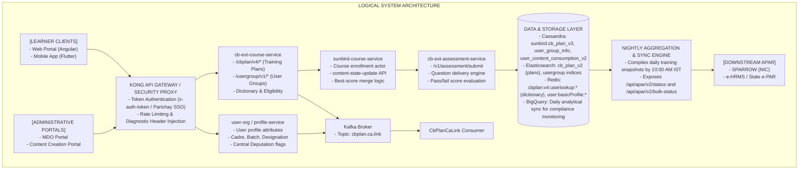

### 8.2 Component Responsibility Matrix

| Component Name | Type | Key Architectural Responsibilities | Upstream Callers | Downstream Dependencies | Evidence Source |
|---|---|---|---|---|---|
| **cb-ext-course-service** | Backend Microservice | Manages CB Plan V4 lifecycle (create, update, publish, archive); manages User Group V1 CRUD; runs learner eligibility and dictionary pipelines. | Kong Gateway, Web/Mobile Clients | Cassandra (`cb_plan_v3`, `user_group_info`), Elasticsearch (`cb_plan_v2`), Redis | V4 API Spec `1350467607` |
| **user-group-module** | Service Module | Centrally manages reusable User Groups; validates UUID references; enforces fail-closed deletion locks when linked to active plans. | `cb-ext-course-service` | Cassandra (`user_group_info`), Elasticsearch | V4 API Spec `1350467607` |
| **sunbird-course-service** | Core Platform Service | Manages course enrollments, TOC page queries, and content consumption state merges; houses the never-decrease best-score comparison engine. | `cb-ext-assessment-service`, Web/Mobile Clients | Cassandra (`user_content_consumption_v2`, `user_enrolment`) | `Tech Design 1355612176` |
| **cb-ext-assessment-service** | Backend Microservice | Delivers assessment questions; evaluates learner responses; computes raw/percentage scores; triggers unconditional `content-state-update`. | Web/Mobile Assessment Players | `sunbird-course-service`, Cassandra (`user_assessment_data_v2`) | `Tech Design` `1355612176` |
| **CbPlanCaLinkConsumer** | Kafka Event Consumer | Listens for `ADD`/`REMOVE` events when CA content nodes change; executes idempotent CA-link updates and invalidates org-scoped Redis caches. | Kafka Event Bus (`cbplan.ca.link`) | Cassandra (`cb_plan_v3.calinkedid`), Redis | V4 API Spec `1350467607` |
| **APAR Consolidation Engine** | Scheduled Worker / Job | Executes nightly batch compilation of course progress and CA results, generating consolidated officer snapshots by 10:00 AM IST. | System Cron / Orchestrator | Cassandra, BigQuery, External APAR REST Dispatcher | BRD `1031307285` |
| **External APAR Gateway** | REST Interface | Serves read-only single-officer and bulk training compliance data to SPARROW, e-HRMS, and State e-PAR platforms. | SPARROW, State APAR Systems | APAR Snapshot Database | BRD `1031307285`, `KB-10681` |

## Section 9 — API Lifecycle and V3 versus V4 Comparison

### 9.1 API Inventory Register

| Endpoint Path | Version | HTTP Method | Consumer | Provider Service | Request Inputs | Response Payload Key Fields | Validation & Authorization Gates |
|---|---|---|---|---|---|---|---|
| `/cbplan/v3/create` | V3 | POST | MDO Admin | `cb-ext-course-service` | `name`, `contentList`, `contextData` (inline criteria), `endDate` | `result.id`, `result.status: "Cbplan created successfully"` | `x-authenticated-user-token`, `orgid` header; bean validation. |
| `/cbplan/v3/update` | V3 | POST | MDO Admin | `cb-ext-course-service` | `id`, updated fields | `result.status: "Updated"` | Creator or `MDO_LEADER` role; Live plans stage edits in `draftData`. |
| `/cbplan/v3/publish` | V3 | POST | MDO Admin | `cb-ext-course-service` | `id` | Empty `result: {}`, envelope status `success` | Creator or `MDO_LEADER`; applies staged `draftData` to live row. |
| `/cbplan/v3/read/{cbPlanId}` | V3 | GET | MDO Admin | `cb-ext-course-service` | `cbPlanId` (path variable) | `result.content.{id, name, status, contentList, ...}` | Token + orgid; wraps payload under `content` key. |
| `/cbplan/v3/user/dictionary` | V3 | POST | Learner Portal | `cb-ext-course-service` | `planYear` (optional) | `result.aparContentList.{doId: [{planId, endDate}]}` | Token only; groups output by **content ID**, not plan. No Redis cache. |
| `/cbplan/v4/create` | V4 | POST | MDO Admin | `cb-ext-course-service` | `name`, `contentList` (`{id, mandatory}`), `userGroupId` refs | `result.id`, `result.status: "Cbplan created successfully"` | `x-auth-token`; transactional ES pre-commit with Cassandra rollback. |
| `/cbplan/v4/update` | V4 | POST | MDO Admin | `cb-ext-course-service` | `id`, updated fields, optional `caLinkedId` | `result.status: "Updated"` | Staged for Live plans; caLinkedId-only body executes direct fast-path. |
| `/cbplan/v4/``publish` | V4 | POST | MDO Admin | `cb-ext-course-service` | `id` | Empty `result: {}`, envelope status `success` | Syncs `trainingPlan_v2.contentList` on linked CA node; invalidates cache. |
| `/cbplan/v4/read/{cbPlanId}` | V4 | GET | MDO Admin | `cb-ext-course-service` | `cbPlanId` (path variable) | `result.{id, name, status, caLinkedId, contentList, ...}` | Rejects `draft` plans unless called via `/admin/read/{id}`. |
| `/cbplan/v4/user/dictionary` | V4 | POST | Learner Portal | `cb-ext-course-service` | `planYear` (optional) | `result.{year}.aparPlanList.{planId: {name, caLinkedId}}` | Token only; groups by **plan ID**; cached in Redis (~1 hr); filters non-Live CAs. |
| `/cbplan/v4/user/assessment/eligibility/{doId}` | V4 | GET | Learner Portal | `cb-ext-course-service` | `doId` (CA content ID) | `result.eligible: boolean`, `result.mandatoryCourses: []` | Evaluates plan targeting + Live CA status; shares dictionary Redis cache. |
| `/usergroup/v1/create` | V1 | POST | MDO Admin | `cb-ext-course-service` | `userGroupName`, `criteria` array | `result.{orgid, usergroupid, status: "ACTIVE"}` | Enforces L0/CCA org hierarchy; prevents duplicate group names per org. |
| `/usergroup/v1/delete/{id}` | V1 | DELETE | MDO Admin | `cb-ext-course-service` | `userGroupId` (path variable) | `result.response: "User group archived successfully"` | Soft delete; **blocked with HTTP 409** if referenced by any active CB Plan. |
| `/api/apar/v2/status` | V2 | GET | SPARROW | APAR Sync Service | `eHRMS ID` or `Parichay ID` | `planDetails`, `coursesList`, `caStatus`, `diagnosticCode` | Authorized external system; sub-second SLA (<1s). |
| `/api/apar/v2/bulk-status` | V2 | POST | SPARROW | APAR Sync Service | `orgId`, `cadre`, `dateRange` | Array of officer training snapshots | Batch export; supports pagination and chunking. |

### 9.2 V3 versus V4 Detailed Comparison

| Capability / Dimension | V3 Architecture & API Contract | V4 Architecture & API Contract | Architectural Reason for Change | Operational & Migration Impact |
|---|---|---|---|---|
| **Targeting Data Model** | Criteria stored **inline** inside `contextData.accessControl.userGroups[].userGroupCriteriaList`. | Stores a `userGroupId` reference pointing to central rows in `user_group_info`. | Eliminates massive data duplication across plans; allows updating a group once across all plan years. | V4 automatically detects legacy V3 inline JSON and routes it to legacy evaluators for backward compatibility. |
| **User Group Lifecycle** | Non-existent; groups were recreated for every individual training plan. | Centrally managed via `/usergroup/v1/*` with full lifecycle (`ACTIVE`, `INACTIVE`, `ARCHIVED`). | Needed reusable cohorts across multiple training plans and reporting cycles. | Groups cannot be deleted if referenced by an active plan (fail-closed HTTP 409 safety lock). |
| **Content List Encoding** | Array of plain content ID strings: `["do_123", "do_456"]`. | Array of JSON-serialized objects: `["{\"identifier\":\"do_123\",\"mandatory\":true}"]`. | Required marking specific courses within a plan as mandatory vs optional for APAR compliance. | Read parsers in V4 auto-detect string vs JSON shapes transparently. |
| **Dictionary Structure** | Keyed by **Content ID** (`aparContentList.{doId: [plans]}`). | Keyed by **Plan ID** (`aparPlanList.{planId: {details, contentList}}`). | Front-end My iGOT dashboard required plan-centric rendering to display overall plan progress. | Breaking structural change for frontend consumers; required frontend dashboard update. |
| **Performance & Caching** | No Redis caching layer; re-evaluated rules fresh on every call (in-process Caffeine only). | Dedicated Redis caching namespace (`cbplan:v4:userlookup:*`) with ~1 hour TTL. | Sub-second response requirements for millions of concurrent civil servants during appraisal weeks. | Significant load reduction on Cassandra; requires precise cache invalidation on plan publish/retire. |
| **CA Linkage** (`caLinkedId`) | Not supported in V3 (verified by exhaustive source code inspection). | First-class citizen: direct fast-path update + Kafka event-driven consumer (`CbPlanCaLinkConsumer`). | Required decoupled lifecycle where CAs could be authored and linked after plan creation. | Dictionary hides plans whose linked CA is not in `Live` status. |
| **Transactional Safety** | Create indexing was non-transactional; ES failure left orphaned Cassandra records. | Transactional pre-commit: ES index occurs as a pre-commit with explicit Cassandra/ES rollback. | Prevented silent divergence between Elasticsearch search queries and Cassandra reads. | Guarantees search index consistency across all administrative create/publish operations. |
| **Admin Bypass Security** | `aicbp/publish` bypassed role checks with internal `isAdmin=true` without validating token roles. | Explicitly validates caller holds `AICBP_ADMIN` role in token before allowing target org bypass. | Closed privilege escalation vulnerability in AI CBP automated provisioning pipelines. | Automated AI CBP publishing service must obtain explicit `AICBP_ADMIN` credentials. |

## Section 10 — Assessment Results and Best-Score Logic

### 10.1 Technical Design Analysis

The technical design for Best Score in Comprehensive Assessment (`Tech Design 1355612176`, revised October 27, 2026, linked to `KB-15848`) underwent an architecture review that overturned earlier design drafts.

#### Rejection of Dedicated Storage Tables

Two initial storage proposals were formally rejected during the Phase 3 Tech Design Review:

1. **New Table** (`user_assessment_score`): Rejected due to scaling limits and Cassandra cross-table consistency hazards. Writing to a separate score table during assessment submission while reading from consumption tables during enrollment created a dual point of failure: *"if that is not updated, then my progress will not reflect... they will be raising complaints."*
2. **New Columns on** `user_assessment_data_v2` (`score`, `pass`): Rejected because the learner Table of Contents (TOC) read path never invokes the API that reads `user_assessment_data_v2`. Adding data there would not surface it where learners consume it.

#### Approved Storage Model: Reuse of `user_content_consumption_v2.progressDetails`

The finalized design requires **no new database tables, no new columns, and no new APIs**.

- The existing JSON column `progressDetails` on table `sunbird.user_content_consumption_v2`—which already stores `max`, `current`, and `mimeType` for standard content—is extended for CA rows to persist:
  - `current`: Score percentage achieved on the most recent attempt.
  - `best`: Maximum passing score percentage achieved across all attempts.

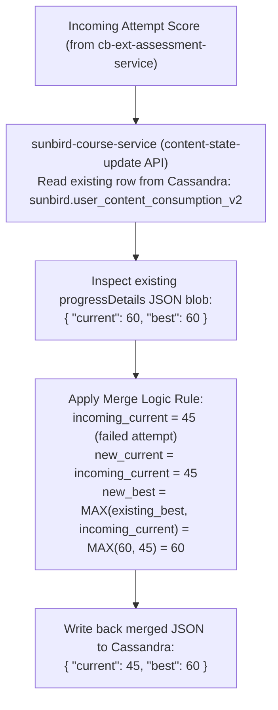

### 10.2 Write-Path and Merge-Path Fixes

To implement this model, four specific service-level modifications were finalized:

1. **Unconditional State Update:** `cb-ext-assessment-service` previously skipped calling `content-state-update` when a learner failed an assessment. The service must now invoke the update on **every attempt**, regardless of outcome.
2. **Dynamic Status Derivation:** The status parameter sent to `content-state-update` was previously hardcoded to `"complete"`. It must now dynamically reflect whether the attempt was a pass or a failure.
3. **Pre-Enrollment Assessment Parity:** Pre-enrollment assessment flows omitted score information entirely; they must now transmit scores identically to regular assessment submissions.
4. **Merge Logic in Course Service:** `sunbird-course-service` must unpack `progressDetails`, apply the never-decrease rule to `best`, overwrite `current`, and persist the updated JSON.

### 10.3 Best-Score Decision Matrix

| Scenario # | Prior Stored State | Incoming Attempt Event | New Stored State (`current`, `best`) | Overall CA Status | Certificate Status | Downstream APAR Reflection | Traceability Source |
|---|---|---|---|---|---|---|---|
| **1** | None (No prior attempt) | Attempt 1: Scores 45% (Fail) | `current: 45, best: 45` | Not Passed | Withheld | CA Applicable: Yes; Result: Not Passed | `Tech Design 1355612176` |
| **2** | `current: 45, best: 45` | Attempt 2: Scores 65% (Pass) | `current: 65, best: 65` | Passed | Generated / Issued | CA Applicable: Yes; Result: Passed | `Tech Design 1355612176` |
| **3** | `current: 65, best: 65` | Attempt 3: Scores 85% (Pass) | `current: 85, best: 85` | Passed | Updated (Higher Merit) | CA Applicable: Yes; Result: Passed | `Tech Design 1355612176` |
| **4** | `current: 85, best: 85` | Attempt 4: Scores 70% (Pass) | `current: 70, best: 85` | Passed | Preserved (Best 85%) | CA Applicable: Yes; Result: Passed (85%) | `Tech Design 1355612176` |
| **5** | `current: 85, best: 85` | Attempt 5: Scores 40% (Fail) | `current: 40, best: 85` | Passed | Preserved (Best 85%) | CA Applicable: Yes; Result: Passed (85%) | `Tech Design 1355612176` |
| **6** | `current: 45, best: 45` | Attempt 2: Scores 40% (Fail) | `current: 40, best: 45` | Not Passed | Withheld | CA Applicable: Yes; Result: Not Passed | `Tech Design 1355612176` |
| **7** | `current: 75, best: 75` | Attempt 3: Network Drop / Fail | `current: 75, best: 75` (Unchanged) | Passed | Preserved (Best 75%) | CA Applicable: Yes; Result: Passed | SRS `426311744` |

### 10.4 The Completed-Course TOC Read Gap (Critical Open Architectural Item)

The Phase 3 Architecture Review revealed a critical read-path limitation:

- **The Problem:** Once a learner completes an assessment program, the enrollment status in `user_enrolment` is marked `"completed"`. On subsequent visits to the Table of Contents (TOC) page, the platform’s course-enrollment actor **skips re-fetching** `user_content_consumption_v2` entirely for completed courses to optimize query speeds.
- **The Impact:** If a learner who has already passed retakes the CA to improve their score, or if the UI needs to display the historical Best Score post-completion, the TOC page cannot display the updated value because the backing data is never retrieved.
- **Status:** Open. Requires modifying the course-enrollment actor’s read pipeline or introducing a dedicated caching projection.

## Section 11 — Requirements and Implementation Traceability

This matrix maps foundational business requirements to Jira implementation tickets, technical components, code evidence from the `cbrelease-4.8.41` baseline, and verification statuses.

| Req ID | Requirement Summary | Source Document | Related Jira Tickets | Technical Component | API / Code Evidence | Status | Identified Gap / Risk |
|---|---|---|---|---|---|---|---|
| **REQ-01** | Support program-level (L2) assessments with assessment window enforcement. | SRS `426311744`, Page `426311735` | `KB-8065`, `KB-8066` | Content Portal, Course Service | Content model `Program`; window checks in assessment controller. | Production Deployed | Window extensions require manual administrative re-publishing. |
| **REQ-02** | Lock CA access until comprising mandatory courses are completed. | SRS `426311744`, BRD `430964819` | `KB-8065`, `KB-10684` | TOC Page, Course Actor | `isAssessmentLocked` flag in course hierarchy DTO. | Implemented (Verified) | Some MDOs request unlocking CA without course completion; logic is binary. |
| **REQ-03** | Auto-populate mandatory course completion in APAR Table 11A/12A. | BRD `430964819`, FRS `432963599` | `KB-10686`, `KB-10681` | Reporting Engine, SPARROW Sync | `/report/org/enrolment/{orgId}` returning `is_apar` & `competency_type`. | Production Deployed | External APAR displays depend on daily 10:00 AM batch run; not real-time. |
| **REQ-04** | Auto-populate CA pass/fail status in APAR Table 11B/12B. | BRD `430964819`, FRS `432963599` | `KB-10686`, `KB-10681` | Reporting Engine, SPARROW Sync | Field `comprehensive_level_assessment_status` in reporting payload. | Production Deployed | External forms show "Not Available" if officer eHRMS ID mismatches. |
| **REQ-05** | Enforce profile completeness before APAR training plan allocation. | FRS `432963599`, BRD `1031307285` | `KB-10686`, `KB-10684` | User Profile Service, Course Service | `PROFILE_INCOMPLETE` diagnostic check in plan dictionary evaluator. | Implemented in V4 | Non-AIS state officers frequently lack verified cadre mapping in master DB. |
| **REQ-06** | Provide CCA role for pan-organizational plan curation for AIS. | BRD `430964819`, `KB-10686` | `KB-10686` | Access Control Service | CCA organization flag; bypasses single `rootOrgId` restriction. | Production Deployed | CCA flag configuration initially required manual DB seed; UI added later. |
| **REQ-07** | Deduplicate courses across multiple training plans in My iGOT. | `KB-11524` | `KB-11524` | Learner Dashboard / My iGOT | Frontend merge reducer grouping by `contentId` and picking max `endDate`. | Implemented in Web UI | Mobile app historically exhibited delayed deduplication cache flushes. |
| **REQ-08** | Enforce server-side 50% pass threshold to block certificates on failure. | `KB-12764` | `KB-12764` | `cb-ext-assessment-service` | Assessment evaluation actor checks `score >= passPercentage`. | Production Deployed | Legacy CAP certificates issued prior to Q11 required manual reconciliation. |
| **REQ-09** | Display post-assessment review screen showing correct/incorrect marks. | `KB-13093`, `KB-13449` | `KB-13093`, `KB-13449` | Web Assessment Player, Flutter App | Result screen DTO carrying `questionId`, `userSelectedOption`, `isCorrect`. | Implemented (Web) / To Do (Mobile) | Mobile implementation (`KB-13449`) remained in "To Do" during Q11 close. |
| **REQ-10** | Provide daily BigQuery export of CA compliance and denominators. | `KB-12923`, `KB-13111` | `KB-12923`, `KB-13111` | Analytics Pipeline | Scheduled ETL loading from Cassandra to Google BigQuery datasets. | Implemented | Denominator calculations fluctuate when officers update designations mid-cycle. |
| **REQ-11** | Enforce retake bounds between 9 and 19 attempts. | `KB-12934` | `KB-12934` | Content Creator Portal | Form field validation rule `min: 9, max: 19` in Angular creator component. | Implemented (Jira Verified) | Some legacy assessments retain 3-retake configuration unless re-edited. |
| **REQ-12** | Display persistent retake modal prompt for failed learners. | `KB-13402` | `KB-13402` | Learner Portal Home Interceptor | Modal trigger checking `lastAttemptStatus ==` `FAILED` and `attemptsLeft > 0`. | Grooming Completed | High risk of modal fatigue; requires strict frequency throttling. |
| **REQ-13** | Decouple plan targeting into reusable User Groups (AND-of-OR). | BRD/PRD `1031307285`, API Spec `1350467607` | `KB-13866` | `cb-ext-course-service` (`/usergroup/v1/*`) | `user_group_info` table; `contextDataV4` ES index field; `AccessRuleEvaluator`. | Implemented in `4.8.41` | Deleting groups locked if referenced by live plan (HTTP 409). |
| **REQ-14** | Support State Civil Services (e.g., Bihar BAS, BSS) in cadre targeting. | BRD/PRD `1031307285` | `KB-13866` | User Group Service, Profile Service | Schema mapping supporting state cadre hierarchy and designation levels. | Implemented in V4 | Requires State HRMS integration to keep batch and cadre data synchronized. |
| **REQ-15** | Inject Sector and Target Audience metadata into AI Assessment Tool. | `KB-15357` | `KB-15357` | Content Portal, AI Assessment Service | Optional fields `sector` and `targetAudiences` passed in generation payload. | Open (In Progress) | If omitted, AI generator defaults to generic competency frameworks. |
| **REQ-16** | Expose standardized diagnostic codes for missing APAR data. | BRD/PRD `1031307285` | `KB-13866` | APAR v2 API Service | Enum: `OK`, `NO_APAR_PLAN`, `PROFILE_INCOMPLETE`, `CA_WINDOW_CLOSED`, etc. | Designed / In Dev | External APAR systems must be updated to consume and display diagnostics. |
| **REQ-17** | Persist and surface individual Best Score without dedicated tables. | `Tech Design 1355612176` | `KB-15848` | `sunbird-course-service`, TOC Page | Merge logic updating `progressDetails.best` in `user_content_consumption_v2`. | Tech Design Approved | **Critical Gap:** Completed-course TOC read path skips fetching consumption data. |

## Section 12 — Risks, Dependencies, and Open Questions

### 12.1 Prioritized Risk Register

| Risk ID | Risk Description | Risk Category | Business & Technical Impact | Severity | Recommended Mitigation Action |
|---|---|---|---|---|---|
| **RSK-01** | **Completed-Course TOC Read Suppression** | Architecture / Defect | Learners who retake a CA after completing the program will not see their updated Best Score on the TOC page because the read path bypasses `user_content_consumption_v2`. | **Critical** | Modify the course-enrollment actor to unconditionally fetch `progressDetails` for CA content types regardless of enrollment status. |
| **RSK-02** | **External Appraisal Batch Latency** | Integration / Operational | Officers completing assessments hours before midnight appraisal deadlines face missing data in SPARROW because snapshots compile daily at 10:00 AM IST. | **High** | Introduce an on-demand cache-bypass sync API (`POST /api/apar/v2/sync-officer/{id}`) invokable directly from SPARROW during appraisal filing. |
| **RSK-03** | **Identifier Mapping Mismatches** | Data Integrity | Discrepancies between iGOT internal user IDs, eHRMS IDs, and Parichay IDs cause training records to drop from external APAR forms (`IDENTIFIER_MISMATCH`). | **High** | Deploy daily pre-appraisal reconciliation jobs to flag and alert unmapped officers 30 days prior to APAR submission deadlines. |
| **RSK-04** | **Unconditional Failure Update Incomplete** | Implementation Gap | If the assessment service fails to invoke `content-state-update` on failed attempts, `progressDetails.current` will reflect stale passing scores, corrupting attempt logs. | **High** | Enforce automated integration tests verifying that HTTP 200/400 assessment outcomes both emit valid state-update payloads. |
| **RSK-05** | **User Group Deletion Deadlock** | Operational Governance | Administrators attempting to clean up legacy User Groups receive unexpected HTTP 409 Conflict errors because archived or draft plans still reference the UUID. | **Medium** | Implement a dependency explorer in the MDO Portal showing exact plan titles referencing a User Group before deletion is attempted. |
| **RSK-06** | **Modal Retake Alert Fatigue** | Learner Experience | Persistent failed-assessment popups (`KB-13402`) appearing across non-learning pages may frustrate officers who choose not to re-attempt the assessment immediately. | **Medium** | Implement local-storage and backend dismissal throttling (e.g., maximum once per 48 hours unless appraisal deadline is < 7 days). |

### 12.2 Integration Dependencies

1. **SPARROW / NIC Integration:** SPARROW must maintain stable OAuth2 / API-key connectivity and implement graceful error handling when iGOT returns `IDENTIFIER_MISMATCH` or `NO_APAR_PLAN`.
2. **Parichay SSO & e-HRMS:** Relies on consistent transmission of government employee unique identifiers to guarantee deterministic plan targeting.
3. **Kafka Infrastructure** (`cbplan.ca.link`): Event-driven CA decoupling depends on reliable message delivery; consumer lag could temporarily delay CA linking.
4. **Elasticsearch Cluster Health:** Plan creation, updating, and User Group checking rely on Elasticsearch pre-commit transactions; ES degradation blocks administrative plan publishing.

### 12.3 Open-Question Register

| Question ID | Unresolved Question / Inconsistency | Why It Matters | Conflicting Sources | Recommended Action / Owner | Priority |
|---|---|---|---|---|---|
| **OQ-01** | **Completed Course Read Gap Resolution** | Determines whether Best Score can be surfaced to learners post-completion on the TOC page. | Tech Design identifies the gap; no architectural fix committed in code. | **Owner:** Mahesh Vakkund / Course Service Team. Determine whether to fix in enrollment actor or via an activity aggregator stream. | **P0 (Blocker)** |
| **OQ-02** | **Part-APAR & Mid-Year Transfer Handling** | Officers transferred mid-year have multiple reporting officers and multiple partial APARs. It is unclear how training targets apportion across plans. | Q13 BRD/PRD `1031307285` lists Part-APAR as "Not Started / Ideas"; no FRS or API contract exists. | **Owner:** Product Team (Prakash Srivastava). Define business logic for apportioning course requirements across split reporting periods. | **P1 (High)** |
| **OQ-03** | **Mobile Result Screen Parity** (`KB-13449`) | Web learners see detailed item-level results, while mobile users may receive legacy screens if the Flutter task remains unmerged. | `KB-13093` (Web) vs `KB-13449` (Mobile status: "To Do"). | **Owner:** Mobile Engineering Lead. Align Flutter release `32.x` with backend result screen DTOs. | **P1 (High)** |
| **OQ-04** | **Legacy Certificate Reconciliation** | Confirm whether all certificates erroneously issued for failed attempts prior to the Q11 threshold enforcement (`KB-12764`) were formally revoked in the database. | `KB-13093` notes "certificates to be reverted back"; no audit script execution logged in tickets. | **Owner:** Platform QA / Database Operations. Run audit query on `user_enrolment` and `assessment_aggregator` for scores < 50% with issued certs. | **P2 (Medium)** |

## Section 13 — Consolidated Conclusion

### 13.1 Synthesis of Evolution and Architecture

The Comprehensive Assessment (CA) ecosystem on iGOT Karmayogi has matured from an experimental course-grouping feature in Q8 into an enterprise-grade evaluation engine by Q13 and the 2026–27 cycle. The platform successfully bridges instructional delivery with statutory civil service governance by tying learning directly to the Annual Performance Appraisal Report (APAR).

Architecturally, the evolution reflects a deliberate transition from monolithic, tightly coupled designs to modular, decoupled microservices:

- **Targeting:** Migrated from fragile inline JSON blobs embedded in Cassandra plans (`/cbplan/v3/*`) to independent, reusable User Groups (`/usergroup/v1/*` and `/cbplan/v4/*`) supporting complex AND-of-OR boolean rules and State Civil Services.
- **Evaluation & Best Score:** Evolved from unconstrained submissions to strict 50% pass-threshold validations and an elegant, zero-new-table Best Score storage strategy inside `user_content_consumption_v2.progressDetails`.
- **Interoperability:** Advanced from manual data extracts to sub-second REST endpoints (`/api/apar/v2/*`) backed by automated diagnostic error codes.

### 13.2 Verified versus Unverified Capabilities

- **Verified Implemented Capabilities:** User Group V1 CRUD; CB Plan V4 lifecycle; transactional Elasticsearch pre-commits; selective CA course tagging; server-side 50% certificate blocking; daily BigQuery data exports; bounding of retakes (9–19); and the Best Score technical design specification.
- **Unverified / In-Development Capabilities:** Resolution of the completed-course TOC read gap; mobile sectional result screen delivery (`KB-13449`); Part-APAR multi-plan allocation rules; and automated client-side remediation popups (`KB-13402`).

### 13.3 Recommended Next Steps

1. **Remediate Completed-Course TOC Read Path:** Implement the recommended architectural patch in `sunbird-course-service` to ensure `progressDetails` is retrieved for completed CAs, allowing the Best Score to display reliably.
2. **Deploy APAR v2 Push/Pull Endpoints:** Finalize development of `/api/apar/v2/status` and execute end-to-end integration testing with NIC SPARROW staging environments.
3. **Execute Pre-Appraisal Data Cleansing:** Run automated identifier-reconciliation scripts across all MDOs to eliminate `IDENTIFIER_MISMATCH` errors prior to the peak 2026–27 appraisal window.

## Section 14 — Appendix

### 14.1 Jira Reference Index

| Jira Key | Issue Summary | Issue Type | Final Status |
|---|---|---|---|
| **KB-8065** | Q8 \| L2 Assessments/CAP \| Creation of L2 Assessments/CAP | Epic | KB Approved |
| **KB-8066** | Q8 \| L2 Assessments/CAP \| Learner consumption | Epic | KB Approved |
| **KB-10681** | Q9 \| APAR \| APAR API Integration | Epic | KB Review |
| **KB-10684** | Q9 \| APAR \| Learner Consumption | Epic | KB Review |
| **KB-10686** | Q9 \| APAR \| Training Plan, CCA in Organization Selection, Central Deputation, CA | Initiative | In Progress |
| **KB-11524** | Q10 \| APAR \| Additional Comprehensive Assessment Flag on APAR Training Plan Courses | Improvement | Open |
| **KB-12764** | Q11 \| Ad-Hoc \| Comprehensive Program Assessment Threshold Validation & Certificate Control | Epic | Prod Deployed |
| **KB-12923** | Q11 \| ad-hoc \| Provide Comprehensive Assessment Program data in BQ | Task | Grooming Completed |
| **KB-12934** | Comprehensive Assessment Program \| The retake count for Comprehensive assessment should range from 9 to 19 | Improvement | Open |
| **KB-13076** | Q11 \| Ad-Hoc \| Comprehensive Assessments and APAR Enhancements | Epic | Open |
| **KB-13077** | CBP Portal \| Comprehensive Assessment \| Edit functionality Improvements for Meta data editing | Improvement | Prod Deployed |
| **KB-13086** | Q11 \| Ad-Hoc \| CA and APAR Enhancements \| Adding CA flag in APAR Courses | Improvement | Prod Deployed |
| **KB-13093** | Q11 \| Ad-Hoc \| CA and APAR Enhancements \| Showing Pass/Fail Status and Assessment Result with Responses post attempting CA | Improvement | Open |
| **KB-13111** | Q11 \| Ad-hoc \| Comprehensive Assessment Program \| get users' highest score data to reports and BQ | Task | Grooming Completed |
| **KB-13194** | Q11 \| Ad-Hoc \| Comprehensive Assessment Revaluation | Epic | Open |
| **KB-13402** | Mandatory Pop-up for Failed CA users | Task | Grooming Completed |
| **KB-13449** | Mobile \| Comprehensive Assessment Revaluation - Result screen | Task | To Do |
| **KB-13866** | Q13 \| APAR and CA Workflow Revamp | Epic | DEV IN PROGRESS |
| **KB-15357** | Q13 \| AI Assessment Tool \| Comprehensive Assessment \| Need to add two fields "Sector" & "Target Audiences" | Story | Open |
| **KB-15848** | Q14 \| APAR and CA Workflow Revamp Phase III \| Learner | Story | Open |

### 14.2 Confluence Reference Index

| Page ID | Document Title | Space | Key Contribution |
|---|---|---|---|
| **426311735** | Q8 \| Comprehensive Assessment Program | TES | Earliest baseline establishing L2 program evaluations. |
| **426311744** | SRS — Comprehensive Assessment Program | TES | Software specifications: NFRs, scaling to 25k users, window locks. |
| **430964819** | KB-10686 APAR BRD — Mandatory Courses and CA My iGOT Plan | TPT | Business requirements for DoPT/SPARROW integration and CCAs. |
| **432963599** | KB-10686 APAR FRS — Mandatory Courses and CA My iGOT Plan | TPT | Functional requirements: Tables 11A/B, profile constraints, 50% rule. |
| **838664193** | APAR Training Plan and CA Program Process Flow | TPT | Visual step-by-step workflow for MDO plan creation and learner flow. |
| **1031307285** | Q13 \| APAR and CA 2026-27 \| BRD/PRD | TPT | Master requirements for 2026–27: User Groups, State PCS, APAR v2. |
| **1350139929** | Lifecycle of the CA/APAR V3 APIs | TES | Source-verified technical specifications for `/cbplan/v3/*`. |
| **1350467607** | Lifecycle of the CA/APAR V4 APIs | TES | Source-verified technical specifications for `/cbplan/v4/*` and `/usergroup/v1/*`. |
| **1355612176** | Tech Design for Best Score in Comprehensive Assessment | TES | Architectural design for Best Score tracking in `user_content_consumption_v2`. |

### 14.3 Technical Glossary

- **AIS:** All India Services (encompassing Indian Administrative Service - IAS, Indian Police Service - IPS, and Indian Forest Service - IFS).
- **APAR:** Annual Performance Appraisal Report (mandatory annual performance evaluation for Indian civil servants).
- **BAS / BSS:** Bihar Administrative Service / Bihar Secretariat Service (State civil service cadres incorporated in Q13).
- **CA / CAP:** Comprehensive Assessment / Comprehensive Assessment Program (the Level-2 thematic evaluation program on iGOT).
- **CBP:** Capacity Building Plan / Training Plan.
- **CCA:** Cadre Controlling Authority (the central administrative ministry responsible for an entire service cadre, e.g., DoPT for IAS).
- **DoPT:** Department of Personnel and Training, Government of India.
- **e-HRMS:** Electronic Human Resource Management System.
- **L0 Organization:** Top-level apex organization in the platform hierarchy (e.g., Central Ministry or State Government SPV).
- **L1 Assessment:** Level-1 assessment (course-level diagnostic quiz or final assessment).
- **L2 Assessment:** Level-2 assessment (program-level holistic evaluation evaluating competencies across multiple courses).
- **MDO:** Ministry, Department, or Organization on the iGOT Karmayogi platform.
- **Parichay:** Government of India Single Sign-On (SSO) authentication gateway.
- **SPARROW:** Smart Performance Appraisal Report Recording Online Window (central government electronic APAR software operated by NIC).
- **TOC:** Table of Contents (the course or program syllabus and curriculum navigation page on the learner portal).

### 14.4 Evidence and Confidence Definitions

- **Confirmed (High Confidence):** Directly substantiated by production code, verified API schemas in `cbrelease-4.8.41`, approved architecture review records, or deployed Jira statuses.
- **Partially Confirmed (Medium Confidence):** Stated as a mandatory requirement in approved BRD/FRS/SRS documents with active development tickets, but lacking explicit production deployment logs or code references.
- **Unverified / Open Item (Low Confidence / Flagged):** Documented as an unresolved design gap, operational ticket without test evidence, or proposed future enhancement awaiting technical design.

## Technical Diagram Specifications

### Diagram 1: CA Feature Evolution Timeline (Q8 to Q14 / 2026–27)

**CA FEATURE EVOLUTION TIMELINE**

| RELEASE / TIME | Q8 Baseline JUL 2025 | Q9 APAR Launch AUG 2025 | Q10 Tuning NOV 2025 | Q11 Hardening FEB-MAR 2026 | Q13/Q14 Revamp OCT 2026 |
|---|---|---|---|---|---|
| **BUSINESS LANE** | • L2 CAP Concept • Multi-course eval • Window Locks | • Mission Karmayogi • DoPT/SPARROW Rule • CCA Authority | • MDO Roles • Deduplication • Overrides | • 50% Threshold • Retakes (9-19) • BQ Compliance | • State PCS (BAS) • AI Context Meta • Diagnostic Codes |
| **LEARNER LANE** | • Scheduled Asmt • Countdown Timers • Cert Display | • My iGOT APAR Tab • Central Deputation • Routing | • Dual Tagging • Target Counts • CA course pill | • Result Screen • Item marks • Cert Revoke | • Best Score TOC • Retake Modal • History Selector |
| **API & BACKEND LANE** | • Content Portal • Program node • Basic access | • Reporting API v1 • /report/org/enrol • is_apar flag | • Training Plan • Course schema • override rules | • Server Cert Gate • BigQuery ETL • Mobile Flutter | • User Group v1 • /cbplan/v4/* • progressDetails |

```mermaid
timeline
    title Comprehensive Assessment Feature Evolution (Q8 to Q14)
    section Q8 (Jul 2025)
        Business & Policy : L2 Program-level evaluation introduced : Strict assessment window dates
        Learner Experience : Scheduled Assessment home section : Assessment locking until course completion
        Technical & APIs : Content Portal Program node creation : Basic access control enforcement
    section Q9 (Aug 2025)
        Business & Policy : APAR integration mandate (Mission Karmayogi) : Cadre Controlling Authority (CCA) role
        Learner Experience : Dedicated "My iGOT" APAR tab : Central Deputation profile routing
        Technical & APIs : Reporting API (/report/org/enrolment) : Mandatory profile attributes (eHRMS, Cadre)
    section Q10 (Nov 2025)
        Business & Policy : Selective course mapping to CA : Course deduplication override rules
        Learner Experience : CA badges on individual APAR course tiles : Single target display for duplicate courses
        Technical & APIs : Training plan schema update : MDO Leader vs Admin permission split
    section Q11 (Mar 2026)
        Business & Policy : 50% passing threshold enforced : Bounded retakes (9 to 19 attempts)
        Learner Experience : Redesigned post-assessment result screen : Persistent failure retake pop-up modal
        Technical & APIs : Server-side certificate issuance blocking : BigQuery daily compliance analytics pipeline
    section Q13 (Oct 2026)
        Business & Policy : State Civil Services inclusion (BAS, BSS) : Reusable User Groups (AND-of-OR logic)
        Learner Experience : Current reporting year default with history pills : AI-generated assessment sector targeting
        Technical & APIs : Decoupled User Group service (/usergroup/v1/*) : Training Plan V4 (/cbplan/v4/*) : APAR v2 REST APIs with diagnostic codes
    section Q14 / 2026-27
        Business & Policy : Never-decrease Best Score guarantee : Multi-organization historical view
        Learner Experience : Best Score surfaced directly on TOC page : Cross-department training plan selector
        Technical & APIs : Storage inside user_content_consumption_v2 : Course service never-decrease merge logic
```

### Diagram 2: End-to-End CA Consumption Flow

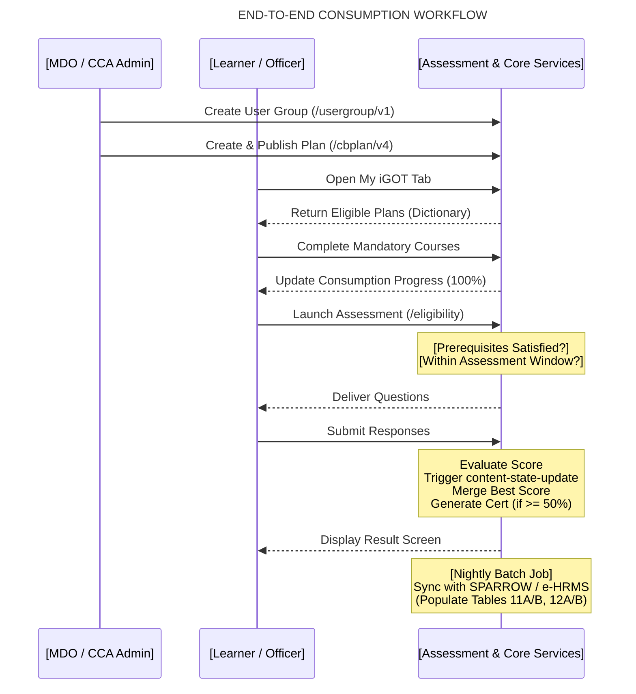

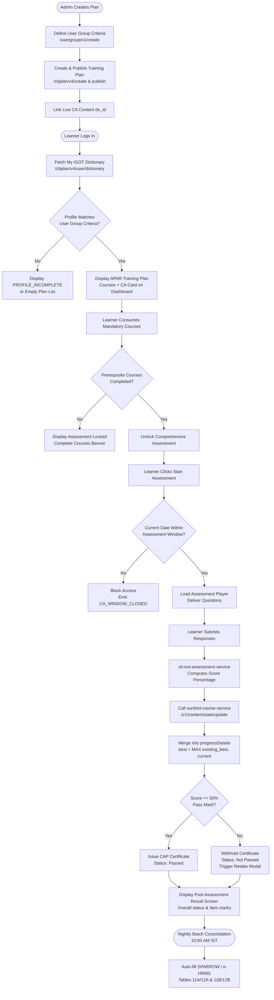

### Diagram 3: Logical System Context Diagram

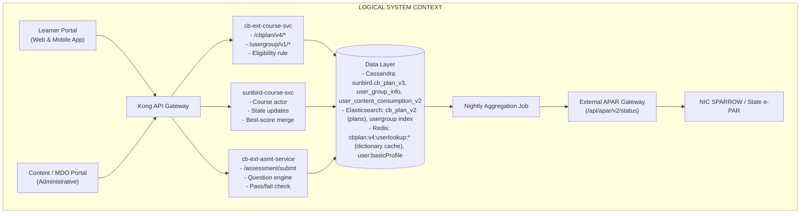

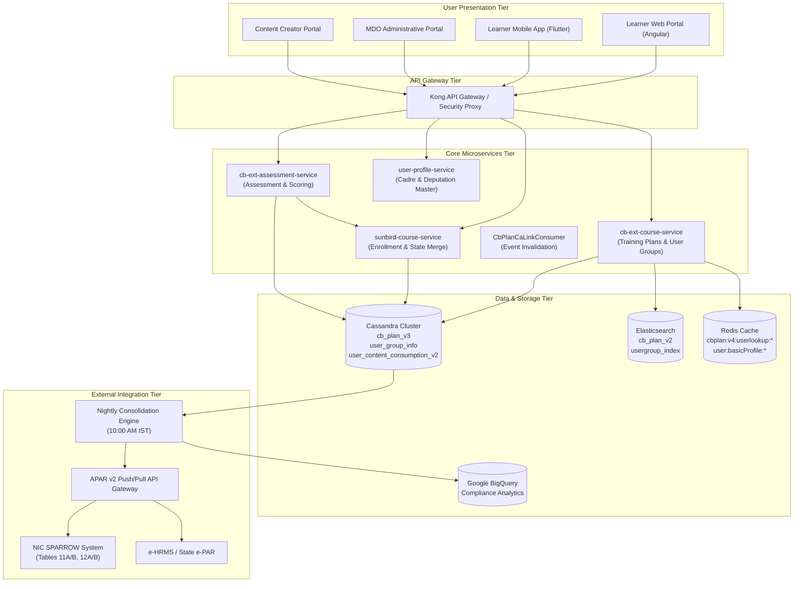

### Diagram 4: CA/APAR API Sequence Diagram

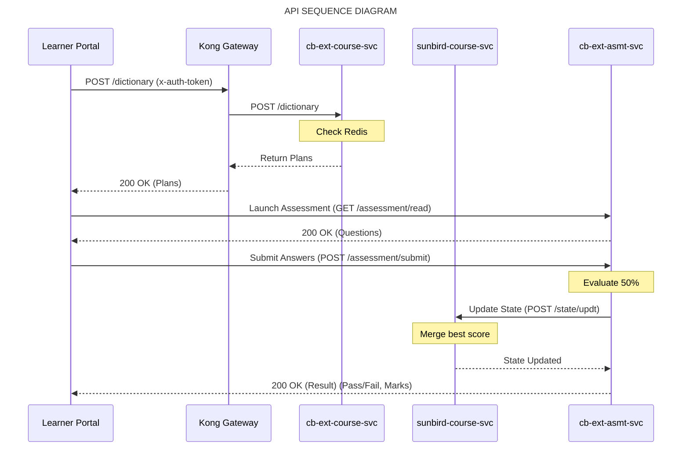

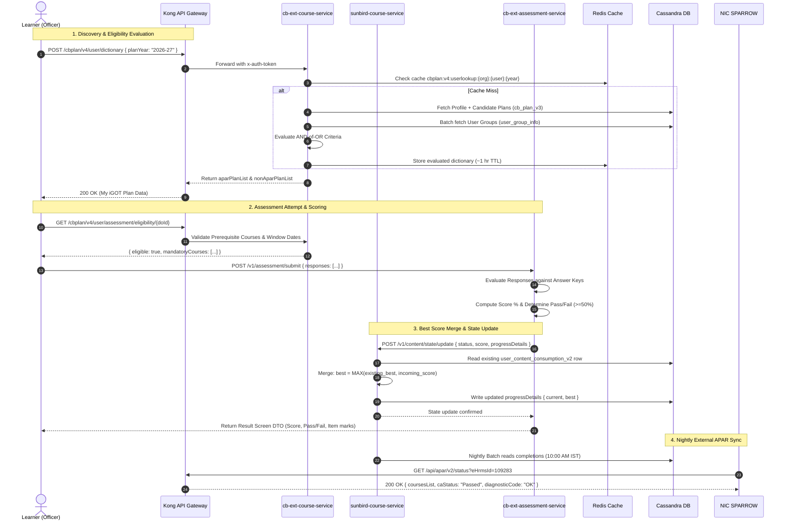

### Diagram 5: Best-Score Decision Flow

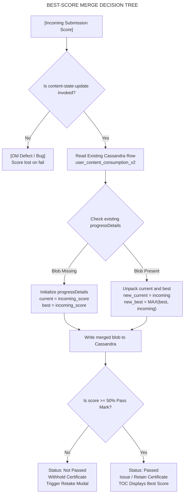

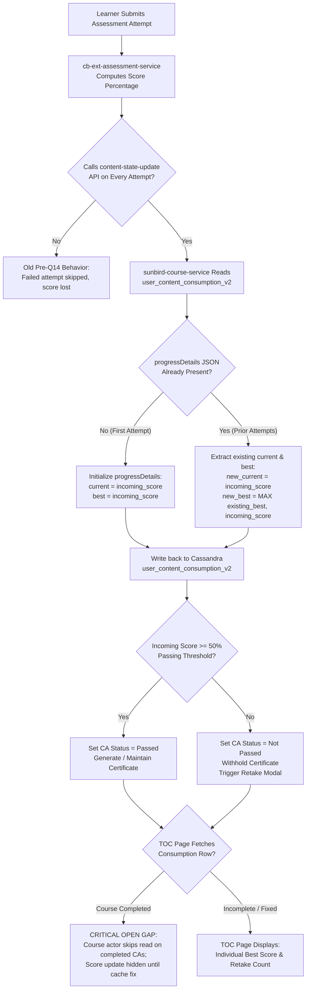

### Diagram 6: CA Data and Result Lifecycle

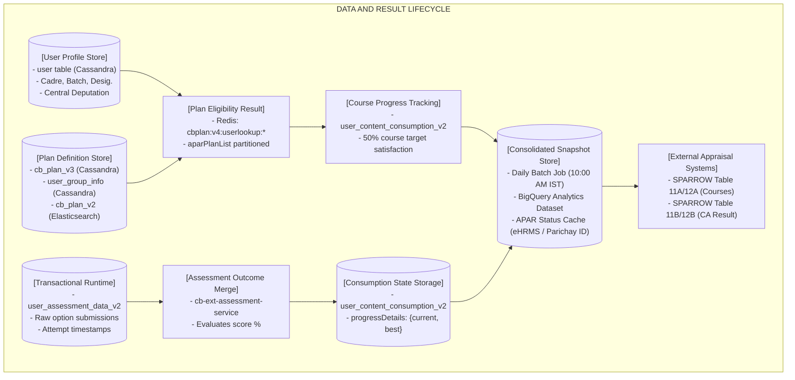

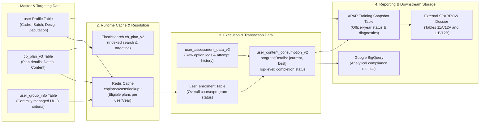
