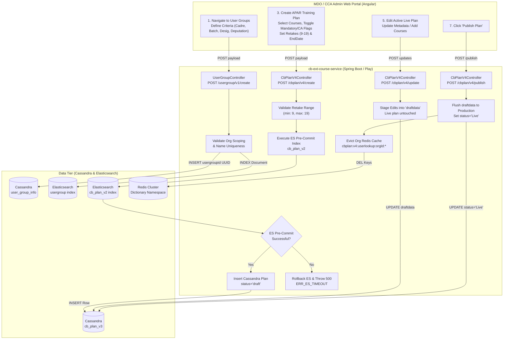
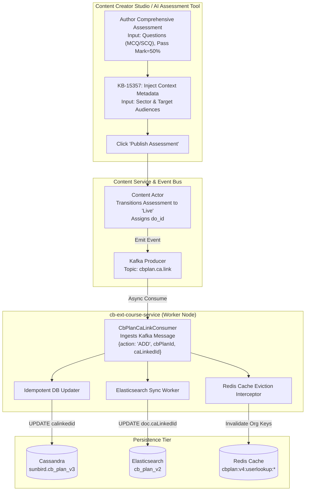
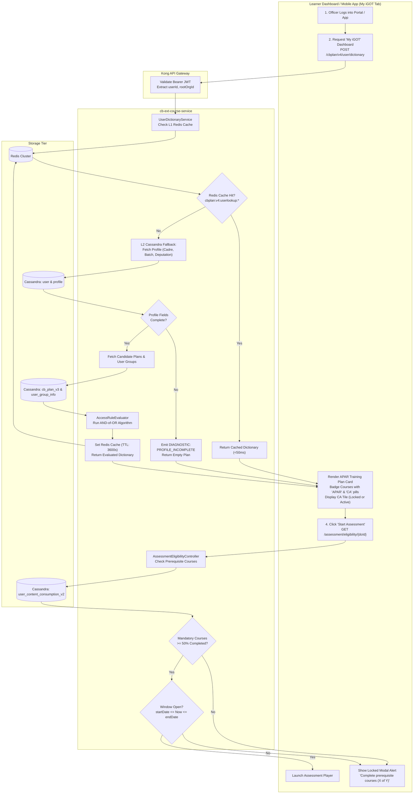
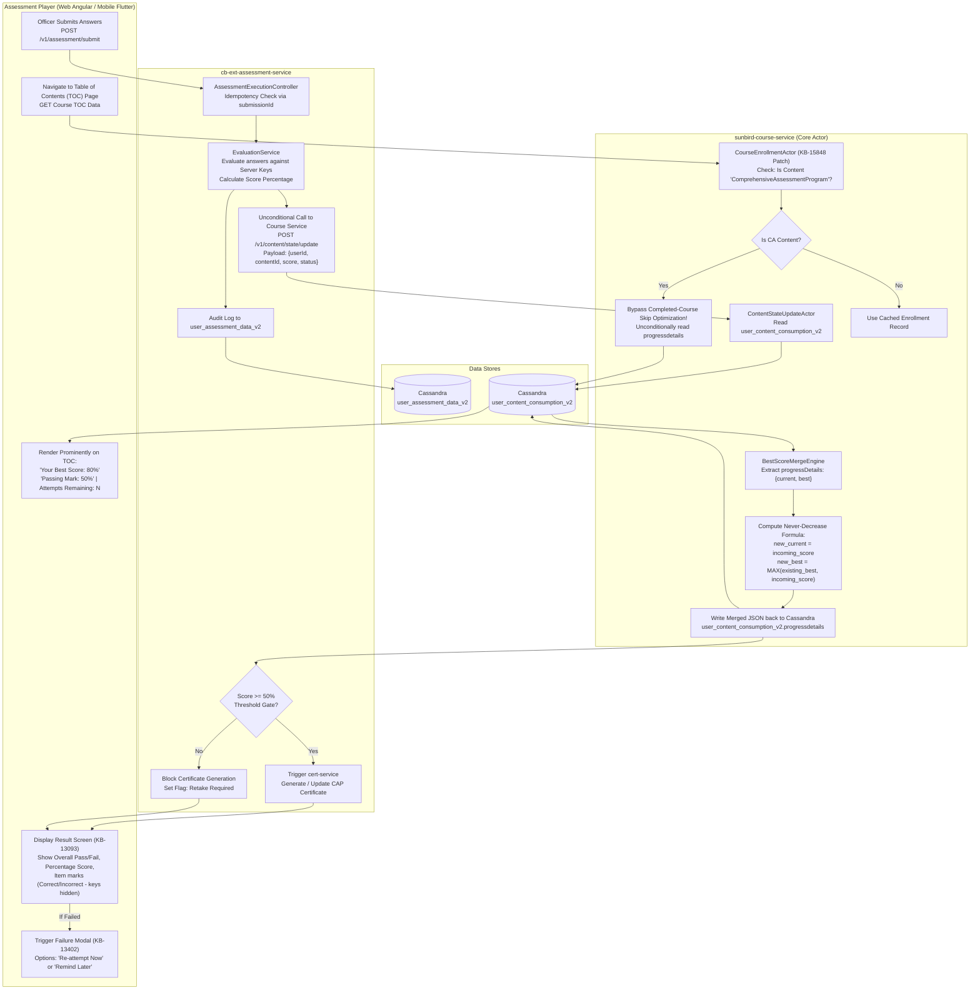
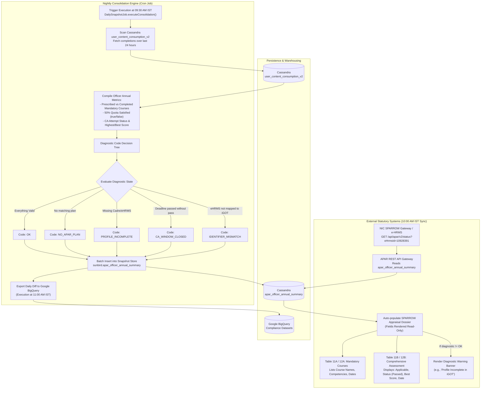

# Comprehensive Assessment — Low-Level Design (LLD)

**Comprehensive Assessment (CA) & APAR Integration**

## 1. Feature-to-Task Architectural Flow Map

**FEATURE TO IMPLEMENTATION TASK MAP**

- **ADMIN CREATION FLOWS (Flow 1 & Flow 2)**
    - KB-13866 / BRD-1031307285: User Group (AND-of-OR) Targeting Engine
    - KB-11524 / KB-13077: Selective CA Course Mapping & Live Plan Staging (draftData)
    - KB-12934: Retake Limit Bounding (9 to 19 attempts)
    - KB-15357: AI Assessment Context Metadata (Sector & Target Audience)
    - cbrelease-4.8.41: Transactional ES Pre-Commit & Event-Driven CA Linkage (Kafka)
- **LEARNER DISCOVERY & CONSUMPTION FLOWS (Flow 3 & Flow 4)**
    - KB-10684 / KB-13086: My iGOT Dictionary, 2-Tier Redis Cache & Course CA Tile Badges
    - KB-8065 / KB-8066: Scheduled Window & Prerequisite 50% Course Completion Gating
    - KB-12764: Server-Side 50% Pass Threshold & Certificate Issuance Blocker
    - KB-13093 / KB-13449: Post-Attempt Item-Level Result Review Screen (Web & Flutter)
    - KB-13402: Persistent Failure Retake Prompt Modal Interceptor
    - KB-15848 / Tech Design: Never-Decrease Best-Score Merge & TOC Read-Path Bypass
- **STATUTORY REPORTING & APAR FLOW (Flow 5)**
    - KB-10681 / KB-10686: SPARROW Tables 11A/B & 12A/B REST Integration (/api/apar/v2/*)
    - KB-12923 / KB-13111: BigQuery Real-Time Compliance Analytics ETL
    - BRD-1031307285: Automated Diagnostic Error Code Attribution

## 2. Flow Diagram 1: Administrative Creation & Targeting Plane

### Covers: `KB-13866` (User Groups), `KB-11524` (Course CA Flags), `KB-12934` (Retakes), `KB-13077` (Staging), and `cbrelease-4.8.41` (Transactional ES)

## 3. Flow Diagram 2: Content Authoring & Event-Driven CA Linkage

### Covers: `KB-8065` (CAP Program Content), `KB-15357` (AI Metadata), and `cbrelease-4.8.41` (Kafka Consumer)

## 4. Flow Diagram 3: Runtime Discovery & Prerequisite Gating

### Covers: `KB-10684` (Learner Routing), `KB-13086` (Course CA Badge), `KB-8066` (Locking), and `KB-13866` (AND-of-OR Evaluation)

## 5. Flow Diagram 4: Assessment Attempt, Best-Score Merge & Feedback

### Covers: `KB-12764` (Pass Threshold), `KB-13093` / `KB-13449` (Result Screens), `KB-13402` (Retake Pop-up), `KB-15848` (Best Score), and `Tech Design 1355612176`

## 6. Flow Diagram 5: Nightly Batch Aggregation & Statutory APAR Sync

### Covers: `KB-10681` (APAR API), `KB-12923` / `KB-13111` (BigQuery ETL), and `BRD-1031307285` (Diagnostics & SPARROW Tables 11 & 12)

## 7. Task-Level Cross-Reference Matrix

| Jira Task / Ticket | Flow Diagram Ref | Execution Subsystem | Core Technical Logic Implemented |
|---|---|---|---|
| `KB-8065` | **Flow 2** | Content Creation | Level-2 Comprehensive Assessment Program (CAP) content model and window dates. |
| `KB-8066` | **Flow 3** | Learner Dashboard | Prerequisite course locking logic; Scheduled Assessments portal UI. |
| `KB-10681` | **Flow 5** | Downstream Sync | Initial APAR reporting API `/report/org/enrolment/{orgId}` and SPARROW integration. |
| `KB-10684` | **Flow 3** | Discovery Engine | Profile-driven dual routing for Central Deputation vs Cadre Controlling Authority plans. |
| `KB-10686` | **Flow 1 & 5** | Master Initiative | CCA organizational privileges; end-to-end statutory SPARROW pipeline. |
| `KB-11524` | **Flow 1** | Training Plan Service | Selective CA flagging on individual courses; course deduplication with max date override. |
| `KB-12764` | **Flow 4** | Assessment Service | Server-side 50% pass threshold check blocking certificate generation on failure. |
| `KB-12923` | **Flow 5** | Analytics Pipeline | Scheduled ETL loading from Cassandra to Google BigQuery datasets. |
| `KB-12934` | **Flow 1** | Content Portal Form | Form field validation bounding configurable assessment retakes between 9 and 19. |
| `KB-13076` | **Flow 1** | Content Management | Operational fixes: org search, CSV question auto-trim, and question-type labeling. |
| `KB-13077` | **Flow 1** | Training Plan Service | Staging column `draftData` for live plan mutations; start-date locking for active CAs. |
| `KB-13086` | **Flow 3** | Learner Portal | Visual "APAR" and "Comprehensive Assessment" badges on course tiles and TOC headers. |
| `KB-13093` | **Flow 4** | Web Assessment Player | Post-assessment review screen displaying item-level correct/incorrect marks (answers hidden). |
| `KB-13111` | **Flow 5** | Analytics Pipeline | Data pipeline extracting learner highest scores to reporting pipelines and BigQuery. |
| `KB-13194` | **Flow 4** | Assessment Engine | Master revaluation epic covering result screen redesigns and mobile parity. |
| `KB-13402` | **Flow 4** | Learner Interceptor | Persistent failure modal dialogue with "Re-attempt Now" and "Remind Me Later" CTAs. |
| `KB-13449` | **Flow 4** | Flutter Mobile App | Mobile Flutter implementation of the item-level post-assessment result review screen. |
| `KB-13866` | **Flow 1 & 3** | Decoupled Architecture | Reusable User Groups (`/usergroup/v1/*`), V4 Plan APIs, and State Civil Services (`BAS`/`BSS`). |
| `KB-15357` | **Flow 2** | AI Assessment Studio | Ingestion of `Sector` and `Target Audiences` metadata to guide AI question generation. |
| `KB-15848` | **Flow 4** | Core Course Actor | `BestScoreMergeEngine` and `CourseEnrollmentActor` TOC read-path patch. |
