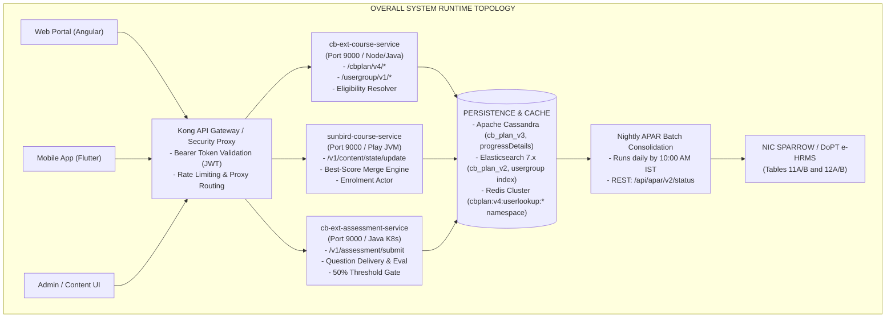
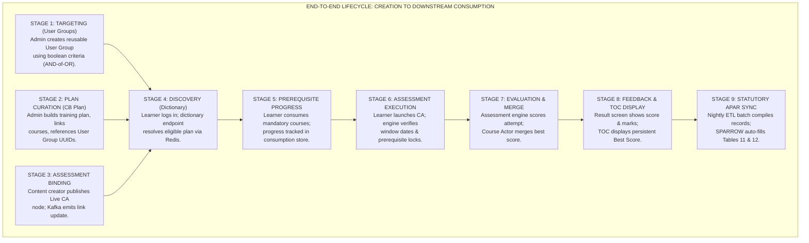
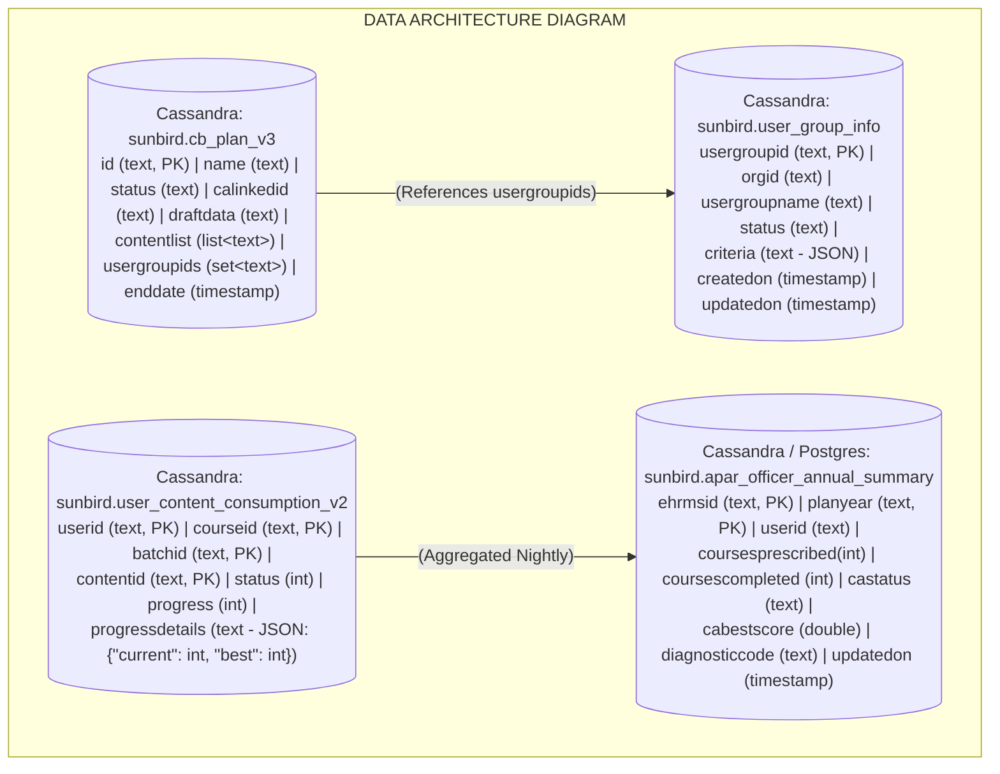
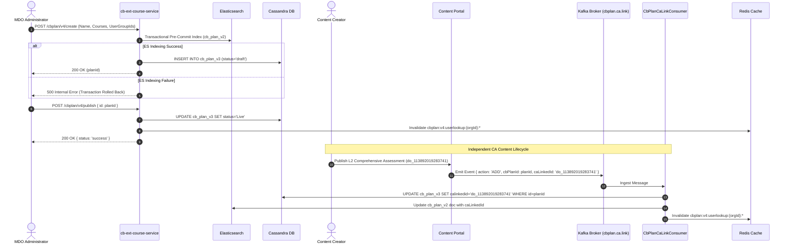
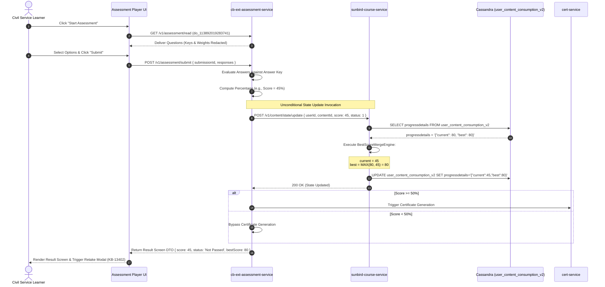
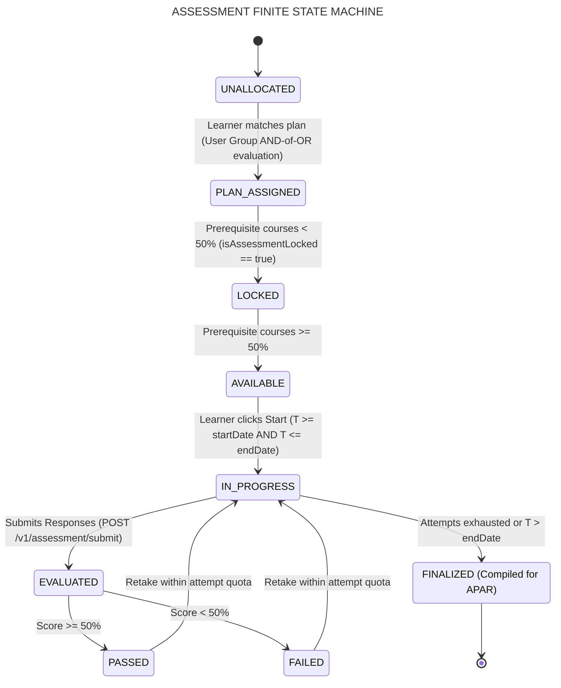

# Comprehensive Assessment — Software Design Description (SDD)

**Comprehensive Assessment (CA) and APAR Integration Program**

## 1. Introduction and Architectural Rationale

### 1.1 Purpose

This Software Design Description (SDD) provides the complete technical and architectural design for the **Comprehensive Assessment (CA)** subsystem and its direct integration with the **Annual Performance Appraisal Report (APAR)** under Mission Karmayogi. It translates the formal requirements specified in `SRS-IGOT-CA-APAR-2026-V1.0` into precise component designs, data models, interaction diagrams, state machines, API contracts, and algorithmic specifications.

### 1.2 System Context and Design Objectives

The primary design challenge centers on transitioning from early monolithic, tightly coupled course groupings (Q8 baseline) and inline JSON targeting (V3 APIs) to a decoupled, high-scale microservices architecture (V4 APIs).



Key technical objectives of this architecture include:

1. **Decoupled Targeting:** Extracting inline criteria blobs out of training plan records into reusable, centrally managed User Groups evaluated using an **AND-of-OR** boolean schema.
2. **State PCS Support:** Native handling of State Civil Services (e.g., Bihar Administrative Service - BAS, Bihar Secretariat Service - BSS) alongside central and All India Services (AIS).
3. **Zero-New-Table Score Persistence:** Storing multi-attempt assessment scores inside `user_content_consumption_v2.progressDetails` in Cassandra without altering database schemas or introducing cross-table distributed transaction risks.
4. **Deterministic Sub-Second Lookups:** Operating an L1 Redis dictionary cache (`cbplan:v4:userlookup:*`) with organization-scoped cache invalidation to support 25,000 concurrent sessions during peak appraisal closing windows.
5. **Fail-Closed Statutory Governance:** Enforcing a strict 50% server-side passing threshold before certificate generation or positive APAR sync can occur.

## 2. End-to-End Architectural Flow: Creation to Consumption

The end-to-end Comprehensive Assessment lifecycle is composed of nine distinct, sequentially executed stages.



### Stage 1: Targeting Cohort Creation (User Groups)

- **Actor:** MDO Administrator or Cadre Controlling Authority (CCA) Leader.
- **Component:** `cb-ext-course-service` (`user-group-module`).
- **Design Execution:**
  - The administrator invokes `POST /usergroup/v1/create` submitting criteria arrays.
  - The service enforces root organizational hierarchy validation (`L0` organization check).
  - The service writes the targeting payload to Cassandra table `sunbird.user_group_info` and synchronously indexes the document into Elasticsearch cluster index `usergroup`.
  - The generated `usergroupId` (UUID v4) serves as a reusable targeting reference across multiple training plan cycles.

### Stage 2: APAR Training Plan Authoring & Staging

- **Actor:** MDO Administrator.
- **Component:** `cb-ext-course-service` (`cbplan-module`).
- **Design Execution:**
  - The administrator invokes `POST /cbplan/v4/create`, submitting plan metadata (`name`, `planYear`, `endDate`), an array of course identifiers flagged with mandatory status (`[{"identifier": "do_...", "mandatory": true}]`), and linked `usergroupId` references.
  - The service initiates a transactional pre-commit index to Elasticsearch (`cb_plan_v2`).
  - Upon Elasticsearch confirmation, the record is inserted into Cassandra table `sunbird.cb_plan_v3` in `draft` status. If Elasticsearch fails, the transaction aborts (fail-closed).
  - Subsequent edits to active plans write to the `draftData` column, preserving live runtime operations until `POST /cbplan/v4/publish` is called.

### Stage 3: Assessment Publication and Event-Driven Linkage

- **Actor:** Content Publisher & System Kafka Bus.
- **Components:** Content Portal, Kafka Broker, `CbPlanCaLinkConsumer`.
- **Design Execution:**
  - Content Creator authors Level-2 Comprehensive Assessment questions, configures retake limits (enforced between 9 and 19), sets a 50% pass mark, and publishes the assessment content unit (`do_id`).
  - Transition of the CA node to `Live` emits an asynchronous message to the Kafka topic `cbplan.ca.link`.
  - `CbPlanCaLinkConsumer` ingests the event, updates `cb_plan_v3.calinkedid` for matching plan definitions, updates the Elasticsearch index, and invalidates the organization's Redis dictionary namespace (`cbplan:v4:userlookup:{orgId}:*`).

### Stage 4: Runtime Plan Discovery and Eligibility Evaluation

- **Actor:** Civil Service Learner.
- **Components:** Web/Mobile Portal, Kong API Gateway, `cb-ext-course-service`.
- **Design Execution:**
  - Client initializes the "My iGOT" dashboard and calls `POST /cbplan/v4/user/dictionary` with the target `planYear` (defaulting to the current active cycle, e.g., `2026-27`).
  - The gateway validates the JWT token and extracts user identity (`userId`, `rootOrgId`).
  - The service inspects Redis for key `cbplan:v4:userlookup:{rootOrgId}:{userId}:{planYear}`:
    - **Cache Hit:** Returns cached JSON payload within .
    - **Cache Miss:** Reads user profile metadata (Service, Cadre, Batch, Designation, Central Deputation flag) from Cassandra.

  - The internal component `AccessRuleEvaluator` fetches candidate plans, retrieves linked User Groups, and executes **AND-of-OR** boolean matching.
  - Matched plans are grouped into `aparPlanList` and written to Redis with a 3600-second TTL.

### Stage 5: Mandatory Course Consumption & Prerequisite Gating

- **Actor:** Learner.
- **Components:** Course Content Player, `sunbird-course-service`.
- **Design Execution:**
  - Learner consumes prescribed SCORM, video, and audio assets.
  - The player periodically dispatches telemetry batches to `POST /v1/content/state/update`.
  - `sunbird-course-service` updates progress percentages in `user_content_consumption_v2` and marks completion status in `user_enrolment`.
  - When the learner attempts to launch the Comprehensive Assessment, the client calls `GET /cbplan/v4/user/assessment/eligibility/{doId}`.
  - The eligibility engine evaluates whether the plan’s prerequisite course completion quota () has been met. If unmet, the API returns `eligible: false`, locking the assessment player.

### Stage 6: Assessment Launch and Submission Execution

- **Actor:** Learner.
- **Components:** Assessment Web Player, `cb-ext-assessment-service`.
- **Design Execution:**
  - The learner initiates the assessment. The server validates that current timestamp satisfies:
  - Questions are randomized and delivered to the client with answer keys and weights stripped.
  - Learner submits responses via `POST /v1/assessment/submit` with an idempotent `submissionId`.
  - The engine evaluates responses against server-side answer keys, calculates raw scores and percentages, checks if , and logs the full audit trail in Cassandra table `user_assessment_data_v2`.

### Stage 7: Score Processing & Never-Decrease Best-Score Merge

- **Actor:** Assessment Evaluation Actor & Core Course Actor.
- **Components:** `cb-ext-assessment-service`, `sunbird-course-service`.
- **Design Execution:**
  - `cb-ext-assessment-service` invokes `POST /v1/content/state/update` on `sunbird-course-service` **unconditionally** for all submissions (passes and failures).
  - `sunbird-course-service` reads the existing consumption record from `sunbird.user_content_consumption_v2`.
  - The Course Actor unpacks the JSON column `progressDetails`:
    - If `progressDetails` is empty, initialize: `current = incoming_score`, `best = incoming_score`.
    - If `progressDetails` exists, calculate:

  - The merged JSON payload is written back to `progressDetails`.
  - If , status transitions to `completed`, triggering certificate issuance. If , certificate issuance is bypassed.

### Stage 8: Post-Assessment Feedback & TOC Score Surfacing

- **Actor:** Learner.
- **Components:** Learner Portal Result Controller, TOC Page Component.
- **Design Execution:**
  - The client renders the post-assessment result screen showing overall status (`Passed` or `Not Passed`), numeric score percentage, correct/incorrect status per question, and remaining attempts.
  - If the attempt failed, an application-wide modal interceptor flags the profile to display the mandatory retake modal (`KB-13402`).
  - Upon navigating to the Table of Contents (TOC) page, the client invokes the course enrollment reader. The read-path patch bypasses completion checks, retrieves `user_content_consumption_v2.progressDetails`, and prominently displays `"Your Best Score: X%"`.

### Stage 9: Nightly Statutory Synchronization (APAR / SPARROW)

- **Actor:** Automated Batch Cron Daemon, NIC SPARROW Gateway.
- **Components:** Nightly Consolidation Worker, APAR Integration REST API.
- **Design Execution:**
  - Daily at 09:30 AM IST, a scheduled distributed batch job scans Cassandra consumption logs for records completed over the preceding 24 hours.
  - The worker computes annual summary metrics per officer: total mandatory courses prescribed, total completed, quota satisfied (`true`/`false`), CA attempt status, CA best score, and system diagnostic code (`OK`, `NO_APAR_PLAN`, `PROFILE_INCOMPLETE`, etc.).
  - Results populate the consolidated table `apar_officer_annual_summary`.
  - External appraisal systems (NIC SPARROW, e-HRMS) query `GET /api/apar/v2/status` by 10:00 AM IST to auto-populate Tables 11A/12A and 11B/12B.

## 3. Detailed Component Decomposition

The system is decomposed into four autonomous microservices and two batch/event workers.

**COMPONENT DECOMPOSITION**

1. **cb-ext-course-service (Port 9000)**
    - `UserGroupController`: Endpoints for /usergroup/v1/* (CRUD)
    - `CbPlanV4Controller`: Endpoints for /cbplan/v4/* (Plan CRUD, Publish, Dictionary)
    - `AccessRuleEvaluator`: In-memory AND-of-OR rule matching engine
    - `UserDictionaryService`: Two-tier cache resolver (Redis L1 / Cassandra L2)
    - `AssessmentEligibilityEvaluator`: Validates course prerequisites and window constraints
2. **sunbird-course-service (Core Course Actor)**
    - `ContentStateUpdateActor`: Handles /v1/content/state/update
    - `BestScoreMergeEngine`: Implements MAX(best, incoming) merge logic
    - `CourseEnrollmentActor`: TOC read path with completed-course consumption bypass
3. **cb-ext-assessment-service**
    - `AssessmentExecutionController`: Handles /v1/assessment/submit and player delivery
    - `QuestionDeliveryEngine`: Strips answer keys and randomizes question sequences
    - `ThresholdValidationService`: Enforces 50% pass threshold; triggers state updates
4. **CbPlanCaLinkConsumer (Kafka Worker)**
    - Topic: `cbplan.ca.link`: Ingests CA events, links plans, invalidates Redis
5. **APAR Consolidation Engine (Batch Service)**
    - `DailySnapshotJob`: Cron-driven 09:30 AM IST aggregation pipeline
    - `AparV2RestController`: Exposes /api/apar/v2/status and /bulk-status

### 3.1 `cb-ext-course-service` Component Specification

#### Class: `UserGroupController`

- **Package:** `org.sunbird.cbplan.controller`
- **Responsibilities:** Exposes REST endpoints for managing reusable user group entities. Enforces organizational boundaries and checks for linked plans before allowing deletion.
- **Public Interface:**
  - `Response createUserGroup(@RequestBody UserGroupCreateRequest request, @RequestHeader HttpHeaders headers)`
  - `Response updateUserGroup(@RequestBody UserGroupUpdateRequest request, @RequestHeader HttpHeaders headers)`
  - `Response deleteUserGroup(@PathVariable("id") String userGroupId, @RequestHeader HttpHeaders headers)`
  - `Response readUserGroup(@PathVariable("id") String userGroupId, @RequestHeader HttpHeaders headers)`

#### Class: `CbPlanV4Controller`

- **Package:** `org.sunbird.cbplan.controller`
- **Responsibilities:** Orchestrates the lifecycle of V4 training plans, staged mutations in `draftData`, and learner dictionary lookups.
- **Public Interface:**
  - `Response createPlan(@RequestBody CbPlanCreateRequest request, @RequestHeader HttpHeaders headers)`
  - `Response updatePlan(@RequestBody CbPlanUpdateRequest request, @RequestHeader HttpHeaders headers)`
  - `Response publishPlan(@RequestBody CbPlanPublishRequest request, @RequestHeader HttpHeaders headers)`
  - `Response getUserDictionary(@RequestBody UserDictionaryRequest request, @RequestHeader HttpHeaders headers)`

#### Class: `AccessRuleEvaluator`

- **Package:** `org.sunbird.cbplan.service.evaluator`
- **Responsibilities:** Executes in-memory matching of officer profile attributes against plan criteria.
- **Algorithm / Logic:**
  ```java
  public boolean evaluateUserEligibility(UserProfile profile, List<UserGroup> groups) {
      if (groups == null || groups.isEmpty()) {
          return false;
      }
      // OR across User Groups
      for (UserGroup group : groups) {
          if (matchesGroupCriteria(profile, group.getCriteria())) {
              return true;
          }
      }
      return false;
  }
  private boolean matchesGroupCriteria(UserProfile profile, List<CriteriaRule> rules) {
      // AND within single User Group criteria
      for (CriteriaRule rule : rules) {
          if (!rule.evaluate(profile)) {
              return false;
          }
      }
      return true;
  }
  ```

### 3.2 `sunbird-course-service` Component Specification

#### Class: `BestScoreMergeEngine`

- **Package:** `org.sunbird.learner.actors.coursebatch.dao.impl`
- **Responsibilities:** Reads `progressDetails` from Cassandra, applies never-decrease merge logic, and returns the updated JSON object.
- **Algorithm / Logic:**
  ```java
  public Map<String, Object> mergeProgressDetails(Map<String, Object> existingDetails, int incomingScore) {
      Map<String, Object> updatedDetails = new HashMap<>();
      if (existingDetails == null || existingDetails.isEmpty()) {
          updatedDetails.put("current", incomingScore);
          updatedDetails.put("best", incomingScore);
          return updatedDetails;
      }
      int existingBest = 0;
      if (existingDetails.containsKey("best")) {
          existingBest = ((Number) existingDetails.get("best")).intValue();
      }
      int calculatedBest = Math.max(existingBest, incomingScore);
      updatedDetails.putAll(existingDetails);
      updatedDetails.put("current", incomingScore);
      updatedDetails.put("best", calculatedBest);
      return updatedDetails;
  }
  ```

#### Class: `CourseEnrollmentActor` (TOC Read Path Patch)

- **Package:** `org.sunbird.learner.actors`
- **Responsibilities:** Intercepts Table of Contents (TOC) queries. Specifically overrides the legacy caching optimization that skips fetching `user_content_consumption_v2` for completed courses when the content type is `ComprehensiveAssessmentProgram`.

## 4. Data Design and Schema Specifications



### 4.1 Apache Cassandra Data Models

#### 1. Table: `sunbird.cb_plan_v3`

Stores Capacity Building Plans (CB Plans) across V3 and V4 formats.

```sql
CREATE TABLE sunbird.cb_plan_v3 (
    id text,
    name text,
    description text,
    orgid text,
    status text,  -- 'draft', 'Live', 'archived', 'retired'
    planyear text,  -- e.g., '2026-27'
    startdate timestamp,
    enddate timestamp,
    contentlist list<text>,  -- Encoded JSON: '{"identifier":"do_123","mandatory":true}' usergroupids set<text>,
    -- Set of linked user_group_info UUIDs
    calinkedid text,  -- Linked Comprehensive Assessment content ID
    draftdata text,  -- Staging JSON blob for updates to Live plans
    createdby text,
    createddate timestamp,
    updatedby text,
    updateddate timestamp,
    PRIMARY KEY (id)
);
```

#### 2. Table: `sunbird.user_group_info`

Stores reusable targeting criteria cohorts.

```sql
CREATE TABLE sunbird.user_group_info (
    usergroupid text,
    orgid text,
    usergroupname text,
    status text,  -- 'ACTIVE', 'INACTIVE', 'ARCHIVED'
    criteria text,
    -- JSON serialized criteria array
    createdby text,
    createdon timestamp,
    updatedby text,
    updatedon timestamp,
    PRIMARY KEY (usergroupid)
);
CREATE INDEX ON sunbird.user_group_info (orgid);
CREATE INDEX ON sunbird.user_group_info (status);
```

#### 3. Table: `sunbird.user_content_consumption_v2`

Primary transactional store for content progress, assessment attempts, and best scores.

```sql
CREATE TABLE sunbird.user_content_consumption_v2 (
    userid text,
    courseid text,
    batchid text,
    contentid text,
    status int,  -- 0=Not Started, 1=In Progress, 2=Completed
    progress int,  -- Percentage (0 to 100)
    progressdetails text,  -- Extensible JSON: {"current": 75, "best": 85, "mimeType": "..."}
    completionpercentage int,
    lastaccesstime timestamp,
    lastcompletedtime timestamp,
    lastupdatedtime timestamp,
    PRIMARY KEY (userid, courseid, batchid, contentid)
);
```

### 4.2 Redis Caching Key Schemas and Expirations

| Redis Key Namespace Pattern | Data Type | Value Format | TTL | Invalidation Trigger |
|---|---|---|---|---|
| `cbplan:v4:userlookup:{orgId}:{userId}:{planYear}` | String | Serialized JSON dictionary (`aparPlanList`, `nonAparPlanList`) | 3600s | Plan published/retired; CA link updated; profile cadre/org updated. |
| `user:basicProfile:{userId}` | Hash | User profile fields (`cadre`, `batch`, `designation`, `deputation`) | 7200s | Profile update event emitted from User-Org service. |
| `usergroup:cache:{userGroupId}` | String | Serialized User Group entity JSON | 86400s | `POST /usergroup/v1/update` or `delete`. |

## 5. Sequence and Interaction Diagrams

### 5.1 Plan Authoring and Kafka CA Decoupled Linkage Flow



### 5.2 Assessment Attempt, Scoring, and Never-Decrease Best-Score Merge



## 6. Comprehensive Assessment State Machine

The Comprehensive Assessment execution lifecycle is governed by the finite state machine specified below.



### State Definitions and Transition Rules

| Initial State | Event / Trigger | Guard Condition | Next State | Action Executed |
|---|---|---|---|---|
| **UNALLOCATED** | Dictionary API query | Officer profile matches linked User Group criteria. | **PLAN_ASSIGNED** | Plan rendered in My iGOT dictionary response. |
| **PLAN_ASSIGNED** | Curriculum progress check | Plan has `isAssessmentLocked=true` AND mandatory course progress . | **LOCKED** | CA rendered with lock badge; launch button disabled. |
| **LOCKED** | Course completion event | Mandatory course progress reaches . | **AVAILABLE** | Lock badge removed; "Start Assessment" button enabled. |
| **AVAILABLE** | Learner launches assessment | Current timestamp : . | **IN_PROGRESS** | Assessment session initiated; question set delivered. |
| **IN_PROGRESS** | Learner submits answers | Answers submitted via `POST /v1/assessment/submit`. | **EVALUATED** | Questions scored; raw and percentage marks computed. |
| **EVALUATED** | Score classification | Score percentage . | **PASSED** | Certificate issued; `best` updated; SPARROW status = Passed. |
| **EVALUATED** | Score classification | Score percentage . | **FAILED** | Certificate blocked; retake modal displayed; `best` preserved. |
| **PASSED / FAILED** | Retake initiated | Remaining attempts AND . | **IN_PROGRESS** | New attempt initialized; question order randomized. |
| **PASSED / FAILED** | Assessment window closes | OR remaining attempts . | **FINALIZED** | Attempting blocked; final `best` score locked for APAR sync. |

## 7. API and Interface Specifications

### 7.1 Component: `cb-ext-course-service`

#### 1. Endpoint: `POST /usergroup/v1/create`

- **Description:** Creates a reusable targeting User Group.
- **Headers:**
  - `Content-Type: application/json`
  - `x-authenticated-user-token: <JWT>`
  - `rootorg: <ORG_ID>`

- **Request Payload Schema:**
  ```json
  {
    "userGroupName": "string (min 3, max 100)",
    "criteria": [
      {
        "cadre": [
          "string"
        ],
        "batch": [
          "string"
        ],
        "designation": [
          "string"
        ],
        "deputation": "boolean (optional)"
      }
    ]
  }
  ```
- **Response Payload** (`200 OK`):
  ```json
  {
    "id": "api.usergroup.create",
    "ver": "1.0",
    "ts": "2026-10-29T12:58:00Z",
    "params": {
      "resmsgid": "8f1a2c3d-4e5f-6a7b-8c9d-0e1f2a3b4c5d",
      "status": "SUCCESSFUL"
    },
    "responseCode": "OK",
    "result": {
      "orgid": "org_central_dopt_001",
      "usergroupid": "ug_7c9e6679-7425-40de-944b-e07fc1f90ae7",
      "status": "ACTIVE"
    }
  }
  ```

#### 2. Endpoint: `POST /cbplan/v4/publish`

- **Description:** Activates a draft plan or applies staged `draftData` to production.
- **Headers:**
  - `Content-Type: application/json`
  - `x-authenticated-user-token: <JWT>`

- **Request Payload Schema:**
  ```json
  {
    "id": "plan_d9a8b1c2-3e4f-4a5b-8c6d-7e8f9a0b1c2d"
  }
  ```
- **Response Payload** (`200 OK`):
  ```json
  {
    "id": "api.cbplan.v4.publish",
    "ver": "4.0",
    "ts": "2026-10-29T12:58:30Z",
    "params": {
      "status": "success"
    },
    "responseCode": "OK",
    "result": {}
  }
  ```

#### 3. Endpoint: `POST /cbplan/v4/user/dictionary`

- **Description:** Resolves eligible plans and returns the learner’s APAR plan dictionary.
- **Request Payload Schema:**
  `{ "planYear": "2026-27" }`
- **Response Payload** (`200 OK`):
  ```json
  {
    "id": "api.cbplan.v4.user.dictionary",
    "ver": "4.0",
    "ts": "2026-10-29T12:59:00Z",
    "params": {
      "status": "success"
    },
    "responseCode": "OK",
    "result": {
      "2026-27": {
        "aparPlanList": {
          "plan_d9a8b1c2-3e4f-4a5b-8c6d-7e8f9a0b1c2d": {
            "id": "plan_d9a8b1c2-3e4f-4a5b-8c6d-7e8f9a0b1c2d",
            "name": "Civil Services Annual Mandatory Plan 2026-27",
            "caLinkedId": "do_113892019283741",
            "contentList": [
              "{\"identifier\":\"do_1138810293\",\"mandatory\":true}",
              "{\"identifier\":\"do_1138810294\",\"mandatory\":true}"
            ],
            "endDate": "2027-03-31T23:59:59Z"
          }
        },
        "nonAparPlanList": {}
      }
    }
  }
  ```

### 7.2 Component: `sunbird-course-service`

#### Endpoint: `POST /v1/content/state/update`

- **Description:** Receives content consumption updates and merges Best Scores.
- **Request Payload Schema:**
  ```json
  {
    "request": {
      "userId": "usr_99881122-3344-5566-7788-99aabbccdde",
      "contents": [
        {
          "contentId": "do_113892019283741",
          "courseId": "do_113892019283741",
          "batchId": "batch_01928374192",
          "status": 2,
          "score": 65,
          "progressDetails": {
            "current": 65,
            "best": 85
          }
        }
      ]
    }
  }
  ```
- **Response Payload** (`200 OK`):
  ```json
  {
    "id": "api.content.state.update",
    "ver": "1.0",
    "ts": "2026-10-29T12:59:30Z",
    "params": {
      "status": "successful"
    },
    "responseCode": "OK",
    "result": {
      "response": "SUCCESS"
    }
  }
  ```

### 7.3 Component: Downstream APAR Integration Gateway

#### Endpoint: `GET /api/apar/v2/status`

- **Description:** Exposes read-only compliance snapshots to NIC SPARROW and e-HRMS.
- **Query Parameters:**
  - `eHrmsId` (string, optional): Government employee e-HRMS code.
  - `parichayId` (string, optional): Parichay SSO username / email.

- **Response Payload** (`200 OK`):
  ```json
  {
    "id": "api.apar.v2.status",
    "ver": "2.0",
    "ts": "2026-10-29T13:00:00Z",
    "params": {
      "status": "success"
    },
    "responseCode": "OK",
    "result": {
      "officerDetails": {
        "eHrmsId": "10928391",
        "parichayId": "rajesh.sharma@gov.in",
        "cadre": "IAS",
        "batch": "2010"
      },
      "planYear": "2026-27",
      "trainingPlan": {
        "planId": "plan_d9a8b1c2-3e4f-4a5b-8c6d-7e8f9a0b1c2d",
        "totalPrescribedCourses": 4,
        "completedCoursesCount": 4,
        "quotaSatisfied": true
      },
      "comprehensiveAssessment": {
        "applicable": true,
        "assessmentId": "do_113892019283741",
        "status": "Passed",
        "bestScorePercentage": 85.0,
        "completionDate": "2026-07-02T14:45:00Z",
        "certificateIssued": true
      },
      "diagnosticCode": "OK"
    }
  }
  ```

## 8. Requirements Traceability to Design

The matrix below establishes bidirectional traceability from system requirements to architectural components and database entities.

| Requirement ID | Requirement Summary | Implementing Architectural Component | Code / Schema Target | Design Section | Verification Method |
|---|---|---|---|---|---|
| `REQ-BR-PROF-001` | Profile completeness enforcement | `cb-ext-course-service` | `UserDictionaryService.java` | 2, 7.1 | Automated Test |
| `REQ-BR-PROF-002` | Central Deputation hierarchy | `cb-ext-course-service` | `AccessRuleEvaluator.java` | 2, 3.1 | Automated Test |
| `REQ-BR-TARG-001` | Reusable User Group isolation | `user-group-module` | `sunbird.user_group_info` | 2, 4.1 | Schema Inspection |
| `REQ-BR-TARG-002` | AND-of-OR evaluation logic | `cb-ext-course-service` | `AccessRuleEvaluator.java` | 1.2, 3.1 | Unit Test |
| `REQ-BR-TARG-003` | Fail-closed group deletion | `user-group-module` | `UserGroupController.java` | 2, 3.1 | Integration Test |
| `REQ-BR-ASMT-001` | Prerequisite course locking | `cb-ext-course-service` | `AssessmentEligibilityEvaluator.java` | 2, 6 | Functional Test |
| `REQ-BR-ASMT-002` | Assessment window enforcement | `cb-ext-assessment-service` | `AssessmentExecutionController.java` | 2, 6 | Automated Test |
| `REQ-BR-ASMT-003` | Retake limit bounding (9–19) | Content Creator Portal | Form Validator Component | 2, 6 | UI Validation |
| `REQ-BR-SCOR-001` | 50% passing threshold gate | `cb-ext-assessment-service` | `ThresholdValidationService.java` | 2, 5.2 | Automated Test |
| `REQ-BR-SCOR-002` | Never-decrease best score | `sunbird-course-service` | `BestScoreMergeEngine.java` | 3.2, 5.2 | Unit Test |
| `REQ-BR-SCOR-003` | Unconditional state updates | `cb-ext-assessment-service` | `AssessmentExecutionController.java` | 2, 5.2 | Integration Test |
| `REQ-FR-PLAN-004` | Transactional ES pre-commit | `cb-ext-course-service` | `CbPlanV4Controller.java` | 2, 5.1 | Integration Test |
| `REQ-FR-PLAN-005` | Kafka CA decoupled linkage | Kafka / `CbPlanCaLinkConsumer` | Topic: `cbplan.ca.link` | 2, 5.1 | Event Simulation |
| `REQ-FR-SCOR-004` | Completed-course TOC read patch | `sunbird-course-service` | `CourseEnrollmentActor.java` | 2, 3.2 | Regression Test |
| `REQ-FR-SYNC-001` | Daily 10:00 AM batch sync | APAR Consolidation Engine | `DailySnapshotJob.java` | 2, 3 | End-to-End Test |
| `REQ-FR-SYNC-002` | SPARROW status API (V2) | APAR Integration Gateway | `AparV2RestController.java` | 7.3 | Contract Test |

## 9. Security, Operational, and Deployment Considerations

### 9.1 Authentication and Access Control Architecture

1. **API Gateway Enforcement:** All incoming client requests pass through Kong API Gateway. Requests must present a signed, non-expired Bearer JWT token issued by Keycloak.
2. **Administrative Role Boundaries:**
  - `MDO_ADMIN`: Can create User Groups and draft CB Plans matching their token's `rootOrgId`.
  - `MDO_LEADER`: Possesses exclusive privileges to publish, archive, or retire CB Plans.
  - `CCA_ADMIN`: Possesses elevated multi-org authority allowing the curation of plans across foreign `rootOrgId` domains for specific cadres.
  - `AICBP_ADMIN`: Required for calling `/aicbp/publish` endpoints; prevents unauthorized automated publishing.

### 9.2 Rate Limiting and Scalability Controls

- **Dictionary Endpoint Throttling:** The `/cbplan/v4/user/dictionary` endpoint is throttled at Kong to a maximum of 100 requests per minute per IP address to prevent denial-of-service attempts during appraisal deadlines.
- **Redis Connection Pool Tuning:** Jedis/Lettuce connection pools in `cb-ext-course-service` are configured with a minimum of 64 idle connections and a maximum of 512 active connections per pod, matching the 25,000 concurrent user scaling profile.

### 9.3 Observability and Telemetry

- **Prometheus Metrics:** Microservices expose standard metrics on `/metrics`:
  - `cbplan_dictionary_latency_seconds`: Histogram tracking dictionary response times.
  - `assessment_submit_total`: Counter tracking assessment attempts, partitioned by `status` (pass/fail).
  - `best_score_merge_count`: Counter tracking score merges where .

- **Audit Logging:** All administrative mutations (User Group creation, Plan publication, CA linkage) emit structured JSON audit logs capturing caller identity, timestamp, before-state, and after-state.

## 10. Technical Risk Mitigation and Architecture Open Items

### 10.1 Completed-Course TOC Read Suppression Resolution

- **Risk Context:** In legacy releases, when a learner completes an assessment program, the enrollment row in `user_enrolment` is marked `completed` (`status=2`). Subsequent queries to the Table of Contents (TOC) page intentionally skip querying `user_content_consumption_v2` to minimize Cassandra reads. Consequently, retakes scoring a new Best Score cannot be surfaced.
- **Architectural Fix:** The `CourseEnrollmentActor` in `sunbird-course-service` is updated with an explicit content-type override:
  ```java
  if (isCompleted && !"ComprehensiveAssessmentProgram".equalsIgnoreCase(content.getContentType())) {
      // Use cached enrollment record only
      return cachedResponse;
  }
  // Force retrieval of progressDetails from user_content_consumption_v2
  return fetchConsumptionDetails(userId, courseId, batchId);
  ```

### 10.2 External Appraisal Batch Latency Mitigation

- **Risk Context:** External appraisal systems (SPARROW) rely on the daily 10:00 AM IST snapshot. Civil servants completing assessments late in the evening before submission deadlines report discrepancies.
- **Mitigation Design:** Expose an authenticated on-demand sync hook (`POST /api/apar/v2/sync-officer/{eHrmsId}`) callable by SPARROW when an officer opens their appraisal form, enabling real-time cache reconciliation on demand.
