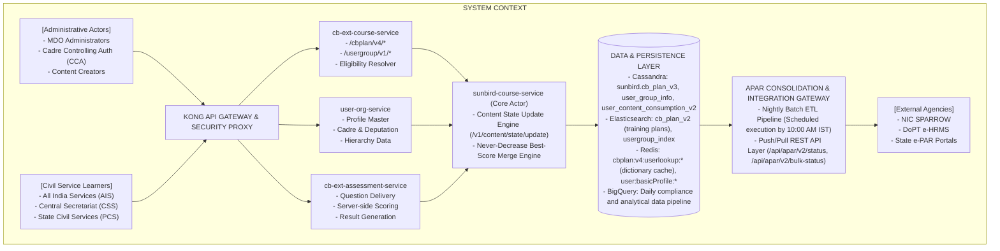
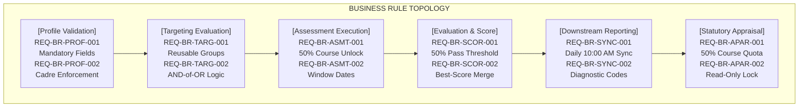
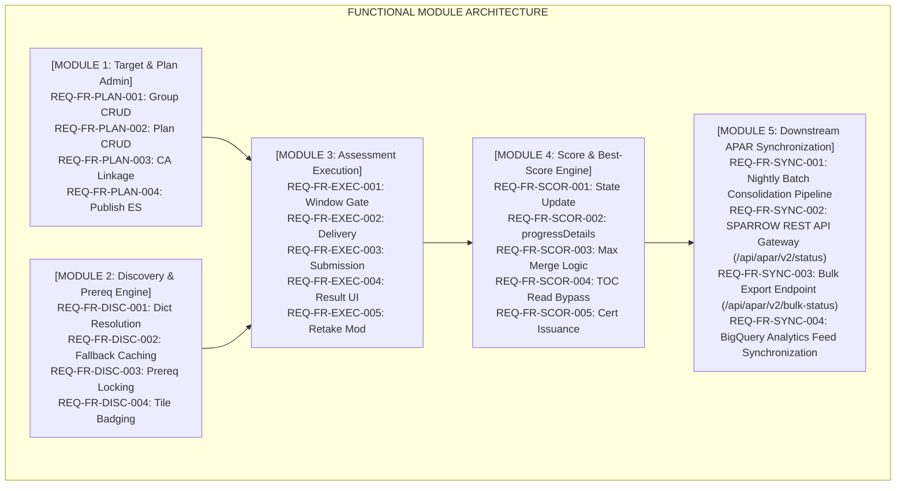

# Comprehensive Assessment — Software Requirements Specification (SRS)

**Comprehensive Assessment (CA) and APAR Integration Program**

## 1. Introduction

### 1.1 Purpose

This Software Requirements Specification (SRS) establishes the complete, authoritative, and verifiable functional, performance, security, operational, and interface requirements for the **Comprehensive Assessment (CA)** program and its direct integration with the **Annual Performance Appraisal Report (APAR)** on the iGOT Karmayogi platform.

This specification establishes requirements across the product evolution from Q8 through Q13 and sets the technical baseline for the 2026–27 APAR operational cycle. It serves as the formal binding contract between Product Management, System Architecture, Engineering Leads, Quality Assurance (QA), and external integration agencies (NIC SPARROW, DoPT, and State Civil Service Boards).

### 1.2 Scope of the System

The Comprehensive Assessment and APAR subsystem encompasses:

1. **Administrative Planning & Targeting:** Multi-level authoring of Annual Capacity Building Plans (CB Plans) and reusable User Groups using boolean criteria (AND-of-OR evaluation) across Central Ministries, Cadre Controlling Authorities (CCAs), and State Governments.
2. **Curriculum & Assessment Binding:** Association of Level-2 (L2) Comprehensive Assessments with prescribed mandatory courses across Behavioral, Functional, and Domain competencies.
3. **Learner Discovery & Consumption:** Dynamic resolution of officer eligibility, dashboard rendering within "My iGOT", conditional unlocking of evaluations based on course progress, and time-bound assessment window enforcement.
4. **Assessment Engine Execution & Evaluation:** Delivery of randomized question banks, client-side response capture, server-side scoring, enforcement of passing thresholds (50%), attempt bounding (9 to 19 retakes), and diagnostic result feedback.
5. **Score Persistence & Best-Score Governance:** Merging of multiple assessment attempts into persistent storage using a never-decrease best-score algorithm within `user_content_consumption_v2.progressDetails`.
6. **Statutory Appraisal Reporting:** Compilation of consolidated officer training records and automated auto-population of APAR Tables 11A/12A (Mandatory Courses) and 11B/12B (Comprehensive Assessment) in external systems (NIC SPARROW, e-HRMS, and State e-PAR) via REST APIs.

**Out of Scope:**

- Direct authoring of course SCORM/HTML5 content packages (handled by core Sunbird Content Service).
- Legal dispute workflows regarding civil servant appraisal grading.
- Evaluation of physical, offline classroom assessments.

### 1.3 Product Overview and Context

Comprehensive Assessment bridges continuous professional development and annual civil service appraisals under Mission Karmayogi. Standard Level-1 (L1) assessments verify module-level content absorption. In contrast, Level-2 (L2) Comprehensive Assessments evaluate cross-cutting competencies across multi-course curricula.



### 1.4 Document Conventions and Requirements Terminology

Requirements within this document conform to ISO/IEC/IEEE 29148:2018 guidelines. Each requirement is uniquely identified and expressed using standardized modal verbs:

- **"Shall"**: Mandatory requirement; non-negotiable for system compliance.
- **"Should"**: Highly recommended; deviation requires explicit architectural sign-off.
- **"May"**: Optional or permission to implement an alternative approach.
- **"TBD" (To Be Determined)**: Explicit placeholder where quantifiable targets are pending production benchmarking.

**Requirement Identification Schema:**

- `REQ-BR-[CATEGORY]-[ID]`: Business Rules
- `REQ-FR-[SUBSYSTEM]-[ID]`: Functional Requirements
- `REQ-NFR-[QUALITY]-[ID]`: Non-Functional & Quality Requirements
- `REQ-EXT-[INTERFACE]-[ID]`: External Interface Requirements

## 2. Referenced Documents and Traceability Base

The requirements in this specification are directly derived from and traceable to the following engineering and business records:

| Document / Asset ID | Document Title & System Location | Baseline Cycle / Version |
|---|---|---|
| **KB-8065** | Jira Epic: Q8 \| L2 Assessments/CAP \| Creation of L2 Assessments/CAP | Q8 (July 2025) |
| **KB-8066** | Jira Epic: Q8 \| L2 Assessments/CAP \| Learner consumption | Q8 (July 2025) |
| **KB-10681** | Jira Epic: Q9 \| APAR \| APAR API Integration | Q9 (July 2025) |
| **KB-10684** | Jira Epic: Q9 \| APAR \| Learner Consumption | Q9 (July 2025) |
| **KB-10686** | Jira Initiative: Q9 \| APAR Master Initiative | Q9 (August 2025) |
| **KB-11524** | Jira Story: Q10 \| Selective CA Flag on APAR Training Plan Courses | Q10 (September 2025) |
| **KB-12764** | Jira Epic: Q11 \| Pass Threshold Validation & Certificate Control | Q11 (January 2026) |
| **KB-12923** | Jira Task: Q11 \| Comprehensive Assessment Program data in BigQuery | Q11 (January 2026) |
| **KB-12934** | Jira Story: Retake count for Comprehensive Assessment (9 to 19) | Q11 (January 2026) |
| **KB-13076** | Jira Epic: Q11 \| Comprehensive Assessments and APAR Enhancements | Q11 (February 2026) |
| **KB-13077** | Jira Story: CBP Portal Metadata Editing Improvements | Q11 (February 2026) |
| **KB-13086** | Jira Story: Adding CA Visual Flag in APAR Courses | Q11 (February 2026) |
| **KB-13093** | Jira Story: Post-Attempt Result Screen with Item-Level Breakdown | Q11 (February 2026) |
| **KB-13111** | Jira Task: Extract Users' Highest Score Data to Reports & BigQuery | Q11 (February 2026) |
| **KB-13194** | Jira Epic: Q11 \| Comprehensive Assessment Revaluation | Q11 (February 2026) |
| **KB-13402** | Jira Task: Mandatory Pop-up for Failed CA Learners | Q11 (March 2026) |
| **KB-13449** | Jira Task: Mobile Result Screen Implementation (Flutter) | Q11 (March 2026) |
| **KB-13866** | Jira Epic: Q13 \| APAR and CA Workflow Revamp Master | Q13 (May 2026) |
| **KB-15357** | Jira Story: AI Assessment Tool Metadata (Sector & Target Audience) | Q13 (September 2026) |
| **KB-15848** | Jira Story: Q14 Phase III Learner Best Score Surfacing | Q14 (October 2026) |
| **Page 426311735** | Confluence: Q8 Comprehensive Assessment Program Baseline | Q8 (July 2025) |
| **Page 426311744** | Confluence: SRS — Comprehensive Assessment Program | Q8 (July 2025) |
| **Page 430964819** | Confluence: KB-10686 APAR BRD — Mandatory Courses & CA My iGOT Plan | Q9 (July 2025) |
| **Page 432963599** | Confluence: KB-10686 APAR FRS — Mandatory Courses & CA My iGOT Plan | Q9 (July 2025) |
| **Page 838664193** | Confluence: APAR Training Plan and CA Program Process Flow | Process Baseline (2026) |
| **Page 1031307285** | Confluence: Q13 APAR and CA 2026–27 BRD/PRD | Q13 Baseline (July 2026) |
| **Page 1350139929** | Confluence: Lifecycle of the CA/APAR V3 APIs (`cbrelease-4.8.41`) | Architecture (Oct 2026) |
| **Page 1350467607** | Confluence: Lifecycle of the CA/APAR V4 APIs (`cbrelease-4.8.41`) | Architecture (Oct 2026) |
| **Page 1355612176** | Confluence: Tech Design for Best Score in Comprehensive Assessment | Architecture (Oct 2026) |

## 3. Overall System Description

### 3.1 User Characteristics and Stakeholder Roles

1. **Civil Service Learner (Officer):** Personnel belonging to All India Services (IAS, IPS, IFS), Central Secretariat Service (CSS), Central Civil Services (CCS), and State Civil Services (e.g., Bihar Administrative Service - BAS, Bihar Secretariat Service - BSS). Responsible for profile verification, completing mandatory courses, and passing the Comprehensive Assessment.
2. **MDO Administrator / Training Coordinator:** Administrative personnel managing training plans within a specific Ministry, Department, or Organization. Authorized to create User Groups and curate training plans bound to their organizational node.
3. **MDO Leader:** Executive authority within an MDO. Possesses exclusive authority to permanently archive, delete, or withdraw published training plans.
4. **Cadre Controlling Authority (CCA) Administrator:** Specialized authority operating within nodal ministries (e.g., DoPT for IAS/CSS, Ministry of Home Affairs for IPS, Ministry of Environment, Forest and Climate Change for IFS). Possesses elevated multi-org privileges to issue mandatory training plans targeting officers across ministries, including those serving on Central Deputation.
5. **Content Creator / Publisher:** Authorized instructional designer responsible for authoring question banks, defining passing criteria, configuring assessment windows, and publishing L2 assessments.
6. **External System Consumer (NIC SPARROW / e-HRMS):** Automated systems operating via system-to-system API credentials to retrieve verified learning records for appraisal dossier population.

### 3.2 Operating Environment and Dependencies

- **Core Runtime:** JVM (OpenJDK 11/17) running microservices deployed on Kubernetes (Amazon EKS / On-Premise Government Cloud).
- **Databases:** Apache Cassandra 3.11/4.x (Distributed NoSQL), Google BigQuery (Data Warehousing / Analytics).
- **Caching & Indexing:** Redis Cluster (In-Memory Key-Value Cache), Elasticsearch 7.x (Search & Aggregations).
- **Messaging Bus:** Apache Kafka (Event streaming topics: `cbplan.ca.link`, `telemetry.raw`).
- **Client Platforms:** Web browsers (Chrome, Edge, Firefox, Safari) and Mobile App (Flutter on Android 10+ and iOS 14+).

### 3.3 Design and Implementation Constraints

1. **Zero New Storage Tables:** Under the approved Phase 3 Tech Design (`Page 1355612176`), the system shall not introduce new database tables or columns for Best Score tracking; all attempt data must reside within the existing Cassandra JSON column `sunbird.user_content_consumption_v2.progressDetails`.
2. **Backward Compatibility:** Training Plan V4 APIs shall automatically detect legacy V3 inline criteria structures and evaluate them without throwing syntax or mapping errors.
3. **Appraisal Form Read-Only Locking:** In accordance with DoPT statutory rules, data populated into external APAR systems (Tables 11A/B and 12A/B) shall be immutable on the receiving forms and editable only through source re-evaluation within iGOT.

## 4. Business Rules Specification



### 4.1 Profile and Eligibility Rules

- `REQ-BR-PROF-001` Profile Completeness Enforcement: The system shall determine a learner's eligibility for an APAR training plan if and only if the learner profile contains non-null values for: `eHRMS ID`, `Parichay ID`, `Service`, `Cadre`, `Batch Seniority Year`, `Designation`, `rootOrgId`, and `ministryOrStateId`.
- `REQ-BR-PROF-002` Central Deputation Hierarchy: For officers belonging to All India Services (IAS, IPS, IFS), the system shall evaluate plan assignment based on the `isCentralDeputation` profile flag:
  - If `isCentralDeputation == true`, the officer shall be assigned the APAR plan published by their allocated Central Ministry MDO.
  - If `isCentralDeputation == false`, the officer shall be assigned the APAR plan published by their statutory Cadre Controlling Authority (DoPT, MHA, MoEFCC).

- `REQ-BR-PROF-003` Single Active APAR Plan Invariant: The system shall ensure that a learner matches no more than one active APAR training plan and exactly one Comprehensive Assessment per financial reporting year (April 1 to March 31).

### 4.2 Targeting and Access Rules

- `REQ-BR-TARG-001` Reusable User Group Isolation: The system shall maintain User Groups as independent entities in `user_group_info`. A User Group shall be referenced by multiple training plans via its persistent UUID.
- `REQ-BR-TARG-002` AND-of-OR Evaluation Logic: When evaluating a learner profile against User Groups:
  - Criteria within a single User Group (e.g., Cadre AND Batch AND Designation) shall be evaluated as a logical **AND** (all conditions must match).
  - Multiple User Groups attached to a single training plan shall be evaluated as a logical **OR** (matching any group qualifies the learner).

- `REQ-BR-TARG-003` Fail-Closed User Group Deletion: The system shall reject any administrative request to delete or archive a User Group with HTTP 409 Conflict if that User Group is currently linked to at least one active (`Live`) CB Plan.

### 4.3 Assessment and Scoring Rules

- `REQ-BR-ASMT-001` Prerequisite Course Completion Gating: If a CB Plan configures the `isAssessmentLocked` property as `true`, the system shall prevent the learner from launching the linked Comprehensive Assessment until the learner has achieved 100% completion in at least 50% of the prescribed mandatory courses within that plan.
- `REQ-BR-ASMT-002` Time-Bound Window Enforcement: The system shall permit assessment attempts if and only if the current server timestamp falls within the inclusive interval:<br><br>Any submission received after shall be rejected.
- `REQ-BR-ASMT-003` Retake Limit Bounding: The system shall restrict the maximum configurable retake count for any Comprehensive Assessment to an integer between 9 and 19 (inclusive). Configurations outside this range shall be rejected at the API schema validation layer.
- `REQ-BR-SCOR-001` Absolute Passing Threshold: The system shall evaluate an assessment attempt as `Passed` if and only if the percentage score achieved is greater than or equal to 50% (). Any score shall be marked as `Not Passed`.
- `REQ-BR-SCOR-002` Never-Decrease Best Score Retention: When merging a new assessment attempt into the learner's consumption record, the system shall compute the stored `best` score using the function:<br><br>A lower subsequent score shall update but shall not reduce .
- `REQ-BR-SCOR-003` Unconditional State Transmission: The assessment delivery microservice shall invoke the course state update API on all completed submissions, including failed attempts (), transmitting the exact numeric score achieved and the derived outcome.
- `REQ-BR-SCOR-004` Certificate Issuance Governance: The system shall issue a verifiable Comprehensive Assessment Program certificate if and only if the learner achieves a score . The system shall block or revoke certificate generation for any attempt resulting in .

### 4.4 APAR and External Synchronization Rules

- `REQ-BR-APAR-001` 50% Course Completion Quota: To satisfy the mandatory course requirement for annual appraisals, an officer shall complete at least 50% of the mandatory courses prescribed in their active APAR plan before the annual cutoff date.
- `REQ-BR-APAR-002` External Immutability: Training plan progress and CA results rendered within external APAR systems (SPARROW / e-HRMS) shall be strictly read-only and immutable against client modification.
- `REQ-BR-SYNC-001` Daily 10:00 AM Consolidation: The system shall execute a scheduled batch consolidation job daily, ensuring that all course completions and assessment attempts submitted prior to 09:30 AM IST are compiled and queryable by external APAR systems by 10:00 AM IST.
- `REQ-BR-SYNC-002` Diagnostic Error Attribution: Every APAR compliance record generated for an officer shall contain exactly one valid diagnostic state code from the enumeration:

## 5. Functional Requirements Specification



### 5.1 Module 1: Targeting and Training Plan Administration

- `REQ-FR-PLAN-001` User Group Management API: The system shall provide RESTful endpoints (`/usergroup/v1/create`, `/usergroup/v1/update`, `/usergroup/v1/read/{id}`, `/usergroup/v1/delete/{id}`) allowing authorized administrators to manage reusable targeting cohorts.
- `REQ-FR-PLAN-002` State Civil Service Cadre Support: The User Group management schema shall support State Civil Service cadre hierarchies, including:
  - `cadreType`: Central, All India Services (AIS), State Civil Services (PCS).
  - `stateCadreCode`: Predefined state codes, including Bihar Administrative Service (`BAS`) and Bihar Secretariat Service (`BSS`).
  - `batchSeniority`: 4-digit Gregorian calendar year.

- `REQ-FR-PLAN-003` Training Plan V4 Authoring API: The system shall provide endpoints (`/cbplan/v4/create`, `/cbplan/v4/update`, `/cbplan/v4/publish`, `/cbplan/v4/read/{id}`) supporting:
  - Association of an array of courses marked with boolean `mandatory` flags.
  - Direct linkage of reusable User Group UUIDs.
  - Direct linkage of a published Comprehensive Assessment content ID (`caLinkedId`).

- `REQ-FR-PLAN-004` Transactional Search Indexing: When an administrator publishes a training plan via `/cbplan/v4/publish`, the system shall execute a transactional pre-commit index to Elasticsearch (`cb_plan_v2`). If the search indexing fails, the system shall roll back the Cassandra transaction and return HTTP 500.
- `REQ-FR-PLAN-005` Asynchronous Event-Driven CA Linkage: When a CA content node transitions to `Live`, the system shall emit an event to the Kafka topic `cbplan.ca.link`. The consumer `CbPlanCaLinkConsumer` shall consume the message, update the plan’s `calinkedid` column in Cassandra, and invalidate the corresponding organization-level Redis dictionary cache.
- `REQ-FR-PLAN-006` Live Plan Mutation Staging: When an administrator edits a training plan in `Live` status, the system shall write changes to a staging column `draftData`. The live production plan shall remain unmodified until the administrator calls `/cbplan/v4/publish`.

### 5.2 Module 2: Learner Discovery and Eligibility Resolution

- `REQ-FR-DISC-001` Dictionary Plan Resolution API: The system shall provide the endpoint `POST /cbplan/v4/user/dictionary` which accepts an optional `planYear` parameter and resolves the caller's eligible training plans.
- `REQ-FR-DISC-002` Tiered Dictionary Caching: The dictionary resolution pipeline shall implement a two-tier caching strategy:
  - **L1 (Redis):** Check key `cbplan:v4:userlookup:{orgId}:{userId}:{planYear}` (TTL = 3600 seconds).
  - **L2 (Cassandra fallback):** On cache miss, fetch the learner profile and candidate plans from `cb_plan_v3`, evaluate User Group criteria in-memory, store the result in Redis, and return the payload.

- `REQ-FR-DISC-003` Multi-Year History Navigation: The dictionary endpoint shall support querying historical reporting periods. When called with a previous financial year (e.g., `2024-25`), the system shall retrieve and render the archived plan records for that period.
- `REQ-FR-DISC-004` Visual Badging on Course Tiles: The web and mobile frontends shall render a distinct visual badge ("APAR" and "Comprehensive Assessment") on all course tiles and Table of Contents (TOC) headers that are mapped to an active APAR training plan.
- `REQ-FR-DISC-005` Prerequisite Eligibility Verification API: The system shall expose `GET /cbplan/v4/user/assessment/eligibility/{doId}` to determine whether a learner has satisfied course completion prerequisites and whether the assessment window is open.

### 5.3 Module 3: Assessment Execution and Remediation

- `REQ-FR-EXEC-001` Time-Bound Window Validation: When an assessment attempt is initiated, the assessment service shall verify that:<br><br>If the check fails, the service shall reject the attempt and return error code `CA_WINDOW_CLOSED`.
- `REQ-FR-EXEC-002` Question Engine Delivery: The assessment engine shall deliver randomized question sets consisting of Single Correct Questions (SCQ) and Multiple Correct Questions (MCQ) in accordance with the assessment content schema.
- `REQ-FR-EXEC-003` Idempotent Submission Handling: The assessment submission endpoint `POST /v1/assessment/submit` shall require a unique client-generated UUID `submissionId`. The service shall discard duplicate submissions bearing the same ID and return the existing evaluation result.
- `REQ-FR-EXEC-004` Post-Attempt Result Screen: Upon submission, the system shall render a result screen displaying:
  - Overall outcome: `Passed` (green) or `Not Passed` (red).
  - Numeric score percentage achieved.
  - Question review list showing the user's selected answers and an indicator of whether each was correct or incorrect (without displaying the correct answer options for missed questions).
  - Remaining attempt count based on the configured retake limit.

- `REQ-FR-EXEC-005` Persistent Retake Pop-Up Prompt: When a learner who failed an attempt () navigates to any top-level portal page, the frontend shall display a modal dialogue indicating failure and presenting two actions: "Re-attempt Now" (navigating to the assessment) and "Remind Me Later" (dismissing the modal for 48 hours).

### 5.4 Module 4: Score Processing and Best-Score Governance

- `REQ-FR-SCOR-001` Unconditional State Update Invocation: Upon completing scoring, `cb-ext-assessment-service` shall call `POST /v1/content/state/update` on `sunbird-course-service` for **every** attempt, transmitting `status`, `score`, `userId`, `courseId`, and `batchId`.
- `REQ-FR-SCOR-002` JSON Storage in `progressDetails`: The system shall persist the assessment score data within `user_content_consumption_v2.progressDetails` as a serialized JSON object containing:
  - `current`: Numeric percentage achieved on the most recent attempt.
  - `best`: Maximum numeric percentage achieved across all attempts.

- `REQ-FR-SCOR-003` Server-Side Max Merge Execution: Within `sunbird-course-service`, the state update actor shall parse `progressDetails`, evaluate , update `current`, and write the merged JSON back to Cassandra in a single partition update.
- `REQ-FR-SCOR-004` Completed Course TOC Read Bypass Patch: When the TOC page requests enrollment and progress data, the course-enrollment actor shall fetch `user_content_consumption_v2` for Comprehensive Assessment content types regardless of whether the course enrollment status is `completed`, ensuring the `best` score is surfaced.
- `REQ-FR-SCOR-005` Dynamic Certificate Authority Integration: When an attempt score is , the system shall emit a certificate generation request to `cert-service`. If the score is , certificate issuance shall be skipped.

### 5.5 Module 5: Downstream APAR Synchronization

- `REQ-FR-SYNC-001` Nightly Consolidation Batch Execution: The system shall execute a scheduled batch ETL job daily at 09:30 AM IST that compiles the latest course completions, CA results, and profile data into an aggregated snapshot table `apar_officer_annual_summary`.
- `REQ-FR-SYNC-002` Single Officer Status REST API: The system shall provide an authenticated endpoint `GET /api/apar/v2/status` accessible by external systems (SPARROW, e-HRMS), accepting query parameters `eHrmsId` or `parichayId` and returning:
  - `planDetails`: Plan ID, Plan Name, Reporting Year.
  - `mandatoryCourses`: Total prescribed, total completed, list of course names with completion dates.
  - `comprehensiveAssessment`: Applicable (`true`/`false`), Status (`Passed`/`Not Passed`/`Not Attempted`), Best Score, Completion Date.
  - `diagnosticCode`: Diagnostic enum (`OK`, `NO_APAR_PLAN`, `PROFILE_INCOMPLETE`, etc.).

- `REQ-FR-SYNC-003` Bulk APAR Status REST API: The system shall expose `POST /api/apar/v2/bulk-status` to allow external systems to fetch compliance records in paginated batches of up to 500 records per call, filtered by `rootOrgId` and `planYear`.
- `REQ-FR-SYNC-004` BigQuery Analytical Data Feed: The system shall sync daily change logs to Google BigQuery datasets by 11:00 AM IST to support MDO compliance dashboards and central monitoring.

## 6. External Interface Requirements

### 6.1 User Interfaces

- `REQ-UI-001` Responsive Design Standard: All learner-facing interfaces (My iGOT dashboard, Table of Contents page, Assessment Player, and Result Screen) shall be responsive and fully functional across desktop viewports () and mobile viewports ( to ).
- `REQ-UI-002` Assessment Player Display: The assessment player shall render:
  - A persistent countdown timer displaying remaining time.
  - A question palette indicating Answered, Unanswered, and Marked for Review items.
  - Accessible question formatting supporting text, code blocks, and diagrams.

- `REQ-UI-003` Visual Best Score Surfacing: The Table of Contents (TOC) page for a Comprehensive Assessment shall prominently display the label `"Your Best Score: X%"` alongside the passing standard (`"Passing Mark: 50%"`) and the count of remaining attempts.

### 6.2 Software Interfaces and APIs

#### 6.2.1 Training Plan & User Group Subsystem (`cb-ext-course-service`)

##### API Contract: Create User Group

```http
POST /usergroup/v1/create HTTP/1.1
Host: karmayogi.gov.in
Content-Type: application/json
x-authenticated-user-token: <JWT>
rootorg: <ORG_ID>

{
  "userGroupName": "Bihar BAS 2022 Batch Joint Secretaries",
  "criteria": [
    {
      "cadre": [
        "BAS"
      ],
      "batch": [
        "2022"
      ],
      "designation": [
        "Joint Secretary"
      ]
    }
  ]
}
```

- **Response** `200 OK`:

```json
{
  "id": "api.usergroup.create",
  "ver": "1.0",
  "ts": "2026-10-29T07:15:00Z",
  "params": {
    "status": "SUCCESSFUL"
  },
  "responseCode": "OK",
  "result": {
    "orgid": "org_bihar_001",
    "usergroupid": "ug_7c9e6679-7425-40de-944b-e07fc1f90ae7",
    "status": "ACTIVE"
  }
}
```

##### API Contract: Fetch Learner Dictionary (V4)

```http
POST /cbplan/v4/user/dictionary HTTP/1.1
Host: karmayogi.gov.in
Content-Type: application/json
x-authenticated-user-token: <JWT>

{
  "planYear": "2026-27"
}
```

- **Response** `200 OK`:

```json
{
  "id": "api.cbplan.v4.user.dictionary",
  "ver": "4.0",
  "ts": "2026-10-29T07:15:30Z",
  "params": {
    "status": "success"
  },
  "responseCode": "OK",
  "result": {
    "2026-27": {
      "aparPlanList": {
        "plan_d9a8b1c2-3e4f-4a5b-8c6d-7e8f9a0b1c2d": {
          "id": "plan_d9a8b1c2-3e4f-4a5b-8c6d-7e8f9a0b1c2d",
          "name": "DoPT IAS Joint Secretary Mandatory Plan 2026-27",
          "caLinkedId": "do_113892019283741",
          "contentList": [
            "{\"identifier\":\"do_1138810293\",\"mandatory\":true}",
            "{\"identifier\":\"do_1138810294\",\"mandatory\":true}"
          ],
          "endDate": "2027-03-31T23:59:59Z"
        }
      },
      "nonAparPlanList": {}
    }
  }
}
```

#### 6.2.2 Assessment & Core Subsystem (`sunbird-course-service`)

##### API Contract: Content State Update with Best Score Merge

```http
POST /v1/content/state/update HTTP/1.1
Host: karmayogi.gov.in
Content-Type: application/json
x-authenticated-user-token: <JWT>

{
  "request": {
    "userId": "usr_99881122-3344-5566-7788-99aabbccdde",
    "contents": [
      {
        "contentId": "do_113892019283741",
        "courseId": "do_113892019283741",
        "batchId": "batch_01928374192",
        "status": 2,
        "score": 75,
        "progressDetails": {
          "current": 75,
          "best": 85
        }
      }
    ]
  }
}
```

- **Response** `200 OK`:

```json
{
  "id": "api.content.state.update",
  "ver": "1.0",
  "ts": "2026-10-29T07:16:00Z",
  "params": {
    "status": "successful"
  },
  "responseCode": "OK",
  "result": {
    "response": "SUCCESS"
  }
}
```

#### 6.2.3 External APAR REST Integration Subsystem

##### API Contract: Single Officer APAR Status (V2)

```http
GET /api/apar/v2/status?eHrmsId=10928391 HTTP/1.1
Host: karmayogi.gov.in
Authorization: Bearer <INTEGRATION_TOKEN>
Accept: application/json
```

- **Response** `200 OK`:

```json
{
  "id": "api.apar.v2.status",
  "ver": "2.0",
  "ts": "2026-10-29T07:16:30Z",
  "params": {
    "status": "success"
  },
  "responseCode": "OK",
  "result": {
    "officerDetails": {
      "eHrmsId": "10928391",
      "parichayId": "rajesh.sharma@gov.in",
      "name": "Rajesh Kumar Sharma",
      "cadre": "IAS",
      "batch": "2010"
    },
    "planYear": "2026-27",
    "trainingPlan": {
      "planId": "plan_d9a8b1c2-3e4f-4a5b-8c6d-7e8f9a0b1c2d",
      "planName": "DoPT Mandatory Capacity Building Plan 2026-27",
      "totalPrescribedCourses": 4,
      "completedCoursesCount": 4,
      "quotaSatisfied": true,
      "courses": [
        {
          "courseId": "do_1138810293",
          "courseName": "Public Policy Analysis and Design",
          "competencyType": "Functional",
          "completionStatus": "Completed",
          "completionDate": "2026-06-15T10:30:00Z"
        }
      ]
    },
    "comprehensiveAssessment": {
      "applicable": true,
      "assessmentId": "do_113892019283741",
      "assessmentName": "National Governance Comprehensive Assessment 2026",
      "status": "Passed",
      "bestScorePercentage": 85.0,
      "passingMarkPercentage": 50.0,
      "completionDate": "2026-07-02T14:45:00Z",
      "certificateIssued": true
    },
    "diagnosticCode": "OK"
  }
}
```

### 6.3 Communications and Messaging Interfaces

- `REQ-COMM-001` Kafka CA Link Topic: The system shall produce and consume events on the Kafka topic `cbplan.ca.link` formatted as JSON:
  ```json
  {
    "eventId": "evt_b1c2d3e4-f5a6-7b8c-9d0e-1f2a3b4c5d6e",
    "action": "ADD",
    "cbPlanId": "plan_d9a8b1c2-3e4f-4a5b-8c6d-7e8f9a0b1c2d",
    "caLinkedId": "do_113892019283741",
    "timestamp": 1793258160000
  }
  ```
- `REQ-COMM-002` Telemetry Stream Standard: All learner interactions (start attempt, submit answer, complete assessment) shall emit standard Level-3 Telemetry events to the `telemetry.raw` Kafka topic conforming to the iGOT Telemetry Standards V2.

## 7. Non-Functional and Quality Requirements

### 7.1 Performance Requirements

- `REQ-NFR-PERF-001` Dictionary API Response Latency: The 95th percentile response latency for `POST /cbplan/v4/user/dictionary` shall not exceed 250 milliseconds under a normal load of 5,000 requests per second, and shall not exceed 800 milliseconds at peak load (25,000 requests per second).
- `REQ-NFR-PERF-002` Assessment Submission Processing: The assessment scoring and submission pipeline (`POST /v1/assessment/submit`) shall evaluate answers and return the result DTO within 1.5 seconds at the 99th percentile.
- `REQ-NFR-PERF-003` External APAR Endpoint SLA: The single-officer status endpoint (`/api/apar/v2/status`) shall return complete responses within 1.0 second for 99% of requests received from external consumers (SPARROW / e-HRMS).
- `REQ-NFR-PERF-004` Redis Cache Hit Ratio: The Redis cache layer for user dictionary lookups shall maintain a cache hit ratio during peak appraisal filing periods.

### 7.2 Scalability and Capacity Requirements

- `REQ-NFR-SCAL-001` Peak Concurrent Learner Capacity: In accordance with the SRS baseline (`Page 426311744`), the assessment execution subsystem shall support at least 25,000 concurrently active civil servant assessment sessions without memory degradation or connection pool exhaustion.
- `REQ-NFR-SCAL-002` Daily Submission Volume: The system architecture shall support processing up to 500,000 completed assessment submissions per 24-hour cycle during peak appraisal closing weeks.

### 7.3 Security and Access Control Requirements

- `REQ-NFR-SEC-001` Cryptographic Authentication: All public and administrative APIs shall mandate Bearer token authentication validated against the central Keycloak/IAM instance.
- `REQ-NFR-SEC-002` Assessment Question Bank Protection: The assessment delivery engine shall redact all answer keys, scoring weights, and correct option flags from payloads transmitted to the client browser or mobile application.
- `REQ-NFR-SEC-003` Role-Based Administrative Scoping: The system shall enforce organizational data isolation. An MDO Administrator shall only view and assign User Groups and training plans whose `rootOrgId` matches their authenticated administrative domain, unless they possess verified `CCA_ADMIN` privileges.
- `REQ-NFR-SEC-004` AI Admin Escalation Protection: In accordance with `cbrelease-4.8.41`, the automated publishing endpoint `/aicbp/publish` shall reject requests unless the incoming JWT explicitly carries the role `AICBP_ADMIN`.

### 7.4 Reliability, Fault Tolerance, and Data Integrity

- `REQ-NFR-REL-001` High Availability: The core runtime services (course service, assessment service, and APAR API gateway) shall maintain an operational availability uptime during the active annual APAR cycle (January 1 through May 31).
- `REQ-NFR-REL-002` Idempotent State Updates: All state update operations in `sunbird-course-service` shall be fully idempotent. Replaying an identical assessment submission payload shall yield an identical database state without inflating attempt counts or altering scores.
- `REQ-NFR-REL-003` Fail-Safe Nightly Consolidation: In the event that the 09:30 AM batch consolidation job encounters a database timeout or fatal network partition, the scheduler shall trigger an automatic retry within 15 minutes. If failure persists, it shall alert platform operations and serve the previous day's snapshot labeled with warning header `X-Snapshot-Stale: true`.

## 8. Verification, Validation, and Acceptance Criteria

### 8.1 Verification Matrix

Requirements shall be verified through one of four formal methods:

1. **Inspection (I):** Visual verification of code, schema definitions, or documentation.
2. **Analysis (A):** Algorithmic verification, log aggregation, or architectural trace analysis.
3. **Test (T):** Automated unit, integration, or end-to-end functional test execution.
4. **Demonstration (D):** Operational demonstration in a staging or production-like environment.

| Requirement ID | Method | Verification Procedure & Acceptance Test Description | Success Criteria |
|---|---|---|---|
| `REQ-BR-PROF-001` | **T** | Invoke `/cbplan/v4/user/dictionary` with a user profile lacking `cadre` or `eHrmsId`. | System returns HTTP 200 with an empty plan list and `diagnosticCode: "PROFILE_INCOMPLETE"`. |
| `REQ-BR-TARG-002` | **T** | Construct a plan linked to Group 1 (IAS AND 2020) and Group 2 (IPS AND 2021). Execute dictionary queries for users matching each combination. | Users matching (IAS, 2020) or (IPS, 2021) receive the plan; users matching (IAS, 2021) do not. |
| `REQ-BR-TARG-003` | **T** | Attempt to delete a User Group currently referenced by an active (`Live`) CB Plan via `/usergroup/v1/delete/{id}`. | Request is rejected with HTTP 409 Conflict and an error message identifying the linked plan. |
| `REQ-BR-ASMT-001` | **T** | Attempt to launch a locked CA where course completion is at 25% (threshold is 50%). | `/assessment/eligibility` returns `eligible: false` and the UI Start Assessment button is disabled. |
| `REQ-BR-ASMT-002` | **T** | Submit an assessment attempt where system timestamp is 1 second past `endDate`. | Submission is rejected with HTTP 400 Bad Request and error code `CA_WINDOW_CLOSED`. |
| `REQ-BR-ASMT-003` | **T** | Post an assessment creation payload via Content Portal API configuring 5 retakes, and another with 25 retakes. | Both payloads are rejected with HTTP 400 validation error; payload configuring 10 retakes succeeds. |
| `REQ-BR-SCOR-001` | **T** | Submit responses yielding 49.5% score. Verify certificate issuance and status. | Status is marked `Not Passed`, certificate issuance event is not emitted. |
| `REQ-BR-SCOR-002` | **T** | Submit Attempt 1 scoring 80% (Pass). Verify `progressDetails`. Submit Attempt 2 scoring 45% (Fail). Verify `progressDetails`. | Post Attempt 1: `current: 80, best: 80`. Post Attempt 2: `current: 45, best: 80`. Certificate remains valid. |
| `REQ-FR-PLAN-004` | **T** | Mock an Elasticsearch cluster outage. Call `/cbplan/v4/publish` on an existing draft plan. | API returns HTTP 500; Cassandra `cb_plan_v3` status remains `draft` (transaction rolled back). |
| `REQ-FR-SCOR-004` | **T** | Complete a CA program (marking enrollment `completed`). Perform a retake scoring higher. Visit TOC page. | TOC page displays the new higher score; verify course-enrollment actor retrieved `user_content_consumption_v2`. |
| `REQ-FR-SYNC-002` | **T** | Query `/api/apar/v2/status` using an authorized integration token for a fully compliant officer. | Returns HTTP 200 with complete course lists, CA status `Passed`, best score, and `diagnosticCode: "OK"`. |
| `REQ-NFR-PERF-001` | **A** | Execute JMeter/Gatling load test simulating 5,000 concurrent dictionary requests per second. | 95th percentile latency remains ; error rate . |
| `REQ-NFR-SEC-004` | **T** | Call `/aicbp/publish` with a valid user token lacking the `AICBP_ADMIN` role claim. | System rejects the call with HTTP 403 Forbidden. |

## 9. Traceability Matrix

The matrix below maps business and user needs from Jira tickets, BRDs, and architectural designs to the formal system requirements defined in this SRS, together with their verification methods.

| Business Need / Jira Ticket | Source Authority Document | Derived System Requirement ID(s) | Verification Method | Implementation Status |
|---|---|---|---|---|
| **CAP Program Creation** | `KB-8065`, Page `426311744` | `REQ-FR-PLAN-003`, `REQ-NFR-SCAL-001` | T / A | Production Deployed |
| **Course Locking & Scheduled Windows** | `KB-8066`, Page `426311744` | `REQ-BR-ASMT-001`, `REQ-BR-ASMT-002`, `REQ-FR-EXEC-001` | T | Production Deployed |
| **APAR Master Initiative** | `KB-10686`, Page `430964819` | `REQ-BR-PROF-001`, `REQ-BR-PROF-002`, `REQ-BR-APAR-001` | T | Production Deployed |
| **APAR Reporting APIs** | `KB-10681`, Page `432963599` | `REQ-FR-SYNC-001`, `REQ-FR-SYNC-002`, `REQ-NFR-PERF-003` | T / A | Production Deployed |
| **Learner Profile Enrichment** | `KB-10684`, Page `432963599` | `REQ-BR-PROF-001`, `REQ-FR-DISC-001` | T | Production Deployed |
| **Selective CA Course Flagging** | `KB-11524` | `REQ-FR-PLAN-003`, `REQ-FR-DISC-004` | T | Production Deployed |
| **Server-Side Pass Threshold (50%)** | `KB-12764` | `REQ-BR-SCOR-001`, `REQ-BR-SCOR-004`, `REQ-FR-``SCOR-005` | T | Production Deployed |
| **BigQuery Analytics Compliance Feed** | `KB-12923`, `KB-13111` | `REQ-FR-SYNC-004` | A | Implemented / Verified |
| **Retake Limit Bounding (9 to 19)** | `KB-12934` | `REQ-BR-ASMT-003` | T | Implemented / Verified |
| **Metadata Editing & Start Date Locks** | `KB-13077` | `REQ-FR-PLAN-006` | T | Production Deployed |
| **Visual CA Badges on Courses** | `KB-13086` | `REQ-FR-DISC-004`, `REQ-UI-001` | D | Production Deployed |
| **Post-Attempt Result Breakdown** | `KB-13093` | `REQ-FR-EXEC-004`, `REQ-NFR-SEC-002` | T / D | Production Deployed (Web) |
| **Mobile Result Screen Parity** | `KB-13449` | `REQ-FR-EXEC-004`, `REQ-UI-001` | T | Open / In Progress |
| **Mandatory Failure Retake Pop-Up** | `KB-13402` | `REQ-FR-EXEC-005` | T / D | Implemented (Groomed) |
| **Q13 Workflow & Architecture Revamp** | `KB-13866`, Page `1031307285` | `REQ-BR-TARG-001`, `REQ-BR-TARG-002`, `REQ-FR-PLAN-001` | T | Implemented (`4.8.41`) |
| **State Civil Service Cadres (BAS/BSS)** | `KB-13866`, Page `1031307285` | `REQ-FR-PLAN-002` | T | Implemented (`4.8.41`) |
| **AI Assessment Sector Metadata** | `KB-15357` | `REQ-FR-PLAN-003` | T | Open / In Progress |
| **Best Score Architecture Design** | `KB-15848`, Page `1355612176` | `REQ-BR-SCOR-002`, `REQ-BR-SCOR-003`, `REQ-FR-SCOR-001` | T | Approved Architecture |
| **Zero Table Constraint** | Page `1355612176` (Tech Design) | `REQ-FR-SCOR-002` | I | Approved Architecture |
| **Completed Course TOC Read Gap** | Page `1355612176` (Review) | `REQ-FR-SCOR-004` | T / A | Open Architectural Defect |
| **Standardized Diagnostic Codes** | Page `1031307285` (PRD) | `REQ-BR-SYNC-002`, `REQ-FR-SYNC-002` | T | Implemented (`4.8.41`) |
