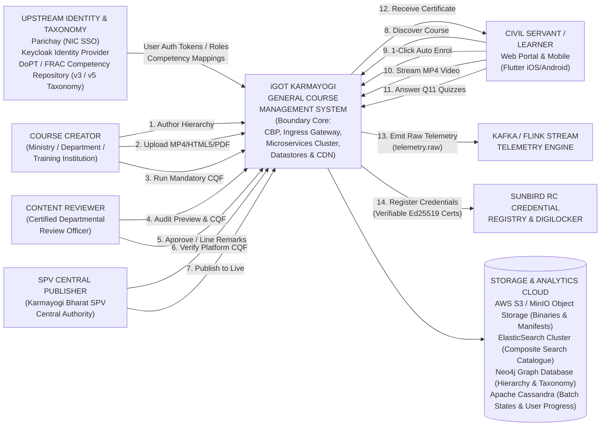
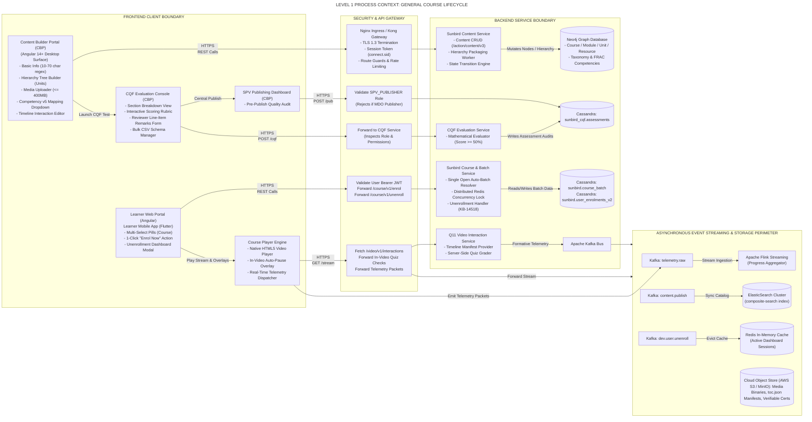
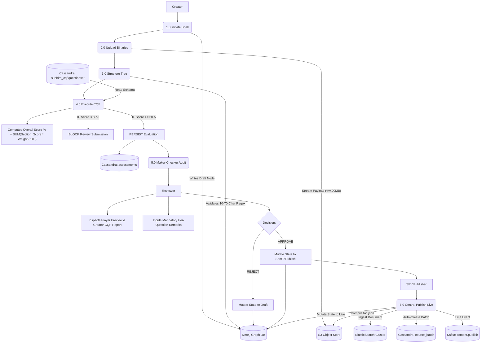
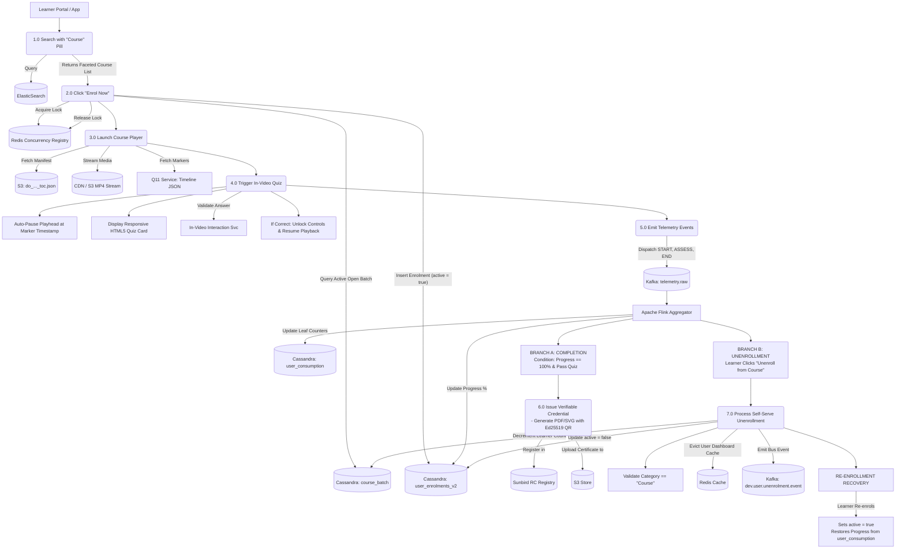
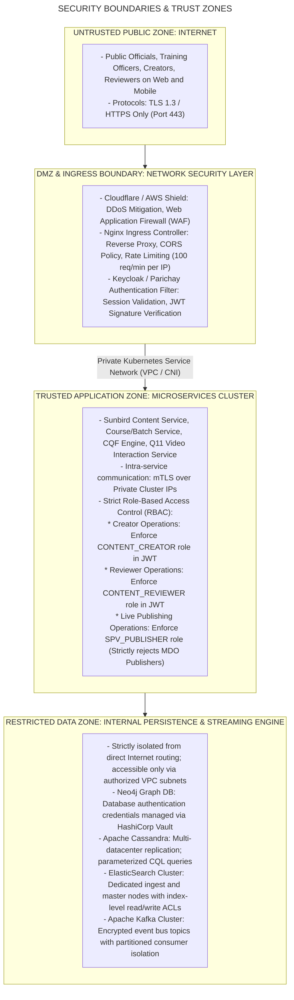

# Course — Context Diagram & System Boundary Architecture

## 1. Executive Summary & Context Scope

### 1.1 Purpose & Scope

This Context Diagram and System Boundary Document establishes the structural, environmental, and behavioral boundaries of the **General Platform Course** capability (`primaryCategory: "Course"`, `contentType: "Course"`) within the broader iGOT Karmayogi digital architecture. It models the complete lifecycle from **Quarter 2 (Q2)** through **Quarter 13 (Q13)**, documenting:

1. **External Stakeholders & Human Actors:** Course Creators, Certified Reviewers, Karmayogi Bharat SPV Central Publishers, and Public Official Learners across web and mobile surfaces.
2. **External Enterprise Systems & Identity Providers:** Parichay (e-Gov Single Sign-On), Keycloak IAM, the National Framework for Roles, Activities, and Competencies (FRAC v3/v5) taxonomy service, Digilocker, and the Sunbird RC Verifiable Credential Registry.
3. **Internal Microservice Ecosystem Boundaries:** The operational perimeter of Sunbird Content, Course, Batch, CQF, In-Video Interaction (Q11), and Telemetry Processing microservices.
4. **Data Stores, Event Streaming & CDN Infrastructures:** Cloud object stores (S3/MinIO), Neo4j graph nodes, Apache Cassandra runtime tables, ElasticSearch clusters, and Apache Kafka/Flink event streaming pipelines.

### 1.2 Evolutionary Context (Q2 to Q13)

- **Q2–Q3 (Foundational Monolith):** Basic boundaries connecting monolithic Angular web templates to Sunbird Content Service v1 with manual open batch creation.
- **Q4–Q5 (Static Quality Checklists):** Addition of MDO Reviewer rejection loops and FRAC v3 competency metadata bindings.
- **Q6 (The Modular Revamp):** Introduction of the Angular 14+ Content Builder Portal (CBP), Configurable CQF schema ingestion, and SPV Publisher gatekeeping (KB-6276, KB-6407, KB-6847, KB-7066).
- **Q7–Q8 (Automated Batching):** Integration of background batch orchestrators and distributed Redis locking engines to enforce single active open batches.
- **Q9–Q10 (AI Augmentation & Decoupling):** Integration with Python LLM orchestration services for automated course structuring and metadata rewriting (KB-8909, KB-9851).
- **Q11 (Active Video Telemetry):** Integration of the native Q11 interactive video timeline overlay engine, replacing legacy SCORM packages.
- **Q12 (Lifecycle Expansion):** Introduction of learner-driven self-serve unenrollment and re-enrollment mechanics (KB-14109, KB-14518, KB-14523).
- **Q13 (Discovery Hardening):** Deployment of responsive multi-select category search pills (`Course`) and background deduplication reconcilers (KB-15689, KAR-1351).

## 2. High-Level Context Diagram (System Boundary Level 0)

The Level 0 Context Diagram establishes the highest-level operational boundary of the **iGOT Course Ecosystem**, representing all external human actors, upstream enterprise identities, external registries, and downstream consumption surfaces.

## 3. Detailed Process Context Diagram (Level 1 Decomposition)

The Level 1 Context Diagram zooms into the operational boundary of the **General Course Management System**, delineating the interaction paths between frontends, the security/ingress boundary, distinct core microservices, and persistence engines.

## 3. Data Flow Context Diagrams (DFD Level 1 & Level 2)

### 3.1 DFD Level 1: Course Authoring, Quality Validation & Live Deployment

### 3.2 DFD Level 2: Learner Discovery, 1-Click Enrolment, Playback & Full Lifecycle

## 4. External Boundary Interface & Interaction Matrix

| External System / Actor | Interface Protocol | Boundary Direction | Consumed / Produced Data Artifacts | Security & Auth Guard | Jira Traceability |
|---|---|---|---|---|---|
| **Parichay / Keycloak** | OAuth2 / OIDC | Inbound to Gateway | User profile, unique identity token, organizational roles (`CONTENT_CREATOR`, `SPV_PUBLISHER`). | Encrypted session cookie (`connect.sid`), Bearer JWT | KB-6847, KB-7066 |
| **FRAC Competency Svc** | REST / JSON | Inbound to CBP | Hierarchical competency taxonomy (Areas, Themes, Sub-themes) for competency tagging. | Internal Microservice Token (Mutual TLS) | KB-8066, KB-6276 |
| **Cloud S3 / MinIO** | S3 API / HTTPS | Bi-Directional | Uploads raw MP4, MP3, HTML5 zips; stores pre-compiled `do_..._toc.json` manifests. | AWS Signature v4, IAM Bucket Policies | PRD 271450154 |
| **Apache Kafka Bus** | TCP / Kafka Wire | Outbound from Core | Dispatches events: `telemetry.raw`, `content.publish`, `dev.user.unenrolment.event`. | SASL_PLAINTEXT, ACL per microservice | KB-1950, KB-14518 |
| **Apache Flink Cluster** | Kafka Consumer | Bi-Directional | Ingests raw telemetry events; performs stateful windowed progress aggregation into Cassandra. | Kafka Kerberos / Internal network boundary | KB-1950, KB-6847 |
| **ElasticSearch** | REST / HTTPS | Inbound / Outbound | Ingests denormalized course documents; executes multi-select faceted search queries. | Basic Auth / Shield Role-Based Security | KB-15689, KAR-1351 |
| **Sunbird RC Registry** | REST / HTTPS | Outbound from Core | Registers issued digital credentials; generates verifiable PDF/SVG certificates with QR codes. | OAuth2 Service Credentials | PRD 271450154 |
| **Digilocker** | REST / Open API | Outbound to Govt | Syncs issued completion certificates to the citizen's national Digilocker repository. | Signed JWT / Public Key Cryptography | PRD 271450154 |

## 5. Security Boundaries, Network Segregation & Trust Zones

## 6. Implementation Task Breakdown & System Context Tracing

```mermaid
flowchart TD
    W1["1. INGRESS & BOUNDARY SECURITY WORKSTREAM<br/>Task 1.1: Configure Nginx Ingress routes for /action/content/v3 and /cqf (KB-6276)<br/>Task 1.2: Implement Parichay/Keycloak JWT claims verifier for SPV_PUBLISHER (KB-7066)<br/>Task 1.3: Set up distributed Redis lock registry for single active open batch enrolment"]
    W2["2. AUTHORING & GOVERNANCE CONTEXT WORKSTREAM<br/>Task 2.1: Implement CBP 3-step wizard boundary components in Angular 14 (KB-6847)<br/>Task 2.2: Enforce frontend/gateway title regex: ^[a-zA-Z0-9\.\-\_\$\/\:\[\]\'\ \!]+$<br/>Task 2.3: Build CQF bulk CSV schema ingestion pipeline and Cassandra mutator (KB-6408)<br/>Task 2.4: Deploy mathematical CQF evaluation engine enforcing #gt;= 50% pass gate (KB-6409)"]
    W3["3. RUNTIME CONSUMPTION CONTEXT WORKSTREAM<br/>Task 3.1: Build multi-select category search filter pills (Course) in UI (KB-15689)<br/>Task 3.2: Implement 1-click open batch assignment handler in Course Service (KB-1950)<br/>Task 3.3: Embed Q11 native video timeline overlay engine and auto-pause gates (Q11 BRD)<br/>Task 3.4: Configure Apache Flink streaming consumer on Kafka topic telemetry.raw"]
    W4["4. LIFECYCLE EXTENSION CONTEXT WORKSTREAM<br/>Task 4.1: Deploy /course/v1/unenroll handler for Course category (KB-14518)<br/>Task 4.2: Build learner dashboard confirmation modal with progress loss warnings (KB-14520)<br/>Task 4.3: Implement Kafka event publisher on topic dev.user.unenrolment.event<br/>Task 4.4: Deploy progress restoration engine for re-enrolling learners (KB-14523)"]
    W1 --> W2
    W2 --> W3
    W3 --> W4
```

## 7. Master Context Traceability Matrix

| System Context Boundary / Interaction | Primary Jira Reference | Parent Initiative / Epic | Source Component | Target Component | Production Implementation Status |
|---|---|---|---|---|---|
| **CBP Authoring Boundary (3-Step Wizard)** | KB-6847 | KB-6276 | Content Creator Web | Content Service | **Fully Implemented** |
| **Validation Bounds (10–70 Chars, )** | KB-6847 | PRD 271450154 | CBP Web Client | API Gateway | **Fully Implemented** |
| **CQF Schema Bulk CSV Ingestion** | KB-6408 | KB-6407 | SPV Publisher Portal | CQF Microservice | **Fully Implemented** |
| **Mathematical CQF Gating ()** | KB-6409 | KB-6407 | CQF Microservice | Content Service | **Fully Implemented** |
| **Maker-Checker Review & Remarking** | KB-6547, KB-7066 | KB-6276 | Reviewer Console | Cassandra `assessments` | **Fully Implemented** |
| **Central SPV Publisher Authorization** | KB-7066, KB-7126 | KB-6649 | SPV Publisher Console | Neo4j `:Course` | **Fully Implemented** |
| **Open Auto-Batch Orchestration** | KB-1950, KB-8065 | KB-1936 | Course Service | Cassandra `course_batch` | **Fully Implemented** |
| **Multi-Select Category Search Pills** | KB-15689, KAR-1351 | KB-15189 | Learner Portal Search | ElasticSearch Cluster | **Fully Implemented** |
| **Q11 Native Video Interaction Overlays** | Q11 BRD | TPT/499974191 | HTML5 Course Player | Video Interaction Svc | **Partially Implemented (Phase 1)** |
| **Self-Serve Course Unenrollment** | KB-14109, KB-14518 | KB-14109 | Learner Dashboard | Cassandra / Kafka Bus | **Fully Implemented** |
| **Re-enrollment Progress Recovery** | KB-14523 | KB-14109 | Course Service | Cassandra Consumption | **Fully Implemented** |

## 8. Conclusion

This Context Diagram and System Boundary Architecture Document defines the comprehensive environmental parameters, external entity interfaces, and internal microservice boundaries for the **Course – General Platform Course Creation & Management** capability across its evolutionary progression from **Quarter 2 through Quarter 13**.

By standardizing validation constraints across ingress boundaries, establishing mathematical Course Quality Framework gates (), decoupling video interactivity via native Q11 timeline overlays, automating open batch creation with concurrency-safe Redis locks, and providing complete lifecycle autonomy via self-serve unenrollment and re-enrollment, the architecture guarantees:

1. **Clear Environmental Segregation:** Deterministic boundaries separating untrusted public users, secure DMZ gateways, trusted internal microservices, and restricted persistence backends.
2. **Pedagogical and Structural Integrity:** Automated gating mechanisms preventing unverified or non-compliant courses from entering public indexing.
3. **Resilient Public Infrastructure:** Non-blocking asynchronous event processing, zero duplicate active batch rows, and sub-second multi-tier responsiveness capable of scaling to millions of civil servants across India.
