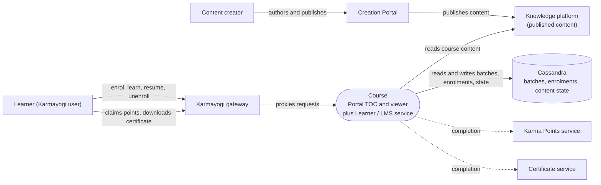

# Course — Context Diagram

## System boundary

Inside the feature is the Course pipeline: the portal's table-of-contents and viewer
screens and the learner/LMS service that holds batches, enrolments and per-node content
state. Outside it are the learner, the gateway in front of the services, the Karma Points
and certificate services that consume completion, the Creation Portal and knowledge
platform that publish course content, and the Cassandra store behind the LMS. There is no
approval workflow in the path.

## Diagram

## Elements

| Element | Role | Detailed in |
|---|---|---|
| Course (portal TOC and viewer, Learner / LMS service) | Central system: direct enrolment, node-by-node progress, completion | [hld.md](hld.md) |
| Learner | Enrols, learns and resumes, unenrolls, claims Karma Points, downloads the certificate | [use-cases.md](use-cases.md) |
| Content creator | Authors and publishes the course | [hld.md](hld.md) |
| Karmayogi gateway | Path from portal to the services | [apis.md](apis.md) |
| Creation Portal | Where course content is published from | [hld.md](hld.md) |
| Knowledge platform | Holds published course content | [hld.md](hld.md) |
| Karma Points service | Downstream consumer of completion; read, claim and totals endpoints | [apis.md](apis.md) |
| Certificate service | Downstream consumer of completion; certificate download endpoint | [apis.md](apis.md) |
| Cassandra | Stores batches, enrolments and content state | [lld.md](lld.md) |

> **Verification boundary:** elements and interactions come from the feature's own pages
> (index, use cases, APIs, HLD, LLD) and the Operations Manual stub, which has no content.
> The feature's docs record no source repo or version. A read-only spot-check of the
> workspace found the gateway proxy layer and the course service containing
> enrolment and batch handling, consistent with the pages. LMS internals, the Karma Points
> and certificate services, and Cassandra schemas were not independently verified. The
> dashed arrows are the documented downstream completion consumers.
