# Course — High-Level Design (HLD)

## 1. Executive Summary & Architectural Intent

### 1.1 Scope & System Intent

The **General Platform Course** (`primaryCategory: "Course"`, `contentType: "Course"`) is the foundational, open-access competency development modality on the iGOT Karmayogi platform. Designed to provide continuous, democratized professional training to all civil servants under the National Programme for Civil Services Capacity Building (NPCSCB), general courses operate under specific architectural rules:

1. **Universal Public Availability:** Accessible to all registered public officials (`accessSetting: "allUsers"`), eliminating organizational whitelists or department-gated isolation.
2. **Automated Single Active Open Batch:** Built on an open auto-batch model (`autoBatch: "Yes"`, `enrollmentType: "open"`), providing instant 1-click self-enrolment and eliminating manual cohort creation.
3. **Quality Governance via Configurable CQF:** Courses must pass an automated, mathematical Course Quality Framework (CQF) threshold () before review submission and live deployment.
4. **Central SPV Publishing Gate:** Maker-checker governance ensures organizational creators and reviewers curate the content, but live production deployment is guarded by the central Karmayogi SPV Publisher (`SPV_PUBLISHER`).
5. **Decoupled Interactive Consumption (Q11):** Video learning decouples interactivity from proprietary SCORM packages, utilizing non-destructive timeline JSON overlays rendered natively over HTML5 streams.
6. **Full Learner Lifecycle Autonomy:** Complete support for self-serve unenrollment (KB-14518), event-driven cache eviction, and re-enrollment with historical progress restoration (KB-14523).

### 1.2 Architectural Objectives

- **Presentation-Tier Decoupling:** Complete separation of authoring (Angular 14+ CBP) and consumption (Angular Web Portal, Flutter Mobile Engine) from core business logic.
- **Stateless Microservice Orchestration:** Deployment across distributed Kubernetes pods communicating via HTTP/REST ingress and asynchronous Apache Kafka event pipelines.
- **Deterministic Quality Gates:** Elimination of unverified content via dynamic CQF assessment validation before state changes.
- **High-Throughput Telemetry Pipeline:** Sub-second ingestion of telemetry events (`START`, `INTERACT`, `ASSESS`, `END`) via Kafka into Apache Flink stateful streaming workers.

## 2. Feature Evolution Matrix (Quarter 2 to Quarter 13)

The architecture of General Platform Courses progressed across 12 product quarters from a monolithic Sunbird wrapper to an enterprise-grade learning system.

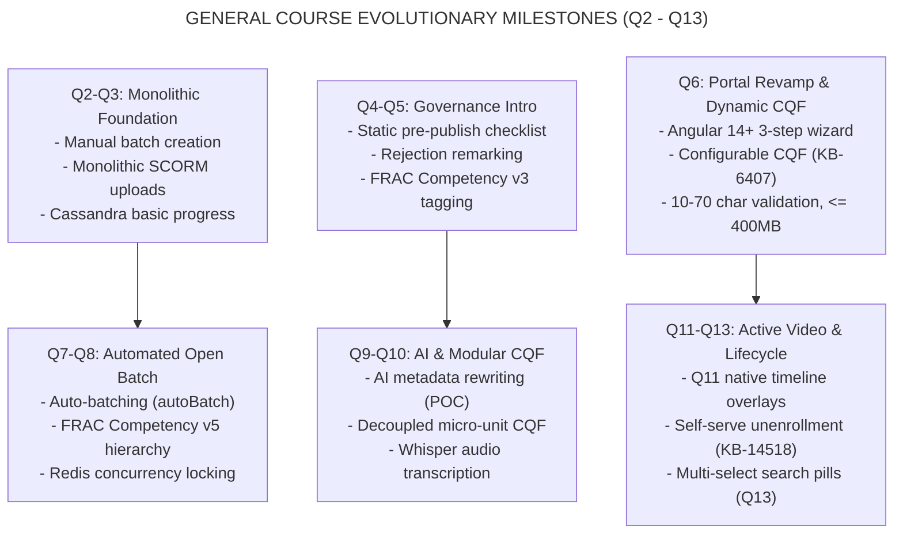

### Detailed Quarterly Analysis

| Quarter Epoch | Focus Area & Key Epics | Functional Evolution | Frontend Client Architecture | Backend Microservices Architecture | Persistence & Streaming Layer |
|---|---|---|---|---|---|
| **Q2 – Q3** | Foundational Batches *(KB-1950, KB-1936)* | Manual batch creation; basic course player; SCORM zip packaging. | Monolithic Angular templates; basic video iframe wrappers. | Sunbird Content Service v1; manual batch management endpoints. | Cassandra `user_content_consumption`; Neo4j graph nodes. |
| **Q4 – Q5** | Static Governance *(KB-**3756, KB-4660)* | Pre-publishing checklist; Reviewer rejection remarks; FRAC v3 tagging. | Basic review console; static checklist checkboxes. | Content Service validation checks; early ElasticSearch sync. | PostgreSQL audit logs; ElasticSearch `composite-search` v1. |
| **Q6** | Content Portal Revamp *(KB-6276, KB-6407, KB-6847, KB-7066)* | 3-step authoring wizard; Configurable CQF scoring; strict validation regex. | Angular 14+ modular architecture; reactive CQF questionnaire UI. | CQF microservice deployed; mathematical score aggregator (). | Cassandra `sunbird_cqf.questionset` & `assessments` tables. |
| **Q7 – Q8** | Auto-Batching Engine *(KB-8065, KB-8066, KBE-582)* | Automated open batching; race condition elimination; FRAC v5 taxonomy. | 1-click "Enrol Now" button; hierarchical competency picker. | Background open batch creator; distributed Redis concurrency locks. | Cassandra `course_batch` auto-generation; Redis lock registry. |
| **Q9 – Q10** | AI Assist & Modular CQF *(KB-8909, KB-9851, KB-11977)* | AI outline generator POC; decoupled CQF for standalone micro-units. | AI metadata prompt helper; modular tabbed CQF rubric views. | Python LLM orchestration pipeline; decoupled QuestionSet evaluator. | Vector embeddings in pgvector; Cassandra CQF modular schema. |
| **Q11** | Native Video Interactivity *(Q11 BRD - TPT/499974191)* | Non-destructive video timeline overlays; formative in-video quizzes. | Timeline marker editor in CBP; HTML5 responsive video overlay layer. | Video Interaction Service (`/video/v1/interactions`); quiz evaluator. | S3 JSON timeline manifests; telemetry assessment events. |
| **Q12** | Full Lifecycle Autonomy *(KB-14109, KB-14518, KB-**14520, KB-14523)* | Self-serve unenrollment; re-enrollment with historical progress recovery. | Unenrollment confirmation modal; progress warning indicators. | Sunbird Course Service unenroll handler; Kafka event dispatcher. | Cassandra `user_enrolments_v2` mutation (`active:` `false`). |
| **Q13** | Faceted Discovery & Reconciliation *(KB-15689, KAR-1351)* | Multi-select search pills (`Course`); duplicate batch cleanup jobs. | Multi-select filter pills; instant facet count updates. | ElasticSearch aggregation tuning; automated batch reconciler. | Automated cleanup scripts in Cassandra `course_batch`. |

## 3. High-Level Architecture Diagram (End-to-End System Topology)

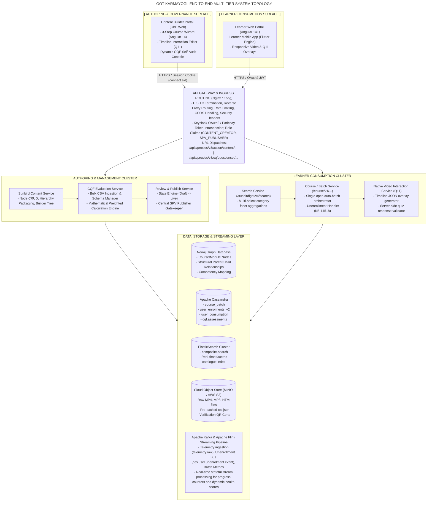

## 4. End-to-End Architectural Workflows (Frontend-to-Backend)

### 4.1 Subsystem 1: Course Authoring, Tree Structuring & Payloads

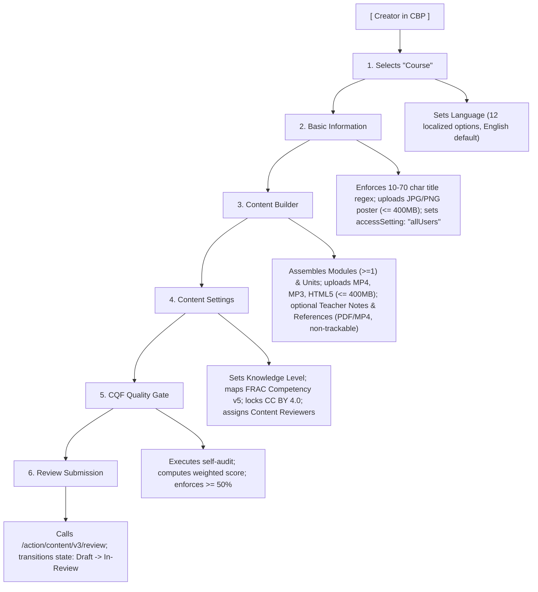

#### Technical Payload & Validation Specifications

1. **Creation Initiation:**
  - **Endpoint:** `POST /apis/proxies/v8/action/content/v3/create`
  - **Payload:**

```json
{
  "request": {
    "content": {
      "name": "Public Financial Administration and GFR Rules",
      "description": "Standardized principles of government budgeting and procurement.",
      "contentType": "Course",
      "primaryCategory": "Course",
      "accessSetting": "allUsers",
      "mimeType": "application/vnd.ekstep.content-collection",
      "framework": "igot",
      "language": [
        "English"
      ]
    }
  }
}
```

- **Backend State:** Content Service provisions a node in Neo4j with properties `status: "Draft"`, `visibility: "Default"`. Returns identifier `do_114389201`.

1. **Builder Tree Validation Rules:**
  - **Title Regex:** Must strictly match `^[a-zA-Z0-9\.\-\_\$\/\:\[\]\'\ \!]+$` with length between **10 and 70 characters**.
  - **Media Payloads:** File uploads streamed via multipart form-data to `/action/content/v3/upload/{do_id}`. Enforces upper limit: .
  - **Collection Tree:** Must contain at least one Module; each Module must contain at least one consumable resource.

### 4.2 Subsystem 2: Course Quality Framework (CQF) Mathematical Engine

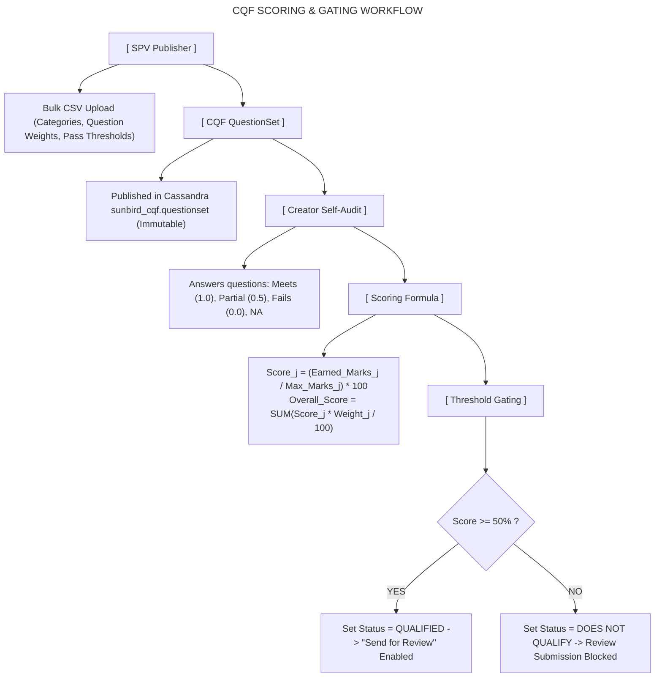

#### Scoring Formulations & Tier Classifications

The CQF schema defines categories where section weights sum to :

Each category score is derived from questions:

Cumulative weighted evaluation:

- **Threshold Gate:** If , the UI and API layer enforce **Does Not Qualify**. The "Send for Review" action is strictly disabled.
- **Tier Categorization:**
  - : `Does Not Qualify` (Submission blocked)
  - : `iGOT Basic`
  - : `iGOT Intermediate`
  - : `iGOT Advanced`

### 4.3 Subsystem 3: Maker-Checker Governance & SPV Live Publishing

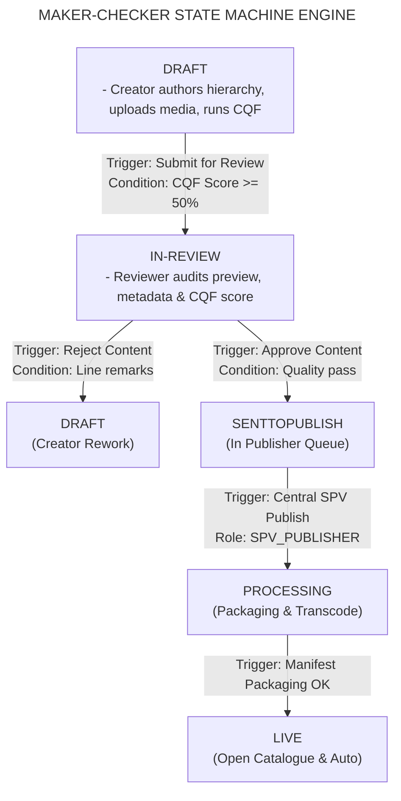

#### Review & Publishing Gate Mechanics

1. **Maker-Checker Inspection:** Content Reviewer inspects preview player rendering, verifies competency mappings, and audits the creator's CQF submission. The reviewer can independently re-evaluate the CQF, with per-question remarks being mandatory.
2. **Central SPV Publishing Authority:** While department reviewers approve content into `SentToPublish`, publication to `Live` requires authorization by a user holding the `SPV_PUBLISHER` role.
3. **Automated Live Packaging Pipeline:**
  - Ingestion worker compiles hierarchy manifest `do_..._toc.json` and pushes it to cloud storage.
  - Neo4j node transitions to `status: "Live"`.
  - Emits message to Kafka topic `content.publish`.
  - ElasticSearch indexes the document into `composite-search`.
  - Course Service initializes an open batch in Cassandra `sunbird.course_batch` (`status: 1`, `enrollmentType: "open"`).

### 4.4 Subsystem 4: Learner Discovery & 1-Click Open Auto-Batching

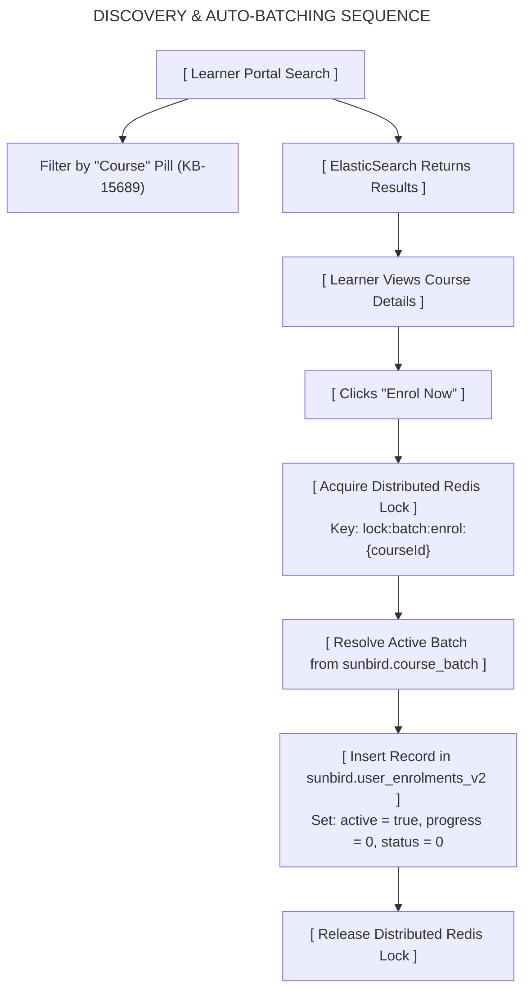

- **Faceted Search Aggregation:** The Learner Portal constructs an ElasticSearch search payload querying `primaryCategory: ["Course"]` and `status: ["Live"]`. Filter pills dynamically update facet counts across Competency Area, Duration Range, Sponsoring Ministry, and Language.
- **Concurrency-Safe Open Enrolment:**
  - When a learner clicks "Enrol", the system resolves the active open batch ID.
  - To eliminate enrollment race conditions, the system secures a distributed Redis lock on `lock:batch:enrol:{courseId}`.
  - Writes to Cassandra table `sunbird.user_enrolments_v2` with `active: true` and releases the lock.

### 4.5 Subsystem 5: Q11 Native Interactive Video Playback Engine

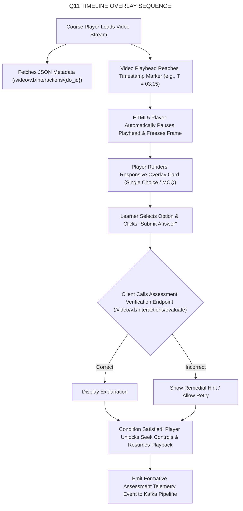

- **Timeline-Based Decoupling:** Video files (.mp4) remain unmodified on cloud storage. Interactive markers are defined in an adjacent JSON manifest:
  ```json
  {
    "contentId": "do_114389201",
    "version": "1.0",
    "interactions": [
      {
        "interactionId": "q11_int_001",
        "timestamp": 195,
        "type": "SINGLE_CHOICE_MCQ",
        "mandatory": true,
        "question": "What is the primary objective of the Course Quality Framework (CQF)?",
        "options": [
          {
            "id": "opt_a",
            "text": "To restrict user enrolment",
            "correct": false
          },
          {
            "id": "opt_b",
            "text": "To enforce standardized pedagogical quality",
            "correct": true
          }
        ],
        "explanation": "CQF enforces standardized quality thresholds prior to publishing."
      }
    ]
  }
  ```
- **Runtime Overlay Mechanics:** When the playhead crosses a marker timestamp, the player automatically triggers a pause. If `mandatory: true`, playback controls remain locked until the question is answered and validated server-side.

### 4.6 Subsystem 6: Telemetry, Progress Streaming & Unenrollment Lifecycle

```mermaid
---
title: PROGRESS & UNENROLLMENT PIPELINES
---
flowchart TD
    subgraph PSP["[ PROGRESS STREAMING PIPELINE ]"]
        P1["Player Dispatches Telemetry Events (START, INTERACT, ASSESS, END)"]
        P2["Kafka Ingress (telemetry.raw)"]
        P2a["Apache Flink Stateful Aggregation"]
        P3["Calculate: Progress % = (Completed Leaf Nodes / Total Leaf Nodes) * 100"]
        P4["Update Cassandra: sunbird.user_content_consumption & user_enrolments_v2"]
        P5["Condition: Progress == 100% & Pass Assessment"]
        P6["Trigger Sunbird RC Credential Svc<br/>(Generate PDF/SVG with Ed25519 Cryptographic QR Code Signature)"]
        P1 --> P2 --> P2a
        P2 --> P3 --> P4 --> P5 --> P6
    end
    subgraph ULP["[ UNENROLLMENT LIFECYCLE PIPELINE (KB-14518) ]"]
        U1["Learner Clicks #quot;Unenroll from Course#quot; in Dashboard Modal"]
        U2["POST /apis/proxies/v8/course/v1/unenroll"]
        U3["Validate System Config: course_unenroll_allowed_primary_category = Course,Moderated Course"]
        U4["Mutate Cassandra: user_enrolments_v2 -> Set active = false, unenrolled_date = now()"]
        U5["Emit Kafka Event: dev.user.unenrolment.event -> Evict Redis Dashboard Cache"]
        U6["[ RE-ENROLLMENT RECOVERY (KB-14523) ]<br/>Learner Re-enrols -> Mutate active = true -> Restore Historical Progress from Cassandra"]
        U1 --> U2 --> U3 --> U4 --> U5 --> U6
    end
```

## 5. Microservice Interaction Sequence Diagram

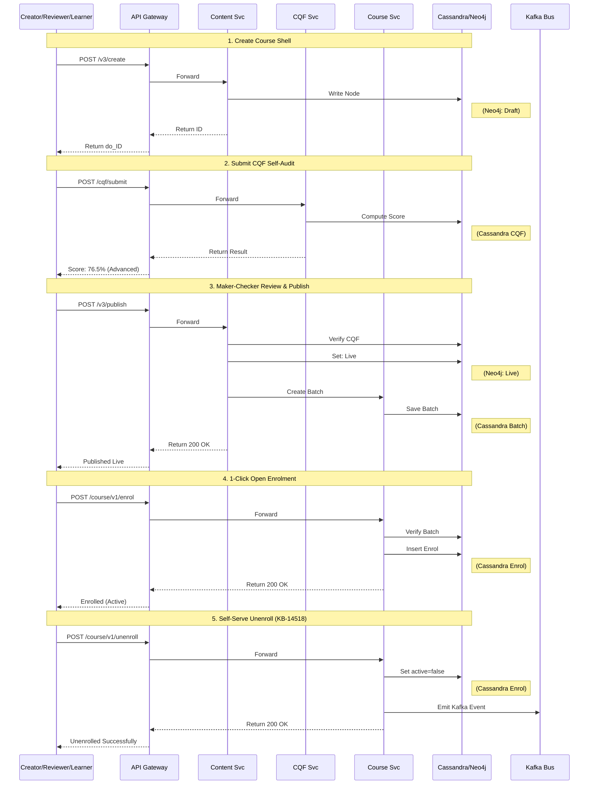

## 6. Data Architecture & Storage Schema

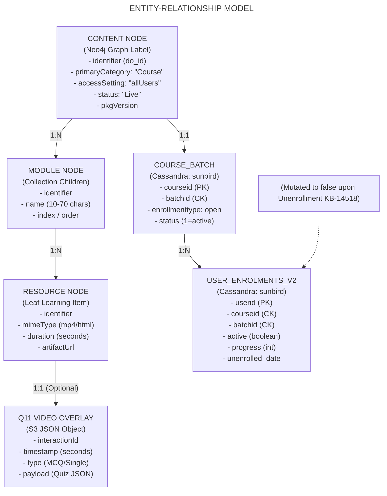

### 6.1 Database Engine Distribution

- **Neo4j Graph Database:** Primary store for course structural trees, module order indexes, and taxonomic linkages (FRAC Competency v5).
- **Apache Cassandra:**
  - `sunbird.course_batch`: Manages active open batches.
  - `sunbird.user_enrolments_v2`: High-throughput table for active enrollment states, progress integers, and unenrollment timestamps.
  - `sunbird.user_content_consumption`: Detailed leaf-node consumption counters.
  - `sunbird_cqf.assessments`: Immutable audit records of Creator, Reviewer, and Publisher quality evaluations.

- **ElasticSearch** (`composite-search` Index): Denormalized catalogue index supporting multi-select category search pills and faceted aggregations.
- **Cloud Object Store (MinIO / S3):** Hosts immutable media files (MP4, MP3, HTML5), Q11 interaction JSON overlays, compiled `toc.json` manifests, and verifiable credential PDFs/SVGs.

## 7. API Gateway & Microservice Interface Specifications

| API Endpoint | HTTP Method | Consuming Surface | Owning Microservice | Core Purpose & Guard |
|---|---|---|---|---|
| `/apis/proxies/v8/action/content/v3/create` | `POST` | CBP Web Client | Sunbird Content Service | Creates `Course` shell. Requires `CONTENT_CREATOR` role. |
| `/apis/proxies/v8/action/content/v3/update/{id}` | `PATCH` | CBP Web Client | Sunbird Content Service | Updates metadata: 10–70 char titles, descriptions, competencies. |
| `/apis/proxies/v8/cqfquestionset/submit` | `POST` | CBP Web Client | CQF Evaluation Service | Evaluates CQF questions; computes category scores; enforces 50% pass threshold. |
| `/apis/proxies/v8/action/content/v3/review/{id}` | `POST` | Reviewer Console | Sunbird Content Service | Submits course for review or approves review; logs line remarks. |
| `/apis/proxies/v8/action/content/v3/publish/{id}` | `POST` | Publisher Console | Content Publish Service | Central SPV live deployment; triggers manifest packaging and live indexing. |
| `/apis/proxies/v8/sunbirdigot/v4/search` | `POST` | Learner Portal / App | Search Service | Executes faceted search; filters on `primaryCategory: ["Course"]`. |
| `/apis/proxies/v8/course/v1/enrol` | `POST` | Learner Portal / App | Sunbird Course Service | Executes 1-click self-enrolment into single open auto-batch. |
| `/apis/proxies/v8/video/v1/interactions/{id}` | `GET` | Course Player Engine | Video Interaction Svc | Fetches non-destructive JSON timeline overlay schema and quiz definitions. |
| `/apis/proxies/v8/course/v1/unenroll` | `POST` | Learner Dashboard | Sunbird Course Service | Executes self-serve unenrollment (KB-14518); updates Cassandra; emits Kafka event. |

## 8. Non-Functional Architecture & System Attributes

**NON-FUNCTIONAL ATTRIBUTES (NFRs)**

| Dimension | Target SLA / Metric | Architectural Design Mechanism |
|---|---|---|
| Latency | P95 < 600 ms | Redis caching for course hierarchies; pre-compiled CDN manifests (toc.json). |
| Search Latency | P99 < 250 ms | ElasticSearch sharding on primaryCategory. |
| Concurrency | 25,000 active learners | Stateless Kubernetes pods with HPA (>= 70%). |
| Telemetry Bus | >= 10,000 events/second | Kafka topic partitioned across 16 workers; stateful streaming via Apache Flink. |
| Reliability | Zero duplicate active enrolments (0.00%) | Single-active-batch enforcement; distributed Redis locks on enrolment calls. |
| Disaster Recovery | RTO <= 4 hours | Multi-region Cassandra & S3 bucket mirroring. |

## 9. Comprehensive Implementation Task Breakdown

```mermaid
flowchart TD
    W1["1. CBP AUTHORING & CREATION WORKSTREAM<br/>Task 1.1: Build 3-Step Wizard components in Angular 14 (KB-6847)<br/>Task 1.2: Enforce regex validation (Titles: 10-70 chars, Uploads: #lt;= 400MB)<br/>Task 1.3: Integrate FRAC Competency v5 taxonomy picker (KB-8066)<br/>Task 1.4: Implement Q11 non-destructive timeline interaction editor (Q11 BRD)"]
    W2["2. QUALITY & GOVERNANCE WORKSTREAM<br/>Task 2.1: Develop CSV bulk upload engine for CQF schemas (KB-6408)<br/>Task 2.2: Implement mathematical scoring engine enforcing #gt;= 50% threshold (KB-6409)<br/>Task 2.3: Build Reviewer/Publisher audit console with side-by-side CQF reports (KB-6547)<br/>Task 2.4: Deploy central SPV Publisher authorization gatekeeper (KB-7066)"]
    W3["3. RUNTIME & PLAYER WORKSTREAM<br/>Task 3.1: Deploy responsive multi-select category search pills (KB-15689)<br/>Task 3.2: Implement 1-click open batch auto-assignment with Redis locking (KB-1950)<br/>Task 3.3: Embed Q11 native HTML5 video player auto-pause overlay engine (Q11 BRD)<br/>Task 3.4: Configure Sunbird RC Credential Service for verifiable PDF/SVG issuance"]
    W4["4. FULL LIFECYCLE WORKSTREAM<br/>Task 4.1: Deploy unenrollment microservice endpoint (/course/v1/unenroll) (KB-14518)<br/>Task 4.2: Build learner dashboard unenrollment modal with progress warnings (KB-14520)<br/>Task 4.3: Implement Kafka event dispatcher (dev.user.unenrolment.event)<br/>Task 4.4: Deploy progress restoration engine for re-enrolling learners (KB-14523)"]
    W1 --> W2 --> W3 --> W4
```

## 10. Master Traceability Matrix

| Requirement / Architecture Component | Primary Jira Reference | Parent Initiative / Epic | Primary System Entity | Implementation Status |
|---|---|---|---|---|
| **Course Creation Wizard** | KB-6847 | KB-6276 | Neo4j `:Course` | **Fully Implemented** |
| **Validation Bounds (10–70 chars)** | KB-6847 | PRD 271450154 | Content Service | **Fully Implemented** |
| **Configurable CQF Schema Ingestion** | KB-6408 | KB-6407 | Cassandra `questionset` | **Fully Implemented** |
| **Mathematical CQF Gating ()** | KB-6409 | KB-6407 | CQF Microservice | **Fully Implemented** |
| **Reviewer & SPV Audit Console** | KB-6547, KB-7066 | KB-6276 | Cassandra `assessments` | **Fully Implemented** |
| **Central SPV Live Publishing** | KB-7066, KB-7126 | KB-6649 | Neo4j `status: Live` | **Fully Implemented** |
| **Open Auto-Batch Orchestration** | KB-1950, KB-8065 | KB-1936 | Cassandra `course_batch` | **Fully Implemented** |
| **Multi-Select Search Pills** | KB-15689, KAR-1351 | KB-15189 | ElasticSearch Facets | **Fully Implemented** |
| **Native Q11 Video Interactivity** | Q11 BRD | TPT/499974191 | S3 JSON Overlays | **Partially Implemented (Phase 1)** |
| **Self-Serve Unenrollment Engine** | KB-14518, KB-14520 | KB-14109 | Cassandra / Kafka | **Fully Implemented** |
| **Re-enrollment Progress Recovery** | KB-14523 | KB-14109 | Cassandra Progress | **Fully Implemented** |

## 11. Conclusion

This High-Level Design (HLD) document defines the architectural, structural, and operational baseline for the **Course – General Platform Course Creation & Management** feature across its evolutionary lifecycle from **Q2 through Q13**.

By standardizing validation schemas (10–70 character titles, assets), enforcing mathematical Course Quality Framework gates (), centralizing live publishing with the SPV Publisher, decoupling in-video interactivity via Q11 timeline overlays, automating open batch creation with Redis concurrency locks, and providing complete lifecycle autonomy via self-serve unenrollment and re-enrollment, the architecture achieves:

1. **High Pedagogical Quality:** Mathematically governed, audit-logged standards before courses are published.
2. **Frictionless Learner Experience:** 1-click open auto-enrollment, responsive cross-platform video consumption, and sub-second progress persistence.
3. **Enterprise Resilience:** Deterministic state machine transitions, zero duplicate active batch records, and scalable, decoupled microservice performance across millions of civil servants.
