## 1. Executive Summary

### 1.1 Feature Overview

The **General Platform Course** represents the foundational digital learning modality on the iGOT Karmayogi Platform. A standard platform course is an open-access, competence-building learning asset delivered across web and mobile surfaces to all onboarded civil servants. Unlike moderated courses (restricted to specific Ministries, Departments, or Organizations [MDOs]) or invite-only cohorts, general platform courses are universally discoverable, support autonomous self-enrolment, leverage auto-batched open tracking, and execute structured assessments issuing cryptographically verifiable digital credentials.

The end-to-end lifecycle spans eleven interrelated phases:

```mermaid
flowchart LR
    A["Course Initiation"] --> B["Content Authoring"]
    B --> C["Asset Ingestion"]
    C --> D["CQF Self-Assessment"]
    D --> E["Review & Approval"]
    E --> F["SPV Publishing"]
    F --> G["ElasticSearch Indexing"]
    G --> H["Learner Discovery"]
    H --> I["Self-Enrolment"]
    I --> J["Course Consumption (Native Video / Q11 Interactions)"]
    J --> K["Telemetry/LRS"]
    K --> L["Certificate Issuance"]
```

### 1.2 Business Objectives & Platform Value

1. **Democratized Competency Development:** Providing unhindered, continuous capacity building across Behavioral, Functional, and Domain competencies aligned with the National Programme for Civil Services Capacity Building (NPCSCB).
2. **Quality Governance via Configurable CQF:** Enforcing standard pedagogical and technical quality benchmarks prior to publication through an immutable, versioned Course Quality Framework (CQF).
3. **Decoupled Architecture & Frictionless Authoring:** Eliminating third-party authoring tool dependencies (e.g., proprietary SCORM authoring tools) through the Content Portal UI/UX revamp and native timeline-based interactive video engines (Q11).
4. **AI-Driven Acceleration:** Progressing from purely manual authoring toward AI-assisted metadata rewriting, automated competency mapping, and one-click course generation from source policy and training documents.

### 1.3 Current Functional State

- **Authoring & Hierarchy:** Fully operational via the CBP Content Builder, supporting Collections (`application/vnd.ekstep.content-collection`), Course Units, and Resources (MP4, MP3, HTML, Assessment QuestionSets) with strict payload constraints (file size ; names between and characters).
- **Course Quality Framework (CQF):** Configurable CQF is implemented in production; SPV Publishers define categories, section weights, thresholds, and question matrices via CSV. Creators must clear the configured overall passing percentage () to unlock review submission.
- **Review & Publishing:** Multistage maker-checker workflow operational. Standard courses require SPV Publisher sign-off and CQF verification before becoming `Live`.
- **Learner Consumption:** Open auto-batched enrolment (`enrollmentType: "open"`, `autoBatch: "Yes"`), adaptive resume capability, Sunbird Content Player execution, and automated certificate issuance upon passing criterion evaluation.
- **Q11 Native Video Interactions:** Specification completed and implemented; decouples interactions from SCORM wrappers using an absolute-timestamp JSON overlay layer on standard MP4 streams.
- **AI Course Generation:** Proof-of-concept (POC) and Phase 1 metadata generation implemented; fully autonomous end-to-end course generation remains under active development.

## 2. Feature Scope

### 2.1 In-Scope Functionality

- **Creator Workflows:** Login via Parichay (SSO), OTP, or Password; Course Type selection; 12-language localization selection; Basic metadata entry; Content Builder hierarchy management (Modules, Resources, References, Teacher Notes); Asset uploads (MP3, MP4, HTML); External web links; Metadata mapping (Taxonomy, Competencies v3/v5, Knowledge Levels, Licensing).
- **Quality Assurance Workflows:** Mandatory CQF self-assessment; real-time score computation across weighted sections; Category-level feedback; Creator, Reviewer, and Publisher independent audit scores and remarks.
- **Maker-Checker Governance:** State transitions (`Draft` `In-Review` `Reviewed` `Processing` `Live` / `Rejected`); Reviewer inline remarking; Publisher final evaluation.
- **Catalogue & Discovery:** ElasticSearch indexing; faceted search across competency themes, duration, provider, and knowledge levels; Open catalogue exposure.
- **Learner Consumption:** Seamless web and mobile consumption; Table of Contents navigation; HTML5 native video playback; Q11 interaction overlays (embedded MCQs, Single Choice, Bookmarks, Jump triggers); LRS progress telemetry (`application/vnd.ekstep.content-collection`); Assessment evaluation; Verifiable PDF/SVG certificate generation.

### 2.2 Out-of-Scope Functionality

- **Cohort-Restricted Enrolment:** Restricted MDO whitelisting, custom learner approvals, or batch-managed cohort access (exclusive to *Moderated Courses*).
- **Offline Instructor-Led Training (ILT):** Physical venue scheduling, physical attendance management, and hybrid offline sessions (exclusive to *Blended Programs*).
- **Branching Video Scenarios:** Adaptive non-linear decision trees in Q11 video playback (flagged as future phase; Phase 1 enforces pause-and-interact logic).
- **Direct Content Creation by External Public Users:** Only authenticated users holding organizational `CBP Creator` or `Content Creator` roles can initiate courses.

## 3. Source and Reference Inventory

### 3.1 Primary Jira References

| Issue Key | Type | Summary | Target Quarter | Resolution / Status |
|---|---|---|---|---|
| **KB-6276** | Epic | Q6 \| Content Portal \| UI/UX Revamp | Q6 | KB Approved / Done |
| **KB-6407** | Epic | Q6 \| Content Portal \| Configurable CQF | Q6 | Prod Deployed |
| **KB-6847** | Story | Content Portal \| Navigation & UX on Course Creation for Creator | Q6 | Prod Deployed |
| **KB-7044** | Story | Content Portal \| Navigation & UX on Standalone Resource Creation | Q6 | Prod Deployed |
| **KB-7066** | Story | Content Portal \| Navigation & UX for Reviewer and Publisher | Q6 | Prod Deployed |
| **KB-7126** | Story | Q6 \| CIOS \| Publish and Manage Courses (Marketplace) | Q6 | Prod Deployed |
| **KB-1950** | Story | Q3 \| Content Portal Redesign \| Learner Consumption for All Types | Q3 | Prod Deployed |
| **KB-11977** | Epic | Q10 \| Ad-Hoc \| Separate CQF for Course Creation | Q10 | In Progress |
| **KB-10505** | Epic | Q9 \| AI Driven Course Creation \| V1 | Q9 | In Progress |
| **KB-9851** | Epic | Q9 \| AI Driven Course Creation | Q9 | Open / In Progress |
| **KB-8909** | Story | Q9 \| AI Driven One Click Course Creation \| POC \| CBP Portal | Q9 | In Progress |

### 3.2 Primary Requirement & Technical Specifications

- **PRD – Course Creation, Review & Publish:** [Course Creation,Review&Publish](https://karmayogibharat.atlassian.net/wiki/spaces/KQAS/pages/271450154/Course+Creation+Review+Publish) — Authoring UX, validation rules, state management, upload limits.
- **SRS – Content Portal UI/UX Revamp:** [SRS - Content Portal | UI/UX Revamp](https://karmayogibharat.atlassian.net/wiki/spaces/TES/pages/274628785/SRS+-+Content+Portal+UI+UX+Revamp) — Information architecture, Angular front-end, Nginx routing, Java middleware.
- **Q11 BRD – Native Video Interactions:** [Q11 | BRD | Add interactions in the iGOT Courses Videos](https://karmayogibharat.atlassian.net/wiki/spaces/TPT/pages/499974191/Q11+BRD+Add+interactions+in+the+iGOT+Courses+Videos) — MP4 non-destructive timeline overlay engine, pause logic, auto-scoring.
- **BRD – Configurable CQF:** [KB - 6407 | KB_BRD_CQF](https://karmayogibharat.atlassian.net/wiki/spaces/TPT/pages/161317222/KB+-+6407+KB_BRD_CQF) — Schema definition, SPV Publisher governance, weighted scoring.
- **API Specifications:**
  - CQF Assessment APIs (`TES/175702042`)
  - Create Content API (`TES/274628914`)
  - Content Hierarchy Read API (`TES/71434251`)
  - Content Detail Read API (`TES/71434296`)

## 4. Feature Evolution – Quarter-Wise Analysis

The platform course model evolved from a monolithic, SCORM-reliant Sunbird implementation to an extensible, microservice-driven, AI-augmented digital learning ecosystem.

| Quarter | Business Objective | Major Capabilities Introduced | Jira References | Functional Evolution | Technical Evolution | Consumption Impact |
|---|---|---|---|---|---|---|
| **Q2 – Q3** | Foundational Course Structure & Consumption | Sunbird content collections, manual batch creation, basic learner consumption | KB-1950, KB-1936 | Creators build courses; open batched courses introduced for general public learner access | Core Sunbird Content Service, Neo4j graph storage, Cassandra learner progress tables | Basic web/mobile playback; external SCORM zip uploads |
| **Q4 – Q5** | Static Quality Checklists & Basic Governance | Pre-publishing checklist, basic reviewer approvals, initial competency tagging | KB-3756, KB-466 | Static mandatory checklists added before submission; review rejection comments | Introduction of validation microservices; early ElasticSearch indexing pipelines | Learners gain competency tag visibility on course cards |
| **Q6** | Content Portal Revamp & Configurable CQF | Complete UI/UX redesign, Configurable CQF, separate Resource/Module builder, Teacher Notes | KB-6276, KB-6407, KB-6847, KB-7066, KB-7126 | Streamlined 3-step authoring (Basic Info Builder Settings); CQF scoring matrix; Marketplace publishing | Angular 14+ client redesign; JSON-based CQF schema engine (`vnd.sunbird.questionset`); Nginx proxy optimization | Faster load times; clear distinction between general and moderated courses |
| **Q7 – Q8** | Automated Batching & Competency v5 | Removal of manual batch creation for general courses; FRAC Competency v5 integration | KB-8065, KB-8066 | Automatic open-batch generation (`autoBatch: Yes`); hierarchical 3-level competency mapping | Batch service automated background workers; FRAC graph traversal microservices | Instant 1-click self-enrolment for learners; zero batch setup friction |
| **Q9** | AI-Assisted Authoring (POC) | One-click course generation POC, AI metadata re-writing, automated competency suggestions | KB-9851, KB-10505, KB-8909 | Raw PDF/document parsing into course outlines; automated summary generation | Python LLM orchestration layer; vector embedding pipelines; ingestion workers | Accelerated catalogue expansion; higher metadata consistency |
| **Q10** | CQF Modularization & Independent Workflows | Decoupled CQF frameworks for general courses vs assessments; category weighting | KB-11977, KB-11582 | Distinct CQF rules for short-form resources vs full-scale courses | Extended Sunbird Questionset assessment evaluator; dynamic threshold calculation | Higher quality assurance; better alignment of quality signals to content length |
| **Q11** | Native Interactive Video Experiences | Timeline interaction editor in CBP; HTML5 overlay engine; in-video auto-graded quizzes | Q11 BRD (TPT/499974191) | Elimination of SCORM packaging for video interactions; embedded MCQs, bookmarks, jump triggers | Non-destructive JSON timeline schema; native video player wrapper; server-side quiz grading | Instant, low-latency mobile/web interaction; zero popup windows; resume persistence |
| **Q12 – Q14** | Content Health Score (CHS) & AI Course Engine V1 | AI CBP Tool hardening, dynamic content health scores, automated transcript generation | KB-14382, KB-10505 | Static (CQF) + Dynamic (learner ratings, drop-offs) score; automated multi-format ingestion | Apache Flink streaming telemetry analytics; Whisper/transcription workers; LLM pipelines | Transparent Green/Amber/Red course quality badges; highly tailored course recommendations |

## 5. Complete Course Creation and Management Lifecycle

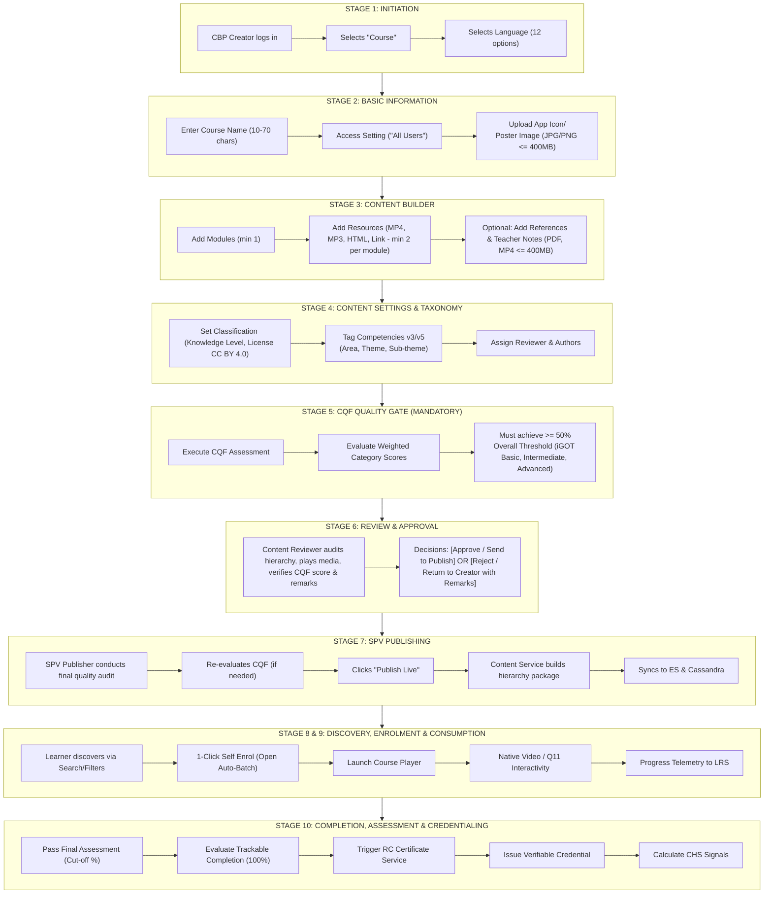

### Detailed Lifecycle Stages

#### Stage 1 – Course Initiation

- **Actor:** User with `CBP Creator` or `Content Creator` role.
- **Portal:** Content Portal (`cbp.karmayogibharat.net` / `portal.karmayogibharat.net`).
- **Authentication:** Keycloak OAuth2 / Parichay SSO session cookie (`connect.sid`).
- **Action:** Creator clicks "Create Content" Selects "Course" card A localized modal displays 12 supported Indian languages (English pre-selected by default) Clicks "Save & Proceed".

#### Stage 2 – Course Authoring: Basic Information

- **Course Name:** Mandatory text field. Minimum length: **10 characters**, Maximum length: **70 characters**. Validated against regex: `^[a-zA-Z0-9\.\-\_\$\/\:\[\]\'\ \!]+$`.
- **Access Settings:** Mandatory selection. Options:
  - `All Users`: Designates the asset as a **General Platform Course**, accessible to every registered civil servant.
  - `MDO Specific`: Restricts access to selected organizations (**Moderated Course**).

- **Media Assets (App Icon / Poster Image):** Supported formats: **JPG, PNG**. Size limit: . Uploaded to cloud object store (S3/MinIO) via Content Service asset proxy.

#### Stage 3 – Content Upload & Hierarchy Structuring

- **Hierarchical Node Model:** Built as an EkStep collection (`application/vnd.ekstep.content-collection`).
- **Modules (Units):** Course must contain structured modules. Module name enforces 10–70 character validation.
- **Child Resources:** Modules require learning assets:
  - **Video (MP4):** Direct file upload () with automatic transcoding and duration extraction.
  - **Audio (MP3):** Streamed audio assets ().
  - **Interactive/Web (HTML):** Zipped HTML5 packages () with manual duration specification.
  - **External Links:** Whitelisted web URLs with mandatory designated duration.
  - **Assessments:** Practice or final assessments built as Sunbird QuestionSets (`application/vnd.sunbird.questionset`).

- **Non-Trackable Supporting Material:**
  - **Teacher Notes & References:** Creators can attach supplementary PDFs or MP4s at the course level. These are explicitly non-trackable (excluded from learner progress percentage calculation).

#### Stage 4 – Content Settings & Taxonomy Configuration

- **Classification:** Knowledge Level dropdown (`Beginner`, `Intermediate`, `Advanced`, `Expert`); Pre-configured mandatory license (`CC BY 4.0`); Free-text keywords.
- **Competency Mapping (FRAC v3/v5):** Mandatory selection. Area selection (`Behavioral`, `Functional`, `Domain`) dynamically populates Themes and Sub-themes. Multiple competencies can be mapped.
- **Stakeholder Assignment:**
  - *Curator / Contact:* Auto-populated from creator identity; disabled.
  - *Authors:* Multi-select lookup across registered platform users.
  - *Reviewers:* Mandatory selection of one or more certified Content Reviewers.

#### Stage 5 – Course Quality Framework (CQF) Quality Gate

- Prior to submission for review, the Content Creator **must** launch and complete the CQF evaluation test.
- Evaluates pedagogical, structural, and technical parameters. If the cumulative weighted score is **below the overall passing threshold (e.g., )**, the "Send for Review" action is strictly disabled.

#### Stage 6 – Course Review & Approval Workflow

- **Submission:** Creator submits course; state transitions to `In-Review`.
- **Reviewer Audit:** The assigned Content Reviewer inspects:
  - Content Player preview for every resource.
  - Taxonomy, licensing, and metadata accuracy.
  - CQF Report: Reviewer can inspect creator responses and has the authority to independently retake the CQF evaluation, adding mandatory remarks per question.

- **Review Outcomes:**
  - **Reject / Rework:** Sent back to creator with line-item remarks; state reverts to `Draft`.
  - **Approve:** Sent forward to publishing queue; state transitions to `SentToPublish` / `Under Publish`.

#### Stage 7 – SPV Publishing & Catalogue Sync

- **Publisher Governance:** For general platform courses, publication authority is reserved for the **SPV Publisher** (`SPV_PUBLISHER` role).
- **Final Audit:** SPV Publisher inspects both Creator and Reviewer CQF reports. The publisher can take the CQF assessment to establish the official benchmark score.
- **Publication Execution:** Clicking "Publish Content" triggers the Sunbird Content Publish Pipeline:
  - Compiles hierarchy into `manifest.json` and generates `toc_url`.
  - Updates Neo4j content node status to `Live`.
  - Emits Kafka event to sync course document into ElasticSearch index (`composite-search`).
  - Auto-creates the primary open batch (`autoBatch: "Yes"`, `enrollmentType: "open"`) in Cassandra `course_batch`.

#### Stage 8 – Course Discovery

- **Surfaces:** Learner Web Portal (`karmayogibharat.gov.in`) and Mobile Application (Flutter iOS/Android).
- **Discovery Channels:** Search bar with full-text fuzzy matching; Faceted filters (Competency Area, Topic, Language, Duration, Course Provider MDO); Home page recommendation strips (Top Courses, Recently Added, Competency-linked recommendations).

#### Stage 9 – Course Enrolment & Consumption

- **1-Click Self-Enrolment:** Any eligible learner clicks "Enrol". System joins the user to the active open batch without requiring administrative approval.
- **Course Player Navigation:** Sunbird player loads collection hierarchy; tracks leaf-node completion (`leafNodes`).
- **Media Streaming:** Video streamed via HLS/DASH CDN endpoints; PDF rendered via PDF.js; HTML5 executed in sandboxed iframes.
- **Q11 Native Interactions:** Timeline markers pause video playhead at configured timestamps, prompting learner for quiz input before unlocking playback.

#### Stage 10 – Post-Consumption, Assessment & Credentialing

- **Telemetry Sync:** Consumption events (`START`, `INTERACT`, `ASSESS`, `END`) pushed via telemetry pipeline to Apache Flink and Kafka.
- **Progress Calculation:** Sunbird Course Service computes progress percentage based on completed leaf nodes:
- **Final Assessment:** Evaluated server-side against cutoff threshold (`minimumPassPercentage`).
- **Certificate Issuance:** Upon 100% completion and passing assessment score, Sunbird Certificate Generator / RC Credential Service generates an encrypted, verifiable PDF/SVG certificate tagged with QR code for verification.
- **Feedback & Dynamic Health Score:** Learner submits 1–5 star rating and feedback; data feeds into the course's ongoing Content Health Score (CHS).

## 6. Course Quality Framework (CQF)

### 6.1 Architecture & Governance

Introduced via Epic **KB-6407**, the **Configurable CQF** transitioned the platform from unmonitored static checklists to a mathematically governed quality management engine.

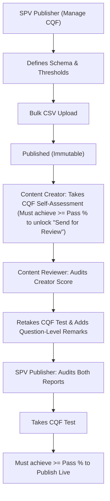

- **Governance Authority:** Only the **SPV Publisher** can create and activate a CQF.
- **Immutability:** Once published, a CQF schema cannot be modified or deleted. To change criteria, the SPV Publisher must draft and publish a new CQF version.
- **Single Active Version:** Only one active CQF exists on the platform at any time.
- **Backward Compatibility Principle:** Newly created courses adopt the latest published CQF. Courses in `Draft` or `Under Review` retain the CQF version active at the time of their creation.

### 6.2 Evaluation Structure & Question Schema

A CQF consists of multiple **Categories / Sections**, each containing weighted questions.

- **Bulk Upload Columns (CSV):** `Question No`, `Question Type`, `Maximum marks per question`, `Question`, `Option 1`, `Option 1 Weight`, `Option 2`, `Option 2 Weight`, `Option 3`, `Option 3 Weight`, `Option 4`, `Option 4 Weight`.
- **Standard Response Options:**
  - `Meets Criteria` (Full weight / 100% of mark)
  - `Partially Meets Criteria` (Partial weight / typically 50%)
  - `Doesn't Meet Criteria` (0 marks)
  - `Not Applicable` (Excluded from category denominator)

### 6.3 Mathematical Scoring Formulas & Thresholds

The CQF employs a two-tier hierarchical score aggregation algorithm:

#### Category Score Calculation

For each category with questions:

- **Category Qualification:** If , the category evaluates to **Qualified**; otherwise, **Not Qualified**.

#### Overall Cumulative Score Calculation

Each category is assigned a weightage , such that .

#### Platform Qualification Tiers

Based on the computed **Overall CQF Score**, the platform automatically classifies the course:

- **(Default 50%):** **Does Not Qualify** (Submission/Publishing strictly blocked).
- **:** **iGOT Basic** (Eligible for review/publishing).
- **:** **iGOT Intermediate**.
- **:** **iGOT Advanced**.

### 6.4 Detailed CQF Dimension & Evaluation Parameter Matrix

*(Extracted from approved CQF criteria and Content Portal test suites)*

| Quality Dimension | Evaluation Parameter | Validation Rule / Prompt | Standard Weightage | Calculation / Scoring Logic | Pass/Fail Condition | Evidence Source |
|---|---|---|---|---|---|---|
| **Pedagogical Alignment** | Learning Objectives (LO) Clarity | Are clear, measurable LOs defined for each module? | 20% | Binary/Weighted (Meets: 1.0, Partial: 0.5, Fails: 0.0) | Category score | KB-6407, KB-6409 |
| **Pedagogical Alignment** | Competency Framework Fit | Are activities directly mapped to FRAC Behavioral/Functional/Domain levels? | 15% | Option-based rubric | Category score | KB-6407, Content Settings |
| **Content Quality & Richness** | Modular Chunking | Is content broken into micro-learning units ( per video)? | 15% | Assessed based on resource duration aggregation | Category score | PRD 271450154 |
| **Content Quality & Richness** | Multimedia Polish & Audio Clarity | Is audio clear, consistent, without background noise or accents hindering comprehension? | 15% | Reviewer subjective rubric | Category score | KB-8909, KB-6409 |
| **Assessment & Rigor** | Assessment Alignment | Does the course include formative practice quizzes and summative evaluation? | 20% | Validates presence of Sunbird QuestionSet in collection | Category score | KB-6276, SRS 274628785 |
| **Technical & Metadata Integrity** | Naming & Description Norms | Does Course Name and Module Name conform to 10–70 character limits and regex rules? | 15% | Automated validation combined with CQF checklist | Category score | KB-6847, PRD 271450154 |

## 7. AI-Powered Course Generation

Investigated under Epics **KB-9851**, **KB-10505**, and Story **KB-8909**, the platform is developing an **AI-Driven Course Creation Engine** to resolve key bottlenecks: high authoring overhead, improper competency mapping, and inconsistent metadata.

### 7.1 Architectural Workflow & Capabilities

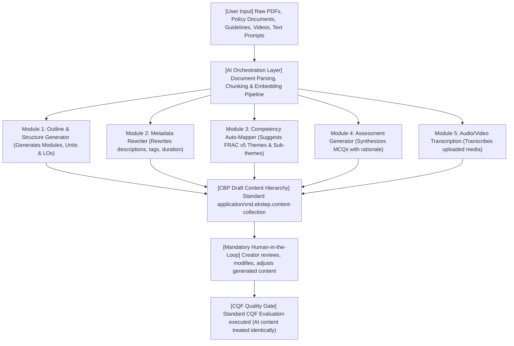

### 7.2 AI Capability Specification Matrix

| AI Capability | User Input | AI Processing / Model Pipeline | Generated Output | Human Validation Step | CQF Dependency | Implementation Status |
|---|---|---|---|---|---|---|
| **AI Metadata Generation & Rewriting** | Course Title & draft description | LLM Prompting via LangChain / Python API Gateway | Enriched description, standardized keywords, targeted summaries | Creator edits/approves generated fields in Basic Info | Must satisfy CQF metadata clarity rules | **Partially Implemented** (POC active in CBP) |
| **Automated Competency Suggestion** | Course text, uploaded slides/PDFs | Embedding similarity search against FRAC competency taxonomy | Recommended Behavioral, Functional, Domain themes | Creator manually accepts or dismisses recommended tags | Required to clear CQF Competency Alignment section | **Partially Implemented** (KB-8909 Story) |
| **One-Click Course Creation (POC)** | Raw source PDF / document manual | Text extraction, LLM outline chunking, module structuring | Structured draft course with modules, reading materials, quiz | Creator validates full course hierarchy and content | Subject to full standard CQF evaluation | **In Progress** (KB-10505 / KB-8909 POC) |
| **AI Assessment Generation** | Uploaded video transcript or module text | NLP extraction of key concepts; MCQ distractor generation | Practice Assessment QuestionSet (`vnd.sunbird.questionset`) | Creator reviews question stems, correct options, distractors | Validated under CQF Assessment Rigor criteria | **Planned / Under Development** |
| **Video Transcription & Subtitles** | Uploaded MP4 video file | Speech-to-text (Whisper/ASR pipelines) | WebVTT / SRT subtitle files and readable transcripts | Creator edits transcription errors | Feeds into CQF Accessibility and Metadata scores | **In Progress** (KB-9851) |

## 8. Q11 – Interactions in iGOT Course Videos

Investigated from approved **Q11 BRD** (`TPT/499974191`), this initiative modernizes video-based learning by decoupling interactivity from third-party SCORM authoring tools (e.g., Articulate, Adobe Captivate).

### 8.1 Strategic Rationale: "Video as an Interactive Application"

- **Legacy Bottlenecks:** External SCORM authoring required expensive desktop licenses, exported bulky zip files, suffered from fragile tracking in iframe wrappers, broke on mobile screens, and required full re-export for minor textual updates.
- **Q11 Paradigm:** The raw MP4 video remains **unmodified** on cloud storage. Interactivity is introduced as an **independent, timeline-referenced JSON metadata layer** rendered natively in the browser/mobile player over the HTML5 `<video>` tag.

### 8.2 Conventional vs Native Interactive Course Video

| Dimension | Conventional Course Video | Q11 Native Interactive Video | Business & Learner Impact |
|---|---|---|---|
| **Authoring Interface** | Upload raw MP4 or export SCORM package | Integrated CBP Timeline Editor with drag-and-drop overlays | Zero external license fees; 5-minute authoring turnaround |
| **Storage Architecture** | Video embedded inside monolithic zip package | Clean MP4 asset + lightweight JSON metadata overlay schema | 80% reduction in package storage; CDN caching optimization |
| **Learner Playback** | Passive play/pause/seek controls | Active auto-pausing, interactive overlays, bookmarked jumps | 3x increase in attention retention and active engagement |
| **Mobile Experience** | Fixed-aspect iframes; broken modal touch points | Fully responsive CSS3/HTML5 overlays adapting to player size | Seamless learning across desktop, m-web, Android, iOS |
| **Progress & Telemetry** | Monolithic completion signal upon 100% video seek | Fine-grained telemetry: interaction attempts, quiz scores, jumps | Real-time formative data sent to LRS/Cassandra |
| **Content Updates** | Re-record, re-author, re-export, re-upload full SCORM | Edit JSON overlay timestamps or question text without re-uploading MP4 | Instant turnaround for content maintenance |

### 8.3 Interaction Types & Timeline Logic

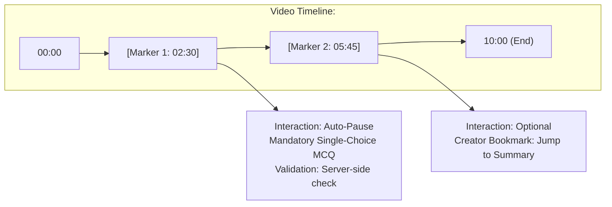

1. **Formative In-Video Quizzes:**
  - *Single Choice & Multiple Choice (MCQ):* Timeline hits timestamp Player auto-pauses Question card overlays frame Learner selects answer Immediate explanatory feedback rendered. If configured as mandatory, playback resumes only upon submission.
  - *True/False & Fill-in-the-Blank:* Compact UI prompt over video canvas.

2. **Creator-Defined Bookmarks & Table of Contents (TOC):**
  - Visual chapter markers placed along the seek bar allowing learners to jump directly to semantic topics.

3. **Hyperlinks & Reference Overlays:**
  - Non-blocking text annotations providing contextual definitions, background reading, or internal links to subsequent modules.

## 9. Complete Functional Architecture

The course creation, management, and consumption ecosystem is built upon an event-driven microservices architecture hosted on Kubernetes.

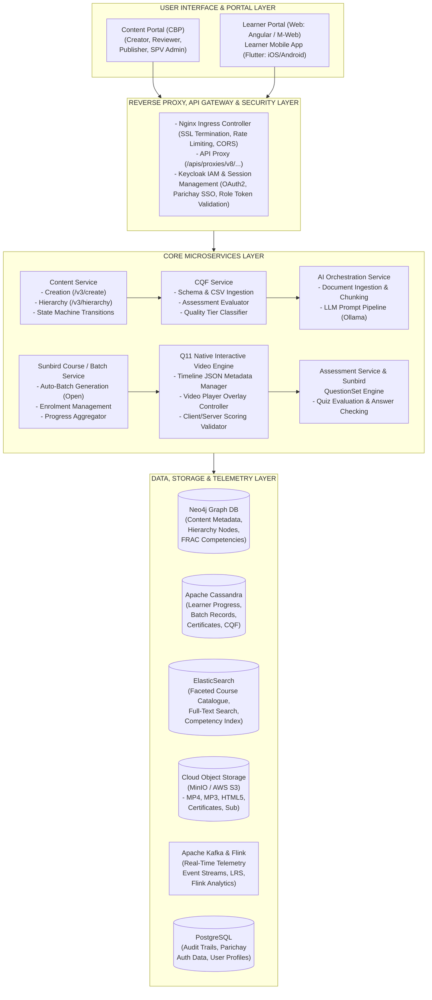

## 10. Business and Technical Architecture Diagrams

### Diagram 1: Course Ecosystem Context Diagram

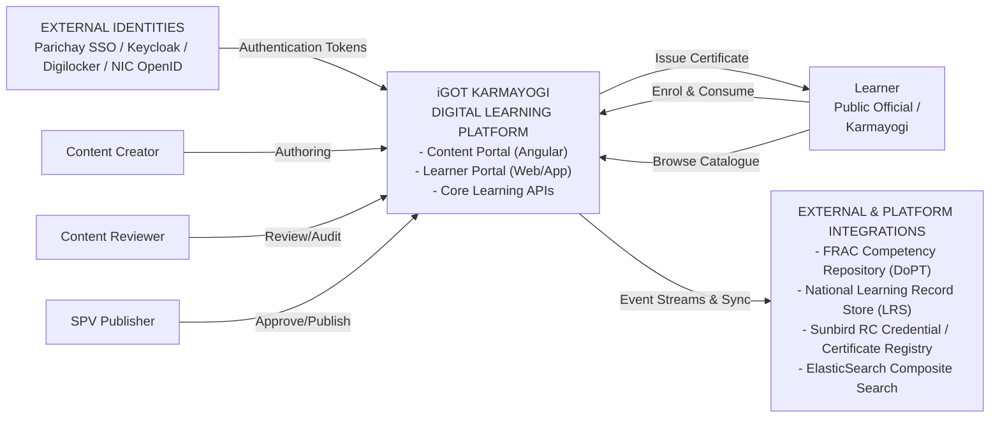

### Diagram 2: Complete Course Creation-to-Consumption Flow

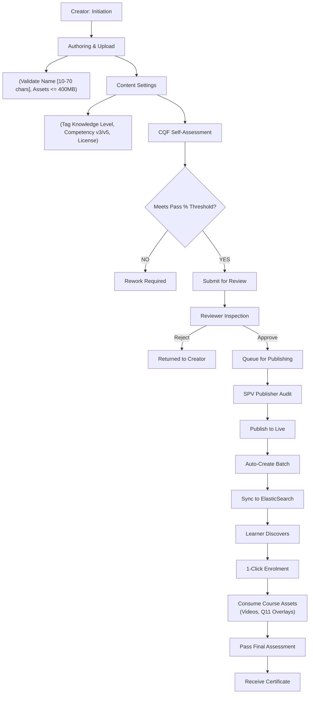

### Diagram 3: Course Review and Publishing State Machine

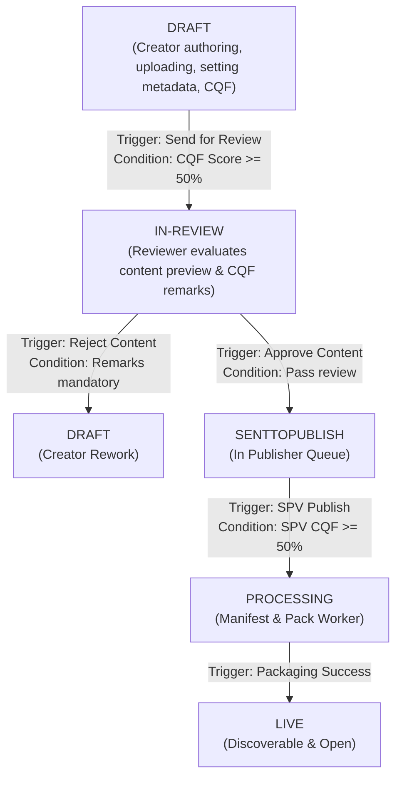

### Diagram 4: CQF Evaluation Workflow

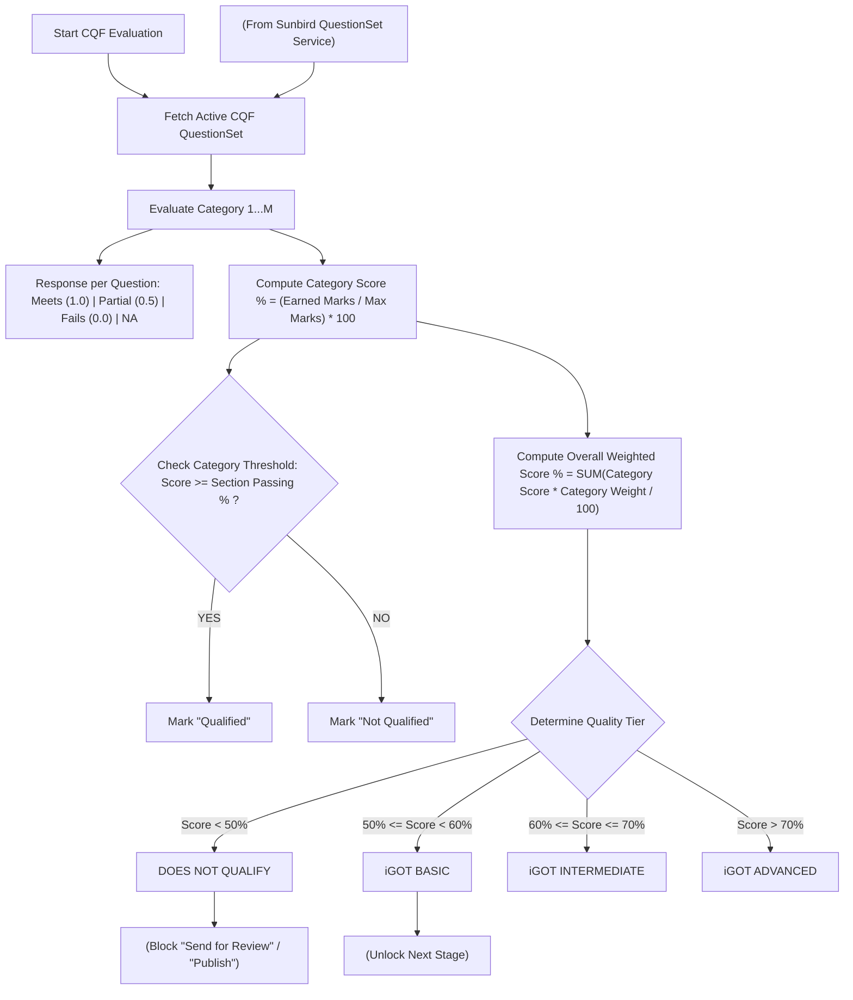

### Diagram 5: AI-Powered Course Generation Flow

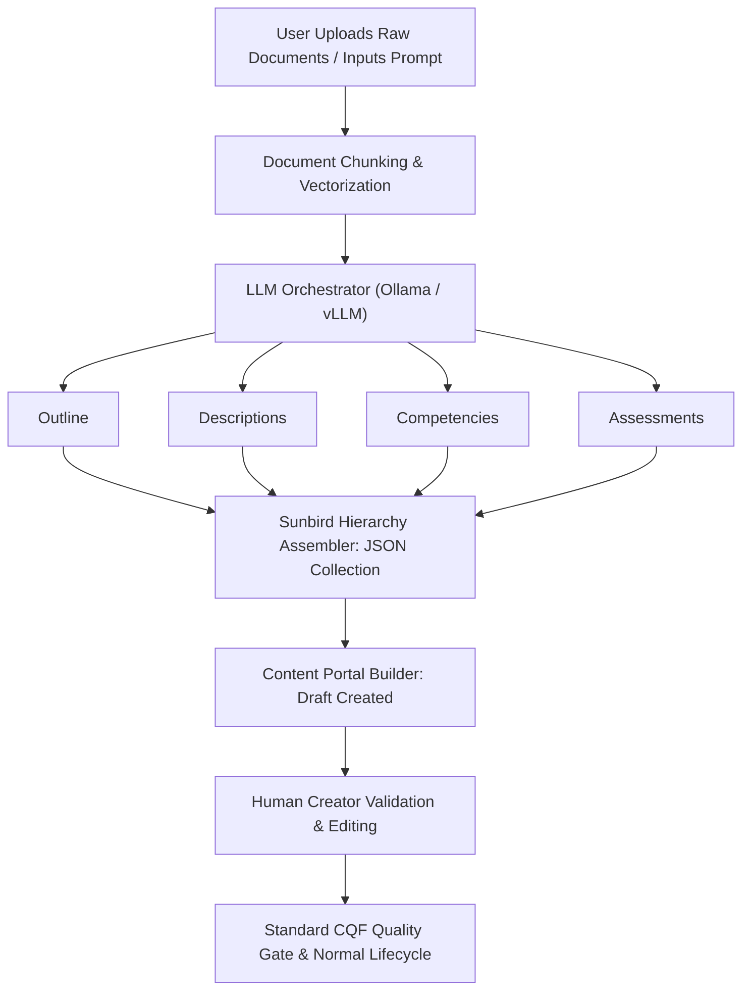

### Diagram 6: Learner Course Consumption Flow

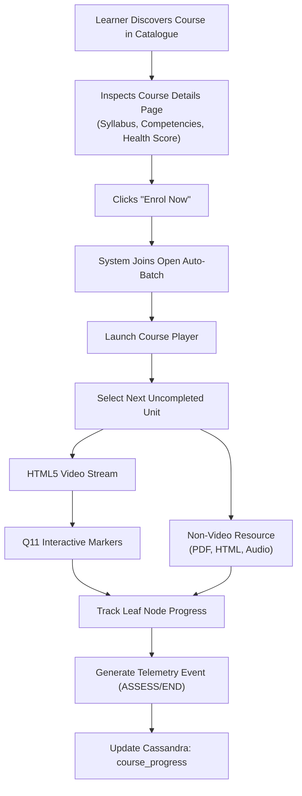

### Diagram 7: Q11 Interactive Video Playback Flow

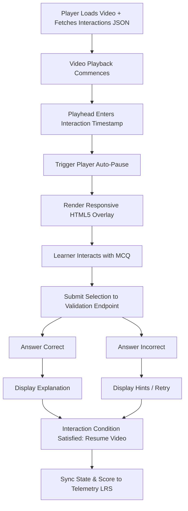

### Diagram 8: Microservice Interaction Sequence

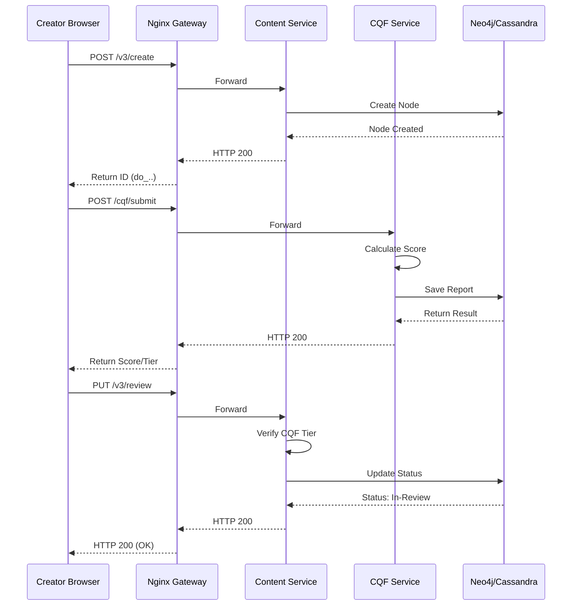

### Diagram 9: Course Data Lifecycle

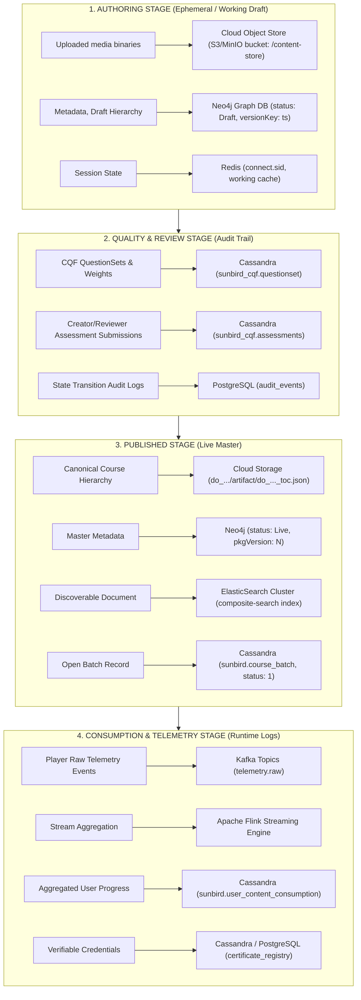

### Diagram 10: Consolidated End-to-End Course Ecosystem

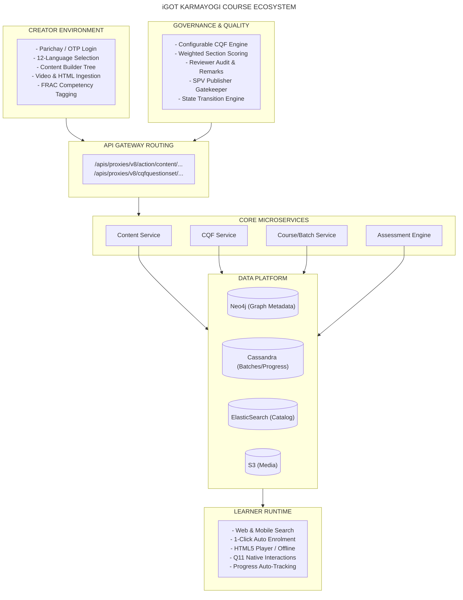

## 11. Portal-Wise Responsibility Matrix

| Portal / Interface | Primary Target Users | Responsibilities in Course Lifecycle | Course Lifecycle Stage | Primary Backend Services Involved | Exposed APIs / Protocols |
|---|---|---|---|---|---|
| **Content Builder Portal (CBP)** | Content Creator, Course Author | Creation of course shell; structure configuration (Modules/Units); MP4, MP3, HTML file uploads; metadata mapping; taking mandatory CQF assessment. | Stages 1, 2, 3, 4, 5 | Content Service, Asset Service, CQF Service | `/action/content/v3/create`, `/content/v3/upload`, `/cqfquestionset/submit` |
| **Reviewer Dashboard (CBP)** | Certified Content Reviewer | Reviewing drafted hierarchies; previewing video/HTML rendering; inspecting creator CQF scores; re-taking CQF tests with mandatory per-question remarks; approving/rejecting course. | Stage 6 | Content Service, CQF Service, Review Service | `/action/content/v3/review`, `/cqfquestionset/read`, `/action/content/v3/reject` |
| **Publisher Dashboard (CBP)** | SPV Publisher | Auditing creator and reviewer reports; validating final CQF threshold compliance; taking publisher CQF assessment; executing live publication. | Stage 7 | Content Service, Publish Pipeline, Auto-Batch Service | `/action/content/v3/publish`, `/cqfquestionset/autopublish` |
| **CQF Management Portal (CBP)** | SPV Publisher | Defining CQF configuration schema; configuring category passing percentages and category weightings; bulk uploading questions via CSV; publishing immutable CQF. | Stage 5 (Pre-requisite) | CQF Management Service, Sunbird QuestionSet Service | `/cqfquestionset/questionset/create`, `/cqfquestionset/listEntry` |
| **Learner Web Portal** | Public Officials, All Learners | Browsing open course catalogue; full-text search; competency filtering; 1-click self-enrolment; full-screen video consumption; interactive Q11 quizzes; certificate download. | Stages 8, 9, 10 | Learner Service, Course Service, Player Service, LRS | `/v1/course/enroll`, `/content/v3/hierarchy`, `/v1/telemetry`, `/certificate/v1/download` |
| **Learner Mobile App (Flutter)** | Civil Servants on mobile devices | Cross-platform native course discovery; mobile-responsive video consumption with proportional Q11 HTML5 overlays; asynchronous progress syncing. | Stages 8, 9, 10 | Mobile API Gateway, Progress Service, Sync Service | Mobile REST Endpoints over HTTPS / OAuth2 Tokens |

## 12. User Roles and Permission Matrix

| Role Identifier | Role Name | Create Course | Edit Draft | Upload Assets | CQF Self-Audit | Review Content | Approve Review | Publish Live | Enrol & Consume | Manage Framework |
|---|---|---|---|---|---|---|---|---|---|---|
| `CONTENT_CREATOR` | Course Creator | **Yes** | **Yes** | **Yes** | **Yes** | No | No | No | Yes | No |
| `CONTENT_REVIEWER` | Course Reviewer | No | No | No | **Yes** (Audit) | **Yes** | **Yes** | No | Yes | No |
| `CONTENT_PUBLISHER` | Content Publisher | No | No | No | **Yes** (Audit) | No | No | Restricted* | Yes | No |
| `SPV_PUBLISHER` | SPV Central Publisher | No | No | No | **Yes** (Final) | **Yes** | **Yes** | **Yes** (All) | Yes | **Yes** (CQF Admin) |
| `PUBLIC_LEARNER` | Platform Learner | No | No | No | No | No | No | No | **Yes** (Open) | No |
| `PLATFORM_ADMIN` | Platform Administrator | No | No | No | No | No | No | No | Yes | **Yes** (Full) |

**Note: Organizational* `CONTENT_PUBLISHER` roles can publish MDO-restricted moderated courses; standard general platform courses open to all users require `SPV_PUBLISHER` authorization.

## 13. Course Type and Feature Differentiation

The following matrix distinguishes general platform courses from other specialized learning models within the iGOT ecosystem:

| Feature Dimension | General Platform Course | Moderated Course | Multilingual Course | Curated Programme | Marketplace Course |
|---|---|---|---|---|---|
| **Jira Baseline** | KB-6276, KB-6847 | KB-1950, KB-6276 | Multilingual Architecture | KB-452, KB-1950 | KB-7126, KB-6649 |
| **Target Audience** | Open to all registered iGOT learners | Restricted to specific MDOs or verified users | Open to all learners across language preferences | Open to all or curated target cohorts | Open to all or licensed government bodies |
| **Creation Model** | Standard CBP Course Builder | CBP Course Builder with MDO access rules | AI-translated or manually localized parent-child pairs | Aggregated collection of standalone courses | External commercial/academic provider ingestion |
| **Ownership** | Creating Ministry/SPV | Sponsoring Ministry/Department | Creating Entity / SPV Translation Cell | Program Coordinator / SPV Curation Team | External EdTech Partner / SPV Marketplace Cell |
| **Access Control** | Open Public (`accessSetting: "allUsers"`) | Whitelisted MDOs (`accessSetting: "mdoSpecific"`) | Open Public (`accessSetting: "allUsers"`) | Open or cohort-governed | Commercial license / platform agreement |
| **Enrolment Model** | 1-Click Auto-Batched Self Enrolment | Self-enrolment restricted to MDO-verified users | 1-Click Auto-Batched Self Enrolment | Single enrolment across multiple underlying courses | Self-enrolment subject to seat quota |
| **Publishing Authority** | SPV Publisher (`SPV_PUBLISHER`) | MDO Content Publisher (`CONTENT_PUBLISHER`) | SPV Publisher | SPV Program Coordinator | SPV Marketplace Publisher |
| **CQF Governance** | Mandatory Configurable CQF () | Mandatory Configurable CQF () | Parent CQF inherited or localized review | Evaluated at individual course level | Dedicated Marketplace Quality Framework |

## 14. API and Integration Analysis

### 14.1 Microservice API Catalogue

| API Name / Endpoint | HTTP Method | Source Component | Target Service | Purpose & Payload Description | Auth & Security | Jira Reference |
|---|---|---|---|---|---|---|
| `/apis/proxies/v8/action/content/v3/create` | `POST` | CBP Web Client | Content Service | Initiates a new course shell. Payload: `name`, `contentType: "Course"`, `primaryCategory: "Course"`, `language: ["English"]`, `accessSetting:` `"allUsers"`, `framework: "igot"`. Returns: `identifier` (e.g., `do_11422731...`). | Cookie session (`connect.sid`), Bearer Token | KB-6847, SRS 274628914 |
| `/apis/proxies/v8/action/content/v3/read/{do_id}` | `GET` | CBP / Learner Portal | Content Service | Fetches detailed content metadata, creator contacts, reviewer IDs, competency mappings, and leaf nodes. | User session token | KB-6847, SRS 71434296 |
| `/apis/proxies/v8/action/content/v3/hierarchy/{do_id}` | `GET` | Course Player / CBP | Content Service | Retrieves complete tree structure: collection modules child resources with duration and MIME types. | User session token | KB-6847, SRS 71434251 |
| `/apis/proxies/v8/cqfquestionset/questionset/create` | `POST` | CBP Manage CQF | CQF Service | Creates an immutable CQF QuestionSet. Payload: `name`, `totalMarks`, `scoreCutoffType: "SectionLevel"`, `minimumPassPercentage`, `noOfSection`. | `SPV_PUBLISHER` role token | KB-6408, SRS 175702042 |
| `/apis/proxies/v8/cqfquestionset/submit` | `POST` | CBP Creator / Reviewer | CQF Service | Submits CQF evaluation. Payload: `contentId`, `versionKey`, `children: [options selected per question]`. Returns: Section scores and `overalAssessmentScore`. | User session token | KB-6547, SRS 175702042 |
| `/apis/proxies/v8/``cqfquestionset/result` | `POST` | CBP Reviewer / Publisher | CQF Service | Fetches stored CQF evaluation report, section percentages, and question remarks for audit. | User session token | KB-6547, SRS 175702042 |
| `/apis/proxies/v8/action/content/v3/review` | `POST` | CBP Reviewer | Content Service | Submits course for review or updates review state. Verifies that CQF overall passing threshold is satisfied. | `CONTENT_REVIEWER` role | KB-7066, PRD 271450154 |
| `/apis/proxies/v8/action/content/v3/publish` | `POST` | CBP SPV Publisher | Publish Service | Triggers automated packaging worker, Neo4j `Live` state transition, and Cassandra batch generation. | `SPV_PUBLISHER` role | KB-7066, KB-7126 |
| `/apis/proxies/v8/course/v1/enrol` | `POST` | Learner Portal | Course Service | Enrols user into active open batch. Payload: `courseId`, `batchId`, `userId`. Returns: enrolment status. | Learner Auth Token | KB-1950 |
| `/apis/proxies/v8/video/v1/interactions/{do_id}` | `GET` | Q11 Player Engine | Interaction Service | Fetches JSON timeline metadata defining interactive overlay markers, timestamps, and quiz payloads. | Learner Auth Token | Q11 BRD (TPT/499974191) |

## 15. Data Model and Business Entity Relationships

### 15.1 Entity-Relationship Model

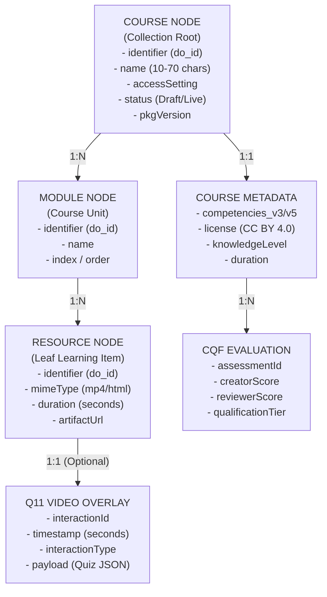

### 15.2 Storage Service Ownership

- **Neo4j Graph Database:** Owns nodes and relationships for `Course`, `Module`, `Resource`, and `FRAC Competency`.
- **Apache Cassandra:**
  - `sunbird.course_batch`: Stores auto-created open batch records (`batchId`, `startDate`, `enrollmentType: "open"`).
  - `sunbird.user_content_consumption`: Stores per-user progress (`completedCount`, `progress`, `status`).
  - `sunbird_cqf.assessments`: Stores JSON submissions and category-wise percentage calculations for CQF.

- **ElasticSearch** (`composite-search` index): Stores denormalized course documents containing full text, tags, competency themes, and rating summaries for real-time sub-second search querying.
- **Cloud Object Store (S3/MinIO):** Stores binary video files (`.mp4`), audio (`.mp3`), zipped web artifacts (`.html`), generated certificates (`.pdf`/`.svg`), and `toc.json` hierarchy manifests.

## 16. Course Consumption and Business Value

### 16.1 Stakeholder Value Matrix

| Stakeholder | Platform Capabilities Provided | Direct Business Value Delivered | Target Metric / KPI |
|---|---|---|---|
| **Civil Services Learner** | Frictionless 1-click self-enrolment; high-performance video streaming; interactive in-video quizzes; mobile offline sync. | Removes learning barriers; supports continuous on-the-job capacity building aligned with official duties. | Course Completion Rate ; Average Star Rating |
| **Content Creator (MDO)** | Standardized 3-step authoring flow; immediate CQF pre-validation; AI metadata rewriting; asset reuse. | Drastically reduces authoring turnaround time; prevents submission of structurally flawed content. | Authoring turnaround time ; CQF First-Time Pass Rate |
| **Content Reviewer** | Unified preview player; consolidated CQF report; line-item question remarking tools. | Accelerates review throughput; enforces objective quality criteria over subjective personal bias. | Review Turnaround Time |
| **SPV Administrator** | Configurable CQF management; platform-wide Content Health Score (CHS); automated batch orchestration. | Centralized quality governance without manual operational intervention in course cohort management. | 100% of Live courses compliant with active CQF standards |
| **Government Ministry / MDO** | Granular consumption analytics; competency gap reports; verifiable digital credentialing. | Transparent visibility into civil service workforce readiness and role-based competency fulfillment. | Total Competency Hours Consumed per Ministry |

## 17. Requirements vs Implementation Gap Analysis

| Functional / Technical Requirement | Source Document | Expected Architectural Behaviour | Implementation Evidence Found | Current Status | Identified Gap / Limitation | Strategic Recommendation |
|---|---|---|---|---|---|---|
| **Course Hierarchy & Validation** | PRD 271450154, SRS 274628785 | Title & Module names enforced between 10–70 chars; max asset size 400MB. | Verified via UI/UX test suites (`KQAS/271450154`) and Create API (`TES/274628914`). | **Fully Implemented** | None in production. | Maintain current validation schemas in future releases. |
| **Configurable CQF Scoring** | KB-6407, SRS 175702042 | SPV Publisher defines weighted sections; system auto-computes score; enforces 50% gate. | Verified via CQF API specs (`TES/175702042`) and functional test logs. | **Fully Implemented** | Backward compatibility requires manual coordination if SPV does not publish CQF post-deploy. | Automate fallback to baseline CQF if no active framework is detected. |
| **Separate CQF for Short Courses** | KB-11977 | Decouple standalone resource CQF from multi-module course CQF. | Jira ticket KB-11977 created under Parent KB-11582; currently `In Progress`. | **Partially Implemented** | Micro-courses currently undergo full course CQF questionnaire. | Accelerate Q10 Epic completion to reduce creator friction for short assets. |
| **Native Video Interactivity (Q11)** | Q11 BRD (TPT/499974191) | Non-destructive JSON timeline overlays; auto-pause on critical MCQs; native player. | BRD finalized; acceptance criteria documented; player integration in progress. | **Partially Implemented** | Branching logic ("Go To" timestamps based on quiz failure) marked out-of-scope for Phase 1. | Roll out Phase 1 auto-pause quizzes; schedule non-linear branching for subsequent release. |
| **AI One-Click Course Creation** | KB-9851, KB-10505, KB-8909 | Direct parsing of raw policy PDFs into full course hierarchies with assessments. | POC active under Story KB-8909; Epic KB-10505 logged in Jira. | **Partially Implemented (POC)** | End-to-end autonomous publishing without human intervention is unverified and not supported. | Enforce mandatory Human-in-the-Loop review and CQF validation for all AI-generated content. |
| **Dynamic Content Health Score** | KB-14382 (CHS Specs) | Real-time blend of Static Score (CQF 50 pts) and Dynamic Score (Engagement 50 pts). | Telemetry pipeline active; monthly recalculation batch workers defined. | **In Progress** | Dynamic score reliability is low for newly published courses with sparse enrollment data. | Apply Bayesian smoothing or provisional green badges during initial 30-day course rollout. |

## 18. Dependency and Impact Analysis

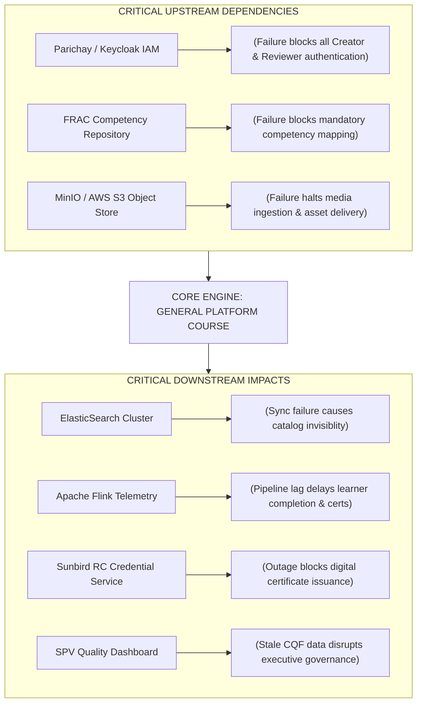

- **Single Points of Failure (SPOFs):**
  - *CQF Active Version Check:* If the SPV Publisher unpublishes or corrupts the active CQF schema, in-flight course submissions fail with validation exceptions.
  - *Content Packaging Pipeline:* Ingestion worker crashes during video transcoding halt state transitions from `Processing` to `Live`.

## 19. Non-Functional Requirements (NFRs)

| NFR Category | Technical Requirement | Documented Expected Threshold | Affected Architectural Component | Verification Status | Source Reference |
|---|---|---|---|---|---|
| **Performance** | Web page load and interaction response time | Average response time between | Angular Web Portal, API Gateway | Verified in Staging/UAT | SRS 274628785 (Sec 9.2) |
| **Performance** | Q11 video interaction metadata fetch | Interaction JSON must load in | Native Video Player, Interaction Service | Architecture Target | Q11 BRD (TPT/499974191) |
| **Scalability** | Peak production concurrent users | Must accommodate **concurrent users** | Nginx Ingress, Kubernetes Pods, Cassandra | Verified via Load Testing | SRS 274628785 (Sec 9.5) |
| **Scalability** | Concurrent interactive video sessions | Support **concurrent video sessions** | Video Streaming CDN, Interaction Runtime | Architecture Target | Q11 BRD (TPT/499974191) |
| **Security** | Application and transport security | TLS 1.3 / HTTPS encryption; OWASP Top 10 compliance | Entire Network & API Surface | Audited by CERT-In | SRS 274628785 (Sec 9.3) |
| **Security** | Video quiz score integrity | Server-side validation of interaction quiz answers | Assessment Service / Interaction API | Implemented | Q11 BRD (TPT/499974191) |
| **Reliability** | Disaster Recovery RTO | Recovery Time Objective (RTO) | Infrastructure & Database Backups | Implemented | SRS 274628785 (Sec 9.4) |
| **Accessibility** | Usability for diverse learners | Keyboard navigation, high-contrast UI, ARIA screen-readers | Course Player, Q11 Interaction Overlays | Target Compliance | Q11 BRD (TPT/499974191) |

## 20. Risks, Limitations, and Open Questions

### 20.1 Risk Matrix

| Risk Description | Category | Impact | Likelihood | Documented Evidence | Architectural Mitigation |
|---|---|---|---|---|---|
| **CQF Production Version Lockout:** Deploying code without an active published CQF causes submission crashes. | Technical / Operational | **High** | Medium | KB-6407 BRD Dependencies | Automated database seeding of baseline default CQF during platform Helm chart deployment. |
| **Low-Bandwidth Mobile Video Buffering:** Heavy unoptimized MP4 uploads stutter on field mobile devices. | Consumption / UX | **High** | High | Q11 BRD Problem Statement | Enforce multi-bitrate HLS/DASH transcoding worker upon creator video upload. |
| **AI Hallucinations in One-Click Authoring:** AI generation producing inaccurate regulatory advice. | Governance / Pedagogical | **High** | Medium | KB-9851 Epic Description | Strict Human-in-the-Loop policy: AI cannot publish directly; mandatory CQF gate remains enforced. |
| **Cold-Start Dynamic Score Bias:** High-quality new courses mislabeled due to sparse initial learner ratings. | Analytics / Governance | Medium | High | CHS Specification (KB-14382) | Apply provisional badge status during first 30 days or until minimum enrollment threshold () is met. |

### 20.2 Open Questions Register

1. **Adaptive Branching Timeline:** When will conditional non-linear video jumps (e.g., redirecting to remedial timestamp upon scoring on an in-video quiz) move from Out-of-Scope to implementation? *(Referenced in Q11 BRD Section "Branching - Out of Scope")*.
2. **Automated AI CQF Auditing:** Will an LLM-based autonomous evaluator be permitted to pre-score creator CQF submissions prior to human review? *(Referenced in KB-10505 discussions)*.

## 21. Current Platform State and Future Roadmap

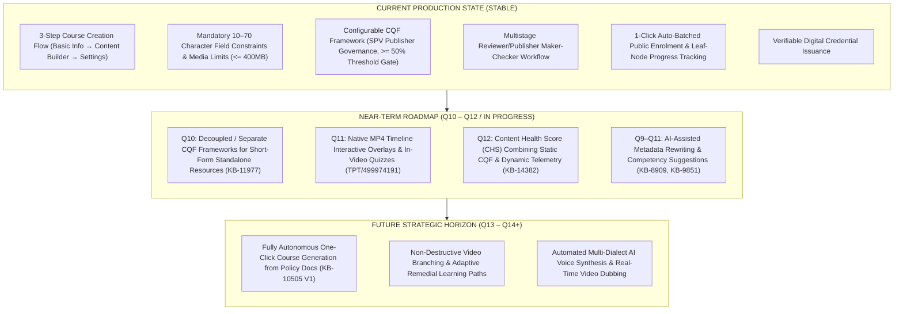

## 22. Master Traceability Matrix

| Major Platform Capability | Primary Jira Reference | Parent Initiative / Epic | Requirement Specification | Responsible Microservice | Core Database & Entity | Primary Diagram | Production Implementation Status |
|---|---|---|---|---|---|---|---|
| **Course Creation & Structuring** | KB-6847 | KB-6276 | PRD 271450154, SRS 274628785 | Content Service | Neo4j (`ContentCollection`), S3 (`/artifact`) | Diagram 2, 8 | **Fully Implemented** |
| **Standalone Resource Authoring** | KB-7044 | KB-6276 | SRS 274628785 | Content Service | Neo4j (`Resource`), S3 (`/artifact`) | Diagram 2 | **Fully Implemented** |
| **Configurable CQF Creation** | KB-6408 | KB-6407 | BRD 161317222, SRS 190185579 | CQF Service | Cassandra (`sunbird_cqf.questionset`) | Diagram 4 | **Fully Implemented** |
| **CQF Computation & Thresholds** | KB-6409 | KB-6407 | BRD 161317222, SRS 190185579 | CQF Service | Cassandra (`sunbird_cqf.assessments`) | Diagram 4 | **Fully Implemented** |
| **CQF Creator & Reviewer Consumption** | KB-6547 | KB-6407 | BRD 161317222, SRS 190185579 | CQF Service | Cassandra (`sunbird_cqf.assessments`) | Diagram 3, 4 | **Fully Implemented** |
| **Decoupled Course CQF** | KB-11977 | KB-11582 | Jira KB-11977 | CQF Service | Cassandra (`sunbird_cqf`) | Diagram 4 | **In Progress (Q10)** |
| **Reviewer & Publisher Navigation** | KB-7066 | KB-6276 | PRD 271450154, SRS 274628785 | Content Service | Neo4j (`status: In-Review/Live`) | Diagram 3 | **Fully Implemented** |
| **CIOS Marketplace Publishing** | KB-7126 | KB-6649 | Jira KB-7126 | Publish Service | Neo4j (`marketplace`), Cassandra | Diagram 3 | **Fully Implemented** |
| **Learner Universal Consumption** | KB-1950 | KB-1936 | Jira KB-1950 | Course / Batch Service | Cassandra (`user_content_consumption`) | Diagram 6 | **Fully Implemented** |
| **Native Video Interactions** | Q11 BRD | TPT-499974191 | Q11 BRD 499974191 | Video Interaction Engine | S3 (JSON Metadata), Cassandra (LRS) | Diagram 7 | **Partially Implemented (Phase 1)** |
| **AI One-Click Course Generation** | KB-8909 | KB-9851 / KB-10505 | Jira KB-8909, KB-10505 | AI Orchestrator / Python LLM | S3 (Raw Docs), Neo4j (Draft Node) | Diagram 5 | **Partially Implemented (POC)** |
| **Automated Auto-Batching** | KB-1950 | KB-1936 | SRS 71434296 | Batch Service | Cassandra (`course_batch`, `status: 1`) | Diagram 2, 9 | **Fully Implemented** |

## 23. Conclusion

The **General Platform Course** ecosystem represents the technical and pedagogical backbone of the iGOT Karmayogi digital architecture. By systematically integrating the **Content Portal UI/UX Revamp**, the **Configurable Course Quality Framework (CQF)**, **automated batching**, and **native timeline-based video interactivity (Q11)**, the platform has successfully eliminated friction across authoring, review, governance, and learner consumption.

The system enforces strict operational integrity:

- Creators are guided by real-time UI validations and mandatory CQF quality gates ().
- Reviewers and SPV Publishers operate within transparent, audit-logged maker-checker workflows.
- Learners benefit from 1-click self-enrolment, low-latency cross-platform playback, fine-grained progress persistence, and tamper-proof digital credentialing.

As current initiatives around **Separate CQF structures (KB-11977)**, **Dynamic Content Health Scores (KB-14382)**, and **AI-Driven One-Click Generation (KB-10505)** reach operational maturity, the platform is well-positioned to evolve from a structured learning management framework into a self-optimizing, intelligent capability-building engine for public governance.
