# Course — Low-Level Design (LLD)

## 1. Introduction & Implementation Principles

### 1.1 Purpose

This Low-Level Design (LLD) document specifies the concrete component logic, data flow algorithms, sequence interactions, database execution queries, schema structures, and API contracts for the **General Platform Course** capability (`primaryCategory: "Course"`, `contentType: "Course"`). It details how engineering teams implement, test, and maintain the feature across both web and mobile presentation surfaces down to backend microservices, streaming pipelines, and persistence tiers.

### 1.2 Core Architectural Invariants

1. **Payload & Validation Bounds:** Course titles and module names **MUST** strictly conform to `^[a-zA-Z0-9\.\-\_\$\/\:\[\]\'\ \!]+$` with a length bound of characters. Binary assets (MP4, MP3, HTML5) are capped at .
2. **Deterministic CQF Gate:** State transitions from `Draft` to `In-Review` and from `SentToPublish` to `Live` require an evaluated Course Quality Framework (CQF) score .
3. **Decoupled Video Interactivity (Q11):** Video binary assets remain immutable on object storage; interactive overlay timelines reside in separate JSON structures evaluated server-side.
4. **Single Active Batch & Concurrency Locking:** 1-click self-enrolment is managed through a single open batch per course (`status: 1`, `enrollmentType: "open"`), guarded by distributed Redis locks to prevent race conditions.
5. **Full Lifecycle State Support:** Support for self-serve unenrollment (KB-14518) via Cassandra status mutations and Kafka notification events, alongside re-enrollment progress recovery (KB-14523).

## 2. Low-Level Evolution Matrix (Q2 to Q13)

**LOW-LEVEL CODE & SYSTEM PROGRESSION (Q2 - Q13)**

| Quarter Epoch | Frontend Presentation Layer | Microservices & Persistence Layer |
|---|---|---|
| **Q2 – Q3** | Monolithic Angular templates; SCORM iframe wrappers; manual batch selection dropdowns. | Java Sunbird Content Service v1; manual batch creation; basic Cassandra consumption tables (user_content_consumption). |
| **Q4 – Q5** | Basic checklist components; Reviewer rejection comments view; FRAC v3 competency pickers. | Static checklist validation; Reviewer rejection remark persistence; FRAC v3 taxonomy graph traversal in Neo4j. |
| **Q6** | Angular 14+ 3-step wizard (Basic Info -> Builder -> Settings); reactive form validation regex. | Dynamic CQF calculation engine; bulk CSV schema ingestion; mathematical weighting ($\ge 50\%$ gate); Cassandra cqf tables. |
| **Q7 – Q8** | 1-click "Enrol Now" button; hierarchical FRAC v5 competency tree selection dropdown. | Automated open batch creation background workers; distributed Redis concurrency locks preventing duplicate enrollment anomalies. |
| **Q9 – Q10** | In-context AI summary generator; modular tabbed CQF rubric views for micro-learning units. | Python LLM LangChain orchestration; Whisper transcription pipeline; decoupled Sunbird QuestionSet quality evaluators. |
| **Q11** | Native video player wrapper; timeline drag-and-drop marker editor; responsive quiz overlay. | Q11 Video Interaction microservice; timeline JSON manifest builder; server-side quiz evaluator; telemetry LRS streaming. |
| **Q12** | Unenrollment modal in dashboard; progress loss warning prompts; re-enrollment action triggers. | /course/v1/unenroll handler; Cassandra state mutator (active: false); Kafka bus publisher (dev.user.unenrolment.event). |
| **Q13** | Multi-select search pills (All, Course); reactive count updates on catalogue filters. | ElasticSearch faceted aggregation tuning; automated Cassandra duplicate batch cleanup reconciler scripts (KAR-1351). |

## 3. Presentation Layer Low-Level Design (Frontend)

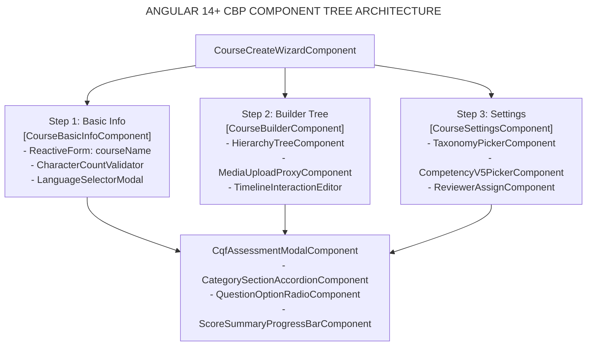

### 3.1 Angular Reactive Form Validation Logic

The `CourseBasicInfoComponent` initializes form controls with explicit validators:

```typescript
this.courseForm = this.fb.group({
  name: [
    '',
    [
      Validators.required,
      Validators.minLength(10),
      Validators.maxLength(70),
      Validators.pattern(/^[a-zA-Z0-9\.\-\_\$\/\:\[\]\'\ \!]+$/)
    ]
  ],
  description: [
    '',
    [Validators.required, Validators.minLength(30), Validators.maxLength(500)]
  ],
  language: [['English'], [Validators.required]],
  accessSetting: [{ value: 'allUsers', disabled: true }, [Validators.required]],
  primaryCategory: ['Course', [Validators.required]]
});
```

### 3.2 Flutter Mobile Video & Q11 Overlay View Hierarchy

In the mobile application, the player leverages a layered `Stack` widget:

```text
Stack (StackFit.expand)
├── AspectRatio (16:9)
│   └── BetterPlayer / Chewie (HTML5/DASH Video Stream)
├── Q11TimelineController (PositionListener on stream playhead)
└── Visibility (visible: isInteractionTriggered)
    └── Q11QuizOverlayCard (Glassmorphic Modal Card)
        ├── RadioListTile (Options 1..4)
        └── ElevatedButton ("Submit Answer" -> Dispatches HTTP to Gateway)
```

## 4. Low-Level Component Process Flowcharts

### 4.1 Flowchart 1: Course Creation & Asset Upload Pipeline

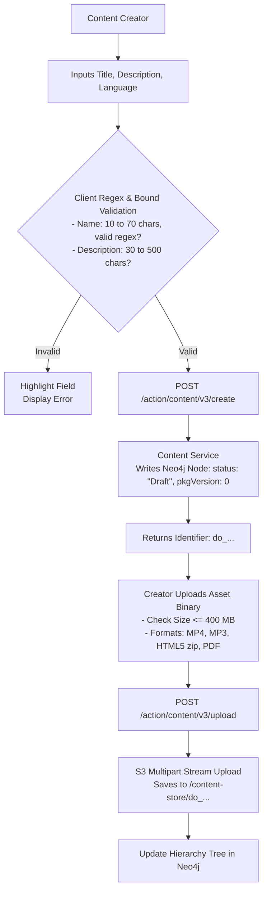

### 4.2 Flowchart 2: Configurable CQF Calculation & Evaluation Logic

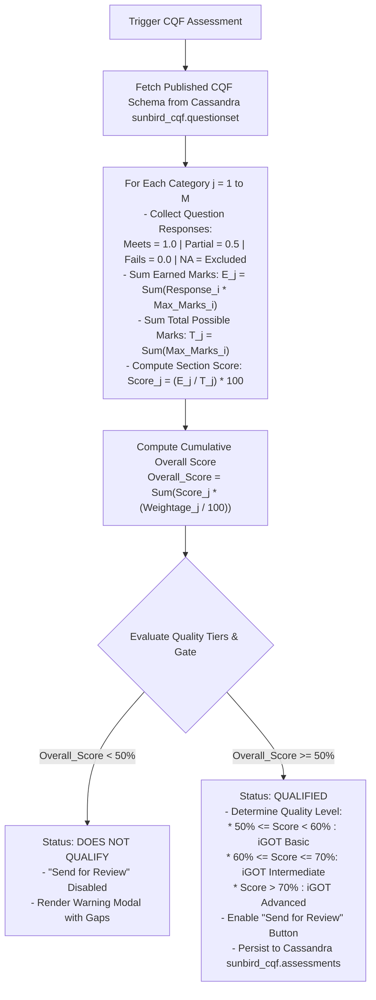

### 4.3 Flowchart 3: Maker-Checker Governance & SPV Live Publishing

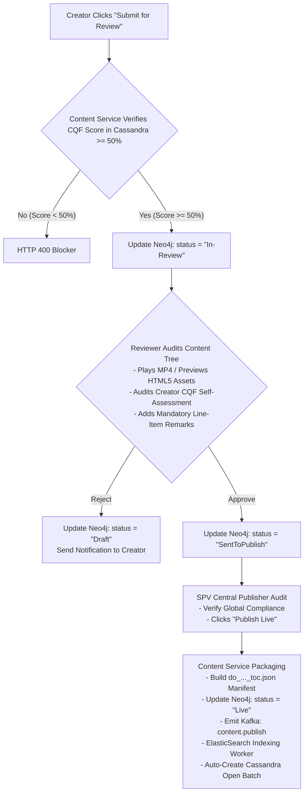

### 4.4 Flowchart 4: 1-Click Open Auto-Batching with Concurrency Locking

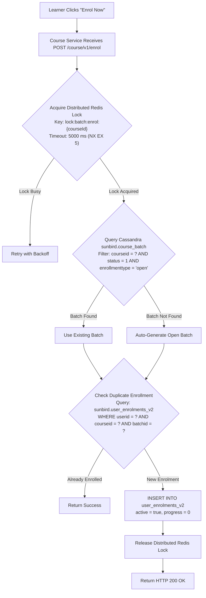

### 4.5 Flowchart 5: Q11 Native Interactive Video Playback Engine

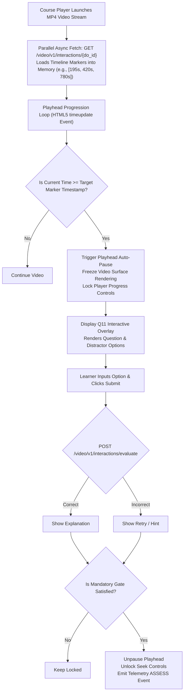

### 4.6 Flowchart 6: Telemetry Ingestion & Real-Time Progress Aggregation

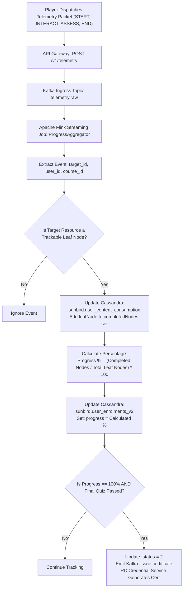

### 4.7 Flowchart 7: Self-Serve Unenrollment & Re-enrollment Lifecycle

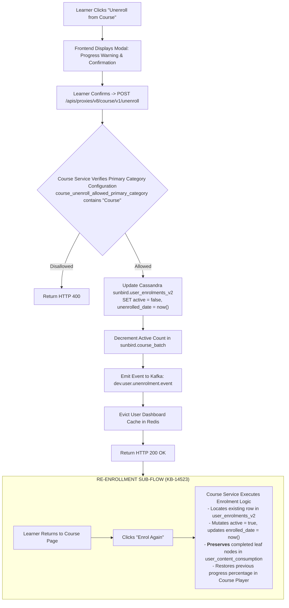

## 5. Microservice Interaction Sequence Diagrams

### 5.1 Sequence 1: End-to-End Course Authoring, CQF Evaluation & Live Publishing

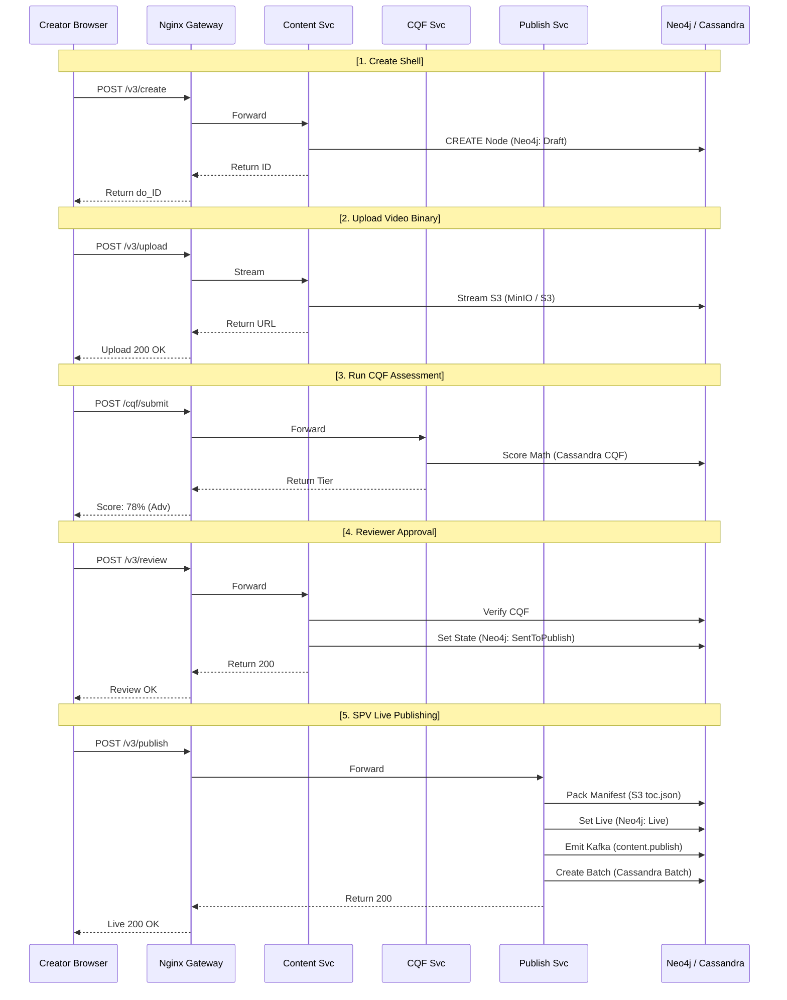

### 5.2 Sequence 2: Learner Enrolment, Q11 In-Video Playback & Unenrollment

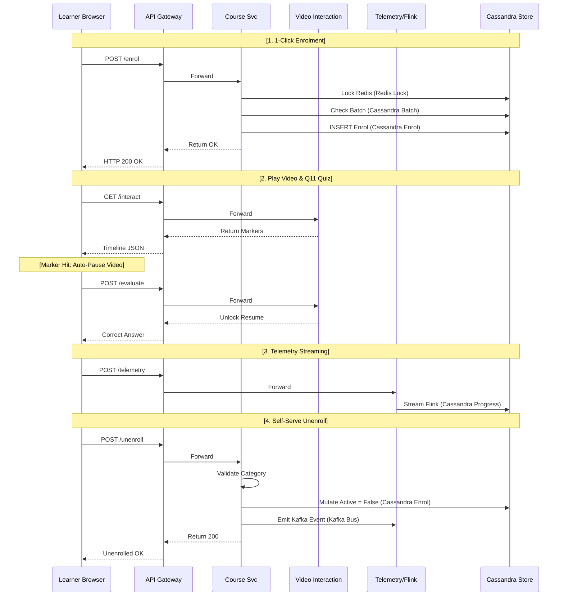

## 6. Low-Level Database Design & Query Execution Plans

**PHYSICAL DATA ENGINE MAPPING**

| Database Engine | Primary Responsibility | Target Schema / Key Entities |
|---|---|---|
| **Neo4j** (Graph DB) | Course collection trees, module sequences, taxonomy and competency hierarchies. | Node Labels: :Content, :Course, :Collection, :Resource. Relationships: [:CONTAINS {index: Int}] |
| **Cassandra** (NoSQL Distributed) | High-throughput runtime transactions, batch states, user progress, CQF audits. | Keyspaces: sunbird, sunbird_cqf. Tables: course_batch, user_enrolments_v2, user_content_consumption, assessments. |
| **ElasticSearch** (Search Cluster) | Full-text search catalogue, multi-select category pills, duration/competency facets. | Index: composite-search. Facets: primaryCategory, channel, duration, competencies_v5. |
| **Cloud S3/MinIO** (Object Store) | Binary media storage, compiled manifests, Q11 JSON overlays, credentials. | Buckets: /content-store, /manifests. Objects: do_.../artifact.mp4, toc.json, q11_interactions.json. |

### 6.1 Neo4j Graph Queries (Cypher)

#### Creating Root Course Collection Node

```cypher
CREATE (c:Content:Course {
  identifier: $identifier,
  name: $name,
  code: $identifier,
  contentType: "Course",
  primaryCategory: "Course",
  accessSetting: "allUsers",
  status: "Draft",
  framework: "igot",
  language: $language,
  createdOn: datetime(),
  pkgVersion: 0,
  visibility: "Default"
})
RETURN c.identifier AS contentId;
```

#### Traversing Full Tree Hierarchy for TOC Manifest

```cypher
MATCH (root:Content {identifier: $courseId})-[:CONTAINS*1..3]->(child:Content)
WITH root, child, [r IN relationships(p) | r.index] AS orderSequence
RETURN child.identifier AS id,
       child.name AS title,
       child.mimeType AS mimeType,
       child.artifactUrl AS mediaUrl,
       child.duration AS duration
ORDER BY orderSequence;
```

### 6.2 Apache Cassandra Schemas & CQL Mutations

#### Keyspace: `sunbird` | Table: `course_batch`

```sql
CREATE TABLE sunbird.course_batch (
    courseid text,
    batchid text,
    name text,
    enrollmenttype text,  -- 'open'
    startdate text,
    enddate text,
    status int,  -- 1 = active, 2 = completed
    createdby text,
    createddate text,
    PRIMARY KEY (courseid, batchid)
);

-- CQL: Fetch Single Active Batch SELECT batchid, name, enrollmenttype FROM sunbird.course_batch WHERE courseid = 'do_114389201' AND status = 1 LIMIT 1;
```

#### Keyspace: `sunbird` | Table: `user_enrolments_v2` (Supporting KB-14518)

```sql
CREATE TABLE sunbird.user_enrolments_v2 (
    userid text,
    courseid text,
    batchid text,
    active boolean,
    -- Mutated to false upon unenrollment
    progress int,
    -- Stored as 0..100
    status int,  -- 0 = Not started, 1 = In progress, 2 = Completed
    enrolled_date timestamp,
    unenrolled_date timestamp,
    certificates list<frozen<map<text, text>>>,
    PRIMARY KEY (userid, courseid, batchid)
);

-- CQL: Self-Serve Unenrollment Mutation UPDATE sunbird.user_enrolments_v2 SET active = false, unenrolled_date = toTimestamp(now()) WHERE userid = '712020:2b1926b8-ba53-4277-9b45-3508667c6b3d' AND courseid = 'do_114389201' AND batchid = '0138947261947';
-- CQL: Re-enrollment Progress Recovery Mutation UPDATE sunbird.user_enrolments_v2 SET active = true, enrolled_date = toTimestamp(now()) WHERE userid = '712020:2b1926b8-ba53-4277-9b45-3508667c6b3d' AND courseid = 'do_114389201' AND batchid = '0138947261947';
```

#### Keyspace: `sunbird_cqf` | Table: `assessments`

```sql
CREATE TABLE sunbird_cqf.assessments (
    contentid text,
    userrole text,  -- 'creator', 'reviewer', 'publisher'
    assessmentid text,
    score map<text, double>,  -- Section-wise percentage map overallscore double,
    -- Weighted cumulative score
    qualificationstatus text,
    -- 'iGOT Advanced',
    'iGOT Basic',
    etc. remarks map<text, text>,  -- Line-item reviewer feedback
    submissiondate timestamp,
    PRIMARY KEY (contentid, userrole)
);

-- CQL: Insert Creator Assessment Evaluation
INSERT INTO sunbird_cqf.assessments ( contentid, userrole, assessmentid, score, overallscore, qualificationstatus, submissiondate ) VALUES ( 'do_114389201', 'creator', 'cqf_v6_schema', {'Pedagogical Alignment': 80.0, 'Content Richness': 75.0, 'Technical Quality': 74.0}, 76.5, 'iGOT Advanced', toTimestamp(now()) );
```

### 6.3 ElasticSearch Search Query & Facet Mappings

#### Index: `composite-search` | Multi-Select Category Pill Query

```json
{
  "query": {
    "bool": {
      "must": [
        {
          "term": {
            "status.keyword": "Live"
          }
        },
        {
          "terms": {
            "primaryCategory.keyword": [
              "Course"
            ]
          }
        }
      ]
    }
  },
  "aggs": {
    "competency_areas": {
      "terms": {
        "field": "competencyArea.keyword",
        "size": 10
      }
    },
    "duration_ranges": {
      "range": {
        "field": "duration",
        "ranges": [
          {
            "to": 3600,
            "key": "Under 1 Hour"
          },
          {
            "from": 3600,
            "to": 10800,
            "key": "1 to 3 Hours"
          },
          {
            "from": 10800,
            "key": "Over 3 Hours"
          }
        ]
      }
    },
    "sponsoring_mdo": {
      "terms": {
        "field": "channel.keyword",
        "size": 15
      }
    }
  },
  "sort": [
    {
      "lastPublishedOn": {
        "order": "desc"
      }
    }
  ],
  "from": 0,
  "size": 20
}
```

## 7. Concrete Microservice API Specifications & Data Contracts

### 7.1 API-1: Create Course Shell

- **Route:** `POST /apis/proxies/v8/action/content/v3/create`
- **Request Headers:**
  - `Content-Type: application/json`
  - `Cookie: connect.sid={{session_cookie}}`

- **Request Body:**
  ```json
  {
    "request": {
      "content": {
        "name": "General Financial Rules (GFR) Masterclass",
        "description": "Essential public procurement guidelines and expenditure control standards.",
        "contentType": "Course",
        "primaryCategory": "Course",
        "accessSetting": "allUsers",
        "mimeType": "application/vnd.ekstep.content-collection",
        "framework": "igot",
        "language": [
          "English"
        ]
      }
    }
  }
  ```
- **Response Body** (`HTTP 200 OK`):
  ```json
  {
    "id": "api.content.create",
    "ver": "3.0",
    "ts": "2026-10-30T16:00:00Z",
    "params": {
      "resmsgid": "c92841b2-10f8-4b72-9b21-4d928374821a",
      "msgid": "b18274a1-0291-4c12-8d72-1b827364812a",
      "status": "successful"
    },
    "responseCode": "OK",
    "result": {
      "identifier": "do_114389201",
      "versionKey": "1698654210000"
    }
  }
  ```

### 7.2 API-2: Submit CQF Self-Audit Evaluation

- **Route:** `POST /apis/proxies/v8/cqfquestionset/submit`
- **Request Headers:**
  - `Content-Type: application/json`
  - `Cookie: connect.sid={{session_cookie}}`

- **Request Body:**
  ```json
  {
    "request": {
      "contentId": "do_114389201",
      "versionKey": "1698654210000",
      "userRole": "creator",
      "children": [
        {
          "questionId": "cqf_sec1_q1",
          "selectedOption": "opt_meets"
        },
        {
          "questionId": "cqf_sec1_q2",
          "selectedOption": "opt_partial"
        },
        {
          "questionId": "cqf_sec2_q1",
          "selectedOption": "opt_meets"
        },
        {
          "questionId": "cqf_sec3_q1",
          "selectedOption": "opt_meets"
        }
      ]
    }
  }
  ```
- **Response Body** (`HTTP 200 OK`):
  ```json
  {
    "id": "api.cqf.submit",
    "ver": "1.0",
    "ts": "2026-10-30T16:01:00Z",
    "params": {
      "resmsgid": "f8273612-...",
      "status": "successful"
    },
    "responseCode": "OK",
    "result": {
      "contentId": "do_114389201",
      "overallScore": 76.5,
      "qualificationStatus": "iGOT Advanced",
      "isQualified": true,
      "sectionBreakdown": [
        {
          "sectionName": "Pedagogical Alignment",
          "score": 80.0,
          "status": "Qualified"
        },
        {
          "sectionName": "Content Richness",
          "score": 75.0,
          "status": "Qualified"
        },
        {
          "sectionName": "Technical & Metadata",
          "score": 74.0,
          "status": "Qualified"
        }
      ]
    }
  }
  ```

### 7.3 API-3: Self-Serve Course Unenrollment (KB-14518)

- **Route:** `POST /apis/proxies/v8/course/v1/unenroll`
- **Request Headers:**
  - `Authorization: Bearer {{gateway_jwt}}`
  - `x-authenticated-user-token: {{user_token}}`
  - `Content-Type: application/json`

- **Request Body:**
  ```json
  {
    "request": {
      "courseId": "do_114389201",
      "batchId": "0138947261947",
      "userId": "712020:2b1926b8-ba53-4277-9b45-3508667c6b3d"
    }
  }
  ```
- **Response Body** (`HTTP 200 OK`):
  ```json
  {
    "id": "api.course.unenroll",
    "ver": "v1",
    "ts": "2026-10-30T16:02:00Z",
    "params": {
      "resmsgid": "a9827361-...",
      "status": "successful"
    },
    "responseCode": "OK",
    "result": {
      "response": "SUCCESS"
    }
  }
  ```

### 7.4 API-4: Q11 Interactive Video Timeline Manifest

- **Route:** `GET /apis/proxies/v8/video/v1/interactions/{do_id}`
- **Request Headers:**
  - `Authorization: Bearer {{gateway_jwt}}`

- **Response Body** (`HTTP 200 OK`):
  ```json
  {
    "id": "api.video.interactions.read",
    "ver": "1.0",
    "result": {
      "contentId": "do_114389201",
      "videoDuration": 1200,
      "interactions": [
        {
          "interactionId": "q11_m1_q1",
          "timestamp": 195,
          "type": "SINGLE_CHOICE_MCQ",
          "mandatory": true,
          "question": "What is the primary threshold required to qualify a course under CQF?",
          "options": [
            {
              "id": "opt_1",
              "text": "35%",
              "correct": false
            },
            {
              "id": "opt_2",
              "text": "50%",
              "correct": true
            },
            {
              "id": "opt_3",
              "text": "75%",
              "correct": false
            }
          ],
          "explanation": "50% is the mandatory platform cut-off threshold (iGOT Basic)."
        }
      ]
    }
  }
  ```

## 8. Implementation Task Breakdown & Engineering Workstreams

```mermaid
flowchart TD
    W1["1. FRONTEND WORKSTREAM (ANGULAR 14+ & FLUTTER CLIENTS)<br/>Task 1.1: Build 3-Step Wizard components in CBP (KB-6847)<br/>Task 1.2: Enforce regex validators (10-70 char titles, #lt;= 400MB payloads)<br/>Task 1.3: Develop reactive CQF assessment form with live score calculations (KB-6547)<br/>Task 1.4: Embed Q11 video player wrapper with pause/resume timeline listeners (Q11 BRD)<br/>Task 1.5: Build dashboard unenrollment modal and confirmation warnings (KB-14520)<br/>Task 1.6: Implement responsive multi-select category search filter pills (KB-15689)"]
    W2["2. CORE MICROSERVICES WORKSTREAM (JAVA / NODE.JS)<br/>Task 2.1: Implement Content Service hierarchy packaging & S3 manifest compiler<br/>Task 2.2: Build CQF calculation engine with weighted formula validation (KB-6409)<br/>Task 2.3: Enforce central SPV Publisher authorization gatekeeper on /publish (KB-7066)<br/>Task 2.4: Build 1-click open batch assignment with Redis locking (KBE-582, KB-8065)<br/>Task 2.5: Develop Q11 in-video interaction evaluator & manifest service (Q11 BRD)<br/>Task 2.6: Deploy /course/v1/unenroll handler & Cassandra mutator (KB-14518)"]
    W3["3. DATA & STREAMING PIPELINES WORKSTREAM<br/>Task 3.1: Initialize Cassandra keyspaces and tables (sunbird, sunbird_cqf)<br/>Task 3.2: Configure Neo4j constraint indexes on :Content(identifier) and :Course<br/>Task 3.3: Deploy Flink streaming aggregator for real-time progress calculations<br/>Task 3.4: Set up Kafka bus topics: telemetry.raw, content.publish, dev.user.unenroll<br/>Task 3.5: Implement nightly batch reconciliation job for duplicate cleanup (KAR-1351)"]
    W4["4. INTEGRATION, SECURITY & QA VERIFICATION WORKSTREAM<br/>Task 4.1: Configure Nginx/Kong reverse proxy routing, rate limiting, and SSL termination<br/>Task 4.2: Integrate Sunbird RC Credential Service for verifiable PDF/SVG certificate gen<br/>Task 4.3: Deploy unit test suites covering CQF score edge cases (e.g., 49.9% vs 50.0%)<br/>Task 4.4: Execute JMeter stress test bench for 25,000 concurrent learner video sessions"]
    W1 --> W2
    W2 --> W3
    W3 --> W4
```

## 9. Master Traceability Matrix

| Component / Function Requirement | Primary Jira Key | Architectural Layer | Primary Entity / Storage | Implementation Status |
|---|---|---|---|---|
| **Course Creation Wizard** | KB-6847, KB-6276 | Frontend CBP | Neo4j `:Course` Node | **Fully Implemented** |
| **Validation Bounds (10–70 chars)** | KB-6847, PRD 271450154 | Frontend & Gateway | Content Service | **Fully Implemented** |
| **CQF Bulk CSV Schema Ingestion** | KB-6408, KB-6407 | Backend Microservice | Cassandra `questionset` | **Fully Implemented** |
| **Mathematical CQF Score Gating** | KB-6409, KB-6407 | Backend Microservice | CQF Service Engine | **Fully Implemented** |
| **Reviewer Line-Item Remarks** | KB-6547, KB-7066 | Frontend & Backend | Cassandra `assessments` | **Fully Implemented** |
| **Central SPV Publisher Gate** | KB-7066, KB-7126 | Security & Gateway | Neo4j `status: Live` | **Fully Implemented** |
| **1-Click Open Auto-Batching** | KB-1950, KB-8065 | Course Service | Cassandra `course_batch` | **Fully Implemented** |
| **Multi-Select Search Filter Pills** | KB-15689, KAR-1351 | Learner Portal UI | ElasticSearch Facets | **Fully Implemented** |
| **Q11 Timeline Video Overlays** | Q11 BRD | Video Interaction Svc | Cloud S3 JSON Manifests | **Partially Implemented (Phase 1)** |
| **Self-Serve Course Unenrollment** | KB-14109, KB-14518 | Course Service | Cassandra / Kafka | **Fully Implemented** |
| **Re-enrollment Progress Recovery** | KB-14523 | Course Service | Cassandra Progress | **Fully Implemented** |

## 10. Conclusion

This Low-Level Design (LLD) document provides the implementation specifications for the **Course – General Platform Course Creation & Management** capability across its evolutionary progression from **Quarter 2 through Quarter 13**.

By standardizing client validation constraints (10–70 character limits, asset sizes), establishing an automated Course Quality Framework threshold gate (), decoupling in-video interactivity via Q11 timeline overlays, automating open batch creation with Redis concurrency locks, and providing complete lifecycle autonomy via self-serve unenrollment and re-enrollment, the architecture ensures:

1. **Structural and Pedagogical Consistency:** Unverified or structurally invalid learning assets are blocked before public release.
2. **Frictionless Learner Experience:** Sub-second open enrollment, native cross-platform playback, and reliable progress persistence.
3. **Enterprise Operational Reliability:** Concurrency-safe batching, automated audit trails, and resilient distributed microservice scaling across millions of civil servants.
