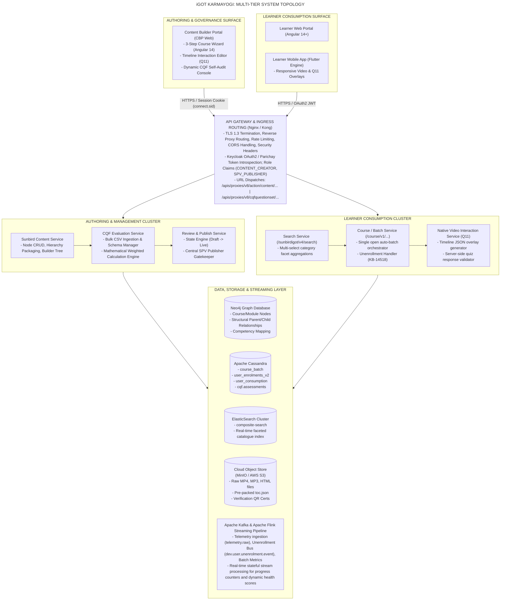
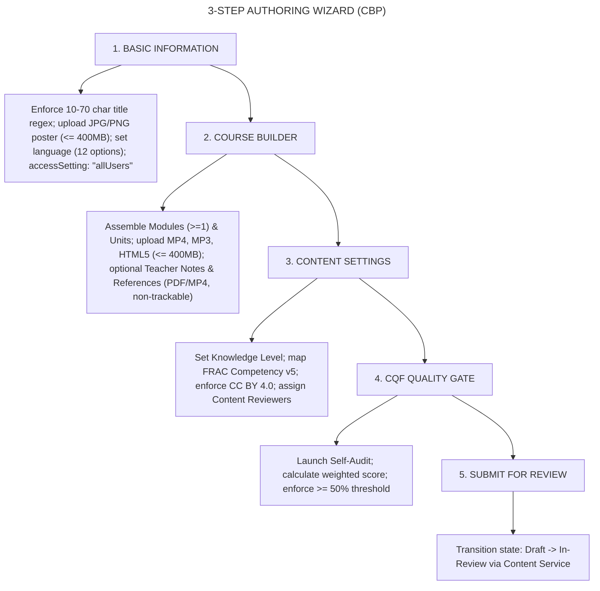
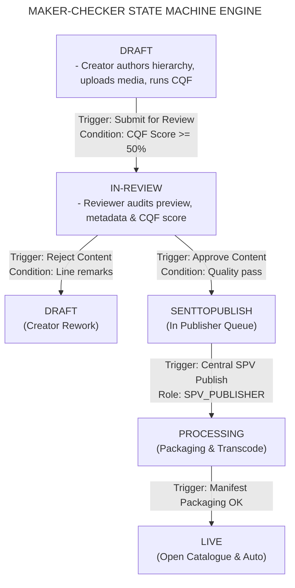
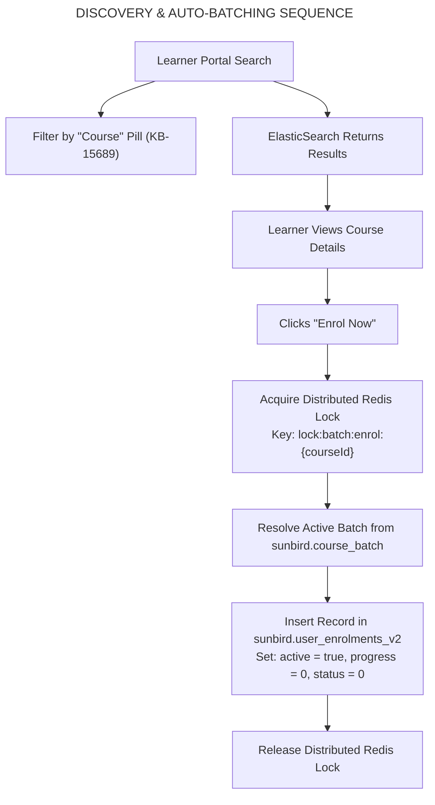
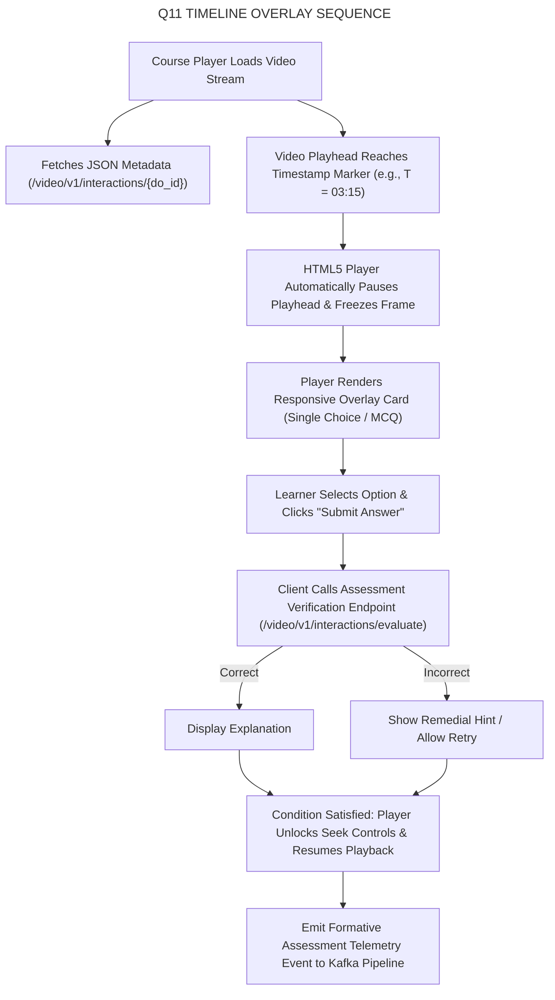
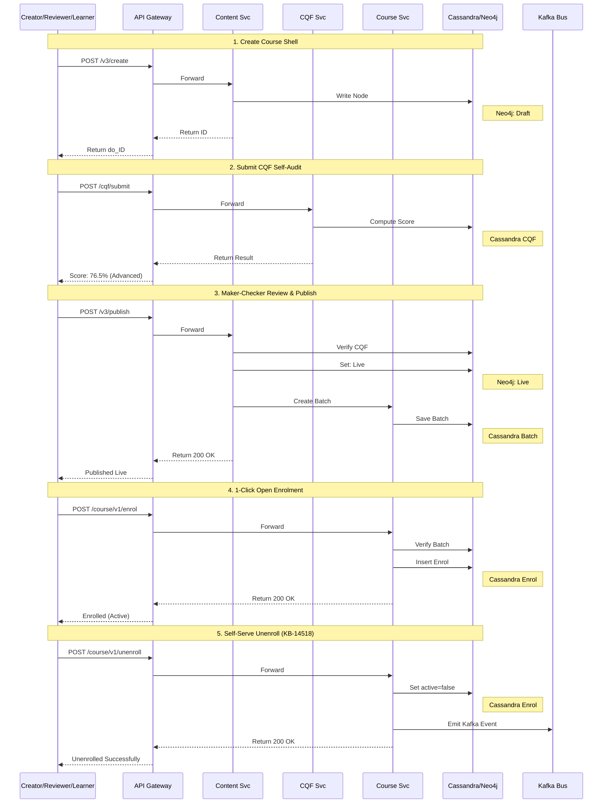
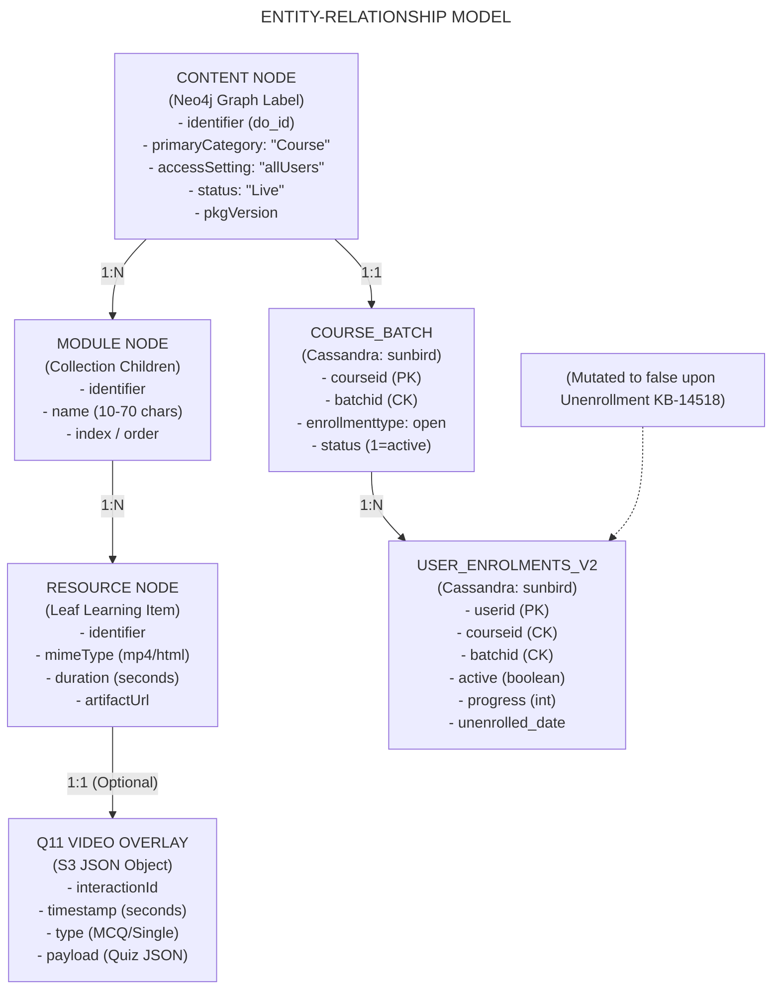

# Course — Software Design Document (SDD)

## 1. Introduction & Design Principles

### 1.1 Purpose

This Software Design Document (SDD) provides the complete technical design for the **General Platform Course** capability (`primaryCategory: "Course"`, `contentType: "Course"`) across its architectural and functional evolution from **Quarter 2 (Q2)** through **Quarter 13 (Q13)** on the iGOT Karmayogi platform. It decomposes the end-to-end multi-tier pipeline:

1. **Creation & Authoring Surface:** Content Builder Portal (CBP) 3-step authoring wizard, validation regexes, payload boundaries, asset streaming, and hierarchy assembly.
2. **Pedagogical Governance Engine:** Course Quality Framework (CQF) mathematical scoring engine, bulk schema ingestion, and mandatory state-transition gates ().
3. **Maker-Checker State Engine:** Multistage review workflows, audit trails, line-item remarking, and central Special Purpose Vehicle (SPV) live deployment.
4. **Learner Discovery & Consumption:** Faceted ElasticSearch multi-select filtering, 1-click open auto-batching, native Q11 timeline-based in-video interactions, and Cassandra/Flink progress aggregation.
5. **Full Lifecycle Autonomy:** Self-serve unenrollment (KB-14518), Kafka event bus notifications, and re-enrollment with historical progress restoration.

### 1.2 Architectural Design Principles

- **De-Coupled Multi-Tier Topology:** Clean separation of presentation clients (Angular 14+, Flutter), API gateways (Nginx/Kong), stateless microservices, and distributed persistence engines.
- **Non-Destructive Media Interactivity (Q11):** Media assets (MP4) remain immutable on object storage; formative in-video interactions are executed via timeline JSON overlay layers evaluated server-side.
- **Deterministic Quality Gates:** Elimination of unverified content via automated mathematical thresholding () prior to review or publishing enablement.
- **Single Active Open Batch:** Elimination of duplicate batch enrollment anomalies via distributed concurrency locks (Redis) and automated reconciliation workers.
- **Stateful Stream Telemetry:** Telemetry packets (`START`, `INTERACT`, `ASSESS`, `END`) are processed through Apache Kafka and Apache Flink to provide sub-second progress calculation and verifiable credential issuance.

## 2. Source Traceability & Evolutionary Progression (Q2 – Q13)

### 2.1 Traceability Inventory

| Jira Reference | Type | Milestone | Primary System Function / Impact |
|---|---|---|---|
| **KB-6276** | Epic | Q6 | Content Portal UI/UX Revamp: 3-step builder, Angular 14+ migration, Nginx proxy routing. |
| **KB-6407** | Epic | Q6 | Configurable CQF Framework: Transition from static checklists to dynamic mathematical scoring. |
| **KB-6408 / KB-6409** | Stories | Q6 | SPV Publisher bulk CSV schema ingestion; category weighting; passing threshold gate. |
| **KB-6547** | Story | Q6 | CQF consumption: Creator self-audit, Reviewer inspection, and Publisher sign-off. |
| **KB-6847** | Story | Q6 | Creator navigation & UX: Enforces 10–70 character titles, asset payloads. |
| **KB-7044** | Story | Q6 | Modular Resource Ingestion: Separation of standalone resources from collection units. |
| **KB-7066** | Story | Q6 | Maker-Checker Governance: Reviewer and SPV Publisher approval and line-item remarking. |
| **KB-7126** | Story | Q6 | CIOS Marketplace & Live Publishing: Neo4j live state update, ElasticSearch catalogue ingestion. |
| **KB-1950 / KB-1936** | Epic / Story | Q3 | Learner Consumption & Batch Framework: Introduction of open batched learner consumption. |
| **KB-8065 / KB-8066** | Stories | Q7 | Auto-Batch Engine & FRAC v5: Automated batch creation; hierarchical competency mapping. |
| **KB-8909 / KB-9851** | Story / Epic | Q9 | AI Course Generation POC: PDF parsing, outline generation, LLM metadata rewriting. |
| **KB-11977** | Epic | Q10 | Decoupled Modular CQF: Distinct quality frameworks for short-form resources vs full courses. |
| **Q11 BRD** | Spec | Q11 | Native Interactive Video: Timeline JSON overlay engine; auto-pausing; in-video quizzes. |
| **KB-14109 / KB-14518** | Epic / Story | Q12 | Course Unenrollment Framework: Self-serve unenrollment API; Cassandra state mutator. |
| **KB-14520 / KB-14523** | Stories | Q12 | Learner Dashboard unenrollment modal; re-enrollment historical progress recovery. |
| **KB-15689 / KAR-1351** | Story / Defect | Q13 | Multi-select category search pills (`Course`); duplicate batch cleanup & reconciliation. |

### 2.2 Quarterly Evolution Matrix

**FEATURE EVOLUTION EPOCHS (Q2 - Q13)**

| Milestone | Architectural Focus | Key Functional Capabilities |
|---|---|---|
| **Q2 – Q3** | Monolithic Ingestion & Manual Batches | Manual batching; SCORM zip uploads; basic Cassandra progress tracking. |
| **Q4 – Q5** | Static Quality & Governance | Static pre-publishing checklists; Reviewer rejection remarks; FRAC v3. |
| **Q6** | Content Portal Revamp & Dynamic CQF (The Architectural Baseline) | 3-Step Creator Wizard; CSV-driven CQF; mathematical scoring; 10-70 char regex. |
| **Q7 – Q8** | Auto-Batching & Competency v5 | Auto-batch generation (autoBatch: Yes); Redis locks preventing race conditions. |
| **Q9 – Q10** | AI Authoring & Modular Frameworks | AI metadata generation; decoupled CQF rubrics for micro-learning units. |
| **Q11** | Native Interactive Video (Q11) | Timeline JSON overlays on raw MP4; auto-pause quizzes; server-side grading. |
| **Q12** | Full Lifecycle & Unenrollment | Self-serve unenrollment; Kafka bus event; re-enrollment with progress restored. |
| **Q13** | Faceted Discovery & Deduplication | Multi-select search pills (Course); automated single active batch reconciler. |

## 3. High-Level Architectural Decomposition



## 4. Subsystem Design & Component Modules

### 4.1 Subsystem A: Content Builder Portal (CBP) & Authoring Pipeline



#### Detailed Component Specifications

- **Form Validation Engine (Angular 14+):**
  - `Course Title` and `Module Title`: Validated against regex `^[a-zA-Z0-9\.\-\_\$\/\:\[\]\'\ \!]+$`. Enforces and characters.
  - `Short Description`: Minimum 30 characters, maximum 500 characters.
  - `Media Binary Ingestion`: Managed via chunked multipart form upload proxy directly to MinIO/S3 storage. Max payload bound: .

- **Hierarchy Assembler:**
  - Root node constructed with `mimeType: "application/vnd.ekstep.content-collection"`.
  - Modules constructed as `application/vnd.ekstep.content-collection` with `visibility: "Parent"`.
  - Leaf nodes assigned their specific media MIME type (`video/mp4`, `audio/mp3`, `application/pdf`, `application/vnd.ekstep.html-archive`, `application/vnd.sunbird.questionset`).
  - Dispatches hierarchy updates via `PATCH /apis/proxies/v8/action/content/v3/hierarchy/update`.

### 4.2 Subsystem B: Course Quality Framework (CQF) Mathematical Engine

```mermaid
---
title: CQF SCORING & GATING WORKFLOW
---
flowchart TD
    A["SPV Publisher"] --> A2["Bulk CSV Upload (Categories, Question Weights, Pass Thresholds)"]
    B["CQF QuestionSet"] --> B2["Published in Cassandra sunbird_cqf.questionset (Immutable)"]
    C["Creator Self-Audit"] --> C2["Answers questions: Meets (1.0), Partial (0.5), Fails (0.0), NA"]
    D["Scoring Formula"] --> D2["Score_j = (Earned_Marks_j / Max_Marks_j) * 100<br/>Overall_Score = SUM(Score_j * Weight_j / 100)"]
    E["Threshold Gating"] --> E2{"Score #gt;= 50% ?"}
    E2 -->|"YES"| Y["Set Status = QUALIFIED -#gt; #quot;Send for Review#quot; Enabled"]
    E2 -->|"NO"| N["Set Status = DOES NOT QUALIFY -#gt; Review Submission Blocked"]
    A --> B --> C --> D --> E
```



#### Mathematical Formulation & Schema

The CQF Engine evaluates course submissions across weighted sections, where the sum of section weightages equals :

For each section containing questions:

The cumulative weighted quality score is calculated as:

- **Gating Enforcement:** If , the submission evaluates to **Does Not Qualify**. The Content Service strictly disables the review transition.
- **Tier Categorization:**
  - : `Does Not Qualify` (Hard blocker).
  - : `iGOT Basic` (Eligible for review & live publishing).
  - : `iGOT Intermediate`.
  - : `iGOT Advanced`.

### 4.3 Subsystem C: Maker-Checker Governance & Central SPV Publishing



#### State Transition Logic & Enforcement

1. **Review Submission:** Content Creator calls `POST /apis/proxies/v8/action/content/v3/review/{do_id}`. The microservice queries Cassandra `sunbird_cqf.assessments` to ensure a qualifying score () exists before transitioning state to `In-Review`.
2. **Reviewer Inspection & Remarking:** The assigned Content Reviewer previews media, verifies taxonomy, and inspects the creator CQF breakdown. The reviewer can retake the CQF test, with line-item remarks per question being **mandatory**.
  - *Reject Action:* Reverts node state to `Draft` and appends reviewer remarks to the rejection log.
  - *Approve Action:* Transitions node state to `SentToPublish`.

3. **Central SPV Publishing Gate:** Publishing for General Platform Courses (`accessSetting: "allUsers"`) is restricted exclusively to authenticated users holding the central `SPV_PUBLISHER` role.
4. **Publishing Pipeline Worker:**
  - Compiles the complete course hierarchy into `manifest.json` and `do_..._toc.json`, uploading the output to cloud storage.
  - Updates Neo4j node properties: `status: "Live"`, `pkgVersion: pkgVersion + 1`.
  - Emits event on Kafka topic `content.publish`.
  - Reindexes the document in ElasticSearch (`composite-search`).
  - Automatically initializes the open batch in Cassandra `sunbird.course_batch` (`enrollmentType: "open"`, `status: 1`).

### 4.4 Subsystem D: Learner Discovery & 1-Click Open Auto-Batching



- **Faceted Search Aggregation:** ElasticSearch query targets `primaryCategory: ["Course"]` and `status: ["Live"]`. Filter aggregations group results by Competency Area, Duration Range, Sponsoring Ministry, and Language.
- **Single Active Batch Concurrency Control:**
  - When a learner enrolls, the Sunbird Course Service checks `sunbird.course_batch` for an active batch (`status: 1`).
  - To eliminate race conditions during high-concurrency drives, the service acquires a distributed Redis lock (`SET lock:batch:enrol:{courseId} {uuid} NX EX 5`).
  - Writes user enrollment record to Cassandra `sunbird.user_enrolments_v2` with `active: true` and releases the lock.

### 4.5 Subsystem E: Q11 Native Interactive Video Engine



- **Decoupled Architecture:** The MP4 video file is hosted on CDN/S3. An adjacent JSON document defines timeline markers:
  ```json
  {
    "contentId": "do_114389201",
    "version": "1.0",
    "interactions": [
      {
        "interactionId": "q11_int_001",
        "timestamp": 195,
        "type": "SINGLE_CHOICE_MCQ",
        "mandatory": true,
        "question": "What is the primary objective of the Course Quality Framework (CQF)?",
        "options": [
          {
            "id": "opt_a",
            "text": "To restrict user enrolment",
            "correct": false
          },
          {
            "id": "opt_b",
            "text": "To enforce standardized pedagogical quality",
            "correct": true
          }
        ],
        "explanation": "CQF enforces standardized quality thresholds prior to publishing."
      }
    ]
  }
  ```
- **Runtime Behavior:** When the playhead crosses the interaction timestamp, the player automatically triggers pause. If `mandatory: true`, seek and playhead controls remain locked until the learner inputs an answer and receives validation confirmation from the assessment microservice.

### 4.6 Subsystem F: Telemetry, Progress Aggregation & Lifecycle Management

```mermaid
---
title: PROGRESS & UNENROLLMENT PIPELINES
---
flowchart TD
    subgraph PSP["PROGRESS STREAMING PIPELINE"]
        P1["Player Dispatches Telemetry Events (START, INTERACT, ASSESS, END)"]
        P2["Kafka Ingress (telemetry.raw)"]
        P2B["Apache Flink Stateful Aggregation"]
        P3["Calculate: Progress % = (Completed Leaf Nodes / Total Leaf Nodes) * 100"]
        P4["Update Cassandra: sunbird.user_content_consumption & user_enrolments_v2"]
        P5["Condition: Progress == 100% & Pass Assessment"]
        P6["Trigger Sunbird RC Credential Svc<br/>(Generate PDF/SVG with Ed25519 Cryptographic QR Code Signature)"]
        P1 --> P2 --> P2B
        P2 --> P3 --> P4 --> P5 --> P6
    end
    subgraph ULP["UNENROLLMENT LIFECYCLE PIPELINE (KB-14518)"]
        U1["Learner Clicks #quot;Unenroll from Course#quot; in Dashboard Modal"]
        U2["POST /apis/proxies/v8/course/v1/unenroll"]
        U3["Validate System Config: course_unenroll_allowed_primary_category = Course,Moderated Course"]
        U4["Mutate Cassandra: user_enrolments_v2 -#gt; Set active = false, unenrolled_date = now()"]
        U5["Emit Kafka Event: dev.user.unenrolment.event -#gt; Evict Redis Dashboard Cache"]
        U6["RE-ENROLLMENT RECOVERY (KB-14523)<br/>Learner Re-enrols -#gt; Mutate active = true -#gt; Restore Historical Progress from Cassandra"]
        U1 --> U2 --> U3 --> U4 --> U5 --> U6
    end
```



## 5. Microservice Interaction Sequence Logic



## 6. Data Architecture & Entity Design



### 6.1 Database Engine Allocations

- **Neo4j Graph Database:** Owns nodes and relationships for course hierarchy collections, structural child order (`index`), taxonomic competency tags (FRAC v5), and content lifecycle states.
- **Apache Cassandra:**
  - `sunbird.course_batch`: Manages open batches (`enrollmenttype: "open"`).
  - `sunbird.user_enrolments_v2`: Tracks user enrollment, active state, completion status, and unenrollment timestamps.
  - `sunbird.user_content_consumption`: Tracks leaf-node progress counters.
  - `sunbird_cqf.assessments`: Stores JSON submissions, category percentages, and reviewer audit remarks.

- **ElasticSearch** (`composite-search` index): Stores denormalized course documents for real-time search querying across categories, competencies, durations, and channels.
- **Cloud Object Store (MinIO / S3):** Stores binary video assets (`.mp4`), audio (`.mp3`), zipped web artifacts (`.html`), Q11 interaction JSON overlays, compiled `toc.json` manifests, and verifiable credentials.

## 7. API Gateway & Microservice Interface Specifications

| API Route / Endpoint | Method | Consuming Surface | Owning Microservice | Core Business Purpose | Auth & Security Guard |
|---|---|---|---|---|---|
| `/apis/proxies/v8/action/content/v3/create` | `POST` | CBP Web Client | Sunbird Content Service | Creates `Course` root collection shell. | Session cookie (`connect.sid`), `CONTENT_CREATOR` role |
| `/apis/proxies/v8/action/content/v3/update/{id}` | `PATCH` | CBP Web Client | Sunbird Content Service | Updates metadata: 10–70 char titles, descriptions, competency tags. | `CONTENT_CREATOR` or Author ID match |
| `/apis/proxies/v8/cqfquestionset/submit` | `POST` | CBP Web Client | CQF Evaluation Service | Evaluates CQF questions; computes category scores; enforces 50% pass threshold. | Session cookie, Creator or Reviewer role |
| `/apis/proxies/v8/action/content/v3/review/{id}` | `POST` | Reviewer Console | Sunbird Content Service | Submits course for review or approves review; logs line-item audit remarks. | `CONTENT_REVIEWER` role |
| `/apis/proxies/v8/action/content/v3/publish/{id}` | `POST` | Publisher Console | Content Publish Service | Central SPV live deployment; triggers manifest packaging and live indexing. | Central `SPV_PUBLISHER` role |
| `/apis/proxies/v8/sunbirdigot/v4/search` | `POST` | Learner Portal / App | Search Service | Executes faceted search; filters on `primaryCategory: ["Course"]`. | Public / Authenticated Learner Token |
| `/apis/proxies/v8/course/v1/enrol` | `POST` | Learner Portal / App | Sunbird Course Service | Executes 1-click self-enrolment into single open auto-batch. | Learner Bearer JWT Token |
| `/apis/proxies/v8/video/v1/interactions/{id}` | `GET` | Course Player Engine | Video Interaction Svc | Fetches non-destructive JSON timeline overlay schema and quiz definitions. | Authenticated Learner Session |
| `/apis/proxies/v8/course/v1/unenroll` | `POST` | Learner Dashboard | Sunbird Course Service | Executes self-serve unenrollment (KB-14518); updates Cassandra; emits Kafka event. | Learner Bearer JWT, Active Enrolment Guard |

## 8. Non-Functional Requirements & Design Metrics

| Metric ID | Engineering Dimension | Target Specification | Design Implementation Mechanism |
|---|---|---|---|
| **NFR-PERF-01** | **API Response Latency** | P95 latency for `/v3/hierarchy` | Multi-layer Redis cache holding pre-packed `toc.json` manifests. |
| **NFR-PERF-02** | **Faceted Search Speed** | P99 latency for search pills | ElasticSearch optimized sharding and routing on `primaryCategory`. |
| **NFR-SCAL-01** | **Concurrent Learners** | Accommodate **concurrent learners** | Stateless Kubernetes pods with Horizontal Pod Autoscaling (HPA ). |
| **NFR-SCAL-02** | **Telemetry Throughput** | Ingest telemetry events/sec | Kafka cluster partitioned across 16 worker nodes; Apache Flink streaming. |
| **NFR-SEC-01** | **Transport Security** | TLS 1.3 encryption across all public routes | Nginx Ingress Controller SSL termination with HSTS enabled. |
| **NFR-SEC-02** | **Quiz Integrity** | Server-side validation of in-video answers | Interactive quiz answers evaluated server-side; client cannot spoof scores. |
| **NFR-REL-01** | **Single Active Batch** | duplicate active batch rows | Distributed Redis locking around batch enrollment calls; nightly reconciler. |
| **NFR-REL-02** | **Disaster Recovery (RTO)** | Recovery Time Objective | Multi-region Cassandra & MinIO bucket replication with automated failover. |

## 9. Comprehensive Engineering Workstreams & Task Breakdown

```mermaid
flowchart TD
    W1["1. CBP AUTHORING & CREATION WORKSTREAM<br/>Task 1.1: Build 3-Step Wizard components in Angular 14 (KB-6847)<br/>Task 1.2: Enforce regex validation (Titles: 10-70 chars, Uploads: #lt;= 400MB)<br/>Task 1.3: Integrate FRAC Competency v5 taxonomy picker (KB-8066)<br/>Task 1.4: Implement Q11 non-destructive timeline interaction editor (Q11 BRD)"]
    W2["2. QUALITY & GOVERNANCE WORKSTREAM<br/>Task 2.1: Develop CSV bulk upload engine for CQF schemas (KB-6408)<br/>Task 2.2: Implement mathematical scoring engine enforcing #gt;= 50% threshold (KB-6409)<br/>Task 2.3: Build Reviewer/Publisher audit console with side-by-side CQF reports (KB-6547)<br/>Task 2.4: Deploy central SPV Publisher authorization gatekeeper (KB-7066)"]
    W3["3. RUNTIME & PLAYER WORKSTREAM<br/>Task 3.1: Deploy responsive multi-select category search pills (KB-15689)<br/>Task 3.2: Implement 1-click open batch auto-assignment with Redis locking (KB-1950)<br/>Task 3.3: Embed Q11 native HTML5 video player auto-pause overlay engine (Q11 BRD)<br/>Task 3.4: Configure Sunbird RC Credential Service for verifiable PDF/SVG issuance"]
    W4["4. FULL LIFECYCLE WORKSTREAM<br/>Task 4.1: Deploy unenrollment microservice endpoint (/course/v1/unenroll) (KB-14518)<br/>Task 4.2: Build learner dashboard unenrollment modal with progress warnings (KB-14520)<br/>Task 4.3: Implement Kafka event dispatcher (dev.user.unenrolment.event)<br/>Task 4.4: Deploy progress restoration engine for re-enrolling learners (KB-14523)"]
    W1 --> W2 --> W3 --> W4
```



## 10. Conclusion

This Software Design Document formalizes the structural, mathematical, and operational specifications for the **Course – General Platform Course Creation & Management** feature across its evolutionary path from **Q2 through Q13**.

By decoupling presentation components, enforcing strict payload validations (10–70 character limits, assets), gating workflows with the Course Quality Framework (), integrating native Q11 timeline-based video interactivity, automating open batch creation with Redis concurrency locks, and providing complete lifecycle autonomy via self-serve unenrollment and re-enrollment, the architecture achieves:

1. **High Pedagogical Quality:** Objective, mathematically verified standards prior to public release.
2. **Frictionless Consumption:** 1-click open enrollment and sub-second progress calculation for millions of public officials.
3. **Enterprise Resilience:** Deterministic state machine transitions, zero duplicate active batch rows, and sub-second multi-tier responsiveness.
