# Course — Software Requirements Specification (SRS)

**Software Requirements Specification (SRS)**

## Feature: Moderated Course – Lifecycle Evolution, Creation, Management, and Learner Consumption (Q2 – Q13)

### Document Control & Metadata

- **Platform:** iGOT Karmayogi (Integrated Government Online Training)
- **Standard:** IEEE 29148 / IEEE 830 Standard for Software Requirements Specifications
- **Document Version:** 2.0 (Evolutionary Baseline: Q2 through Q13)
- **Status:** Approved / Technical Specification
- **Primary System References:**
  - **Jira Initiatives & Epics:** KB-337, KB-338, KB-261, KB-355, KB-743, KB-946, KBE-582, KB-6276, KB-6407, KB-6847, KB-7066, KB-11977, KB-14109, KB-14236, KB-14518, KB-14520, KB-14523, KB-15189, KB-15266, KB-15689.
  - **System Baseline Documents:**
    - FRS/SRS – Content Portal UI/UX Revamp (`TES/274628785`)
    - SRS – Unenrollment from Course & Moderated Course (`TES/1113882645`)
    - PRD – Course Creation, Review, and Publish (`KQAS/271450154`)
    - Technical Specification – Configurable CQF (`KQAS/190185579`)
    - Architectural Guide – Duplicate Batch Enrolment Cleanup & Reconciliation (`TES/1148747777`)

## 1. Introduction

### 1.1 Purpose

This Software Requirements Specification (SRS) formalizes the technical, functional, architectural, and interface requirements for the **Moderated Course** capability across its evolutionary progression from **Quarter 2 (Q2)** through **Quarter 13 (Q13)** on the iGOT Karmayogi platform. It covers:

1. **Creation & Authoring:** Course structure, metadata, restricted target audience configuration, and Course Quality Framework (CQF) evaluation within the Content Builder Portal (CBP).
2. **Review & Governance:** Maker-checker governance, MDO-specific publisher authorizations, and state transitions.
3. **Consumption & Runtime:** Role/verification-gated discovery, batch association, protected player execution, progress aggregation, unenrollment/re-enrollment lifecycles, and credential issuance.
4. **End-to-End Frontend-to-Backend Orchestration:** Interfacing across Angular/Flutter clients, Nginx/Kong API gateways, Sunbird Content & Course microservices, Flink telemetry pipelines, Kafka event queues, Neo4j, Cassandra, and ElasticSearch.

### 1.2 Document Conventions

- **MUST / SHALL:** Mandatory requirement for compliance.
- **SHOULD:** Recommended best practice or target optimization.
- **MAY:** Permissible optional configuration.
- **MDO:** Ministry, Department, or Organization.
- **SPV:** Special Purpose Vehicle (Karmayogi Bharat).
- **CQF:** Course Quality Framework.
- **LRS:** Learning Record Store.

### 1.3 Intended Audience

- **Solution & Enterprise Architects:** For microservice boundaries, data pipeline consistency, and state engine integrity.
- **Full-Stack Engineers (Frontend & Backend):** For UI contracts, API schemas, and Cassandra/Neo4j mutations.
- **QA & Automation Teams:** For verification criteria, role permissions, and regression edge-cases.
- **MDO Administrators & Curators:** For understanding audience scoping and access boundaries.

## 2. Scope & System Perspective

### 2.1 Feature Definition & Boundaries

A **Moderated Course** (`primaryCategory: "Moderated Course"`) is a specialized learning modality designed for regulated, targeted, or organization-specific capacity building. In contrast to a General Platform Course (`accessSetting: "allUsers"`), a Moderated Course enforces:

- **Restricted Target Audience:** Visibility and enrolment restricted by MDO boundaries, user profile attributes, or Verified Karmayogi status (`isVerifiedKarmayogi`).
- **Controlled Batch Management:** Enrolment governed by managed open/closed batches, requiring validation or administrative approval rather than generic platform-wide auto-batching.
- **Autonomous MDO Governance:** Decentralized publishing by organizational Content Publishers (`CONTENT_PUBLISHER`), bypassing central SPV Publisher gates while adhering to CQF standards.
- **Full Lifecycle Support:** Ingestion, tracking, telemetry sync, self-serve unenrollment, and re-enrollment without loss of historical assessment integrity.

### 2.2 System Differentiation: General Course vs. Moderated Course

| Functional Dimension | General Platform Course | Moderated Course |
|---|---|---|
| Primary Category | Course | Moderated Course |
| Access Setting Metadata | allUsers | mdoSpecific / restricted |
| Target Audience Eligibility | Universal (All civil servants) | Filtered by MDO, Org, Designation |
| Verification Requirement | Public / Registered | Optional "Verified Karmayogi" Gate |
| Batch Configuration | Automated Open Batch | Controlled Single Active Batch |
| Publishing Authority | SPV Publisher (SPV_PUBLISHER) | MDO Publisher (CONTENT_PUBLISHER) |
| Discovery Model | Open Catalogue | Filtered / Gated by Profile Token |
| Unenrollment Engine Support | Supported (Q12) | Supported (Q12 - KB-14518) |

## 3. Evolutionary Architecture & Roadmap (Q2 – Q13)

The capability evolved across multiple quarters from basic access checks to a hardened, distributed enterprise learning solution.

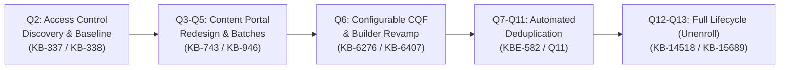

### Detailed Quarterly Analysis

| Quarter Milestone | Core Epics / Jira Tickets | Architectural & Functional Evolution | Frontend (Web / Mobile) Impact | Backend & Data Layer Impact |
|---|---|---|---|---|
| **Q2 Baseline** | **KB-337, KB-338, KB-261, KB-355** | Introduced `Moderated Course` category. Established access differentiation between **Verified Karmayogi** and unverified users. | Added access toggle in Content Settings; basic "Restricted Access" prompt on Player. | Added `isVerifiedKarmayogi` flag to Neo4j metadata schema and API Gateway route guards. |
| **Q3 Foundation** | **KB-743, KB-797, KB-799, KB-946, KB-1872** | Redesigned Content Portal navigation; added batch framework distinguishing Open, Moderated, and Invite-only batches. | Dedicated "My Content" tab grouping Moderated Courses; structured Table of Contents (TOC). | Implemented Cassandra `course_batch` lookup; basic telemetry event streaming. |
| **Q4 – Q5 Scaling** | **KB-3756, KB-4660, KB-5120** | Enforced MDO-level maker-checker approval chains. Introduced pre-publishing quality checklists for MDO admins. | Added Reviewer remarking view; MDO filtering dropdowns in review lists. | Enforced role-based authorization check (`CONTENT_PUBLISHER` within same org ID). |
| **Q6 Portal Revamp** | **KB-6276, KB-6407, KB-6847, KB-7066** | Complete Angular 14+ UI revamp; Configurable CQF integration; strict 10–70 character validation; max asset size . | 3-step authoring flow (Basic Info Builder Settings); dynamic CQF questionnaire and scoring view. | CQF QuestionSet API integration (`TES/175702042`); automated weighted threshold calculation (). |
| **Q7 – Q8 Batch Hardening** | **KBE-582, KB-8065, KB-8066** | Resolved race conditions during simultaneous enrolments; single active batch policy enforcement. | Clear enrollment error states if batch capacity or eligibility is breached. | Cassandra `enrollment_batch_lookup` table; automated reconciliation workers. |
| **Q9 – Q10 AI & Modular CQF** | **KB-9851, KB-11977, KB-11582** | Introduced decoupled CQF evaluation for micro-modules; AI metadata rewriting POC for MDO content. | In-context AI summary generator; modular CQF checklist tabs. | Decoupled CQF evaluation engine; Whisper/LLM ingestion worker endpoints. |
| **Q11 Interactive Playback** | **Q11 BRD (TPT/499974191)** | Integrated Q11 Native Interactive Video Engine into Moderated Courses. | Native HTML5 video timeline overlays; embedded in-video single/multiple choice checks. | Non-destructive JSON timeline schema (`/video/v1/interactions`); telemetry LRS sync. |
| **Q12 Lifecycle Expansion** | **KB-14109, KB-14518, KB-14520, KB-14523** | Enabled **Unenrollment** and **Re-enrollment** for `Moderated Course` (`course_unenroll_allowed_primary_category`). | "Unenroll" button in Course Dashboard; confirmation modals; progress reset prompts. | Sunbird Course Service unenroll handler; Kafka event `dev.user.unenrolment.event`; Cassandra updates. |
| **Q13 Audience & Search** | **KB-15189, KB-15266, KB-15689, KAR-1351** | Multi-select category pills on Learner Portal; advanced Target Audience rule builder (Designation, Ministry, Cadre). | Interactive filter pills (`Course`, `Moderated Course`); responsive audience selection UI. | ElasticSearch `composite-search` indexing updates; automated duplicate batch enrolment cleanup. |

## 4. User Classes and Persona Characteristics

**USER CLASS & PERSONA MATRIX**

| Persona | System Role Identifier | Responsibilities & Constraints |
|---|---|---|
| Course Creator | CONTENT_CREATOR | Authors course outline; uploads media; tags audience; completes mandatory CQF self-audit. |
| Content Reviewer | CONTENT_REVIEWER | Inspects content preview; audits CQF scoring; records line-item remarks; approves/rejects. |
| MDO Publisher | CONTENT_PUBLISHER | Conducts final organizational audit; verifies CQF $\ge 50\%$; publishes course to Live state. |
| Verified Learner | PUBLIC_LEARNER (Flag: isVerified=true) | Authenticated user with verified profile; accesses restricted moderated catalogues; consumes. |
| Unverified Learner | PUBLIC_LEARNER (Flag: isVerified=false) | Standard user; view-only or blocked from restricted courses. |

## 5. System Architecture & End-to-End Component Interaction

### 5.1 Multi-Tier Architecture Diagram

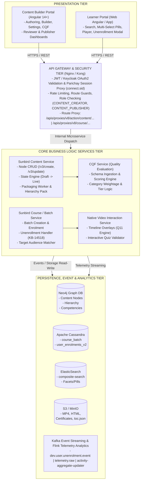

## 6. Detailed Functional Requirements

### 6.1 Module A: Course Creation, Authoring & Metadata (Frontend to Backend)

#### FR-AUTH-01: Category Selection & Initialization

- **Description:** The system must allow creators to explicitly initialize a course under the `Moderated Course` category.
- **Actor:** Content Creator (`CONTENT_CREATOR`).
- **Frontend Flow:**
  - Creator logs into CBP clicks "Create New" selects "Course" modal presents "General Course" vs. "Moderated Course".
  - Selecting "Moderated Course" sets `primaryCategory: "Moderated Course"` and `contentType: "Course"`.
  - Creator chooses course language from 12 supported Indian languages.

- **Backend Flow:**
  - Client sends `POST /apis/proxies/v8/action/content/v3/create`.
  - Content Service creates node in Neo4j with properties: `status: "Draft"`, `visibility: "Default"`, `primaryCategory: "Moderated Course"`. Returns generated ID `do_...`.

#### FR-AUTH-02: Content Structure & Payload Validation

- **Description:** Creation forms must enforce standardized character constraints and file limits.
- **Rules:**
  - **Course Title & Module Title:** Minimum **10 characters**, maximum **70 characters**. Regex pattern: `^[a-zA-Z0-9\.\-\_\$\/\:\[\]\'\ \!]+$`.
  - **Short Description:** Mandatory, 30–500 characters.
  - **Media Uploads:** JPG/PNG posters, MP4 videos, MP3 audio, HTML5 zip bundles .
  - **Builder Tree:** Course must contain at least 1 Module, each module containing at least 1 consumable trackable resource.

- **Backend API:** `PATCH /apis/proxies/v8/action/content/v3/update/{do_id}` and `POST /apis/proxies/v8/action/content/v3/upload/{do_id}`.

#### FR-AUTH-03: Target Audience & Verification Scoping

- **Description:** Content Settings must capture restricted audience rules (KB-337, KB-15189).
- **Parameters:**
  - `isVerifiedKarmayogi`: Boolean (`true`/`false`). When `true`, restricts enrolment exclusively to learners authenticated with government email/e-Sign/Parichay verification.
  - `targetAudience`: Multi-select array containing target MDO codes, cadres, or designations.

- **Persistence:** Serialized into the course metadata object within Neo4j and synced to ElasticSearch index.

### 6.2 Module B: Course Quality Framework (CQF) Quality Gate

**CQF EXECUTION & THRESHOLD VALIDATION**

1. Fetch Schema: `GET /apis/proxies/v8/cqfquestionset/read/{cqf_id}`
2. Evaluate Sections:
    - Section 1: Pedagogical Alignment (Weight W1 = 30%)
    - Section 2: Content Richness & Modularity (Weight W2 = 40%)
    - Section 3: Technical & Metadata Quality (Weight W3 = 30%)
3. Score Algorithm:
    - `Score_Section = (Sum(Earned Marks) / Sum(Max Marks)) * 100`
    - `Overall_Score = Sum(Score_Section_j * W_j / 100)`
4. Gate Enforcement:
    - IF Overall_Score >= 50%: Status = QUALIFIED -> "Send for Review" Enabled
    - IF Overall_Score < 50%: Status = DOES NOT QUALIFY -> "Send for Review" Disabled

#### FR-CQF-01: Mandatory Creator Self-Audit

- **Description:** Creators must complete a self-evaluation against the active CQF schema before submission.
- **Rules:**
  - The system blocks review submission if CQF is unattempted or if the computed score is .
  - Scores are categorized into:
    - : `Does Not Qualify` (Hard blocker)
    - : `iGOT Basic`
    - : `iGOT Intermediate`
    - : `iGOT Advanced`

- **Backend API:** `POST /apis/proxies/v8/cqfquestionset/submit`. Stores assessment in Cassandra `sunbird_cqf.assessments`.

#### FR-CQF-02: Reviewer and Publisher Verification

- **Description:** Reviewers and Publishers must independently inspect creator responses and have permissions to submit audit scores and line-item remarks (KB-6547).
- **Audit History:** Review history displays Creator, Reviewer, and Publisher score cards side-by-side.

### 6.3 Module C: Review, Approval & Decentralized MDO Publishing

#### FR-REV-01: Maker-Checker Governance Engine

- **Description:** Moderated courses must pass through an organizational maker-checker review cycle.
- **State Machine Transitions:**
  - `Draft` `In-Review`.
  - `In-Review` `SentToPublish`.
  - `In-Review` `Draft` (Reverted to creator).
  - `SentToPublish` `Processing` `Live`.

- **Autonomous Publishing Authority:** Unlike General Courses requiring central SPV sign-off, a Moderated Course can be published directly to `Live` by an authenticated organizational `CONTENT_PUBLISHER` from the sponsoring MDO.
- **Backend API:**
  - Review Submission: `POST /apis/proxies/v8/action/content/v3/review/{do_id}`
  - Publish Action: `POST /apis/proxies/v8/action/content/v3/publish/{do_id}`

### 6.4 Module D: Search, Discovery & Access Control (Learner Portal)

#### FR-DISC-01: Faceted Discovery & Multi-Select Category Pills (KB-15689, KAR-1351)

- **Description:** The Learner Portal search UI must provide responsive multi-select category filter pills.
- **Behavior:**
  - Filter pills displayed: `All`, `Course`, `Moderated Course`, `Blended Program`, `Standalone Assessment`.
  - Selecting `Moderated Course` executes search query:

```json
{
  "request": {
    "filters": {
      "primaryCategory": [
        "Moderated Course"
      ],
      "status": [
        "Live"
      ]
    },
    "sort_by": {
      "lastUpdatedOn": "desc"
    }
  }
}
```

- **Endpoint:** `POST /apis/proxies/v8/sunbirdigot/v4/search`.

#### FR-DISC-02: Access Guard & Profile Verification Enforcement (KB-337)

- **Description:** System must enforce access rules when a learner views a Moderated Course details page.
- **Logic:**
  - If `isVerifiedKarmayogi: true`, check learner's JWT token payload for `isVerified: true`.
  - If unverified, render guarded modal: *"This course is restricted to Verified Karmayogi learners. Please complete your profile verification to access."*
  - If user belongs to target MDO/Cadre, enable the "Enrol" action; otherwise, display *"Access Restricted by Sponsoring Department"*.

### 6.5 Module E: Consumption, In-Video Interactivity & Progress Tracking

#### FR-CONS-01: Controlled Batch Assignment

- **Description:** The system must manage enrolment via a single active batch per Moderated Course to eliminate duplicate enrolment records (KB-1148747777).
- **Behavior:** When learner clicks "Enrol", Course Service checks `enrollment_batch_lookup`. If no active batch exists, an automated managed batch is created (`enrollmentType: "open"` or `"moderated"`).

#### FR-CONS-02: Q11 Native Interactive Video Playback

- **Description:** Moderated course video units must support non-destructive timeline interactions (Q11 BRD).
- **Behavior:**
  - Player fetches timeline markers: `GET /apis/proxies/v8/video/v1/interactions/{do_id}`.
  - When video playback hits timestamp , player auto-pauses and renders HTML5 overlay containing formative assessment.
  - Learner submits answer server validates video resumes.

#### FR-CONS-03: Real-Time Telemetry & Progress Calculation

- **Description:** Telemetry events (`START`, `INTERACT`, `ASSESS`, `END`) must be dispatched asynchronously to the telemetry pipeline.
- **Calculation:** Progress updated in Cassandra `sunbird.user_content_consumption` by Apache Flink streaming workers:

### 6.6 Module F: Unenrollment and Re-enrollment Lifecycle (Q12: KB-14518)

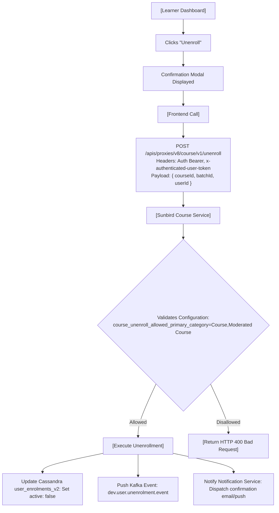

#### FR-LIFE-01: Self-Serve Unenrollment

- **Description:** Enrolled learners must be permitted to withdraw from an ongoing Moderated Course prior to certificate issuance.
- **Validation:** System checks whether `Moderated Course` is declared in `course_unenroll_allowed_primary_category`.
- **State Mutation:**
  - In Cassandra table `sunbird.user_enrolments_v2`, update record: `active: false`, `unenrolled_date: current_timestamp()`.
  - Deducts 1 from active batch count in `course_batch`.

- **Audit Event:** Emits Kafka message on topic `dev.user.unenrolment.event`.

#### FR-LIFE-02: Re-enrollment Mechanics

- **Description:** Learners who previously unenrolled can re-enrol into the active batch.
- **Data Recovery:** Upon re-enrolment, historical node completion records are retained in `user_content_consumption`, restoring previous progress percentage.

## 7. External Interface Requirements

### 7.1 User Interfaces (UI/UX)

- **Creation Portal (CBP):** Built with Angular 14+, Material Components, and Tailwind CSS. Responsive down to 1024px desktop resolutions.
- **Learner Portal (Web):** Cross-browser compatible (Chromium 90+, Safari 14+, Firefox 88+). Supports high-contrast accessibility modes.
- **Learner Mobile (App):** Flutter native application supporting iOS 13+ and Android 8.0+ (API Level 26+). Adaptive video orientation and offline caching.

### 7.2 Hardware & Network Interfaces

- **Client Bandwidth:** Minimum functional bandwidth: 256 kbps (PDF/HTML5); recommended: 2.0 Mbps (720p HLS video).
- **Server-Side Deployment:** Hosted on Kubernetes (EKS/On-Prem VM cluster) managed via Helm charts and Ansible playbooks.

### 7.3 Software & API Interface Specifications

#### API-01: Create Moderated Course Shell

- **Endpoint:** `POST /apis/proxies/v8/action/content/v3/create`
- **Headers:** `Content-Type: application/json`, `Cookie: connect.sid=...`
- **Payload:**
  ```json
  {
    "request": {
      "content": {
        "name": "Public Financial Moderation Standards",
        "description": "Standardized financial auditing procedures for MDO comptrollers.",
        "contentType": "Course",
        "primaryCategory": "Moderated Course",
        "accessSetting": "mdoSpecific",
        "isVerifiedKarmayogi": true,
        "mimeType": "application/vnd.ekstep.content-collection",
        "framework": "igot",
        "language": [
          "English"
        ]
      }
    }
  }
  ```
- **Response:** `HTTP 200 OK` `{ "result": { "identifier": "do_114289452", "versionKey": "1698654210000" } }`.

#### API-02: Course Unenrollment Endpoint (KB-14518)

- **Endpoint:** `POST /apis/proxies/v8/course/v1/unenroll`
- **Headers:** `Authorization: Bearer {{token}}`, `x-authenticated-user-token: {{user_token}}`
- **Payload:**
  ```json
  {
    "request": {
      "courseId": "do_114289452",
      "batchId": "0138947261947",
      "userId": "712020:2b1926b8-ba53-4277-9b45-3508667c6b3d"
    }
  }
  ```
- **Response:**
  ```json
  {
    "id": "api.course.unenroll",
    "ver": "v1",
    "ts": "2026-10-30T10:25:00Z",
    "params": {
      "resmsgid": "uuid-...",
      "status": "successful"
    },
    "responseCode": "OK",
    "result": {
      "response": "SUCCESS"
    }
  }
  ```

## 8. Data Model & Database Architecture

### 8.1 Neo4j Graph Model (Content Metadata & Hierarchy)

- **Node Labels:** `:Content`, `:Course`, `:ModeratedCourse`
- **Properties:**
  - `identifier`: String (Unique Primary Key, e.g., `do_...`)
  - `primaryCategory`: `"Moderated Course"`
  - `accessSetting`: `"mdoSpecific"`
  - `isVerifiedKarmayogi`: Boolean
  - `status`: `"Draft"` | `"In-Review"` | `"SentToPublish"` | `"Live"`
  - `targetAudience`: Array of Strings
  - `cqfScore`: Float
  - `pkgVersion`: Integer

### 8.2 Apache Cassandra Schemas

#### Table: `sunbird.course_batch`

```sql
CREATE TABLE sunbird.course_batch (
    courseid text,
    batchid text,
    name text,
    enrollmenttype text,  -- 'open' or 'moderated'
    startdate text,
    enddate text,
    status int,  -- 1 = active, 2 = completed
    createdby text,
    createddate text,
    PRIMARY KEY (courseid, batchid)
);
```

#### Table: `sunbird.user_enrolments_v2` (Supporting KB-14518 Unenrollment)

```sql
CREATE TABLE sunbird.user_enrolments_v2 (
    userid text,
    courseid text,
    batchid text,
    active boolean,
    -- Set to false upon unenrollment
    progress int,
    status int,  -- 0 = Not started, 1 = In progress, 2 = Completed
    enrolled_date timestamp,
    unenrolled_date timestamp,
    certificates list<frozen<map<text, text>>>,
    PRIMARY KEY (userid, courseid, batchid)
);
```

#### Table: `sunbird_cqf.assessments`

```sql
CREATE TABLE sunbird_cqf.assessments (
    contentid text,
    userrole text,  -- 'creator', 'reviewer', 'publisher'
    assessmentid text,
    score map<text, double>,
    -- Section wise percentage overallscore double,
    qualificationstatus text,  -- 'Does Not Qualify', 'iGOT Basic', etc. remarks map<text, text>,
    submissiondate timestamp,
    PRIMARY KEY (contentid, userrole)
);
```

### 8.3 ElasticSearch Index (`composite-search`) Mapping

```json
{
  "properties": {
    "identifier": {
      "type": "keyword"
    },
    "name": {
      "type": "text",
      "analyzer": "standard"
    },
    "primaryCategory": {
      "type": "keyword"
    },
    "accessSetting": {
      "type": "keyword"
    },
    "isVerifiedKarmayogi": {
      "type": "boolean"
    },
    "targetAudience": {
      "type": "keyword"
    },
    "status": {
      "type": "keyword"
    },
    "createdFor": {
      "type": "keyword"
    }
  }
}
```

## 9. Non-Functional Requirements (NFRs)

| NFR ID | Category | Requirement Specification | Metric / Target Threshold | Verification Method |
|---|---|---|---|---|
| **NFR-PERF-01** | **Performance** | API Gateway response time for course hierarchy retrieval (`/v3/hierarchy`) | 95th percentile under nominal load | JMeter load tests |
| **NFR-PERF-02** | **Performance** | ElasticSearch faceted query latency for multi-select pills (`primaryCategory: Moderated Course`) | 99th percentile | Elastic APM monitoring |
| **NFR-SCAL-01** | **Scalability** | Concurrent batch enrolment capacity | transactions per minute during peak drive | Performance test bench |
| **NFR-SEC-01** | **Security** | Zero-trust access enforcement on verified-only course streams | 100% rejection (HTTP 403) for unverified JWTs | Automated DAST / OWASP Zap |
| **NFR-REL-01** | **Reliability** | Single active batch consistency; zero duplicate active enrolments | duplicate active batch rows in Cassandra | Nightly reconciliation worker |
| **NFR-AUD-01** | **Auditability** | Complete audit trail for course state changes, unenrollments, and CQF scores | 100% events written to PostgreSQL audit log | Audit verification script |

## 10. End-to-End Task Breakdown & Engineering Workflows

```mermaid
flowchart TD
    W1["WORKFLOW 1: CONTENT CREATOR (CBP)<br/>Task 1.1: Initialize Course Shell (Select primaryCategory: #quot;Moderated Course#quot;)<br/>Task 1.2: Complete Basic Info (Validate Name: 10-70 chars, upload poster #lt;= 400MB)<br/>Task 1.3: Assemble Builder Hierarchy (Add Modules, upload MP4/PDFs, set durations)<br/>Task 1.4: Configure Settings (Set Target MDOs, toggle isVerifiedKarmayogi: true)<br/>Task 1.5: Execute CQF Self-Audit (Submit answers, achieve #gt;= 50% threshold)<br/>Task 1.6: Submit Course for Review"]
    W2["WORKFLOW 2: CONTENT REVIEWER & MDO PUBLISHER (CBP)<br/>Task 2.1: Reviewer inspects preview player & audits Creator CQF report<br/>Task 2.2: Reviewer completes audit CQF test with per-question remarks<br/>Task 2.3: Reviewer Approves -#gt; transitions course to SentToPublish<br/>Task 2.4: MDO Publisher verifies organizational compliance & clicks #quot;Publish#quot;<br/>Task 2.5: Packaging Worker compiles manifest#59; updates Neo4j to Live#59; syncs ES"]
    W3["WORKFLOW 3: PLATFORM LEARNER (WEB / MOBILE)<br/>Task 3.1: Discover course using #quot;Moderated Course#quot; filter pill<br/>Task 3.2: System verifies Karmayogi verification flag against learner profile<br/>Task 3.3: Learner enrols into managed batch (sunbird.course_batch)<br/>Task 3.4: Learner consumes content#59; completes Q11 in-video interactive quizzes<br/>Task 3.5: Optional: Learner triggers self-serve Unenrollment (Updates Cassandra/Kafka)<br/>Task 3.6: Achieve 100% completion#59; pass final assessment#59; receive digital certificate"]
    W1 --> W2 --> W3
```

## 11. Traceability Matrix & Jira Mapping

| Feature Requirement ID | Jira Issue Reference | Quarter | Responsible Microservice | Persistence Target | Verification Status |
|---|---|---|---|---|---|
| **FR-AUTH-01** (Creation Shell) | KB-337, KB-6847 | Q2, Q6 | Sunbird Content Service | Neo4j (`:Course`) | Fully Implemented |
| **FR-AUTH-02** (Validation Rules) | KB-6847, KB-7044 | Q6 | Content Service, CBP Web | Neo4j, Cloud S3 | Fully Implemented |
| **FR-AUTH-03** (Audience Rules) | KB-337, KB-15189 | Q2, Q13 | Content Service, Search | Neo4j, ElasticSearch | Fully Implemented |
| **FR-CQF-01** (CQF Quality Gate) | KB-6407, KB-6408 | Q6 | CQF Service | Cassandra (`sunbird_cqf`) | Fully Implemented |
| **FR-CQF-02** (CQF Audit Trail) | KB-6547, KB-11977 | Q6, Q10 | CQF Service | Cassandra (`assessments`) | Fully Implemented |
| **FR-REV-01** (MDO Publishing) | KB-7066, KB-7126 | Q6 | Content Service, Publish | Neo4j (`status: Live`) | Fully Implemented |
| **FR-DISC-01** (Category Pills) | KB-15689, KAR-1351 | Q13 | Search Service, Portal | ElasticSearch Index | Fully Implemented |
| **FR-DISC-02** (Verified Gate) | KB-337, KB-338 | Q2 | API Gateway, Course Service | Keycloak, Neo4j | Fully Implemented |
| **FR-CONS-01** (Batch Management) | KB-743, KBE-582 | Q3, Q8 | Sunbird Course Service | Cassandra (`course_batch`) | Fully Implemented |
| **FR-CONS-02** (Q11 Video) | Q11 BRD | Q11 | Video Interaction Engine | S3 (JSON), Cassandra | Partially Implemented |
| **FR-LIFE-01** (Unenrollment) | KB-14518, KB-14520 | Q12 | Sunbird Course Service | Cassandra, Kafka | Fully Implemented |
| **FR-LIFE-02** (Re-enrollment) | KB-14523, KB-14109 | Q12 | Sunbird Course Service | Cassandra (`user_enrol`) | Fully Implemented |

## 12. Conclusion

This Software Requirements Specification defines the end-to-end functional, structural, and architectural parameters of the **Moderated Course** capability on the iGOT Karmayogi platform. Through continuous evolution from **Q2 to Q13**:

- The feature matured from basic verification flags (KB-337) into a hardened learning system.
- Authoring is secured via strict payload validations and mandatory CQF quality gates ().
- Governance is democratized, allowing individual MDOs to review and publish targeted content autonomously.
- The consumption experience provides friction-free discovery via multi-select category pills, interactive Q11 video capabilities, and complete lifecycle self-serve autonomy (unenrollment and re-enrollment).

This document serves as the authoritative baseline for engineering implementation, quality assurance test case authoring, and platform architectural compliance.

**Software Requirements Specification (SRS)**

## 1. Introduction

### 1.1 Purpose

This Software Requirements Specification (SRS) captures the functional, non-functional, interface, evolutionary, and architectural requirements for **Course – General Platform Course Creation & Management** on the iGOT Karmayogi digital learning infrastructure. It specifies the technical capabilities required to author, manage, validate, govern, discover, enrol in, consume, interact with, and monitor standard platform courses (`primaryCategory: "Course"`, `contentType: "Course"`) across web and mobile surfaces from **Quarter 2 (Q2)** through **Quarter 13 (Q13)**.

### 1.2 Document Scope & Product Boundaries

A **General Platform Course** is an open-access, competence-aligned digital learning asset universally discoverable and consumable by all verified and onboarded civil servants across India. Unlike MDO-restricted moderated courses or closed cohort programs, general courses:

1. Enforce universal public platform availability (`accessSetting: "allUsers"`).
2. Utilize open, auto-managed batch allocation (`autoBatch: "Yes"`, `enrollmentType: "open"`).
3. Require Special Purpose Vehicle (SPV) Publisher central sign-off and Course Quality Framework (CQF) validation prior to live indexing.
4. Integrate native timeline-based interactive video engines (Q11), automated telemetry event streaming, and cryptographically verifiable digital credentialing.
5. Provide self-serve lifecycle autonomy, including unenrollment and re-enrollment with progress preservation.

### 1.3 Intended Audience

- **Enterprise & Systems Architects:** For microservice interface contracts, distributed state machine models, and multi-tier data pipeline layouts.
- **Full-Stack Engineering Teams (Angular, Flutter, Java/Node.js/Python):** For API route schemas, UI validation regexes, payload constraints, and state transitions.
- **QA & Test Automation Engineers:** For test case traceability, automated end-to-end regression suites, and edge-case boundary validations.
- **Platform Operations & NOC Teams:** For deployment dependencies, Kafka event topic management, Cassandra scaling, and Flink streaming job performance.

### 1.4 Document Conventions

- `MUST` / `SHALL`: An absolute technical requirement for system compliance.
- `SHOULD`: A strongly recommended architectural guideline or performance target.
- `MAY`: An optional configuration or extensible capability.
- **CBP:** Content Builder Portal (Creator, Reviewer, and Publisher web surface).
- **MDO:** Ministry, Department, or Organization.
- **SPV:** Special Purpose Vehicle (Karmayogi Bharat).
- **CQF:** Course Quality Framework.
- **FRAC:** Framework for Roles, Activities, and Competencies (v3/v5).
- **LRS:** Learning Record Store.

## 2. Comprehensive Source & Traceability Inventory

Every requirement specified in this document is derived from platform engineering records, functional specifications, and architectural documentation:

### 2.1 Primary Jira References

| Issue Key | Type | Summary | Milestone | Functional Area |
|---|---|---|---|---|
| **KB-6276** | Epic | Q6 \| Content Portal \| UI/UX Revamp | Q6 | Authoring & Navigation Redesign |
| **KB-6407** | Epic | Q6 \| Content Portal \| Configurable CQF | Q6 | Quality Assessment Engine |
| **KB-6408** | Story | Content Portal \| SPV Publisher to create the CQF | Q6 | CQF Management & Schema Ingestion |
| **KB-6409** | Story | Content Portal \| Configurable CQF computation | Q6 | Mathematical Quality Evaluation |
| **KB-6547** | Story | Content Portal \| Consumption of CQF | Q6 | Creator & Reviewer CQF Workflows |
| **KB-6847** | Story | Content Portal \| Navigation & UX on Course Creation for Creator | Q6 | 3-Step Course Creation Flow |
| **KB-7044** | Story | Content Portal \| Navigation & UX on Standalone Resource Creation | Q6 | Modular Resource Ingestion |
| **KB-7066** | Story | Content Portal \| Navigation & UX for Reviewer and Publisher | Q6 | Maker-Checker Review Console |
| **KB-7126** | Story | Q6 \| CIOS \| Publish and Manage Courses (Marketplace) | Q6 | Decentralized & Marketplace Sync |
| **KB-1950** | Story | Q3 \| Content Portal Redesign \| Learner Consumption for All Types | Q3 | Open Player & Batch Framework |
| **KB-1936** | Epic | Q3 \| Course Batch Automation & Open Enrolment | Q3 | Auto-Batch Mechanics |
| **KB-8065** | Story | Q7 \| Auto-Batch Generation Engine for Open Courses | Q7 | Single Active Batch Enforcement |
| **KB-8909** | Story | Q9 \| AI Driven One Click Course Creation \| POC \| CBP Portal | Q9 | AI Authoring Ingestion |
| **KB-9851** | Epic | Q9 \| AI Driven Course Creation | Q9 | LLM Orchestration & Structuring |
| **KB-10505** | Epic | Q9 \| AI Driven Course Creation \| V1 | Q9 | AI Competency & Metadata Suggester |
| **KB-11977** | Epic | Q10 \| Ad-Hoc \| Separate CQF for Course Creation | Q10 | Decoupled Modular Quality Gates |
| **KB-14109** | Epic | Q12 \| Course Unenrollment Framework | Q12 | Learner Lifecycle Management |
| **KB-14518** | Story | Q12 \| Course Unenrollment API & Cassandra State Mutator | Q12 | Unenrollment State Handling |
| **KB-14520** | Story | Q12 \| Learner Web UI Unenrollment Modal & Dashboard | Q12 | Presentation Layer Unenrollment |
| **KB-14523** | Story | Q12 \| Re-enrollment & Historical Progress Restoration | Q12 | Progress Re-hydration |
| **KB-15189** | Story | Q13 \| Advanced Audience Filtering & Search Indexing | Q13 | ElasticSearch Query Optimization |
| **KB-15689** | Story | Q13 \| Multi-Select Category Search Filter Pills | Q13 | Faceted Portal Discovery |
| **KAR-1351** | Defect | Q13 \| Duplicate Enrolment Cleanup & Batch Reconciliation | Q13 | Data Integrity & Concurrency |

### 2.2 Primary Architecture & Requirement Specifications

- **PRD – Course Creation, Review and Publish:** `KQAS/271450154` — Workflow logic, regex rules, character bounds, file size constraints.
- **FRS/SRS – Content Portal UI/UX Revamp:** `TES/274628785` — Angular 14+ client structure, Nginx ingress routing, Java microservice APIs.
- **BRD / Spec – Configurable CQF:** `TPT/161317222` & `KQAS/190185579` — Bulk CSV ingestion, weighted calculations, threshold gates.
- **Q11 BRD – Native In-Video Interactions:** `TPT/499974191` — MP4 non-destructive timeline overlay engine, pause logic, server-side grading.
- **SRS – Unenrollment from Course & Moderated Course:** `TES/1113882645` — Cassandra schema mutation, Kafka unenrollment bus.
- **Architectural Guide – Batch Management:** `TES/1148747777` — Deduplication algorithms, concurrency locking, and batch state reconciliation.

## 3. Evolutionary Analysis: Platform Course Progression (Q2 – Q13)

The General Platform Course feature transitioned from an unmonitored monolithic framework into a distributed, mathematically governed, AI-augmented digital learning system.

**FEATURE PROGRESSION TIMELINE (Q2 TO Q13)**

| Epoch | Major Milestone Capabilities | Architectural & Operational Impact |
| --- | --- | --- |
| **Q2 – Q3**<br>(Foundational) | Foundational Sunbird Ingestion<br>Manual Batch Creation<br>Basic Web Playback | Heavy reliance on monolithic SCORM zip uploads. Manual batch creation caused high administrative friction. |
| **Q4 – Q5**<br>(Governance Intro) | Static Quality Checklists<br>Reviewer Rejection Remarking<br>Competency v3 Tagging | Basic pre-publishing checklists; line-item comments for creator rework; early ElasticSearch indexing pipelines. |
| **Q6**<br>(The Great Pivot) | Content Portal UI/UX Revamp<br>Configurable CQF Engine (KB-6407)<br>Strict Validation (10-70 chars) | 3-Step Wizard: Basic Info, Builder, Settings. CSV-based CQF schema; mathematical pass gate (>= 50%). |
| **Q7 – Q8**<br>(Automation) | Automated Open Batching (KB-8065)<br>FRAC Competency v5 Integration<br>Race-Condition Elimination | System auto-creates single open batch. Distributed Redis locks eliminate batch enrollment race conditions. |
| **Q9 – Q10**<br>(AI & Modularity) | AI Course Authoring POC (KB-8909)<br>Decoupled Course CQF (KB-11977)<br>Whisper Audio Transcription | PDF parsing into course outlines; LLM metadata re-writing; distinct CQF frameworks for short-form resources. |
| **Q11**<br>(Active Playback) | Q11 Native Video Interactivity<br>Non-Destructive Timeline Overlays<br>Formative In-Video Quizzes | Replaces SCORM wrappers with timeline JSON schema on raw MP4; auto-pauses video for server-side graded checks. |
| **Q12**<br>(Full Lifecycle) | Course Unenrollment (KB-14518)<br>Kafka Event Dispatcher<br>Re-enrollment Progress Recovery | Self-serve unenrollment API deployed; Cassandra user_enrolments_v2 update; re-enrollment preserves progress. |
| **Q13**<br>(Discovery Hardened & Deduplication) | Multi-Select Search Pills<br>Advanced ElasticSearch Tuning<br>Duplicate Batch Cleanup (KAR-1351) | Responsive discovery pills; faceted ES queries; automated deduplication batch cleanup jobs enforcing single batch. |

## 4. Overall Architecture & System Decomposition

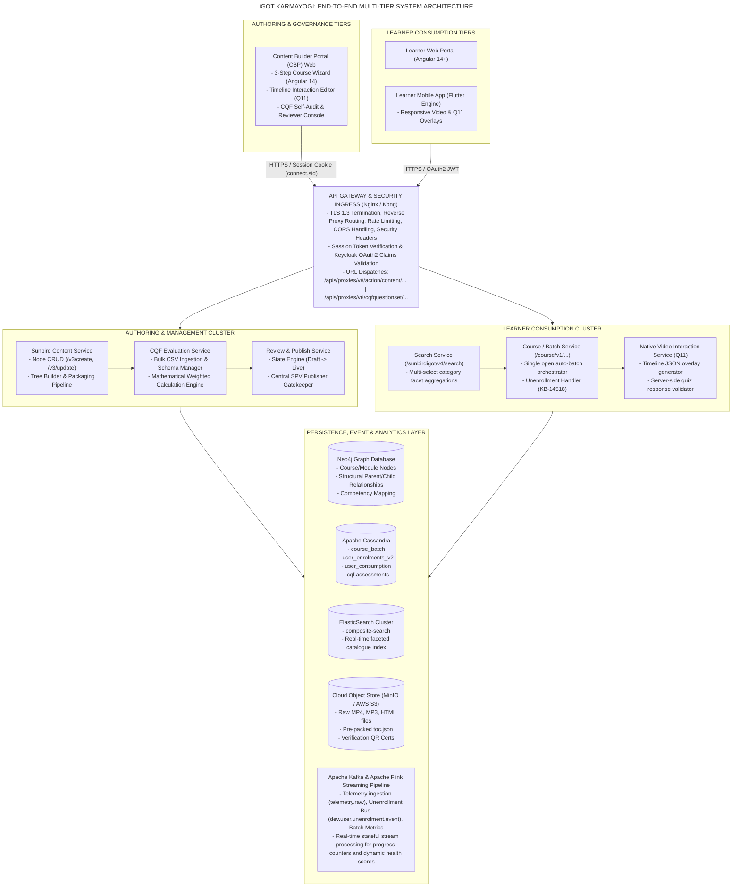

## 5. Functional Requirements: Authoring, Quality & Governance

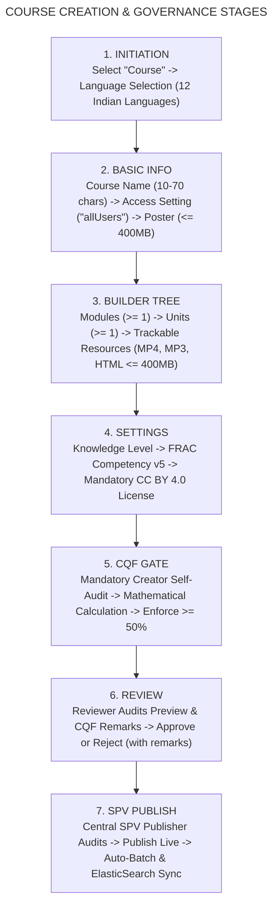

### 5.1 Module AUTH: Course Initiation & Authoring (CBP)

#### REQ-AUTH-001: Course Shell Initialization

- **Description:** The system **SHALL** provide an authenticated Content Creator (`CONTENT_CREATOR` role) with an interface to initialize a General Platform Course shell.
- **Functional Behavior:**
  - Creator selects "Course" from creation options.
  - System presents a mandatory language selection modal supporting 12 localized languages (Assamese, Bengali, English, Gujarati, Hindi, Kannada, Malayalam, Marathi, Odia, Punjabi, Tamil, Telugu). English **MUST** be pre-selected as the default fallback.
  - System assigns system properties: `contentType: "Course"`, `primaryCategory: "Course"`, `status: "Draft"`.

- **API Invocation:** `POST /apis/proxies/v8/action/content/v3/create`
- **Traceability:** KB-6847, PRD `KQAS/271450154`.

#### REQ-AUTH-002: Metadata Validation Bounds & Regular Expressions

- **Description:** System **MUST** strictly validate all metadata text fields and uploads on both presentation and microservice layers.
- **Constraints:**
  - **Course Name & Module Titles:** Minimum length: **10 characters**, maximum length: **70 characters**. Validated against regex:

`^[a-zA-Z0-9\.\-\_\$\/\:\[\]\'\ \!]+$`

- **Short Description:** Mandatory text string, minimum **30 characters**, maximum **500 characters**.
- **App Icon & Poster Image:** Formats restricted to `.jpg`, `.jpeg`, `.png`. Max file size: .
- **Access Settings:** Mandatory selection. For General Platform Courses, value **MUST** be fixed to `allUsers`.
- **Traceability:** KB-6847, SRS `TES/274628785`.

#### REQ-AUTH-003: Content Builder Tree & Resource Ingestion

- **Description:** The system **SHALL** provide a hierarchical tree builder allowing creators to structure courses into Modules, Units, and Resources.
- **Structural Rules:**
  - The course collection **MUST** contain at least one Module.
  - Each Module **MUST** contain at least one trackable resource.
  - **Supported MIME Types:**
    - Native Video: `video/mp4` (Auto-transcoded to HLS/DASH).
    - Native Audio: `audio/mp3`.
    - Web Interactive: `application/vnd.ekstep.html-archive` (Zipped package with `index.html` at root).
    - Reading Material: `application/pdf`.
    - Formative / Summative Assessments: `application/vnd.sunbird.questionset`.

  - **Non-Trackable Supplementary Material:** System **MAY** allow creators to upload course-level "Teacher Notes" and "References" (PDF/MP4 ). These **MUST NOT** be counted toward learner progress percentages.

- **API Invocation:** `PATCH /apis/proxies/v8/action/content/v3/hierarchy/update`
- **Traceability:** KB-6847, KB-7044.

#### REQ-AUTH-004: Taxonomy & Competency v5 Tagging

- **Description:** Creators **MUST** map learning assets to the national capacity-building taxonomy prior to review submission.
- **Field Requirements:**
  - **Knowledge Level:** Dropdown selection (`Beginner`, `Intermediate`, `Advanced`, `Expert`).
  - **Copyright & License:** Pre-configured and locked to `CC BY 4.0`.
  - **FRAC Competency Mapping (v3/v5):** Hierarchical mapping requiring selection of Competency Area (`Behavioral`, `Functional`, `Domain`), followed by linked Theme and Sub-Theme.

- **Traceability:** KB-6847, KB-8066.

### 5.2 Module CQF: Course Quality Framework (CQF) Quality Gate

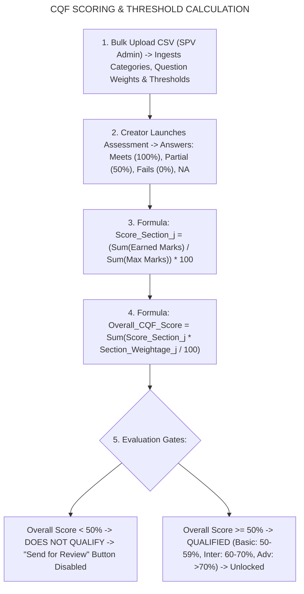

#### REQ-CQF-001: Dynamic Schema & Immutability Governance

- **Description:** The system **SHALL** provide the SPV Publisher with administrative interfaces to define, parameterize, and publish immutable CQF schemas via bulk CSV upload.
- **Rules:**
  - Bulk CSV schema columns: `Question No`, `Question Type`, `Maximum marks per question`, `Question`, `Option 1`, `Option 1 Weight`, `Option 2`, `Option 2 Weight`, `Option 3`, `Option 3 Weight`, `Option 4`, `Option 4 Weight`.
  - Section weightages **MUST** sum exactly to :
  - A published CQF schema is **immutable**. Only one active CQF schema is permitted platform-wide at any time.
  - In-flight courses created under an earlier CQF version **SHALL** retain that version's schema until published.

- **API Invocations:** `POST /apis/proxies/v8/cqfquestionset/questionset/create`, `POST /apis/proxies/v8/cqfquestionset/questionset/publish`
- **Traceability:** KB-6407, KB-6408.

#### REQ-CQF-002: Mathematical Scoring Engine & Gating Logic

- **Description:** System **MUST** execute mathematical scoring upon creator assessment submission and enforce the passing threshold.
- **Computation Rules:**
  - For category with questions:
  - Overall CQF Score:
  - **Gate Enforcement:** If , the submission evaluates to **Does Not Qualify**. The "Send for Review" button **MUST** remain disabled, displaying an error modal stating that minimum quality standards have not been met.
  - **Qualification Tiers:**
    - : `Does Not Qualify`
    - : `iGOT Basic`
    - : `iGOT Intermediate`
    - : `iGOT Advanced`

- **Traceability:** KB-6409, KB-6547.

#### REQ-CQF-003: Reviewer & Publisher CQF Audit Logging

- **Description:** Reviewers and SPV Publishers **MUST** have access to the complete CQF breakdown submitted by the creator.
- **Audit Rules:**
  - Reviewers and Publishers can independently retake the CQF evaluation.
  - For Reviewer evaluations, line-item textual remarks per question are **mandatory**.
  - The system **MUST** persist all three evaluation records (Creator, Reviewer, Publisher) in Cassandra `sunbird_cqf.assessments` to maintain an immutable audit trail.

- **Traceability:** KB-6547, KB-11977.

### 5.3 Module GOV: Maker-Checker Review & Central SPV Publishing

#### REQ-GOV-001: Maker-Checker State Machine Transitions

- **Description:** The system **SHALL** transition course states through a formal maker-checker governance model.

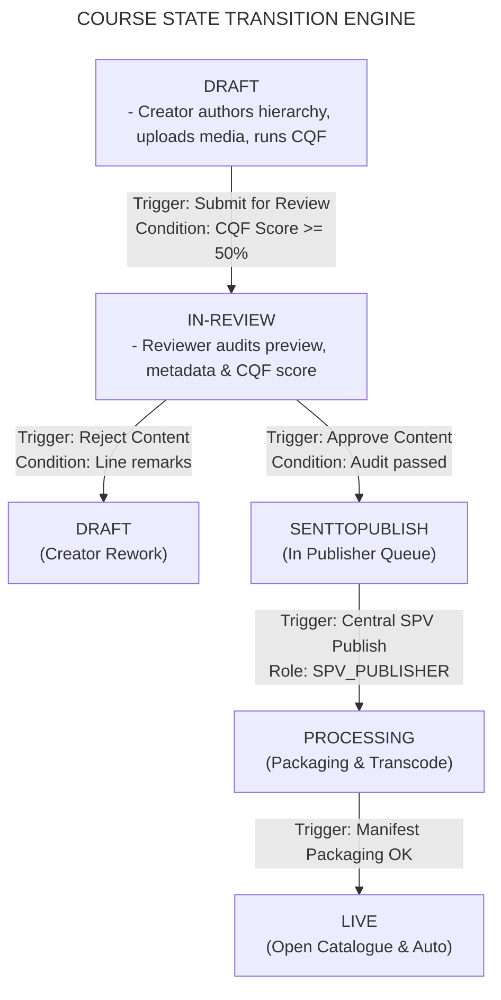

- **State Definitions:**
  - `Draft`: Editable by Creator. Assets can be uploaded, modified, or removed.
  - `In-Review`: Locked for creator editing. Read-only preview active for assigned Reviewers.
  - `SentToPublish`: Approved by Reviewer. Queued in central SPV Publisher dashboard.
  - `Processing`: Background packaging workers compiling hierarchy manifests (`toc.json`), extracting media durations, and transcoding videos.
  - `Live`: Fully published, discoverable in ElasticSearch, open batch active in Cassandra.

- **Traceability:** KB-7066, KB-7126, PRD `KQAS/271450154`.

#### REQ-GOV-002: Central SPV Publishing Authorization Gate

- **Description:** Live publication authority for General Platform Courses (`accessSetting: "allUsers"`) **MUST** be restricted exclusively to users holding the central `SPV_PUBLISHER` role.
- **Validation:** If an organizational `CONTENT_PUBLISHER` attempts to publish a general course directly, the API Gateway **MUST** reject the call with `HTTP 403 Forbidden` (`Error: ERR_CENTRAL_PUBLISHER_ROLE_REQUIRED`).
- **Traceability:** KB-7066, KB-7126.

#### REQ-GOV-003: Post-Publishing Automated Ingestion Pipelines

- **Description:** Upon SPV Publisher approval, the publishing pipeline **MUST** execute the following operations automatically:
  - Generate `manifest.json` and compiled `do_..._toc.json`, uploading them to S3 object storage.
  - Mutate Neo4j node properties: `status: "Live"`, `pkgVersion: pkgVersion + 1`, `lastPublishedOn: ISO_TIMESTAMP`.
  - Emit event to Kafka topic `content.publish`.
  - Ingest and reindex the course document into ElasticSearch index `composite-search`.
  - Trigger Sunbird Course Service to create the open auto-batch in Cassandra (`autoBatch: "Yes"`).

- **Traceability:** KB-1950, KB-8065.

## 6. Functional Requirements: Discovery, Consumption & Lifecycle

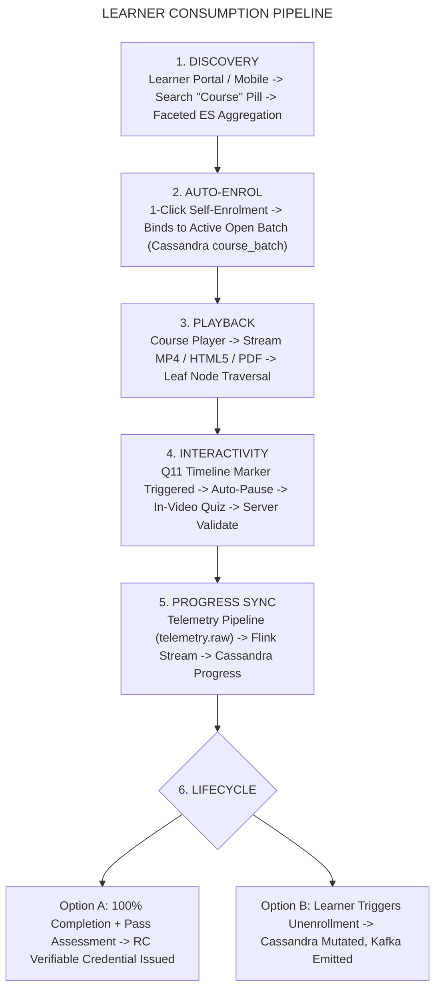

### 6.1 Module DISC: Faceted Discovery & Search Indexing

#### REQ-DISC-001: Responsive Multi-Select Filter Pills

- **Description:** The Learner Portal and Mobile clients **SHALL** display responsive multi-select category pills on all search and directory views.
- **Behavior:**
  - Supported filter categories: `All`, `Course`, `Moderated Course`, `Blended Program`, `Standalone Assessment`.
  - Selecting `Course` constructs an ElasticSearch request targeting `primaryCategory: ["Course"]` and `status: ["Live"]`.
  - Faceted aggregations return counts grouped by Competency Area, Duration Range (, , ), Sponsoring Ministry, and Language.

- **API Invocation:** `POST /apis/proxies/v8/sunbirdigot/v4/search`
- **Traceability:** KB-15689, KAR-1351.

### 6.2 Module CONS: 1-Click Enrolment & Automated Batch Orchestration

#### REQ-CONS-001: Open Auto-Batch Resolution & Concurrency Control

- **Description:** The system **SHALL** provide immediate 1-click self-enrolment for all authenticated civil servants into a single managed open batch.
- **Execution Logic:**
  - Learner clicks "Enrol".
  - Course Service checks Cassandra `sunbird.course_batch` for an active batch (`status: 1`, `enrollmentType: "open"`).
  - **Concurrency Locking:** The service acquires a distributed Redis lock on key `lock:batch:enrol:{courseId}` to prevent race conditions during simultaneous enrolments.
  - System inserts enrollment row into Cassandra `sunbird.user_enrolments_v2`:

```sql
INSERT INTO sunbird.user_enrolments_v2 (userid, courseid, batchid, active, progress, status, enrolled_date)
VALUES (?, ?, ?, true, 0, 0, toTimestamp(now()));
```

1. System releases the distributed lock.

- **Traceability:** KB-1950, KBE-582, KB-8065.

### 6.3 Module INT: Q11 Native Interactive Video Playback

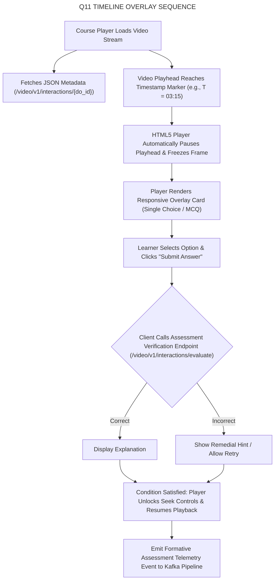

#### REQ-INT-001: Non-Destructive JSON Timeline Overlay Schema

- **Description:** Video interactivity **MUST** be decoupled from video binaries and third-party SCORM authoring wrappers.
- **Specification:**
  - Raw MP4 files are stored unmodified on object storage.
  - Interactivity is defined via an external JSON document fetched alongside the course manifest:

```json
{
  "contentId": "do_114389201",
  "version": "1.0",
  "interactions": [
    {
      "interactionId": "q11_int_001",
      "timestamp": 195,
      "type": "SINGLE_CHOICE_MCQ",
      "mandatory": true,
      "question": "What is the primary objective of the Course Quality Framework (CQF)?",
      "options": [
        {
          "id": "opt_a",
          "text": "To restrict user enrolment",
          "correct": false
        },
        {
          "id": "opt_b",
          "text": "To enforce standardized pedagogical quality",
          "correct": true
        }
      ],
      "explanation": "CQF enforces standardized quality thresholds prior to publishing."
    }
  ]
}
```

- **Player Enforcement:** When the playhead crosses the interaction timestamp, the player **MUST** pause video playback and present the HTML5 overlay. If `mandatory: true`, playback controls **MUST** remain locked until the question is answered and validated server-side.
- **Traceability:** Q11 BRD `TPT/499974191`.

### 6.4 Module TELEM: Telemetry, Progress Tracking & Digital Credentialing

#### REQ-TELEM-001: Telemetry Stream Ingestion & Progress Calculation

- **Description:** Client player surfaces **MUST** dispatch standardized telemetry event packets (`START`, `INTERACT`, `ASSESS`, `END`) to the API Gateway.
- **Streaming Pipeline:**
  - API Gateway routes packets to Kafka topic `telemetry.raw`.
  - Apache Flink streaming workers consume events, statefully aggregating completed leaf nodes (`completedCount`) against total leaf nodes (`totalCount`).
  - Flink updates Cassandra table `sunbird.user_content_consumption` and writes aggregated progress to `sunbird.user_enrolments_v2`:

- **Traceability:** KB-1950, KB-6847.

#### REQ-TELEM-002: Verifiable Credential Generation

- **Description:** Upon reaching completion and clearing final summative assessments (), the system **SHALL** automatically invoke the Sunbird RC Credential Service.
- **Security & Verification:**
  - Credentials generated as tamper-proof, signed PDF and SVG assets.
  - Asset embedded with a secure QR code encoding an Ed25519 cryptographic signature linked to the learner's unique profile ARI.

- **Traceability:** PRD `KQAS/271450154`.

### 6.5 Module LIFE: Course Unenrollment & Re-enrollment Lifecycle (Q12)

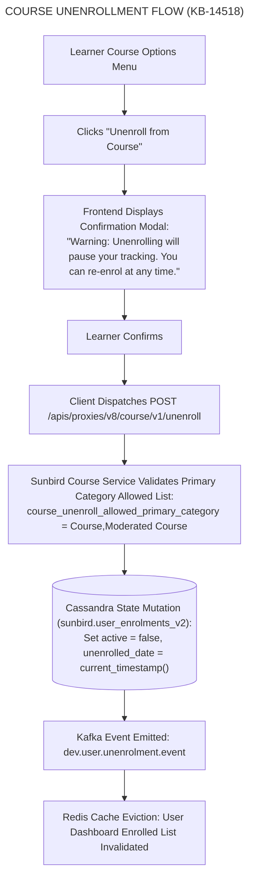

#### REQ-LIFE-001: Self-Serve Course Unenrollment

- **Description:** The system **SHALL** permit learners to unenroll from an active course prior to credential issuance.
- **Validation:** Course Service checks system configuration `course_unenroll_allowed_primary_category`. General courses (`Course`) **MUST** be whitelisted.
- **Database State Change:**
  - In Cassandra table `sunbird.user_enrolments_v2`, update record:

```sql
UPDATE sunbird.user_enrolments_v2
SET active = false, unenrolled_date = toTimestamp(now())
WHERE userid = ? AND courseid = ? AND batchid = ?;
```

- Active batch participant count decremented in `sunbird.course_batch`.
- **Kafka Event Bus:** Publishes message to `dev.user.unenrolment.event` with payload:
  ```json
  {
    "userId": "712020:2b1926b8-ba53-4277-9b45-3508667c6b3d",
    "courseId": "do_114389201",
    "batchId": "0138947261947",
    "timestamp": "2026-10-30T16:00:00Z"
  }
  ```
- **Traceability:** KB-14109, KB-14518, KB-14520, SRS `TES/1113882645`.

#### REQ-LIFE-002: Re-enrollment Mechanics & Progress Recovery

- **Description:** Learners who have previously unenrolled **SHALL** be permitted to re-enrol into the active open batch.
- **Data Recovery:**
  - When learner re-enrols, the system updates `active: true` in `sunbird.user_enrolments_v2`.
  - The system **MUST NOT** purge leaf-node records from `sunbird.user_content_consumption`.
  - The course player reads historical consumption records, restoring the learner's previous completion progress percentage.

- **Traceability:** KB-14523.

## 7. External Interface Requirements

### 7.1 User Interfaces (UI/UX Specifications)

#### UI-CBP-001: Content Builder Wizard (Angular 14+)

- **Layout:** Three sequential step headers: `1. Basic Information`, `2. Course Builder`, `3. Content Settings`.
- **State Behavior:** Navigation to Step 2 is blocked until Step 1 validates successfully. Navigation to review submission is blocked until CQF evaluation yields .
- **Error Indicators:** Inline red border and explanatory text for strings violating 10–70 character limits.

#### UI-LRN-001: Learner Portal & Mobile Player (Flutter / Angular)

- **Responsive Video Player:** Full-screen adaptive HTML5 player supporting quality switching (360p, 480p, 720p, 1080p).
- **Overlay Layering:** Q11 interaction cards render with z-index above the HTML5 video element but below native mobile navigation bars.

### 7.2 Microservice API Schema Catalogue

#### API-CRS-001: Create Course Shell

- **Endpoint:** `POST /apis/proxies/v8/action/content/v3/create`
- **Headers:** `Content-Type: application/json`, `Cookie: connect.sid=...`
- **Request Payload:**
  ```json
  {
    "request": {
      "content": {
        "name": "Public Procurement and Financial Integrity",
        "description": "Comprehensive grounding in General Financial Rules and e-Procurement.",
        "contentType": "Course",
        "primaryCategory": "Course",
        "accessSetting": "allUsers",
        "mimeType": "application/vnd.ekstep.content-collection",
        "framework": "igot",
        "language": [
          "English"
        ]
      }
    }
  }
  ```
- **Success Response** (`HTTP 200 OK`):
  ```json
  {
    "id": "api.content.create",
    "ver": "3.0",
    "ts": "2026-10-30T16:00:00Z",
    "params": {
      "resmsgid": "d748f2c0-...",
      "status": "successful"
    },
    "result": {
      "identifier": "do_114389201",
      "versionKey": "1698654210000"
    }
  }
  ```

#### API-CRS-002: Submit CQF Self-Audit Evaluation

- **Endpoint:** `POST /apis/proxies/v8/cqfquestionset/submit`
- **Headers:** `Content-Type: application/json`, `Cookie: connect.sid=...`
- **Request Payload:**
  ```json
  {
    "request": {
      "contentId": "do_114389201",
      "versionKey": "1698654210000",
      "userRole": "creator",
      "children": [
        {
          "questionId": "cqf_q_01",
          "selectedOption": "opt_meets"
        },
        {
          "questionId": "cqf_q_02",
          "selectedOption": "opt_partial"
        }
      ]
    }
  }
  ```
- **Success Response** (`HTTP 200 OK`):
  ```json
  {
    "id": "api.cqf.submit",
    "ver": "1.0",
    "result": {
      "overallScore": 76.5,
      "qualificationStatus": "iGOT Advanced",
      "isQualified": true,
      "sectionBreakdown": [
        {
          "sectionName": "Pedagogical Alignment",
          "score": 80.0,
          "status": "Qualified"
        },
        {
          "sectionName": "Technical & Metadata",
          "score": 73.0,
          "status": "Qualified"
        }
      ]
    }
  }
  ```

#### API-CRS-003: Unenroll from Course

- **Endpoint:** `POST /apis/proxies/v8/course/v1/unenroll`
- **Headers:** `Authorization: Bearer {{token}}`, `x-authenticated-user-token: {{user_token}}`
- **Request Payload:**
  ```json
  {
    "request": {
      "courseId": "do_114389201",
      "batchId": "0138947261947",
      "userId": "712020:2b1926b8-ba53-4277-9b45-3508667c6b3d"
    }
  }
  ```
- **Success Response** (`HTTP 200 OK`):
  ```json
  {
    "id": "api.course.unenroll",
    "ver": "v1",
    "result": {
      "response": "SUCCESS"
    }
  }
  ```

## 8. Data Architecture & Database Models

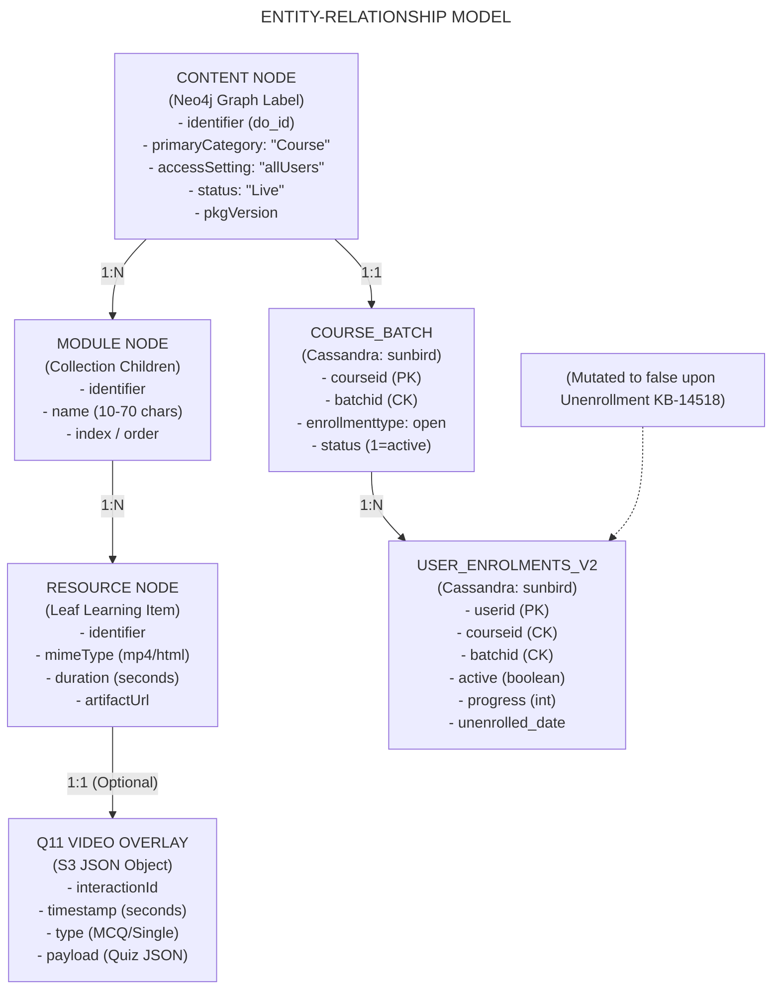

### 8.1 Neo4j Graph Database

- **Nodes:** `:Content`, `:Course`, `:Collection`, `:Resource`
- **Relationships:** `(:Course)-[:CONTAINS {index: 1}]->(:Collection)-[:CONTAINS {index: 1}]->(:Resource)`
- **Indexes:** Unique index on `identifier`, composite index on `(primaryCategory, status)`.

### 8.2 Apache Cassandra Tables

```sql
-- Managed Open Batches
CREATE TABLE sunbird.course_batch (
    courseid text,
    batchid text,
    name text,
    enrollmenttype text,  -- 'open'
    startdate text,
    enddate text,
    status int,  -- 1 = active, 2 = completed
    createdby text,
    createddate text,
    PRIMARY KEY (courseid, batchid)
);

-- User Enrolments & Lifecycle Management (KB-14518)
CREATE TABLE sunbird.user_enrolments_v2 (
    userid text,
    courseid text,
    batchid text,
    active boolean,
    progress int,
    status int,  -- 0 = Not started, 1 = In progress, 2 = Completed
    enrolled_date timestamp,
    unenrolled_date timestamp,
    certificates list<frozen<map<text, text>>>,
    PRIMARY KEY (userid, courseid, batchid)
);

-- CQF Assessment Evaluation Audit Store
CREATE TABLE sunbird_cqf.assessments (
    contentid text,
    userrole text,  -- 'creator', 'reviewer', 'publisher'
    assessmentid text,
    score map<text, double>,
    -- Section wise percentage map overallscore double,
    qualificationstatus text,
    remarks map<text, text>,
    submissiondate timestamp,
    PRIMARY KEY (contentid, userrole)
);
```

### 8.3 ElasticSearch Index: `composite-search`

```json
{
  "mappings": {
    "properties": {
      "identifier": {
        "type": "keyword"
      },
      "name": {
        "type": "text",
        "analyzer": "standard"
      },
      "primaryCategory": {
        "type": "keyword"
      },
      "accessSetting": {
        "type": "keyword"
      },
      "status": {
        "type": "keyword"
      },
      "channel": {
        "type": "keyword"
      },
      "duration": {
        "type": "integer"
      },
      "competencies_v5": {
        "type": "keyword"
      }
    }
  }
}
```

## 9. Non-Functional Requirements (NFRs) & Engineering Targets

| Metric ID | Engineering Dimension | Documented Target Specification | Operational Mechanism | Verification Strategy |
|---|---|---|---|---|
| **NFR-PERF-01** | **API Response Latency** | P95 latency for `/v3/hierarchy` | Redis multi-layer cache for pre-packed `toc.json` | Distributed JMeter bench |
| **NFR-PERF-02** | **Faceted Search Speed** | P99 latency for multi-select pills | ElasticSearch routing on `primaryCategory` | Elastic APM traces |
| **NFR-SCAL-01** | **Concurrent Learners** | Accommodate **concurrent learners** | Stateless Kubernetes pods with HPA ( CPU) | Cloud-scale stress tests |
| **NFR-SCAL-02** | **Telemetry Throughput** | Ingest telemetry events per second | Kafka topic partitioning across 16 worker nodes | Flink stream metrics |
| **NFR-SEC-01** | **Data Transport Security** | TLS 1.3 encryption across all public routes | Nginx Ingress Controller SSL termination | CERT-In compliance scan |
| **NFR-SEC-02** | **Quiz Integrity** | Server-side validation of Q11 video answers | Quiz payloads validated against Cassandra keys | Pen-test automated suites |
| **NFR-REL-01** | **Single Active Batch** | duplicate active batch rows | Distributed Redis locking around batch enrol | Automated reconciliation job |
| **NFR-REL-02** | **Disaster Recovery (RTO)** | Recovery Time Objective | Multi-region Cassandra & MinIO bucket mirroring | Disaster recovery drills |

## 10. Implementation Task Breakdown & Lifecycle Workstreams

```mermaid
flowchart TD
    W1["1. AUTHORING WORKSTREAM (CBP)<br/>Task 1.1: Build 3-Step Wizard components in Angular 14 (KB-6847)<br/>Task 1.2: Implement regex validations (Title: 10-70 chars, Uploads: #lt;= 400MB)<br/>Task 1.3: Integrate FRAC Competency v5 taxonomy picker (KB-8066)<br/>Task 1.4: Implement Q11 non-destructive timeline interaction editor (Q11 BRD)"]
    W2["2. QUALITY & GOVERNANCE WORKSTREAM<br/>Task 2.1: Develop CSV bulk upload engine for CQF schemas (KB-6408)<br/>Task 2.2: Implement mathematical scoring engine enforcing >= 50% threshold (KB-6409)<br/>Task 2.3: Build Reviewer/Publisher audit console with side-by-side CQF reports (KB-6547)<br/>Task 2.4: Deploy central SPV Publisher authorization gatekeeper (KB-7066)"]
    W3["3. RUNTIME & PLAYER WORKSTREAM<br/>Task 3.1: Deploy responsive multi-select category search pills (KB-15689)<br/>Task 3.2: Implement 1-click open batch auto-assignment with Redis locking (KB-1950)<br/>Task 3.3: Embed Q11 native HTML5 video player auto-pause overlay engine (Q11 BRD)<br/>Task 3.4: Configure Sunbird RC Credential Service for verifiable PDF/SVG issuance"]
    W4["4. FULL LIFECYCLE WORKSTREAM<br/>Task 4.1: Deploy unenrollment microservice endpoint (/course/v1/unenroll) (KB-14518)<br/>Task 4.2: Build learner dashboard unenrollment modal with progress warnings (KB-14520)<br/>Task 4.3: Implement Kafka event dispatcher (dev.user.unenrolment.event)<br/>Task 4.4: Deploy progress restoration engine for re-enrolling learners (KB-14523)"]
    W1 --> W2 --> W3 --> W4
```

## 11. Traceability Matrix

| Requirement Identifier | Short Description | Source Jira Epic/Story | Architectural Component | Implementation Status |
|---|---|---|---|---|
| **REQ-AUTH-001** | Course Shell Creation | KB-6847, KB-6276 | Sunbird Content Service | **Fully Implemented** |
| **REQ-AUTH-002** | Validation Rules (10-70 chars) | KB-6847, PRD 271450154 | CBP Web Client, Gateway | **Fully Implemented** |
| **REQ-AUTH-003** | Builder Tree & Media Ingestion | KB-6847, KB-7044 | Content Service, S3 Bucket | **Fully Implemented** |
| **REQ-AUTH-004** | FRAC Competency v5 Tagging | KB-8066, KB-6276 | Taxonomy Service, Neo4j | **Fully Implemented** |
| **REQ-CQF-001** | Configurable CQF Bulk Upload | KB-6407, KB-6408 | CQF Management Service | **Fully Implemented** |
| **REQ-CQF-002** | Mathematical Scoring Gate | KB-6409, KB-6407 | CQF Evaluation Engine | **Fully Implemented** |
| **REQ-CQF-003** | Reviewer/Publisher CQF Audit | KB-6547, KB-11977 | CQF Service, Cassandra | **Fully Implemented** |
| **REQ-GOV-001** | Maker-Checker State Machine | KB-7066, KB-6276 | Sunbird Content Service | **Fully Implemented** |
| **REQ-GOV-002** | Central SPV Publisher Gate | KB-7066, KB-7126 | API Gateway, Content Svc | **Fully Implemented** |
| **REQ-GOV-003** | Auto-Batch & ES Ingestion | KB-1950, KB-8065 | Publish Pipeline, Kafka | **Fully Implemented** |
| **REQ-DISC-001** | Multi-Select Category Pills | KB-15689, KAR-1351 | Learner Portal, ElasticSearch | **Fully Implemented** |
| **REQ-CONS-001** | 1-Click Open Batch Enrolment | KB-1950, KBE-582 | Sunbird Course Service | **Fully Implemented** |
| **REQ-INT-001** | Q11 In-Video Interactions | Q11 BRD (TPT/499974191) | Video Interaction Svc | **Partially Implemented (Phase 1)** |
| **REQ-TELEM-001** | Real-Time Progress Tracking | KB-1950, KB-6847 | Kafka, Apache Flink, LRS | **Fully Implemented** |
| **REQ-TELEM-002** | Verifiable Credentials | PRD 271450154 | Sunbird RC Credential Svc | **Fully Implemented** |
| **REQ-LIFE-001** | Self-Serve Unenrollment | KB-14109, KB-14518 | Course Service, Cassandra | **Fully Implemented** |
| **REQ-LIFE-002** | Re-enrollment Progress Recovery | KB-14523, KB-14520 | Course Service, Cassandra | **Fully Implemented** |

## 12. Conclusion

This Software Requirements Specification defines the operational, architectural, and mathematical baseline for the **Course – General Platform Course Creation & Management** feature across its evolutionary lifecycle from **Q2 to Q13**.

By standardizing validation schemas (10–70 character titles, assets), enforcing mathematical Course Quality Framework gates (), decoupling video interactivity via Q11 timeline overlays, automating open batch creation with Redis concurrency locks, and providing complete lifecycle autonomy via self-serve unenrollment and re-enrollment, the platform guarantees high pedagogical quality, zero-friction public official consumption, and scalable enterprise performance across millions of learners.
