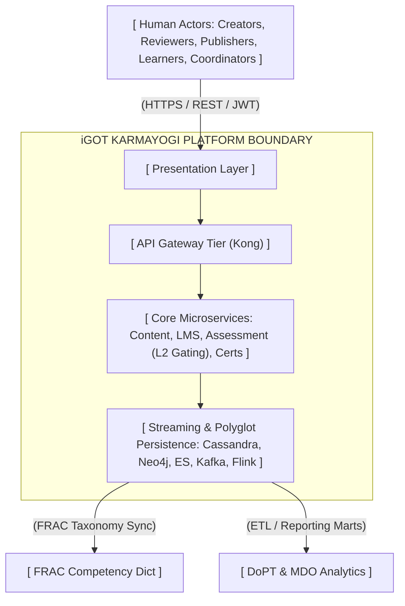
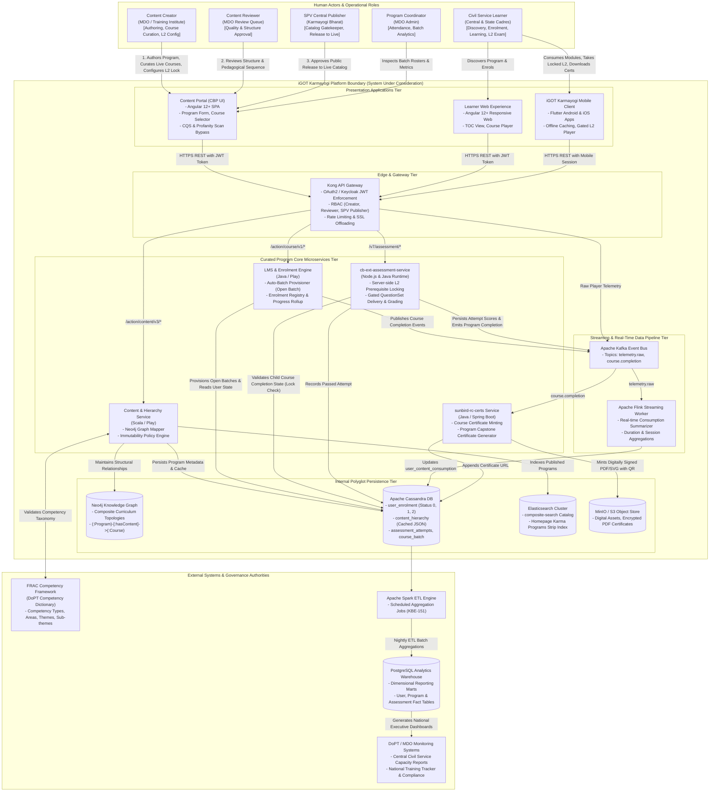

# Curated Program — System Context Diagram (Level-0)

**iGOT Karmayogi Platform | Architecture Specification**

### 1. Architectural Narrative & System Boundaries

The **Curated Program System Context (C4 Level-1 / IEEE 1016 System Context)** defines the boundaries of the iGOT Karmayogi Curated Program subsystem. It illustrates the primary human actors, external governance and competency bodies, adjacent storage and analytics systems, and the bidirectional flow of control, data, and telemetry across the platform boundary.

### 2. Comprehensive System Context Diagram

### 3. Contextual Entity Interface & Data Boundary Matrix

| Interface Boundary | Inbound / Outbound Data | Interaction Pattern | Target System / Component | Security & Governance Control | Jira / Spec Reference |
|---|---|---|---|---|---|
| **Creator / Reviewer CBP UI** | Program metadata, Live course links, L2 QuestionSet association, locking flags | Synchronous HTTPS / REST | Content Portal (`cbp.igotkarmayogi.gov.in`) | OAuth2 / Keycloak JWT (`CBP Creator`, `CBP Reviewer`) | [KB-1945: Q3 \| Content Portal Redesign \| Create program](https://karmayogibharat.atlassian.net/browse/KB-1945) (Prod Deployed), [KBE-174: Ability to create a curated program and add live courses](https://karmayogibharat.atlassian.net/browse/KBE-174) (Review), [KB-452: Q2 \| CBP Publishing \| Course vs Program publishing flow for SPV](https://karmayogibharat.atlassian.net/browse/KB-452) (KB Approved) |
| **SPV Publisher Content Service** | Publish trigger, immutability state activation, auto-batch trigger | Synchronous HTTPS / REST | Kong Gateway Content Service | Enforces central `SPV Publisher` role (regular publishers rejected) | [KB-452: Q2 \| CBP Publishing \| Course vs Program publishing flow for SPV](https://karmayogibharat.atlassian.net/browse/KB-452) (KB Approved), [KB-457: Q2 \| CBP Editing \| Program Editing](https://karmayogibharat.atlassian.net/browse/KB-457) (KB Approved), [KB-1946: Q3 \| Content Portal Redesign \| Batch management for program](https://karmayogibharat.atlassian.net/browse/KB-1946) (Prod Deployed) |
| **Content Service FRAC Dictionary** | Competency Area, Theme, Sub-theme taxonomy validation | Synchronous Internal REST | External FRAC Dictionary Service | Read-only taxonomy lookup & mapping validation | Page 35062022 §5.10 |
| **Learner LMS Enrolment Service** | Program enrollment, TOC progress retrieval, bi-directional progress queries | Synchronous HTTPS / REST | Kong Gateway LMS Service | Authenticated user session, Open Batch verification | [KBE-148: Should be able to view and consume the curated programs](https://karmayogibharat.atlassian.net/browse/KBE-148) (Review), [KB-9650: Regression : The progress of the course content is not reflecting immediately in TOC page content tab when comes back from the player page. It reflects only after page reload.](https://karmayogibharat.atlassian.net/browse/KB-9650) (Done) |
| **Learner cb-ext-assessment-service** | Gated assessment read (`/v7/assessment/read`), attempt answer submission | Synchronous HTTPS / REST | Kong Gateway Assessment Service | Server-side gating verification (`contextLockingType: "Course Assessment Only"`) | [KB-8842: Q8 \| Learning Path \| Curated Program \| Add Final Assessment Locking](https://karmayogibharat.atlassian.net/browse/KB-8842) (Prod Deployed), [KB-9043: Replicate the code of read,retake,submit and result API's from cb-ext-service in cb-ext-assessment service](https://karmayogibharat.atlassian.net/browse/KB-9043) (Done), [KB-9600: User is able to consume final assessment without consuming course content in curated porgram](https://karmayogibharat.atlassian.net/browse/KB-9600) (Done) |
| **Player Telemetry Pipeline** | Interactive player events (`START`, `INTERACT`, `END`), duration, milestones | Asynchronous Stream | Kong Gateway Kafka (`telemetry.raw`) | Rate-limited telemetry ingestion, zero data loss buffer | Page 21266503, [KBE-151: Able to view the detailed reports at the program/user level](https://karmayogibharat.atlassian.net/browse/KBE-151) (To Do) |
| **Assessment / LMS Cert Service** | Program & Course completion triggers (`course.completion`) | Asynchronous Event | Kafka `sunbird-rc-certs` | Idempotent consumer, SHA-256 digital signature, verifiable QR | [KBE-149: Should be able to view certificate on completion of the curated program](https://karmayogibharat.atlassian.net/browse/KBE-149) (To Do), [KB-9809: Certificate is not getting generated in TOC page about tab once Curated program is consumed by some users in both QA and UAT environment](https://karmayogibharat.atlassian.net/browse/KB-9809) (Fixed) |
| **Cassandra Analytics Warehouse** | Completed user records, assessment attempt scores, completion timestamps | Asynchronous Batch ETL | Spark Batch Job PostgreSQL Marts | Role-based data redaction, DoPT compliance auditing | [KBE-151: Able to view the detailed reports at the program/user level](https://karmayogibharat.atlassian.net/browse/KBE-151) (To Do), Page 373850243 |

### 4. Key Architectural Insights Highlighted by Context

1. **Clear Trust Boundaries**: Public access to Curated Programs requires authorization from the central `SPV Publisher`, preventing regional training institutes from releasing unverified public curricula.
2. **Autonomous Gating Enforcement**: The `cb-ext-assessment-service` acts as an independent enforcement boundary. It cross-examines learner progress directly against Cassandra before dispensing exam question payloads, securing evaluation integrity against client tampering.
3. **Decoupled Telemetry & Credentials**: Player activity updates streaming buffers (Kafka/Flink) and asynchronous certificate workers (`sunbird-rc-certs`), ensuring high learner concurrency does not degrade core platform responsiveness.
