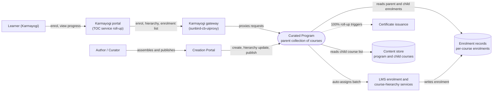

# Curated Program — Context Diagram

## System boundary

Inside the feature is the Curated Program itself: a parent collection of existing courses,
the one-call enrol endpoints that auto-assign the learner into its batch, and the
client-side roll-up that derives the program's progress from the child courses. Outside it
are the learner and the author or curator, the portal and the gateway, the LMS enrolment
and course-hierarchy services behind it, the Creation Portal used to assemble the program,
and the certificate issued on completion.

## Diagram

## Elements

| Element | Role | Detailed in |
|---|---|---|
| Curated Program | Central system: parent collection enrolled as one unit, batch auto-assigned, progress derived from children | [index.md](index.md) |
| Learner (Karmayogi) | Enrols in one call, works through child courses, completes and is certified | [use-cases.md](use-cases.md) |
| Author / Curator | Assembles the program from existing courses and publishes it | [use-cases.md](use-cases.md) |
| Karmayogi portal (TOC service roll-up) | Fetches the enrolment list once and merges child progress into the parent percentage client-side | [lld.md](lld.md) |
| Karmayogi gateway | Path to the curated-program and open-program enrol endpoints | [apis.md](apis.md) |
| Creation Portal | Create, review and publish cycle for the collection | [use-cases.md](use-cases.md) |
| LMS enrolment and course-hierarchy services | Resolve the batch server-side; serve program structure and enrolments | [hld.md](hld.md) |
| Content store | Holds the program and its child course list | [apis.md](apis.md) |
| Enrolment records | Per-course enrolments; a child completed standalone still counts | [lld.md](lld.md) |
| Certificate issuance | Triggered at program-level completion, as for a course | [use-cases.md](use-cases.md) |

> **Verification boundary:** elements and interactions come from the feature's own pages
> (index, use cases, APIs, HLD, LLD; the operations manual is a stub and was not used for
> content). Spot-checked read-only in the workspace: the curated-program and open-program
> enrol routes exist in the gateway repo, and the roll-up function name appears in the
> portal repos. Not verified: LMS-side batch resolution and certificate issuance internals,
> and the storage behind the content and enrolment services; these are shown as the docs
> describe them.
