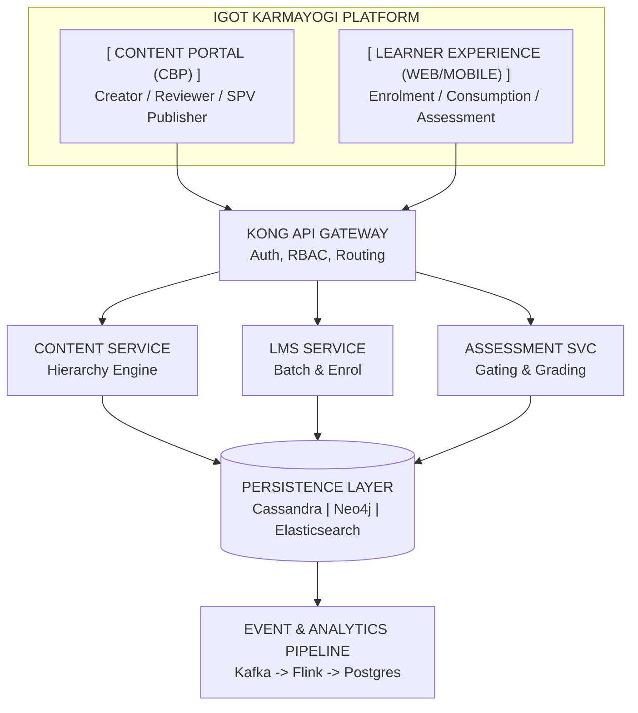
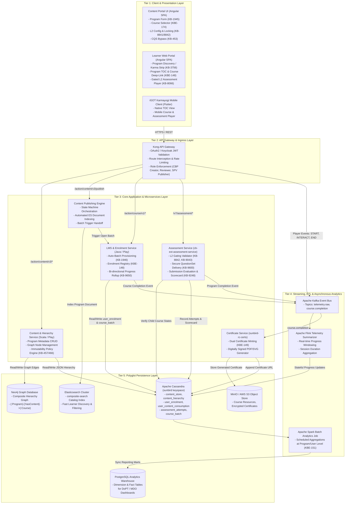
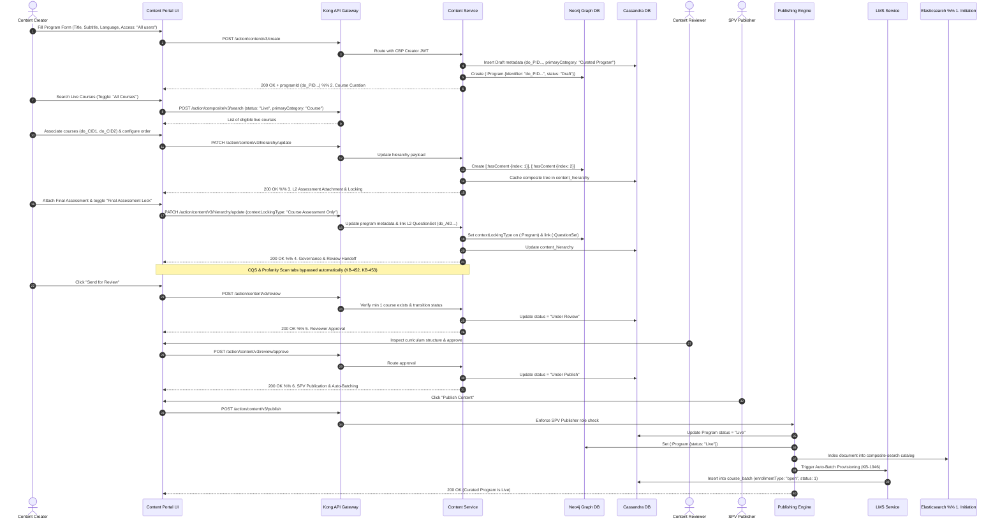
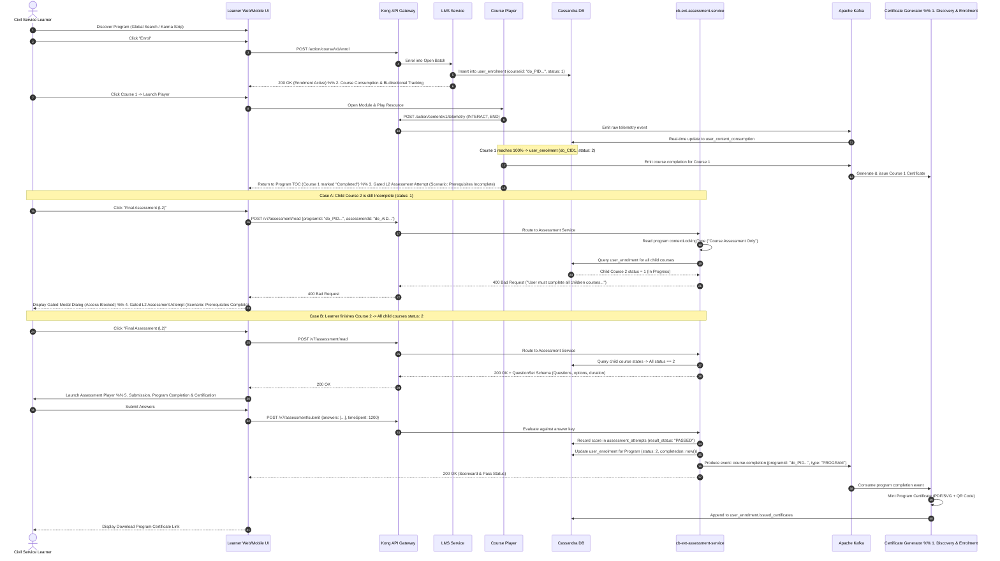
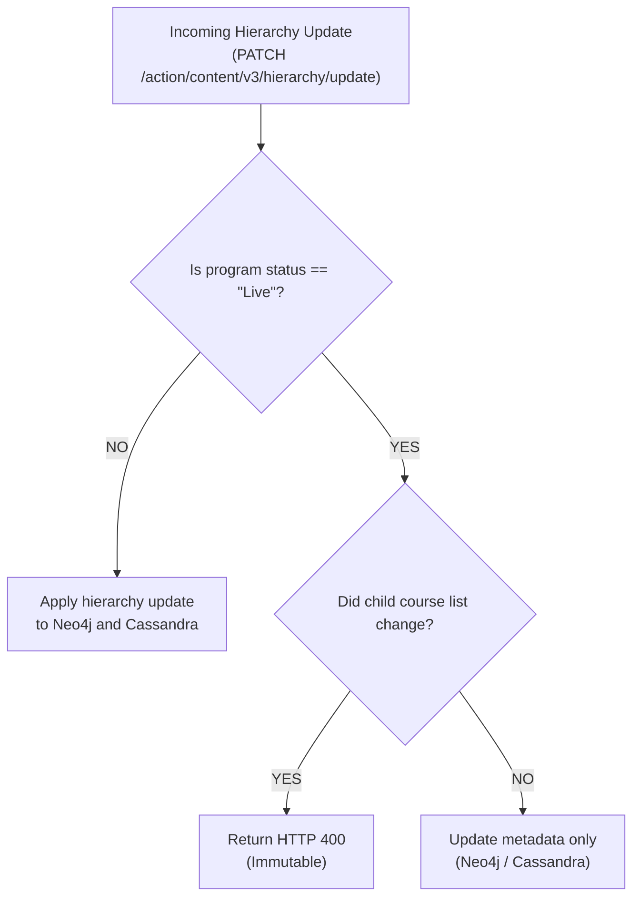

# Curated Program — High-Level Design (HLD)

**iGOT Karmayogi Platform | Digital Workplace Technical Architecture**

### Document Control & Traceability

## 1. Executive Architecture Overview

The **Curated Program** subsystem provides a structured mechanism to aggregate pre-published, verified courses into a thematic curriculum with holistic competency evaluation and dual-level certification.



### Architectural Tenets

1. **Curriculum by Reference**: Curated Programs link live courses (`primaryCategory = "Course"`, `status = "Live"`) using unique content identifiers (`do_CID...`). No underlying digital resources (MP4, PDF, SCORM) are duplicated.
2. **Streamlined Quality Governance**: Because constituent courses have already passed institutional review, Content Quality Score (CQS) testing and profanity scanning are bypassed ([KB-452: Q2 | CBP Publishing | Course vs Program publishing flow for SPV](https://karmayogibharat.atlassian.net/browse/KB-452) (KB Approved), [KB-453: Q2 | CBP Publishing | CQS and Self Curation should be removed for content creator, content reviewer and publisher for invite only and curated program](https://karmayogibharat.atlassian.net/browse/KB-453) (Prod Deployed)).
3. **Curriculum Immutability**: Once a Curated Program transitions to `Live`, its course list is immutable to safeguard enrolled learners' progress and completion records ([KB-457: Q2 | CBP Editing | Program Editing](https://karmayogibharat.atlassian.net/browse/KB-457) (KB Approved), [KB-466: Q2 | CBP Publishing | Editing a live program In-Progress](https://karmayogibharat.atlassian.net/browse/KB-466)).
4. **Automated Batching**: Public Curated Programs automatically provision an open batch (`enrollmentType = "open"`) upon publication, removing manual batch management ([KB-1946: Q3 | Content Portal Redesign | Batch management for program](https://karmayogibharat.atlassian.net/browse/KB-1946) (Prod Deployed)).
5. **Enforced Server-Side Gating**: Level-2 (L2) capstone assessments evaluate cumulative competency across courses. If `contextLockingType == "Course Assessment Only"`, the backend (`cb-ext-assessment-service`) blocks access until all child courses reach `status == 2` (100% complete) ([KB-8842: Q8 | Learning Path | Curated Program | Add Final Assessment Locking](https://karmayogibharat.atlassian.net/browse/KB-8842) (Prod Deployed), [KB-9600: User is able to consume final assessment without consuming course content in curated porgram](https://karmayogibharat.atlassian.net/browse/KB-9600) (Done)).
6. **Unified Dual Certification & Analytics**: Finishing an individual course issues a Course Certificate; completing all courses and passing the L2 assessment issues a Program Certificate ([KBE-149: Should be able to view certificate on completion of the curated program](https://karmayogibharat.atlassian.net/browse/KBE-149) (To Do)). Telemetry streams through Kafka and Flink into Cassandra and a PostgreSQL reporting warehouse.

## 2. End-to-End Logical Component Architecture

The diagram below details the 5-tier architecture connecting frontend clients to backend data stores and streaming pipelines.



## 3. End-to-End Sequence Architecture

### 3.1 Phase I: Program Creation, Content Curation, Review & SPV Publishing

This sequence shows program initiation, live course association, automated CQS bypass, approval, SPV publication, and automated batch creation.



### 3.2 Phase II: Discovery, Enrolment, Learning, Gated L2 Assessment & Dual Certification

This sequence tracks learner discovery, self-enrolment, bidirectional course consumption tracking, server-side L2 assessment prerequisite gating, scorecard calculation, and certificate generation.



## 4. Subsystem Detailed Designs

### 4.1 Content Portal & Hierarchy Subsystem

- **Access Control**: Evaluates user roles through JWT tokens passed in the `Authorization` header.
- **Streamlined UI Workflow**: Hides CQS scoring and profanity scanning tabs when `primaryCategory == "Curated Program"` ([KB-453: Q2 | CBP Publishing | CQS and Self Curation should be removed for content creator, content reviewer and publisher for invite only and curated program](https://karmayogibharat.atlassian.net/browse/KB-453) (Prod Deployed)).
- **Immutability Guard**: When editing a program in `Live` status, the Content Service checks `status == "Live"` and rejects any hierarchy update that alters child courses ([KB-457: Q2 | CBP Editing | Program Editing](https://karmayogibharat.atlassian.net/browse/KB-457) (KB Approved), [KB-466: Q2 | CBP Publishing | Editing a live program In-Progress](https://karmayogibharat.atlassian.net/browse/KB-466)). Only metadata fields (title, description, tags, competencies) can be modified.



### 4.2 LMS & Batch Management Subsystem

- **Automated Batching**: Curated Programs are intended for open public access. When a program transitions to `Live`, the Publishing Engine calls the internal LMS API to create an open batch ([KB-1946: Q3 | Content Portal Redesign | Batch management for program](https://karmayogibharat.atlassian.net/browse/KB-1946) (Prod Deployed)):
  ```json
  {
    "request": {
      "courseId": "do_PID...",
      "name": "Auto Open Batch",
      "enrollmentType": "open",
      "startDate": "YYYY-MM-DD",
      "status": 1
    }
  }
  ```
- **Enrolment Tracking**: Stores active records in `sunbird.user_enrolment`. The batch is open to all registered civil servants without requiring invite lists or approval workflows.

### 4.3 Assessment & Prerequisite Gating Subsystem (`cb-ext-assessment-service`)

- **Endpoint Contract**: Exposes `POST /v7/assessment/read` requiring `{ programId, assessmentId }` in the request body ([KB-8842: Q8 | Learning Path | Curated Program | Add Final Assessment Locking](https://karmayogibharat.atlassian.net/browse/KB-8842) (Prod Deployed)).
- **Legacy Interception**: Direct requests to legacy `cb-ext` endpoints for assessments tagged with `contextCategory: "Final Program Assessment"` are intercepted and rejected with `HTTP 400 Bad` `Request` ([KB-9043: Replicate the code of read,retake,submit and result API's from cb-ext-service in cb-ext-assessment service](https://karmayogibharat.atlassian.net/browse/KB-9043) (Done)).
- **Prerequisite Gating Algorithm**:
  - Retrieve the program hierarchy from `content_hierarchy`.
  - If `contextLockingType != "Course Assessment Only"`, return the QuestionSet.
  - If locking is enabled, query `sunbird.user_enrolment` using the learner's `userId` and the list of child course IDs.
  - If any child course has `status < 2`, reject the request:

```json
{
  "id": "api.assessment.read",
  "params": {
    "status": "FAILED",
    "err": "ASSESSMENT_LOCKED",
    "errmsg": "User must complete all the children courses before starting on the Final Assessment"
  },
  "responseCode": "CLIENT_ERROR",
  "result": {}
}
```

1. If all child courses have `status == 2`, return the QuestionSet without answer keys.

### 4.4 Completion Evaluation & Dual Certification Subsystem

- **Completion Gate**: Program completion requires:
  - Every constituent course must have `status == 2` in `sunbird.user_enrolment`.
  - If an L2 assessment is configured, the learner must have a record in `assessment_attempts` with `result_status == "PASSED"`.

- **Certificate Issuance**:
  - **Course Level**: Triggered when each individual course completes.
  - **Program Level**: Triggered when the overall program completes. The event is emitted to the Kafka topic `course.completion`, and `sunbird-rc-certs` mints the credential asynchronously with a verifiable QR code.

## 5. Persistence & Polyglot Data Architecture

**PERSISTENCE TIER ARCHITECTURE**

- **[ Neo4j Graph Database ]**
    - Node `(:Program {identifier, status, contextLockingType})`
    - Node `(:Course {identifier, status})`
    - Node `(:QuestionSet {identifier, contextCategory})`
    - Edge `(:Program)-[:hasContent {index}]->(:Course)`
    - Edge `(:Program)-[:hasAssessment]->(:QuestionSet)`
- **[ Apache Cassandra (sunbird keyspace) ]**
    - `content_store`: Program metadata and state records
    - `content_hierarchy`: Cached complete JSON hierarchy tree
    - `user_enrolment`: Primary progress tracking `((userid), courseid, batchid)`
    - `user_content_consumption`: Leaf-level resource progress `((userid), contentid, courseid, batchid)`
    - `assessment_attempts`: L2 attempt history and scores `((userid, programid), assessmentid, attempt_id)`
    - `course_batch`: Auto-generated open batches `((courseid), batchid)`
- **[ Elasticsearch Cluster ]**
    - Index: `composite-search`
    - Documents: Live curated programs for learner discovery, faceted search, and Karma strips
- **[ PostgreSQL Analytics Warehouse ]**
    - Dimension & Fact Tables: Synced via Flink/Spark batch jobs for DoPT/MDO reporting dashboards

## 6. End-to-End API Interface Catalog

| Lifecycle Stage | HTTP Method | Endpoint | Source Component | Target Service | Auth / Role | Key Payload Attributes | Key Response / Status | Traceability |
|---|---|---|---|---|---|---|---|---|
| **Creation** | `POST` | `/action/content/v3/create` | Content Portal UI | Content Service | Bearer JWT (`CBP Creator`) | `name`, `primaryCategory: "Curated Program"`, `access: "All users"` | `200 OK` + `programId` (`do_PID...`) | [KB-1945: Q3 \| Content Portal Redesign \| Create program](https://karmayogibharat.atlassian.net/browse/KB-1945) (Prod Deployed), Page 35062022 |
| **Curation** | `PATCH` | `/action/content/v3/hierarchy/update` | Content Portal UI | Content Service | Bearer JWT (`CBP Creator`) | `rootId`, `children: ["do_CID1", "do_CID2"]`, `contextLockingType` | `200 OK` + `content_id` | [KBE-174: Ability to create a curated program and add live courses](https://karmayogibharat.atlassian.net/browse/KBE-174) (Review), [KB-8842: Q8 \| Learning Path \| Curated Program \| Add Final Assessment Locking](https://karmayogibharat.atlassian.net/browse/KB-8842) (Prod Deployed) |
| **Review** | `POST` | `/action/content/v3/review` | Content Portal UI | Content Service | Bearer JWT (`CBP Creator`) | `identifier: "do_PID..."` | `200 OK` (status: `Under Review`) | [KB-452: Q2 \| CBP Publishing \| Course vs Program publishing flow for SPV](https://karmayogibharat.atlassian.net/browse/KB-452) (KB Approved), Page 35062022 |
| **Publish** | `POST` | `/action/content/v3/publish` | Content Portal UI | Publishing Engine | Bearer JWT (`SPV Publisher`) | `identifier: "do_PID..."` | `200 OK` (status: `Live`, auto-batch triggered) | [KB-452: Q2 \| CBP Publishing \| Course vs Program publishing flow for SPV](https://karmayogibharat.atlassian.net/browse/KB-452) (KB Approved), [KB-1946: Q3 \| Content Portal Redesign \| Batch management for program](https://karmayogibharat.atlassian.net/browse/KB-1946) (Prod Deployed) |
| **Discovery** | `POST` | `/action/composite/v3/search` | Learner Portal | Search Service | Anonymous / Learner Session | `filters: {primaryCategory: "Curated Program", status: "Live"}` | `200 OK` + list of program cards | [KBE-150: Should be able to review and publish the curated programs and display for the karmayogi learners to consume](https://karmayogibharat.atlassian.net/browse/KBE-150) (Review), [KB-3756: Q4 \| Karma Programs](https://karmayogibharat.atlassian.net/browse/KB-3756) (Prod Deployed) |
| **Enrolment** | `POST` | `/action/course/v1/enrol` | Learner Portal | LMS Service | Learner Session | `courseId: "do_PID..."`, `batchId: "..."`, `userId: "..."` | `200 OK` (enrolment record created) | [KBE-148: Should be able to view and consume the curated programs](https://karmayogibharat.atlassian.net/browse/KBE-148) (Review), [KB-1946: Q3 \| Content Portal Redesign \| Batch management for program](https://karmayogibharat.atlassian.net/browse/KB-1946) (Prod Deployed) |
| **Hierarchy Read** | `GET` | `/action/course/v1/hierarchy/{programId}` | Learner Portal | LMS Service | Learner Session | URL path `programId` | `200 OK` + TOC tree and progress states | [KBE-148: Should be able to view and consume the curated programs](https://karmayogibharat.atlassian.net/browse/KBE-148) (Review), [KB-9650: Regression : The progress of the course content is not reflecting immediately in TOC page content tab when comes back from the player page. It reflects only after page reload.](https://karmayogibharat.atlassian.net/browse/KB-9650) (Done) |
| **Telemetry** | `POST` | `/action/content/v1/telemetry` | Course Player | Kong / Kafka | Learner Session | Raw telemetry packets (`START`, `INTERACT`, `END`) | `200 OK` (queued for ingestion) | Page 21266503 |
| **L2 Read (Gated)** | `POST` | `/v7/assessment/read` | Assessment Player | cb-ext-assessment-service | Learner Session | `programId: "do_PID..."`, `assessmentId: "do_AID..."` | `200 OK` (QuestionSet) OR `400 Bad Request` (Locked) | [KB-8842: Q8 \| Learning Path \| Curated Program \| Add Final Assessment Locking](https://karmayogibharat.atlassian.net/browse/KB-8842) (Prod Deployed), [KB-9043: Replicate the code of read,retake,submit and result API's from cb-ext-service in cb-ext-assessment service](https://karmayogibharat.atlassian.net/browse/KB-9043) (Done) |
| **L2 Submit** | `POST` | `/v7/assessment/submit` | Assessment Player | cb-ext-assessment-service | Learner Session | `programId`, `assessmentId`, `answers: [...]`, `timeSpent` | `200 OK` + score and pass/fail result | [KB-8065: Q8 \| L2 Assessments/CAP \| Creation of L2 Assessments/CAP](https://karmayogibharat.atlassian.net/browse/KB-8065) (KB Approved), [KB-9248: BE \| Enhance Assessment V7 READ API - to return error for content locking](https://karmayogibharat.atlassian.net/browse/KB-9248) (Done) |

## 7. Non-Functional Architecture & System Safeguards

### 7.1 Security & Role-Based Access Control

- **Gateway-Level Enforcement**: Kong validates JWT signatures against Keycloak public keys and checks user roles.
  - Accessing authoring APIs requires `CBP Creator`.
  - Advancing programs to publish requires `CBP Reviewer`.
  - Releasing public Curated Programs (`access: "All users"`) requires `SPV Publisher`. Calls from standard publishers are rejected with `HTTP 403 Forbidden`.

- **Assessment Content Protection**: Question answers, rubrics, and evaluation logic are isolated in `cb-ext-assessment-service` and never sent to the client browser prior to submission.
- **Tamper-Resistant Server Gating**: Gating is evaluated server-side against Cassandra enrollment tables. Client-side state overrides cannot bypass prerequisite checks ([KB-9600: User is able to consume final assessment without consuming course content in curated porgram](https://karmayogibharat.atlassian.net/browse/KB-9600) (Done)).

### 7.2 Scalability & Resiliency

- **Asynchronous Telemetry Ingestion**: High-volume telemetry packets from active players route through Kafka topic `telemetry.raw`. The Flink streaming cluster processes progress rollups asynchronously, shielding Cassandra from write contention.
- **Idempotent Certificate Generation**: Workers processing the `course.completion` Kafka topic check existing credentials in `user_enrolment.issued_certificates` before rendering new certificates, preventing duplicates during message retries ([KB-9809: Certificate is not getting generated in TOC page about tab once Curated program is consumed by some users in both QA and UAT environment](https://karmayogibharat.atlassian.net/browse/KB-9809) (Fixed)).
- **Client Cache Invalidation**: Returning from a course player to the Program TOC triggers a client-side cache refresh, ensuring newly completed courses display the updated status immediately ([KB-9650: Regression : The progress of the course content is not reflecting immediately in TOC page content tab when comes back from the player page. It reflects only after page reload.](https://karmayogibharat.atlassian.net/browse/KB-9650) (Done)).

## 8. Requirements Traceability Matrix (HLD to Sources)

| System Feature / Component | Architectural Solution | Key Source Tickets | Confluence Reference | Status |
|---|---|---|---|---|
| **Program Creation & Taxonomy** | Angular Program creation form; `primaryCategory: "Curated Program"`, `access: "All` `users"`. | [KB-1945: Q3 \| Content Portal Redesign \| Create program](https://karmayogibharat.atlassian.net/browse/KB-1945) (Prod Deployed), [KBE-174: Ability to create a curated program and add live courses](https://karmayogibharat.atlassian.net/browse/KBE-174) (Review) | Page 35062022 §5.1 | **Implemented** |
| **Content Curation by Reference** | Content search restricted to `status: "Live"`; Neo4j `[:hasContent]` relationship links. | [KBE-174: Ability to create a curated program and add live courses](https://karmayogibharat.atlassian.net/browse/KBE-174) (Review) | Page 35062022 §5.2.3 | **Implemented** |
| **CQS & Profanity Scan Bypass** | Workflow rules suppress CQS and profanity checks for Curated Programs. | [KB-452: Q2 \| CBP Publishing \| Course vs Program publishing flow for SPV](https://karmayogibharat.atlassian.net/browse/KB-452) (KB Approved), [KB-453: Q2 \| CBP Publishing \| CQS and Self Curation should be removed for content creator, content reviewer and publisher for invite only and curated program](https://karmayogibharat.atlassian.net/browse/KB-453) (Prod Deployed) | Page 21266503 | **Implemented** |
| **SPV Publishing & Immutability** | `SPV Publisher` role gate; backend rejects child course modifications on live programs. | [KB-452: Q2 \| CBP Publishing \| Course vs Program publishing flow for SPV](https://karmayogibharat.atlassian.net/browse/KB-452) (KB Approved), [KB-457: Q2 \| CBP Editing \| Program Editing](https://karmayogibharat.atlassian.net/browse/KB-457) (KB Approved), [KB-466: Q2 \| CBP Publishing \| Editing a live program In-Progress](https://karmayogibharat.atlassian.net/browse/KB-466) | Page 35062022 §3 | **Implemented** |
| **Automated Batch Provisioning** | Publishing engine triggers creation of an open batch in `course_batch`. | [KB-1946: Q3 \| Content Portal Redesign \| Batch management for program](https://karmayogibharat.atlassian.net/browse/KB-1946) (Prod Deployed) | Page 35062022 §5.5 | **Implemented** |
| **Learner Discovery & Strip** | Elasticsearch indexing; homepage "Karma Programs" curated strip. | [KBE-150: Should be able to review and publish the curated programs and display for the karmayogi learners to consume](https://karmayogibharat.atlassian.net/browse/KBE-150) (Review), [KB-3756: Q4 \| Karma Programs](https://karmayogibharat.atlassian.net/browse/KB-3756) (Prod Deployed) | Production Baseline | **Implemented** |
| **Progress Synchronization** | Unified `user_content_consumption` store; bidirectional sync between standalone and TOC contexts. | [KBE-148: Should be able to view and consume the curated programs](https://karmayogibharat.atlassian.net/browse/KBE-148) (Review), [KB-9650: Regression : The progress of the course content is not reflecting immediately in TOC page content tab when comes back from the player page. It reflects only after page reload.](https://karmayogibharat.atlassian.net/browse/KB-9650) (Done) | Page 21266503 | **Implemented** |
| **L2 Capstone Assessment** | Root-level QuestionSet attachment (`contextCategory: "Final Program Assessment"`). | [KB-8065: Q8 \| L2 Assessments/CAP \| Creation of L2 Assessments/CAP](https://karmayogibharat.atlassian.net/browse/KB-8065) (KB Approved), [KB-8841: Q8 \| Learning Path \| Curated Program \| Add Final Assessment](https://karmayogibharat.atlassian.net/browse/KB-8841) (Prod Deployed) | Page 373915757 | **Implemented** |
| **Server-Side L2 Locking** | `cb-ext-assessment-service` gating check; rejects calls with HTTP 400 if child courses are incomplete. | [KB-8842: Q8 \| Learning Path \| Curated Program \| Add Final Assessment Locking](https://karmayogibharat.atlassian.net/browse/KB-8842) (Prod Deployed), [KB-9043: Replicate the code of read,retake,submit and result API's from cb-ext-service in cb-ext-assessment service](https://karmayogibharat.atlassian.net/browse/KB-9043) (Done), [KB-9600: User is able to consume final assessment without consuming course content in curated porgram](https://karmayogibharat.atlassian.net/browse/KB-9600) (Done) | Page 373915757 §4 | **Implemented** |
| **Dual Certificate Generation** | Course-level certificates via LMS; Program-level certificates via Kafka and `sunbird-rc-certs`. | [KBE-149: Should be able to view certificate on completion of the curated program](https://karmayogibharat.atlassian.net/browse/KBE-149) (To Do), [KB-9742: UAT issue : Certificate is not getting generated in TOC page about tab once Curated program is consumed](https://karmayogibharat.atlassian.net/browse/KB-9742) (Done), [KB-9809: Certificate is not getting generated in TOC page about tab once Curated program is consumed by some users in both QA and UAT environment](https://karmayogibharat.atlassian.net/browse/KB-9809) (Fixed) | Page 21266503 | **Implemented** |
| **Detailed Reporting Pipeline** | Telemetry ingestion through Kafka/Flink; Spark batch analytics syncing to PostgreSQL marts. | [KBE-151: Able to view the detailed reports at the program/user level](https://karmayogibharat.atlassian.net/browse/KBE-151) (To Do) | Production Baseline | **Implemented** |
