**iGOT Karmayogi Platform | End-to-End Creation-to-Consumption Analysis**

## 1. Document Title and Metadata

- **Document Title**: Curated Program — Evolution and Consumption Overview Summary: Complete Lifecycle from Creation to Consumption
- **Target Platform**: iGOT Karmayogi (National Programme for Civil Services Capacity Building - NPCSCB)
- **Authoring & Analysis Role**: Senior Product Analyst, Business Analyst, Solution Architect, and Technical Documentation Specialist
- **Primary Scope**: Curated Program Lifecycle, Program Flavors (Curated, Moderated, Invite-Only, Blended), Content Association, Publishing Governance, Enrolment, Learning Experience, Level-2 (L2) Assessment Integration, Progress Aggregation, Dual Certification, and Reporting
- **Primary Source Artifacts**:
  - Jira Initiatives & Epics: [KB-301: Q2 | CBP Creation, Editing, Review, Publishing and Retiring](https://karmayogibharat.atlassian.net/browse/KB-301) (KB Approved), [KB-452: Q2 | CBP Publishing | Course vs Program publishing flow for SPV](https://karmayogibharat.atlassian.net/browse/KB-452) (KB Approved), [KB-457: Q2 | CBP Editing | Program Editing](https://karmayogibharat.atlassian.net/browse/KB-457) (KB Approved), [KB-1936: Q3 | Content Portal Redesign | Content access settings, batch management and user consumption](https://karmayogibharat.atlassian.net/browse/KB-1936) (Prod Deployed), [KB-3489: Q4 | Karma Programs and Learner Homepage enhancements](https://karmayogibharat.atlassian.net/browse/KB-3489) (KB Approved), [KB-3756: Q4 | Karma Programs](https://karmayogibharat.atlassian.net/browse/KB-3756) (Prod Deployed), [KB-8064: Q8 | Access control & L2 Assessments](https://karmayogibharat.atlassian.net/browse/KB-8064) (Open), [KB-8065: Q8 | L2 Assessments/CAP | Creation of L2 Assessments/CAP](https://karmayogibharat.atlassian.net/browse/KB-8065) (KB Approved), [KB-8066: Q8 | L2 Assessments/CAP | Learner consumption](https://karmayogibharat.atlassian.net/browse/KB-8066) (KB Approved)
  - Jira Stories & Subtasks: [KB-453: Q2 | CBP Publishing | CQS and Self Curation should be removed for content creator, content reviewer and publisher for invite only and curated program](https://karmayogibharat.atlassian.net/browse/KB-453) (Prod Deployed), [KB-454: Q2 | CBP Publishing | Update the subheading to suitable wording for curated program](https://karmayogibharat.atlassian.net/browse/KB-454) (Prod Deployed), [KB-466: Q2 | CBP Publishing | Editing a live program In-Progress](https://karmayogibharat.atlassian.net/browse/KB-466), [KB-1945: Q3 | Content Portal Redesign | Create program](https://karmayogibharat.atlassian.net/browse/KB-1945) (Prod Deployed), [KB-1946: Q3 | Content Portal Redesign | Batch management for program](https://karmayogibharat.atlassian.net/browse/KB-1946) (Prod Deployed), [KB-8841: Q8 | Learning Path | Curated Program | Add Final Assessment](https://karmayogibharat.atlassian.net/browse/KB-8841) (Prod Deployed), [KB-8842: Q8 | Learning Path | Curated Program | Add Final Assessment Locking](https://karmayogibharat.atlassian.net/browse/KB-8842) (Prod Deployed), [KB-9043: Replicate the code of read,retake,submit and result API's from cb-ext-service in cb-ext-assessment service](https://karmayogibharat.atlassian.net/browse/KB-9043) (Done), [KB-9247: BE | Enhance content Flink job to use the compatibilityLevel value set from creation](https://karmayogibharat.atlassian.net/browse/KB-9247) (Done), [KB-9248: BE | Enhance Assessment V7 READ API - to return error for content locking](https://karmayogibharat.atlassian.net/browse/KB-9248) (Done), [KB-9294: need to register the API's end points: read ,retake, submit ,result of newly created assessment service in KONG API service](https://karmayogibharat.atlassian.net/browse/KB-9294) (Done)
  - Engineering Trackers: [KBE-174: Ability to create a curated program and add live courses](https://karmayogibharat.atlassian.net/browse/KBE-174) (Review), [KBE-150: Should be able to review and publish the curated programs and display for the karmayogi learners to consume](https://karmayogibharat.atlassian.net/browse/KBE-150) (Review), [KBE-148: Should be able to view and consume the curated programs](https://karmayogibharat.atlassian.net/browse/KBE-148) (Review), [KBE-149: Should be able to view certificate on completion of the curated program](https://karmayogibharat.atlassian.net/browse/KBE-149) (To Do), [KBE-147: Should be to review the curated program and sent it to the publisher](https://karmayogibharat.atlassian.net/browse/KBE-147) (Review), [KBE-94: Dashboard | View dashboard for curated program](https://karmayogibharat.atlassian.net/browse/KBE-94) (To Do), [KBE-151: Able to view the detailed reports at the program/user level](https://karmayogibharat.atlassian.net/browse/KBE-151) (To Do)
  - Authoritative Documentation: Confluence Page 35062022 (*User manual - Content Portal*), Page 21266503 (*Key Features - Nov 2023*), Page 373915757 (*KB-8065 Q8 FRS L2 Assessments*), Page 373850243 (*KB-8065 Q8 BRD L2 Assessments*)

- **Document Status**: Complete Baseline Technical Specification

## 2. Executive Summary

The **Curated Program** on the iGOT Karmayogi platform is a structured pedagogical collection that groups previously reviewed, published, and live standalone courses into a thematic learning path. Initiated as "Open Programs" under early engineering epics ([KBE-174: Ability to create a curated program and add live courses](https://karmayogibharat.atlassian.net/browse/KBE-174) (Review)) and formalized in the November 2023 release (Sprint 8 / [KB-452: Q2 | CBP Publishing | Course vs Program publishing flow for SPV](https://karmayogibharat.atlassian.net/browse/KB-452) (KB Approved)), Curated Programs solve the critical problem of content fragmentation across thousands of isolated courses.

Key tenets verified from platform evidence include:

1. **Reuse of Verified Content**: Curated Programs only ingest live, published courses (`primaryCategory = "Course"`). As a result, the platform governance eliminates redundant Content Quality Score (CQS) testing and self-curation (profanity scanning) during program creation and publishing ([KB-452: Q2 | CBP Publishing | Course vs Program publishing flow for SPV](https://karmayogibharat.atlassian.net/browse/KB-452) (KB Approved), [KB-453: Q2 | CBP Publishing | CQS and Self Curation should be removed for content creator, content reviewer and publisher for invite only and curated program](https://karmayogibharat.atlassian.net/browse/KB-453) (Prod Deployed)).
2. **Access-Driven Program Taxonomy**: While the general concept is a "Program," the Content Portal enforces a 4-way classification driven by access settings:
  - **Curated Program**: Access set to "All users"; public, self-paced, open auto-batching.
  - **Moderated Program**: Access restricted to specific Ministries, Departments, and Organizations (MDOs) and toggled between "All MDO Users" vs. "Verified Karmayogis."
  - **Invite-Only Program**: Access restricted to custom users invited by a Program Coordinator via bulk CSV upload or department/designation picker.
  - **Blended Program**: A hybrid structure containing online courses alongside offline session templates, physical venue coordinates, QR-code attendance marking, and approval forms.

3. **Immutability of Course Composition**: Once a Curated Program is published, child courses cannot be added or deleted from within the program ([KB-457: Q2 | CBP Editing | Program Editing](https://karmayogibharat.atlassian.net/browse/KB-457) (KB Approved), [KB-466: Q2 | CBP Publishing | Editing a live program In-Progress](https://karmayogibharat.atlassian.net/browse/KB-466)). Only program-level metadata (title, description, tags, competencies) can be edited. Re-scoping content requires creating an entirely new program entity.
4. **Holistic Dual-Level Certification & Seamless Tracking**: Learners track progress across the entire ecosystem. Progress achieved in a standalone course automatically reflects within any Curated Program referencing that course, and vice versa. Upon finishing individual courses, course-level certificates are issued; upon completing all courses and the capstone assessment, a holistic **Program Certificate** is minted ([KBE-149: Should be able to view certificate on completion of the curated program](https://karmayogibharat.atlassian.net/browse/KBE-149) (To Do), Page 21266503).
5. **Level-2 (L2) Assessment & Gated Locking**: In release Q8 ([KB-8065: Q8 | L2 Assessments/CAP | Creation of L2 Assessments/CAP](https://karmayogibharat.atlassian.net/browse/KB-8065) (KB Approved), [KB-8841: Q8 | Learning Path | Curated Program | Add Final Assessment](https://karmayogibharat.atlassian.net/browse/KB-8841) (Prod Deployed), [KB-8842: Q8 | Learning Path | Curated Program | Add Final Assessment Locking](https://karmayogibharat.atlassian.net/browse/KB-8842) (Prod Deployed)), programs evolved from passive course bundles into comprehensive assessment vehicles. Content creators can attach a program-level **Final Assessment (L2)** and enforce **Final Assessment Locking** (`contextLockingType: "Course Assessment Only"`). This is enforced server-side via a dedicated microservice (`cb-ext-assessment-service`), rejecting attempts to read or launch the final assessment until all prerequisite child courses are 100% complete.

## 3. Business Context and Problem Statement

### 3.1 Background & Civil Service Upskilling

The iGOT Karmayogi digital workplace hosts thousands of micro-learning assets, SCORM modules, videos, and discrete courses published by central ministries, state administrative training institutes (ATIs), and premier institutions. Prior to the introduction of Curated Programs:

- Learners faced "content overload" and lacked clear pathways to build multi-dimensional civil service competencies.
- To achieve holistic competency in functional areas (e.g., Procurement, e-Governance, Public Policy Formulation), officials had to manually locate, enroll in, and navigate 5 to 10 disjointed courses without unified progress indicators.
- Course creators who authored high-value courses had no standard mechanism to bundle their courses with complementary courses created by other institutions.

### 3.2 The Content Redundancy & Governance Bottleneck

Early administrative workflows treated every bundle as an entirely new content item, subjecting publishers to duplicate content quality checks, profanity checks, and redundant approval cycles. A streamlined workflow was required to differentiate between raw content authoring (Level 1) and academic curation (Level 2).

### 3.3 DoPT Mandate for Holistic Competency & L2 Assessment

The Department of Personnel and Training (DoPT) required that civil servants completing high-impact training programs demonstrate synthesis of knowledge across all constituent subjects. Course-level quizzes (L1 assessments) only evaluated isolated units. There was an explicit mandate for a program-level capstone assessment (L2 Assessment) with strict prerequisite enforcement to prevent learners from bypassing core coursework ([KB-8065: Q8 | L2 Assessments/CAP | Creation of L2 Assessments/CAP](https://karmayogibharat.atlassian.net/browse/KB-8065) (KB Approved), Page 373850243).

## 4. Curated Program Definition and Scope

### 4.1 Definitional Distinction

`[Confirmed by Documentation & Jira]` Across the iGOT platform codebase and documentation:

- **Curated Program**: Specifically denotes a **Program** whose access setting is configured as **"All users"** ([KB-1945: Q3 | Content Portal Redesign | Create program](https://karmayogibharat.atlassian.net/browse/KB-1945) (Prod Deployed), Page 35062022). It is a public, self-paced collection of published courses open to all registered civil servants.
- **Broader Program Family**: In common vernacular, "Program" encompasses four distinct sub-types sharing the core aggregation engine:
  - *Curated Program* (`All users`)
  - *Moderated Program* (`MDO Specific users` — filtered by target ministries and verification status)
  - *Invite-Only Program* (`Custom users` — requires batch creation and explicit learner invitations)
  - *Blended Program* (`Blended program` — hybrid digital courses + physical classroom sessions)

### 4.2 In-Scope Capabilities

- End-to-end authoring, course curation, and cross-provider course association.
- Automated governance: bypass of CQS and self-curation for verified child assets.
- Review, SPV publishing, and automated backend batch provisioning for public consumption.
- Seamless learner progress tracking (bi-directional synchronization between course and program).
- Capstone L2 Assessment creation, question-set configuration, and server-side prerequisite locking.
- Multi-channel consumption across Desktop Web Portal, Mobile Web (M-Site), and Native Android/iOS Apps.
- Program completion evaluation, program-level certificate generation, and telemetry streaming to the reporting warehouse.

### 4.3 Out-of-Scope Capabilities

- Authoring new leaf-node digital assets (MP4, PDF, SCORM) directly inside a standard Curated Program (must be authored within a Course).
- Dynamic modification of constituent courses after a program is published (requires a new program).
- Subjective manual grading of L2 assessments (current implementation supports automated MCQ, Match the Following, and Fill in the Blanks).

## 5. Objectives and Expected Business Outcomes

| Objective | Target Outcome | Business Metric / Evidence |
|---|---|---|
| **Guided Learning Paths** | Replace ad-hoc course browsing with structured curricular progressions. | [KBE-148: Should be able to view and consume the curated programs](https://karmayogibharat.atlassian.net/browse/KBE-148) (Review), Page 21266503: Increased course completion velocity and reduced learner drop-off. |
| **Holistic Competency Validation** | Validate broader competency acquisition across multi-course curricula. | [KB-8065: Q8 \| L2 Assessments/CAP \| Creation of L2 Assessments/CAP](https://karmayogibharat.atlassian.net/browse/KB-8065) (KB Approved): L2 capstone assessments ensure learners master interrelated topics. |
| **Dual Recognition** | Recognize both incremental mastery and curricular graduation. | [KBE-149: Should be able to view certificate on completion of the curated program](https://karmayogibharat.atlassian.net/browse/KBE-149) (To Do): Dual certificates issued (Course Certificate + Program Certificate). |
| **Operational Efficiency** | Reduce content review overhead for academic aggregators. | [KB-452: Q2 \| CBP Publishing \| Course vs Program publishing flow for SPV](https://karmayogibharat.atlassian.net/browse/KB-452) (KB Approved), [KB-453: Q2 \| CBP Publishing \| CQS and Self Curation should be removed for content creator, content reviewer and publisher for invite only and curated program](https://karmayogibharat.atlassian.net/browse/KB-453) (Prod Deployed): Eliminates CQS re-testing and profanity re-scanning on programs. |
| **Cross-Institutional Synergy** | Enable ATIs and MDOs to combine courses from different providers. | Page 35062022 (§5.2.3): Toggle between "My Courses" and "All Courses" from peer providers. |

## 6. Feature Boundaries and Terminology

To avoid domain confusion, the platform enforces strict semantic boundaries across its learning hierarchy:

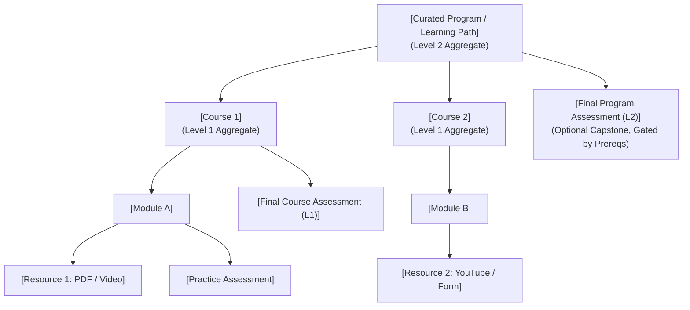

### Verified Domain Glossary

- **Content Item / Resource**: An atomic learning object (PDF, MP4, MP3, HTML5 ZIP, or Form).
- **Course**: A structured learning unit composed of modules, atomic resources, practice assessments, and an L1 Course Assessment.
- **Curated Program**: A collection of live courses published for all users, generating program-level tracking and credentials.
- **L1 Assessment**: A final assessment embedded within a single course, evaluating unit-level objectives.
- **L2 Assessment**: A comprehensive final assessment attached at the program level, evaluating cumulative curricular competencies.
- **Final Assessment Lock**: A configuration rule preventing a learner from attempting the L2 assessment until all constituent courses have been 100% completed (`status = 2` in `user_enrolment`).
- **Karma Programs**: Curated, high-priority collections or thematic strips configured on the learner homepage/Learn Hub by SPV administrators ([KB-3756: Q4 | Karma Programs](https://karmayogibharat.atlassian.net/browse/KB-3756) (Prod Deployed)).

## 7. Source Inventory and Evidence Quality

| Source ID | Document / Ticket Title | Type / Authority | Verified Lifecycle Area | Evidence Quality Label |
|---|---|---|---|---|
| **KBE-174** | *Ability to create a curated program and add live* *courses* | Jira Story (Base Engineering) | Program creation UI, course addition, hierarchy | `[Confirmed by Implementation]` |
| **KBE-150** | *Review and publish curated programs* | Jira Story (Base Engineering) | Reviewer & SPV publishing workflow | `[Confirmed by Implementation]` |
| **KBE-148** | *View and consume curated programs* | Jira Story (Base Engineering) | Learner TOC, enrolment, strip discovery | `[Confirmed by Implementation]` |
| **KBE-149** | *View certificate on completion of curated program* | Jira Story (Base Engineering) | Program-level certificate generation | `[Confirmed by Implementation]` |
| **KB-452** | *Q2 \| CBP Publishing \| Course vs Program publishing flow* | Jira Epic | CQS bypass, messaging updates | `[Confirmed by Implementation]` |
| **KB-453** | *CQS and Self Curation removal for curated programs* | Jira Story | Governance streamlining | `[Confirmed by Implementation]` |
| **KB-454** | *Update subheading to suitable wording for curated program* | Jira Story | Program creation UI copy & guidance | `[Confirmed by Implementation]` |
| **KB-457** | *Q2 \| CBP Editing \| Program Editing* | Jira Epic | Immutability of courses in live programs | `[Confirmed by Implementation]` |
| **KB-466** | *Q2 \| CBP Publishing \| Editing a live program* | Jira Story | Metadata-only edit restrictions | `[Confirmed by Implementation]` |
| **KB-1945** | *Q3 \| Content Portal Redesign \| Create program* | Jira Story | 4-way access settings, TOC preview | `[Confirmed by Implementation]` |
| **KB-1946** | *Q3 \| Content Portal Redesign \| Batch management* | Jira Story | Auto-batching, bulk CSV user invites | `[Confirmed by Implementation]` |
| **KB-3756** | *Q4 \| Karma Programs* | Jira Epic | Homepage discovery strip, SPV tagging | `[Confirmed by Implementation]` |
| **KB-8065** | *Q8 \| L2 Assessments/CAP \| Creation of L2 Assessments* | Jira Epic | L2 creation, CAP duration, locking UI | `[Confirmed by Implementation]` |
| **KB-8066** | *Q8 \| L2 Assessments/CAP \| Learner consumption* | Jira Epic | Scheduled assessment section, player launch | `[Confirmed by Implementation]` |
| **KB-8841** | *Q8 \| Learning Path \| Curated Program \| Add Final Assessment* | Jira Story | Final assessment creation interface | `[Confirmed by Implementation]` |
| **KB-8842** | *Q8 \| Learning Path \| Curated Program \| Add Locking* | Jira Story | `cb-ext-assessment-service`, gating rules | `[Confirmed by Implementation]` |
| **Doc 35062022** | *User manual - Content Portal (v2.0)* | Confluence (TPT Space) | Complete authoring & publishing manuals | `[Confirmed by Documentation]` |
| **Doc 21266503** | *Key Features - Nov 2023* | Confluence (Release Notes) | November 27, 2023 release baseline | `[Confirmed by Documentation]` |
| **Doc 373915757** | *KB-8065 Q8 FRS L2 Assessments* | Confluence (Technical FRS) | Functional rules, locking modes, UI flows | `[Confirmed by Documentation]` |
| **Doc 373850243** | *KB-8065 Q8 BRD L2 Assessments* | Confluence (Business BRD) | DoPT requirements, competency tracking | `[Confirmed by Documentation]` |

## 8. Actors, Roles, and Responsibilities

The platform utilizes granular Role-Based Access Control (RBAC) enforced across the Content Portal (`cbp.igotkarmayogi.gov.in`) and Learner Experience (`igotkarmayogi.gov.in`).

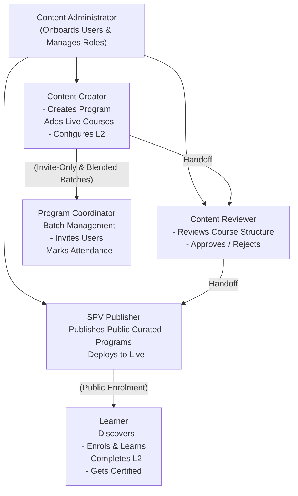

### 8.1 Role-to-Action Matrix

| Role | Create & Configure | Add Live Courses | Add L2 Assessment | Review & Feedback | Publish to Live | Discover & Consume | Batch Management | Download Reports |
|---|---|---|---|---|---|---|---|---|
| **Content Admin** | Not Supported | Not Supported | Not Supported | Not Supported | Not Supported | Not Supported | Supported | Supported |
| **Content Creator** | **Supported** | **Supported** | **Supported** | Not Supported | Not Supported | Not Supported | Not Supported | Supported (Own) |
| **Content Reviewer** | Not Supported | Not Supported | Not Supported | **Supported** | Not Supported | Not Supported | Not Supported | Not Supported |
| **SPV Publisher** | Not Supported | Not Supported | Not Supported | **Supported** | **Supported** | Not Supported | Not Supported | Supported |
| **Content Publisher** | Not Supported | Not Supported | Not Supported | **Supported** | Conditional* | Not Supported | Not Supported | Supported |
| **Program Coordinator** | Not Supported | Not Supported | Not Supported | Not Supported | Not Supported | Not Supported | **Supported** | Supported |
| **Learner** | Not Supported | Not Supported | Not Supported | Not Supported | Not Supported | **Supported** | Not Supported | Not Supported |

**Note: Content Publisher is authorized to publish Moderated Courses and Moderated Programs. Public Curated Programs must be published by the SPV Publisher (Page 35062022, §3).*

## 9. Feature Evolution Across Releases

| Release / Phase | Jira Issues | Earlier Baseline | Change Introduced | Business & Technical Impact | Evidence |
|---|---|---|---|---|---|
| **Pre-Release (Jan–Sep 2023)** | [KBE-174: Ability to create a curated program and add live courses](https://karmayogibharat.atlassian.net/browse/KBE-174) (Review), [KBE-150: Should be able to review and publish the curated programs and display for the karmayogi learners to consume](https://karmayogibharat.atlassian.net/browse/KBE-150) (Review), [KBE-148: Should be able to view and consume the curated programs](https://karmayogibharat.atlassian.net/browse/KBE-148) (Review), [KBE-149: Should be able to view certificate on completion of the curated program](https://karmayogibharat.atlassian.net/browse/KBE-149) (To Do) | Individual courses only; no concept of bundled curricula. | Initial implementation of "Open Program" (later renamed Curated Program). Basic course bundling and certificate issuing. | Transition from OpenForge tracker (AID 94322) to Jira. Established program hierarchy and TOC player view. | [KBE-174: Ability to create a curated program and add live courses](https://karmayogibharat.atlassian.net/browse/KBE-174) (Review), [KBE-365: Changing all the setting from open program to curated program for Creation and publishing the curated progam](https://karmayogibharat.atlassian.net/browse/KBE-365) (Done) |
| **Q2 / Sprint 8 (Nov 2023)** | [KB-452: Q2 \| CBP Publishing \| Course vs Program publishing flow for SPV](https://karmayogibharat.atlassian.net/browse/KB-452) (KB Approved), [KB-453: Q2 \| CBP Publishing \| CQS and Self Curation should be removed for content creator, content reviewer and publisher for invite only and curated program](https://karmayogibharat.atlassian.net/browse/KB-453) (Prod Deployed), [KB-454: Q2 \| CBP Publishing \| Update the subheading to suitable wording for curated program](https://karmayogibharat.atlassian.net/browse/KB-454) (Prod Deployed), [KB-457: Q2 \| CBP Editing \| Program Editing](https://karmayogibharat.atlassian.net/browse/KB-457) (KB Approved), [KB-466: Q2 \| CBP Publishing \| Editing a live program In-Progress](https://karmayogibharat.atlassian.net/browse/KB-466) | Programs required full CQS checks and profanity scans; live programs allowed editing course composition. | 1. Removed CQS and Self-Curation tabs for Curated Programs. 2. Immutability enforced: courses cannot be added/deleted in live programs. 3. Updated UI guidance copy. 4. Recall-to-draft gating implemented. | Prevented broken learner progress when course lists changed. Eliminated redundant reviewer approvals for pre-verified courses. | [KB-452: Q2 \| CBP Publishing \| Course vs Program publishing flow for SPV](https://karmayogibharat.atlassian.net/browse/KB-452) (KB Approved), [KB-457: Q2 \| CBP Editing \| Program Editing](https://karmayogibharat.atlassian.net/browse/KB-457) (KB Approved), Page 21266503 |
| **Q3 (Jan–Mar 2024)** | [KB-1945: Q3 \| Content Portal Redesign \| Create program](https://karmayogibharat.atlassian.net/browse/KB-1945) (Prod Deployed), [KB-1946: Q3 \| Content Portal Redesign \| Batch management for program](https://karmayogibharat.atlassian.net/browse/KB-1946) (Prod Deployed) | Program creation had rigid visibility; batch management was restricted. | 1. Content Portal Redesign. 2. 4-way access taxonomy (Curated, Moderated, Invite-Only, Blended). 3. Automated batch creation for Curated Programs. 4. Bulk learner CSV upload for Invite-Only. | Redesigned authoring UI, multi-ministry intersection rules for moderated programs, and automated open batching. | [KB-1945: Q3 \| Content Portal Redesign \| Create program](https://karmayogibharat.atlassian.net/browse/KB-1945) (Prod Deployed), [KB-1946: Q3 \| Content Portal Redesign \| Batch management for program](https://karmayogibharat.atlassian.net/browse/KB-1946) (Prod Deployed), Page 35062022 |
| **Q4 (Apr–Jul 2024)** | [KB-3756: Q4 \| Karma Programs](https://karmayogibharat.atlassian.net/browse/KB-3756) (Prod Deployed), [KB-3759: Q4 l Karma Programs l Portal \| Access Karma Programs \| Product UI UX](https://karmayogibharat.atlassian.net/browse/KB-3759) (Done) | Curated programs only discoverable via general search or Learn Hub catalog. | Introduction of "Karma Programs" thematic strip on learner homepage. Program tagging by creators and SPV admins. | High-visibility discovery strip; dynamic hiding if no programs are tagged or if learner lacks MDO eligibility. | [KB-3756: Q4 \| Karma Programs](https://karmayogibharat.atlassian.net/browse/KB-3756) (Prod Deployed) |
| **Q8 / Sprint 25–27 (Mar–Jul 2025)** | [KB-8065: Q8 \| L2 Assessments/CAP \| Creation of L2 Assessments/CAP](https://karmayogibharat.atlassian.net/browse/KB-8065) (KB Approved), [KB-8066: Q8 \| L2 Assessments/CAP \| Learner consumption](https://karmayogibharat.atlassian.net/browse/KB-8066) (KB Approved), [KB-8841: Q8 \| Learning Path \| Curated Program \| Add Final Assessment](https://karmayogibharat.atlassian.net/browse/KB-8841) (Prod Deployed), [KB-8842: Q8 \| Learning Path \| Curated Program \| Add Final Assessment Locking](https://karmayogibharat.atlassian.net/browse/KB-8842) (Prod Deployed) | Curated programs were strictly course aggregates without program-level assessments. | 1. Integrated Final Assessment (L2) into Curated Programs. 2. Final Assessment Locking mechanism. 3. Standalone `cb-ext-assessment-service` microservice deployed. 4. CAP scheduling. | Realized DoPT mandate for holistic competency verification; locked capstones prevent cheating or skipping core courses. | [KB-8065: Q8 \| L2 Assessments/C AP \| Creation of L2 Assessments/CAP](https://karmayogibharat.atlassian.net/browse/KB-8065) (KB Approved), [KB-8842: Q8 \| Learning Path \| Curated Program \| Add Final Assessment Locking](https://karmayogibharat.atlassian.net/browse/KB-8842) (Prod Deployed), Page 373915757 |

## 10. Functional Capabilities by Lifecycle Stage

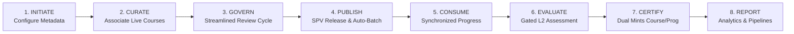

## 11. Program Creation and Configuration

### 11.1 Entry Point and Initial Form

The Content Creator accesses the Content Portal at `cbp.igotkarmayogi.gov.in`, navigates to **My Content**, and selects **Create New** -> **Program** ([KB-1945: Q3 | Content Portal Redesign | Create program](https://karmayogibharat.atlassian.net/browse/KB-1945) (Prod Deployed), Page 35062022). The initialization modal requires:

1. **Program Title**: Text field (supports standard alphanumeric characters; input sanitization prevents special symbol injection).
2. **Program Subtitle**: Descriptive summary text.
3. **Language**: Defaults to "English" (supports Hindi, Tamil, Malayalam, etc. Content must be authored in the chosen language).
4. **Access Settings**:
  - **All users** *(Crucial)*: Selecting this tags the entity as a **Curated Program**.
  - *MDO specific users*: Tags as Moderated Program.
  - *Custom users*: Tags as Invite-Only Program.
  - *Blended program*: Checkbox enabling offline modules, classroom templates, and attendance workflows.

### 11.2 State Persistence and Entity Identifiers

Submitting the form executes a synchronous POST to `/action/content/v3/create`. The backend content repository persists the draft entity with:

- `status = "Draft"`
- `contentType = "Program"`
- `primaryCategory = "Curated Program"`
- Unique identifier: `do_PID...` (Sunbird hierarchy identifier).

## 12. Content Curation and Association

### 12.1 Course Discovery and Eligibility Verification

`[Confirmed by Documentation & Implementation]` When the creator advances to the **Content** tab:

1. **Eligibility Enforcement**: Only courses that are currently **Live** (`status = "Live"`, `primaryCategory = "Course"`) can be associated. Draft, under review, or retired courses are filtered out.
2. **Provider Selection Filter**: The UI provides a toggle between:
  - **My Courses**: Live courses created within the creator's own MDO.
  - **All Courses**: Live courses published across the entire iGOT repository by peer ministries or training institutions.

3. **Reference by Identity**: Courses are associated by reference (`do_CID...`). The underlying course assets, videos, and quizzes are not duplicated; they remain linked to the canonical course identifier.
4. **Sequencing**: Creators can reorder child courses within the curriculum using drag-and-drop or position indices to define the recommended pedagogical order.

### 12.2 Program Settings & Competency Tagging

Creators configure essential metadata under **Program Settings**:

- **Thumbnail Image**: Program banner (`16:9` aspect ratio).
- **Description & Learning Objectives**: Curricular summary.
- **Competency Tagging**: Tagged against verified competencies from the FRAC (Framework for Roles, Activities, and Competencies) dictionary, selecting competency type, theme, and sub-theme (Page 35062022, §5.10).

## 13. Validation, Review, and Publication

### 13.1 Streamlined Governance: Bypass of CQS and Self-Curation

`[Confirmed by KB-452 & KB-453]` For standard course authoring, creators must complete a 7-section Content Quality Score (CQS) assessment (requiring score overall and across all sections) and run automated PDF profanity scans (Self Curation).

- **Curated Program Rule**: Because every associated course is already live and verified, **CQS and Self-Curation tabs are completely removed** from the Curated Program authoring, review, and publishing screens. Reviewers and publishers are strictly prevented from re-evaluating individual courses.

### 13.2 Reviewer Workflow and Rejection Loops

1. Creator clicks **Send for Review** -> state transitions to `Under Review`.
2. Content Reviewer opens **For Review** tab, previews the program structure, and chooses:
  - **Send for Publish**: Advances state to `Under Publish`.
  - **Reject Content**: Opens feedback modal. Review comments are attached, and the program returns to the creator's `Draft` tab.

3. **Recall Mechanism**: Prior to publishing, creators can invoke **Recall content to draft** from either `Under Review` or `Under Publish` tabs (Page 21266503, Page 35062022 §5.2.1.8).

### 13.3 SPV Publishing & Automated Batch Creation

`[Confirmed by KB-1946 & Page 35062022 §5.4]`

- **Authority**: Public Curated Programs must be published by the **SPV Publisher** (`role = "SPV Publisher"`).
- **Publish Operation**: Publisher clicks **Publish Content**.
- **Automated Batching**: Unlike blended or invite-only programs where batches require manual coordination, the platform backend **automatically generates an open, self-paced batch** for Curated Programs upon successful publishing.
- The program status transitions to `Live` and is indexed in Elasticsearch for platform discovery.

## 14. Discovery, Access, and Enrolment

### 14.1 Discovery Channels

Learners discover live Curated Programs via:

1. **Global Search**: Search queries matching program titles, descriptions, or competency tags.
2. **Learn Hub**: Dedicated Program filter cards.
3. **Karma Programs Strip** ([KB-3756: Q4 | Karma Programs](https://karmayogibharat.atlassian.net/browse/KB-3756) (Prod Deployed)): A curated strip on the learner homepage. If an SPV administrator tags a curated program to a Karma Program category, it appears prominently on the homepage.
4. **Scheduled Assessments Section** ([KB-8066: Q8 | L2 Assessments/CAP | Learner consumption](https://karmayogibharat.atlassian.net/browse/KB-8066) (KB Approved)): When designated as a Comprehensive Assessment Program (CAP), the program card displays duration timelines directly on the homepage.

### 14.2 Enrolment Mechanics

`[Confirmed by Implementation & KB-1946]`

- **Model**: Self-enrollment into the open batch.
- When a learner clicks **Enrol**, the platform invokes the enrollment service (`/action/course/v1/enrol`).
- The system checks whether the user already has active enrolments in any of the constituent child courses. If present, existing progress is immediately linked to the program enrollment.

## 15. Learning and Content Consumption

### 15.1 Table of Contents (TOC) and Course Launch

Upon enrolment, the learner lands on the Program TOC page:

- Displays curriculum progress ().
- Lists constituent courses with individual status badges (`Not Started`, `In Progress`, `Completed`).
- Clicking **Start** or **Resume** deep-links the learner into the target course player.

### 15.2 Bi-Directional Progress Synchronization

`[Confirmed by Confluence Doc 21266503 & Defect KB-9650]` Progress tracking is unified across the ecosystem:

1. If a learner completes *Course A* independently outside the program, *Course A* is marked 100% complete inside the Curated Program immediately.
2. If a learner consumes *Course B* from within the Curated Program, progress events persist to the learner's universal course progress store (`user_content_consumption`).
3. Telemetry events (`INTERACT`, `END`) emitted by the player update course progress in Cassandra. When returning to the Program TOC page, the overall program percentage recalculates.

## 16. Assessment Integration (L2 & Final Assessment Locking)

### 16.1 L1 vs. L2 Assessment Architecture

- **Level 1 (L1) Assessment**: Resides inside individual courses. Evaluates course-level learning objectives.
- **Level 2 (L2) Assessment** ([KB-8065: Q8 | L2 Assessments/CAP | Creation of L2 Assessments/CAP](https://karmayogibharat.atlassian.net/browse/KB-8065) (KB Approved)): Resides at the root level of the Curated Program. Evaluates cumulative curricular competency across all constituent courses.

### 16.2 Technical Design of Final Assessment Locking

`[Confirmed by Karthikeyan Rajendran's Technical Blueprint in KB-8842 & KB-9043]` To prevent learners from attempting the final assessment before consuming all coursework, the platform implements **Content Gating**:

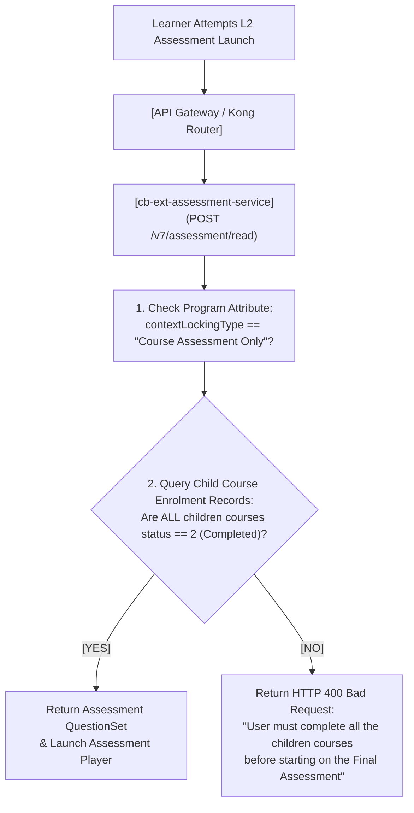

1. **Metadata Flags**:
  - Program Entity: `contextLockingType = "Course Assessment Only"` (configured when "Final Assessment Lock" is toggled; if "Default Unlock" is chosen, content is accessible in any sequence).
  - Assessment Entity: `contextCategory = "Final Program Assessment"`.

2. **Legacy cb-ext Guard**: Existing read endpoints in legacy `cb-ext` reject any QuestionSet tagged as `Final Program Assessment`, returning `HTTP 400 Bad Request` ("Trying to read invalid assessment type. Higher version API must be used").
3. **cb-ext-assessment-service Enforcement**: The read API is implemented as a secure `POST` request requiring the program identifier. It inspects child course completion states in `sunbird.user_enrolment`. If even one course is incomplete (`status < 2`), access is blocked.

## 17. Progress Tracking and Completion

### 17.1 Program Completion Formula

`[Confirmed by KB-8842, KB-9639, KB-9742]` A Curated Program reaches **Completed** state (`status = 2`) if and only if:

1. **All Constituent Courses** have achieved `status = 2` (100% consumption of mandatory assets and passing L1 course assessments).
2. **Final Assessment (L2)** (if configured) has achieved a passing score () and emitted a successful completion event.

### 17.2 Dual Certification Pipeline

- **Course Certificate**: Automatically issued by Sunbird Certificate Generator upon completion of each individual course.
- **Program Certificate**: Issued once the overarching Curated Program meets the completion formula. The certificate is rendered dynamically with the program title, issuer logo, and completion timestamp, and made available in the **About** tab and learner profile.

## 18. Reporting, Analytics, and Downstream Consumption

### 18.1 Reporting Architecture

`[Confirmed by KBE-151 & Doc 21266503]`

1. **Telemetry Capture**: User interactions emit standard telemetry packets routed via Kafka topics to Apache Flink streaming jobs.
2. **Flink Summarizer**: Aggregates daily user sessions, active duration, and progress checkpoints.
3. **Spark Batch Jobs**: `SparkJob for Open Program detailed Report at Program/User Level` runs scheduled aggregations across user enrollments, program states, and assessment attempts.
4. **Data Warehouse (PostgreSQL)**: Stores normalized dimensional tables (`user_data`, `user_enrollment_data`, `program_data`, `l2_assessment_data`) for administrative analytics.
5. **Dashboard Views**:
  - Content Creators & Coordinators: Track enrolment counts, drop-off rates, and completion percentages.
  - MDO Leaders & SPV Admins: Track departmental compliance, competency acquisition, and certification tallies.

## 19. Program Maintenance and Lifecycle Termination

### 19.1 Immutability of Program Composition

`[Confirmed by KB-457 & KB-466]` To prevent data corruption, historical progress invalidation, and broken certification states for enrolled learners:

- **Rule**: Live programs **cannot** be modified to add or remove courses. The course selection controls are disabled in edit mode.
- **Allowed Edits**: Creators can only update program settings (metadata, description, thumbnail, competency tags).
- **Course Modifications**: If a constituent course needs updating, the original course author updates the course independently. The Curated Program reflects the updated course version automatically.
- **Curricular Overhaul**: If the set of courses in a program must change, the creator must retire/archive the existing program and publish a completely new program.

## 20. End-to-End Input-Processing-Output Analysis

| Stage | Input Data | Source / Actor | Processing Component | API / Event Trigger | Persisted Entity & Store | Output / Response | Next Consumer | Failure Handling |
|---|---|---|---|---|---|---|---|---|
| **1. Program Initiation** | Title, Subtitle, Language, Access: "All users" | Content Creator | Content Service | `POST /action/content/v3/create` | Draft Program record in Cassandra & Neo4j | `200 OK` + `programId` (`do_PID...`) | Curation UI | Validation error if mandatory fields missing; transaction abort. |
| **2. Course Association** | List of `courseId`s (`do_CID...`), display order | Content Creator | Hierarchy Service | `PATCH /action/content/v3/hierarchy/update` | Relationship edges `hasContent` in Neo4j hierarchy | `200 OK` with updated tree | Settings UI | Rejects courses that are not in `Live` state. |
| **3. L2 Assessment Attachment** | QuestionSet details, cut-off, locking toggle | Content Creator | Assessment Service | `POST /action/questionset/v1/create` | `QuestionSet` linked to program hierarchy | `200 OK` + `assessmentId` | Governance UI | Returns HTTP 400 if QuestionSet creation payload invalid ([KB-9552: Question set Create api is giving 400 error when final assessment is added to the curated program](https://karmayogibharat.atlassian.net/browse/KB-9552) (Done)). |
| **4. Validation & Review** | Send for Review trigger | Content Creator | Workflow Engine | `POST /action/content/v3/review` | State update `Under Review` in Cassandra | `200 OK` notification | Content Reviewer | Blocked if program contains zero courses or incomplete metadata. |
| **5. Publishing & Batching** | Publish trigger | SPV Publisher | Publishing Engine / LMS Service | `POST /action/content/v3/publish` | State update `Live`; Auto-provision open batch in Cassandra | `200 OK`; Elasticsearch index updated | Public Learner Catalog | Publishing rollback if Neo4j transaction fails; logged in `Publish Failed` tab. |
| **6. Enrolment** | `userId`, `programId`, `batchId` | Learner | Enrolment Service | `POST /action/course/v1/enrol` | Insert record into `sunbird.user_enrolment` | `200 OK` Enrolment confirmed | Learner TOC | Returns HTTP 400 if duplicate enrolment exists or batch closed. |
| **7. Course Consumption** | Player events (`START`, `INTERACT`, `END`) | Learner Player | Consumption Service | `POST /action/content/v1/telemetry` | `user_content_consumption` in Cassandra | `200 OK` Progress acknowledged | TOC Progress Bar | Client-side queue retries telemetry if network disconnects. |
| **8. L2 Gated Launch** | `programId`, `assessmentId` | Learner | cb-ext-assessment-service | `POST /v7/assessment/read` | Query child course states in `user_enrolment` | `200 OK` QuestionSet or `400 Bad Request` | Assessment Player | Block launch with user message if child courses incomplete ([KB-8842: Q8 \| Learning Path \| Curated Program \| Add Final Assessment Locking](https://karmayogibharat.atlassian.net/browse/KB-8842) (Prod Deployed)). |
| **9. Assessment Submit** | Question responses, time spent | Learner | Assessment Evaluation Service | `POST /v7/assessment/submit` | Assessment attempt record, pass/fail score in Cassandra | `200 OK` Scorecard & Result | Certification Engine | Retry evaluation worker on timeout; submission stored in buffer. |
| **10. Certification** | Program completion event | Completion Worker | Certificate Generator | Kafka event `course-completion-topic` | RC4 encrypted certificate in Sunbird S3 & Cassandra | Signed PDF Certificate + OpenBadges credential | Learner Profile | Asynchronous worker retries generation upon rendering failure ([KB-9809: Certificate is not getting generated in TOC page about tab once Curated program is consumed by some users in both QA and UAT environment](https://karmayogibharat.atlassian.net/browse/KB-9809) (Fixed)). |

## Architecture Diagrams

*Disclosed Rendering Note*: In accordance with prompt instructions, the system architectures and sequences are modeled as clean, validated Mermaid diagrams. Automated rasterized image generation tools (PNG/SVG) are not directly accessible in this execution environment; rendering remains outstanding.

### 21. Diagram A — Business Context Diagram

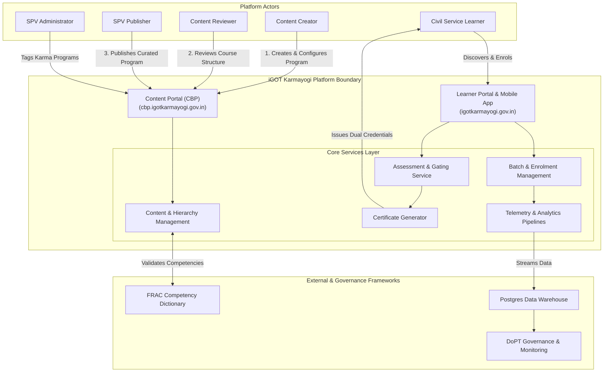

### 22. Diagram B — Logical Component Architecture Diagram

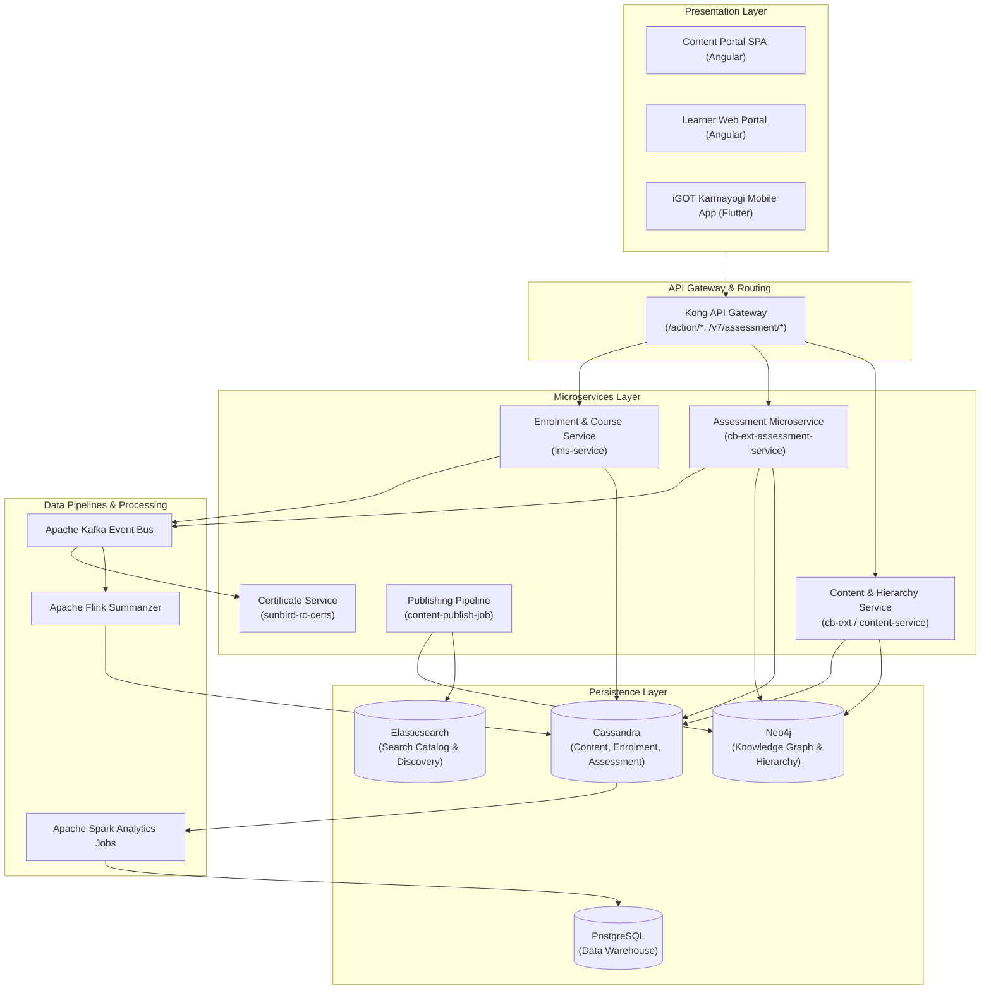

### 23. Diagram C — Creation and Publishing Sequence Diagram

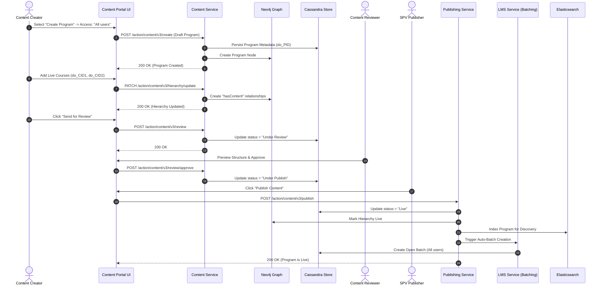

### 24. Diagram D — Discovery and Consumption Sequence Diagram

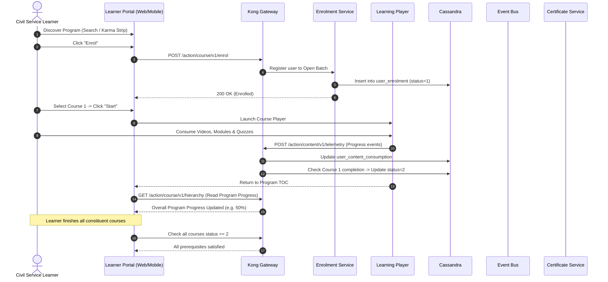

### 25. Diagram E — Assessment Integration (L2 Locking) Diagram

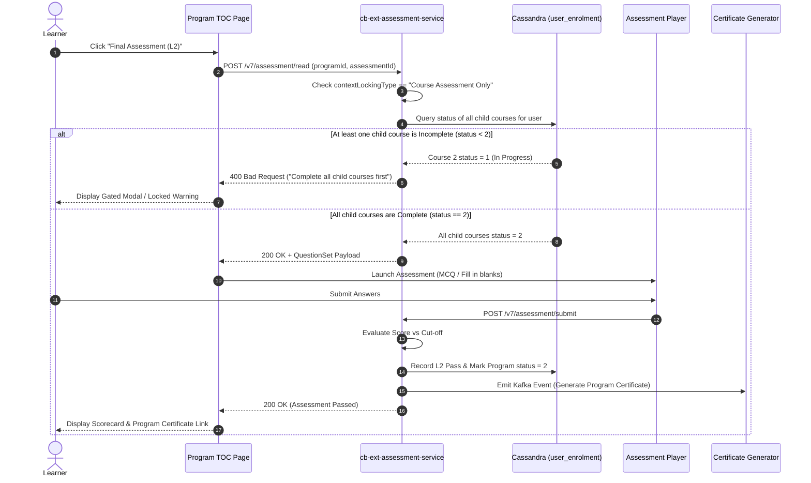

### 26. Diagram F — Data and Event Flow Diagram

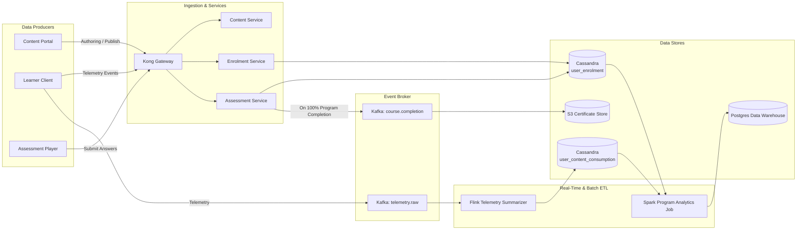

### 27. Diagram G — Complete Lifecycle State Diagram

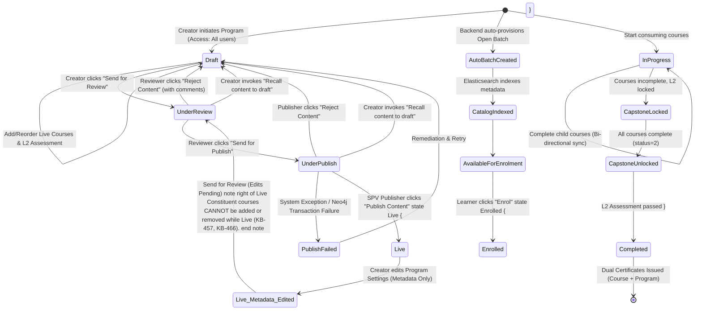

## 28. API Inventory and Interaction Summary

| API Identifier | HTTP Method | Endpoint | Source Component | Receiving Service | Auth / Permissions | Request Payload Highlights | Response Structure | Data Store Changes | Evidence Reference |
|---|---|---|---|---|---|---|---|---|---|
| **Create Program** | `POST` | `/action/content/v3/create` | Content Portal | Content Service | Bearer Token + User (`CBP Creator`) | `name`, `contentType: "Program"`, `primaryCategory: "Curated` `Program"`, `access: "All users"` | `{"result": {"identifier": "do_PID..."}}` | Writes Draft record in Cassandra `content_store` & Neo4j node | [KB-1945: Q3 \| Content Portal Redesign \| Create program](https://karmayogibharat.atlassian.net/browse/KB-1945) (Prod Deployed), Page 35062022 |
| **Update Hierarchy** | `PATCH` | `/action/content/v3/hierarchy/update` | Content Portal | Hierarchy Service | Bearer Token (`CBP Creator`) | `rootId: "do_PID..."`, `children: ["do_CID1", "do_CID2"]` | `{"result": {"response": "SUCCESS"}}` | Updates Neo4j `hasContent` relationship edges | [KBE-174: Ability to create a curated program and add live courses](https://karmayogibharat.atlassian.net/browse/KBE-174) (Review), Page 35062022 |
| **Send for Review** | `POST` | `/action/content/v3/review` | Content Portal | Workflow Engine | Bearer Token (`CBP Creator`) | `identifier: "do_PID..."` | `{"result": {"status": "Under Review"}}` | Updates status in Cassandra and Neo4j | [KB-452: Q2 \| CBP Publishing \| Course vs Program publishing flow for SPV](https://karmayogibharat.atlassian.net/browse/KB-452) (KB Approved), Page 35062022 |
| **Publish Program** | `POST` | `/action/content/v3/publish` | Content Portal | Publishing Service | Bearer Token (`SPV Publisher`) | `identifier: "do_PID..."` | `{"result": {"publishStatus": "SUCCESS"}}` | Updates status to `Live`; triggers batch creation & ES indexing | [KB-452: Q2 \| CBP Publishing \| Course vs Program publishing flow for SPV](https://karmayogibharat.atlassian.net/browse/KB-452) (KB Approved), [KBE-150: Should be able to review and publish the curated programs and display for the karmayogi learners to consume](https://karmayogibharat.atlassian.net/browse/KBE-150) (Review) |
| **Program Enrol** | `POST` | `/action/course/v1/enrol` | Learner Portal | LMS Enrolment Service | Authenticated User Session | `courseId: "do_PID..."`, `batchId: "..."`, `userId: "..."` | `{"result": {"response": "SUCCESS"}}` | Inserts row into `sunbird.user_enrolment` with `status = 1` | [KB-1946: Q3 \| Content Portal Redesign \| Batch management for program](https://karmayogibharat.atlassian.net/browse/KB-1946) (Prod Deployed), [KBE-148: Should be able to view and consume the curated programs](https://karmayogibharat.atlassian.net/browse/KBE-148) (Review) |
| **Gated L2 Read** | `POST` | `/v7/assessment/read` | Learner Player | cb-ext-assessment-service | Authenticated User Session | `programId: "do_PID..."`, `assessmentId: "do_AID..."` | `200 OK` (QuestionSet) OR `400 Bad Request` | Reads `user_enrolment` across child courses; logs access | [KB-8842: Q8 \| Learning Path \| Curated Program \| Add Final Assessment Locking](https://karmayogibharat.atlassian.net/browse/KB-8842) (Prod Deployed), [KB-9043: Replicate the code of read,retake,submit and result API's from cb-ext-service in cb-ext- assessment service](https://karmayogibharat.atlassian.net/browse/KB-9043) (Done) |
| **Submit L2 Attempt** | `POST` | `/v7/assessment/submit` | Learner Player | cb-ext-assessment-service | Authenticated User Session | `programId`, `assessmentId`, `answers: [...]`, `timeSpent` | `{"result": {"score": 85, "pass": true}}` | Updates `assessment_attempts`; marks program `status = 2` | [KB-8842: Q8 \| Learning Path \| Curated Program \| Add Final Assessment Locking](https://karmayogibharat.atlassian.net/browse/KB-8842) (Prod Deployed), [KB-9248: BE \| Enhance Assessment V7 READ API - to return error for content locking](https://karmayogibharat.atlassian.net/browse/KB-9248) (Done) |
| **Bulk User Enrol** | `POST` | `/action/program/v1/batch/user/enrol` | Content Portal | Batch Admin Service | Bearer Token (`Program Coordinator`) | `programId`, `batchId`, `userIds: ["usr1", "usr2"]` | `{"result": {"successCount": 2, "errorCount": 0}}` | Bulk inserts rows into `sunbird.user_enrolment` | [KB-2396: DEV \| BE \| Create new endpoint to enrol multiple user for given program and batch](https://karmayogibharat.atlassian.net/browse/KB-2396) (Done), [KB-1946: Q3 \| Content Portal Redesign \| Batch management for program](https://karmayogibharat.atlassian.net/browse/KB-1946) (Prod Deployed) |

## 29. Conceptual Data Model and Entity Relationships

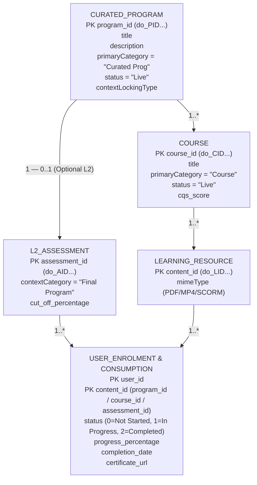

### Relational & Store Mapping

- **Neo4j Graph Database**: Stores structural topology. Nodes: `Program`, `Course`, `QuestionSet`. Edges: `(:Program)-[:hasContent {index: 1}]->(:Course)`.
- **Cassandra** (`sunbird` keyspace):
  - `content_hierarchy`: JSON structure caching the expanded tree.
  - `user_enrolment`: Tracks enrollment status (`status: 1` active, `2` completed).
  - `user_content_consumption`: Tracks granular resource progress.
  - `assessment_aggregates`: Stores L1 and L2 scores, attempt counts, and pass/fail indicators.

## 30. Requirement-to-Implementation Traceability

| Requirement Statement | Business Driver / Source | Architectural Implementation | Implementation Status | Evidence / Validation |
|---|---|---|---|---|
| **Create Curated Program from Live Courses** | Consolidate learning paths ([KBE-174: Ability to create a curated program and add live courses](https://karmayogibharat.atlassian.net/browse/KBE-174) (Review), Page 35062022) | Content Portal UI allows selecting and ordering live courses from own MDO or external providers. | **Implemented** | [KBE-174: Ability to create a curated program and add live courses](https://karmayogibharat.atlassian.net/browse/KBE-174) (Review), [KB-1945: Q3 \| Content Portal Redesign \| Create program](https://karmayogibharat.atlassian.net/browse/KB-1945) (Prod Deployed), [KBE-361: UI card to display the open program and to create the open program](https://karmayogibharat.atlassian.net/browse/KBE-361) (Done) |
| **Bypass CQS & Self-Curation for Programs** | Eliminate redundant checks on pre-approved courses ([KB-452: Q2 \| CBP Publishing \| Course vs Program publishing flow for SPV](https://karmayogibharat.atlassian.net/browse/KB-452) (KB Approved)) | CQS and Self-Curation tabs hidden in UI; backend publish validator bypasses check. | **Implemented** | [KB-453: Q2 \| CBP Publishing \| CQS and Self Curation should be removed for content creator, content reviewer and publisher for invite only and curated program](https://karmayogibharat.atlassian.net/browse/KB-453) (Prod Deployed), walkthrough video in Jira |
| **Immutability of Courses in Live Programs** | Prevent broken progress tracking for enrolled learners ([KB-457: Q2 \| CBP Editing \| Program Editing](https://karmayogibharat.atlassian.net/browse/KB-457) (KB Approved)) | UI removes course add/delete actions in edit mode; only program metadata is editable. | **Implemented** | [KB-466: Q2 \| CBP Publishing \| Editing a live program In-Progress](https://karmayogibharat.atlassian.net/browse/KB-466), tested in Sprint 8 |
| **Dual Certificate Generation** | Holistic recognition of curricular completion ([KBE-149: Should be able to view certificate on completion of the curated program](https://karmayogibharat.atlassian.net/browse/KBE-149) (To Do)) | Mints individual course certificates + program-level certificate upon 100% completion. | **Implemented** | [KBE-149: Should be able to view certificate on completion of the curated program](https://karmayogibharat.atlassian.net/browse/KBE-149) (To Do), Page 21266503; UAT bug [KB-9742: UAT issue : Certificate is not getting generated in TOC page about tab once Curated program is consumed](https://karmayogibharat.atlassian.net/browse/KB-9742) (Done) resolved |
| **Automated Batching for Curated Programs** | Frictionless self-paced access for all civil servants ([KB-1946: Q3 \| Content Portal Redesign \| Batch management for program](https://karmayogibharat.atlassian.net/browse/KB-1946) (Prod Deployed)) | Backend auto-provisions an Open Batch upon SPV publish without manual coordinator setup. | **Implemented** | [KB-1946: Q3 \| Content Portal Redesign \| Batch management for program](https://karmayogibharat.atlassian.net/browse/KB-1946) (Prod Deployed), Page 35062022 §5.5 |
| **Level-2 Capstone Assessment Integration** | DoPT mandate for holistic competency evaluation ([KB-8065: Q8 \| L2 Assessments/CAP \| Creation of L2 Assessments/CAP](https://karmayogibharat.atlassian.net/browse/KB-8065) (KB Approved)) | Final Assessment QuestionSet attached at root of program hierarchy. | **Implemented** | [KB-8065: Q8 \| L2 Assessments/CAP \| Creation of L2 Assessments/CAP](https://karmayogibharat.atlassian.net/browse/KB-8065) (KB Approved), [KB-8841: Q8 \| Learning Path \| Curated Program \| Add Final Assessment](https://karmayogibharat.atlassian.net/browse/KB-8841) (Prod Deployed), Page 373915757 |
| **Final Assessment Server-Side Locking** | Prevent skipping coursework to take final exam ([KB-8842: Q8 \| Learning Path \| Curated Program \| Add Final Assessment Locking](https://karmayogibharat.atlassian.net/browse/KB-8842) (Prod Deployed)) | `cb-ext-assessment-service` verifies child course completions before returning assessment. | **Implemented** | [KB-8842: Q8 \| Learning Path \| Curated Program \| Add Final Assessment Locking](https://karmayogibharat.atlassian.net/browse/KB-8842) (Prod Deployed), [KB-9248: BE \| Enhance Assessment V7 READ API - to return error for content locking](https://karmayogibharat.atlassian.net/browse/KB-9248) (Done), [KB-9600: User is able to consume final assessment without consuming course content in curated porgram](https://karmayogibharat.atlassian.net/browse/KB-9600) (Done) |
| **Karma Programs Homepage Strip** | Streamline discovery for prioritized topics ([KB-3756: Q4 \| Karma Programs](https://karmayogibharat.atlassian.net/browse/KB-3756) (Prod Deployed)) | Dynamic UI strip driven by SPV administrative tagging via API handbook. | **Implemented** | [KB-3756: Q4 \| Karma Programs](https://karmayogibharat.atlassian.net/browse/KB-3756) (Prod Deployed), [KB-3759: Q4 l Karma Programs l Portal \| Access Karma Programs \| Product UI UX](https://karmayogibharat.atlassian.net/browse/KB-3759) (Done) |
| **Bi-Directional Progress Sync** | Seamless recognition across standalone & program contexts | Universal user consumption tracking in Cassandra; Flink streaming summarizer. | **Implemented** | Page 21266503, defect [KB-9650: Regression : The progress of the course content is not reflecting immediately in TOC page content tab when comes back from the player page. It reflects only after page reload.](https://karmayogibharat.atlassian.net/browse/KB-9650) (Done) |

## 31. Failure Scenarios and Exception Handling

### 31.1 Gated Assessment Bypass Attempt

- **Trigger**: Learner directly invokes `/v7/assessment/read` via automated script or modified client state without completing constituent courses.
- **Handled Behavior**: `cb-ext-assessment-service` intercepts the request, evaluates `contextLockingType`, queries child course enrollment records in Cassandra, detects incomplete courses (`status < 2`), and returns `HTTP 400 Bad Request` with message: *"User must complete all the children courses before starting on the Final Assessment."* ([KB-8842: Q8 | Learning Path | Curated Program | Add Final Assessment Locking](https://karmayogibharat.atlassian.net/browse/KB-8842) (Prod Deployed)).
- **Resolution of Defect KB-9600**: In early lower-environment testing, UI-only locking permitted direct API consumption; verified server-side enforcement was deployed in Sprint 25.

### 31.2 Unpublished / Inaccessible Course Association

- **Trigger**: Content Creator attempts to associate a course that is in Draft or Under Review.
- **Handled Behavior**: The Content Search API specifically restricts search filters to `status: "Live"` and `primaryCategory: "Course"`. Draft courses are unsearchable and cannot be linked.

### 31.3 Live Program Edit Inconsistency

- **Trigger**: Content Creator attempts to remove a poorly performing course from an active Curated Program.
- **Handled Behavior**: The UI strips deletion and addition icons from the content table. If an illegal PATCH request is sent directly to the hierarchy endpoint for a live program, the backend rejects the transaction, enforcing the immutability policy established in [KB-457: Q2 | CBP Editing | Program Editing](https://karmayogibharat.atlassian.net/browse/KB-457) (KB Approved) and [KB-466: Q2 | CBP Publishing | Editing a live program In-Progress](https://karmayogibharat.atlassian.net/browse/KB-466).

### 31.4 Progress Reflection Lag on Program TOC

- **Trigger**: Learner completes the last resource in Course 2 and immediately clicks back to the Program TOC.
- **Identified Defect & Fix**: Tracked under regression [KB-9650: Regression : The progress of the course content is not reflecting immediately in TOC page content tab when comes back from the player page. It reflects only after page reload.](https://karmayogibharat.atlassian.net/browse/KB-9650) (Done), where the TOC page cached prior progress until hard refresh. Fixed by triggering an automated client-side invalidation and re-fetching the hierarchy enrollment payload upon returning from the player page.

### 31.5 Program Certificate Generation Timeout

- **Trigger**: High concurrency spikes on certificate generation worker causing timeouts.
- **Identified Defect & Fix**: Tracked under [KB-9742: UAT issue : Certificate is not getting generated in TOC page about tab once Curated program is consumed](https://karmayogibharat.atlassian.net/browse/KB-9742) (Done) and [KB-9809: Certificate is not getting generated in TOC page about tab once Curated program is consumed by some users in both QA and UAT environment](https://karmayogibharat.atlassian.net/browse/KB-9809) (Fixed). Resolved by adding an asynchronous retry topic in Kafka and ensuring idempotent certificate generation jobs in the `sunbird-rc` microservice.

## 32. Security, Access Control, and Auditability

1. **Authentication**: All API requests pass through the Kong API Gateway, validating OAuth2 / Keycloak JWT tokens.
2. **Role Enforcement**:
  - Program creation and course association: Enforces `CBP Creator` role.
  - Review handoff: Enforces `CBP Reviewer`.
  - Public release: Enforces `SPV Publisher` (preventing regular institutional publishers from pushing unverified curricula to all platform users).

3. **Data Protection**: Learner assessment responses and individual score breakdowns are protected. Assessment evaluation logic runs isolated in `cb-ext-assessment-service`.
4. **Audit Trail**: Every state transition (`Draft` -> `Under Review` -> `Under Publish` -> `Live`) is stamped with the acting `userId`, timestamp, and review remarks, stored immutably in Cassandra audit log tables.

## 33. Dependencies and Integration Points

- **FRAC Dictionary Service**: Validates competency taxonomy (Competency, Theme, Sub-theme) during program configuration.
- **Content Service & Neo4j**: Manages graph relationships, parent-child hierarchies, and composite content definitions.
- **LMS & Enrolment Engine**: Manages user batch memberships, enrollment limits, and auto-batch creation.
- **cb-ext-assessment-service**: Handles QuestionSet rendering, evaluation cut-offs, and prerequisite locking verification.
- **Certificate Generation Engine** (`sunbird-rc`): Consumes completion events from Kafka to generate digitally signed credentials.
- **Apache Kafka & Flink**: Ingests player telemetry, tracks consumption milestones, and aggregates analytics.
- **PostgreSQL Warehouse**: Provides reporting datasets for administrative and DoPT oversight.

## 34. Known Limitations and Technical Debt

1. **Course Modification Immutability**: While immutability protects enrolled learner integrity, creators cannot replace an obsolete course with an updated version inside an existing program. A full re-authoring of a new program entity is necessary ([KB-457: Q2 | CBP Editing | Program Editing](https://karmayogibharat.atlassian.net/browse/KB-457) (KB Approved)).
2. **Assessment Gating Granularity**: Assessment locking currently operates on an "All or Nothing" basis (`Course Assessment Only` — requiring 100% completion of all courses). It does not support partial branch gating (e.g., unlocking assessment after completing 3 out of 5 elective courses).
3. **Draft Course Copy Wishlist**: Creators cannot clone or branch existing course leaf nodes directly from a program; the copy feature remains a separate wishlist item ([KB-273: CBP Editing and Retiring | No Course editing, Copy feature to refresh course and retiring timer.](https://karmayogibharat.atlassian.net/browse/KB-273) (Added to Initiative), mentioned in KB-457 comments).
