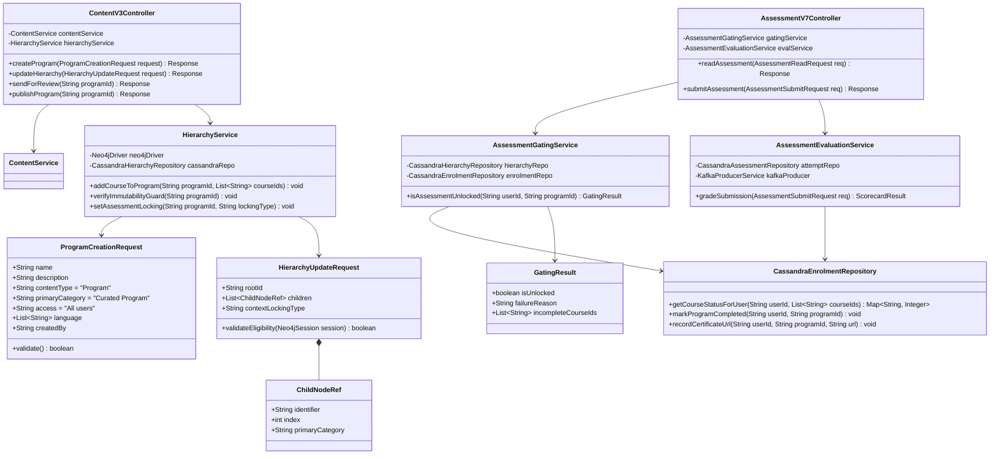
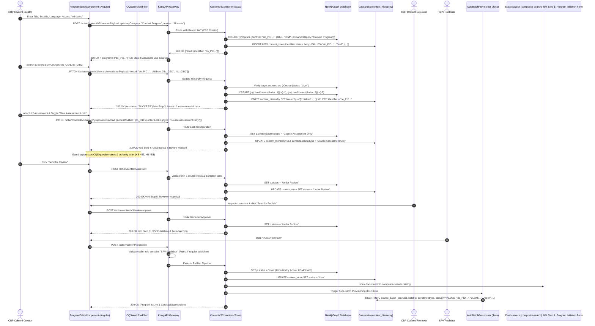
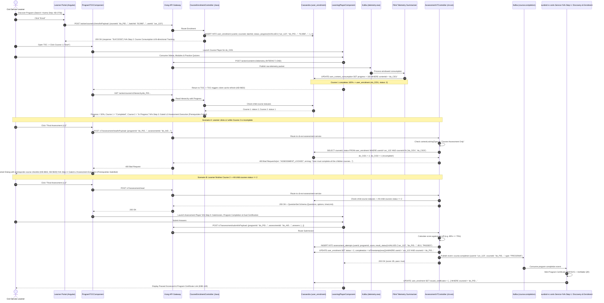
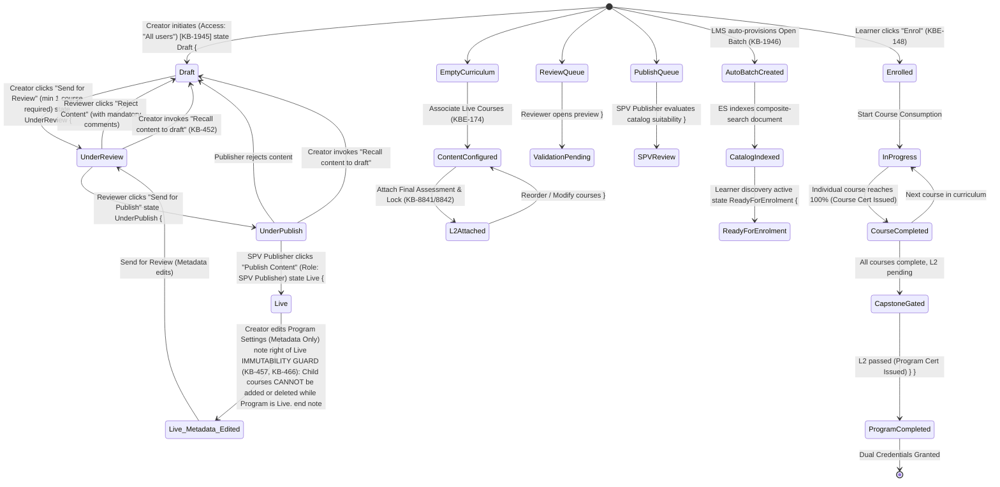
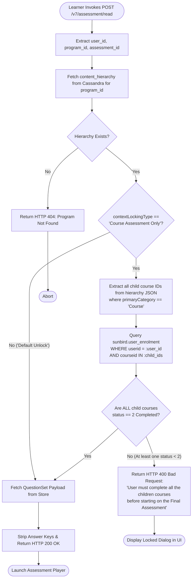
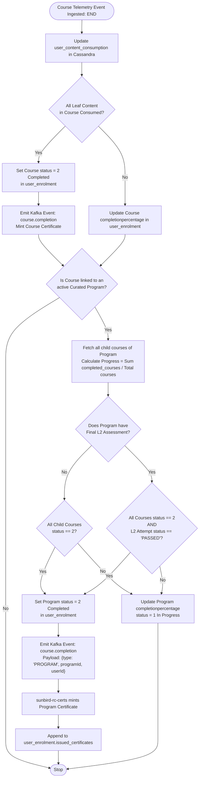

# Curated Program — Low-Level Design (LLD)

**Diagrammatic & Structural Low-Level Engineering Specification (Frontend to Backend, Creation to Consumption)**

**iGOT Karmayogi Platform | Digital Workplace Engineering Architecture**

## 1. Low-Level Component & Modular Decomposition

This structural diagram maps each frontend Angular component, router guard, gateway routing rule, controller, service implementation, database table, and message queue.

```mermaid
flowchart TD
    subgraph FE_CBP ["Frontend Tier: Content Portal SPA (cbp.igotkarmayogi.gov.in)"]
        CBP_Comp["ProgramEditorComponent\n- FormGroup: title, subtitle, lang\n- AccessSelect: 'All users' (KB-1945)"]
        CoursePicker["CoursePickerComponent\n- Live Course Search Grid\n- Drag & Drop Reorder (KBE-174)"]
        L2_Config["L2AssessmentConfigComponent\n- Final Assessment Picker (KB-8841)\n- Locking Toggle: contextLockingType (KB-8842)"]
        CQS_Guard["CQSWorkflowFilter\n- Suppresses CQS & Profanity Tabs (KB-453)"]
        Immutability_Guard["LiveEditStateGuard\n- Disables Add/Delete Course buttons on Live (KB-457/466)"]
    end
    subgraph FE_LP ["Frontend Tier: Learner Portal SPA & Mobile (igotkarmayogi.gov.in)"]
        StripComp["KarmaProgramStripComponent\n- Homepage Strip Renderer (KB-3756)"]
        TOC_Comp["ProgramTOCComponent\n- Progress Header (0-100%)\n- Course Status Pills (KB-9650)"]
        Gated_Card["GatedAssessmentCardComponent\n- Displays Lock Icon & Prereq Modal (KB-8066)"]
        Player_Comp["CourseAndAssessmentPlayerComponent\n- Emits Telemetry (INTERACT, END)"]
    end
    subgraph GW ["API Gateway Tier: Kong Reverse Proxy"]
        Kong_Auth["Kong OAuth2/JWT Plugin\n- Validates User Tokens\n- Inspects Roles (CBP Creator, SPV Publisher)"]
        Kong_Router["Kong Route Dispatcher\n- /action/content/* -> Content Service\n- /action/course/* -> LMS Service\n- /v7/assessment/* -> Assessment Service"]
    end
    subgraph BE_Content ["Backend Tier: Sunbird Content & Hierarchy Service"]
        ContentCtrl["ContentV3Controller\n- createContent()\n- updateHierarchy()\n- reviewContent()"]
        HierarchyMgr["HierarchyManager\n- validates child courses 'Live'\n- blocks live program course mutations"]
        PublishEngine["PublishPipelineManager\n- changes status to 'Live'\n- triggers Open Batch & ES indexing"]
    end
    subgraph BE_LMS ["Backend Tier: Sunbird LMS & Enrolment Service"]
        EnrolCtrl["CourseEnrolmentController\n- enrolUser()\n- getHierarchyWithProgress()"]
        BatchProv["AutoBatchProvisioner\n- creates Open Batch on Publish (KB-1946)"]
        ProgressAggregator["ProgressAggregationEngine\n- rolls up leaf-level progress to Program"]
    end
    subgraph BE_Assessment ["Backend Tier: cb-ext-assessment-service"]
        AssessCtrl["AssessmentV7Controller\n- readAssessment()\n- submitAssessment()"]
        LockingValidator["PrerequisiteGatingValidator\n- queries Cassandra user_enrolment\n- rejects if child courses < status 2 (KB-8842/9600)"]
        GradingEngine["GradingAndScorecardEngine\n- grades against cut-off\n- emits course.completion (KB-9248)"]
    end
    subgraph StreamingTier ["Streaming & Asynchronous Workers"]
        K_Raw["Kafka Topic: telemetry.raw"]
        K_Comp["Kafka Topic: course.completion"]
        Flink_Job["Flink Telemetry Summarizer\n- windowed aggregation of progress"]
        Cert_Worker["sunbird-rc-certs Worker\n- mints Program Certificate (KBE-149, KB-9809)"]
        Spark_Job["Spark Analytics Job\n- aggregates program reporting mart (KBE-151)"]
    end
    subgraph StoresTier ["Polyglot Storage Engine"]
        Neo4j_DB[("Neo4j Graph Database\n- (:Program)-[:hasContent]->(:Course)\n- (:Program)-[:hasAssessment]->(:QuestionSet)")]
        Cas_Enrol[("Cassandra: sunbird.user_enrolment\n- progress, status (0,1,2), batchid")]
        Cas_Hierarchy[("Cassandra: sunbird.content_hierarchy\n- cached JSON tree, contextLockingType")]
        Cas_Attempts[("Cassandra: sunbird.assessment_attempts\n- attempt scores, result_status")]
        ES_Index[("Elasticsearch: composite-search\n- searchable catalog documents")]
        S3_Store[("MinIO / S3 Object Store\n- PDF/SVG Certificates with QR code")]
    end
    %% CBP Frontend to Gateway
    CBP_Comp -->|POST /action/content/v3/create| Kong_Router
    CoursePicker -->|PATCH /action/content/v3/hierarchy/update| Kong_Router
    L2_Config -->|PATCH /action/content/v3/hierarchy/update| Kong_Router
    CBP_Comp -.-> CQS_Guard
    CBP_Comp -.-> Immutability_Guard
    %% Learner Frontend to Gateway
    StripComp -->|POST /action/composite/v3/search| Kong_Router
    TOC_Comp -->|GET /action/course/v1/hierarchy/:id| Kong_Router
    TOC_Comp -->|POST /action/course/v1/enrol| Kong_Router
    Gated_Card -->|POST /v7/assessment/read| Kong_Router
    Player_Comp -->|POST /v7/assessment/submit| Kong_Router
    Player_Comp -->|POST /action/content/v1/telemetry| Kong_Router
    %% Gateway to Controllers
    Kong_Router --> Kong_Auth
    Kong_Auth --> ContentCtrl
    Kong_Auth --> EnrolCtrl
    Kong_Auth --> AssessCtrl
    %% Backend Content Wiring
    ContentCtrl --> HierarchyMgr
    HierarchyMgr --> Neo4j_DB
    HierarchyMgr --> Cas_Hierarchy
    ContentCtrl --> PublishEngine
    PublishEngine --> ES_Index
    PublishEngine --> BatchProv
    %% Backend LMS Wiring
    BatchProv --> Cas_Enrol
    EnrolCtrl --> Cas_Enrol
    EnrolCtrl --> ProgressAggregator
    ProgressAggregator --> Cas_Hierarchy
    %% Backend Assessment Wiring
    AssessCtrl --> LockingValidator
    LockingValidator --> Cas_Hierarchy
    LockingValidator --> Cas_Enrol
    AssessCtrl --> GradingEngine
    GradingEngine --> Cas_Attempts
    GradingEngine --> Cas_Enrol
    GradingEngine --> K_Comp
    %% Streaming & Events Wiring
    Kong_Router -->|telemetry events| K_Raw
    K_Raw --> Flink_Job
    Flink_Job --> Cas_Enrol
    K_Comp --> Cert_Worker
    Cert_Worker --> S3_Store
    Cert_Worker --> Cas_Enrol
    Cas_Enrol --> Spark_Job
```



## 2. Low-Level Object & Class Architecture

This UML class diagram specifies the domain models, service interfaces, and data-access objects governing program creation, immutability, prerequisite gating, and completion evaluation.



## 3. Comprehensive Sequence Designs: Creation to Consumption

### 3.1 Flow 1: Creation, Curation, Review & SPV Publishing Sequence

This sequence details form validation, hierarchy graph edge creation, automated CQS bypass, review approvals, live immutability state locking, and automated open batch provisioning.



### 3.2 Flow 2: Discovery, Enrolment, Learning & Gated L2 Assessment Sequence

This sequence details learner catalog search, open batch self-enrolment, bidirectional course consumption tracking, server-side L2 assessment prerequisite gating, grading, and dual-certificate generation.



## 4. State Transition Machine Architecture

The finite state machine below models valid states, transitions, authorized actors, API triggers, and rejection/recall loops across the Curated Program lifecycle.



## 5. Physical Database Schemas & DDL Specifications

### 5.1 Apache Cassandra Data Definition Language (DDL)

```sql
-- Keyspace Definition
CREATE KEYSPACE IF NOT EXISTS sunbird WITH replication = {'class': 'NetworkTopologyStrategy', 'datacenter1': 3};

-- 1. User Enrolment Table (Stores Course & Program Enrolment and Completion)
CREATE TABLE IF NOT EXISTS sunbird.user_enrolment (
    userid text,
    courseid text,  -- Program Identifier (do_PID...) or Course Identifier (do_CID...)
    batchid text,  -- Auto-generated Open Batch ID (013987...)
    active boolean,
    completionpercentage int,  -- Aggregate 0-100%
    completedon timestamp,
    enrolled_date timestamp,
    issued_certificates list<frozen<map<text,
    text>>>,
    -- Stores certificate URL, ID, and
    mint timestamp lastreadcontentid text,
    lastreadcontentstatus int,
    progress int,
    status int,  -- 0: Not Started, 1: In Progress, 2: Completed
    PRIMARY KEY ((userid), courseid, batchid)
) WITH CLUSTERING ORDER BY (courseid ASC, batchid ASC);
CREATE INDEX IF NOT EXISTS idx_user_enrolment_status ON sunbird.user_enrolment (status);

-- 2. Content Hierarchy Store (Stores cached JSON trees and locking metadata)
CREATE TABLE IF NOT EXISTS sunbird.content_hierarchy (
    identifier text,  -- Program ID (do_PID...)
    hierarchy text,
    -- Complete nested JSON tree
    contextlockingtype text,  -- "Course Assessment Only" or "Default Unlock"
    lastupdatedon timestamp,
    PRIMARY KEY (identifier)
);

-- 3. Level-2 Assessment Attempts Store (Stores historical capstone submissions)
CREATE TABLE IF NOT EXISTS sunbird.assessment_attempts (
    userid text,
    programid text,
    assessmentid text,
    attempt_id text,
    score double,
    max_score double,
    result_status text,  -- "PASSED", "FAILED"
    time_spent int,
    -- Time spent in seconds
    submitted_date timestamp,
    response_payload text,  -- Encrypted JSON blob of submitted answers
    PRIMARY KEY ((userid, programid), assessmentid, attempt_id)
) WITH CLUSTERING ORDER BY (assessmentid ASC, attempt_id DESC);

-- 4. Open Batch Management Store (Tracks auto-provisioned open batches)
CREATE TABLE IF NOT EXISTS sunbird.course_batch (
    courseid text,  -- Program ID (do_PID...)
    batchid text,
    createdby text,
    createddate text,
    enddate text,
    enrollmenttype text,
    -- Fixed to "open" for Curated Programs
    name text,
    -- Defaults to "Auto Open Batch"
    startdate text,
    status int,  -- 1: Open / In Progress, 2: Completed
    PRIMARY KEY ((courseid), batchid)
);
```

### 5.2 Neo4j Cypher Schema & Property Graph Constraints

```cypher
// 1. Create Unique Constraints on Primary Identifiers
CREATE CONSTRAINT unique_program_id IF NOT EXISTS FOR (p:Program) REQUIRE p.identifier IS UNIQUE;
CREATE CONSTRAINT unique_course_id IF NOT EXISTS FOR (c:Course) REQUIRE c.identifier IS UNIQUE;
CREATE CONSTRAINT unique_questionset_id IF NOT EXISTS FOR (q:QuestionSet) REQUIRE q.identifier IS UNIQUE;

// 2. Program Node Property Schema
// (:Program {
//   identifier: "do_PID...",
//   name: "Curated Program on Public Procurement",
//   contentType: "Program",
//   primaryCategory: "Curated Program",
//   access: "All users",
//   status: "Live",
//   contextLockingType: "Course Assessment Only",
//   versionKey: "1730218200000"
// })

// 3. Structural Relationship Graph Construction
MATCH (p:Program {identifier: "do_PID2139847192847"})
MATCH (c1:Course {identifier: "do_CID1130982348712", status: "Live"})
MATCH (c2:Course {identifier: "do_CID1130982348713", status: "Live"})
MATCH (q:QuestionSet {identifier: "do_AID1130982348714", contextCategory: "Final Program Assessment"})

// Create Ordered Hierarchy Edges
MERGE (p)-[:hasContent {index: 1, addedOn: timestamp()}]->(c1)
MERGE (p)-[:hasContent {index: 2, addedOn: timestamp()}]->(c2)
MERGE (p)-[:hasAssessment {index: 3, addedOn: timestamp()}]->(q);
```

## 6. Algorithmic Low-Level Logic & Control Flow

### 6.1 Server-Side L2 Assessment Gating Algorithm (`cb-ext-assessment-service`)

This flowchart details the exact decision tree implemented in `cb-ext-assessment-service` to enforce server-side gating when a learner invokes `POST /v7/assessment/read`.



### 6.2 Program Progress Rollup & Status Resolution Logic

This flowchart defines how user interactions roll up from atomic digital resources to child courses, and ultimately to overall program completion and dual-certificate triggering.



## 7. Concrete Payload Schema & Interceptor Contracts

### 7.1 Gated Assessment Read Request & Response Contracts

#### A. Inbound Client Request (`POST /v7/assessment/read`)

```json
{
  "programId": "do_PID2139847192847",
  "assessmentId": "do_AID1130982348714"
}
```

#### B. Error Response (`HTTP 400 Bad Request` — Server-Side Gate Enforced)

*Triggered when one or more child courses have* `status < 2` in `sunbird.user_enrolment`.

```json
{
  "id": "api.assessment.read",
  "ver": "7.0",
  "ts": "2026-10-29T16:15:00.000Z",
  "params": {
    "resmsgid": "b1849201-9a72-4c81-b201-984729184712",
    "msgid": "a9847120-1294-4712-9847-194820194821",
    "status": "FAILED",
    "err": "ASSESSMENT_LOCKED",
    "errmsg": "User must complete all the children courses before starting on the Final Assessment"
  },
  "responseCode": "CLIENT_ERROR",
  "result": {
    "contextLockingType": "Course Assessment Only",
    "incompleteCourses": [
      {
        "courseId": "do_CID1130982348713",
        "title": "Public Procurement: Tendering & Contracting",
        "currentStatus": 1
      }
    ]
  }
}
```

#### C. Success Response (`HTTP 200 OK` — All Prerequisites Satisfied)

```json
{
  "id": "api.assessment.read",
  "ver": "7.0",
  "ts": "2026-10-29T16:16:00.000Z",
  "params": {
    "resmsgid": "d9847201-a129-4b82-c847-194820194822",
    "status": "SUCCESSFUL"
  },
  "responseCode": "OK",
  "result": {
    "questionset": {
      "identifier": "do_AID1130982348714",
      "title": "Comprehensive Final Assessment: Public Procurement",
      "contextCategory": "Final Program Assessment",
      "maxQuestions": 50,
      "timeLimit": 3600,
      "cutOffPercentage": 75.0,
      "navigationMode": "free",
      "shuffleQuestions": true,
      "questions": [
        {
          "identifier": "do_QID102948192",
          "title": "Under GFR Rule 149, procurement of goods via GeM is:",
          "type": "mcq",
          "options": [
            {
              "index": 0,
              "text": "Mandatory for all central ministries"
            },
            {
              "index": 1,
              "text": "Optional at discretion of Head of Department"
            },
            {
              "index": 2,
              "text": "Restricted to contracts exceeding 10 Crores"
            },
            {
              "index": 3,
              "text": "Applicable only to state public sector units"
            }
          ]
        }
      ]
    }
  }
}
```

## 8. Requirements Traceability Matrix (LLD to Engineering Sources)

| SRS / Feature Requirement | Low-Level Architectural Component | Concrete Implementation Artifact | Verification Reference |
|---|---|---|---|
| **Program Creation & Taxonomy** | `ProgramEditorComponent` (Angular) & `ContentV3Controller` | Schema: `primaryCategory = "Curated Program"`, `access = "All users"` | [KB-1945: Q3 \| Content Portal Redesign \| Create program](https://karmayogibharat.atlassian.net/browse/KB-1945) (Prod Deployed), Page 35062022 §5.1 |
| **Course Curation by Reference** | `CoursePickerComponent` & `HierarchyManager` | Neo4j Relationship: `[:hasContent {index: n}]` | [KBE-174: Ability to create a curated program and add live courses](https://karmayogibharat.atlassian.net/browse/KBE-174) (Review), Page 35062022 §5.2.3 |
| **CQS & Profanity Scan Bypass** | `CQSWorkflowFilter` (Angular Router / UI Guard) | Workflow suppression of CQS Questionnaire & profanity upload tabs | [KB-452: Q2 \| CBP Publishing \| Course vs Program publishing flow for SPV](https://karmayogibharat.atlassian.net/browse/KB-452) (KB Approved), [KB-453: Q2 \| CBP Publishing \| CQS and Self Curation should be removed for content creator, content reviewer and publisher for invite only and curated program](https://karmayogibharat.atlassian.net/browse/KB-453) (Prod Deployed) |
| **Publishing Immutability Guard** | `LiveEditStateGuard` & `HierarchyManager` | Backend validation rejecting child mutations on live programs | [KB-457: Q2 \| CBP Editing \| Program Editing](https://karmayogibharat.atlassian.net/browse/KB-457) (KB Approved), [KB-466: Q2 \| CBP Publishing \| Editing a live program In-Progress](https://karmayogibharat.atlassian.net/browse/KB-466) |
| **Automated Batch Provisioning** | `AutoBatchProvisioner` (LMS Service) | Cassandra `sunbird.course_batch` with `enrollmenttype = "open"` | [KB-1946: Q3 \| Content Portal Redesign \| Batch management for program](https://karmayogibharat.atlassian.net/browse/KB-1946) (Prod Deployed), Page 35062022 §5.5 |
| **Karma Strip Homepage Discovery** | `KarmaProgramStripComponent` | Elasticsearch query filtering on SPV administrative tag | [KB-3756: Q4 \| Karma Programs](https://karmayogibharat.atlassian.net/browse/KB-3756) (Prod Deployed) |
| **Progress Synchronization** | `ProgressAggregationEngine` & Flink Job | Bidirectional update across `user_content_consumption` & TOC cache | [KBE-148: Should be able to view and consume the curated programs](https://karmayogibharat.atlassian.net/browse/KBE-148) (Review), [KB-9650: Regression : The progress of the course content is not reflecting immediately in TOC page content tab when comes back from the player page. It reflects only after page reload.](https://karmayogibharat.atlassian.net/browse/KB-9650) (Done) |
| **Server-Side L2 Gating Lock** | `PrerequisiteGatingValidator` (`cb-ext-assessment-service`) | Endpoint `POST /v7/assessment/read` returning HTTP 400 if child courses < status 2 | [KB-8842: Q8 \| Learning Path \| Curated Program \| Add Final Assessment Locking](https://karmayogibharat.atlassian.net/browse/KB-8842) (Prod Deployed), [KB-9043: Replicate the code of read,retake,submit and result API's from cb-ext-service in cb-ext-assessment service](https://karmayogibharat.atlassian.net/browse/KB-9043) (Done), [KB-9600: User is able to consume final assessment without consuming course content in curated porgram](https://karmayogibharat.atlassian.net/browse/KB-9600) (Done) |
| **L2 Grading & Evaluation** | `GradingAndScorecardEngine` | Submission grading against cut-off and persistence to `assessment_attempts` | [KB-8065: Q8 \| L2 Assessments/CAP \| Creation of L2 Assessments/CAP](https://karmayogibharat.atlassian.net/browse/KB-8065) (KB Approved), [KB-9248: BE \| Enhance Assessment V7 READ API - to return error for content locking](https://karmayogibharat.atlassian.net/browse/KB-9248) (Done) |
| **Dual Certificate Generation** | `sunbird-rc-certs` Worker | Kafka topic `course.completion` triggering Program Certificate mint | [KBE-149: Should be able to view certificate on completion of the curated program](https://karmayogibharat.atlassian.net/browse/KBE-149) (To Do), [KB-9742: UAT issue : Certificate is not getting generated in TOC page about tab once Curated program is consumed](https://karmayogibharat.atlassian.net/browse/KB-9742) (Done), [KB-9809: Certificate is not getting generated in TOC page about tab once Curated program is consumed by some users in both QA and UAT environment](https://karmayogibharat.atlassian.net/browse/KB-9809) (Fixed) |
