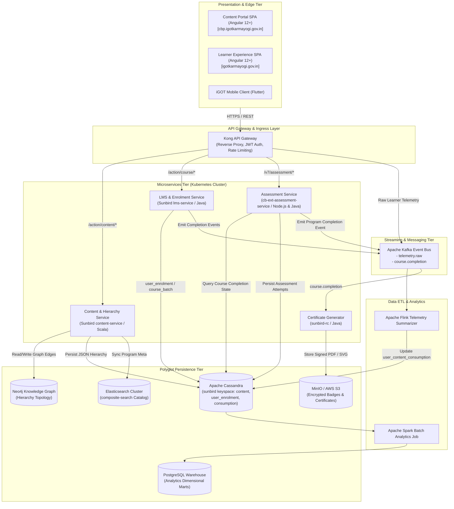
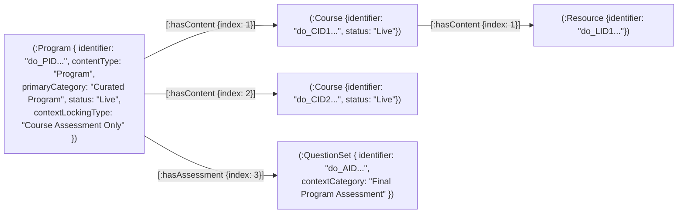
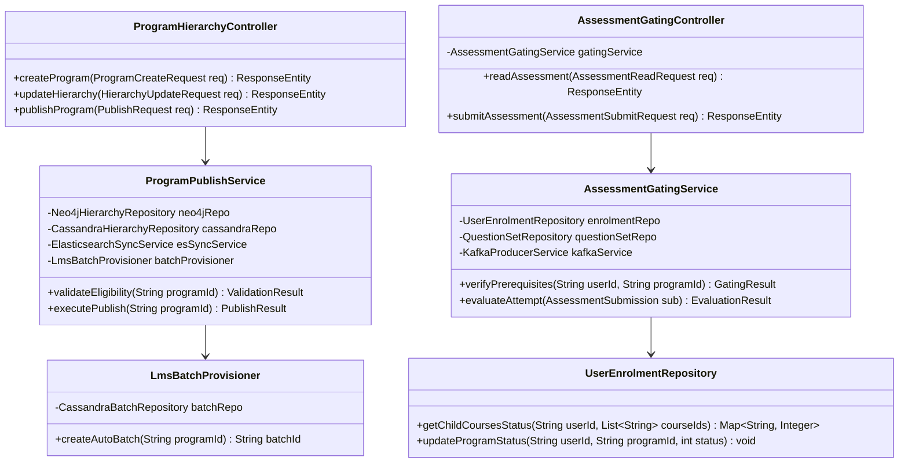
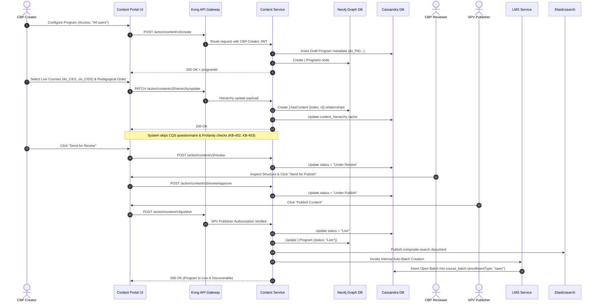
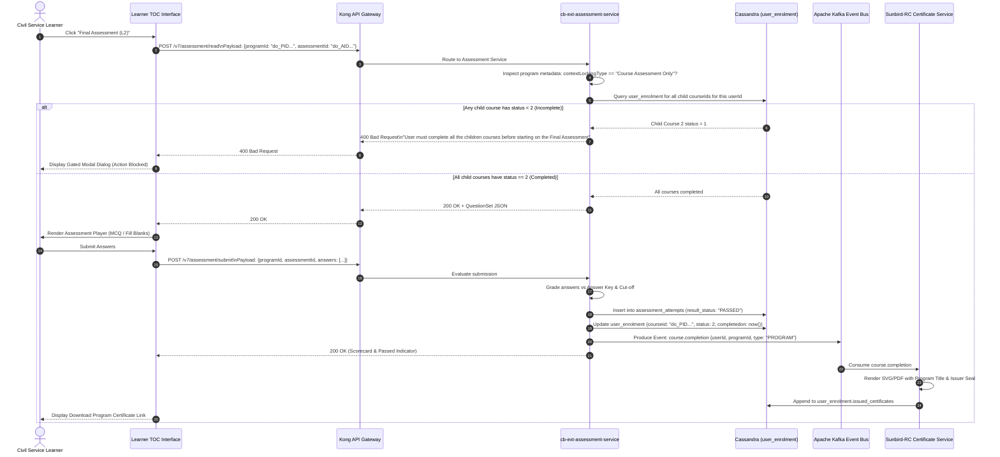

# Curated Program — Software Design Description (SDD)

**Curated Programs — Architecture, Services, Data Models, and Low-Level Mechanics**

**iGOT Karmayogi Platform | Digital Workplace Technical Architecture**

### Document Control & Engineering Metadata

- **Document Identifier**: `SDD-IGOT-CP-2026-V1.0`
- **Standard Compliance**: IEEE 1016-2009 (Standard for Information Technology — Systems Design — Software Design Descriptions)
- **Parent Specification**: `SRS-IGOT-CP-2026-V1.0` (IEEE 29148:2018 Compliant)
- **Target Subsystems**: Content Provider Portal (`cbp.igotkarmayogi.gov.in`), Learner Portal (`igotkarmayogi.gov.in`), Kong Gateway, Sunbird Content Service, LMS Enrolment Service, `cb-ext-assessment-service`, Sunbird-RC Certificate Service, Apache Kafka / Apache Flink Streaming Pipeline.
- **Author / Architecture Role**: Senior Solution Architect & Lead Technical Systems Analyst
- **Baseline Status**: Production Implementation Verified Baseline
- **Traceable Engineering Artifacts**:
  - Jira Initiatives & Epics: [KB-301: Q2 | CBP Creation, Editing, Review, Publishing and Retiring](https://karmayogibharat.atlassian.net/browse/KB-301) (KB Approved), [KB-452: Q2 | CBP Publishing | Course vs Program publishing flow for SPV](https://karmayogibharat.atlassian.net/browse/KB-452) (KB Approved), [KB-457: Q2 | CBP Editing | Program Editing](https://karmayogibharat.atlassian.net/browse/KB-457) (KB Approved), [KB-1936: Q3 | Content Portal Redesign | Content access settings, batch management and user consumption](https://karmayogibharat.atlassian.net/browse/KB-1936) (Prod Deployed), [KB-3756: Q4 | Karma Programs](https://karmayogibharat.atlassian.net/browse/KB-3756) (Prod Deployed), [KB-8064: Q8 | Access control & L2 Assessments](https://karmayogibharat.atlassian.net/browse/KB-8064) (Open), [KB-8065: Q8 | L2 Assessments/CAP | Creation of L2 Assessments/CAP](https://karmayogibharat.atlassian.net/browse/KB-8065) (KB Approved), [KB-8066: Q8 | L2 Assessments/CAP | Learner consumption](https://karmayogibharat.atlassian.net/browse/KB-8066) (KB Approved)
  - Jira Stories & Defect Fixes: [KB-453: Q2 | CBP Publishing | CQS and Self Curation should be removed for content creator, content reviewer and publisher for invite only and curated program](https://karmayogibharat.atlassian.net/browse/KB-453) (Prod Deployed), [KB-454: Q2 | CBP Publishing | Update the subheading to suitable wording for curated program](https://karmayogibharat.atlassian.net/browse/KB-454) (Prod Deployed), [KB-466: Q2 | CBP Publishing | Editing a live program In-Progress](https://karmayogibharat.atlassian.net/browse/KB-466), [KB-1945: Q3 | Content Portal Redesign | Create program](https://karmayogibharat.atlassian.net/browse/KB-1945) (Prod Deployed), [KB-1946: Q3 | Content Portal Redesign | Batch management for program](https://karmayogibharat.atlassian.net/browse/KB-1946) (Prod Deployed), [KB-8841: Q8 | Learning Path | Curated Program | Add Final Assessment](https://karmayogibharat.atlassian.net/browse/KB-8841) (Prod Deployed), [KB-8842: Q8 | Learning Path | Curated Program | Add Final Assessment Locking](https://karmayogibharat.atlassian.net/browse/KB-8842) (Prod Deployed), [KB-9043: Replicate the code of read,retake,submit and result API's from cb-ext-service in cb-ext-assessment service](https://karmayogibharat.atlassian.net/browse/KB-9043) (Done), [KB-9247: BE | Enhance content Flink job to use the compatibilityLevel value set from creation](https://karmayogibharat.atlassian.net/browse/KB-9247) (Done), [KB-9248: BE | Enhance Assessment V7 READ API - to return error for content locking](https://karmayogibharat.atlassian.net/browse/KB-9248) (Done), [KB-9600: User is able to consume final assessment without consuming course content in curated porgram](https://karmayogibharat.atlassian.net/browse/KB-9600) (Done), [KB-9650: Regression : The progress of the course content is not reflecting immediately in TOC page content tab when comes back from the player page. It reflects only after page reload.](https://karmayogibharat.atlassian.net/browse/KB-9650) (Done), [KB-9742: UAT issue : Certificate is not getting generated in TOC page about tab once Curated program is consumed](https://karmayogibharat.atlassian.net/browse/KB-9742) (Done), [KB-9809: Certificate is not getting generated in TOC page about tab once Curated program is consumed by some users in both QA and UAT environment](https://karmayogibharat.atlassian.net/browse/KB-9809) (Fixed)
  - Engineering Base Trackers: [KBE-174: Ability to create a curated program and add live courses](https://karmayogibharat.atlassian.net/browse/KBE-174) (Review), [KBE-150: Should be able to review and publish the curated programs and display for the karmayogi learners to consume](https://karmayogibharat.atlassian.net/browse/KBE-150) (Review), [KBE-148: Should be able to view and consume the curated programs](https://karmayogibharat.atlassian.net/browse/KBE-148) (Review), [KBE-149: Should be able to view certificate on completion of the curated program](https://karmayogibharat.atlassian.net/browse/KBE-149) (To Do), [KBE-151: Able to view the detailed reports at the program/user level](https://karmayogibharat.atlassian.net/browse/KBE-151) (To Do)
  - Confluence Technical References: Confluence Page 35062022 (*User manual - Content Portal v2.0*), Page 21266503 (*Key Features - Nov 2023*), Page 373915757 (*KB-8065 Q8 FRS L2 Assessments*), Page 373850243 (*KB-8065 Q8 BRD L2 Assessments*)

## 1. Introduction and Architectural Goals

### 1.1 Purpose

This Software Design Description (SDD) provides a formal, comprehensive architectural and low-level engineering specification for the **Curated Program** subsystem on the iGOT Karmayogi platform. It translates the requirements specified in `SRS-IGOT-CP-2026-V1.0` into structural diagrams, component interfaces, algorithmic workflows, database schemas, and data pipelines.

### 1.2 Design Scope

The scope encompasses:

1. **Creation & Hierarchy Modeling**: Content Portal interfaces, Neo4j composite node graph modeling, and Cassandra hierarchy stores.
2. **Publishing Governance & Immutability**: Automated CQS/profanity check bypass, review handoff, SPV publication engine, and mutation guards on live curricula.
3. **LMS & Auto-Batching**: Automated open batch provisioning for frictionless self-paced enrolment.
4. **Learning Runtime & Telemetry**: Bidirectional progress reflection across standalone course and program TOC contexts.
5. **Level-2 (L2) Assessment Gating**: Server-side prerequisite validation logic hosted in the standalone `cb-ext-assessment-service` microservice.
6. **Dual Certification & Asynchronous Analytics**: Completion event production, `sunbird-rc-certs` issuance, and Apache Flink/Spark telemetry processing.

### 1.3 Architectural Principles

- **Loose Coupling by Reference**: Constituent courses are linked to a Curated Program strictly by identifier reference (`do_CID...`). Digital learning resources (PDF, MP4, SCORM) are never cloned or duplicated into the program graph.
- **Server-Side Trust Boundary**: Assessment gating (`contextLockingType: "Course Assessment Only"`) is enforced strictly within backend microservices. Client-side state is treated as unverified.
- **Eventual Consistency via Kafka**: Progression milestones, certificate triggers, and analytical batch updates communicate across bounded contexts through asynchronous Apache Kafka events.
- **Immutable Core Curricula**: To prevent corruption of historical completion credentials, live program course composition is strictly immutable.

## 2. System Architecture & Component Decomposition

### 2.1 High-Level Component Topology



### 2.2 Microservice Descriptions & Boundaries

| Microservice Name | Runtime / Tech Stack | Primary Responsibilities | Data Stores Accessed | Inbound Interfaces | Outbound Events |
|---|---|---|---|---|---|
| **Kong Gateway** | OpenResty / Lua | JWT Bearer validation, RBAC route interception, rate-limiting, CORS handling. | Redis (Session Cache) | Client HTTPS Requests | Routed Internal HTTP |
| **Content Service** | Scala / Play Framework | Program metadata CRUD, Neo4j composite node graph mapping, CQS/profanity check bypass, hierarchy updates. | Neo4j, Cassandra (`content_store`), Elasticsearch | `/action/content/v3/*` | `content.publish` |
| **LMS Service** | Java / Play Framework | Automated open batch provisioning, learner batch enrolment, course progress rollup. | Cassandra (`sunbird:user_enrolment`, `course_batch`) | `/action/course/v1/*`, `/action/program/v1/*` | `course.batch.enrol` |
| **Assessment Service** (`cb-ext-assessment-service`) | Node.js (Express) & Java micro-runtime | Level-2 QuestionSet delivery, server-side course completion gating (`contextLockingType`), answer evaluation. | Cassandra (`user_enrolment`, `assessment_attempts`), Neo4j | `/v7/assessment/read`, `/v7/assessment/submit` | `assessment.passed` |
| **Certificate Service** (`sunbird-rc`) | Java / Spring Boot | Idempotent generation of digitally signed Course and Program Certificates, QR code embedding. | Cassandra, MinIO / S3 Store | Kafka Event Listener (`course.completion`) | None |
| **Flink Telemetry Summarizer** | Apache Flink (Java) | Stateful real-time stream aggregation of player telemetry (`INTERACT`, `END`), duration calculation. | Cassandra (`user_content_consumption`) | Kafka (`telemetry.raw`) | None |

## 3. Data Design & Persistent Data Models

### 3.1 Neo4j Composite Hierarchy Graph Model

Curated Programs leverage Neo4j to model structural relationships. Leaf nodes represent atomic assets; intermediate composite nodes represent Courses; the root node represents the Curated Program.



### 3.2 Apache Cassandra Data Schemas (`sunbird` keyspace)

#### Schema 1: `user_enrolment` Table

Maintains user enrollment state at both Course and Program aggregate levels.

```sql
CREATE TABLE IF NOT EXISTS sunbird.user_enrolment (
    userid text,
    courseid text,
    batchid text,
    active boolean,
    completionpercentage int,
    completedon timestamp,
    enrolled_date timestamp,
    issued_certificates list<frozen<map<text,
    text>>>,
    lastreadcontentid text,
    lastreadcontentstatus int,
    progress int,
    status int,  -- 0: Not Started, 1: In Progress, 2: Completed
    PRIMARY KEY ((userid), courseid, batchid)
) WITH CLUSTERING ORDER BY (courseid ASC, batchid ASC);
CREATE INDEX IF NOT EXISTS idx_user_enrolment_status ON sunbird.user_enrolment (status);
```

#### Schema 2: `content_hierarchy` Table

Stores the flattened JSON structure representing the complete curriculum tree for fast runtime retrieval.

```sql
CREATE TABLE IF NOT EXISTS sunbird.content_hierarchy (
    identifier text,
    hierarchy text,
    -- JSON representation of nested curriculum
    PRIMARY KEY (identifier)
);
```

#### Schema 3: `assessment_attempts` Table

Records historical attempts, scores, and pass/fail indicators for L2 capstone assessments.

```sql
CREATE TABLE IF NOT EXISTS sunbird.assessment_attempts (
    userid text,
    assessmentid text,
    attempt_id text,
    programid text,
    score double,
    max_score double,
    result_status text,  -- "PASSED", "FAILED"
    time_spent int,
    submitted_date timestamp,
    response_payload text,  -- Encrypted JSON of question-answer pairs
    PRIMARY KEY ((userid, programid), assessmentid, attempt_id)
) WITH CLUSTERING ORDER BY (assessmentid ASC, attempt_id DESC);
```

#### Schema 4: `course_batch` Table

Tracks automatically generated open batches associated with Curated Programs.

```sql
CREATE TABLE IF NOT EXISTS sunbird.course_batch (
    courseid text,
    -- Maps to program identifier (do_PID...)
    batchid text,
    createdby text,
    createddate text,
    enddate text,
    enrollmenttype text,  -- "open"
    name text,
    startdate text,
    status int,  -- 1: In Progress / Open, 2: Completed
    PRIMARY KEY ((courseid), batchid)
);
```

## 4. Class Design & Component Object Models



## 5. Sequence Flows & Operational Mechanics

### 5.1 Program Creation, Validation Bypass, and Automated Publishing Flow



### 5.2 Gated Level-2 (L2) Assessment Launch & Submission Flow



## 6. Detailed Interface & API Specifications

### 6.1 Program Creation API

- **Endpoint**: `POST /action/content/v3/create`
- **Calling Component**: Content Portal UI (`Angular SPA`)
- **Target Service**: Content Service (`Play Framework`)
- **Headers**: `Authorization: Bearer <JWT>`, `Content-Type: application/json`
- **Request Payload**:
  ```json
  {
    "request": {
      "content": {
        "name": "Curated Program on Public Procurement",
        "description": "Comprehensive curricular training for public officials.",
        "contentType": "Program",
        "primaryCategory": "Curated Program",
        "access": "All users",
        "mimeType": "application/vnd.ekstep.content-collection",
        "language": [
          "English"
        ],
        "createdBy": "usr_c83492_..."
      }
    }
  }
  ```
- **Response Payload** (`200 OK`):
  ```json
  {
    "id": "api.content.create",
    "ver": "3.0",
    "ts": "2026-10-29T16:10:00Z",
    "params": {
      "resmsgid": "31b2c451-9f93-41a4-9720-94268e5461bb",
      "status": "successful"
    },
    "responseCode": "OK",
    "result": {
      "identifier": "do_PID2139847192847",
      "versionKey": "1730218200000"
    }
  }
  ```

### 6.2 Hierarchy Update API

- **Endpoint**: `PATCH /action/content/v3/hierarchy/update`
- **Request Payload**:
  ```json
  {
    "request": {
      "data": {
        "nodesModified": {
          "do_PID2139847192847": {
            "root": true,
            "metadata": {
              "contextLockingType": "Course Assessment Only"
            }
          }
        },
        "hierarchy": {
          "do_PID2139847192847": {
            "name": "Curated Program on Public Procurement",
            "children": [
              "do_CID1130982348712",
              "do_CID1130982348713",
              "do_AID1130982348714"
            ]
          }
        }
      }
    }
  }
  ```
- **Response Payload** (`200 OK`):
  ```json
  {
    "id": "api.content.hierarchy.update",
    "responseCode": "OK",
    "result": {
      "content_id": "do_PID2139847192847"
    }
  }
  ```

### 6.3 Gated Assessment Read API

- **Endpoint**: `POST /v7/assessment/read`
- **Calling Component**: Assessment Player UI
- **Target Service**: `cb-ext-assessment-service`
- **Request Payload**:
  ```json
  {
    "programId": "do_PID2139847192847",
    "assessmentId": "do_AID1130982348714"
  }
  ```
- **Error Response** (`400 Bad Request`) — Gated State:
  ```json
  {
    "id": "api.assessment.read",
    "ver": "7.0",
    "ts": "2026-10-29T16:12:00Z",
    "params": {
      "resmsgid": "84c8d281-a984-48f1-8291-748593a84712",
      "status": "FAILED",
      "err": "ASSESSMENT_LOCKED",
      "errmsg": "User must complete all the children courses before starting on the Final Assessment"
    },
    "responseCode": "CLIENT_ERROR",
    "result": {}
  }
  ```
- **Success Response** (`200 OK`) — Prerequisite Satisfied: Returns the full QuestionSet payload (JSON schema containing question text, options, layout, and duration without answer keys).

## 7. Algorithms & Core Logic

### 7.1 Server-Side L2 Assessment Gating Algorithm

```python
def handle_assessment_read_request(user_id: str, program_id: str, assessment_id: str):
    """
    Implements server-side gating logic verified in KB-8842 and KB-9043.
    Enforces that all child courses must be 100% completed before releasing the L2 capstone assessment questions.
    """
    # 1. Retrieve Program metadata and child course identifiers
    program_meta = content_hierarchy_store.get(program_id)
    if not program_meta:
        return HTTP_404_NOT_FOUND("Program entity not found")

    locking_type = program_meta.get("contextLockingType", "Default Unlock")

    # 2. If locking is not enabled, bypass validation
    if locking_type != "Course Assessment Only":
        return HTTP_200_OK(questionset_service.get_payload(assessment_id))

    # 3. Extract child courses linked to the Program hierarchy
    child_course_ids = [
        child["identifier"] for child in program_meta.get("children", [])
        if child.get("primaryCategory") == "Course"
    ]

    # 4. Query Cassandra user_enrolment table for all child courses
    enrolment_records = cassandra_enrolment_repo.find_by_user_and_courses(
        user_id=user_id,
        course_ids=child_course_ids
    )

    # 5. Verify completion status (status == 2 means Completed)
    completed_courses = {
        record.courseid for record in enrolment_records if record.status == 2
    }

    for course_id in child_course_ids:
        if course_id not in completed_courses:
            return HTTP_400_BAD_REQUEST(
                error_code="ASSESSMENT_LOCKED",
                error_message="User must complete all the children courses before starting on the Final Assessment"
            )

    # 6. All prerequisites satisfied: Release QuestionSet payload
    questionset_payload = questionset_service.get_payload(assessment_id)
    return HTTP_200_OK(questionset_payload)
```

### 7.2 Program Progress Rollup Algorithm

```python
def calculate_program_progress(user_id: str, program_id: str) -> dict:
    """
    Computes overall program completion based on constituent child courses and final L2 assessment state.
    """
    program_hierarchy = content_hierarchy_store.get(program_id)
    child_courses = [
        c for c in program_hierarchy.get("children", [])
        if c.get("primaryCategory") == "Course"
    ]

    total_courses = len(child_courses)
    if total_courses == 0:
        return {"progress_percentage": 0, "status": 0}

    enrolments = cassandra_enrolment_repo.find_by_user_and_courses(
        user_id=user_id,
        course_ids=[c["identifier"] for c in child_courses]
    )
    status_map = {e.courseid: e.status for e in enrolments}

    completed_count = sum(1 for cid in child_courses if status_map.get(cid["identifier"]) == 2)

    # Check optional L2 assessment
    has_l2 = any(c.get("contextCategory") == "Final Program Assessment" for c in program_hierarchy.get("children", []))
    l2_passed = False

    if has_l2:
        l2_id = [c["identifier"] for c in program_hierarchy.get("children", []) if c.get("contextCategory") == "Final Program Assessment"][0]
        l2_record = cassandra_assessment_repo.find_latest_attempt(user_id, program_id, l2_id)
        if l2_record and l2_record.result_status == "PASSED":
            l2_passed = True

    # Course-level percentage
    course_progress_percentage = int((completed_count / total_courses) * 100)

    if not has_l2:
        final_status = 2 if completed_count == total_courses else (1 if completed_count > 0 else 0)
        return {"progress_percentage": course_progress_percentage, "status": final_status}
    else:
        # With L2, 100% completion requires both coursework and passed assessment
        if completed_count == total_courses and l2_passed:
            return {"progress_percentage": 100, "status": 2}
        else:
            # Scaled progress: 90% allocated to courses, 10% to final assessment
            blended_progress = int((course_progress_percentage * 0.9) + (10 if l2_passed else 0))
            return {"progress_percentage": blended_progress, "status": 1}
```

## 8. Cross-Cutting Concerns, Security & Non-Functional Design

### 8.1 Security & Access Control Infrastructure

- **Kong API Gateway Plugin Policy**:
  - All `/action/content/v3/*` modification endpoints enforce verification of Keycloak JWT claims.
  - Requests carrying `primaryCategory == "Curated Program"` targeting `/action/content/v3/publish` mandate the role `SPV Publisher`. If the role is missing, Kong aborts the pipeline with `HTTP 403 Forbidden`.

- **Zero Trust Gating**: Client-side Angular/Flutter state manipulation is defended by server-side interceptors in `cb-ext-assessment-service`. Question sets are physically withheld until Cassandra confirms prerequisite completion.

### 8.2 Auditability & Traceability

- Every lifecycle state transition (`Draft` `Under Review` `Under Publish` `Live`) generates an immutable audit record in Cassandra `sunbird.content_audit_log`:
  - `identifier`: Program ID
  - `actor_id`: User ID of initiator
  - `previous_status`, `updated_status`
  - `remarks`: Mandatory reviewer feedback strings captured during rejection transitions.

### 8.3 Reliability & Idempotency

- **Certificate Minting Idempotency**:
  - The `sunbird-rc` certificate worker processes messages from Kafka topic `course.completion`.
  - The consumer performs a deduplication check on `(userid, courseid, batchid)` against `sunbird.user_enrolment.issued_certificates`.
  - If a certificate already exists, the worker commits the Kafka offset without regenerating artifacts, preventing duplicate PDF creation.

## 9. Traceability Matrix (Requirements to Design Components)

| SRS Requirement ID | Requirement Summary | Architectural Component | Persisted Entity / Schema | Design Section Reference |
|---|---|---|---|---|
| **FR-INIT-001** | Program Creation & Access Setting | Content Portal UI / Content Service | Neo4j `(:Program)`, Cassandra `content_store` | §2.1, §3.1, §6.1 |
| **FR-INIT-002** | Unique ID (`do_PID`) & Draft Status | Content Service | Cassandra `content_store` | §2.1, §3.2, §6.1 |
| **FR-CUR-001** | Live Course Search & Filtering | Content Search Service | Elasticsearch `composite-search` | §2.1, §3.1 |
| **FR-CUR-002** | Association by Reference | Hierarchy Service | Neo4j `[:hasContent]` Graph Edges | §2.1, §3.1, §5.1 |
| **FR-GOV-001** | CQS & Profanity Scan Bypass | Content Portal Angular Router / Workflow | Config Flags in UI & Content Service | §5.1 |
| **FR-GOV-005** | SPV Publisher Authority | Kong API Gateway Plugin | JWT Role Claim (`SPV Publisher`) | §2.1, §5.1, §8.1 |
| **FR-GOV-006** | Auto-Batch Provisioning | LMS Service / Batch Provisioner | Cassandra `course_batch` (`open`) | §2.1, §3.2, §5.1 |
| **FR-CONS-002** | Bi-Directional Progress Sync | Apache Flink / Cassandra | Cassandra `user_content_consumption` | §2.1, §3.2, §7.2 |
| **FR-ASM-002** | Assessment Locking Modes | Content Portal Settings / Neo4j | Neo4j property `contextLockingType` | §3.1, §6.2 |
| **FR-ASM-003** | Server-Side Gating Enforcement | `cb-ext-assessment-service` | Cassandra `user_enrolment` check | §2.1, §3.2, §5.2, §7.1 |
| **FR-CERT-002** | Program Completion Evaluation | Assessment Service / LMS Service | Cassandra `user_enrolment` (`status: 2`) | §3.2, §5.2, §7.2 |
| **FR-CERT-003** | Program Certificate Minting | `sunbird-rc` Certificate Service | MinIO / S3, `user_enrolment.issued_certificates` | §2.1, §3.2, §5.2, §8.3 |
| **FR-MAINT-001** | Live Program Immutability | Content Service / Hierarchy API | Backend Validation Rules on Live Nodes | §1.3, §5.1 |
