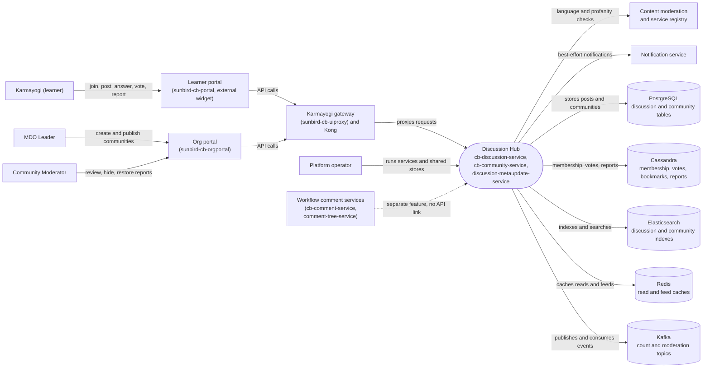

# Discussion Hub — Context Diagram

## System boundary

Inside the feature are `cb-discussion-service` (Questions, Answer Posts and Replies, plus
the asynchronous language and profanity checks), `cb-community-service` (communities, topics
and membership) and `discussion-metaupdate-service` (the Kafka worker that keeps community
counters in sync). Outside it are the learner and org-admin portals, the gateway in front of
the services, the external moderation and notification services, the separate workflow-comment
services, and the shared Postgres, Cassandra, Elasticsearch, Redis and Kafka stores.

## Diagram

## Elements

| Element | Role | Detailed in |
|---|---|---|
| Discussion Hub (`cb-discussion-service`, `cb-community-service`, `discussion-metaupdate-service`) | Central system: community-scoped Q&A, answer threads, moderation pipeline, counter sync | [hld.md](hld.md) |
| Karmayogi (learner) | Joins communities, posts, answers, votes, bookmarks and reports | [use-cases.md](use-cases.md) |
| MDO Leader | Creates, edits, publishes and deletes communities; moderates | [use-cases.md](use-cases.md) |
| Community Moderator | Reviews, hides and restores reported content in their community | [index.md](index.md) |
| Platform operator | Runs the services and the shared datastores | [index.md](index.md) |
| Learner portal | Hosts the discussion route; the UI itself is an unvendored external widget | [index.md](index.md) |
| Org portal | Community create/publish and moderation queue screens | [use-cases.md](use-cases.md) |
| Karmayogi gateway and Kong | Pass-through proxy for the live route family | [hld.md](hld.md) |
| Content moderation and service registry | External language and profanity verdicts | [hld.md](hld.md) |
| Notification service | Receives best-effort author notifications | [hld.md](hld.md) |
| Workflow comment services | Separate comment feature for content review; shares only a table between its own two services | [hld.md](hld.md) |
| PostgreSQL | Discussion, reply and community records | [hld.md](hld.md) |
| Cassandra | Community membership, votes, bookmarks and reports | [hld.md](hld.md) |
| Elasticsearch | Read and search path for discussions and communities | [hld.md](hld.md) |
| Redis | Read and feed caches | [hld.md](hld.md) |
| Kafka | Count-update and moderation topics | [hld.md](hld.md) |

> **Verification boundary:** elements and interactions come from the feature's own pages
> (index, HLD, and the opening sections of use cases and APIs). Spot-checked read-only in source: the Kafka listener in
> `discussion-metaupdate-service` and the discussion routes in `sunbird-cb-uiproxy`. The
> dashed link to the workflow comment services reflects the documented absence of any API
> or Kafka connection. The learner widget's own calls, and the content-moderation, notification
> and registry services, were not inspected. Not re-verified: Cassandra and Redis usage
> details, and the LLD.
