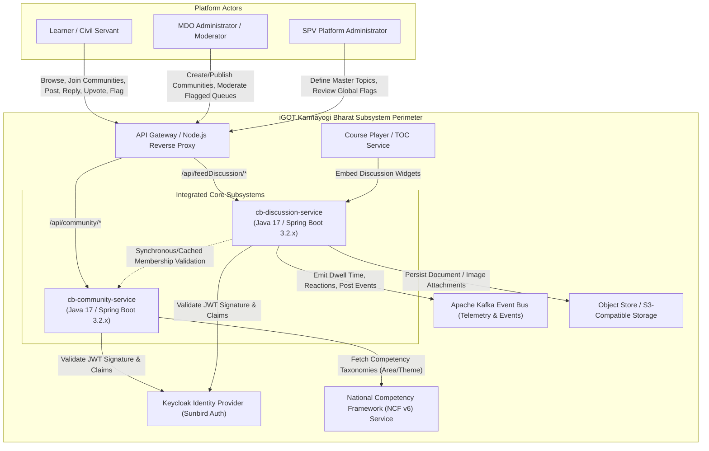
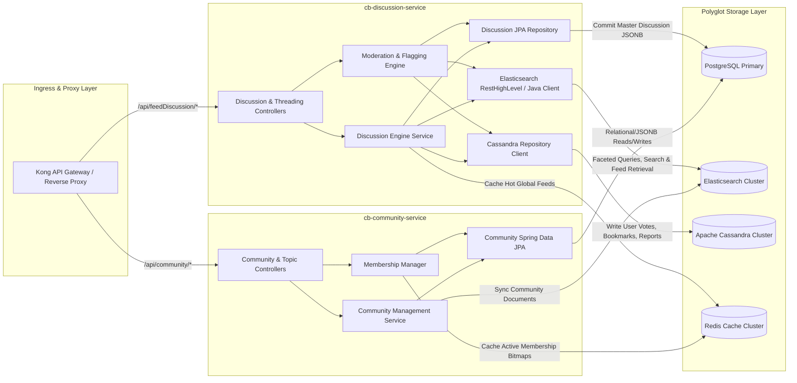
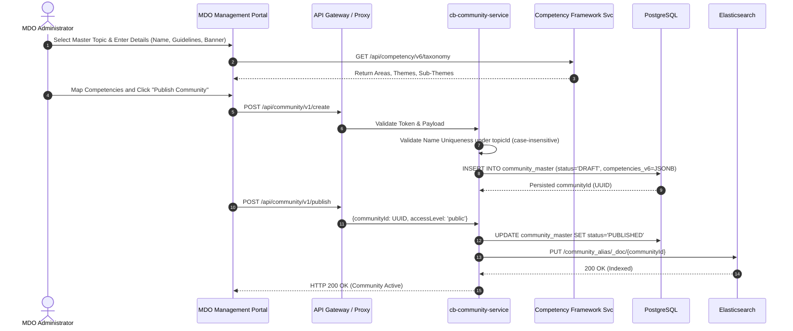
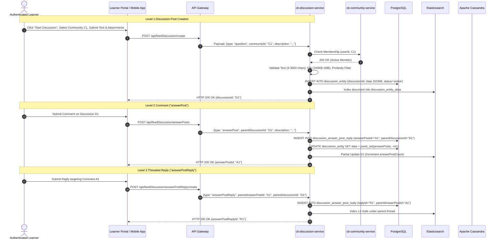
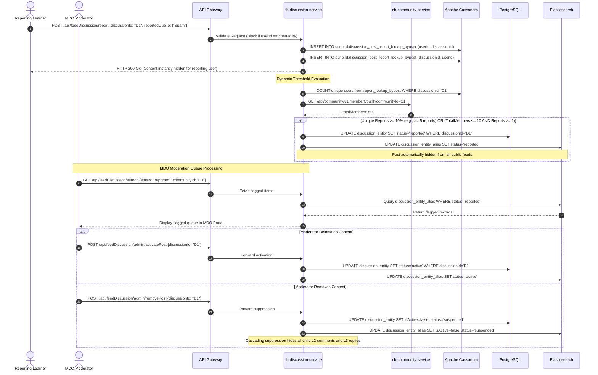
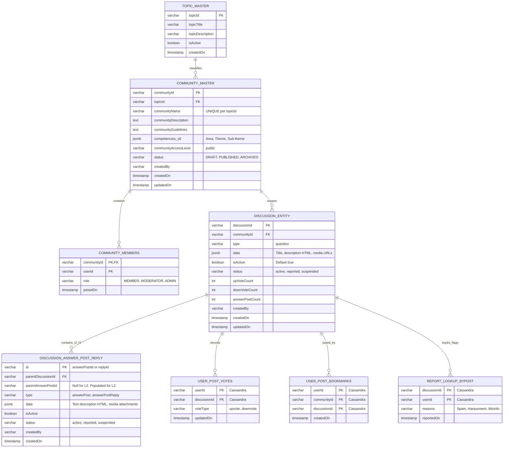

# Discussion Hub — High-Level Design (HLD)

**Discuss Hub and Community Subsystems Integration**

## 1. Document Overview and System Context

### 1.1 Purpose and Architectural Objective

This High-Level Design (HLD) defines the multi-tier system topology, service decomposition, component interaction patterns, integration interfaces, persistence architecture, and security boundaries for the **Discuss Hub** (`cb-discussion-service`) and **Community** (`cb-community-service`) subsystems.

The primary architectural objective is to establish a **federated, horizontally scalable, multi-tenant social learning ecosystem** that replaces the legacy NodeBB forum architecture (decommissioned in Q7). The design decouples organizational governance (Communities created by MDOs under SPV Topics) from high-concurrency social interactions (3-level threaded discussions, reactions, bookmarks, and automated multi-tier abuse moderation).

### 1.2 Upstream Specification Traceability

This HLD directly operationalizes the following approved baselines:

- **SRS Baseline**: SRS v2.4.0 (`FR-COMM-01` through `FR-COMM-05`, `FR-DISC-01` through `FR-DISC-05`, `FR-THRD-01` through `FR-THRD-03`, `FR-SOC-01` through `FR-SOC-04`, `FR-MOD-01` through `FR-MOD-06`, `FR-TEL-01` through `FR-TEL-02`).
- **Governing Epics**: [KB-7533: Q7 | Discuss Hub](https://karmayogibharat.atlassian.net/browse/KB-7533) (Open) (Q7 Overhaul), [KB-7534: Q7 | Discuss Hub | Backend and API implementation](https://karmayogibharat.atlassian.net/browse/KB-7534) (Open) (Backend APIs), [KB-7909: Q7 | Discuss Hub | Community Creation on MDO Portal](https://karmayogibharat.atlassian.net/browse/KB-7909) (KB Approved) (MDO Community Creation), [KB-7947: Q7 | Discuss Hub | Discuss Hub Consumption on Learner portal](https://karmayogibharat.atlassian.net/browse/KB-7947) (Prod Deployed) (Learner Portal Consumption), [KB-9261: Q8 | Discuss Hub | User tagging and three level replying](https://karmayogibharat.atlassian.net/browse/KB-9261) (KB Approved) (3-Level Replying), [KB-10497: Q9 | Discuss Hub](https://karmayogibharat.atlassian.net/browse/KB-10497) (KB Review) (Comment Flagging).
- **Technical Specifications**: [KB-7533 - Q7 | Discussion Hub](https://karmayogibharat.atlassian.net/wiki/spaces/TES/pages/246055034/KB-7533+-+Q7+Discussion+Hub) and [cb-discussion-service](https://karmayogibharat.atlassian.net/wiki/spaces/TES/pages/387350530/cb-discussion-service).

## 2. Global Architecture and System Context

### 2.1 System Context Diagram (Level 1)

Discuss Hub and Community subsystems operate within the perimeter of the iGOT Karmayogi Bharat platform, exposing authenticated REST interfaces to client portals and consuming platform identity, taxonomy, and analytics pipelines.

## 3. Subsystem Decomposition and Internal Architecture

### 3.1 Service Responsibilities and Decoupling

To satisfy **CON-01** (Statelessness) and **CON-03** (Strict Relational Scoping):

1. `cb-community-service`:
  - Master custodian of Topic definitions (`topic_master`) and Community entities (`community_master`).
  - Governs Community lifecycles: `DRAFT` `PUBLISHED` `ARCHIVED`.
  - Enforces National Competency Framework (NCF v6) binding.
  - Manages User Membership Rosters (Join/Unjoin operations).

2. `cb-discussion-service`:
  - Master custodian of discussion nodes across the 3-level tree:
    - **Level 1** (`question`): PostgreSQL `discussion_entity`.
    - **Level 2** (`answerPost`): PostgreSQL `discussion_answer_post_reply`.
    - **Level 3** (`answerPostReply`): PostgreSQL `discussion_answer_post_reply`.

  - Handles user interactions: upvotes, downvotes, cross-community bookmarks.
  - Manages decentralized moderation: abuse reporting, dynamic community percentage threshold evaluation, and MDO moderation actions (`activatePost`, `removePost`).
  - Intercepts dwell-time metrics and streams telemetry payloads to Apache Kafka.

### 3.2 Component Interaction Architecture (Level 2)

The internal layering separates presentation routing, business orchestration, and polyglot persistence:

## 4. End-to-End Sequence Workflows

### 4.1 Community Creation and Publishing Workflow (MDO Portal)

MDO Administrators create and publish communities mapped to NCF v6 taxonomies under SPV Master Topics.

### 4.2 Cross-Community Discussion and 3-Level Threading Workflow

Demonstrates the creation of a Level 1 post (`question`), an L2 comment (`answerPost`), and an L3 reply (`answerPostReply`).

### 4.3 Abuse Reporting, Auto-Suppression, and Moderation Workflow

Demonstrates the multi-tier moderation cascade from user flagging to dynamic threshold suppression and MDO moderation.

## 5. Persistence Architecture and Data Models

### 5.1 Polyglot Storage Strategy

The platform utilizes specialized persistence engines to support diverse access patterns:

- **PostgreSQL 15 (System of Record)**: Enforces ACID compliance, transactional integrity, foreign key relations, and flexible schema extensions via JSONB for nested discussions.
- **Elasticsearch 8.11 (Search & Facet Index)**: Powers sub-second keyword search, multi-community Global Feeds, and MDO moderation queues.
- **Apache Cassandra 4.1 (High-Throughput Interactions)**: Handles write-heavy, non-relational operations with zero lock contention (upvotes, downvotes, user bookmarks, and abuse flag audit trails).
- **Redis Cluster 7.x (In-Memory Cache)**: Buffers hot global feeds and user community membership bitmaps to minimize inter-service latency.

### 5.2 Logical Data Schema and Entity Relationships

## 6. Access Control, Security, and Edge-Case Architecture

### 6.1 Authentication and Role-Based Authorization

1. **Bearer Token Validation**: Ingress proxies intercept incoming requests, validating the Keycloak JWT signature against the public certificate (`Sunbird Keycloak Realm`). The token payload exposes `userId` and platform roles (`PUBLIC`, `MDO_ADMIN`, `MDO_LEADER`).
2. **Community Membership Gating**:
  - For discussion authoring, L2 commenting, and L3 replying, `cb-discussion-service` verifies that the `userId` is an enrolled member of `communityId` by querying Redis cache key `comm:members:{communityId}:{userId}` with a database fallback.
  - Unauthenticated or non-member users receive an HTTP `403 Forbidden`.

3. **Course TOC Discussion Gating**:
  - When accessing discussions embedded in a Course Table of Contents (`/api/feedDiscussion/toc/*`), the service calls the Course Enrollment API.
  - If enrollment is verified, write capabilities are unlocked. Otherwise, the user is restricted to read-only access.

4. **MDO Moderation Access**:
  - Moderation operations (`/api/feedDiscussion/admin/*`) require the caller to possess `MDO_ADMIN`, `MDO_LEADER`, or explicitly assigned `MODERATOR` permissions within the target community.

### 6.2 Failure Handling and Circuit Breaking

- **Elasticsearch Degradation**: If Elasticsearch experiences downtime or ingestion lag, write transactions continue to execute synchronously against PostgreSQL. Feed queries fall back to direct PostgreSQL JSONB index queries with reduced pagination windows (capped at 10 items/page).
- **Cassandra Write Resilience**: Writes to `sunbird.user_post_votes` and `user_post_bookmarks` use Cassandra consistency level `LOCAL_QUORUM`. If Cassandra nodes become unavailable, votes are queued in Redis and drained via asynchronous recovery workers.
- **Malicious File Attachment Handling**: Media and document attachments uploaded during discussion creation are routed through validation logic enforcing file size bounds (150 KB to 1 MB) and MIME-type restrictions before storage URLs are generated.

## 7. Traceability: Requirements to High-Level Design

The following matrix confirms that all functional and non-functional requirements established in SRS v2.4.0 are fully realized in this architectural design:

| SRS Requirement ID | HLD Architectural Realization | Governing Components & Interfaces |
|---|---|---|
| **FR-COMM-01 / 02 / 03** | Enforced via `cb-community-service` controller validation and PostgreSQL unique constraints on `(topicId, lower(communityName))`. | `CommunityController`, `community_master`, `API-COMM-01` |
| **FR-COMM-04** | Serialized as structured JSONB in PostgreSQL and indexed in Elasticsearch under `competencies_v6` field. | `community_master.competencies_v6`, `API-COMM-01` |
| **FR-COMM-05** | Managed by `MembershipManager` writing membership states to PostgreSQL and caching active bits in Redis. | `community_members`, `API-COMM-03`, `API-COMM-04` |
| **FR-DISC-01 / 02** | Intercepted by `DiscussionValidator` checking Redis membership cache, string lengths (3-3000 chars), and profanity lists. | `DiscussionEngineService`, `API-DISC-01` |
| **FR-DISC-03** | Storage handler validating attachment types (PDF/Images) and file size bounds (150 KB - 1 MB). | `DiscussionEngineService`, Object Storage Gateway |
| **FR-DISC-04** | Ingestion pipeline profanity evaluation against configured dictionary lists before database commit. | `ProfanityFilterComponent`, `cb-discussion-service` |
| **FR-DISC-05** | Ownership verification comparing JWT `sub` claim with record `createdBy` attribute prior to update/soft-delete. | `discussion_entity`, `API-DISC-02`, `API-DISC-03` |
| **FR-THRD-01 / 02** | Relational mapping supporting L1 (`discussion_entity`), L2, and L3 (`discussion_answer_post_reply`) with depth ceiling logic. | `discussion_answer_post_reply`, `API-DISC-04`, `API-DISC-05` |
| **FR-THRD-03** | Regex token parser intercepting `@username` mentions and publishing notification events to Kafka. | Kafka Topic `notification.mentions` |
| **FR-SOC-01 / 02** | Cassandra tables `sunbird.user_post_votes` and `user_post_bookmarks` with aggregated denormalization in PostgreSQL/ES. | Cassandra Data Tier, `API-DISC-06`, `API-DISC-07` |
| **FR-SOC-03** | Elasticsearch query aggregating posts across joined community IDs extracted from caller context. | `discussion_entity_alias`, `API-DISC-09` |
| **FR-SOC-04** | Course enrollment verification interceptor gating write actions on TOC-embedded discussions. | Course Player Proxy Interceptor |
| **FR-MOD-01 / 02 / 03** | Cassandra abuse logging with immediate personal feed exclusion for the reporting user. | `discussion_post_report_lookup_*`, `API-DISC-08` |
| **FR-MOD-04 / 05 / 06** | Dynamic 10% threshold auto-suppression, cascading parent-child hides, and MDO moderation queue APIs. | `ModerationEngine`, `API-DISC-10`, `API-DISC-11` |
| **FR-TEL-01 / 02** | Client-side 3-second viewport dwell interceptor streaming structured telemetry envelopes to Kafka. | Kafka Topic `telemetry.raw`, `FR-TEL-01/02` |
| **NFR-PERF-01 / 02 / 03** | Redis caching for hot feeds, asynchronous Kafka emission, and optimized Elasticsearch indexes. | Multi-tier Caching & Async Processing |
| **NFR-SCAL-01 / 02** | Stateless pod design with Kubernetes HPA (4-32 pods) and partitioned storage layers. | GKE Deployment manifests |
| **NFR-SEC-01 / 02 / 03** | Keycloak JWT validation, OWASP HTML sanitization, and AES-256 at-rest encryption across PG/Cassandra/ES. | Security & Ingress Ingestion Gateways |
