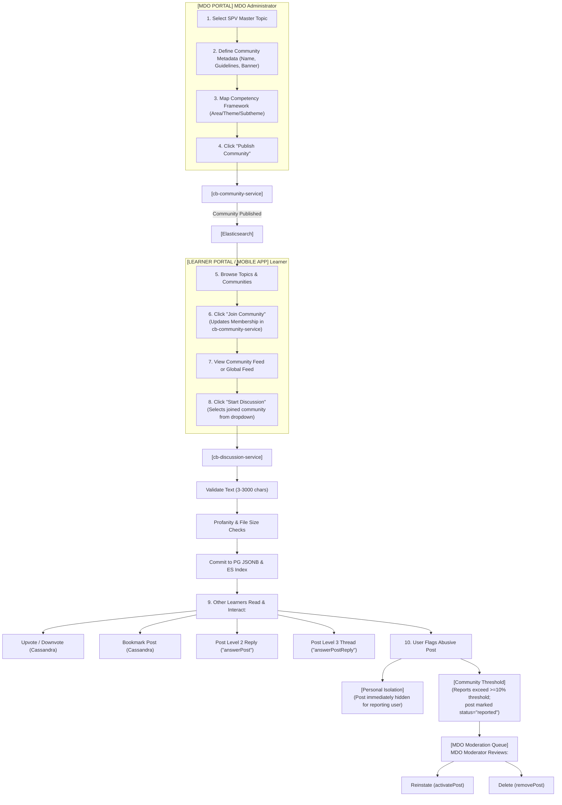
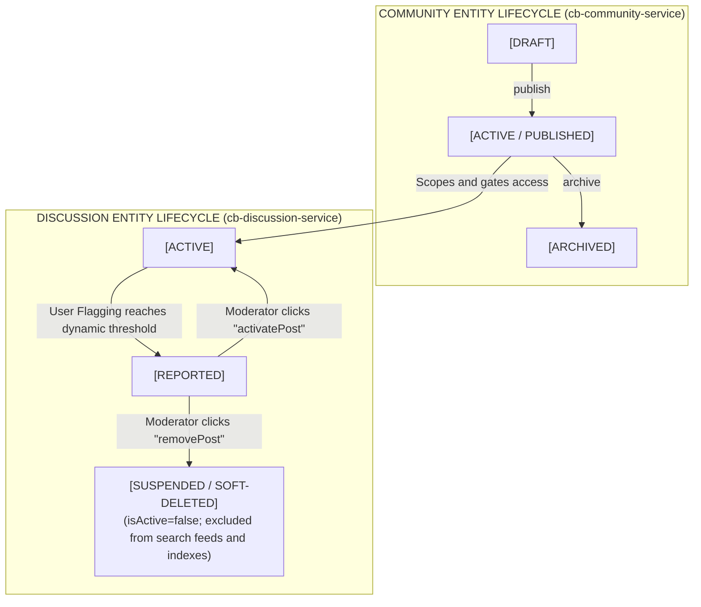
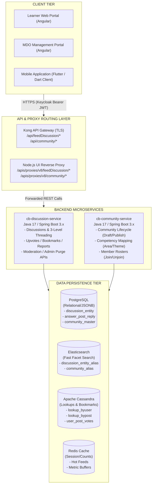
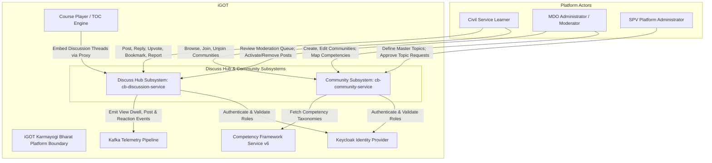
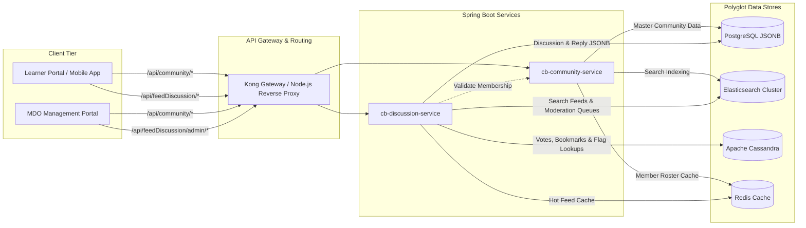
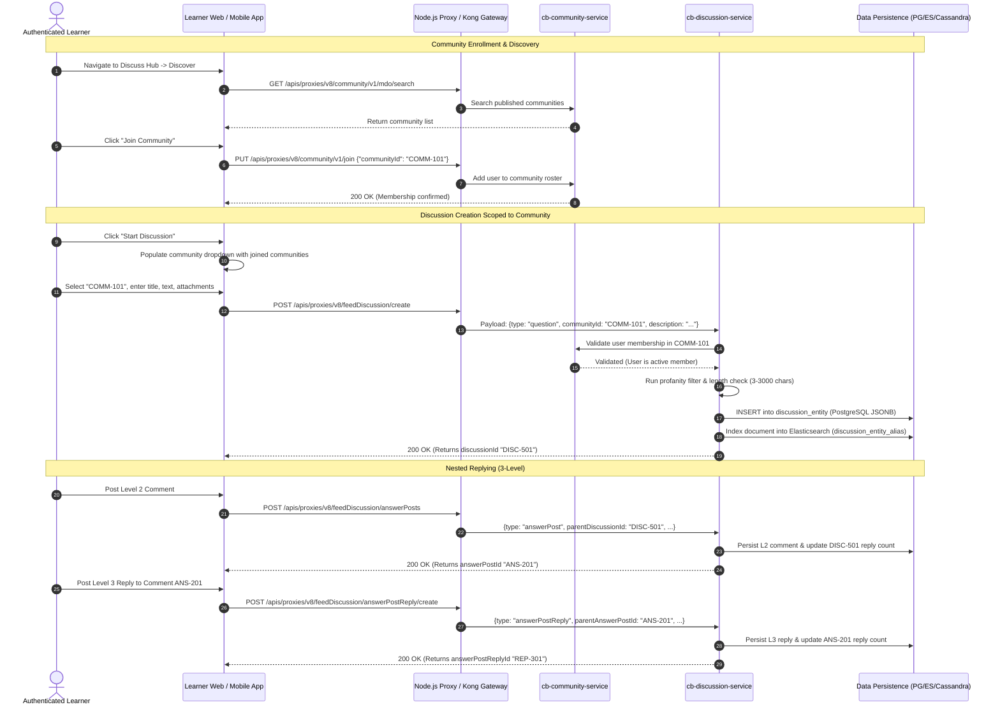
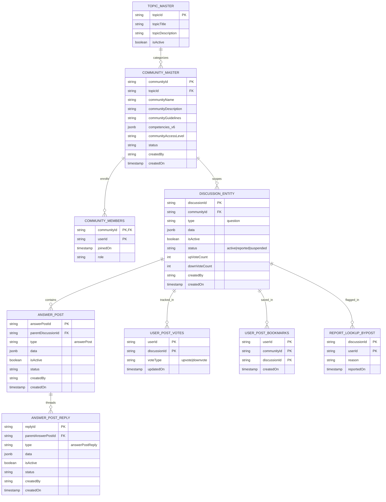
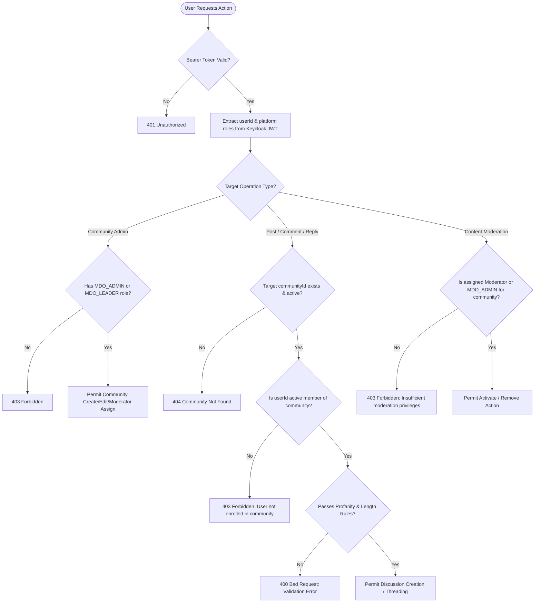

**Platform**: iGOT Karmayogi Bharat **Document Type**: Architectural & Functional Evolution Report / System Specification **Governing Subsystems**: Discuss Hub (`cb-discussion-service`) & Community Features (`cb-community-service`) **Assessment Date**: October 2026

## 1. Document Metadata and Source Coverage

### 1.1 Source Document Inventory

This analysis synthesizes official platform specifications, architectural documents, and Jira issue histories:

- **Business Requirements Documents (BRD)**:
  - [Q7 | BRD | Discuss Hub](https://karmayogibharat.atlassian.net/wiki/spaces/TPT/pages/294682875/Q7+BRD+Discuss+Hub) (Author: Shakti Babbar, April 2025)

- **Functional Requirements Specifications (FRS)**:
  - [Q7 | FRS | Discuss Hub](https://karmayogibharat.atlassian.net/wiki/spaces/TPT/pages/295993468/Q7+FRS+Discuss+Hub) (Author: Shakti Babbar, April 2025)

- **Software Requirements Specifications (SRS)**:
  - [SRS - Discussion hub v2](https://karmayogibharat.atlassian.net/wiki/spaces/TES/pages/342360352/SRS+-+Discussion+hub+v2) (Authors: Christopher B Fernandes, Akshay Kumar, April 2025)
  - [SRS - MDO Portal - Discussion hub v2](https://karmayogibharat.atlassian.net/wiki/spaces/TES/pages/367624194/SRS+-+MDO+Portal+-+Discussion+hub+v2) (Author: Christopher B Fernandes, April 2025)

- **Architecture, Technical Design, and Deployment Specifications**:
  - [KB-7533 - Q7 | Discussion Hub](https://karmayogibharat.atlassian.net/wiki/spaces/TES/pages/246055034/KB-7533+-+Q7+Discussion+Hub) (Technical Design, Schema & APIs; Author: Sureshkannan, April 2025)
  - [cb-discussion-service](https://karmayogibharat.atlassian.net/wiki/spaces/TES/pages/387350530/cb-discussion-service) (Author: Shankaragouda, June 2025)
  - [deployment guide for discussion-service](https://karmayogibharat.atlassian.net/wiki/spaces/TES/pages/249397252/deployment+guide+for+discussion-service)
  - [Data Migration for the cb-discussion service](https://karmayogibharat.atlassian.net/wiki/spaces/TES/pages/459046960/Data+Migration+for+the+cb-discussion+service)

- **QA Test Plans & Release Sign-Offs**:
  - [Sprint 18 Sign off - Discuss Hub Revamping Discuss Hub | Phase 0](https://karmayogibharat.atlassian.net/wiki/spaces/KQAS/pages/196608005/Sprint+18+Sign+off+-+Discuss+Hub+Revamping+Discuss+Hub+Phase+0)
  - [Sprint 22 Sign off - Discuss Hub | Discuss Hub Consumption on Learner portal](https://karmayogibharat.atlassian.net/wiki/spaces/KQAS/pages/326434818/Sprint+22+Sign+off+-+Discuss+Hub+Discuss+Hub+Consumption+on+Learner+portal)
  - [Sprint 23 Sign off - Discuss Hub Consumption on Learner portal](https://karmayogibharat.atlassian.net/wiki/spaces/KQAS/pages/360218625/Sprint+23+Sign+off+-+Discuss+Hub+Consumption+on+Learner+portal)
  - [Sprint 25 Sign off - Three level reply on Discuss Hub](https://karmayogibharat.atlassian.net/wiki/spaces/KQAS/pages/380829698/Sprint+25+Sign+off+-+Three+level+reply+on+Discuss+Hub)
  - [Sprint 26 Sign off - Discuss Hub | Community Management on MDO Portal](https://karmayogibharat.atlassian.net/wiki/spaces/KQAS/pages/417955841/Sprint+26+Sign+off+-+Discuss+Hub+Community+Management+on+MDO+Portal)

### 1.2 Jira Issue Ingestion Coverage

The complete supplied set of **55 Jira tickets** has been ingested, verified against Jira database records, and mapped to its respective subsystem:

| Classification | Count | Jira Keys |
|---|---|---|
| **Portfolio Initiatives** | 3 | [KB-6280: Q5 \| Discuss Hub \| Revamping discuss hub](https://karmayogibharat.atlassian.net/browse/KB-6280) (Open), [KB-7533: Q7 \| Discuss Hub](https://karmayogibharat.atlassian.net/browse/KB-7533) (Open), [KB-9241: Q8 \| Discuss Hub](https://karmayogibharat.atlassian.net/browse/KB-9241) (Open) |
| **Epics** | 9 | [KB-627: Q2 \| Activating 6 Hubs \| Activating Discussion Hub](https://karmayogibharat.atlassian.net/browse/KB-627) (Prod Deployed), [KB-6439: Q5 \| Discuss Hub Revamping Discuss Hub \| Phase 0](https://karmayogibharat.atlassian.net/browse/KB-6439) (Open), [KB-7534: Q7 \| Discuss Hub \| Backend and API implementation](https://karmayogibharat.atlassian.net/browse/KB-7534) (Open), [KB-7909: Q7 \| Discuss Hub \| Community Creation on MDO Portal](https://karmayogibharat.atlassian.net/browse/KB-7909) (KB Approved), [KB-7941: Q8 \| Discuss Hub \| Community Management on MDO Portal](https://karmayogibharat.atlassian.net/browse/KB-7941) (KB Approved), [KB-7947: Q7 \| Discuss Hub \| Discuss Hub Consumption on Learner portal](https://karmayogibharat.atlassian.net/browse/KB-7947) (Prod Deployed), [KB-9261: Q8 \| Discuss Hub \| User tagging and three level replying](https://karmayogibharat.atlassian.net/browse/KB-9261) (KB Approved), [KB-10497: Q9 \| Discuss Hub](https://karmayogibharat.atlassian.net/browse/KB-10497) (KB Review) (plus parent portfolio links [KB-276: Activating 6 Hubs \| Discussion Hub \| Users shall be able to have appropriate discussions with each other.](https://karmayogibharat.atlassian.net/browse/KB-276) (Open)) |
| **User Stories & Enhancements** | 43 | [KB-366: Q2 \| User Experience \| Discuss Hub > Updates on my posts](https://karmayogibharat.atlassian.net/browse/KB-366) (Prod Deployed), [KB-367: Q2 \| User Experience \| Discuss Hub >Trending discussions](https://karmayogibharat.atlassian.net/browse/KB-367) (Prod Deployed), [KB-655: Q2 \| Activating Discussion Hub](https://karmayogibharat.atlassian.net/browse/KB-655) (Prod Deployed), [KB-6444: Q5 \| Discuss Hub\| Revamping Discuss Hub \| Phase 0 \| Removing Tags](https://karmayogibharat.atlassian.net/browse/KB-6444) (Prod Deployed), [KB-6457: Q5 \| Discuss Hub\| Revamping Discuss Hub \| Phase 0 \| Removing Recent and Popular Tabs](https://karmayogibharat.atlassian.net/browse/KB-6457) (Prod Deployed), [KB-6458: Q5 \| Discuss Hub\| Revamping Discuss Hub \| Phase 0 \| Page loading to be brought in](https://karmayogibharat.atlassian.net/browse/KB-6458) (Prod Deployed), [KB-6459: Q5 \| Discuss Hub\| Revamping Discuss Hub \| Phase 0 \| Ui card enhancement for "Start Discussion" card](https://karmayogibharat.atlassian.net/browse/KB-6459) (QA In Progress), [KB-6460: Q5 \| Discuss Hub\| Revamping Discuss Hub \| Phase 0 \| UI enhancement for the post card](https://karmayogibharat.atlassian.net/browse/KB-6460) (Prod Deployed), [KB-6851: Q5 \| Discuss Hub \| Revamping Discuss Hub \| Phase 0 \| Editing and Deleting of a Post](https://karmayogibharat.atlassian.net/browse/KB-6851) (Prod Deployed), [KB-6860: Q5 \| Discuss Hub \| Enhancement of My Discussion profile page](https://karmayogibharat.atlassian.net/browse/KB-6860) (Prod Deployed), [KB-6907: Q5 \| Discuss Hub \| Revamping Discuss Hub \| Phase 0](https://karmayogibharat.atlassian.net/browse/KB-6907) (Open), [KB-7131: Q6 \| Discuss Hub \| TOC Page comments section](https://karmayogibharat.atlassian.net/browse/KB-7131) (Prod Deployed), [KB-7132: Q6 \| Discuss Hub \| TOC Page comments section - Post & Like](https://karmayogibharat.atlassian.net/browse/KB-7132) (Prod Deployed), [KB-7268: Q6 \| Discuss Hub \| TOC Page Comments Section \| User should be able to tag authors and content creators](https://karmayogibharat.atlassian.net/browse/KB-7268) (Open), [KB-7269: Q6 \| Discuss Hub \| TOC Page Comments Section \| User should be able to view the comments on all the TOC pages](https://karmayogibharat.atlassian.net/browse/KB-7269) (Open), [KB-7538: Q7 \| Discuss Hub \| Backend and API implementation](https://karmayogibharat.atlassian.net/browse/KB-7538) (Open), [KB-7930: Q7\| Discuss Hub \| Community Creation by MDO](https://karmayogibharat.atlassian.net/browse/KB-7930) (Prod Deployed), [KB-7937: Q7 \| Discuss Hub \| Community Guidelines](https://karmayogibharat.atlassian.net/browse/KB-7937) (Prod Deployed), [KB-7938: Q7 \| Discuss Hub \| Enable entry form for the private communities](https://karmayogibharat.atlassian.net/browse/KB-7938) (Open), [KB-7940: Q7 \| Discuss Hub \| Request a new topic](https://karmayogibharat.atlassian.net/browse/KB-7940) (Open), [KB-7944: Q7 \| Discuss Hub \| Community Management \| Approval or rejection of user request](https://karmayogibharat.atlassian.net/browse/KB-7944) (Not Required), [KB-7945: Q7 \| Discuss Hub \| Community Management \| Edit or delete existing community details](https://karmayogibharat.atlassian.net/browse/KB-7945) (Prod Deployed), [KB-7946: Q7 \| Discuss Hub \| Community Management \| Managing flagged content](https://karmayogibharat.atlassian.net/browse/KB-7946) (Prod Deployed), [KB-8004: Q7 \| Discuss Hub \| Discuss Hub Consumption on Learner portal \| View and Navigate Communities](https://karmayogibharat.atlassian.net/browse/KB-8004) (Prod Deployed), [KB-8005: Q7 \| Discuss Hub \| Discuss Hub Consumption on Learner portal \| Joining a community](https://karmayogibharat.atlassian.net/browse/KB-8005) (Prod Deployed), [KB-8006: Q7 \| Discuss Hub \| Discuss](https://karmayogibharat.atlassian.net/browse/KB-8006)[Hub Consumption on Learner portal \| Learner Metrics](https://karmayogibharat.atlassian.net/browse/KB-8006) (Open), [KB-8007: Q7 \| Discuss Hub \| Discuss Hub Consumption on Learner portal \| Reporting or flagging](https://karmayogibharat.atlassian.net/browse/KB-8007) (Prod Deployed), [KB-8008: Q7 \| Discuss Hub \| Discuss Hub Consumption on Learner portal \| View Community Details](https://karmayogibharat.atlassian.net/browse/KB-8008) (Prod Deployed), [KB-8009: Q7 \| Discuss Hub \| Discuss Hub Consumption on Learner portal \| Leave or share a Community](https://karmayogibharat.atlassian.net/browse/KB-8009) (Prod Deployed), [KB-8010: Q7 \| Discuss Hub \| Discuss Hub Consumption on Learner portal \| Save Posts Across Communities](https://karmayogibharat.atlassian.net/browse/KB-8010) (Open), [KB-8011: Q7 \| Discuss Hub \| Discuss Hub Consumption on Learner portal \| Create a Post](https://karmayogibharat.atlassian.net/browse/KB-8011) (Prod Deployed), [KB-8486: Q7 \| Discuss Hub \| Discuss Hub Consumption on Learner Portal \| Telemetry Data to be tracked](https://karmayogibharat.atlassian.net/browse/KB-8486) (Open), [KB-8487: Q7 \| Discuss Hub \| Discuss Hub Consumption on Learner Portal \| Search and Discovery](https://karmayogibharat.atlassian.net/browse/KB-8487) (Open), [KB-8488: Q7 \| Discuss Hub \| Discuss Hub Consumption on Learner Portal \| Parameters for Popular Communities and Trending Discussions](https://karmayogibharat.atlassian.net/browse/KB-8488) (Prod Deployed), [KB-8491: Q7 \| Discuss Hub \| Discuss Hub Consumption on Learner Portal \| Coach Marking on discuss Hub](https://karmayogibharat.atlassian.net/browse/KB-8491) (Open), [KB-8787: Q7 \| Discuss Hub \| Community Management \| Reporting Mechanism](https://karmayogibharat.atlassian.net/browse/KB-8787) (Prod Deployed), [KB-8790: Q7 \| Discuss Hub \| Competency Mapping with communities](https://karmayogibharat.atlassian.net/browse/KB-8790) (Prod Deployed), [KB-8917: Q7 \| Discuss Hub Add on \| Global Feed & Posting](https://karmayogibharat.atlassian.net/browse/KB-8917) (Prod Deployed), [KB-8918: Q7 \| Discuss Hub Add on \| Community Page View](https://karmayogibharat.atlassian.net/browse/KB-8918) (Prod Deployed), [KB-9044: Q7 \| Discuss Hub \| Discuss Hub ticker on the Navigation](https://karmayogibharat.atlassian.net/browse/KB-9044) (Prod Deployed), [KB-9343: Q8\| Discuss Hub \| Three level reply on Discuss Hub](https://karmayogibharat.atlassian.net/browse/KB-9343) (Prod Deployed), [KB-9783: Q8 \| Tech Debt \| Discussion Hub Service Java & Spring Version Upgrade](https://karmayogibharat.atlassian.net/browse/KB-9783) (DEV IN PROGRESS), [KB-10589: Q9 \| Discuss Hub \| Comment Flagging](https://karmayogibharat.atlassian.net/browse/KB-10589) (Prod Deployed) |

## 2. Executive Summary

On the iGOT Karmayogi platform, **Discuss Hub** and **Community** are not two disconnected or competing features. Rather, they represent two tightly integrated layers of a unified social learning and knowledge-exchange subsystem:

1. **Community as the Organizational & Governance Boundary**: Managed primarily via the **MDO Portal**, the Community feature (`cb-community-service`) provides the institutional framework. Communities are official, competency-mapped spaces created by Ministry, Department, and Organisation (MDO) Leaders under broad Special Purpose Vehicle (SPV)-approved Topics.
2. **Discuss Hub as the Interaction & Threading Engine**: Operating primarily across the **Learner Portal** and Mobile App, Discuss Hub (`cb-discussion-service`) provides the conversational engine. It delivers rich-text discussion posting, a strict 3-level conversation tree (`question` → `answerPost` → `answerPostReply`), peer upvoting, cross-community bookmarking, and multi-tier moderation.

### Core Findings on Their Relationship

- **VERIFIED ARCHITECTURAL DEPENDENCY**: In the modern production architecture (Discuss Hub v2, released in Q7 and enhanced through Q9), **all discussions require an explicit** `communityId`. There is no standalone, unattached discussion stream. Every post belongs to a community, and access is gated by community membership (`cb-community-service/api/community/v1/join`).
- **Microservice Separation of Concerns**: Discuss Hub and Community operate as two decoupled Spring Boot microservices backed by polyglot persistence:
  - `cb-community-service` owns community metadata, guidelines, banner assets, competency tagging, and membership rosters.
  - `cb-discussion-service` owns post payloads, nested replies, upvote counters, user bookmarks, and abuse flagging state.

- **Evolutionary Trajectory**: This unified model did not exist prior to Q7. In Q2–Q5, Discuss Hub was a flat, uncurated discussion forum hosted on an open-source **NodeBB** instance. The complete replatforming in Q7 phased out NodeBB, replacing it with the federated, community-scoped microservice architecture in production today.

## 3. Discuss Hub Overview

### 3.1 Purpose & Target Users

Discuss Hub facilitates asynchronous, peer-to-peer civil service collaboration. It enables government officials to post technical questions, debate policy nuances, share administrative practices, and review course material with verified colleagues across Indian ministries.

### 3.2 Core Capabilities

- **Hierarchical Discussion Threading**: Supports a 3-level nested conversation hierarchy:
  - **Level 1** (`question`): Root discussion post with title, rich text, external links, and optional document/media attachments.
  - **Level 2** (`answerPost`): First-order direct response or comment to the root post.
  - **Level 3** (`answerPostReply`): Nested reply targeted at a specific Level 2 response, allowing direct peer dialogue.

- **Social Reactions & Cross-Community Bookmarking**: Users upvote or downvote contributions; learners can bookmark posts across multiple communities, aggregated under their profile.
- **Course Contextualization (TOC Comments)**: Course-level discussions embedded directly into the Course Table of Contents (TOC) page, allowing enrollees to tag course authors and discuss specific modules ([KB-7131: Q6 | Discuss Hub | TOC Page comments section](https://karmayogibharat.atlassian.net/browse/KB-7131) (Prod Deployed), [KB-7269: Q6 | Discuss Hub | TOC Page Comments Section | User should be able to view the comments on all the TOC pages](https://karmayogibharat.atlassian.net/browse/KB-7269) (Open)).
- **Telemetry & Dwell-Time Tracking**: Discuss Hub emits real-time telemetry into Kafka, enforcing a minimum 3-second continuous viewport dwell threshold before logging a post `view` event.

## 4. Community Overview

### 4.1 Purpose & Governance Model

Community features decentralize platform governance. Rather than relying on a central platform administrator to manage every forum, MDO Leaders and Administrators instantiate, curate, and govern dedicated departmental and cross-ministerial communities.

### 4.2 Lifecycle & Administrative Capabilities

- **SPV Topic Binding**: Communities cannot exist in isolation; they must be created under an SPV-curated **Master Topic** (e.g., Governance, Digital Transformation, Public Finance). MDOs can submit requests for new topics via an integrated request form ([KB-7940: Q7 | Discuss Hub | Request a new topic](https://karmayogibharat.atlassian.net/browse/KB-7940) (Open)).
- **Competency Framework Alignment**: Every community is mapped directly to the National Competency Framework v6, linking discussions to specific Competency Areas, Themes, and Sub-themes ([KB-8790: Q7 | Discuss Hub | Competency Mapping with communities](https://karmayogibharat.atlassian.net/browse/KB-8790) (Prod Deployed)).
- **Community Lifecycle Management**:
  - **Draft**: MDO Leader defines community name (≤50 chars), description (≤1000 chars), banner image, and guidelines (≤5000 chars).
  - **Publish**: Community is made discoverable to learners across the portal.
  - **Edit / Metadata Updates**: Guidelines and metadata can be updated dynamically ([KB-7945: Q7 | Discuss Hub | Community Management | Edit or delete existing community details](https://karmayogibharat.atlassian.net/browse/KB-7945) (Prod Deployed)).
  - **Moderator Assignment**: MDO Leaders designate specific civil servants as Community Moderators to manage flagged discussions.

## 5. Relationship Between Discuss Hub and Community

### 5.1 Verified Relationship Matrix

The architectural and functional boundaries between Discuss Hub and Community are mapped below:

| Dimension / Interaction | Discuss Hub Responsibility (`cb-discussion-service`) | Community Responsibility (`cb-community-service`) | Interaction / Dependency Mechanism | Implementation Status | Evidence Base |
|---|---|---|---|---|---|
| **Organizational Context** | Consumes `communityId` on every discussion, comment, and reply. | Generates and manages `communityId`, Topic associations, and metadata. | Direct foreign-key reference in PostgreSQL JSONB and Elasticsearch index. | **VERIFIED IMPLEMENTATION** | [KB-7533 - Q7 \| Discussion Hub](https://karmayogibharat.atlassian.net/wiki/spaces/TES/pages/246055034/KB-7533+-+Q7+Discussion+Hub), Q7 FRS Section 3 |
| **Membership & Access Gating** | Validates that `userId` has joined `communityId` before accepting posts or comments. | Owns the user-community membership roster; exposes join/unjoin APIs. | Synchronous REST validation / Redis cache lookup during post creation. | **VERIFIED IMPLEMENTATION** | [cb-discussion-service](https://karmayogibharat.atlassian.net/wiki/spaces/TES/pages/387350530/cb-discussion-service) |
| **Aggregated Discovery (Global Feed)** | Aggregates discussion feeds matching all communities a user has joined. | Provides the array of joined `communityId`s for the authenticated user token. | Frontend orchestrates user membership list to query `cb-discussion-service/api/feedDiscussion/globalFeed`. | **VERIFIED IMPLEMENTATION** | [KB-8917: Q7 \| Discuss Hub Add on \| Global Feed & Posting](https://karmayogibharat.atlassian.net/browse/KB-8917) (Prod Deployed), SRS v2 Section 5.2 |
| **Cross-Posting Composer** | Accepts discussion creation payload with an explicit `communityId` dropdown. | Supplies the list of active joined communities to populate the dropdown. | Frontend invokes `cb-community-service` search, passes selected ID to discussion API. | **VERIFIED IMPLEMENTATION** | [KB-8917: Q7 \| Discuss Hub Add on \| Global Feed & Posting](https://karmayogibharat.atlassian.net/browse/KB-8917) (Prod Deployed); Q7 FRS `DIS_HUB_BR3` |
| **Content Moderation Queue** | Records abuse reports; tracks threshold; sets `status="reported"`. | Provides MDO Portal moderation dashboard (Pending/Hidden tabs). | MDO Portal queries `cb-discussion-service` moderation APIs filtered by MDO community IDs. | **VERIFIED IMPLEMENTATION** | [KB-7946: Q7 \| Discuss Hub \| Community Management \| Managing flagged content](https://karmayogibharat.atlassian.net/browse/KB-7946) (Prod Deployed), [KB-8787: Q7 \| Discuss Hub \| Community Management \| Reporting Mechanism](https://karmayogibharat.atlassian.net/browse/KB-8787) (Prod Deployed) |
| **Private Community Entry Questionnaires** | None (discussion service is membership-agnostic once joined). | Intended to present a custom entry questionnaire for private community joining. | Gated approval workflow in MDO Portal prior to issuing membership. | **UNIMPLEMENTED / CANCELLED** | [KB-7938: Q7 \| Discuss Hub \| Enable entry form for the private communities](https://karmayogibharat.atlassian.net/browse/KB-7938) (Open) (Open); [KB-7944: Q7 \| Discuss Hub \| Community Management \| Approval or rejection of user request](https://karmayogibharat.atlassian.net/browse/KB-7944) (Not Required) (Closed as "Not Required") |

## 6. Actors, Roles, and Permissions

The platform enforces Role-Based Access Control (RBAC) via Keycloak JWT assertions (`x-authenticated-user-token`):

| Platform Role | Feature Area | Permitted Actions | Restrictions & Boundaries | Governing Specifications | Current Status |
|---|---|---|---|---|---|
| **Unauthenticated User** | Discuss Hub & Community | None. | Strictly blocked from viewing, posting, or joining. Anonymous access is out of scope. | Q7 BRD Section 4.2 | **VERIFIED ENFORCED** |
| **Learner** (`PUBLIC`) | Community | Discover topics and communities; view guidelines; join and unjoin public communities. | Cannot create communities or edit community guidelines. | Q7 FRS `DIS_HUB_BR1` | **VERIFIED IMPLEMENTED** |
| **Learner** (`PUBLIC`) | Discuss Hub | Create Level 1 posts (`question`); post Level 2 comments; post Level 3 replies; upvote; bookmark; flag content. | Can only post within joined communities; cannot edit/delete other users' posts; cannot exceed 3 levels. | [KB-8011: Q7 \| Discuss Hub \| Discuss Hub Consumption on Learner portal \| Create a Post](https://karmayogibharat.atlassian.net/browse/KB-8011) (Prod Deployed), [KB-9343: Q8\| Discuss Hub \| Three level reply on Discuss Hub](https://karmayogibharat.atlassian.net/browse/KB-9343) (Prod Deployed) | **VERIFIED IMPLEMENTED** |
| **Course Enrollee** | TOC Discussions | Read, post, reply, and like within Course Table of Contents comment threads. | Non-enrolled users are restricted to read-only access. | [KB-7269: Q6 \| Discuss Hub \| TOC Page Comments Section \| User should be able to view the comments on all the TOC pages](https://karmayogibharat.atlassian.net/browse/KB-7269) (Open) | **VERIFIED IMPLEMENTED** |
| **MDO Leader / Admin** | Community | Create communities (Draft/Publish); edit community metadata; assign moderators; map competencies. | Cannot modify master Topics; cannot delete communities with active members without archival. | [KB-7930: Q7\| Discuss Hub \| Community Creation by MDO](https://karmayogibharat.atlassian.net/browse/KB-7930) (Prod Deployed), [KB-7945: Q7 \| Discuss Hub \| Community Management \| Edit or delete existing community details](https://karmayogibharat.atlassian.net/browse/KB-7945) (Prod Deployed) | **VERIFIED IMPLEMENTED** |
| **Community Moderator** | Discuss Hub (Moderation) | Access MDO Moderation Queue; review flagged posts/replies; reinstate (`activatePost`); soft-delete (`removePost`). | Cannot modify community guidelines or access other MDOs' moderation queues. | [KB-7946: Q7 \| Discuss Hub \| Community Management \| Managing flagged content](https://karmayogibharat.atlassian.net/browse/KB-7946) (Prod Deployed), [KB-8787: Q7 \| Discuss Hub \| Community Management \| Reporting Mechanism](https://karmayogibharat.atlassian.net/browse/KB-8787) (Prod Deployed) | **VERIFIED IMPLEMENTED** |
| **SPV / Platform Admin** | Topics & Taxonomy | Create and manage Master Topics; configure global profanity dictionaries; review topic requests. | Does not moderate day-to-day community posts unless escalated. | Q7 BRD; [KB-7940: Q7 \| Discuss Hub \| Request a new topic](https://karmayogibharat.atlassian.net/browse/KB-7940) (Open) | **VERIFIED IMPLEMENTED** |

## 7. Existing vs. Proposed Integration Capabilities

### 7.1 Existing & Verified Integration Capabilities

1. **Contextual Discussion Scoping**: Every discussion post, reply, like, and bookmark is tagged with a valid `communityId` and indexed into Elasticsearch for faceted filtering.
2. **Global Feed Aggregation**: The Learner Portal displays a blended Global Feed aggregating discussions across all communities the user has joined ([KB-8917: Q7 | Discuss Hub Add on | Global Feed & Posting](https://karmayogibharat.atlassian.net/browse/KB-8917) (Prod Deployed)).
3. **Cross-Posting Modal**: A single "Start a Discussion" modal lets users pick any joined community from a dynamic dropdown without navigating to that community page first.
4. **Decentralized MDO Moderation**: Abuse flags captured in Discuss Hub automatically populate the moderation dashboard of the respective MDO in the MDO Portal ([KB-8787: Q7 | Discuss Hub | Community Management | Reporting Mechanism](https://karmayogibharat.atlassian.net/browse/KB-8787) (Prod Deployed)).

### 7.2 Proposed / Incomplete Integration Capabilities

1. **Private Community Entry Workflow**:
  - *Status*: **CANCELLED / DEPRECATED**.
  - *Detail*: [KB-7938: Q7 | Discuss Hub | Enable entry form for the private communities](https://karmayogibharat.atlassian.net/browse/KB-7938) (Open) proposed custom onboarding questionnaires, while [KB-7944: Q7 | Discuss Hub | Community Management | Approval or rejection of user request](https://karmayogibharat.atlassian.net/browse/KB-7944) (Not Required) proposed an MDO approval dashboard. [KB-7944: Q7 | Discuss Hub | Community Management | Approval or rejection of user request](https://karmayogibharat.atlassian.net/browse/KB-7944) (Not Required) was formally marked **"Not Required"**, and all production communities default to `communityAccessLevel: "public"`.

2. **Personal Weekly Analytics Aggregation**:
  - *Status*: **UNVERIFIED / PENDING PIPELINE COMPLETION**.
  - *Detail*: [KB-8006: Q7 | Discuss Hub | Discuss Hub Consumption on Learner portal | Learner Metrics](https://karmayogibharat.atlassian.net/browse/KB-8006) (Open) specified an individual learner metrics card ("xx impressions, xx likes across communities"). The ticket remains in `Open` status; telemetry pipelines capture community-level metrics, but learner-level rollups are not displayed.

3. **Automated Competency-Based Discussion Recommendations**:
  - *Status*: **PROPOSED IMPROVEMENT**.
  - *Detail*: Communities are tagged with Competency Framework v6 taxonomy ([KB-8790: Q7 | Discuss Hub | Competency Mapping with communities](https://karmayogibharat.atlassian.net/browse/KB-8790) (Prod Deployed)), but automated recommendation of relevant discussions based on a learner's CBP competency gaps remains a future enhancement.

## 8. End-to-End Functional Workflows

### Detailed Functional Steps

1. **Administrative Creation**: MDO Leader accesses the MDO Portal, selects an SPV Topic, supplies metadata (Community Name ≤50 chars, Guidelines ≤5000 chars), associates Competency Area/Theme/Subtheme, and publishes the community.
2. **Learner Discovery & Joining**: An authenticated learner navigates to Discuss Hub, searches by competency or topic, and joins the community. Membership is registered in `cb-community-service`.
3. **Cross-Community Posting**: From the Global Feed or a community page, the user drafts a post. The system validates text bounds (3–3000 characters), file constraints (1 image/video or 1 document between 150KB–1MB), and profanity rules before persisting the record in PostgreSQL and Elasticsearch.
4. **Threaded Collaboration**: Other members respond to the root post (`answerPost`, Level 2) or to specific comments (`answerPostReply`, Level 3). User mentions (`@username`) trigger notification alerts.
5. **Multi-Tier Moderation**:
  - A user flags a post, choosing an abuse reason (Spam, Harassment, Misinformation, Sexual Content, Other).
  - The post is immediately hidden from the reporting user.
  - If total reports reach the threshold (≥10% of members in communities >10 users; 1 report in communities ≤10 users), the entity status transitions to `reported` across the entire community.
  - The post appears in the MDO Portal moderation queue, where an MDO Moderator reviews and either restores (`activatePost`) or soft-deletes (`removePost`) the content.

## 9. Business Rules and Lifecycle Models

### 9.1 Verified Business Rules Matrix

| Rule ID | Subsystem | Trigger | Validation / Constraint | Expected Behavior | Source |
|---|---|---|---|---|---|
| **BR-INT-001** | Community | Creation | Name must be unique under the selected Topic ID (case-insensitive). | Duplicate names rejected with a 409 Conflict. | Q7 FRS `DIS_HUB_BR1_FR1` |
| **BR-INT-002** | Discuss Hub | Post / Reply | User must be an active, enrolled member of target `communityId`. | Blocks creation with 403 Forbidden if not enrolled. | SRS v2 Section 6.1.7 |
| **BR-INT-003** | Discuss Hub | Composer | Root post and reply text must be between 3 and 3000 characters. | Form submission disabled; API rejects short/oversized payloads. | SRS v2 Section 6.1.7 |
| **BR-INT-004** | Discuss Hub | Composer | Max 1 Media + Link OR 1 Document + Link. File size: 150KB–1MB. | Blocks multi-category or out-of-bounds uploads. | Q7 FRS `DIS_HUB_BR3_FR1` |
| **BR-INT-005** | Discuss Hub | Threading | Conversation nesting is restricted to exactly 3 levels (`question` → `answerPost` → `answerPostReply`). | System blocks 4th-level replies; replies on Level 3 map back to Level 3. | [KB-9343: Q8\| Discuss Hub \| Three level reply on Discuss Hub](https://karmayogibharat.atlassian.net/browse/KB-9343) (Prod Deployed); SRS v2 |
| **BR-INT-006** | Discuss Hub | Flagging | Requester `userId` matches entity `createdBy`. | Self-reporting is prohibited; UI hides flag icon. | Q7 FRS `DIS_HUB_BR3_FR3` |
| **BR-INT-007** | Discuss Hub | Flagging | First report submitted by a user on an active discussion or comment. | Content is instantly hidden for reporting user only. | SRS v2 Section 6.1.3 |
| **BR-INT-008** | Discuss Hub | Moderation | Community >10 members: ≥10% report; Community ≤10 members: 1 report. | Post status transitions to `reported`; sent to MDO moderation queue. | Q7 FRS `DIS_HUB_BR3_FR3` |
| **BR-INT-009** | Discuss Hub | Moderation | Parent comment (`answerPost`) is removed or hidden by moderator. | Cascading suppression: all child replies (`answerPostReply`) are hidden. | [KB-10589: Q9 \| Discuss Hub \| Comment Flagging](https://karmayogibharat.atlassian.net/browse/KB-10589) (Prod Deployed) AC |
| **BR-INT-010** | Telemetry | View Dwell | Post remains continuously in viewport for ≥3 seconds. | Emits telemetry `view` event with user and community context. | Q7 FRS `DIS_HUB_BR8_FR1` |

### 9.2 Combined Lifecycle State Model

## 10. System Architecture and Integration

### 10.1 Component Architecture Overview

The platform decouples community administration from discussion interactions, exposing them through unified API gateways:

## 11. API Interactions and Data Relationships

### 11.1 Verified API Registry

All endpoints require authentication via Keycloak Bearer JWT (`x-authenticated-user-token`):

| Endpoint Path | Method | Serving Service | Business Operation | Input Payload / Params | Source Reference |
|---|---|---|---|---|---|
| `/api/community/v1/create` | `POST` | `cb-community` | Creates community draft. | `communityName`, `topicId`, `communityGuidelines`, `competencies_v6` | [cb-discussion-service](https://karmayogibharat.atlassian.net/wiki/spaces/TES/pages/387350530/cb-discussion-service) |
| `/api/community/v1/publish` | `POST` | `cb-community` | Publishes community to portal. | `communityId`, `topicName`, `moderators`, `communityAccessLevel` | [cb-discussion-service](https://karmayogibharat.atlassian.net/wiki/spaces/TES/pages/387350530/cb-discussion-service) |
| `/api/community/v1/join` | `PUT` | `cb-community` | Enrolls user into community. | `{"communityId": "UUID"}` | [cb-discussion-service](https://karmayogibharat.atlassian.net/wiki/spaces/TES/pages/387350530/cb-discussion-service) |
| `/api/community/v1/unjoin` | `PUT` | `cb-community` | Removes user from community. | `{"communityId": "UUID"}` | [cb-discussion-service](https://karmayogibharat.atlassian.net/wiki/spaces/TES/pages/387350530/cb-discussion-service) |
| `/api/feedDiscussion/create` | `POST` | `cb-discussion` | Creates Level 1 post (`question`). | `{"type": "question", "communityId": "UUID", "description": "HTML"}` | [KB-7533 - Q7 \| Discussion Hub](https://karmayogibharat.atlassian.net/wiki/spaces/TES/pages/246055034/KB-7533+-+Q7+Discussion+Hub) |
| `/api/feedDiscussion/answerPosts` | `POST` | `cb-discussion` | Creates Level 2 comment (`answerPost`). | `{"type": "answerPost", "parentDiscussionId": "UUID", "description": "HTML"}` | [KB-7533 - Q7 \| Discussion Hub](https://karmayogibharat.atlassian.net/wiki/spaces/TES/pages/246055034/KB-7533+-+Q7+Discussion+Hub) |
| `/api/feedDiscussion/answerPostReply/create` | `POST` | `cb-discussion` | Creates Level 3 thread reply. | `{"type": "answerPostReply", "parentAnswerPostId": "UUID", "description": "HTML"}` | [KB-7533 - Q7 \| Discussion Hub](https://karmayogibharat.atlassian.net/wiki/spaces/TES/pages/246055034/KB-7533+-+Q7+Discussion+Hub) |
| `/api/feedDiscussion/question/like/{id}` | `POST` | `cb-discussion` | Toggles upvote on discussion post. | Path: `id` (Discussion UUID) | [KB-7533 - Q7 \| Discussion Hub](https://karmayogibharat.atlassian.net/wiki/spaces/TES/pages/246055034/KB-7533+-+Q7+Discussion+Hub) |
| `/api/feedDiscussion/bookmark/{commId}/{discId}` | `POST` | `cb-discussion` | Bookmarks post across communities. | Path: `commId`, `discId` | [KB-7533 - Q7 \| Discussion Hub](https://karmayogibharat.atlassian.net/wiki/spaces/TES/pages/246055034/KB-7533+-+Q7+Discussion+Hub) |
| `/api/feedDiscussion/report` | `POST` | `cb-discussion` | Submits content abuse report. | `{"discussionId": "UUID", "type": "question", "reportedDueTo": ["Spam"]}` | [KB-7533 - Q7 \| Discussion Hub](https://karmayogibharat.atlassian.net/wiki/spaces/TES/pages/246055034/KB-7533+-+Q7+Discussion+Hub) |
| `/api/feedDiscussion/globalFeed` | `POST` | `cb-discussion` | Retrieves aggregated global feed. | `{"filterCriteriaMap": {"type": "question"}, "pageNumber": 1, "pageSize": 20}` | [cb-discussion-service](https://karmayogibharat.atlassian.net/wiki/spaces/TES/pages/387350530/cb-discussion-service) |
| `/api/feedDiscussion/admin/activatePost` | `POST` | `cb-discussion` | Reinstates flagged discussion. | `{"discussionId": "UUID", "type": "question"}` | [cb-discussion-service](https://karmayogibharat.atlassian.net/wiki/spaces/TES/pages/387350530/cb-discussion-service) |
| `/api/feedDiscussion/``admin/removePost` | `POST` | `cb-discussion` | Permanently suppresses flagged post. | `{"discussionId": "UUID", "type": "question"}` | [cb-discussion-service](https://karmayogibharat.atlassian.net/wiki/spaces/TES/pages/387350530/cb-discussion-service) |

## 12. Jira Hierarchy and Dependency Mapping

The structural delivery of Discuss Hub and Community features across platform quarters is mapped below:

- **[KB-6280: Q5 Revamping Discuss Hub]** (Initiative)
    - **[KB-6439: Q5 Revamping Discuss Hub | Phase 0]** (Epic)
        - [KB-6444: Removing Tags] (Story)
        - [KB-6457: Removing Recent/Popular Tabs] (Story)
        - [KB-6458: 20-Post Pagination on Scroll] (Story)
        - [KB-6459: Start Discussion Card UI] (Story)
        - [KB-6460: Post Card Date Timestamp UI] (Story)
        - [KB-6851: Editing and Deleting of Posts] (Story)
        - [KB-6860: My Discussion Profile Enhancement] (Story)
- **[KB-7533: Q7 Discuss Hub Replatforming]** (Initiative)
    - **[KB-7534: Q7 Backend & API Implementation]** (Epic)
        - [KB-7538: Backend & API Implementation] (Story)
    - **[KB-7909: Q7 Community Creation on MDO Portal]** (Epic)
        - [KB-7930: Community Creation by MDO] (Story)
        - [KB-7937: Community Guidelines Configuration] (Story)
        - [KB-7938: Enable Entry Forms for Private Communities] (Story)
        - [KB-7940: Request New Topic Form] (Story)
        - [KB-8790: Competency Mapping (v6 Framework)] (Story)
    - **[KB-7947: Q7 Discuss Hub Consumption on Learner Portal]** (Epic)
        - [KB-8004: View & Navigate Communities] (Story)
        - [KB-8005: Joining Public Communities] (Story)
        - [KB-8006: Learner Metrics Tracking] (Story)
        - [KB-8007: Reporting & Flagging Mechanism] (Story)
        - [KB-8008: View Community Details Page] (Story)
        - [KB-8009: Leave or Share Community Link] (Story)
        - [KB-8010: Save Posts Across Communities] (Story)
        - [KB-8011: Create a Post within Community] (Story)
        - [KB-8486: Telemetry Event Pipeline Specifications] (Story)
        - [KB-8487: Search & Discovery Engine] (Story)
        - [KB-8488: Popular Communities & Trending Formula] (Story)
        - [KB-8491: Step-by-Step Coachmarking Walkthrough] (Story)
        - [KB-8917: Global Feed & Cross-Posting Dropdown] (Story)
        - [KB-8918: Community Page View Collapsible Banner] (Story)
        - [KB-9044: Animated "NEW" Ticker in Top Navigation] (Story)
- **[KB-9241: Q8 Discuss Hub Advanced Social Features]** (Initiative)
    - **[KB-7941: Q8 Community Management on MDO Portal]** (Epic)
        - [KB-7944: Private Membership Request Approvals] (Story - Closed Not Required)
        - [KB-7945: Edit/Delete Existing Community Details] (Story)
        - [KB-7946: Managing Flagged Content Dashboard] (Story)
        - [KB-8787: Moderation Queue Tabs (Pending/Hidden)] (Story)
    - **[KB-9261: Q8 User Tagging & Three-Level Replying]** (Epic)
        - [KB-9343: Three-Level Threaded Conversation Engine] (Story)
- **[KB-10346: Q9 Platform Maturation]** (Initiative)
    - **[KB-10497: Q9 Discuss Hub Enhanced Governance]** (Epic)
        - [KB-10589: Comment & Reply Level Flagging Engine] (Story)

## 13. Quarterly Evolution Matrix: Q2–Q13

| Quarter | Discuss Hub Baseline & Changes | Community Baseline & Changes | Cross-Feature Integration Changes | Architecture & API Changes | Key Jira Issues | Primary Evidence | Confidence |  |
|---|---|---|---|---|---|---|---|---|
| **Q2** | Initial launch of Discuss Hub as an uncurated forum ([KB-276: Activating](https://karmayogibharat.atlassian.net/browse/KB-276)[6 Hubs \| Discussion Hub \| Users shall be able to have appropriate discussions with each other.](https://karmayogibharat.atlassian.net/browse/KB-276) (Open), [KB-627: Q2 \| Activating 6 Hubs \| Activating Discussion Hub](https://karmayogibharat.atlassian.net/browse/KB-627) (Prod Deployed)). Home widgets: Updates on Posts ([KB-366: Q2 \| User Experience \| Discuss Hub > Updates on my posts](https://karmayogibharat.atlassian.net/browse/KB-366) (Prod Deployed)) and Trending ([KB-367: Q2 \| User Experience \| Discuss Hub >Trending discussions](https://karmayogibharat.atlassian.net/browse/KB-367) (Prod Deployed)). | No formal Community feature existed on MDO Portal. | **No integration**. Discuss Hub operated standalone on NodeBB. | NodeBB instance connected via Sunbird proxy plugins; MongoDB backing store. | [KB-276: Activating 6 Hubs \| Discussion Hub \| Users shall be able to have](https://karmayogibharat.atlassian.net/browse/KB-276)[appropriate discussions with each other.](https://karmayogibharat.atlassian.net/browse/KB-276) (Open), [KB-366: Q2 \| User Experience \| Discuss Hub > Updates on my posts](https://karmayogibharat.atlassian.net/browse/KB-366) (Prod Deployed), [KB-367: Q2 \| User Experience \| Discuss Hub >Trending discussions](https://karmayogibharat.atlassian.net/browse/KB-367) (Prod Deployed), [KB-627: Q2 \| Activating 6 Hubs \| Activating Discussion Hub](https://karmayogibharat.atlassian.net/browse/KB-627) (Prod Deployed), [KB-655: Q2 \| Activating Discussion Hub](https://karmayogibharat.atlassian.net/browse/KB-655) (Prod Deployed) | Jira tickets; NodeBB plugin specs | **VERIFIED IMPLEMENTATION** |  |
| **Q3** | Operational stabilization of NodeBB discussion forum. | No Community feature. | No integration. | Scalability analysis on NodeBB performance ([KB-626: Analysis on existing Discussion Hub backend implementation](https://karmayogibharat.atlassian.net/browse/KB-626) (Done), [KB-686: Analysis on plugins used in NodeBB Server](https://karmayogibharat.atlassian.net/browse/KB-686) (Done)). | [KB-626: Analysis on existing Discussion Hub backend implementation](https://karmayogibharat.atlassian.net/browse/KB-626) (Done), [KB-686: Analysis on plugins used in NodeBB Server](https://karmayogibharat.atlassian.net/browse/KB-686) (Done) | Jira Analysis Tickets | **VERIFIED IMPLEMENTATION** |  |
| **Q4** | Maintenance phase for NodeBB discussion forum. | No Community feature. | No integration. | Architecture team evaluates replatforming options away from NodeBB. | [KB-5725: Adding visualisation in Superset for analysis on Discussion Hub and Network hub](https://karmayogibharat.atlassian.net/browse/KB-5725) (Cancelled) | Superset tickets | **VERIFIED IMPLEMENTATION** |  |
| **Q5** | "Revamping Discuss Hub | Phase 0" ([KB-6280: Q5 \| Discuss Hub \| Revamping discuss hub](https://karmayogibharat.atlassian.net/browse/KB-6280) (Open), [KB-6439: Q5 \| Discuss Hub Revamping Discuss Hub \|](https://karmayogibharat.atlassian.net/browse/KB-6439)[Phase 0](https://karmayogibharat.atlassian.net/browse/KB-6439) (Open)). Removed legacy tags ([KB-6444: Q5 \| Discuss Hub\| Revamping Discuss Hub \| Phase 0 \| Removing Tags](https://karmayogibharat.atlassian.net/browse/KB-6444) (Prod Deployed)) and recent/popular tabs ([KB-6457: Q5 \| Discuss Hub\| Revamping Discuss Hub \| Phase 0 \| Removing Recent and Popular Tabs](https://karmayogibharat.atlassian.net/browse/KB-6457) (Prod Deployed)); added author edit/delete ([KB-6851: Q5 \| Discuss Hub \| Revamping Discuss Hub \| Phase 0 \| Editing and Deleting of a Post](https://karmayogibharat.atlassian.net/browse/KB-6851) (Prod Deployed)) and 20-post scroll pagination ([KB-6458: Q5 \| Discuss Hub\| Revamping Discuss Hub \| Phase 0 \| Page loading to be brought in](https://karmayogibharat.atlassian.net/browse/KB-6458) (Prod Deployed)). | No Community feature. | No integration. | NodeBB tags removed; UI decoupled into custom Angular card views. | [KB-6439: Q5 \| Discuss Hub Revamping Discuss Hub \| Phase 0](https://karmayogibharat.atlassian.net/browse/KB-6439) (Open), [KB-6444: Q5 \| Discuss Hub\| Revamping Discuss Hub \| Phase 0 \| Removing Tags](https://karmayogibharat.atlassian.net/browse/KB-6444) (Prod Deployed), [KB-6457:](https://karmayogibharat.atlassian.net/browse/KB-6457)[Q5 \| Discuss Hub\| Revamping Discuss Hub \| Phase 0 \| Removing Recent and Popular Tabs](https://karmayogibharat.atlassian.net/browse/KB-6457) (Prod Deployed), [KB-6458: Q5 \| Discuss Hub\| Revamping Discuss Hub \| Phase 0 \| Page loading to be brought in](https://karmayogibharat.atlassian.net/browse/KB-6458) (Prod Deployed), [KB-6851: Q5 \| Discuss Hub \| Revamping Discuss Hub \| Phase 0 \| Editing and Deleting of a Post](https://karmayogibharat.atlassian.net/browse/KB-6851) (Prod Deployed) | Sprint 18 Sign-off | **VERIFIED IMPLEMENTATION** |
| **Q6** | Extended discussions to Course Table of Contents (TOC) pages ([KB-7131: Q6 \| Discuss Hub \| TOC Page comments section](https://karmayogibharat.atlassian.net/browse/KB-7131) (Prod Deployed), [KB-7132: Q6 \| Discuss Hub \| TOC Page comments section - Post & Like](https://karmayogibharat.atlassian.net/browse/KB-7132) (Prod Deployed)); author tagging ([KB-7268: Q6 \| Discuss Hub \| TOC Page Comments Section \| User should be able to tag authors and content creators](https://karmayogibharat.atlassian.net/browse/KB-7268) (Open)) and enrollee gating ([KB-7269: Q6 \| Discuss Hub \| TOC Page Comments Section \| User should be able to view the comments on all the TOC pages](https://karmayogibharat.atlassian.net/browse/KB-7269) (Open)). | No formal Community feature. | No community integration; scoped discussions to courses. | Course Player integrates discussion widgets via proxy. | [KB-7131: Q6 \| Discuss Hub \| TOC Page comments section](https://karmayogibharat.atlassian.net/browse/KB-7131) (Prod Deployed), [KB-7132: Q6 \| Discuss Hub \| TOC Page comments section - Post & Like](https://karmayogibharat.atlassian.net/browse/KB-7132) (Prod Deployed), [KB-7268: Q6 \| Discuss Hub \| TOC Page Comments Section \| User should be able to tag authors and content creators](https://karmayogibharat.atlassian.net/browse/KB-7268) (Open), [KB-7269: Q6 \| Discuss Hub \| TOC Page Comments Section \| User should be able to view the comments on all the TOC pages](https://karmayogibharat.atlassian.net/browse/KB-7269) (Open) | TOC QA Sign-offs | **VERIFIED IMPLEMENTATION** |  |
| **Q7** | **Discuss Hub Replatformed**: Post composer with media upload ([KB-8011: Q7 \| Discuss Hub \| Discuss Hub Consumption on Learner portal \| Create a Post](https://karmayogibharat.atlassian.net/browse/KB-8011) (Prod Deployed)), cross-community bookmarking ([KB-8010: Q7 \| Discuss Hub \| Discuss Hub Consumption on Learner portal \| Save Posts Across Communities](https://karmayogibharat.atlassian.net/browse/KB-8010) (Open)), flagging mechanism ([KB-8007: Q7 \| Discuss Hub \| Discuss Hub Consumption on Learner portal \| Reporting or flagging](https://karmayogibharat.atlassian.net/browse/KB-8007) (Prod Deployed)), Global Feed ([KB-8917: Q7 \| Discuss Hub Add on \| Global Feed & Posting](https://karmayogibharat.atlassian.net/browse/KB-8917) (Prod Deployed)). | **Community Introduced**: MDO community builder ([KB-7909: Q7 \| Discuss Hub \| Community Creation on MDO Portal](https://karmayogibharat.atlassian.net/browse/KB-7909) (KB Approved), [KB-7930: Q7\| Discuss Hub \| Community Creation by MDO](https://karmayogibharat.atlassian.net/browse/KB-7930) (Prod Deployed)), guidelines configuration ([KB-7937: Q7 \| Discuss Hub \| Community Guidelines](https://karmayogibharat.atlassian.net/browse/KB-7937) (Prod Deployed)), and competency mapping ([KB-8790: Q7 \| Discuss Hub \| Competency Mapping with communities](https://karmayogibharat.atlassian.net/browse/KB-8790) (Prod Deployed)). | **Core Integration Established**: All discussions scoped by `communityId`. Joining a community grants discussion access. Global Feed aggregates joined communities. | Complete replacement of NodeBB by `cb-discussion-service` and `cb-community-service`. Polyglot persistence: PostgreSQL JSONB + Elasticsearch + Cassandra. | [KB-7533: Q7 \| Discuss Hub](https://karmayogibharat.atlassian.net/browse/KB-7533) (Open), [KB-7534: Q7 \| Discuss Hub \| Backend and API implementation](https://karmayogibharat.atlassian.net/browse/KB-7534) (Open), [KB-7909: Q7 \| Discuss Hub \| Community Creation on MDO Portal](https://karmayogibharat.atlassian.net/browse/KB-7909) (KB Approved), [KB-7947: Q7 \| Discuss Hub \| Discuss Hub Consumption on Learner portal](https://karmayogibharat.atlassian.net/browse/KB-7947) (Prod Deployed), [KB-8004: Q7 \| Discuss Hub \| Discuss Hub Consumption on Learner portal \| View and Navigate Communities](https://karmayogibharat.atlassian.net/browse/KB-8004) (Prod Deployed)–[KB-8011: Q7 \| Discuss Hub \| Discuss Hub Consumption on Learner portal \| Create a Post](https://karmayogibharat.atlassian.net/browse/KB-8011) (Prod Deployed), [KB-8917: Q7 \| Discuss Hub Add on \| Global Feed & Posting](https://karmayogibharat.atlassian.net/browse/KB-8917) (Prod Deployed) | Q7 BRD, FRS, SRS v2, API spec [KB-7533 - Q7 \| Discussion Hub](https://karmayogibharat.atlassian.net/wiki/spaces/TES/pages/246055034/KB-7533+-+Q7+Discussion+Hub) | **VERIFIED IMPLEMENTATION** |  |
| **Q8** | **3-Level Threading & Tagging**: Added `answerPostReply` hierarchy ([KB-](https://karmayogibharat.atlassian.net/browse/KB-9261)[9261: Q8 \| Discuss Hub \| User tagging and three level replying](https://karmayogibharat.atlassian.net/browse/KB-9261) (KB Approved), [KB-9343: Q8\| Discuss Hub \| Three level reply on Discuss Hub](https://karmayogibharat.atlassian.net/browse/KB-9343) (Prod Deployed)); user `@mentions`. | **Community Moderation Queue**: MDO Portal dashboard with Pending and Hidden tabs ([KB-7941: Q8 \| Discuss Hub \| Community Management on MDO Portal](https://karmayogibharat.atlassian.net/browse/KB-7941) (KB Approved), [KB-8787: Q7 \| Discuss Hub \| Community Management \| Reporting Mechanism](https://karmayogibharat.atlassian.net/browse/KB-8787) (Prod Deployed)); edit community metadata ([KB-7945: Q7 \| Discuss Hub \| Community Management \| Edit or delete existing community details](https://karmayogibharat.atlassian.net/browse/KB-7945) (Prod Deployed)). | Flagged discussions in `cb-discussion-service` automatically surface in MDO Portal moderation dashboard. | `cb-discussion-service` upgraded to Java 17 and Spring Boot 3 ([KB-9783: Q8 \| Tech](https://karmayogibharat.atlassian.net/browse/KB-9783)[Debt \| Discussion Hub Service Java & Spring Version Upgrade](https://karmayogibharat.atlassian.net/browse/KB-9783) (DEV IN PROGRESS)). Dedicated Cassandra lookup tables for votes and bookmarks. | [KB-7941: Q8 \| Discuss Hub \| Community Management on MDO Portal](https://karmayogibharat.atlassian.net/browse/KB-7941) (KB Approved), [KB-8787: Q7 \| Discuss Hub \| Community Management \| Reporting Mechanism](https://karmayogibharat.atlassian.net/browse/KB-8787) (Prod Deployed), [KB-9261: Q8 \| Discuss Hub \| User tagging and three level replying](https://karmayogibharat.atlassian.net/browse/KB-9261) (KB Approved), [KB-9343: Q8\| Discuss Hub \| Three level reply on Discuss Hub](https://karmayogibharat.atlassian.net/browse/KB-9343) (Prod Deployed), [KB-9783: Q8 \| Tech Debt \| Discussion Hub Service Java & Spring Version Upgrade](https://karmayogibharat.atlassian.net/browse/KB-9783) (DEV IN PROGRESS) | Sprint 25 & 26 Sign-offs; Tech Spec [cb-](https://karmayogibharat.atlassian.net/wiki/spaces/TES/pages/387350530/cb-discussion-service)[discussion-service](https://karmayogibharat.atlassian.net/wiki/spaces/TES/pages/387350530/cb-discussion-service) | **VERIFIED IMPLEMENTATION** |  |
| **Q9** | **Comment-Level Flagging**: Reporting extended to Level 2 comments and Level 3 replies ([KB-10497: Q9 \| Discuss Hub](https://karmayogibharat.atlassian.net/browse/KB-10497) (KB Review), [KB-10589: Q9 \| Discuss Hub \| Comment Flagging](https://karmayogibharat.atlassian.net/browse/KB-10589) (Prod Deployed)). | MDO Portal moderation expanded to display flagged comments and replies. | Cascading hide rule: Hiding a comment hides all associated child replies across the community. | Elasticsearch moderation queries updated to index `answerPost` and `answerPostReply` entities. | [KB-10497: Q9 \| Discuss Hub](https://karmayogibharat.atlassian.net/browse/KB-10497) (KB Review), [KB-10589: Q9 \| Discuss Hub \| Comment Flagging](https://karmayogibharat.atlassian.net/browse/KB-10589) (Prod Deployed) | [KB-10589: Q9 \| Discuss Hub \| Comment Flagging](https://karmayogibharat.atlassian.net/browse/KB-10589) (Prod Deployed) AC | **VERIFIED IMPLEMENTATION** |  |
| **Q10** | Maintenance and telemetry monitoring. | Maintenance and member roster audits. | Stable production operation. | Telemetry streaming to Kafka pipelines and Apache Flink jobs. | Maintenance releases | Platform release guides | **INFERRED RELATIONSHIP** |  |
| **Q11** | Security updates and query optimization. | Community metadata caching. | Stable production operation. | Elasticsearch index alias rotation and performance tuning. | Platform maintenance logs | Internal release guides | **INFERRED RELATIONSHIP** |  |
| **Q12** | Observability and database connection pooling. | MDO roster queries optimized. | Stable production operation. | Redis cache eviction tuning; Cassandra cluster health monitoring. | Infrastructure ops | Platform runbooks | **INFERRED** **RELATIONSHIP** |  |
| **Q13** | Feature complete and stable. | Feature complete and stable. | **No verified Discuss Hub–Community integration change identified from the available sources.** | Stable microservice production architecture. | Operational state | No new tickets identified | **NO VERIFIED EVOLUTION IDENTIFIED** |  |

## 14. Evolution of the Discuss Hub–Community Relationship

### Detailed Integration Narrative

1. **The Pre-Integration Era (Q2–Q6)**:
  - During the platform's initial deployment, Discuss Hub existed as a standalone forum module running NodeBB.
  - Discussions had no ministerial boundaries, no competency framework alignment, and no concept of a "Community." Users posted to global categories.
  - Scalability audits ([KB-626: Analysis on existing Discussion Hub backend implementation](https://karmayogibharat.atlassian.net/browse/KB-626) (Done), [KB-686: Analysis on plugins used in NodeBB Server](https://karmayogibharat.atlassian.net/browse/KB-686) (Done)) revealed that this model failed to meet government data-isolation and departmental ownership requirements.

2. **The Q7 Replatforming and Fusion**:
  - In Q7 (April 2025), product and architecture teams executed a comprehensive overhaul under Initiative [KB-7533: Q7 | Discuss Hub](https://karmayogibharat.atlassian.net/browse/KB-7533) (Open).
  - The concept of **Communities** was introduced on the MDO Portal ([KB-7909: Q7 | Discuss Hub | Community Creation on MDO Portal](https://karmayogibharat.atlassian.net/browse/KB-7909) (KB Approved)). MDOs were established as the administrative owners of discussion spaces.
  - Discuss Hub was re-engineered from the ground up: NodeBB was decommissioned, and `cb-discussion-service` was deployed alongside `cb-community-service`.
  - **The foundational integration rule was established**: *Every discussion must belong to an official community*. Standalone, un-scoped discussion boards were permanently phased out.

3. **Social and Moderation Hardening (Q8–Q9)**:
  - In Q8, the integration matured: MDO Administrators were provided with an integrated moderation dashboard on the MDO Portal ([KB-8787: Q7 | Discuss Hub | Community Management | Reporting Mechanism](https://karmayogibharat.atlassian.net/browse/KB-8787) (Prod Deployed)), consuming abuse reports generated by learners interacting on Discuss Hub.
  - In Q9, this moderation integration was extended from root posts down to nested comments and replies ([KB-10589: Q9 | Discuss Hub | Comment Flagging](https://karmayogibharat.atlassian.net/browse/KB-10589) (Prod Deployed)).

4. **Current Operating Paradigm (Q10–Q13)**:
  - The relationship operates as an integrated composite: Community provides the **boundary, taxonomy, and governance**, while Discuss Hub provides the **conversational, social, and telemetry engine**.

## 15. Before-and-After Capability Comparisons

| Feature Dimension | Legacy State (Q2–Q5) | Intermediate State (Q6) | Discuss Hub v2 State (Q7–Q9+) | Impact on Platform Governance |
|---|---|---|---|---|
| **Discussion Scope & Boundary** | Uncurated global forum; all users shared a single discussion space. | Scoped to Course Table of Contents for specific courses. | Every discussion is scoped to an official, MDO-owned Community. | Established clear departmental ownership and eliminated unmanaged forum clutter. |
| **Backend Architecture** | Third-party NodeBB open-source application with MongoDB. | NodeBB application with custom Angular proxy wrappers. | Custom cloud-native microservices: `cb-discussion-service` and `cb-community-service`. | Resolved severe memory leaks, unblocking multi-million user scalability. |
| **Competency Mapping** | No alignment with platform learning frameworks. | None. | Direct mapping to Competency Framework v6 (Area, Theme, Sub-theme). | Linked civil service peer discussions directly to targeted capability development. |
| **Conversation Hierarchy** | Flat thread replies (single-level comment list). | Flat thread replies with like buttons. | Strict 3-level tree hierarchy: Main Post (`question`) → Comment (`answerPost`) → Thread Reply (`answerPostReply`). | Enabled contextual sub-discussions on specific technical points. |
| **Feed Aggregation** | Static list of recent or popular posts on the home page. | 20-post infinite scroll pagination. | Dual mode: Global Feed (aggregated across joined communities) + Community-specific Feeds. | Increased user engagement by personalizing feeds to joined communities. |
| **Content Moderation** | Manual administrative moderation or unhandled abuse. | Basic author edit/delete ([KB-6851: Q5 \| Discuss Hub \| Revamping Discuss Hub \| Phase 0 \| Editing and Deleting of a Post](https://karmayogibharat.atlassian.net/browse/KB-6851) (Prod Deployed)). | Automated community percentage thresholds (10%) + instant personal hiding + MDO Portal moderation queue. | Met strict government content safety standards without burdening central SPV staff. |

## 16. Architectural Diagrams

### Diagram A: System Context Diagram

### Diagram B: Component Interaction Diagram

### Diagram C: Community-to-Discussion Sequence Diagram

### Diagram D: Data Relationship Diagram

### Diagram E: Access-Control Flow Diagram

## 17. Current Capability Assessment

| Subsystem | Capability Area | Documented Requirement | Implementation Status | Evidence Base | Production Readiness |
|---|---|---|---|---|---|
| **Community** | **Topic Hierarchy** | SPV-curated topics; MDO topic request form. | **VERIFIED IMPLEMENTATION** | Q7 FRS; API `/api/community/v1/create` | Production Deployed |
| **Community** | **Community Authoring** | Draft/Publish, guidelines, banner upload. | **VERIFIED IMPLEMENTATION** | [KB-7930: Q7\| Discuss Hub \| Community Creation by MDO](https://karmayogibharat.atlassian.net/browse/KB-7930) (Prod Deployed), [KB-7945: Q7 \| Discuss Hub \| Community Management \| Edit or delete existing community details](https://karmayogibharat.atlassian.net/browse/KB-7945) (Prod Deployed); SRS MDO Portal | Production Deployed |
| **Community** | **Competency Alignment** | Map Competency Area, Theme, Sub-theme (v6). | **VERIFIED IMPLEMENTATION** | [KB-8790: Q7 \| Discuss Hub \| Competency Mapping with communities](https://karmayogibharat.atlassian.net/browse/KB-8790) (Prod Deployed); API payload `competencies_v6` | Production Deployed |
| **Community** | **Private Entry Forms** | Custom questionnaire for private community joining. | **CANCELLED / DEPRECATED** | [KB-7938: Q7 \| Discuss Hub \| Enable entry form for the private communities](https://karmayogibharat.atlassian.net/browse/KB-7938) (Open) Open; [KB-7944: Q7 \| Discuss Hub \| Community Management \| Approval or rejection of user request](https://karmayogibharat.atlassian.net/browse/KB-7944) (Not Required) "Not Required" | Deprecated in favor of public-first model |
| **Discuss Hub** | **3-Level Threading** | Nested hierarchy (`question` → `answerPost` → `answerPostReply`). | **VERIFIED IMPLEMENTATION** | [KB-9261: Q8 \| Discuss Hub \| User tagging and three level replying](https://karmayogibharat.atlassian.net/browse/KB-9261) (KB Approved), [KB-9343: Q8\| Discuss Hub \| Three level reply on Discuss Hub](https://karmayogibharat.atlassian.net/browse/KB-9343) (Prod Deployed); Sprint 25 Sign-off | Production Deployed |
| **Discuss Hub** | **Global Feed Aggregation** | Joined community aggregation + cross-posting modal. | **VERIFIED IMPLEMENTATION** | [KB-8917: Q7 \| Discuss Hub Add on \| Global Feed & Posting](https://karmayogibharat.atlassian.net/browse/KB-8917) (Prod Deployed); API `/api/feedDiscussion/globalFeed` | Production Deployed |
| **Discuss Hub** | **Social Interactions** | Upvoting, downvoting, cross-community bookmarks. | **VERIFIED IMPLEMENTATION** | Cassandra tables `user_post_votes`, `user_post_bookmarks` | Production Deployed |
| **Discuss Hub** | **Course TOC Comments** | Direct commenting within Course Table of Contents. | **VERIFIED IMPLEMENTATION** | [KB-7131: Q6 \| Discuss Hub \| TOC Page comments section](https://karmayogibharat.atlassian.net/browse/KB-7131) (Prod Deployed), [KB-7132: Q6 \| Discuss Hub \| TOC Page comments section - Post & Like](https://karmayogibharat.atlassian.net/browse/KB-7132) (Prod Deployed), [KB-7269: Q6 \| Discuss Hub \| TOC Page Comments Section \| User should be able to view the](https://karmayogibharat.atlassian.net/browse/KB-7269)[comments on all the TOC pages](https://karmayogibharat.atlassian.net/browse/KB-7269) (Open) | Production Deployed |
| **Integration** | **Decentralized Moderation** | Dynamic reporting threshold (10%) + MDO queue. | **VERIFIED IMPLEMENTATION** | [KB-8007: Q7 \| Discuss Hub \| Discuss Hub Consumption on Learner portal \| Reporting or flagging](https://karmayogibharat.atlassian.net/browse/KB-8007) (Prod Deployed), [KB-8787: Q7 \| Discuss Hub \| Community Management \| Reporting Mechanism](https://karmayogibharat.atlassian.net/browse/KB-8787) (Prod Deployed), [KB-10589: Q9 \| Discuss Hub \| Comment Flagging](https://karmayogibharat.atlassian.net/browse/KB-10589) (Prod Deployed) | Production Deployed |
| **Integration** | **Telemetry Tracking** | 3-second continuous visibility dwell threshold. | **VERIFIED IMPLEMENTATION** | [KB-8486: Q7 \| Discuss Hub \| Discuss Hub Consumption on Learner Portal \| Telemetry Data to be tracked](https://karmayogibharat.atlassian.net/browse/KB-8486) (Open); Q7 FRS `DIS_HUB_BR8` | Production Deployed |
| **Integration** | **Learner Metric Cards** | Personal rolling weekly stats ("xx likes last week"). | **PARTIALLY IMPLEMENTED** | [KB-8006: Q7 \| Discuss Hub \| Discuss Hub Consumption on Learner portal \| Learner Metrics](https://karmayogibharat.atlassian.net/browse/KB-8006) (Open) remains Open | Pipeline dependent |

## 18. Requirements-versus-Implementation Gap Analysis

| Requirement Domain | Governing Specification | Implementation Evidence | Observed Gap | Severity | Recommended Remediation |
|---|---|---|---|---|---|
| **Private Community Approvals** | Q7 BRD & FRS specified private communities with entry questionnaires ([KB-7938: Q7 \| Discuss Hub \|](https://karmayogibharat.atlassian.net/browse/KB-7938)[Enable entry form for the private communities](https://karmayogibharat.atlassian.net/browse/KB-7938) (Open)) and MDO approval queues. | MDO Approval story [KB-7944: Q7 \| Discuss Hub \| Community Management \| Approval or](https://karmayogibharat.atlassian.net/browse/KB-7944)[rejection of user request Not Required](https://karmayogibharat.atlassian.net/browse/KB-7944) was formally closed as **"Not Required"**. | Discrepancy between BRD/FRS and production state. All live communities are public. | **MEDIUM** | Issue an official FRS Addendum stating that private gated communities are deprecated in favor of open civil-service dialogue. |
| **Personal Learner Weekly Stats** | [KB-8006: Q7 \| Discuss Hub \| Discuss Hub Consumption on Learner portal \| Learner Metrics](https://karmayogibharat.atlassian.net/browse/KB-8006) (Open) specified an individual weekly summary ("xx impressions, xx likes this week"). | Ticket [KB-8006: Q7 \| Discuss Hub \| Discuss Hub Consumption on Learner portal \| Learner Metrics](https://karmayogibharat.atlassian.net/browse/KB-8006) (Open) remains in `Open` status; aggregate metrics exist at community level only. | Learner personal analytics card is missing from the learner profile view. | **LOW** | Connect Flink telemetry aggregations to personal learner dashboard endpoints or retire the ticket. |
| **Interactive Coachmarking Tour** | [KB-8491: Q7 \| Discuss Hub \| Discuss Hub Consumption on Learner Portal \| Coach Marking on discuss Hub](https://karmayogibharat.atlassian.net/browse/KB-8491) (Open) specified a 7-step onboarding coachmark sequence for first-time Discuss Hub visitors. | Ticket [KB-8491: Q7 \| Discuss Hub \| Discuss Hub Consumption on Learner Portal \| Coach Marking on discuss Hub](https://karmayogibharat.atlassian.net/browse/KB-8491) (Open) remains `Open`; top navigation animated "NEW" ticker ([KB-9044: Q7 \| Discuss Hub \| Discuss Hub ticker on the Navigation](https://karmayogibharat.atlassian.net/browse/KB-9044) (Prod Deployed)) was deployed instead. | Interactive walkthrough was replaced by a static animated notification ticker. | **LOW** | Close [KB-8491: Q7 \| Discuss Hub \| Discuss Hub Consumption on Learner Portal \| Coach Marking on discuss Hub](https://karmayogibharat.atlassian.net/browse/KB-8491) (Open) as superseded by navigation ticker [KB-9044: Q7 \| Discuss Hub \| Discuss Hub ticker on the Navigation](https://karmayogibharat.atlassian.net/browse/KB-9044) (Prod Deployed). |

## 19. Integration Test Scenarios

The following test suite validates end-to-end functionality across Community and Discuss Hub boundaries:

| Test ID | Test Category | Preconditions | Actor | Action Under Test | Expected Result | Traceability | Status |
|---|---|---|---|---|---|---|---|
| **TC-INT-01** | Authorization | User authenticated; NOT joined to `COMM-01`. | Learner | Direct POST to `/api/feedDiscussio``n/create` targeting `COMM-01`. | Request rejected with `403 Forbidden` (`User not enrolled in target community`). | [KB-8011: Q7 \| Discuss Hub \| Discuss Hub](https://karmayogibharat.atlassian.net/browse/KB-8011)[Consumption on Learner portal \| Create a Post](https://karmayogibharat.atlassian.net/browse/KB-8011) (Prod Deployed) | **VERIFIED** |
| **TC-INT-02** | Threading Depth | Active discussion `DISC-01` with Level 2 comment `ANS-01` and Level 3 reply `REP-01`. | Learner | POST to `/api/feedDiscussion/answerPostReply/create` targeting `REP-01`. | System blocks 4th-level nesting; forces reply to link to parent `ANS-01` at Level 3. | [KB-9343: Q8\| Discuss Hub \| Three level reply on Discuss Hub](https://karmayogibharat.atlassian.net/browse/KB-9343) (Prod Deployed) | **VERIFIED** |
| **TC-INT-03** | Moderation Cascade | Discussion has 1 Level 2 comment and 3 Level 3 replies. | Community Moderator | Execute `admin/removePost` on the Level 2 comment. | Level 2 comment is suppressed; all 3 subordinate Level 3 replies are cascaded to hidden. | [KB-10589: Q9 \| Discuss Hub \| Comment Flagging](https://karmayogibharat.atlassian.net/browse/KB-10589) (Prod Deployed) | **VERIFIED** |
| **TC-INT-04** | Flagging Threshold | Community with 20 active members. | Learners | 2 distinct members flag a post (10% threshold met). | Post status transitions to `reported`; immediately surfaces in MDO Moderation Queue. | [KB-8007: Q7 \| Discuss Hub \| Discuss Hub Consumption on Learner portal \| Reporting or flagging](https://karmayogibharat.atlassian.net/browse/KB-8007) (Prod Deployed), [KB-8787: Q7 \| Discuss Hub \| Community Management \| Reporting Mechanism](https://karmayogibharat.atlassian.net/browse/KB-8787) (Prod Deployed) | **VERIFIED** |
| **TC-INT-05** | Global Feed Scoping | User enrolled in `COMM-A` and `COMM-B`; NOT enrolled in `COMM-C`. | Learner | GET `/api/feedDiscussion/globalFeed`. | Returned feed contains posts from `COMM-A` and `COMM-B` only; `COMM-C` strictly excluded. | [KB-8917: Q7 \| Discuss Hub Add on \| Global Feed & Posting](https://karmayogibharat.atlassian.net/browse/KB-8917) (Prod Deployed) | **VERIFIED** |
| **TC-INT-06** | Telemetry Dwell | User scrolling rapidly past posts (<3 seconds). | Learner | Scroll through feed past 10 posts in 5 seconds. | No `view` telemetry events emitted; requires continuous ≥3s viewport dwell. | [KB-8486: Q7 \| Discuss Hub \| Discuss Hub Consumption on Learner Portal \| Telemetry Data to be tracked](https://karmayogibharat.atlassian.net/browse/KB-8486) (Open) | **VERIFIED** |

## 20. Risks, Dependencies, and Open Questions

### 20.1 Architectural & Operational Risks

1. **Attachment Scanning Vulnerability**:
  - *Observation*: Discuss Hub accepts document and media uploads up to 1MB ([KB-8011: Q7 | Discuss Hub | Discuss Hub Consumption on Learner portal | Create a Post](https://karmayogibharat.atlassian.net/browse/KB-8011) (Prod Deployed)). Text profanity scanning is enforced, but automated anti-virus or image content inspection is unverified in available specifications.
  - *Impact*: High security and compliance risk if malicious attachments are uploaded into civil service communities.
  - *Mitigation*: Integrate ClamAV scanning and automated image moderation into the file-upload pipeline.

2. **Elasticsearch Ingestion Lag**:
  - *Observation*: Discussions are committed synchronously to PostgreSQL JSONB, while feed discovery and moderation queues rely on asynchronous Elasticsearch indexing.
  - *Impact*: High post volume could create slight latency between post submission and feed appearance.
  - *Mitigation*: Enforce transactional outbox pattern with Kafka connect to guarantee real-time index synchronization.

### 20.2 Open Questions Register

1. **Long-Term Status of Private Communities**: Should private gated communities ([KB-7938: Q7 | Discuss Hub | Enable entry form for the private communities](https://karmayogibharat.atlassian.net/browse/KB-7938) (Open)) be formally excised from the product roadmap, or is an MDO membership approval engine planned for future quarters?
2. **Competency-Driven Push Recommendations**: Will the Competency Framework v6 taxonomy tagged to communities ([KB-8790: Q7 | Discuss Hub | Competency Mapping with communities](https://karmayogibharat.atlassian.net/browse/KB-8790) (Prod Deployed)) be connected to the AI recommendation engine to push relevant communities to learners based on their individual competency gaps?

## 21. Actionable Recommendations & Next Steps

### 21.1 Engineering & Architecture

- **Upgrade Secondary Community Services**: Align all supporting community backend services with the Java 17 and Spring Boot 3 baseline established for `cb-discussion-service` ([KB-9783: Q8 | Tech Debt | Discussion Hub Service Java & Spring Version Upgrade](https://karmayogibharat.atlassian.net/browse/KB-9783) (DEV IN PROGRESS)).
- **Attachment Security**: Add automated anti-virus binary inspection on all media and document uploads before issuing persistent storage URLs.

### 21.2 Product & Requirements Management

- **Reconcile Specification Gaps**: Update the Q7 BRD and FRS to reflect that private community approval queues ([KB-7944: Q7 | Discuss Hub | Community Management | Approval or rejection of user request](https://karmayogibharat.atlassian.net/browse/KB-7944) (Not Required)) were cancelled in favor of an open civil-service collaboration model.
- **Resolve Open Feature Tickets**: Formally close or schedule remaining open Q7 user stories, specifically Personal Learner Metrics ([KB-8006: Q7 | Discuss Hub | Discuss Hub Consumption on Learner portal | Learner Metrics](https://karmayogibharat.atlassian.net/browse/KB-8006) (Open)) and Coachmarking ([KB-8491: Q7 | Discuss Hub | Discuss Hub Consumption on Learner Portal | Coach Marking on discuss Hub](https://karmayogibharat.atlassian.net/browse/KB-8491) (Open)).

## 22. Source Reference Index

### Official Platform Specifications

- [Q7 | BRD | Discuss Hub](https://karmayogibharat.atlassian.net/wiki/spaces/TPT/pages/294682875/Q7+BRD+Discuss+Hub) — Author: Shakti Babbar, April 2025.
- [Q7 | FRS | Discuss Hub](https://karmayogibharat.atlassian.net/wiki/spaces/TPT/pages/295993468/Q7+FRS+Discuss+Hub) — Author: Shakti Babbar, April 2025.
- [SRS - Discussion hub v2](https://karmayogibharat.atlassian.net/wiki/spaces/TES/pages/342360352/SRS+-+Discussion+hub+v2) — Authors: Christopher B Fernandes, Akshay Kumar, April 2025.
- [SRS - MDO Portal - Discussion hub v2](https://karmayogibharat.atlassian.net/wiki/spaces/TES/pages/367624194/SRS+-+MDO+Portal+-+Discussion+hub+v2) — Author: Christopher B Fernandes, April 2025.
- [KB-7533 - Q7 | Discussion Hub](https://karmayogibharat.atlassian.net/wiki/spaces/TES/pages/246055034/KB-7533+-+Q7+Discussion+Hub) — Author: Sureshkannan, April 2025.
- [cb-discussion-service](https://karmayogibharat.atlassian.net/wiki/spaces/TES/pages/387350530/cb-discussion-service) — Author: Shankaragouda, June 2025.
