# Discussion Hub — Low-Level Design (LLD)

**Discuss Hub and Community Subsystems Integration**

## 1. Document Overview and Scope

### 1.1 Purpose

This Low-Level Design (LLD) provides the concrete, production-grade technical specifications for implementing the **Discuss Hub** (`cb-discussion-service`) and **Community** (`cb-community-service`) microservices. It bridges the architectural contracts defined in the HLD with code-level implementations, detailing:

- Database DDL scripts (PostgreSQL relational/JSONB, Apache Cassandra column families, Elasticsearch index mappings, Redis cache key taxonomies).
- Class diagrams and component packaging structure.
- Controller contracts, Service orchestration logic, Validator interceptors, and Exception hierarchies.
- Concurrency, transactional demarcation (`@Transactional`), caching boundaries, and resilience strategies.

### 1.2 Upstream Traceability

- **SRS Baseline**: SRS v2.4.0 (`FR-COMM-01`–`05`, `FR-DISC-01`–`05`, `FR-THRD-01`–`03`, `FR-SOC-01`–`04`, `FR-MOD-01`–`06`, `FR-TEL-01`–`02`).
- **HLD Baseline**: Sections 3 (Decomposition), 4 (Sequences), 5 (Polyglot Persistence), 6 (Access Control & Security).
- **Jira Traceability**: [KB-7533: Q7 | Discuss Hub](https://karmayogibharat.atlassian.net/browse/KB-7533) (Open), [KB-7534: Q7 | Discuss Hub | Backend and API implementation](https://karmayogibharat.atlassian.net/browse/KB-7534) (Open), [KB-7909: Q7 | Discuss Hub | Community Creation on MDO Portal](https://karmayogibharat.atlassian.net/browse/KB-7909) (KB Approved), [KB-7930: Q7| Discuss Hub | Community Creation by MDO](https://karmayogibharat.atlassian.net/browse/KB-7930) (Prod Deployed), [KB-7945: Q7 | Discuss Hub | Community Management | Edit or delete existing community details](https://karmayogibharat.atlassian.net/browse/KB-7945) (Prod Deployed), [KB-8005: Q7 | Discuss Hub | Discuss Hub Consumption on Learner portal | Joining a community](https://karmayogibharat.atlassian.net/browse/KB-8005) (Prod Deployed), [KB-8010: Q7 | Discuss Hub | Discuss Hub Consumption on Learner portal | Save Posts Across Communities](https://karmayogibharat.atlassian.net/browse/KB-8010) (Open), [KB-8011: Q7 | Discuss Hub | Discuss Hub Consumption on Learner portal | Create a Post](https://karmayogibharat.atlassian.net/browse/KB-8011) (Prod Deployed), [KB-8787: Q7 | Discuss Hub | Community Management | Reporting Mechanism](https://karmayogibharat.atlassian.net/browse/KB-8787) (Prod Deployed), [KB-8790: Q7 | Discuss Hub | Competency Mapping with communities](https://karmayogibharat.atlassian.net/browse/KB-8790) (Prod Deployed), [KB-8917: Q7 | Discuss Hub Add on | Global Feed & Posting](https://karmayogibharat.atlassian.net/browse/KB-8917) (Prod Deployed), [KB-9343: Q8| Discuss Hub | Three level reply on Discuss Hub](https://karmayogibharat.atlassian.net/browse/KB-9343) (Prod Deployed), [KB-9783: Q8 | Tech Debt | Discussion Hub Service Java & Spring Version Upgrade](https://karmayogibharat.atlassian.net/browse/KB-9783) (DEV IN PROGRESS), [KB-10589: Q9 | Discuss Hub | Comment Flagging](https://karmayogibharat.atlassian.net/browse/KB-10589) (Prod Deployed).

## 2. Complete Database Schemas and DDL Scripts

### 2.1 PostgreSQL 15 DDL (System of Record)

The relational schema leverages native `JSONB` for discussion payload extensibility, foreign-key indexing for referential integrity, and composite unique indexes to prevent namespace collisions.

```sql
-- ============================================================================
-- Schema: Sunbird / iGOT Discuss Hub & Community Subsystems
-- Dialect: PostgreSQL 15+
-- ============================================================================
CREATE EXTENSION IF NOT EXISTS "uuid-ossp";

-- ----------------------------------------------------------------------------
-- Table: topic_master (SPV Master Topics)
-- ----------------------------------------------------------------------------
CREATE TABLE topic_master (
    topic_id VARCHAR(64) PRIMARY KEY,
    topic_title VARCHAR(255) NOT NULL,
    topic_description TEXT,
    is_active BOOLEAN NOT NULL DEFAULT TRUE,
    created_by VARCHAR(64) NOT NULL,
    created_on TIMESTAMP WITH TIME ZONE NOT NULL DEFAULT CURRENT_TIMESTAMP,
    updated_on TIMESTAMP WITH TIME ZONE NOT NULL DEFAULT CURRENT_TIMESTAMP
);
CREATE INDEX idx_topic_master_active ON topic_master(is_active);

-- ----------------------------------------------------------------------------
-- Table: community_master (MDO Communities)
-- Enforces FR-COMM-01, FR-COMM-02, FR-COMM-03, FR-COMM-04
-- ----------------------------------------------------------------------------
CREATE TABLE community_master (
    community_id VARCHAR(64) PRIMARY KEY,
    topic_id VARCHAR(64) NOT NULL REFERENCES topic_master(topic_id) ON DELETE RESTRICT,
    community_name VARCHAR(50) NOT NULL,
    community_description VARCHAR(1000) NOT NULL,
    community_guidelines VARCHAR(5000),
    banner_url TEXT,
    competencies_v6 JSONB NOT NULL DEFAULT '{}'::jsonb,
    community_access_level VARCHAR(32) NOT NULL DEFAULT 'public',
    status VARCHAR(32) NOT NULL DEFAULT 'DRAFT',  -- DRAFT, PUBLISHED, ARCHIVED
    member_count INT NOT NULL DEFAULT 0,
    created_by VARCHAR(64) NOT NULL,
    created_on TIMESTAMP WITH TIME ZONE NOT NULL DEFAULT CURRENT_TIMESTAMP,
    updated_on TIMESTAMP WITH TIME ZONE NOT NULL DEFAULT CURRENT_TIMESTAMP,
    CONSTRAINT chk_community_name_len CHECK (char_length(community_name) >= 3),
    CONSTRAINT chk_community_desc_len CHECK (char_length(community_description) >= 10),
    CONSTRAINT chk_community_access_level CHECK (community_access_level IN ('public', 'private')),
    CONSTRAINT chk_community_status CHECK (status IN ('DRAFT', 'PUBLISHED', 'ARCHIVED'))
);

-- Case-insensitive unique constraint per topic (FR-COMM-02)
CREATE UNIQUE INDEX uq_topic_community_name_lower ON community_master (topic_id, LOWER(community_name));
CREATE INDEX idx_community_master_topic ON community_master(topic_id);
CREATE INDEX idx_community_master_status ON community_master(status);
CREATE INDEX idx_community_master_competencies ON community_master USING GIN (competencies_v6);

-- ----------------------------------------------------------------------------
-- Table: community_members (Membership Roster)
-- Enforces FR-COMM-05, BR-INT-002
-- ----------------------------------------------------------------------------
CREATE TABLE community_members (
    community_id VARCHAR(64) NOT NULL REFERENCES community_master(community_id) ON DELETE CASCADE,
    user_id VARCHAR(64) NOT NULL,
    role VARCHAR(32) NOT NULL DEFAULT 'MEMBER',  -- MEMBER, MODERATOR, ADMIN
    status VARCHAR(32) NOT NULL DEFAULT 'ACTIVE',  -- ACTIVE, INACTIVE, BANNED
    joined_on TIMESTAMP WITH TIME ZONE NOT NULL DEFAULT CURRENT_TIMESTAMP,
    updated_on TIMESTAMP WITH TIME ZONE NOT NULL DEFAULT CURRENT_TIMESTAMP,
    PRIMARY KEY (community_id, user_id),
    CONSTRAINT chk_community_member_role CHECK (role IN ('MEMBER', 'MODERATOR', 'ADMIN')),
    CONSTRAINT chk_community_member_status CHECK (status IN ('ACTIVE', 'INACTIVE', 'BANNED'))
);
CREATE INDEX idx_comm_members_user ON community_members(user_id, status);

-- ----------------------------------------------------------------------------
-- Table: discussion_entity (Level 1 Root Posts - "question")
-- Enforces FR-DISC-01, FR-DISC-02, FR-DISC-05, FR-THRD-01
-- ----------------------------------------------------------------------------
CREATE TABLE discussion_entity (
    discussion_id VARCHAR(64) PRIMARY KEY,
    community_id VARCHAR(64) NOT NULL REFERENCES community_master(community_id) ON DELETE RESTRICT,
    type VARCHAR(32) NOT NULL DEFAULT 'question',
    data JSONB NOT NULL,  -- { "title": "...", "description": "HTML", "mediaCategory": {...} }
    is_active BOOLEAN NOT NULL DEFAULT TRUE,
    status VARCHAR(32) NOT NULL DEFAULT 'active',  -- active, reported, suspended
    up_vote_count INT NOT NULL DEFAULT 0,
    down_vote_count INT NOT NULL DEFAULT 0,
    answer_post_count INT NOT NULL DEFAULT 0,
    created_by VARCHAR(64) NOT NULL,
    created_on TIMESTAMP WITH TIME ZONE NOT NULL DEFAULT CURRENT_TIMESTAMP,
    updated_on TIMESTAMP WITH TIME ZONE NOT NULL DEFAULT CURRENT_TIMESTAMP,
    CONSTRAINT chk_discussion_type CHECK (type = 'question'),
    CONSTRAINT chk_discussion_status CHECK (status IN ('active', 'reported', 'suspended'))
);
CREATE INDEX idx_discussion_entity_community ON discussion_entity(community_id, is_active, status);
CREATE INDEX idx_discussion_entity_author ON discussion_entity(created_by);
CREATE INDEX idx_discussion_entity_created_on ON discussion_entity(created_on DESC);
CREATE INDEX idx_discussion_entity_data_gin ON discussion_entity USING GIN (data);

-- ----------------------------------------------------------------------------
-- Table: discussion_answer_post_reply (Level 2 & Level 3 Nodes)
-- Enforces FR-THRD-01, FR-THRD-02 (Level 2 "answerPost", Level 3 "answerPostReply")
-- ----------------------------------------------------------------------------
CREATE TABLE discussion_answer_post_reply (
    id VARCHAR(64) PRIMARY KEY,  -- answerPostId or replyId
    parent_discussion_id VARCHAR(64) NOT NULL REFERENCES discussion_entity(discussion_id) ON DELETE CASCADE,
    parent_answer_post_id VARCHAR(64) REFERENCES discussion_answer_post_reply(id) ON DELETE CASCADE,
    community_id VARCHAR(64) NOT NULL REFERENCES community_master(community_id) ON DELETE RESTRICT,
    type VARCHAR(32) NOT NULL,  -- answerPost (L2) or answerPostReply (L3)
    data JSONB NOT NULL,  -- { "description": "HTML", "mediaCategory": {...} }
    is_active BOOLEAN NOT NULL DEFAULT TRUE,
    status VARCHAR(32) NOT NULL DEFAULT 'active',  -- active, reported, suspended
    up_vote_count INT NOT NULL DEFAULT 0,
    reply_count INT NOT NULL DEFAULT 0,
    created_by VARCHAR(64) NOT NULL,
    created_on TIMESTAMP WITH TIME ZONE NOT NULL DEFAULT CURRENT_TIMESTAMP,
    updated_on TIMESTAMP WITH TIME ZONE NOT NULL DEFAULT CURRENT_TIMESTAMP,
    CONSTRAINT chk_reply_type CHECK (type IN ('answerPost', 'answerPostReply')),
    CONSTRAINT chk_reply_status CHECK (status IN ('active', 'reported', 'suspended')),
    -- L2 must have parent_answer_post_id NULL; L3 must have it NOT NULL
    CONSTRAINT chk_l2_l3_hierarchy CHECK ( (type = 'answerPost' AND parent_answer_post_id IS NULL) OR (type = 'answerPostReply' AND parent_answer_post_id IS NOT NULL) )
);
CREATE INDEX idx_dapr_parent_disc ON discussion_answer_post_reply(parent_discussion_id, type, is_active);
CREATE INDEX idx_dapr_parent_answer ON discussion_answer_post_reply(parent_answer_post_id, is_active);
CREATE INDEX idx_dapr_author ON discussion_answer_post_reply(created_by);
CREATE INDEX idx_dapr_data_gin ON discussion_answer_post_reply USING GIN (data);
```

### 2.2 Apache Cassandra 4.1 CQL (High-Throughput Social Layer)

Cassandra handles high-frequency upvoting, cross-community user bookmarking, and multi-tier reporting lookups with zero database locks.

```sql
-- ============================================================================
-- Keyspace: sunbird
-- Strategy: NetworkTopologyStrategy (Production) / SimpleStrategy (QA/Local)
-- ============================================================================
CREATE KEYSPACE IF NOT EXISTS sunbird WITH replication = {'class': 'SimpleStrategy', 'replication_factor': 3};

-- ----------------------------------------------------------------------------
-- Table: user_post_votes (Tracks User Vote State)
-- Enforces FR-SOC-01
-- ----------------------------------------------------------------------------
CREATE TABLE IF NOT EXISTS sunbird.user_post_votes (
    userid text,
    discussionid text,
    votetype text,  -- 'upvote' or 'downvote'
    updatedon timestamp,
    PRIMARY KEY (userid, discussionid)
) WITH comment = 'Maintains idempotent upvote/downvote assertions per user and entity';

-- ----------------------------------------------------------------------------
-- Table: user_post_bookmarks (Cross-Community Saved Posts)
-- Enforces FR-SOC-02
-- ----------------------------------------------------------------------------
CREATE TABLE IF NOT EXISTS sunbird.user_post_bookmarks (
    userid text,
    communityid text,
    discussionid text,
    createdon timestamp,
    PRIMARY KEY (userid, communityid, discussionid)
) WITH comment = 'Aggregates user saved discussions across all communities';
CREATE INDEX IF NOT EXISTS idx_bookmarks_user ON sunbird.user_post_bookmarks (userid);

-- ----------------------------------------------------------------------------
-- Table: discussion_post_report_lookup_byuser (Personal Suppression Lookup)
-- Enforces FR-MOD-01, FR-MOD-03 (Immediate personal hide)
-- ----------------------------------------------------------------------------
CREATE TABLE IF NOT EXISTS sunbird.discussion_post_report_lookup_byuser (
    userid text,
    discussionid text,
    reasons list<text>,
    otherreasons text,
    reportedon timestamp,
    PRIMARY KEY (userid, discussionid)
) WITH comment = 'Used to filter out reported posts from the individual reporter feed';

-- ----------------------------------------------------------------------------
-- Table: discussion_post_report_lookup_bypost (Threshold Audit)
-- Enforces FR-MOD-01, FR-MOD-04 (Auto-hiding threshold calculation)
-- ----------------------------------------------------------------------------
CREATE TABLE IF NOT EXISTS sunbird.discussion_post_report_lookup_bypost (
    discussionid text,
    userid text,
    reasons list<text>,
    otherreasons text,
    reportedon timestamp,
    PRIMARY KEY (discussionid, userid)
) WITH comment = 'Used to count unique reports against an entity for threshold auto-hiding';
```

### 2.3 Elasticsearch 8.11 Index Mappings & Schemas

Elasticsearch powers full-text search, multi-community Global Feed aggregation (`FR-SOC-03`), and MDO Moderation Queues (`FR-MOD-06`).

#### Index: `discussion_entity_alias`

```json
{
  "settings": {
    "number_of_shards": 3,
    "number_of_replicas": 2,
    "analysis": {
      "analyzer": {
        "html_strip_analyzer": {
          "tokenizer": "standard",
          "char_filter": [
            "html_strip"
          ],
          "filter": [
            "lowercase",
            "stop",
            "snowball"
          ]
        }
      }
    }
  },
  "mappings": {
    "properties": {
      "discussionId": {
        "type": "keyword"
      },
      "type": {
        "type": "keyword"
      },
      "communityId": {
        "type": "keyword"
      },
      "parentDiscussionId": {
        "type": "keyword"
      },
      "parentAnswerPostId": {
        "type": "keyword"
      },
      "title": {
        "type": "text",
        "analyzer": "standard"
      },
      "description": {
        "type": "text",
        "analyzer": "html_strip_analyzer"
      },
      "createdBy": {
        "type": "keyword"
      },
      "createdOn": {
        "type": "date"
      },
      "updatedOn": {
        "type": "date"
      },
      "status": {
        "type": "keyword"
      },
      "isActive": {
        "type": "boolean"
      },
      "upVoteCount": {
        "type": "integer"
      },
      "downVoteCount": {
        "type": "integer"
      },
      "answerPostCount": {
        "type": "integer"
      },
      "answerPosts": {
        "type": "keyword"
      },
      "taggedUsers": {
        "type": "keyword"
      },
      "mediaCategory": {
        "properties": {
          "type": {
            "type": "keyword"
          },
          "url": {
            "type": "keyword",
            "index": false
          },
          "name": {
            "type": "keyword"
          },
          "size": {
            "type": "integer",
            "index": false
          }
        }
      }
    }
  }
}
```

### 2.4 Redis Cluster 7.x Key Taxonomies

- **Community Member Bitmaps / Sets**: `comm:members:{communityId}` Redis `SET` containing Keycloak `userId`s for membership verification.
- **Hot Global Feed Buffer**: `feed:global:{userId}` Redis `ZSET` (Score: `createdOn` epoch ms, Value: `discussionId`), TTL 300s.
- **Personal Flagged Cache**: `report:hidden:{userId}` Redis `SET` containing suppressed `discussionId`s for rapid feed filtering.

## 3. Class Design and Component Architecture

### 3.1 Class Diagram (`cb-discussion-service`)

The following class diagram models the controllers, service interfaces, orchestrators, repositories, and persistence adapters for discussion creation, 3-level threading, and moderation:

```mermaid
classDiagram
    direction TB
    class FeedDiscussionController {
        -DiscussionEngineService discussionService
        -ModerationEngineService moderationService
        +createDiscussion(CreateDiscussionRequest, String authHeader) ResponseEntity~ApiResponse~
        +createAnswerPost(CreateAnswerPostRequest, String authHeader) ResponseEntity~ApiResponse~
        +createAnswerPostReply(CreateAnswerPostReplyRequest, String authHeader) ResponseEntity~ApiResponse~
        +toggleLike(String id, String authHeader) ResponseEntity~ApiResponse~
        +toggleBookmark(String commId, String discId, String authHeader) ResponseEntity~ApiResponse~
        +reportContent(ReportContentRequest, String authHeader) ResponseEntity~ApiResponse~
        +getGlobalFeed(GlobalFeedRequest, String authHeader) ResponseEntity~ApiResponse~
    }
    class DiscussionAdminController {
        -ModerationEngineService moderationService
        +activatePost(AdminPostActionRequest, String authHeader) ResponseEntity~ApiResponse~
        +removePost(AdminPostActionRequest, String authHeader) ResponseEntity~ApiResponse~
        +getReportedQueue(ReportedQueueRequest, String authHeader) ResponseEntity~ApiResponse~
    }
    class DiscussionEngineService {
        <<interface>>
        +createDiscussion(DiscussionDTO dto, String userId) String
        +createAnswerPost(AnswerPostDTO dto, String userId) String
        +createAnswerPostReply(AnswerPostReplyDTO dto, String userId) String
        +toggleVote(String discussionId, String userId, VoteType type) VoteResultDTO
        +toggleBookmark(String communityId, String discussionId, String userId) boolean
        +getGlobalFeed(List~String~ joinedCommunityIds, Pageable pageable) FeedResponseDTO
    }
    class DiscussionEngineServiceImpl {
        -DiscussionEntityRepository discussionRepo
        -AnswerPostReplyRepository replyRepo
        -CassandraSocialRepository cassandraSocialRepo
        -ElasticsearchOperations esTemplate
        -CommunityServiceClient communityClient
        -KafkaTemplate~String, String~ kafkaTemplate
        -RedisTemplate~String, String~ redisTemplate
        -ContentSanitizer contentSanitizer
        -ProfanityFilter profanityFilter
    }
    class ModerationEngineService {
        <<interface>>
        +reportEntity(ReportDTO dto, String userId) void
        +evaluateThresholdAndAutoHide(String entityId, String communityId) boolean
        +activateEntity(String entityId, EntityType type, String adminUserId) void
        +removeEntity(String entityId, EntityType type, String adminUserId) void
    }
    class ModerationEngineServiceImpl {
        -DiscussionEntityRepository discussionRepo
        -AnswerPostReplyRepository replyRepo
        -CassandraReportRepository cassandraReportRepo
        -ElasticsearchOperations esTemplate
        -CommunityServiceClient communityClient
    }
    class CommunityServiceClient {
        <<interface>>
        +isMember(String communityId, String userId) boolean
        +getCommunityMemberCount(String communityId) int
        +getUserJoinedCommunities(String userId) List~String~
    }
    FeedDiscussionController --> DiscussionEngineService
    FeedDiscussionController --> ModerationEngineService
    DiscussionAdminController --> ModerationEngineService
    DiscussionEngineServiceImpl ..|> DiscussionEngineService
    ModerationEngineServiceImpl ..|> ModerationEngineService
    DiscussionEngineServiceImpl --> CommunityServiceClient
    ModerationEngineServiceImpl --> CommunityServiceClient
```



## 4. REST Controller and API Specifications

### 4.1 `FeedDiscussionController.java`

Implements the core client-facing endpoints defined in SRS Section 3.1.3 and HLD Section 5.

```java
package org.sunbird.karmayogi.discussion.controller;
import jakarta.validation.Valid;
import lombok.RequiredArgsConstructor;
import lombok.extern.slf4j.Slf4j;
import org.sunbird.karmayogi.discussion.dto.*;
import org.sunbird.karmayogi.discussion.service.DiscussionEngineService;
import org.sunbird.karmayogi.discussion.service.ModerationEngineService;
import org.sunbird.karmayogi.discussion.util.JwtUtil;
import org.springframework.http.HttpStatus;
import org.springframework.http.ResponseEntity;
import org.springframework.web.bind.annotation.*;
@Slf4j
@RestController
@RequestMapping("/api/feedDiscussion")
@RequiredArgsConstructor
public class FeedDiscussionController {
    private final DiscussionEngineService discussionService;
    private final ModerationEngineService moderationService;
    private final JwtUtil jwtUtil;
    @PostMapping("/create")
    public ResponseEntity<ApiResponse<CreateDiscussionResponse>> createDiscussion(@RequestHeader("x-authenticated-user-token") String authHeader, @Valid @RequestBody CreateDiscussionRequest request) {
        String userId = jwtUtil.extractUserId(authHeader);
        log.info("REST: createDiscussion by user: {} in community: {}", userId, request.getCommunityId());
        String discussionId = discussionService.createDiscussion(request.toDto(), userId);
        return ResponseEntity.status(HttpStatus.CREATED)
                .body(ApiResponse.success(new CreateDiscussionResponse(discussionId)));
    }
    @PostMapping("/answerPosts")
    public ResponseEntity<ApiResponse<CreateAnswerPostResponse>> createAnswerPost(@RequestHeader("x-authenticated-user-token") String authHeader, @Valid @RequestBody CreateAnswerPostRequest request) {
        String userId = jwtUtil.extractUserId(authHeader);
        log.info("REST: createAnswerPost (L2) by user: {} on discussion: {}", userId, request.getParentDiscussionId());
        String answerPostId = discussionService.createAnswerPost(request.toDto(), userId);
        return ResponseEntity.status(HttpStatus.CREATED)
                .body(ApiResponse.success(new CreateAnswerPostResponse(answerPostId)));
    }
    @PostMapping("/answerPostReply/create")
    public ResponseEntity<ApiResponse<CreateReplyResponse>> createAnswerPostReply(@RequestHeader("x-authenticated-user-token") String authHeader, @Valid @RequestBody CreateAnswerPostReplyRequest request) {
        String userId = jwtUtil.extractUserId(authHeader);
        log.info("REST: createAnswerPostReply (L3) by user: {} on parentAnswer: {}", userId, request.getParentAnswerPostId());
        String replyId = discussionService.createAnswerPostReply(request.toDto(), userId);
        return ResponseEntity.status(HttpStatus.CREATED)
                .body(ApiResponse.success(new CreateReplyResponse(replyId)));
    }
    @PostMapping("/question/like/{id}")
    public ResponseEntity<ApiResponse<VoteResponse>> toggleLike(@RequestHeader("x-authenticated-user-token") String authHeader, @PathVariable("id") String discussionId) {
        String userId = jwtUtil.extractUserId(authHeader);
        VoteResultDTO result = discussionService.toggleVote(discussionId, userId, VoteType.UPVOTE);
        return ResponseEntity.ok(ApiResponse.success(new VoteResponse(result.isVoted(), result.getUpVoteCount())));
    }
    @PostMapping("/bookmark/{commId}/{discId}")
    public ResponseEntity<ApiResponse<BookmarkResponse>> toggleBookmark(@RequestHeader("x-authenticated-user-token") String authHeader, @PathVariable("commId") String communityId, @PathVariable("discId") String discussionId) {
        String userId = jwtUtil.extractUserId(authHeader);
        boolean isBookmarked = discussionService.toggleBookmark(communityId, discussionId, userId);
        return ResponseEntity.ok(ApiResponse.success(new BookmarkResponse(isBookmarked)));
    }
    @PostMapping("/report")
    public ResponseEntity<ApiResponse<String>> reportContent(@RequestHeader("x-authenticated-user-token") String authHeader, @Valid @RequestBody ReportContentRequest request) {
        String userId = jwtUtil.extractUserId(authHeader);
        moderationService.reportEntity(request.toDto(), userId);
        return ResponseEntity.ok(ApiResponse.success("Content successfully reported"));
    }
    @PostMapping("/globalFeed")
    public ResponseEntity<ApiResponse<FeedResponseDTO>> getGlobalFeed(@RequestHeader("x-authenticated-user-token") String authHeader, @Valid @RequestBody GlobalFeedRequest request) {
        String userId = jwtUtil.extractUserId(authHeader);
        FeedResponseDTO feed = discussionService.getGlobalFeed(userId, request.getPageable());
        return ResponseEntity.ok(ApiResponse.success(feed));
    }
}
```

## 5. Service Logic, Validation Rules, and Data Access

### 5.1 Discussion Service Implementation (`DiscussionEngineServiceImpl.java`)

Executes transactional commits to PostgreSQL, updates Elasticsearch, interacts with Cassandra, and emits Kafka telemetry.

```java
package org.sunbird.karmayogi.discussion.service.impl;
import lombok.RequiredArgsConstructor;
import lombok.extern.slf4j.Slf4j;
import org.sunbird.karmayogi.discussion.dto.*;
import org.sunbird.karmayogi.discussion.entity.*;
import org.sunbird.karmayogi.discussion.exception.*;
import org.sunbird.karmayogi.discussion.repository.*;
import org.sunbird.karmayogi.discussion.service.DiscussionEngineService;
import org.sunbird.karmayogi.discussion.util.ContentSanitizer;
import org.sunbird.karmayogi.discussion.util.ProfanityFilter;
import org.springframework.data.domain.Pageable;
import org.springframework.kafka.core.KafkaTemplate;
import org.springframework.stereotype.Service;
import org.springframework.transaction.annotation.Transactional;
import java.time.Instant;
import java.util.*;
@Slf4j
@Service
@RequiredArgsConstructor
public class DiscussionEngineServiceImpl implements DiscussionEngineService {
    private final DiscussionEntityRepository discussionRepo;
    private final AnswerPostReplyRepository replyRepo;
    private final CassandraSocialRepository cassandraSocialRepo;
    private final CommunityServiceClient communityClient;
    private final ContentSanitizer sanitizer;
    private final ProfanityFilter profanityFilter;
    private final KafkaTemplate<String, String> kafkaTemplate;
    @Override
    @Transactional
    public String createDiscussion(DiscussionDTO dto, String userId) {
        // 1. Membership Validation (FR-DISC-01, BR-INT-002)
        if (!communityClient.isMember(dto.getCommunityId(), userId)) {
            throw new AccessDeniedException("User is not an active member of community: " + dto.getCommunityId());
        }
        // 2. Length Validation (FR-DISC-02, BR-INT-003)
        validateContentLength(dto.getDescription(), 3, 3000);
        // 3. Profanity & Sanitization (FR-DISC-04, NFR-SEC-02)
        if (profanityFilter.containsBlacklistedWord(dto.getDescription())) {
            throw new ContentValidationException("Discussion content contains disallowed language.");
        }
        String cleanHtml = sanitizer.sanitize(dto.getDescription());
        // 4. Persistence to PostgreSQL (System of Record)
        String discussionId = UUID.randomUUID().toString();
        DiscussionEntity entity = DiscussionEntity.builder()
                .discussionId(discussionId)
                .communityId(dto.getCommunityId())
                .type("question")
                .data(Map.of("title", dto.getTitle(), "description", cleanHtml, "mediaCategory", dto.getMediaCategory()))
                .status("active")
                .isActive(true)
                .upVoteCount(0)
                .downVoteCount(0)
                .answerPostCount(0)
                .createdBy(userId)
                .createdOn(Instant.now())
                .updatedOn(Instant.now())
                .build();
        discussionRepo.save(entity);
        // 5. Asynchronous Telemetry Emission (FR-TEL-02)
        emitTelemetry("post", discussionId, dto.getCommunityId(), userId);
        return discussionId;
    }
    @Override
    @Transactional
    public String createAnswerPost(AnswerPostDTO dto, String userId) {
        // Enforce L2 conversation rules (FR-THRD-01)
        DiscussionEntity parent = discussionRepo.findById(dto.getParentDiscussionId())
                .orElseThrow(() -> new ResourceNotFoundException("Discussion not found: " + dto.getParentDiscussionId()));
        if (!communityClient.isMember(parent.getCommunityId(), userId)) {
            throw new AccessDeniedException("User not enrolled in parent community.");
        }
        validateContentLength(dto.getDescription(), 3, 3000);
        String cleanHtml = sanitizer.sanitize(dto.getDescription());
        String answerPostId = UUID.randomUUID().toString();
        AnswerPostReplyEntity entity = AnswerPostReplyEntity.builder()
                .id(answerPostId)
                .parentDiscussionId(parent.getDiscussionId())
                .parentAnswerPostId(null) // Must be NULL for Level 2
                .communityId(parent.getCommunityId())
                .type("answerPost")
                .data(Map.of("description", cleanHtml, "mediaCategory", dto.getMediaCategory()))
                .status("active")
                .isActive(true)
                .upVoteCount(0)
                .replyCount(0)
                .createdBy(userId)
                .createdOn(Instant.now())
                .updatedOn(Instant.now())
                .build();
        replyRepo.save(entity);
        discussionRepo.incrementAnswerPostCount(parent.getDiscussionId());
        emitTelemetry("reply_l2", answerPostId, parent.getCommunityId(), userId);
        return answerPostId;
    }
    @Override
    @Transactional
    public String createAnswerPostReply(AnswerPostReplyDTO dto, String userId) {
        // Enforce Level 3 depth ceiling (FR-THRD-01, FR-THRD-02, BR-INT-005)
        AnswerPostReplyEntity parentComment = replyRepo.findById(dto.getParentAnswerPostId())
                .orElseThrow(() -> new ResourceNotFoundException("Target parent comment not found"));
        // If parent target is already L3, flatten to its parent L2 node
        String targetParentAnswerId = parentComment.getType().equals("answerPostReply") ? parentComment.getParentAnswerPostId() : parentComment.getId();
        validateContentLength(dto.getDescription(), 3, 3000);
        String cleanHtml = sanitizer.sanitize(dto.getDescription());
        String replyId = UUID.randomUUID().toString();
        AnswerPostReplyEntity entity = AnswerPostReplyEntity.builder()
                .id(replyId)
                .parentDiscussionId(parentComment.getParentDiscussionId())
                .parentAnswerPostId(targetParentAnswerId) // Explicit Level 3 link
                .communityId(parentComment.getCommunityId())
                .type("answerPostReply")
                .data(Map.of("description", cleanHtml))
                .status("active")
                .isActive(true)
                .createdBy(userId)
                .createdOn(Instant.now())
                .updatedOn(Instant.now())
                .build();
        replyRepo.save(entity);
        replyRepo.incrementReplyCount(targetParentAnswerId);
        emitTelemetry("reply_l3", replyId, parentComment.getCommunityId(), userId);
        return replyId;
    }
    @Override
    public VoteResultDTO toggleVote(String discussionId, String userId, VoteType type) {
        // Cassandra Idempotent Toggle (FR-SOC-01)
        Optional<String> existingVote = cassandraSocialRepo.findVote(userId, discussionId);
        boolean isVoted;
        if (existingVote.isPresent() && existingVote.get().equalsIgnoreCase(type.name())) {
            cassandraSocialRepo.removeVote(userId, discussionId);
            discussionRepo.decrementUpVoteCount(discussionId);
            isVoted = false;
        } else {
            cassandraSocialRepo.saveVote(userId, discussionId, type.name().toLowerCase());
            discussionRepo.incrementUpVoteCount(discussionId);
            isVoted = true;
        }
        int currentCount = discussionRepo.getUpVoteCount(discussionId);
        return new VoteResultDTO(isVoted, currentCount);
    }
    @Override
    public boolean toggleBookmark(String communityId, String discussionId, String userId) {
        // Cassandra Cross-Community Bookmarks (FR-SOC-02)
        boolean exists = cassandraSocialRepo.hasBookmark(userId, communityId, discussionId);
        if (exists) {
            cassandraSocialRepo.deleteBookmark(userId, communityId, discussionId);
            return false;
        } else {
            cassandraSocialRepo.saveBookmark(userId, communityId, discussionId);
            return true;
        }
    }
    private void validateContentLength(String text, int min, int max) {
        if (text == null || text.trim().length() < min || text.trim().length() > max) {
            throw new ContentValidationException( String.format("Content length must be between %d and %d characters.", min, max));
        }
    }
    private void emitTelemetry(String action, String objectId, String communityId, String actorId) {
        // Enforce FR-TEL-02 Kafka Envelope
        String envelope = String.format("{\"actor\":{\"id\":\"%s\"},\"eid\":\"INTERACT\",\"edata\":{\"type\":\"%s\"},\"context\":{\"cdata\":[{\"id\":\"%s\",\"type\":\"Community\"}]},\"object\":{\"id\":\"%s\",\"type\":\"Discussion\"}}", actorId, action, communityId, objectId);
        kafkaTemplate.send("telemetry.raw", actorId, envelope);
    }
}
```

### 5.2 Moderation Engine Implementation (`ModerationEngineServiceImpl.java`)

Implements abuse reporting, personal suppression, dynamic auto-hiding thresholds, and cascading suppression:

```java
package org.sunbird.karmayogi.discussion.service.impl;
import lombok.RequiredArgsConstructor;
import lombok.extern.slf4j.Slf4j;
import org.sunbird.karmayogi.discussion.dto.ReportDTO;
import org.sunbird.karmayogi.discussion.entity.DiscussionEntity;
import org.sunbird.karmayogi.discussion.exception.ContentValidationException;
import org.sunbird.karmayogi.discussion.exception.ResourceNotFoundException;
import org.sunbird.karmayogi.discussion.repository.*;
import org.sunbird.karmayogi.discussion.service.ModerationEngineService;
import org.springframework.stereotype.Service;
import org.springframework.transaction.annotation.Transactional;
@Slf4j
@Service
@RequiredArgsConstructor
public class ModerationEngineServiceImpl implements ModerationEngineService {
    private final DiscussionEntityRepository discussionRepo;
    private final AnswerPostReplyRepository replyRepo;
    private final CassandraReportRepository cassandraReportRepo;
    private final CommunityServiceClient communityClient;
    @Override
    @Transactional
    public void reportEntity(ReportDTO dto, String userId) {
        DiscussionEntity entity = discussionRepo.findById(dto.getDiscussionId())
                .orElseThrow(() -> new ResourceNotFoundException("Entity not found: " + dto.getDiscussionId()));
        // 1. Prohibit Self-Reporting (FR-MOD-02, BR-INT-006)
        if (entity.getCreatedBy().equals(userId)) {
            throw new ContentValidationException("Users cannot report their own content.");
        }
        // 2. Cassandra Personal Suppression and Post Lookup (FR-MOD-01, FR-MOD-03)
        cassandraReportRepo.saveUserReportLookup(userId, dto.getDiscussionId(), dto.getReportedDueTo(), dto.getOtherReasons());
        cassandraReportRepo.savePostReportLookup(dto.getDiscussionId(), userId, dto.getReportedDueTo(), dto.getOtherReasons());
        // 3. Dynamic Threshold Calculation (FR-MOD-04, BR-INT-008)
        evaluateThresholdAndAutoHide(entity.getDiscussionId(), entity.getCommunityId());
    }
    @Override
    @Transactional
    public boolean evaluateThresholdAndAutoHide(String discussionId, String communityId) {
        long uniqueReports = cassandraReportRepo.countUniqueReportersForPost(discussionId);
        int totalMembers = communityClient.getCommunityMemberCount(communityId);
        // Rule: >10 members => >=10% reports; <=10 members => >=1 report
        boolean thresholdMet = (totalMembers > 10) ? (((double) uniqueReports / totalMembers) >= 0.10) : (uniqueReports >= 1);
        if (thresholdMet) {
            log.warn("Auto-hiding post {} in community {}. Reports: {}, Members: {}", discussionId, communityId, uniqueReports, totalMembers);
            discussionRepo.updateStatus(discussionId, "reported");
            return true;
        }
        return false;
    }
    @Override
    @Transactional
    public void removeEntity(String entityId, EntityType type, String adminUserId) {
        // Enforce FR-MOD-05: Cascading child suppression
        if (type == EntityType.QUESTION) {
            discussionRepo.softDeleteDiscussion(entityId, "suspended");
            replyRepo.softDeleteAllChildrenOfDiscussion(entityId, "suspended");
        } else if (type == EntityType.ANSWER_POST) {
            replyRepo.softDeleteAnswerPost(entityId, "suspended");
            replyRepo.softDeleteChildrenOfAnswerPost(entityId, "suspended"); // Cascades to L3
        } else {
            replyRepo.softDeleteAnswerPostReply(entityId, "suspended");
        }
    }
}
```

## 6. JPA Repositories and Cassandra Connectors

### 6.1 `DiscussionEntityRepository.java` (PostgreSQL)

```java
package org.sunbird.karmayogi.discussion.repository;
import org.sunbird.karmayogi.discussion.entity.DiscussionEntity;
import org.springframework.data.jpa.repository.JpaRepository;
import org.springframework.data.jpa.repository.Modifying;
import org.springframework.data.jpa.repository.Query;
import org.springframework.data.repository.query.Param;
import org.springframework.stereotype.Repository;
@Repository
public interface DiscussionEntityRepository extends JpaRepository<DiscussionEntity, String> {
    @Modifying
    @Query("UPDATE DiscussionEntity d SET d.upVoteCount = d.upVoteCount + 1 WHERE d.discussionId = :id")
    void incrementUpVoteCount(@Param("id") String id);
    @Modifying
    @Query("UPDATE DiscussionEntity d SET d.upVoteCount = CASE WHEN d.upVoteCount > 0 THEN d.upVoteCount - 1 ELSE 0 END WHERE d.discussionId = :id")
    void decrementUpVoteCount(@Param("id") String id);
    @Modifying
    @Query("UPDATE DiscussionEntity d SET d.answerPostCount = d.answerPostCount + 1 WHERE d.discussionId = :id")
    void incrementAnswerPostCount(@Param("id") String id);
    @Modifying
    @Query("UPDATE DiscussionEntity d SET d.status = :status WHERE d.discussionId = :id")
    void updateStatus(@Param("id") String id, @Param("status") String status);
    @Modifying
    @Query("UPDATE DiscussionEntity d SET d.isActive = false, d.status = :status WHERE d.discussionId = :id")
    void softDeleteDiscussion(@Param("id") String id, @Param("status") String status);
    @Query("SELECT d.upVoteCount FROM DiscussionEntity d WHERE d.discussionId = :id")
    int getUpVoteCount(@Param("id") String id);
}
```

### 6.2 `CassandraSocialRepository.java` (Apache Cassandra)

```java
package org.sunbird.karmayogi.discussion.repository;
import com.datastax.oss.driver.api.core.CqlSession;
import com.datastax.oss.driver.api.core.cql.*;
import lombok.RequiredArgsConstructor;
import org.springframework.stereotype.Repository;
import java.time.Instant;
import java.util.Optional;
@Repository
@RequiredArgsConstructor
public class CassandraSocialRepository {
    private final CqlSession cqlSession;
    public Optional<String> findVote(String userId, String discussionId) {
        SimpleStatement stmt = SimpleStatement.builder("SELECT votetype FROM sunbird.user_post_votes WHERE userid = ? AND discussionid = ?")
                .addPositionalValues(userId, discussionId)
                .build();
        Row row = cqlSession.execute(stmt).one();
        return Optional.ofNullable(row != null ? row.getString("votetype") : null);
    }
    public void saveVote(String userId, String discussionId, String voteType) {
        SimpleStatement stmt = SimpleStatement.builder("INSERT INTO sunbird.user_post_votes (userid, discussionid, votetype, updatedon) VALUES (?, ?, ?, ?)")
                .addPositionalValues(userId, discussionId, voteType, Instant.now())
                .build();
        cqlSession.execute(stmt);
    }
    public void removeVote(String userId, String discussionId) {
        SimpleStatement stmt = SimpleStatement.builder("DELETE FROM sunbird.user_post_votes WHERE userid = ? AND discussionid = ?")
                .addPositionalValues(userId, discussionId)
                .build();
        cqlSession.execute(stmt);
    }
    public boolean hasBookmark(String userId, String communityId, String discussionId) {
        SimpleStatement stmt = SimpleStatement.builder("SELECT discussionid FROM sunbird.user_post_bookmarks WHERE userid = ? AND communityid = ? AND discussionid = ?")
                .addPositionalValues(userId, communityId, discussionId)
                .build();
        return cqlSession.execute(stmt).one() != null;
    }
    public void saveBookmark(String userId, String communityId, String discussionId) {
        SimpleStatement stmt = SimpleStatement.builder("INSERT INTO sunbird.user_post_bookmarks (userid, communityid, discussionid, createdon) VALUES (?, ?, ?, ?)")
                .addPositionalValues(userId, communityId, discussionId, Instant.now())
                .build();
        cqlSession.execute(stmt);
    }
    public void deleteBookmark(String userId, String communityId, String discussionId) {
        SimpleStatement stmt = SimpleStatement.builder("DELETE FROM sunbird.user_post_bookmarks WHERE userid = ? AND communityid = ? AND discussionid = ?")
                .addPositionalValues(userId, communityId, discussionId)
                .build();
        cqlSession.execute(stmt);
    }
}
```

## 7. Global Exception Hierarchy and Error Mapping

The following unified error-handling framework maps runtime and domain exceptions directly to HTTP status codes matching the SRS specification:

```java
package org.sunbird.karmayogi.discussion.exception;
import lombok.extern.slf4j.Slf4j;
import org.sunbird.karmayogi.discussion.dto.ApiResponse;
import org.springframework.http.HttpStatus;
import org.springframework.http.ResponseEntity;
import org.springframework.web.bind.MethodArgumentNotValidException;
import org.springframework.web.bind.annotation.ExceptionHandler;
import org.springframework.web.bind.annotation.RestControllerAdvice;
@Slf4j
@RestControllerAdvice
public class GlobalExceptionHandler {
    @ExceptionHandler(AccessDeniedException.class)
    public ResponseEntity<ApiResponse<Void>> handleAccessDenied(AccessDeniedException ex) {
        log.warn("Access Denied: {}", ex.getMessage());
        return ResponseEntity.status(HttpStatus.FORBIDDEN)
                .body(ApiResponse.error("FORBIDDEN", ex.getMessage()));
    }
    @ExceptionHandler(ResourceNotFoundException.class)
    public ResponseEntity<ApiResponse<Void>> handleNotFound(ResourceNotFoundException ex) {
        log.warn("Resource Not Found: {}", ex.getMessage());
        return ResponseEntity.status(HttpStatus.NOT_FOUND)
                .body(ApiResponse.error("NOT_FOUND", ex.getMessage()));
    }
    @ExceptionHandler(ContentValidationException.class)
    public ResponseEntity<ApiResponse<Void>> handleValidation(ContentValidationException ex) {
        log.warn("Validation Error: {}", ex.getMessage());
        return ResponseEntity.status(HttpStatus.BAD_REQUEST)
                .body(ApiResponse.error("INVALID_CONTENT", ex.getMessage()));
    }
    @ExceptionHandler(MethodArgumentNotValidException.class)
    public ResponseEntity<ApiResponse<Void>> handleArgumentValidation(MethodArgumentNotValidException ex) {
        String msg = ex.getBindingResult().getFieldErrors().get(0).getDefaultMessage();
        return ResponseEntity.status(HttpStatus.BAD_REQUEST)
                .body(ApiResponse.error("BAD_REQUEST", msg));
    }
    @ExceptionHandler(Exception.class)
    public ResponseEntity<ApiResponse<Void>> handleGeneric(Exception ex) {
        log.error("Unhandled Internal Server Error", ex);
        return ResponseEntity.status(HttpStatus.INTERNAL_SERVER_ERROR)
                .body(ApiResponse.error("INTERNAL_SERVER_ERROR", "An unexpected error occurred."));
    }
}
```

## 8. Concrete LLD-to-SRS Verification Traceability

| LLD Structural Element | Realized Functional & Non-Functional Requirement | Verification Test Target |
|---|---|---|
| `uq_topic_community_name_lower` | **FR-COMM-02**: Case-insensitive unique name enforcement per topic. | `TC-COMM-VAL-02` |
| `chk_community_name_len`, `chk_community_desc_len` | **FR-COMM-03**: Boundary length constraints for Community metadata. | `TC-COMM-VAL-03` |
| `communityClient.isMember(...)` | **FR-DISC-01**, **BR-INT-002**: Gated posting requiring active membership. | `TC-DISC-SEC-01` |
| `validateContentLength(..., 3, 3000)` | **FR-DISC-02**, **BR-INT-003**: 3 to 3000 character boundaries on discussion posts. | `TC-DISC-VAL-01` |
| `ProfanityFilter.containsBlacklistedWord(...)` | **FR-DISC-04**: Ingestion profanity evaluation. | `TC-DISC-SEC-02` |
| `chk_l2_l3_hierarchy` & `createAnswerPostReply` | **FR-THRD-01**, **FR-THRD-02**: Strict 3-level conversation tree and depth ceiling. | `TC-THRD-STR-01/02` |
| `CassandraSocialRepository.saveVote(...)` | **FR-SOC-01**: Low-latency toggleable upvoting in Cassandra. | `TC-SOC-ENG-01` |
| `CassandraSocialRepository.saveBookmark(...)` | **FR-SOC-02**: Cross-community bookmarking in Cassandra. | `TC-SOC-ENG-02` |
| `entity.getCreatedBy().equals(userId)` check | **FR-MOD-02**, **BR-INT-006**: Self-reporting prohibition. | `TC-MOD-SEC-01` |
| `evaluateThresholdAndAutoHide(...)` | **FR-MOD-04**, **BR-INT-008**: 10% auto-suppression threshold evaluation. | `TC-MOD-THR-01` |
| `removeEntity(...)` cascading soft-delete | **FR-MOD-05**: Cascading suppression hiding all child L2 and L3 records. | `TC-MOD-CAS-01` |
| `emitTelemetry(...)` Kafka Producer | **FR-TEL-01**, **FR-TEL-02**: Structured telemetry event stream to `telemetry.raw`. | `TC-TEL-SCH-01` |
