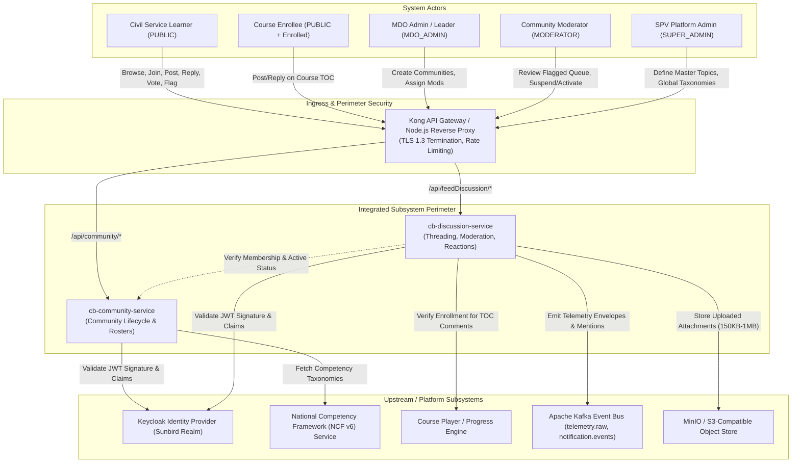
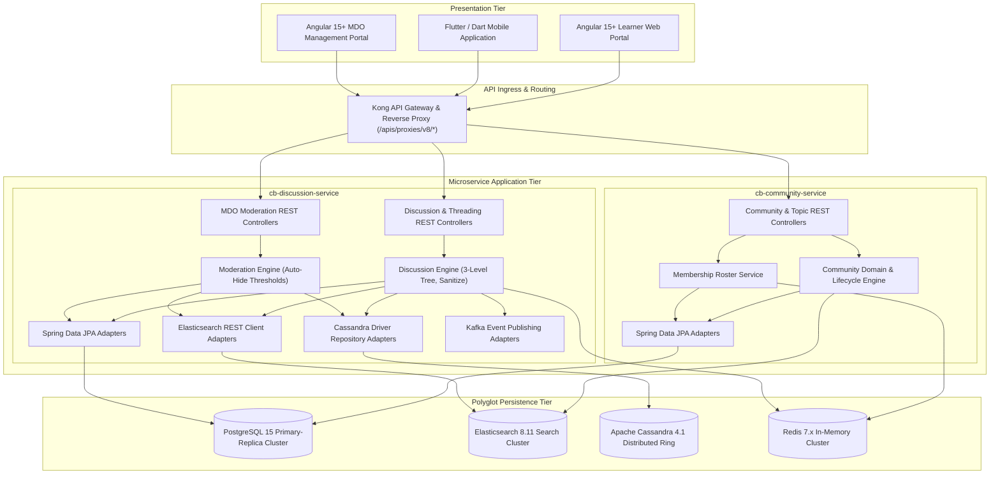
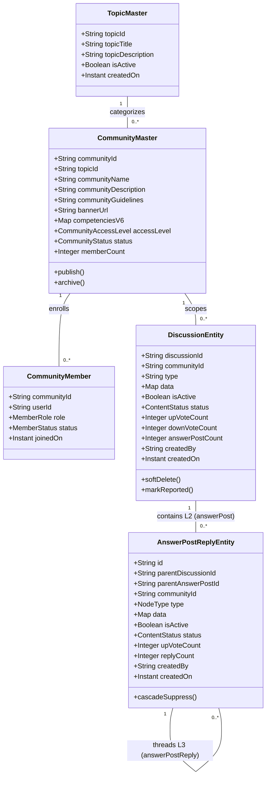
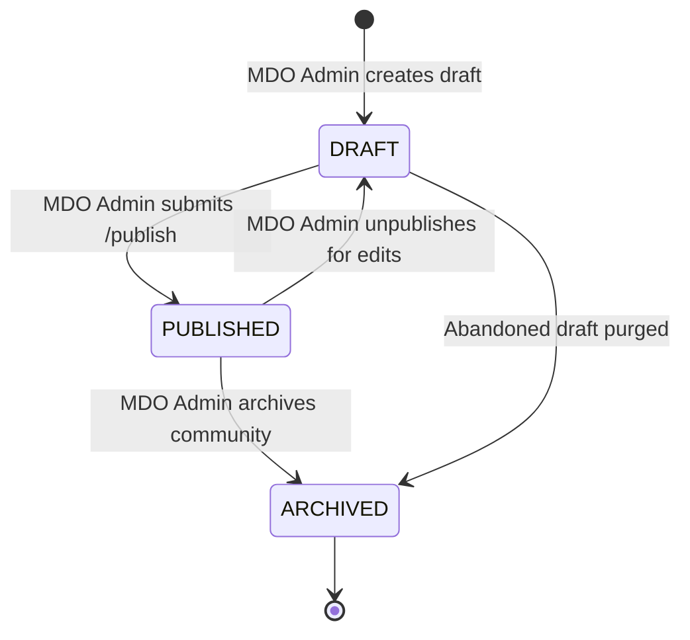
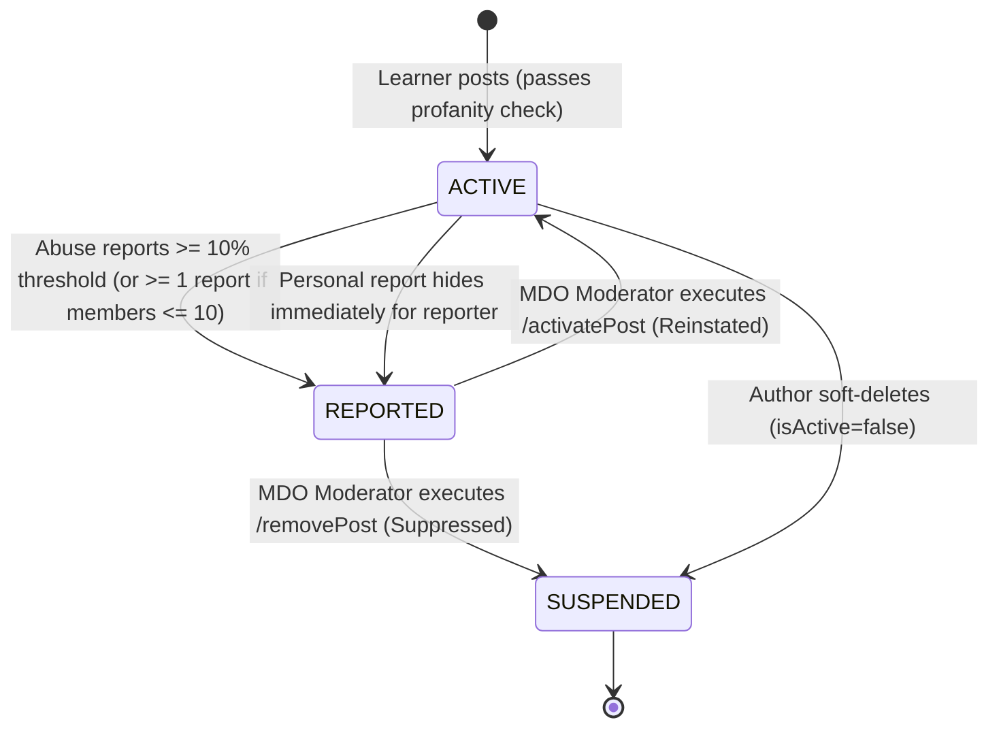
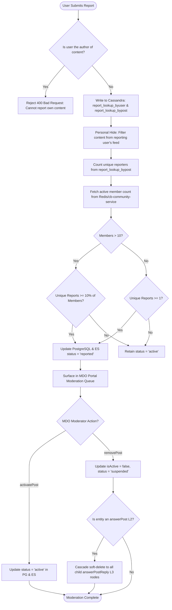
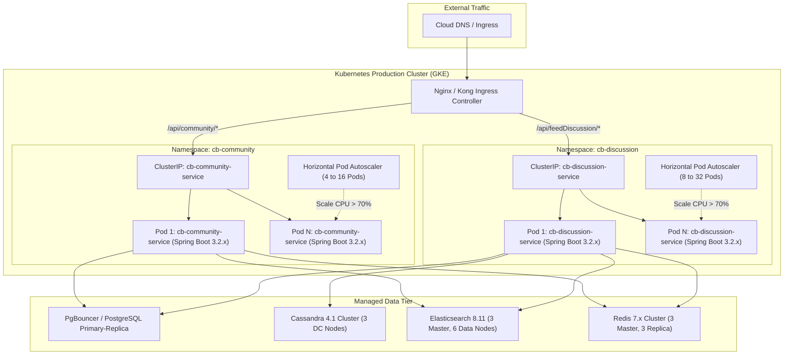

# Discussion Hub — System Design Document (SDD)

**Discuss Hub and Community Subsystems Integration**

**System**: iGOT Karmayogi Bharat Platform<br>**Target Subsystems**: Discuss Hub (`cb-discussion-service`) & Community Features (`cb-community-service`)<br>

## 1. Introduction

### 1.1 Purpose

This Software/System Design Document (SDD) specifies the complete architectural, design, operational, and data models governing the integration of the **Discuss Hub** (`cb-discussion-service`) and **Community** (`cb-community-service`) subsystems. Following **IEEE Std 1016-2009**, this document defines the viewpoints, design entities, design patterns, cross-cutting concerns, and deployment topology required to maintain and evolve these capabilities.

### 1.2 System Scope

The integrated subsystem provides a federated, multi-tenant collaboration engine for Indian civil servants on the iGOT Karmayogi Bharat platform:

- **Community Subsystem** (`cb-community-service`): Encapsulates organizational boundaries, SPV-approved Master Topics, Ministry/Department/Organisation (MDO) community lifecycles, National Competency Framework (NCF v6) bindings, and membership rosters.
- **Discuss Hub Subsystem** (`cb-discussion-service`): Encapsulates conversational lifecycles, strict 3-level conversation hierarchies (`question` `answerPost` `answerPostReply`), toggleable reactions, cross-community user bookmarking, course-contextual Table of Contents (TOC) commenting, multi-tier decentralized abuse moderation, and continuous viewport dwell-time telemetry tracking.

### 1.3 Design Viewpoints Covered

In accordance with IEEE 1016, this SDD exposes:

1. **Context Viewpoint**: Boundaries, external dependencies, and actor interactions.
2. **Composition Viewpoint**: Structural decomposition into subsystems, modules, and persistence layers.
3. **Logical Viewpoint**: Class models, state models, and design patterns.
4. **Information/Data Viewpoint**: Polyglot storage schemas, data dictionaries, and entity-relationship models across PostgreSQL, Apache Cassandra, Elasticsearch, and Redis.
5. **Interface Viewpoint**: REST/JSON contracts, parameters, authentication mechanisms, and response envelopes.
6. **Interaction/Behavioral Viewpoint**: Dynamic execution paths, sequence flows, and threshold evaluations.
7. **Deployment & Operational Viewpoint**: Container orchestration, Kubernetes HPA, replication topologies, observability, and disaster recovery.

## 2. Context Viewpoint

### 2.1 Environmental Boundary and System Actors

Discuss Hub and Community subsystems operate within the private virtual network of iGOT Karmayogi Bharat behind an API Gateway and Reverse Proxy.



## 3. Composition & Architectural Viewpoint

### 3.1 Subsystem Decomposition and Layering

The system adopts an asynchronous, decoupled microservice pattern adhering to the **Hexagonal / Ports-and-Adapters** architectural style:



## 4. Logical Viewpoint

### 4.1 Structural Domain Model

The logical model formalizes the relationship between organizational abstractions and conversational structures:



### 4.2 State Machine Viewpoint

The state machines govern the operational transitions of communities and discussion entities:

#### 4.2.1 Community Lifecycle State Machine



#### 4.2.2 Discussion & Reply Entity State Machine



## 5. Information & Polyglot Data Viewpoint

### 5.1 Storage Allocation Matrix

To handle high concurrent traffic while preserving ACID guarantees for structural data, data storage is divided among engines based on functional role:

| Persistence Engine | Logical Role | Physical Entities / Indexes Stored | Performance Rationale |
|---|---|---|---|
| **PostgreSQL 15** | System of Record (Relational & JSONB) | `topic_master`, `community_master`, `community_members`, `discussion_entity`, `discussion_answer_post_reply` | Enforces ACID guarantees, relational foreign keys, unique topic-scoped names, and transactional state updates. |
| **Apache Cassandra 4.1** | High-Velocity Social & Abuse Logs | `sunbird.user_post_votes`, `sunbird.user_post_bookmarks`, `sunbird.discussion_post_report_lookup_byuser`, `sunbird.discussion_post_report_lookup_bypost` | Delivers constant write throughput with zero row locking for concurrent upvotes, bookmarks, and abuse flag counting. |
| **Elasticsearch 8.11** | Full-Text Search & Faceted Discovery | Index Aliases: `discussion_entity_alias`, `community_alias` | Enables sub-second multi-community Global Feed aggregation, HTML-stripped keyword queries, and faceted MDO moderation queues. |
| **Redis Cluster 7.x** | Ephemeral Buffers & Session Lookups | Keys: `comm:members:{communityId}`, `feed:global:{userId}`, `report:hidden:{userId}` | Offloads high-frequency membership validation ( set lookup) and provides fast pre-computed personal feed retrieval. |

### 5.2 Physical Data Model (PostgreSQL 15 DDL)

```sql
-- DDL Baseline for iGOT Discuss Hub & Community Subsystems
CREATE EXTENSION IF NOT EXISTS "uuid-ossp";
CREATE TABLE topic_master (
    topic_id VARCHAR(64) PRIMARY KEY,
    topic_title VARCHAR(255) NOT NULL,
    topic_description TEXT,
    is_active BOOLEAN NOT NULL DEFAULT TRUE,
    created_by VARCHAR(64) NOT NULL,
    created_on TIMESTAMP WITH TIME ZONE NOT NULL DEFAULT CURRENT_TIMESTAMP,
    updated_on TIMESTAMP WITH TIME ZONE NOT NULL DEFAULT CURRENT_TIMESTAMP
);
CREATE TABLE community_master (
    community_id VARCHAR(64) PRIMARY KEY,
    topic_id VARCHAR(64) NOT NULL REFERENCES topic_master(topic_id) ON DELETE RESTRICT,
    community_name VARCHAR(50) NOT NULL,
    community_description VARCHAR(1000) NOT NULL,
    community_guidelines VARCHAR(5000),
    banner_url TEXT,
    competencies_v6 JSONB NOT NULL DEFAULT '{}'::jsonb,
    community_access_level VARCHAR(32) NOT NULL DEFAULT 'public',
    status VARCHAR(32) NOT NULL DEFAULT 'DRAFT',
    member_count INT NOT NULL DEFAULT 0,
    created_by VARCHAR(64) NOT NULL,
    created_on TIMESTAMP WITH TIME ZONE NOT NULL DEFAULT CURRENT_TIMESTAMP,
    updated_on TIMESTAMP WITH TIME ZONE NOT NULL DEFAULT CURRENT_TIMESTAMP,
    CONSTRAINT chk_comm_name_len CHECK (char_length(community_name) >= 3),
    CONSTRAINT chk_comm_desc_len CHECK (char_length(community_description) >= 10),
    CONSTRAINT chk_comm_status CHECK (status IN ('DRAFT', 'PUBLISHED', 'ARCHIVED'))
);
CREATE UNIQUE INDEX uq_topic_community_name_lower ON community_master (topic_id, LOWER(community_name));
CREATE TABLE community_members (
    community_id VARCHAR(64) NOT NULL REFERENCES community_master(community_id) ON DELETE CASCADE,
    user_id VARCHAR(64) NOT NULL,
    role VARCHAR(32) NOT NULL DEFAULT 'MEMBER',
    status VARCHAR(32) NOT NULL DEFAULT 'ACTIVE',
    joined_on TIMESTAMP WITH TIME ZONE NOT NULL DEFAULT CURRENT_TIMESTAMP,
    updated_on TIMESTAMP WITH TIME ZONE NOT NULL DEFAULT CURRENT_TIMESTAMP,
    PRIMARY KEY (community_id, user_id),
    CONSTRAINT chk_member_role CHECK (role IN ('MEMBER', 'MODERATOR', 'ADMIN')),
    CONSTRAINT chk_member_status CHECK (status IN ('ACTIVE', 'INACTIVE', 'BANNED'))
);
CREATE TABLE discussion_entity (
    discussion_id VARCHAR(64) PRIMARY KEY,
    community_id VARCHAR(64) NOT NULL REFERENCES community_master(community_id) ON DELETE RESTRICT,
    type VARCHAR(32) NOT NULL DEFAULT 'question',
    data JSONB NOT NULL,
    is_active BOOLEAN NOT NULL DEFAULT TRUE,
    status VARCHAR(32) NOT NULL DEFAULT 'active',
    up_vote_count INT NOT NULL DEFAULT 0,
    down_vote_count INT NOT NULL DEFAULT 0,
    answer_post_count INT NOT NULL DEFAULT 0,
    created_by VARCHAR(64) NOT NULL,
    created_on TIMESTAMP WITH TIME ZONE NOT NULL DEFAULT CURRENT_TIMESTAMP,
    updated_on TIMESTAMP WITH TIME ZONE NOT NULL DEFAULT CURRENT_TIMESTAMP,
    CONSTRAINT chk_disc_type CHECK (type = 'question'),
    CONSTRAINT chk_disc_status CHECK (status IN ('active', 'reported', 'suspended'))
);
CREATE TABLE discussion_answer_post_reply (
    id VARCHAR(64) PRIMARY KEY,
    parent_discussion_id VARCHAR(64) NOT NULL REFERENCES discussion_entity(discussion_id) ON DELETE CASCADE,
    parent_answer_post_id VARCHAR(64) REFERENCES discussion_answer_post_reply(id) ON DELETE CASCADE,
    community_id VARCHAR(64) NOT NULL REFERENCES community_master(community_id) ON DELETE RESTRICT,
    type VARCHAR(32) NOT NULL,
    data JSONB NOT NULL,
    is_active BOOLEAN NOT NULL DEFAULT TRUE,
    status VARCHAR(32) NOT NULL DEFAULT 'active',
    up_vote_count INT NOT NULL DEFAULT 0,
    reply_count INT NOT NULL DEFAULT 0,
    created_by VARCHAR(64) NOT NULL,
    created_on TIMESTAMP WITH TIME ZONE NOT NULL DEFAULT CURRENT_TIMESTAMP,
    updated_on TIMESTAMP WITH TIME ZONE NOT NULL DEFAULT CURRENT_TIMESTAMP,
    CONSTRAINT chk_reply_type CHECK (type IN ('answerPost', 'answerPostReply')),
    CONSTRAINT chk_l2_l3_hierarchy CHECK ( (type = 'answerPost' AND parent_answer_post_id IS NULL) OR (type = 'answerPostReply' AND parent_answer_post_id IS NOT NULL) )
);
```

### 5.3 Physical Data Model (Apache Cassandra CQL)

```sql
CREATE KEYSPACE IF NOT EXISTS sunbird WITH replication = {'class': 'NetworkTopologyStrategy', 'datacenter1': 3};
CREATE TABLE IF NOT EXISTS sunbird.user_post_votes (
    userid text,
    discussionid text,
    votetype text,
    updatedon timestamp,
    PRIMARY KEY (userid, discussionid)
);
CREATE TABLE IF NOT EXISTS sunbird.user_post_bookmarks (
    userid text,
    communityid text,
    discussionid text,
    createdon timestamp,
    PRIMARY KEY (userid, communityid, discussionid)
);
CREATE INDEX IF NOT EXISTS idx_bookmarks_user ON sunbird.user_post_bookmarks (userid);
CREATE TABLE IF NOT EXISTS sunbird.discussion_post_report_lookup_byuser (
    userid text,
    discussionid text,
    reasons list<text>,
    otherreasons text,
    reportedon timestamp,
    PRIMARY KEY (userid, discussionid)
);
CREATE TABLE IF NOT EXISTS sunbird.discussion_post_report_lookup_bypost (
    discussionid text,
    userid text,
    reasons list<text>,
    otherreasons text,
    reportedon timestamp,
    PRIMARY KEY (discussionid, userid)
);
```

## 6. Interface Viewpoint

### 6.1 Formal REST API Catalog

All interfaces communicate over HTTPS, require Keycloak JWT Bearer tokens (`x-authenticated-user-token`), and return standardized payload envelopes:

```json
{
  "id": "api.feedDiscussion.operation",
  "ver": "v2",
  "ts": "2026-10-28T11:24:00Z",
  "params": {
    "resmsgid": "uuid",
    "msgid": "uuid",
    "status": "successful"
  },
  "responseCode": "OK",
  "result": {}
}
```

#### API Endpoint Specifications

| Endpoint | Method | Service | Parameters / Request Body | Response Payload | Description |
|---|---|---|---|---|---|
| `/api/community/v1/create` | `POST` | `cb-community` | `communityName` (str, 3-50) `topicId` (str) `communityDescription` (str) `competencies_v6` (obj) | `{"communityId": "UUID"}` | Creates community draft under topic with NCF mapping. |
| `/api/community/v1/publish` | `POST` | `cb-community` | `communityId` (UUID) `communityAccessLevel` ("public") | `{"status": "published"}` | Moves community to active state; indexes in ES. |
| `/api/community/v1/join` | `PUT` | `cb-community` | `communityId` (UUID) | `{"membership": "ACTIVE"}` | Adds learner to community roster and updates Redis. |
| `/api/feedDiscussion/create` | `POST` | `cb-discussion` | `communityId` (UUID) `type` ("question") `title` (str) `description` (HTML, 3-3000) `mediaCategory` (obj) | `{"discussionId": "UUID"}` | Level 1 Discussion creation; profanity-checked. |
| `/api/feedDiscussion/answerPosts` | `POST` | `cb-discussion` | `parentDiscussionId` (UUID) `type` ("answerPost") `description` (HTML, 3-3000) | `{"answerPostId": "UUID"}` | Level 2 Comment creation on root post. |
| `/api/feedDiscussion/answerPostReply/create` | `POST` | `cb-discussion` | `parentDiscussionId` (UUID) `parentAnswerPostId` (UUID) `type` ("answerPostReply") `description` (HTML) | `{"answerPostReplyId": "UUID"}` | Level 3 Threaded Reply creation; blocks Level 4. |
| `/api/feedDiscussion/question/like/{id}` | `POST` | `cb-discussion` | Path: `id` (Discussion UUID) | `{"liked": bool, "upVoteCount": int}` | Toggles user upvote state in Cassandra. |
| `/api/feedDiscussion/bookmark/{commId}/{discId}` | `POST` | `cb-discussion` | Path: `commId`, `discId` (UUIDs) | `{"bookmarked": bool}` | Toggles saved state across communities in Cassandra. |
| `/api/feedDiscussion/report` | `POST` | `cb-discussion` | `discussionId` (UUID) `type` ("question"\|"answerPost"\|"answerPostReply") `reportedDueTo` (arr) | `{"reported": true}` | Submits abuse flag; auto-hides if threshold met. |
| `/api/feedDiscussion/globalFeed` | `POST` | `cb-discussion` | `pageNumber` (int), `pageSize` (int) | `{"data": obj[], "totalHits": int}` | Aggregates feed across joined communities from ES. |
| `/api/feedDiscussion/admin/activatePost` | `POST` | `cb-discussion` | `discussionId` (UUID) `type` (str) | `{"status": "active"}` | Reinstates flagged content from MDO queue. |
| `/api/feedDiscussion/admin/removePost` | `POST` | `cb-discussion` | `discussionId` (UUID) `type` (str) | `{"status": "suspended"}` | Soft-deletes content and cascades hides to replies. |

## 7. Interaction & Behavioral Viewpoint

### 7.1 Multi-Tier Moderation Dynamic Evaluation Logic

The moderation engine enforces a dynamic auto-suppression threshold:

- If community active members : Content auto-hides when unique reporter count of total membership.
- If community active members : Content auto-hides when unique reporter count .



## 8. Deployment, Infrastructure & Operational Viewpoint

### 8.1 Kubernetes Deployment Topology (Google Kubernetes Engine)

The subsystems deploy as stateless Spring Boot application containers on Google Kubernetes Engine (GKE):



### 8.2 Production Sizing and Capacity Specifications

- **CPU & Memory Requests/Limits**:
  - `cb-discussion-service`: Request: `2 CPU, 4Gi Mem`; Limit: `4 CPU, 8Gi Mem`.
  - `cb-community-service`: Request: `1 CPU, 2Gi Mem`; Limit: `2 CPU, 4Gi Mem`.

- **JVM Tuning Parameters**:
  - OpenJDK 17 G1GC: `-XX:+UseG1GC -XX:MaxGCPauseMillis=200 -XX:InitiatingHeapOccupancyPercent=45 -XX:G1ReservePercent=15`.
  - Heap Boundaries: `-Xms4g -Xmx4g` (Discussion Service), `-Xms2g -Xmx2g` (Community Service).

## 9. Traceability Matrix: SRS to SDD

| SRS Requirement ID | Architectural Realization in SDD | Governing SDD Section |
|---|---|---|
| **FR-COMM-01 / 02 / 03** | Topic constraints, lowercase unique index, check constraints in PostgreSQL. | Section 5.2 |
| **FR-COMM-04** | Structured `competencies_v6` JSONB property and GIN index. | Section 5.2 |
| **FR-COMM-05** | `community_members` relational table and Redis bitmap caching. | Section 5.1, 5.2 |
| **FR-DISC-01** | Community scoping foreign key check and membership interceptor. | Section 4.1, 6.1 |
| **FR-DISC-02 / 03 / 04** | HTML sanitization, character boundary validator, and profanity filter. | Section 6.1 |
| **FR-DISC-05** | Ownership check before executing soft-delete in PostgreSQL (`isActive=false`). | Section 5.2, 6.1 |
| **FR-THRD-01 / 02** | `discussion_answer_post_reply` table with hierarchy check constraint (`chk_l2_l3_hierarchy`). | Section 5.2 |
| **FR-THRD-03** | Mention interceptor emitting events to Kafka `notification.events`. | Section 2.1 |
| **FR-SOC-01 / 02** | Cassandra tables `user_post_votes` and `user_post_bookmarks`. | Section 5.3 |
| **FR-SOC-03** | Multi-community Global Feed aggregation using Elasticsearch index `discussion_entity_alias`. | Section 5.1, 6.1 |
| **FR-SOC-04** | Course enrollment verification interceptor gating Course TOC comments. | Section 2.1, 6.1 |
| **FR-MOD-01 / 02 / 03** | Cassandra report lookups by user/post, self-reporting block, and personal feed filter. | Section 5.3, 7.1 |
| **FR-MOD-04 / 05 / 06** | 10% auto-suppression threshold logic, cascading reply hide, and MDO moderation queue. | Section 5.2, 7.1 |
| **FR-TEL-01 / 02** | 3-second dwell interceptor streaming telemetry envelopes to Kafka `telemetry.raw`. | Section 2.1 |
| **NFR-PERF-01 / 02 / 03** | Redis feed caching, Cassandra write paths, and Elasticsearch indexed search. | Section 5.1 |
| **NFR-SCAL-01 / 02** | Kubernetes HPA (up to 32 pods) and partitioned polyglot storage. | Section 8.1, 8.2 |
| **NFR-SEC-01 / 02 / 03** | Keycloak Bearer token verification, OWASP HTML sanitization, and AES-256 encryption at rest. | Section 2.1, 6.1 |
