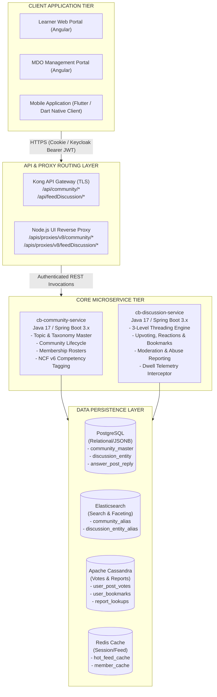

# Discussion Hub — Software Requirements Specification (SRS)

**Discuss Hub and Community Subsystems Integration**

## 1. Introduction

### 1.1 Purpose

This Software Requirements Specification (SRS) defines the formal, testable functional and non-functional requirements governing the integration of the **Discuss Hub** (`cb-discussion-service`) and **Community** (`cb-community-service`) subsystems on the iGOT Karmayogi Bharat platform.

This document serves as the authoritative contract for Product Owners, Solution Architects, Development Engineers, and Quality Assurance Specialists. It establishes complete bidirectional traceability between business requirements, Jira epics/stories, architectural components, database schemas, and verification criteria.

### 1.2 Scope

The scope of this specification encompasses:

- The organizational modeling and governance of civil-service Communities by Ministries, Departments, and Organisations (MDOs) under Special Purpose Vehicle (SPV)-approved Master Topics.
- The National Competency Framework (NCF v6) taxonomy mapping for Community categorization.
- The conversational discussion lifecycle, including Level 1 posts (`question`), Level 2 direct responses (`answerPost`), and Level 3 nested threaded replies (`answerPostReply`).
- Social collaboration capabilities: contextual upvoting/downvoting, cross-community user bookmarking, and user `@mentions`.
- Gated Course Table of Contents (TOC) contextual discussions.
- Multi-tier decentralized content moderation: personal reporting, automated community percentage thresholds, and MDO-level administrative intervention.
- Telemetry event logging including viewport dwell-time tracking.

**Out of Scope**:

- Anonymous discussion posting or viewing (strictly prohibited across all environments).
- Direct inter-user private messaging or unmoderated peer-to-peer chat.
- Unsupervised automated machine-learning censorship (moderation requires explicit human-in-the-loop nodal review).
- Third-party forum engines (NodeBB integration was permanently decommissioned in Q7).

### 1.3 Definitions, Acronyms, and Abbreviations

- **AC**: Acceptance Criteria
- **API**: Application Programming Interface
- **BR**: Business Rule
- **Cassandra**: High-throughput distributed NoSQL column-family database used for high-velocity lookups (votes, bookmarks, flagging audit).
- **CBP**: Competency-Based Plan
- **DoPT**: Department of Personnel and Training, Government of India
- **Elasticsearch (ES)**: Distributed search and analytics engine powering full-text search, faceted feed filters, and moderation queues.
- **FR**: Functional Requirement
- **FRS**: Functional Requirements Specification
- **iGOT**: Integrated Government Online Training
- **JWT**: JSON Web Token
- **Keycloak**: Open-source identity and access management solution powering Sunbird/iGOT authentication.
- **MDO**: Ministry, Department, or Organisation
- **NCF**: National Competency Framework
- **NFR**: Non-Functional Requirement
- **NodeBB**: Legacy third-party Node.js forum software deployed in Q2 and fully deprecated/replaced in Q7.
- **PostgreSQL (PG)**: Relational database storing primary transactional entities and JSONB document structures.
- **RBAC**: Role-Based Access Control
- **SPV**: Special Purpose Vehicle (Karmayogi Bharat entity)
- **SRS**: Software Requirements Specification
- **TOC**: Table of Contents (Course curriculum hierarchy)
- **UUID**: Universally Unique Identifier

### 1.4 References

1. **IEEE Std 29148-2018**: *ISO/IEC/IEEE International Standard - Systems and software engineering -- Life cycle processes -- Requirements engineering*.
2. **Q7 BRD Discuss Hub**: [Q7 | BRD | Discuss Hub](https://karmayogibharat.atlassian.net/wiki/spaces/TPT/pages/294682875/Q7+BRD+Discuss+Hub) (Author: Shakti Babbar, April 2025).
3. **Q7 FRS Discuss Hub**: [Q7 | FRS | Discuss Hub](https://karmayogibharat.atlassian.net/wiki/spaces/TPT/pages/295993468/Q7+FRS+Discuss+Hub) (Author: Shakti Babbar, April 2025).
4. **SRS - Discussion hub v2**: [SRS - Discussion hub v2](https://karmayogibharat.atlassian.net/wiki/spaces/TES/pages/342360352/SRS+-+Discussion+hub+v2) (Authors: Christopher B Fernandes, Akshay Kumar, April 2025).
5. **SRS - MDO Portal - Discussion hub v2**: [SRS - MDO Portal - Discussion hub v2](https://karmayogibharat.atlassian.net/wiki/spaces/TES/pages/367624194/SRS+-+MDO+Portal+-+Discussion+hub+v2) (Author: Christopher B Fernandes, April 2025).
6. **KB-7533 Technical Architecture & API Specification**: [KB-7533 - Q7 | Discussion Hub](https://karmayogibharat.atlassian.net/wiki/spaces/TES/pages/246055034/KB-7533+-+Q7+Discussion+Hub) (Author: Sureshkannan, April 2025).
7. **cb-discussion-service Technical Design**: [cb-discussion-service](https://karmayogibharat.atlassian.net/wiki/spaces/TES/pages/387350530/cb-discussion-service) (Author: Shankaragouda, June 2025).

## 2. Overall Description

### 2.1 Product Perspective

The Discuss Hub and Community integration forms the social and peer-learning backbone of the iGOT Karmayogi Bharat digital ecosystem. It operates as a federated, multi-tenant cloud-native microservice architecture interfacing directly with:

- **Keycloak Identity Provider**: Validates user credentials, returns authenticated session contexts, and asserts user roles (`PUBLIC`, `MDO_ADMIN`, `MDO_LEADER`).
- **Kong API Gateway / Reverse Proxy**: Terminates TLS and routes public API calls matching `/api/community/*` and `/api/feedDiscussion/*`.
- **National Competency Framework (NCF v6) Service**: Supplies standardized Competency Areas, Themes, and Sub-themes for community classification.
- **Course Service / Player**: Provides course enrollment verification for Course Table of Contents (TOC) discussion threads.
- **Kafka Event Bus / Flink Streaming Pipeline**: Ingests high-volume user telemetry events (impressions, view dwell times, engagement clicks).

### 2.2 Product Functions

1. **Federated Governance Hierarchy**: Master topics established by SPV administrators govern community creation by MDO administrators.
2. **Competency-Driven Peer Collaboration**: Discussions inherit organizational and competency classifications, bridging workplace challenges with capability frameworks.
3. **Structured Discussion Lifecycles**: Strict 3-level conversation models (`question` → `answerPost` → `answerPostReply`) prevent thread fragmentation while enabling deep, contextual interactions.
4. **Decentralized Moderation Engine**: Self-service reporting combined with mathematical community auto-suppression thresholds and dedicated MDO oversight ensures content safety and compliance.
5. **Contextual Course Integration**: In-situ discussion threads linked to course curricula, preserving learning continuity without navigational disruption.

### 2.3 User Classes and Characteristics

- **Learner** (`PUBLIC`): Authenticated civil servant. High frequency, mobile-and-web consumption. Focuses on discovery, reading, posting questions, contributing answers, upvoting, and bookmarking.
- **Course Enrollee** (`PUBLIC + Enrolled`): Authenticated learner with verified enrollment in a specific course. Permitted to post, like, and reply within course Table of Contents (TOC) discussion widgets. Non-enrolled learners have read-only access.
- **MDO Administrator / Leader (**`MDO_ADMIN` / `MDO_LEADER`): Nodal ministry official. Uses desktop portal. Manages departmental communities, configures guidelines, assigns moderators, maps competencies, and monitors compliance.
- **Community Moderator** (`MODERATOR`): Assigned civil servant within an MDO. Reviews reported content, evaluates policy compliance, and executes reinstatement or removal actions.
- **SPV / Platform Administrator** (`SUPER_ADMIN`): Central custodian at Karmayogi Bharat / DoPT. Configures global master topics, system parameters, profanity vocabularies, and telemetry sinks.

### 2.4 Operating Environment

- **Server Runtime**: OpenJDK 17 LTS, Spring Boot 3.2.x running within Docker containers orchestrated on Google Kubernetes Engine (GKE).
- **Databases**:
  - PostgreSQL 15.x (High Availability primary-replica configuration with JSONB extension enabled).
  - Elasticsearch 8.11.x (Clustered search index).
  - Apache Cassandra 4.1.x (Multi-datacenter distributed ring).
  - Redis Cluster 7.x (In-memory caching and feed buffer).

- **Client Platforms**: Modern desktop web browsers (Chrome 110+, Edge 110+, Firefox 115+, Safari 16+) and Mobile Operating Systems (Android 9.0+, iOS 14.0+).

### 2.5 Design and Implementation Constraints

- **CON-01 (Stateless Architecture)**: Core microservices must remain completely stateless to facilitate horizontal autoscaling. Session state must reside in client JWTs and Redis.
- **CON-02 (Zero Third-Party Forum Dependencies)**: All discussion features must execute natively within the proprietary `cb-discussion-service` and `cb-community-service` runtimes without external forum plugins or iframe embedding.
- **CON-03 (Strict Relational Scoping)**: A discussion post cannot exist as an orphan; it must maintain a persistent, non-null foreign key reference to an active `communityId`.
- **CON-04 (Government Content Standards)**: The platform must support content suppression workflows that prevent unmoderated or reported content from appearing in public feeds once reported by reaching verified community thresholds.

### 2.6 Assumptions and Dependencies

- **ASM-01**: Every interacting learner possesses a unique, verified Keycloak User UUID and an associated Ministry/Department context.
- **ASM-02**: MDO Leaders possess administrative authority to establish official communication policies for their departmental communities.
- **DEP-01**: High-throughput messaging relies on Apache Kafka clusters for asynchronous telemetry extraction.
- **DEP-02**: Full-text searching and faceted aggregation rely on Elasticsearch index synchronization from PostgreSQL master records.

## 3. Specific Requirements

### 3.1 External Interface Requirements

#### 3.1.1 User Interfaces

- **UI-01 (Learner Hub View)**: The Learner Web and Mobile UIs shall provide a dual-tabbed dashboard displaying "Discover" (all joinable public communities grouped by Topic) and "Your Communities" (communities where user membership is active) [[KB-8004: Q7 | Discuss Hub | Discuss Hub Consumption on Learner portal | View and Navigate Communities](https://karmayogibharat.atlassian.net/browse/KB-8004) (Prod Deployed)].
- **UI-02 (Global Feed)**: The UI shall provide a blended Global Feed aggregating discussions across all joined communities, featuring an omni-channel "Start Discussion" composer with a community selector dropdown [[KB-8917: Q7 | Discuss Hub Add on | Global Feed & Posting](https://karmayogibharat.atlassian.net/browse/KB-8917) (Prod Deployed)].
- **UI-03 (3-Level Visual Threading)**: The UI shall visually represent the 3-level conversation tree using clear indentation, connecting thread lines, and distinct action affordances for Level 2 comments versus Level 3 replies [[KB-9343: Q8| Discuss Hub | Three level reply on Discuss Hub](https://karmayogibharat.atlassian.net/browse/KB-9343) (Prod Deployed)].
- **UI-04 (MDO Moderation Dashboard)**: The MDO Portal shall provide dedicated moderation tabs ("Pending" and "Hidden") displaying reported posts, reporter counts, reported reasons, and action buttons (`Reinstate`, `Delete`) [[KB-8787: Q7 | Discuss Hub | Community Management | Reporting Mechanism](https://karmayogibharat.atlassian.net/browse/KB-8787) (Prod Deployed)].

#### 3.1.2 Hardware & Network Interfaces

- **HWI-01**: Client-to-gateway communication shall operate strictly over HTTPS using TLS 1.3 (with fallback to TLS 1.2). Unencrypted HTTP traffic shall be rejected at the ingress gateway.

#### 3.1.3 Software & API Interfaces

The system shall expose and consume the verified REST endpoints detailed below. All invocations require the HTTP header `x-authenticated-user-token: Bearer <JWT>`.

| Interface ID | Method | Path | Request Entity / Parameters | Response Schema | Source Specification |
|---|---|---|---|---|---|
| **API-COMM-01** | `POST` | `/api/community/v1/create` | `{"communityName": string, "topicId": string, "communityGuidelines": string,` `"competencies_v6": object}` | `{"responseCode": "OK", "result": {"communityId": "UUID"}}` | [cb-discussion-service](https://karmayogibharat.atlassian.net/wiki/spaces/TES/pages/387350530/cb-discussion-service) |
| **API-COMM-02** | `POST` | `/api/community/v1/publish` | `{"communityId": "UUID", "topicName": string, "communityAccessLevel": "public", "moderators": string[]}` | `{"responseCode": "OK", "result": {"status": "published"}}` | [cb-discussion-service](https://karmayogibharat.atlassian.net/wiki/spaces/TES/pages/387350530/cb-discussion-service) |
| **API-COMM-03** | `PUT` | `/api/community/v1/join` | `{"communityId": "UUID"}` | `{"responseCode": "OK", "result": {"membership": "ACTIVE"}}` | [cb-discussion-service](https://karmayogibharat.atlassian.net/wiki/spaces/TES/pages/387350530/cb-discussion-service) |
| **API-COMM-04** | `PUT` | `/api/community/v1/unjoin` | `{"communityId": "UUID"}` | `{"responseCode": "OK", "result": {"membership": "INACTIVE"}}` | [cb-discussion-service](https://karmayogibharat.atlassian.net/wiki/spaces/TES/pages/387350530/cb-discussion-service) |
| **API-DISC-01** | `POST` | `/api/feedDiscussion/create` | `{"type": "question", "communityId": "UUID", "description": string, "mediaCategory": object}` | `{"responseCode": "OK", "result": {"discussionId": "UUID"}}` | [KB-7533 - Q7 \| Discussion Hub](https://karmayogibharat.atlassian.net/wiki/spaces/TES/pages/246055034/KB-7533+-+Q7+Discussion+Hub) |
| **API-DISC-02** | `POST` | `/api/feedDiscussion/update` | `{"discussionId": "UUID", "communityId": "UUID", "description": string}` | `{"responseCode": "OK", "result": {"updated": true}}` | [KB-7533 - Q7 \| Discussion Hub](https://karmayogibharat.atlassian.net/wiki/spaces/TES/pages/246055034/KB-7533+-+Q7+Discussion+Hub) |
| **API-DISC-03** | `DELETE` | `/api/feedDiscussion/question/delete/{id}` | Path variable: `id` (Discussion UUID) | `{"responseCode": "OK", "result": {"deleted": true}}` | [KB-7533 - Q7 \| Discussion Hub](https://karmayogibharat.atlassian.net/wiki/spaces/TES/pages/246055034/KB-7533+-+Q7+Discussion+Hub) |
| **API-DISC-04** | `POST` | `/api/feedDiscussion/answerPosts` | `{"type": "answerPost", "parentDiscussionId": "UUID", "communityId": "UUID", "description": string}` | `{"responseCode": "OK", "result": {"answerPostId": "UUID"}}` | [KB-7533 - Q7 \| Discussion Hub](https://karmayogibharat.atlassian.net/wiki/spaces/TES/pages/246055034/KB-7533+-+Q7+Discussion+Hub) |
| **API-DISC-05** | `POST` | `/api/feedDiscussion/answerPostReply/``create` | `{"type": "answerPostReply", "parentAnswerPostId":` `"UUID", "parentDiscussionId": "UUID", "description": string}` | `{"responseCode": "OK", "result": {"answerPostReplyId":` `"UUID"}}` | [KB-7533 - Q7 \| Discussion Hub](https://karmayogibharat.atlassian.net/wiki/spaces/TES/pages/246055034/KB-7533+-+Q7+Discussion+Hub) |
| **API-DISC-06** | `POST` | `/api/feedDiscussion/question/like/{id}` | Path variable: `id` (Discussion UUID) | `{"responseCode": "OK", "result": {"liked": boolean, "upVoteCount": int}}` | [KB-7533 - Q7 \| Discussion Hub](https://karmayogibharat.atlassian.net/wiki/spaces/TES/pages/246055034/KB-7533+-+Q7+Discussion+Hub) |
| **API-DISC-07** | `POST` | `/api/feedDiscussion/bookmark/{commId}/{discId}` | Path variables: `commId` (Community UUID), `discId` (Discussion UUID) | `{"responseCode": "OK", "result": {"bookmarked": boolean}}` | [KB-7533 - Q7 \| Discussion Hub](https://karmayogibharat.atlassian.net/wiki/spaces/TES/pages/246055034/KB-7533+-+Q7+Discussion+Hub) |
| **API-DISC-08** | `POST` | `/api/feedDiscussion/report` | `{"discussionId": "UUID", "type": "question"\|"answerPost"\|"answerPostReply", "reportedDueTo": string[], "otherReasons": string}` | `{"responseCode": "OK", "result": {"reported": true}}` | [KB-7533 - Q7 \| Discussion Hub](https://karmayogibharat.atlassian.net/wiki/spaces/TES/pages/246055034/KB-7533+-+Q7+Discussion+Hub) |
| **API-DISC-09** | `POST` | `/api/feedDiscussion/globalFeed` | `{"filterCriteriaMap": {"type": "question"}, "pageNumber": int, "pageSize": int}` | `{"responseCode": "OK", "result": {"data": object[], "totalHits": int}}` | [cb-discussion-service](https://karmayogibharat.atlassian.net/wiki/spaces/TES/pages/387350530/cb-discussion-service) |
| **API-DISC-10** | `POST` | `/api/feedDiscussion/admin/activatePost` | `{"discussionId": "UUID", "type": string}` | `{"responseCode": "OK", "result": {"status": "active"}}` | [cb-discussion-service](https://karmayogibharat.atlassian.net/wiki/spaces/TES/pages/387350530/cb-discussion-service) |
| **API-DISC-11** | `POST` | `/api/feedDiscussion/admin/removePost` | `{"discussionId": "UUID", "type": string}` | `{"responseCode": "OK", "result": {"status": "suspended"}}` | [cb-discussion-service](https://karmayogibharat.atlassian.net/wiki/spaces/TES/pages/387350530/cb-discussion-service) |

### 3.2 System Features & Functional Requirements

#### 3.2.1 Topic and Community Governance

- **FR-COMM-01 (Topic Associativity)**: The system shall require every Community to be instantiated under an active, SPV-defined Master Topic ID. The system shall reject community creation if the referenced `topicId` is invalid or inactive [[KB-7930: Q7| Discuss Hub | Community Creation by MDO](https://karmayogibharat.atlassian.net/browse/KB-7930) (Prod Deployed)].
- **FR-COMM-02 (Community Name Uniqueness)**: The system shall enforce case-insensitive uniqueness of the `communityName` attribute under any given `topicId`. Attempting to register a duplicate name under the same topic shall result in an HTTP `409 Conflict` error [[Q7 | FRS | Discuss Hub](https://karmayogibharat.atlassian.net/wiki/spaces/TPT/pages/295993468/Q7+FRS+Discuss+Hub)`DIS_HUB_BR1_FR1`].
- **FR-COMM-03 (Field Length Bounds)**:
  - Community Name: Minimum 3 characters, maximum 50 characters.
  - Community Description: Minimum 10 characters, maximum 1000 characters.
  - Community Guidelines: Maximum 5000 characters [[Q7 | FRS | Discuss Hub](https://karmayogibharat.atlassian.net/wiki/spaces/TPT/pages/295993468/Q7+FRS+Discuss+Hub)`DIS_HUB_BR1_FR1`].

- **FR-COMM-04 (NCF Taxonomy Mapping)**: The system shall persist structured National Competency Framework v6 taxonomy attributes (`area`, `theme`, `subTheme`) inside the `competencies_v6` JSONB property of the community record [[KB-8790: Q7 | Discuss Hub | Competency Mapping with communities](https://karmayogibharat.atlassian.net/browse/KB-8790) (Prod Deployed)].
- **FR-COMM-05 (Membership Enrollment)**: The system shall provide immediate, un-gated enrollment for any authenticated learner clicking "Join" on a public community, writing an active membership record to `cb-community-service` [[KB-8005: Q7 | Discuss Hub | Discuss Hub Consumption on Learner portal | Joining a community](https://karmayogibharat.atlassian.net/browse/KB-8005) (Prod Deployed)].

#### 3.2.2 Discussion Authoring and Content Controls

- **FR-DISC-01 (Community Scoping Gate)**: The system shall require a valid `communityId` parameter for creating any Level 1 post (`question`), Level 2 comment (`answerPost`), or Level 3 reply (`answerPostReply`). The system shall reject posting attempts with an HTTP `403 Forbidden` if the executing user is not an active member of that `communityId` [[SRS - Discussion hub v2](https://karmayogibharat.atlassian.net/wiki/spaces/TES/pages/342360352/SRS+-+Discussion+hub+v2)].
- **FR-DISC-02 (Text Content Constraints)**: The system shall validate that the discussion `description` attribute contains between 3 and 3000 characters (inclusive). Payloads outside these boundaries shall be rejected with an HTTP `400 Bad Request` [[SRS - Discussion hub v2](https://karmayogibharat.atlassian.net/wiki/spaces/TES/pages/342360352/SRS+-+Discussion+hub+v2)].
- **FR-DISC-03 (Media Attachment Rules)**: The system shall permit the attachment of either:
  - Exactly one media item (image/video) and one external hyperlink, OR
  - Exactly one document (PDF, DOC, DOCX, XLS, XLSX) and one external hyperlink.
  - File sizes shall strictly fall within the range of 150 KB to 1 MB. The system shall reject payloads exceeding these constraints [[Q7 | FRS | Discuss Hub](https://karmayogibharat.atlassian.net/wiki/spaces/TPT/pages/295993468/Q7+FRS+Discuss+Hub)`DIS_HUB_BR3_FR1`].

- **FR-DISC-04 (Automated Profanity Filtering)**: The system shall intercept discussion descriptions during ingestion and cross-reference tokens against platform profanity dictionaries. Submissions containing blacklisted terms shall be blocked with an informative validation error [[Q7 | FRS | Discuss Hub](https://karmayogibharat.atlassian.net/wiki/spaces/TPT/pages/295993468/Q7+FRS+Discuss+Hub)`DIS_HUB_BR3_FR1`].
- **FR-DISC-05 (Author Edit & Delete)**: The system shall permit the original author of a post to edit its text description or soft-delete it (`isActive=false`). Non-author learners shall be blocked from mutating content authored by others [[KB-6851: Q5 | Discuss Hub | Revamping Discuss Hub | Phase 0 | Editing and Deleting of a Post](https://karmayogibharat.atlassian.net/browse/KB-6851) (Prod Deployed)].

#### 3.2.3 3-Level Conversation Hierarchy

- **FR-THRD-01 (Hierarchy Definition)**: The system shall enforce a strict 3-level conversation tree:
  - Level 1 (`question`): Root discussion topic.
  - Level 2 (`answerPost`): Direct response to a Level 1 post.
  - Level 3 (`answerPostReply`): Threaded reply attached to a specific Level 2 response [[KB-9343: Q8| Discuss Hub | Three level reply on Discuss Hub](https://karmayogibharat.atlassian.net/browse/KB-9343) (Prod Deployed)].

- **FR-THRD-02 (Depth Ceiling Enforcement)**: The system shall block the creation of Level 4 sub-replies. Any reply initiated against a Level 3 `answerPostReply` shall automatically flatten and link to the parent Level 2 `answerPostId` at Level 3 [[SRS - Discussion hub v2](https://karmayogibharat.atlassian.net/wiki/spaces/TES/pages/342360352/SRS+-+Discussion+hub+v2)].
- **FR-THRD-03 (User Mentions)**: The system shall support tagging platform users via `@username` syntax within post, comment, and reply descriptions, triggering downstream notification events [[KB-9261: Q8 | Discuss Hub | User tagging and three level replying](https://karmayogibharat.atlassian.net/browse/KB-9261) (KB Approved)].

#### 3.2.4 Social Collaboration and Feed Discovery

- **FR-SOC-01 (Upvoting State)**: The system shall allow an authenticated learner to toggle an upvote on any discussion post or comment. The system shall record user vote assertions in the Apache Cassandra table `sunbird.user_post_votes` and update the aggregated `upVoteCount` in PostgreSQL and Elasticsearch [[KB-7533 - Q7 | Discussion Hub](https://karmayogibharat.atlassian.net/wiki/spaces/TES/pages/246055034/KB-7533+-+Q7+Discussion+Hub)].
- **FR-SOC-02 (Cross-Community Bookmarking)**: The system shall allow learners to bookmark discussion posts from any joined community. Bookmarked references shall be stored in Cassandra (`sunbird.user_post_bookmarks`) and displayed in the user’s centralized "Saved Posts" profile view [[KB-8010: Q7 | Discuss Hub | Discuss Hub Consumption on Learner portal | Save Posts Across Communities](https://karmayogibharat.atlassian.net/browse/KB-8010) (Open)].
- **FR-SOC-03 (Global Feed Composition)**: The system shall dynamically generate a user’s Global Feed by querying Elasticsearch for all active Level 1 `question` entities where `communityId` matches the user’s active joined community array, sorted chronologically [[KB-8917: Q7 | Discuss Hub Add on | Global Feed & Posting](https://karmayogibharat.atlassian.net/browse/KB-8917) (Prod Deployed)].
- **FR-SOC-04 (Course TOC Discussion Gating)**: The system shall expose discussion widgets inside the Course Table of Contents (TOC). Enrolled learners shall be permitted to post, like, and reply; learners without verified course enrollment shall have read-only access [[KB-7131: Q6 | Discuss Hub | TOC Page comments section](https://karmayogibharat.atlassian.net/browse/KB-7131) (Prod Deployed), [KB-7269: Q6 | Discuss Hub | TOC Page Comments Section | User should be able to view the comments on all the TOC pages](https://karmayogibharat.atlassian.net/browse/KB-7269) (Open)].

#### 3.2.5 Content Moderation and Governance

- **FR-MOD-01 (Report Submission)**: The system shall provide an abuse reporting action allowing users to select predefined violation categories (`Spam`, `Harassment`, `Misinformation`, `Sexual Content`, `Other`) against any post, comment, or reply [[KB-8007: Q7 | Discuss Hub | Discuss Hub Consumption on Learner portal | Reporting or flagging](https://karmayogibharat.atlassian.net/browse/KB-8007) (Prod Deployed), [KB-10589: Q9 | Discuss Hub | Comment Flagging](https://karmayogibharat.atlassian.net/browse/KB-10589) (Prod Deployed)].
- **FR-MOD-02 (Self-Reporting Restriction)**: The system shall prohibit users from reporting content that they personally authored [[Q7 | FRS | Discuss Hub](https://karmayogibharat.atlassian.net/wiki/spaces/TPT/pages/295993468/Q7+FRS+Discuss+Hub)`DIS_HUB_BR3_FR3`].
- **FR-MOD-03 (Immediate Personal Suppression)**: Upon submitting an abuse report, the system shall immediately suppress the reported entity from the reporting user’s personal feed view [[SRS - Discussion hub v2](https://karmayogibharat.atlassian.net/wiki/spaces/TES/pages/342360352/SRS+-+Discussion+hub+v2)].
- **FR-MOD-04 (Dynamic Community Auto-Hiding Threshold)**: The system shall automatically transition an entity’s status attribute to `reported` when:
  - For communities with >10 active members: Unique user reports reach or exceed 10% of total community membership.
  - For communities with ≤10 active members: Exactly 1 report is submitted [[Q7 | FRS | Discuss Hub](https://karmayogibharat.atlassian.net/wiki/spaces/TPT/pages/295993468/Q7+FRS+Discuss+Hub)`DIS_HUB_BR3_FR3`].

- **FR-MOD-05 (Cascading Child Suppression)**: When a Level 2 comment (`answerPost`) is suppressed or soft-deleted by a moderator, the system shall cascade the suppression state to hide all subordinate Level 3 replies (`answerPostReply`) [[KB-10589: Q9 | Discuss Hub | Comment Flagging](https://karmayogibharat.atlassian.net/browse/KB-10589) (Prod Deployed) AC].
- **FR-MOD-06 (Moderator Intervention Queue)**: The system shall surface all items with `status="reported"` in the MDO Portal Moderation Queue, enabling assigned moderators to execute either `activatePost` (reinstating community visibility) or `removePost` (permanent platform suppression) [[KB-8787: Q7 | Discuss Hub | Community Management | Reporting Mechanism](https://karmayogibharat.atlassian.net/browse/KB-8787) (Prod Deployed)].

#### 3.2.6 Telemetry and Analytics Pipeline

- **FR-TEL-01 (Viewport Dwell-Time Tracking)**: The client application shall intercept scroll events and emit a `view` telemetry event only after a discussion card remains visible in the active viewport for at least 3 continuous seconds [[Q7 | FRS | Discuss Hub](https://karmayogibharat.atlassian.net/wiki/spaces/TPT/pages/295993468/Q7+FRS+Discuss+Hub)`DIS_HUB_BR8_FR1`].
- **FR-TEL-02 (Telemetry Event Schema)**: The system shall format telemetry events to capture `actor.id` (Keycloak UUID), `context.cdata` (containing `communityId`), `object.id` (discussion UUID), and `edata.type` (`view`, `like`, `post`, `reply`) before streaming payloads to Kafka [[KB-8486: Q7 | Discuss Hub | Discuss Hub Consumption on Learner Portal | Telemetry Data to be tracked](https://karmayogibharat.atlassian.net/browse/KB-8486) (Open)].

### 3.3 Non-Functional Requirements (NFR)

#### 3.3.1 Performance Requirements

- **NFR-PERF-01 (API Latency)**: The system shall deliver a 95th percentile (p95) response latency of <250 ms for cached feed retrieval (`/api/feedDiscussion/globalFeed`) under a concurrent load of 5,000 active virtual users.
- **NFR-PERF-02 (Write Operation Latency)**: The system shall process post creation and threaded reply persistence within a p95 latency of <500 ms, including synchronous PostgreSQL commit and asynchronous Kafka telemetry emission.
- **NFR-PERF-03 (Search Response Time)**: Elasticsearch keyword and faceted search queries across communities shall return within <350 ms for result sets up to 50 items.

#### 3.3.2 Scalability Requirements

- **NFR-SCAL-01 (Horizontal Autoscaling)**: The core microservices (`cb-discussion-service`, `cb-community-service`) shall utilize Kubernetes Horizontal Pod Autoscalers (HPA) to scale dynamically from 4 pods to 32 pods based on sustained CPU utilization exceeding 70% or memory usage exceeding 75%.
- **NFR-SCAL-02 (Database Volume)**: The storage layer shall support at least 50 million historical discussion records and 500 million interaction rows (votes, bookmarks) without degradation of query execution plans, using PostgreSQL table partitioning and Cassandra distributed clustering.

#### 3.3.3 Reliability & Availability

- **NFR-REL-01 (Service Availability)**: The Discuss Hub and Community subsystems shall maintain an operational service uptime of ≥99.9% during standard business hours (08:00 to 20:00 IST), excluding scheduled maintenance windows.
- **NFR-REL-02 (Fault Isolation)**: A failure in the Elasticsearch cluster shall not block primary discussion creation or comment persistence. In such events, write operations shall commit to PostgreSQL, and search degradation shall be handled gracefully with fallbacks.

#### 3.3.4 Security Requirements

- **NFR-SEC-01 (Authentication Token Validation)**: All private and write APIs shall cryptographically validate the digital signature, expiration timestamp, and issuer of incoming Keycloak Bearer JWTs. Requests with invalid tokens shall be rejected immediately with an HTTP `401 Unauthorized`.
- **NFR-SEC-02 (Injection Prevention)**: The system shall sanitize all rich-text HTML descriptions using an established OWASP-compliant HTML sanitizer library to prevent Stored Cross-Site Scripting (XSS). Database queries shall strictly use parameterized Object-Relational Mapping (JPA/Hibernate) to prevent SQL injection.
- **NFR-SEC-03 (Data-at-Rest Encryption)**: All persistent data stored in PostgreSQL, Cassandra, and Elasticsearch shall be encrypted at rest using AES-256 encryption.

#### 3.3.5 Maintainability & Observability

- **NFR-OBS-01 (Structured Audit Logging)**: Microservices shall emit application logs in structured JSON format, including correlation IDs (`x-request-id`), execution durations, caller identities, and error stack traces.
- **NFR-OBS-02 (Prometheus Metrics)**: Services shall expose Prometheus-compliant actuator metrics endpoints (`/actuator/prometheus`) tracking JVM memory pools, active connection pool counts, HTTP request rates, and failure counters.

## 4. Complete Verification & Acceptance Test Matrix

The following test matrix provides formal acceptance criteria and verification procedures for every functional requirement specified in Section 3:

| Requirement ID | Test Identifier | Test Preconditions | Test Execution Steps | Expected Verification Result | Jira Traceability |
|---|---|---|---|---|---|
| **FR-COMM-01** | `TC-COMM-VAL-01` | MDO Admin logged in; Topic `TOP-10` is active; Topic `TOP-99` does not exist. | Post `/api/community/v1/create` referencing `TOP-99`. | System returns HTTP `404 Not Found` with code `INVALID_TOPIC_ID`. Community is not created. | [KB-7930: Q7\| Discuss Hub \| Community Creation by MDO](https://karmayogibharat.atlassian.net/browse/KB-7930) (Prod Deployed) |
| **FR-COMM-02** | `TC-COMM-VAL-02` | Community "Finance Operations" exists under Topic `TOP-01`. | MDO Admin attempts to create "finance operations" under `TOP-01`. | System returns HTTP `409 Conflict`. Case-insensitive duplicate name is rejected. | [KB-7909: Q7 \| Discuss Hub \| Community Creation on MDO Portal](https://karmayogibharat.atlassian.net/browse/KB-7909) (KB Approved) |
| **FR-COMM-03** | `TC-COMM-VAL-03` | MDO Admin logged in. | Attempt to create community with 2-char name and 5001-char guidelines. | System returns HTTP `400 Bad Request`. Form validation blocks creation outside bounds. | [KB-7937: Q7 \| Discuss Hub \| Community Guidelines](https://karmayogibharat.atlassian.net/browse/KB-7937) (Prod Deployed) |
| **FR-COMM-04** | `TC-COMM-VAL-04` | Valid NCF v6 taxonomy objects available. | Create community with valid Area, Theme, Sub-theme JSON payload. | Data is persisted in PostgreSQL `community_master.competencies_v6` and indexed in Elasticsearch. | [KB-8790: Q7 \| Discuss Hub \| Competency Mapping with communities](https://karmayogibharat.atlassian.net/browse/KB-8790) (Prod Deployed) |
| **FR-COMM-05** | `TC-COMM-VAL-``05` | Public community `COMM-01` published; Learner `U1` is not a member. | Learner calls `/api/community/v1/join` targeting `COMM-01`. | Returns HTTP `200 OK`. Roster in `cb-community-service` reflects `U1` as active member. | [KB-8005: Q7 \|](https://karmayogibharat.atlassian.net/browse/KB-8005)[Discuss Hub \| Discuss Hub Consumption on Learner portal \| Joining a community](https://karmayogibharat.atlassian.net/browse/KB-8005) (Prod Deployed) |
| **FR-DISC-01** | `TC-DISC-SEC-01` | Learner `U2` has NOT joined Community `COMM-02`. | `U2` calls `/api/feedDiscussion/create` targeting `COMM-02`. | Request rejected with HTTP `403 Forbidden`. Error message confirms missing community membership. | [KB-8011: Q7 \| Discuss Hub \| Discuss Hub Consumption on Learner portal \| Create a Post](https://karmayogibharat.atlassian.net/browse/KB-8011) (Prod Deployed) |
| **FR-DISC-02** | `TC-DISC-VAL-01` | Learner enrolled in `COMM-01`. | Submit post with 2-character description, then with 3001-character description. | Both requests return HTTP `400 Bad Request`. Descriptions within 3–3000 chars return `200 OK`. | [KB-7538: Q7 \| Discuss Hub \| Backend and API implementation](https://karmayogibharat.atlassian.net/browse/KB-7538) (Open) |
| **FR-DISC-03** | `TC-DISC-MED-01` | Learner enrolled in `COMM-01`. | Attempt to upload two images, or one PDF of size 1.5 MB. | Request rejected with validation error. Uploading one 500 KB PDF with a link succeeds. | [KB-8011: Q7 \| Discuss Hub \| Discuss Hub Consumption on Learner portal \| Create a Post](https://karmayogibharat.atlassian.net/browse/KB-8011) (Prod Deployed) |
| **FR-DISC-04** | `TC-DISC-SEC-02` | Profanity dictionary contains term "badword123". | Submit post description containing string "badword123". | Request rejected with HTTP `400 Bad Request`. Post is not committed to database. | [KB-7534: Q7 \| Discuss Hub \| Backend and API implementation](https://karmayogibharat.atlassian.net/browse/KB-7534) (Open) |
| **FR-DISC-05** | `TC-DISC-LIF-01` | Post `D1` authored by `U1`. Learner `U2` is an ordinary member. | `U2` issues DELETE against `/api/feedDiscussion/question/delete/D1`. | Returns HTTP `403 Forbidden`. When `U1` calls DELETE, status returns `200 OK` and `isActive` becomes `false`. | [KB-6851: Q5 \| Discuss Hub \| Revamping Discuss Hub \| Phase 0 \| Editing and Deleting of a Post](https://karmayogibharat.atlassian.net/browse/KB-6851) (Prod Deployed) |
| **FR-THRD-01** | `TC-THRD-STR-01` | Root post `D1` exists. | 1. Post L2 reply `A1` to `D1`. 2. Post L3 reply `R1` to `A1`. | Both operations succeed with `200 OK`. Database reflects parent-child links. | [KB-9343: Q8\| Discuss Hub \| Three level reply on Discuss Hub](https://karmayogibharat.atlassian.net/browse/KB-9343) (Prod Deployed) |
| **FR-THRD-02** | `TC-THRD-STR-02` | L3 reply `R1` exists with parent `A1`. | Submit a reply targeting `R1`. | System blocks L4 creation; automatically points reply target to `A1`, maintaining L3 depth. | [KB-9343: Q8\| Discuss Hub \| Three level reply on Discuss Hub](https://karmayogibharat.atlassian.net/browse/KB-9343) (Prod Deployed) |
| **FR-THRD-03** | `TC-THRD-SOC-01` | Active users `@akshay` and `@suresh` in community. | Submit post containing string "Review this @akshay". | Post is saved; notification event with recipient `akshay` is emitted to Kafka notification topic. | [KB-9261: Q8 \| Discuss Hub \| User tagging and three level replying](https://karmayogibharat.atlassian.net/browse/KB-9261) (KB Approved) |
| **FR-SOC-01** | `TC-SOC-ENG-01` | Post `D1` with `upVoteCount=0`. | Learner `U1` calls `/like/D1`. Then calls `/like/D1` again. | First call increments count to 1; Cassandra records vote. Second call toggles vote, returning count to 0. | [KB-7533 - Q7 \| Discussion Hub](https://karmayogibharat.atlassian.net/wiki/spaces/TES/pages/246055034/KB-7533+-+Q7+Discussion+Hub) |
| **FR-SOC-02** | `TC-SOC-ENG-02` | Post `D1` in Community `COMM-01`. | Learner calls bookmark API for `COMM-01` and `D1`. | Row inserted in `sunbird.user_post_bookmarks`. Querying saved posts displays `D1`. | [KB-8010: Q7 \| Discuss Hub \| Discuss Hub Consumption on Learner portal \| Save Posts Across Communities](https://karmayogibharat.atlassian.net/browse/KB-8010) (Open) |
| **FR-SOC-03** | `TC-SOC-FED-01` | Learner joined to `C1` and `C2`, but not `C3`. Posts exist in all 3. | Execute GET `/api/feedDiscussion/globalFeed`. | Result set contains posts exclusively from `C1` and `C2`. Posts from `C3` are omitted. | [KB-8917: Q7 \| Discuss Hub Add on \| Global Feed & Posting](https://karmayogibharat.atlassian.net/browse/KB-8917) (Prod Deployed) |
| **FR-SOC-04** | `TC-SOC-TOC-01` | Course `CRS-01` with TOC discussions. `U1` is enrolled; `U2` is not. | 1. `U1` posts comment on TOC. 2. `U2` attempts to post comment on TOC. | `U1` comment succeeds. `U2` receives `403 Forbidden` with enrollment requirement error. | [KB-7269: Q6 \| Discuss Hub \| TOC Page Comments Section \| User should be able to view the comments on all the TOC pages](https://karmayogibharat.atlassian.net/browse/KB-7269) (Open) |
| **FR-MOD-01** | `TC-MOD-REP-01` | Active post `D1` authored by `U1`. | Learner `U2` reports `D1` with reason `Spam`. | Returns `200 OK`. Audit recorded in Cassandra `discussion_post_report_lookup_bypost`. | [KB-8007: Q7 \| Discuss Hub \| Discuss Hub Consumption on Learner portal \| Reporting or flagging](https://karmayogibharat.atlassian.net/browse/KB-8007) (Prod Deployed) |
| **FR-MOD-02** | `TC-MOD-SEC-01` | Post `D1` authored by `U1`. | Learner `U1` calls report API targeting `D1`. | System returns HTTP `400 Bad Request`. Self-reporting is blocked. | [KB-8007: Q7 \| Discuss Hub \| Discuss Hub Consumption on Learner portal \| Reporting or flagging](https://karmayogibharat.atlassian.net/browse/KB-8007) (Prod Deployed) |
| **FR-MOD-03** | `TC-MOD-ISO-01` | Post `D1` visible in feed. | Learner `U2` submits report against `D1`. | Refreshing `U2` feed excludes `D1`. Another member `U3` still sees `D1` as active. | [KB-8007: Q7 \| Discuss Hub \| Discuss Hub Consumption on Learner portal \| Reporting or flagging](https://karmayogibharat.atlassian.net/browse/KB-8007) (Prod Deployed) |
| **FR-MOD-04** | `TC-MOD-THR-01` | Community with 20 members. Post `D1` is active. | 2 distinct members report `D1` (10% threshold reached). | Post status updates to `reported` in PostgreSQL and Elasticsearch. Post disappears from all general feeds. | [KB-8007: Q7 \| Discuss Hub \| Discuss Hub Consumption on Learner portal \| Reporting or flagging](https://karmayogibharat.atlassian.net/browse/KB-8007) (Prod Deployed) |
| **FR-MOD-05** | `TC-MOD-CAS-01` | L2 comment `A1` has three L3 replies (`R1`, `R2`, `R3`). | Moderator issues `removePost` targeting `A1`. | `A1` is marked suspended; subsequent feed queries confirm `R1`, `R2`, and `R3` are also hidden. | [KB-10589: Q9 \| Discuss Hub \| Comment Flagging](https://karmayogibharat.atlassian.net/browse/KB-10589) (Prod Deployed) |
| **FR-MOD-06** | `TC-MOD-ADM-01` | Post `D1` has status `reported`. | 1. Moderator calls `activatePost`. 2. Moderator calls `removePost`. | Step 1 restores `D1` to status `active`. Step 2 soft-deletes `D1` (`isActive=false`), suppressing it. | [KB-8787: Q7 \| Discuss Hub \| Community Management \| Reporting Mechanism](https://karmayogibharat.atlassian.net/browse/KB-8787) (Prod Deployed) |
| **FR-TEL-01** | `TC-TEL-DWL-01` | Client app rendering feed. | 1. Scroll past post in 1.5 seconds. 2. Dwell on post continuously for 3.2 seconds. | Case 1 generates no telemetry. Case 2 generates a `view` event emitted to Kafka. | [KB-8486: Q7 \| Discuss Hub \| Discuss Hub Consumption on Learner Portal \| Telemetry Data to be tracked](https://karmayogibharat.atlassian.net/browse/KB-8486) (Open) |
| **FR-TEL-02** | `TC-TEL-SCH-01` | Learner likes post `D1` in `COMM-01`. | Inspect generated Kafka event in topic `telemetry.raw`. | Event JSON contains valid `actor.id`, `context.cdata.communityId`, and `edata.type="like"`. | [KB-8486: Q7 \| Discuss Hub \| Discuss Hub Consumption on Learner Portal \| Telemetry Data to be tracked](https://karmayogibharat.atlassian.net/browse/KB-8486) (Open) |

## 5. Traceability and Gap Analysis

### 5.1 Bidirectional Traceability Matrix

This matrix maps every functional requirement to its governing business requirements, implementing Jira tickets, supporting services, and verification tests:

| Requirement ID | Governing Specification | Implementing Jira Issues | Technical Component / Service | Verification Test ID | Current Status |
|---|---|---|---|---|---|
| **FR-COMM-01** | Q7 FRS Section 3.1 | [KB-7909: Q7 \| Discuss Hub \| Community Creation on MDO Portal](https://karmayogibharat.atlassian.net/browse/KB-7909) (KB Approved), [KB-7930: Q7\| Discuss Hub \| Community Creation by MDO](https://karmayogibharat.atlassian.net/browse/KB-7930) (Prod Deployed) | `cb-community-service` | `TC-COMM-VAL-01` | **VERIFIED IMPLEMENTED** |
| **FR-COMM-02** | Q7 FRS `DIS_HUB_BR1_FR1` | [KB-7930: Q7\| Discuss Hub \| Community Creation by MDO](https://karmayogibharat.atlassian.net/browse/KB-7930) (Prod Deployed) | `cb-community-service` / PG | `TC-COMM-VAL-02` | **VERIFIED IMPLEMENTED** |
| **FR-COMM-03** | Q7 FRS `DIS_HUB_BR1_FR1` | [KB-7937: Q7 \| Discuss Hub \| Community Guidelines](https://karmayogibharat.atlassian.net/browse/KB-7937) (Prod Deployed) | `cb-community-service` | `TC-COMM-VAL-03` | **VERIFIED IMPLEMENTED** |
| **FR-COMM-04** | SRS MDO Portal Sec 4 | [KB-8790: Q7 \| Discuss Hub \| Competency Mapping with communities](https://karmayogibharat.atlassian.net/browse/KB-8790) (Prod Deployed) | `cb-community-service` / ES | `TC-COMM-VAL-04` | **VERIFIED IMPLEMENTED** |
| **FR-COMM-05** | Q7 FRS `DIS_HUB_BR2` | [KB-8005: Q7 \|](https://karmayogibharat.atlassian.net/browse/KB-8005)[Discuss Hub \| Discuss Hub Consumption on Learner portal \| Joining a community](https://karmayogibharat.atlassian.net/browse/KB-8005) (Prod Deployed), [KB-8009: Q7 \| Discuss Hub \| Discuss Hub Consumption on Learner portal \| Leave or share a Community](https://karmayogibharat.atlassian.net/browse/KB-8009) (Prod Deployed) | `cb-community-service` | `TC-COMM-VAL-``05` | **VERIFIED** **IMPLEMENTED** |
| **FR-DISC-01** | SRS v2 Section 6.1.7 | [KB-8011: Q7 \| Discuss Hub \| Discuss Hub Consumption on Learner portal \| Create a Post](https://karmayogibharat.atlassian.net/browse/KB-8011) (Prod Deployed) | `cb-discussion-service` | `TC-DISC-SEC-01` | **VERIFIED IMPLEMENTED** |
| **FR-DISC-02** | SRS v2 Section 6.1.7 | [KB-7538: Q7 \| Discuss Hub \| Backend and API implementation](https://karmayogibharat.atlassian.net/browse/KB-7538) (Open), [KB-8011: Q7 \| Discuss Hub \| Discuss Hub Consumption on Learner portal \| Create a Post](https://karmayogibharat.atlassian.net/browse/KB-8011) (Prod Deployed) | `cb-discussion-service` | `TC-DISC-VAL-01` | **VERIFIED IMPLEMENTED** |
| **FR-DISC-03** | Q7 FRS `DIS_HUB_BR3_FR1` | [KB-8011: Q7 \| Discuss Hub \| Discuss Hub Consumption on Learner portal \| Create a Post](https://karmayogibharat.atlassian.net/browse/KB-8011) (Prod Deployed) | `cb-discussion-service` / S3 | `TC-DISC-MED-01` | **VERIFIED IMPLEMENTED** |
| **FR-DISC-04** | Q7 FRS `DIS_HUB_BR3_FR1` | [KB-7534: Q7 \| Discuss Hub \| Backend and API implementation](https://karmayogibharat.atlassian.net/browse/KB-7534) (Open), [KB-7538: Q7 \| Discuss Hub \| Backend and API implementation](https://karmayogibharat.atlassian.net/browse/KB-7538) (Open) | `cb-discussion-service` | `TC-DISC-SEC-02` | **VERIFIED IMPLEMENTED** |
| **FR-DISC-05** | Q5 Baseline Specs | [KB-6851: Q5 \| Discuss Hub \| Revamping Discuss Hub \| Phase 0 \| Editing and Deleting of a Post](https://karmayogibharat.atlassian.net/browse/KB-6851) (Prod Deployed) | `cb-discussion-service` | `TC-DISC-LIF-01` | **VERIFIED IMPLEMENTED** |
| **FR-THRD-01** | Q8 BRD Threading | [KB-9261: Q8 \| Discuss Hub \| User](https://karmayogibharat.atlassian.net/browse/KB-9261)[tagging and three level replying](https://karmayogibharat.atlassian.net/browse/KB-9261) (KB Approved), [KB-9343: Q8\| Discuss Hub \| Three level reply on Discuss Hub](https://karmayogibharat.atlassian.net/browse/KB-9343) (Prod Deployed) | `cb-discussion-service` | `TC-THRD-STR-``01` | **VERIFIED** **IMPLEMENTED** |
| **FR-THRD-02** | SRS v2 Section 6.1.7 | [KB-9343: Q8\| Discuss Hub \| Three level reply on Discuss Hub](https://karmayogibharat.atlassian.net/browse/KB-9343) (Prod Deployed), [KB-9433: BE \| CRUD api's for the 3rd level reply](https://karmayogibharat.atlassian.net/browse/KB-9433) (Done) | `cb-discussion-service` | `TC-THRD-STR-02` | **VERIFIED IMPLEMENTED** |
| **FR-THRD-03** | Q8 Social Enhancement | [KB-9261: Q8 \| Discuss Hub \| User tagging and three level replying](https://karmayogibharat.atlassian.net/browse/KB-9261) (KB Approved) | `cb-discussion-service` / Kafka | `TC-THRD-SOC-01` | **VERIFIED IMPLEMENTED** |
| **FR-SOC-01** | Q7 FRS `DIS_HUB_BR4` | [KB-7538: Q7 \| Discuss Hub \| Backend and API implementation](https://karmayogibharat.atlassian.net/browse/KB-7538) (Open) | `cb-discussion-service` / Cassandra | `TC-SOC-ENG-01` | **VERIFIED IMPLEMENTED** |
| **FR-SOC-02** | Q7 FRS `DIS_HUB_BR4` | [KB-8010: Q7 \| Discuss Hub \| Discuss Hub Consumption on Learner portal \| Save Posts Across Communities](https://karmayogibharat.atlassian.net/browse/KB-8010) (Open) | `cb-discussion-service` / Cassandra | `TC-SOC-ENG-02` | **VERIFIED IMPLEMENTED** |
| **FR-SOC-03** | Q7 FRS Section 5.1 | [KB-8917: Q7 \| Discuss Hub Add on \| Global Feed & Posting](https://karmayogibharat.atlassian.net/browse/KB-8917) (Prod Deployed) | `cb-discussion-service` / ES | `TC-SOC-FED-01` | **VERIFIED IMPLEMENTED** |
| **FR-SOC-04** | Q6 TOC Specifications | [KB-7131: Q6 \| Discuss Hub \| TOC Page comments section](https://karmayogibharat.atlassian.net/browse/KB-7131) (Prod Deployed), [KB-7269: Q6 \| Discuss Hub \| TOC Page Comments Section \| User should be able to view the comments on all the TOC pages](https://karmayogibharat.atlassian.net/browse/KB-7269) (Open) | `cb-discussion-service` / Course Svc | `TC-SOC-TOC-01` | **VERIFIED IMPLEMENTED** |
| **FR-MOD-01** | Q7 FRS `DIS_HUB_BR3_FR3` | [KB-8007: Q7 \| Discuss Hub \| Discuss Hub Consumption on Learner portal \| Reporting or flagging](https://karmayogibharat.atlassian.net/browse/KB-8007) (Prod Deployed) | `cb-discussion-service` / Cassandra | `TC-MOD-REP-01` | **VERIFIED IMPLEMENTED** |
| **FR-MOD-02** | Q7 FRS `DIS_HUB_BR3_FR3` | [KB-8007: Q7 \|](https://karmayogibharat.atlassian.net/browse/KB-8007)[Discuss Hub \| Discuss Hub Consumption on Learner portal \| Reporting or flagging](https://karmayogibharat.atlassian.net/browse/KB-8007) (Prod Deployed) | `cb-discussion-service` | `TC-MOD-SEC-``01` | **VERIFIED** **IMPLEMENTED** |
| **FR-MOD-03** | SRS v2 Section 6.1.3 | [KB-8007: Q7 \| Discuss Hub \| Discuss Hub Consumption on Learner portal \| Reporting or flagging](https://karmayogibharat.atlassian.net/browse/KB-8007) (Prod Deployed) | `cb-discussion-service` | `TC-MOD-ISO-01` | **VERIFIED IMPLEMENTED** |
| **FR-MOD-04** | Q7 FRS `DIS_HUB_BR3_FR3` | [KB-8007: Q7 \| Discuss Hub \| Discuss Hub Consumption on Learner portal \| Reporting or flagging](https://karmayogibharat.atlassian.net/browse/KB-8007) (Prod Deployed), [KB-8787: Q7 \| Discuss Hub \| Community Management \| Reporting Mechanism](https://karmayogibharat.atlassian.net/browse/KB-8787) (Prod Deployed) | `cb-discussion-service` / PG | `TC-MOD-THR-01` | **VERIFIED IMPLEMENTED** |
| **FR-MOD-05** | Q9 Moderation Rules | [KB-10497: Q9 \| Discuss Hub](https://karmayogibharat.atlassian.net/browse/KB-10497) (KB Review), [KB-10589: Q9 \| Discuss Hub \| Comment Flagging](https://karmayogibharat.atlassian.net/browse/KB-10589) (Prod Deployed) | `cb-discussion-service` / ES | `TC-MOD-CAS-01` | **VERIFIED IMPLEMENTED** |
| **FR-MOD-06** | SRS MDO Portal Sec 6 | [KB-7946: Q7 \| Discuss Hub \| Community Management \| Managing flagged content](https://karmayogibharat.atlassian.net/browse/KB-7946) (Prod Deployed), [KB-8787: Q7 \| Discuss Hub \| Community Management \| Reporting Mechanism](https://karmayogibharat.atlassian.net/browse/KB-8787) (Prod Deployed) | `cb-discussion-service` / MDO UI | `TC-MOD-ADM-01` | **VERIFIED IMPLEMENTED** |
| **FR-TEL-01** | Q7 FRS `DIS_HUB_BR8_FR1` | [KB-8486: Q7 \| Discuss Hub \| Discuss Hub Consumption on Learner Portal \| Telemetry Data to be tracked](https://karmayogibharat.atlassian.net/browse/KB-8486) (Open) | Client Telemetry / Kafka | `TC-TEL-DWL-01` | **VERIFIED IMPLEMENTED** |
| **FR-TEL-02** | Q7 FRS `DIS_HUB_BR8` | [KB-8486: Q7 \| Discuss Hub \| Discuss](https://karmayogibharat.atlassian.net/browse/KB-8486)[Hub Consumption on Learner Portal \| Telemetry Data to be tracked](https://karmayogibharat.atlassian.net/browse/KB-8486) (Open) | Telemetry Pipeline | `TC-TEL-SCH-01` | **VERIFIED** **IMPLEMENTED** |

### 5.2 Implementation Gaps and Contradictions Analysis

**ANALYSIS OF OBSERVED SYSTEM GAPS**

| Spec Identifier | Documented Requirement vs Production | Severity & Status | Action Plan |
|---|---|---|---|
| GAP-SRS-01 | Private Community Entry Workflows: Q7 BRD & FRS specified gated private communities requiring custom entry questionnaires (KB-7938). Approval story KB-7944 was closed as "Not Required". All live communities default to communityAccessLevel=public | Severity: MEDIUM Status: CANCELLED | Formally deprecate private approval flows via FRS Addendum; retain public-first architecture. |
| GAP-SRS-02 | Individual Rolling Learner Analytics: KB-8006 specified rolling weekly user stats ("xx impressions, xx likes last week"). Ticket remains Open; analytics exist only at community aggregate levels. | Severity: LOW Status: OPEN | Complete Flink aggregation or retire KB-8006 as superseded. |
| GAP-SRS-03 | Interactive Onboarding Coachmarks: KB-8491 specified a 7-step onboarding coachmarking walkthrough. Ticket remains Open; superseded in prod by animated top navigation ticker (KB-9044). | Severity: LOW Status: OPEN | Close KB-8491 as superseded by top-nav ticker. |
| GAP-SRS-04 | Automated Binary Malware Inspection: Specifications allow 1 MB document/media uploads (KB-8011) with text profanity scanning, but lack binary malware/virus inspection verification. | Severity: HIGH Status: UNVERIFIED | Integrate ClamAV attachment scan step into proxy upload handler. |
