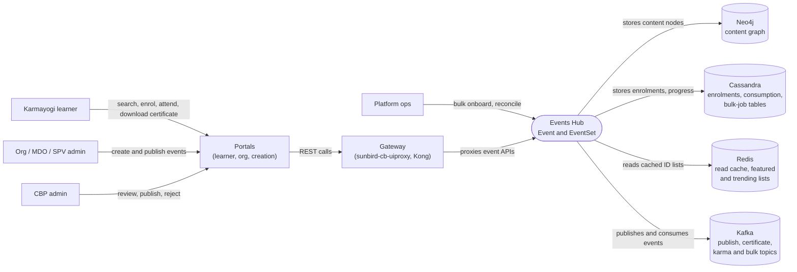

# Events Hub — Context Diagram

## System boundary

Inside the feature are the Event and EventSet content types and the logic that enrols, tracks,
certifies and rewards learners for them: the content actors in `knowledge-platform`, the
enrolment, consumption and certificate actors in `sunbird-course-service`, the event
utilities in `sunbird-cb-ext`, and the Flink publish and certificate jobs. Outside it are the
people who browse, author, review and operate events, the three portal front ends and the
gateway in front of the backends, and the Neo4j, Cassandra, Redis and Kafka stores they share.

## Diagram

## Elements

| Element | Role | Detailed in |
|---|---|---|
| Events Hub (Event and EventSet) | Central feature: content CRUD and publish, three enrolment paths, consumption, certificates, karma points, bulk operations | [hld.md](hld.md) |
| Karmayogi learner | Discovers, enrols in, attends and gets certified for events | [use-cases.md](use-cases.md) |
| Org / MDO / SPV admin | Creates and publishes events for their organisation in the Org Portal | [use-cases.md](use-cases.md) |
| CBP admin | Reviews, publishes or rejects submitted events and links them to courses in the Creation Portal | [use-cases.md](use-cases.md) |
| Platform ops | Runs bulk-onboard CSV uploads and post-consumption reconciliation | [use-cases.md](use-cases.md) |
| Portals (learner, org, creation) | Front ends for browsing, authoring and review | [hld.md](hld.md) |
| Gateway (`sunbird-cb-uiproxy`, Kong) | Pass-through proxy that forwards event APIs to the backends | [apis.md](apis.md) |
| Neo4j | Content graph holding Event and EventSet nodes and their relations | [hld.md](hld.md) |
| Cassandra | Enrolment, consumption and bulk-job tables | [hld.md](hld.md) |
| Redis | Content read cache and featured and trending event ID lists | [apis.md](apis.md) |
| Kafka | Carries publish instructions, certificate, karma-point and bulk-job events | [hld.md](hld.md) |

> **Verification boundary:** elements and interactions come from the feature's own pages,
> read in full: index, use cases, APIs and HLD. The LLD was not read for this diagram. Source
> spot-checks were minimal and read-only: the Event publish and EventSet create routes in
> `knowledge-platform` were confirmed; the course-service enrolment routes and certificate
> topic name were not located by a quick search and rely on the docs. Not re-verified: Kong
> path rewrites, downstream consumers of the karma-point topic, and the portal player call
> that records consumption. The separate "meetup" microsite is out of scope, as the docs state.
