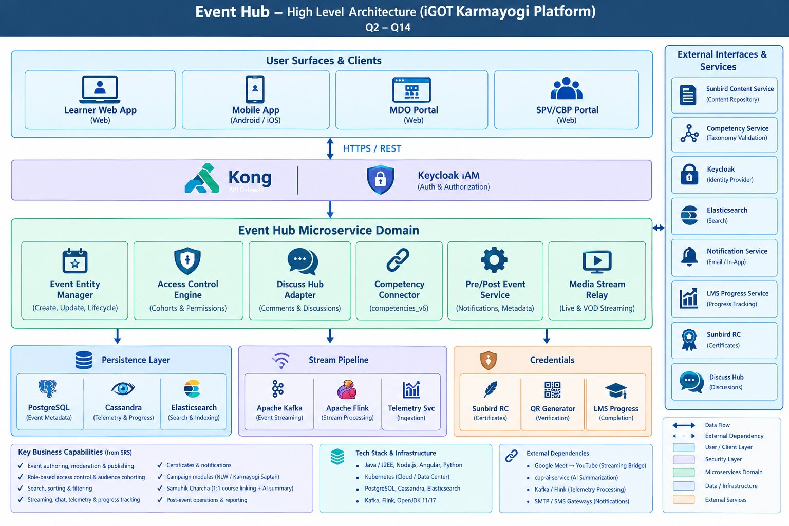

# Events Hub — High-Level Design

## 1. Purpose and scope

The Event Hub is the synchronous and interactive virtual learning subsystem of the iGOT Karmayogi platform. It covers the lifecycle of a virtual session: authoring and scheduling, editorial moderation, publication, live and recorded streaming, in-session chat, watch-time telemetry, verifiable certificates and post-event reporting. This page describes the architecture at component level. The requirements are in the [SRS](srs.md), the end-to-end business flow is in the [Overview](index.md), and the mechanics are in the [LLD](lld.md).

**In scope:** the Learner web and mobile apps, the MDO and SPV/CBP portals, the Event Hub microservice domain, its persistence, stream pipeline and credential components, and its integrations with the shared platform services.

**Out of scope:** physical venue management, direct unmoderated publishing by MDOs, and the internals of the shared platform services the Event Hub calls.

## 2. Architecture overview

*Figure 1. High-level architecture of the Event Hub on the iGOT Karmayogi platform (Q2–Q14).*

Figure 1 has five layers, drawn top to bottom, with the external services on the right.

1. **User surfaces and clients.** The Learner Web App, the Mobile App (Android and iOS), the MDO Portal and the SPV/CBP Portal.
2. **Security layer.** All clients call the platform over HTTPS and REST through **Kong**, the API gateway, with **Keycloak IAM** providing authentication and authorization.
3. **Event Hub microservice domain.** Six services: Event Entity Manager, Access Control Engine, Discuss Hub Adapter, Competency Connector, Pre/Post Event Service and Media Stream Relay.
4. **Data and infrastructure.** A persistence layer (PostgreSQL, Cassandra, Elasticsearch), a stream pipeline (Apache Kafka, Apache Flink and the telemetry service) and a credentials group (Sunbird RC, QR generator and LMS progress).
5. **External interfaces and services.** Sunbird Content Service, the Competency Service, Keycloak, Elasticsearch, the Notification Service, the LMS Progress Service, Sunbird RC and Discuss Hub, connected to the Event Hub domain by two-way data flow.

The band at the bottom of the figure lists the key business capabilities, the tech stack and the external dependencies.

## 3. Layers and components

### 3.1 User surfaces and clients

| Client | Role |
|---|---|
| Learner Web App | Primary surface for event discovery, calendar, playback, chat and certificate download. |
| Mobile App (Android / iOS) | Responsive mobile experience with the same discovery, calendar, playback, chat and certificate features. |
| MDO Portal | Event authoring for MDO Admins and Leaders: drafts, agendas, handouts, competency mapping and post-event data entry. |
| SPV / CBP Portal | Moderation queues (New Requests and Past Requests) for SPV Publishers, and direct publishing for SPV Admins. |

### 3.2 Security layer

| Component | Role |
|---|---|
| Kong (API gateway) | Unified routing, rate limiting and SSL termination; inspects token roles before a request reaches a service. |
| Keycloak IAM | OAuth2 authentication and role assertion (MDO Admin, SPV Publisher, Learner); resolves the organisation of the user. |

### 3.3 Event Hub microservice domain

| Service | Responsibility |
|---|---|
| Event Entity Manager | Create, update and lifecycle of event entities: Draft, Sent_to_Publisher, Live, Rejected, Cancelled and Past. |
| Access Control Engine | Cohorts and permissions. Evaluates Public or Custom access using Boolean Canonical Form rules and the catalog visibility toggle. |
| Discuss Hub Adapter | Comments and discussions: in-session chat with replies, likes and sorting, and linked discussion threads. |
| Competency Connector | Validates and links hierarchical `competencies_v6` tags to events. |
| Pre/Post Event Service | Notifications and metadata: agendas, handouts, speakers, reminders, and post-event attendee count, duration, recording link and summary. |
| Media Stream Relay | Live and video-on-demand streaming: uploaded MP4 files and external YouTube streams. |

### 3.4 Persistence layer

| Store | Holds |
|---|---|
| PostgreSQL | Event metadata (relational). |
| Cassandra | Telemetry state and learner progress. |
| Elasticsearch | Catalog search and indexing for published events. |

### 3.5 Stream pipeline

| Component | Role |
|---|---|
| Apache Kafka | Event streaming; decouples client telemetry from database writes. |
| Apache Flink | Stream processing: aggregates cumulative watch time against event duration, and runs post-publish jobs such as bidirectional course linkage. |
| Telemetry Service | Ingestion of standardized client telemetry (start, play, heartbeat, pause, end). |

### 3.6 Credentials

| Component | Role |
|---|---|
| Sunbird RC | Generates cryptographically verifiable certificates. |
| QR Generator | Adds the verification QR code to each certificate. |
| LMS Progress | Records completion once the watch-time threshold is met. |

### 3.7 External interfaces and services

| Service | Provides |
|---|---|
| Sunbird Content Service | Content repository: event entities, DO IDs (`do_...`) and uploaded attachments. |
| Competency Service | Taxonomy validation against the Karmayogi Competency Model. |
| Keycloak | Identity provider. |
| Elasticsearch | Search. |
| Notification Service | Email and in-app notifications. |
| LMS Progress Service | Progress tracking. |
| Sunbird RC | Certificates. |
| Discuss Hub | Community discussion threads. |

## 4. End-to-end flow

1. An MDO Admin or Leader drafts an event in the MDO Portal. Drafts auto-save with validation bypassed.
2. On submit, the Event Entity Manager checks the mandatory fields and sets the status to Sent_to_Publisher.
3. The event appears in the SPV/CBP Portal's New Requests queue. The SPV Publisher inspects the media, agenda and handouts, and edits the competency tags.
4. The publisher approves or rejects. Approval sets the status to Live, indexes the event in Elasticsearch and triggers the background Flink jobs. Rejection requires remarks and returns the event to the MDO's Rejected tab. An SPV Admin can publish directly without review.
5. Learners find the event through search, the calendar strip or the curated feeds. The Access Control Engine checks eligibility, and the learner enrolls.
6. During playback the client emits telemetry. Kafka carries it to Flink, which aggregates watch time and updates progress in Cassandra.
7. When the watch percentage meets the configured threshold, progress is marked complete and Sunbird RC issues a verifiable certificate with a QR code.
8. After the session, the MDO Admin records the attendee count, duration, recording link and summary.

## 5. Interfaces

| Interface | Protocol | Purpose |
|---|---|---|
| Clients to Kong | HTTPS, REST + JSON | All learner, MDO and SPV requests; real-time chat uses WebSocket (WSS). |
| Kong to Event Hub services | HTTPS (internal) | Routing of authenticated requests with verified roles. |
| Keycloak | OAuth2 / JWT bearer tokens | Authentication, role assertion and organisation resolution. |
| Client to Kafka (via telemetry) | Event streaming | Playback and interaction telemetry. |
| Event Hub to platform services | HTTPS REST | Content, competency, notification, progress and certificate calls. |

## 6. Key design decisions

| Decision | Rationale |
|---|---|
| Federated authoring with central moderation | MDOs author sessions; SPV Publishers keep taxonomy and quality standards; SPV Admins can bypass review. |
| Authorization enforced at the gateway and the service | Kong inspects token roles; services re-check the role and ownership. |
| Boolean Canonical Form for cohorts | Rules combine with OR and conditions with AND, which makes audience rules simple to evaluate and explain. |
| Asynchronous telemetry pipeline | Kafka and Flink decouple high-volume playback telemetry from database updates, keeping the portal responsive during mass campaigns. |
| Completion gated by watch percentage | Certificates reflect verified consumption, not just attendance. |
| Reuse of shared platform services | Identity, content, competency, notifications, certificates and discussions come from existing services. |
| Streaming through existing providers | Live sessions use YouTube broadcasts or meeting links; there is no in-platform streaming bridge. |

## 7. Technology stack

| Area | Technology |
|---|---|
| Runtime | Java / J2EE (OpenJDK 11 / 17), Node.js, Angular, Python (AI services) |
| Infrastructure | Kubernetes (cloud / data centre) |
| Data | PostgreSQL, Cassandra, Elasticsearch |
| Streaming | Apache Kafka, Apache Flink |
| Clients | Web browsers (Chrome, Firefox, Edge); Android and iOS |

## 8. Quality attributes

| Attribute | Approach |
|---|---|
| Performance | Standard read endpoints and search respond within the SRS targets; lazy loading and consolidated payloads on listing feeds. |
| Scalability | Services run on Kubernetes; Kafka buffers telemetry bursts. |
| Availability | High-availability targets and recovery objectives defined in the SRS. |
| Security | HTTPS everywhere, JWT validation, role-based access, audit trails on every state change. |
| Auditability | Every lifecycle status change is recorded with a timestamp and the acting user. |

## 9. External dependencies

- **Google Meet to YouTube streaming bridge:** not automated; live sessions use direct YouTube broadcast links or meeting links.
- **cbp-ai-service:** produces the post-session AI summary for Samuhik Charcha.
- **Kafka and Flink:** telemetry collection and completion processing need healthy brokers and stream consumers.
- **SMTP / SMS gateways:** delivery of email notifications.
