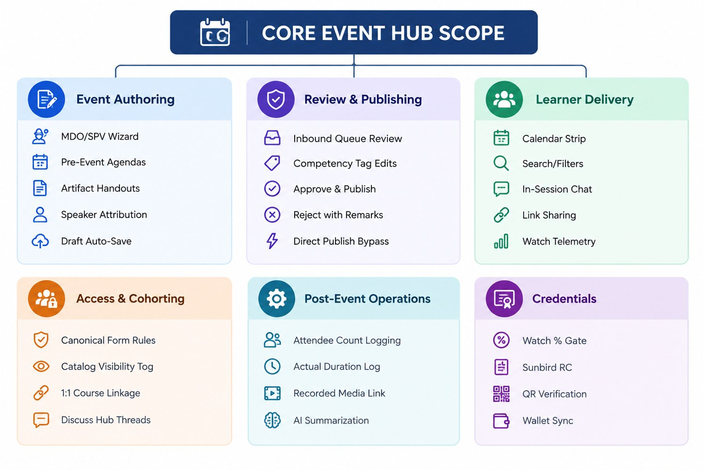
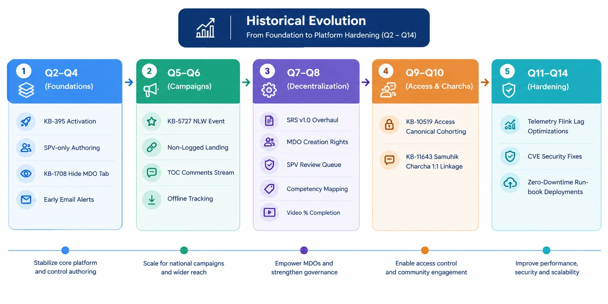
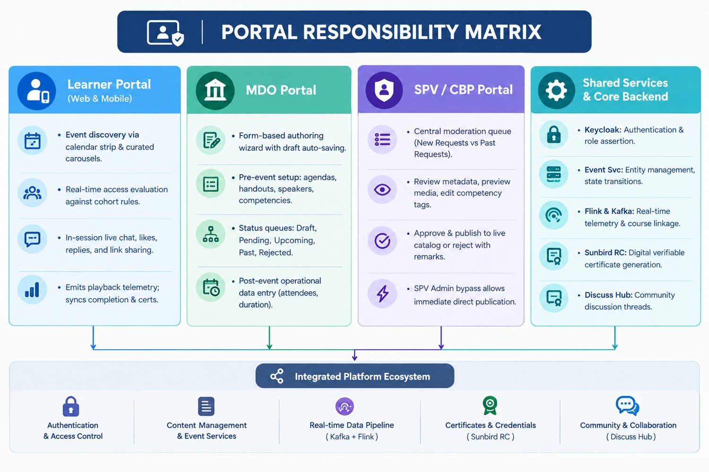
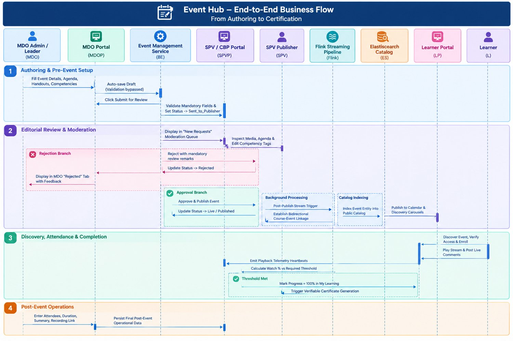
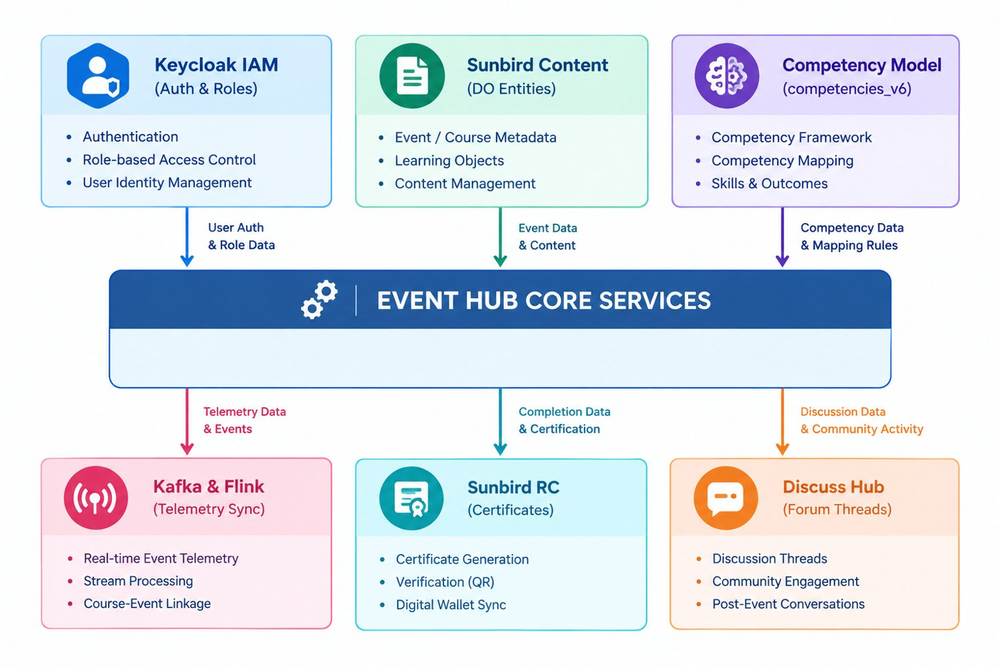

## 1. Executive Summary

### What Event Hub Is

The Event Hub is the synchronous and interactive virtual learning management subsystem of the iGOT Karmayogi platform. It provides end-to-end lifecycle governance for virtual sessions—encompassing scheduling, moderation, publication, live streaming, interactive participant engagement, telemetry-driven completion tracking, verifiable digital credentialing, and post-event analytical reporting.

### Why It Was Introduced

Prior to Event Hub, virtual learning and interactive discussions across Indian government administrative bodies were conducted through fragmented third-party meeting tools without institutional continuity. Sessions lacked integration with platform user identities, offered no connection to official civil service competency models, and provided no auditable record of attendance, participation, or learning outcomes. Event Hub was introduced to centralize virtual sessions within a unified, secure, and governed platform ecosystem.

### Business Objectives

- **Promote Collaborative Governance:** Enable Ministries, Departments, and Organizations (MDOs) to host interactive roundtables, webinars, and policy dissemination sessions directly for civil servants.
- **Competency-Linked Learning:** Connect virtual attendance directly to the national Karmayogi Competency Model (competencies_v6), allowing civil servants to acquire recognized competencies through verified participation.
- **Federated Authoring with Central Quality Control:** Enable MDOs to author specialized sessions while preserving platform-wide quality standards through Special Purpose Vehicle (SPV / Karmayogi Bharat) editorial moderation.
- **Targeted Knowledge Delivery:** Support audience segmentation and cohort-based event delivery via granular access control rules.
- **Sustained Institutional Dialogue:** Transition virtual events from isolated broadcasts into continuous learning engagements via community discussion threads and post-event synthesis.

### Evolution from Q2 to Q14

- **Q2–Q4 (Centralized Foundation):** Platform activation (KB-395) providing basic event consumption for learners, managed entirely by SPV technical staff. MDO event authoring was hidden in Q3 (KB-1708) to consolidate control during platform stabilization.
- **Q5–Q6 (Campaign-Scale Delivery):** Scaled to support National Learning Week (NLW / Karmayogi Saptah, KB-5727) through non-logged-in promotional landing pages (KB-7034), live Table of Contents (TOC) comment streams, and offline attendance logging (KB-7118).
- **Q7–Q8 (Decentralized Governance & Certification):** A comprehensive architectural overhaul (SRS v1.0, March 2025; Q7 FRS 307396630) decentralized creation rights to MDO Admins/Leaders (KB-7744), established an SPV Publisher review queue (KB-7934), introduced interactive learner calendar strips (KB-8013), and established video consumption percentage thresholds for webinar certifications (KB-9870, KB-10007).
- **Q9–Q10 (Access Cohorting & Samuhik Charcha):** Implementation of Boolean Canonical Form access rules and search visibility toggles (KB-10519). Introduction of Samuhik Charcha (KB-11643), adding 1:1 bidirectional platform course linkage, Discuss Hub integration, and automated post-session AI summarization (BRD 510918699, SDD 546177039).
- **Q11–Q14 (Platform Hardening & Pipeline Scale):** No new standalone functional scopes were introduced; engineering efforts focused on infrastructure scaling, resolving Apache Flink consumer backpressure under high telemetry loads, container security patches, and deployment automation (Sprints 34–41.1).

### Current Documented Capabilities

The platform supports multi-role authoring, draft auto-saving with validation bypass, SPV editorial review, Canonical Form cohort allocation, live in-session chat, personalized calendar strips, watch-time telemetry calculation, verifiable Sunbird RC certificates, and post-session operational reporting.

## 2. Product Scope

### 2.1 Functional Scope



### 2.2 Supported Event Types

- **Recorded Events (record):** Video sessions hosted directly via uploaded platform media assets (MP4) or external streaming links (YouTube).
- **Webinars & Live Broadcasts (live):** Scheduled virtual sessions supporting real-time participant interactions, speaker attribution, and telemetry-driven attendance tracking.
- **Samuhik Charcha (Collaborative Roundtables):** Synchronous discussion sessions tied 1:1 to a platform course, accompanied by pre-reads, linked community discussion threads, and post-session AI summaries. (End date/time is intentionally omitted per SDD 546177039 §1.1).
- **National / State Learning Week Campaigns:** Mass campaign events configured with public promotional landing pages and offline participation logging.

### 2.3 Supported User Roles

- **Learner:** Browse public and eligible custom events, enroll, participate in live sessions, submit comments, and download completion certificates.
- **MDO Admin / Leader:** Draft, configure, schedule, and cancel department-scoped events; submit events for review; input post-event operational data. Restricted from direct global publishing.
- **SPV Publisher:** Review inbound MDO event submissions; inspect media and handouts; adjust mapped competency framework tags; publish or reject events with mandatory remarks.
- **SPV Admin:** Full administrative privileges across all events, including direct publishing without secondary review.

### 2.4 Supported Portals and Applications

- **Learner Portal (Web):** Primary web application for event discovery, calendar management, playback, and interaction.
- **Learner Mobile App:** Responsive mobile application supporting calendar strips, video playback, chat, and certificate downloads.
- **MDO Portal:** Administrative web console for session authoring, draft tracking, and post-event analytics entry.
- **SPV / CBP Portal:** Central administrative console for moderation queues (New Requests / Past Requests) and platform-wide catalog publishing.

### 2.5 In-Scope vs. Out-of-Scope Boundaries

| Functional Area | In-Scope Functionality | Out-of-Scope / Excluded Capabilities | Source Reference |
|---|---|---|---|
| Delivery Medium | Virtual streaming (MP4 uploads, YouTube URLs, meeting room links). | Physical in-person venue management, room bookings, and hardware check-in kiosks. | SRS 325746689 §3.2, BRD 510918699 |
| Publishing Rights | Centralized review by SPV Publisher; direct bypass by SPV Admin. | Direct, unmoderated global catalog publishing by MDO Admins. | Q7 FRS 307396630 §EVNT_HUB_BR2 |
| Institutional Spaces | Standard MDO Portal authoring workflows. | Direct event authoring from Content Provider (ATI/CTI) dedicated spaces. | Q7 BRD 253853808 §Scope |
| Link Distribution | Copying verified registration links for peer sharing on iGOT. | Direct one-click sharing via third-party messaging apps (WhatsApp, Telegram). | Q7 BRD 253853808 §Scope |
| AI Summarization | Automated post-event summary generation comparing discussions to agendas. | Manual editing of AI summaries; multi-language AI summarization in initial release. | BRD 510918699 §Scope |
| Feedback Modules | Standard platform Net Promoter Score (NPS) dialogs upon session exit. | Custom per-event rating, surveys, or feedback forms for Samuhik Charcha. | BRD 510918699 §Scope |

## 3. Historical Evolution



### Q2–Q4: Initial Foundation and Early Enhancements

- **Documented Requirements & Scope:** Initial platform activation (KB-395) established the centralized Event Hub. Authoring was restricted to SPV technical staff.
- **Key Interventions:** In Q3, Jira ticket KB-1708 removed the event creation tab from the MDO Portal to consolidate catalog governance. Notifications were introduced via basic email templates (KB-1165, KB-2508).
- **Implementation Evidence:** Basic event entities in Sunbird Cassandra/PostgreSQL; public catalog display on the Learner Portal.

### Q5–Q6: National Learning Week and Campaign Features

- **Documented Requirements & Scope:** Driven by National Learning Week (NLW / Karmayogi Saptah, KB-5727), requirements demanded public discovery and high-volume broadcast support.
- **Key Capabilities Delivered:** Non-logged-in public event landing pages (KB-7034), embedded discussion streams on the Table of Contents page (KB-7118), and administrative bulk-logging of offline auditorium attendance (KB-7118). Feedback collection was integrated via post-session NPS dialogs (KB-6176).

### Q7–Q8: Portal Integration, Governance, and Completion

- **Documented Requirements & Scope:** Formalized under SRS — Events Hub (v1.0, March 2025) and Q7 FRS 307396630. This milestone decentralized event authoring while establishing formal quality gates.
- **Key Capabilities Delivered:**
  - MDO authoring was reinstated with draft auto-saving and mandatory-field submission checks (KB-7744, KB-7790).
  - An SPV Publisher moderation dashboard was deployed with New Requests and Past Requests queues, competency tag editing, and mandatory rejection remarks (KB-7934, KB-8080).
  - Learner UX was revamped with personalized calendar strips showing event indicator dots, shareable registration links, and live commenting (KB-7854, KB-7924).
  - Backend alignment with the Karmayogi Competency Model (competencies_v6, KB-7564).
  - Video consumption percentage thresholds (KB-10007) and webinar certificates (KB-9870) were introduced.

### Q9–Q10: Access Control, Search, Streaming, and Samuhik Charcha

- **Documented Requirements & Scope:** Guided by KB-10519 BRD/FRS (June 2025) and Samuhik Charcha BRD 510918699 / SDD 546177039 (Oct–Nov 2025).
- **Key Capabilities Delivered:**
  - Granular access control engine evaluating Boolean Canonical Form rules (OR/AND logic) with search visibility toggles (KB-10519).
  - Deployment of the Samuhik Charcha collaborative model: 1:1 bidirectional course linkage, asynchronous Flink post-publish jobs, Discuss Hub thread synchronization, and post-session AI summarization (KB-11643).
  - Advanced media player capabilities supporting concurrent video-on-demand and live streaming feeds (KB-10931).

### Q11–Q14: Verified Technical and Functional Enhancements

- **Documented Scope:** Comprehensive searches across enterprise artifacts verify that no new standalone functional requirements or BRDs were introduced for Event Hub in Q11, Q12, Q13, or Q14.
- **Engineering Reality:** Work across Sprints 34–41.1 focused on platform-level infrastructure maintenance:
  - Addressing Apache Flink consumer backpressure and lag on high-volume telemetry topics following national campaigns (KB-14424).
  - Patching SonarQube quality and CVE security vulnerabilities across backend microservices.
  - Optimizing database read replicas and indexing across PostgreSQL and Cassandra.
  - Standardizing automated container build and deployment runbooks.

## 4. Consolidated Feature Catalogue

### Feature 1: Event Lifecycle and State Governance

Manages the end-to-end progression of an event from creation to completion. Incomplete drafts bypass validation, while submission enforces strict mandatory-field checks. Events move through defined states (Draft, Sent_to_Publisher, Live, Rejected, Cancelled, Past), maintaining an auditable trail across portals.

### Feature 2: Event Authoring and Metadata Configuration

Provides a form-based wizard in the MDO and SPV portals. Captures event title, narrative description, brand icon, scheduled start date/time, media URLs, pre-event agendas, background handouts (eventHandouts), speaker profiles, and competency framework tags (competencies_v6). Samuhik Charcha sessions intentionally omit end dates and times to allow flexible roundtable discussions.

### Feature 3: Editorial Moderation and Publishing

Provides a moderation dashboard for SPV Publishers. Publishers can review incoming MDO submissions, inspect media links and handouts, and adjust mapped competency tags to ensure taxonomy compliance. Approving publishes the event directly to the live catalog; rejecting requires mandatory text remarks returned to the MDO. SPV Admins bypass this moderation queue to publish immediately.

### Feature 4: Role-Based Access Control and Canonical Cohorting

Governs event visibility and enrollment. In Public mode, events are open to all registered learners. In Custom mode, access is restricted to cohorts evaluated via Boolean Canonical Form logic:

```
Cohort Access = Rule 1 OR Rule 2 OR ... OR Rule n
where each Rule i = Condition i,1 AND ... AND Condition i,m
```

Conditions evaluate organization, designation, verification status, and cadre group. A visibility toggle allows administrators to show the event Table of Contents (TOC) with an ineligibility explanation, or hide the session entirely from search results.

### Feature 5: Discovery, Search, Categorization, and Filtering

Enables learners to locate sessions via keyword search, calendar strips, and curated feeds (Featured, Trending, Recommended). Filtering supports category (resourceType), competency area/theme, date range, and duration. Search sorting displays upcoming events in ascending/descending date order and past events in descending order.

### Feature 6: Learner Participation and User Experience

Provides an integrated participation workflow. Includes one-click enrollment, an interactive calendar strip with red indicator dots on active event dates, copyable registration links for peer sharing, speaker profile attribution linked to Network Hub, and live in-session commenting with replies, likes, and sorting.

### Feature 7: Media Streaming and Playback Controls

Supports playback of uploaded MP4 video files via direct platform URLs or external YouTube video streams. Provides playback controls, adaptive bitrate streaming, and full-screen presentation modes. Automated Google Meet-to-YouTube streaming bridges remained an external dependency; live events were configured using direct YouTube broadcast URLs or virtual meeting links.

### Feature 8: Telemetry, Consumption Tracking, and Completion

Captures client playback telemetry (start, play, heartbeat, pause, end) enriched with user IDs, event IDs, and timestamps. Streaming pipelines calculate cumulative watch time against the event runtime. Learners must satisfy a configured video consumption percentage threshold before the session is marked complete in My Learning.

### Feature 9: Verifiable Credentials and Certificates

Issues verifiable digital completion certificates for qualifying webinars when learners meet the consumption percentage threshold. The system invokes the Sunbird RC certificate engine to generate cryptographically verifiable PDF credentials with secure QR codes, synchronized to the learner's credentials wallet.

### Feature 10: Communications and Notifications

Dispatches automated email and in-app notifications across session milestones: learner registration confirmations, scheduled commencement reminders (24-hour and 1-hour), inbound moderation alerts for SPV Publishers, and approval/rejection notices (with review remarks) sent to MDO authors.

### Feature 11: National and State Learning Campaigns

Supports high-volume learning campaigns (National Learning Week, State Learning Weeks in Andaman, Rajasthan, Maharashtra) through specialized capabilities: non-logged-in public promotional landing pages, live TOC comment streams, and administrative tools for logging offline auditorium attendance.

### Feature 12: Samuhik Charcha Collaborative Model

A specialized group discussion format linked 1:1 with a platform course. Features a dedicated discovery tab, pre-event reading materials, an automated Flink post-publish course linkage job, an integrated Discuss Hub discussion thread, and an automated post-session AI summarization pipeline comparing discussions against the planned agenda.

### Feature 13: Operational Accounting and Post-Event Setup

Introduced in Q10 (SDD 546177039), this administrative workflow requires MDO Admins to record post-event operational data after session conclusion: actual attendee count (noOfAttendees), actual duration in minutes (eventDuration), recorded video URL (recordedMediaLink), and a narrative summary (meetingSummary).

### Feature 14: Feedback, Sentiment, and NPS Analytics

Collects post-event participant ratings (1–10) and qualitative feedback tags via standard platform Net Promoter Score (NPS) dialogs upon session exit, calculating departmental sentiment benchmarks.

### Feature 15: Architecture Optimization and Scaling (Q11–Q14)

Focuses on platform resilience under high concurrency: lazy loading across listing feeds, API payload consolidation, tuning of Elasticsearch search indexes, and resolving Apache Flink consumer backpressure on telemetry topics.

## 5. Portal-Wise Overview



### A. Learner Portal (Web)

Serves as the primary engagement surface for civil servants. Renders personalized calendar strips marked with red indicator dots on enrolled dates, curated carousels (Featured, Trending, Recommended), and category tabs. Enforces access control checks; if an ineligible learner accesses a restricted event with visibility toggled ON, the TOC is visible but enrollment is blocked with an explanatory message. Provides embedded media playback, in-session chat, and certificate downloads.

### B. SPV / CBP Portal

The administrative console used by Karmayogi Bharat / CBC administrators and publishers. Manages the global moderation queue split into New Requests and Past Requests. Publishers verify MDO session metadata, preview video links, validate handouts, and edit mapped competencies_v6 tags before publication. Actioning approval triggers live indexing and background Flink jobs; actioning rejection mandates textual review remarks returned to the authoring MDO.

### C. MDO Portal

The operational console for departmental nodal officers and training coordinators. Allows MDO Admins and Leaders to author sessions, structure agendas, attach content handouts, and map competencies. Incomplete drafts auto-save without validation, while submission for review enforces strict mandatory-field checks. Following session conclusion, MDO Admins record verified attendance numbers, duration, recording URLs, and narrative summaries.

### D. iGOT Shared Services & Platform Core

- **Kong API Gateway:** Manages unified routing, rate limiting, and SSL termination.
- **Keycloak IAM:** Enforces OAuth2 authentication and user role assertion (MDO Admin, SPV Publisher, Learner).
- **Sunbird Content & LMS Services:** Maintains content hierarchies, DO IDs (do_...), and course progress tracking.
- **Apache Kafka & Flink Pipeline:** Decouples high-volume client telemetry from database writes and executes post-publish course-event linkages.
- **Sunbird RC:** Issues cryptographically verifiable PDF credentials with secure QR codes.
- **Discuss Hub Service:** Provisions and synchronizes linked community discussion forums.

### E. Mobile Application Integration

Provides a responsive mobile experience for learners. Delivers feature parity for event discovery, calendar views, video streaming, in-session commenting, and certificate downloads. Native device calendar synchronization (.ics integration) was proposed but lacks verification in production mobile test suites.

### F. Content Portal (Boundary Analysis)

Dedicated spaces created for Central and State Training Institutions (ATI/CTI, KB-4107) support institutional course authoring and branding. These spaces do not contain an independent event scheduling system; all training institution events must use standard MDO authoring or SPV publishing workflows.

## 6. End-to-End Business Flow

### How a Karmayogi experiences it

<div class="fp-steps">
<div class="fp-step"><b>1 &middot; DISCOVER</b><p>Search, a home-page widget, or the Event Hub's browse pages</p></div>
<div class="fp-step"><b>2 &middot; VIEW</b><p>Detail page, incl. any linked course's progress</p></div>
<div class="fp-step"><b>3 &middot; ENROLL</b><p>One of three independent enrollment code paths</p></div>
<div class="fp-step"><b>4 &middot; ATTEND</b><p>Consumption recorded in the shared Course consumption table</p></div>
<div class="fp-step"><b>5 &middot; CERTIFY</b><p>Certificate + karma points, always assuming 100% completion</p></div>
</div>

### Event Lifecycle Workflow



## 7. Major Business Rules

| Rule Identifier | Functional Area | Business Rule Summary | Trigger Condition | System Behavior & Validation | Error / Rejection Handling | Source Reference |
|---|---|---|---|---|---|---|
| EVNT_HUB_BR1 | Authoring | Authoring restricted to authorized administrative roles | Click "Create Event" | Verifies user token contains MDO_ADMIN, MDO_LEADER, or SPV_ADMIN | Action blocked; HTTP 403 Forbidden | Q7 FRS 307396630 |
| EVNT_HUB_BR2 | Moderation | SPV moderation required for MDO events; SPV Admins bypass | Submit / Publish | MDO submissions move to Sent_to_Publisher. SPV Admin submissions publish directly to Live. | MDOs cannot publish directly to the live catalog | Q7 FRS 307396630 |
| EVNT_HUB_BR2_FR1 | Moderation | Rejections require mandatory text remarks | Click "Reject" | Enforces non-empty text input in rejection dialog | Action blocked until remarks are entered | Q7 FRS 307396630 |
| EVNT_HUB_BR5 | Learner UX | Active event dates display calendar indicators | Calendar render | Evaluates enrolled dates; marks matching dates with red indicator dots | Clean date tile rendered if no event exists | Q7 FRS 307396630 |
| EVNT_HUB_BR6 | Learner UX | Registration links can be copied for peer sharing | Click "Share" | Copies secure event URL to clipboard for peer distribution | Third-party messaging sharing is unsupported | Q7 FRS 307396630 |
| EVNT_HUB_BR7 | In-Session Chat | Interactive chat supports replies, likes, and sorting | In-session chat | Users can post top-level comments, reply, like, and sort by Top or Recent | Inherits Discuss Hub moderation filters | Q7 FRS 307396630 |
| EVNT_HUB_BR8 | Telemetry | User interactions emit standardized telemetry | UI / Player actions | Captures User_ID, Event_ID, and timestamps across calendar and player actions | Unauthenticated events are dropped | Q7 FRS 307396630 |
| FR-7 / FR-8 | Access Control | Access evaluated via Boolean Canonical Form rules | Event enrollment | Evaluates cohort eligibility: Rules combined with OR, Conditions with AND | Enrollment blocked with an eligibility error | KB-10519 FRS 421494793 |
| FR-10 | Access Control | Visibility toggle controls search discovery | Search query | If ON: Ineligible users see TOC with warning. If OFF: Event hidden from search results. | Event excluded from search when Toggle is OFF | KB-10519 FRS 421494793 |
| DERIVED_BL_01 | Authoring | Drafts bypass validation; submissions enforce checks | Save vs Submit | Drafts allow incomplete fields. Submission validates all mandatory metadata. | Form highlights missing fields on submission | Sprint 22 Doc 293765121 |
| DERIVED_BL_02 | Authoring | Editing restricted to editable states | Click "Edit" | Edits allowed only when status is Draft or Rejected | Editing disabled for Live or Sent_to_Publisher | SRS 325746689 §3.3.1 |
| DERIVED_BL_03 | Samuhik Charcha | 1:1 bidirectional platform course linkage | Session authoring | Enforces single-selection course dropdown; links one course to one Charcha | Multiple course selections blocked | SDD 546177039 §1.3 |
| DERIVED_BL_04 | Samuhik Charcha | End date/time omitted by system design | Select category | System automatically disables and omits endDate and endTime fields | Bypassed by system configuration | SDD 546177039 §1.1 |
| DERIVED_BL_05 | Completion | Completion gated by video consumption percentage | Playback telemetry | Evaluates cumulative watch time against event runtime vs configured threshold | Session remains in-progress if threshold is unmet | KB-10007, KB-9870 |

## 8. Integrations and Dependencies



- **Identity & Access Management (Keycloak):** Validates OAuth2 JWT bearer tokens, enforces user role assertions (MDO Admin, SPV Publisher, Learner), and resolves multi-tenant organization IDs.
- **Content Hierarchy Store (Sunbird Content Service):** Persists core event entities, generates unique DO IDs (do_...), and manages uploaded artifact attachments.
- **Competency Framework Engine:** Integrates with the Karmayogi Competency Model API to validate and link hierarchical competencies_v6 tags.
- **Streaming Data Pipelines (Apache Kafka & Flink):** Ingests real-time client telemetry, aggregates watch durations, updates Cassandra learner progress stores, and handles post-publish course-event linkages.
- **Digital Credentialing Engine (Sunbird RC):** Issues cryptographically signed PDF certificates containing verification QR codes upon verified session completion.
- **Discuss Hub Community Integration:** Provisions and synchronizes dedicated community discussion threads for ongoing dialogue following Samuhik Charcha sessions.
- **External Streaming Dependencies:** Relies on third-party streaming providers (YouTube Live) or external virtual meeting tools (Google Meet, Zoom, MS Teams). Automated Google Meet-to-YouTube streaming bridges remained an external platform dependency; live sessions used direct YouTube broadcast links.

## 9. Current Documented State

### 9.1 Confirmed Documented Functionality

- **Decentralized Authoring & Review:** MDO event drafting, validation bypass during drafting, SPV Publisher review queues, and SPV Admin direct publishing bypass are fully verified in specifications and test logs.
- **Competency Framework Integration:** Tagging sessions with the multi-tier competencies_v6 taxonomy is verified across authoring and moderation interfaces.
- **Canonical Form Access Control:** Audience cohorting via Boolean rule sets (OR/AND logic) with search visibility toggles is fully specified and implemented.
- **Samuhik Charcha Architecture:** 1:1 course linkage, Flink post-publish processing, Discuss Hub thread synchronization, and post-event operational reporting fields are verified in technical specifications.
- **Telemetry & Progress Accounting:** High-volume telemetry emission via Kafka, Flink stream processing, and consumption percentage-gated completion accounting are confirmed in deployment and QA artifacts.

### 9.2 Requirements Remaining Unverified / Incomplete

- **Automated Live Streaming Bridge API:** Automated bridging between Google Meet and YouTube streams was dependent on an unreleased platform API; production live events used manual stream URL configurations.
- **Configurable Video Consumption Threshold Value:** While the consumption percentage evaluation logic is verified (KB-10007), the exact threshold value (e.g., 70% vs. 80%) is managed in platform service configuration files rather than hardcoded in the BRD.
- **Samuhik Charcha AI Operational SLAs:** Automated AI summarization was approved for Q10 (BRD 510918699), but queue timeout and retry SLAs are omitted from the functional specifications.
- **Mobile Native Calendar Synchronization:** Native device calendar integration (.ics sync) lacks verification in production mobile test suites; mobile consumption relies on in-app calendar strips.
- **Q11–Q14 Standalone Functional Features:** Enterprise searches verify that no new standalone functional requirements or BRDs were introduced for Event Hub in Q11–Q14; activities were dedicated to infrastructure scaling and platform hardening.

## 10. Risks, Gaps, and Limitations

| Risk / Gap Identifier | Classification | Description & Technical Impact | Context & Supporting Evidence | Mitigation & Operational Recommendation |
|---|---|---|---|---|
| GAP-TECH-01 | Technical Dependency | Automated GMeet-to-YouTube streaming bridge unavailable | Q7 FRS 307396630 §Dependencies cites missing public bridging API. | Standardize on manual YouTube Live stream keys or direct virtual meeting room URLs. |
| GAP-DOC-02 | Documentation Gap | Exact video consumption threshold percentage unstated in BRD | KB-10007 approves logic; exact percentage stored in configuration properties. | Audit LMS service configuration files (application.conf) to verify active threshold values. |
| GAP-DOC-03 | Specification Gap | AI summarization timeout, retry, and review SLAs omitted | BRD 510918699 outlines AI summary logic but omits queue timeout rules. | Audit cbp-ai-service worker queues to establish transcript chunking and timeout handling. |
| RISK-OPS-01 | Operational Risk | High-volume telemetry consumer lag during national campaigns | Post-NLW scaling work (KB-14424) addressed Apache Flink backpressure. | Monitor Flink consumer lag metrics during high-concurrency campaigns. |
| RISK-IAM-02 | Operational Risk | Profile attribute staleness causing cohort evaluation failures | Cohort logic relies on verified user profile attributes in Keycloak. | Implement automated profile validation reminders for nodal departmental officers. |

## 11. Key Conclusions

- **Successful Governance Model:** Event Hub successfully transitioned from a centralized, SPV-only broadcasting tool into a federated model balancing decentralized MDO authoring with central SPV editorial quality control.
- **Pedagogical Integration:** Virtual learning sessions evolved from isolated video broadcasts into structured elements of the civil service curriculum through bidirectional course linking, competencies_v6 mapping, and community discussion threads.
- **Asynchronous Architecture:** The implementation uses an asynchronous streaming architecture (Apache Kafka and Apache Flink) to decouple high-volume client playback telemetry from database state updates, ensuring portal responsiveness during mass learning campaigns.
- **Authoritative Functional Baseline:** The functional specifications established between Q7 and Q10 (SRS v1.0, FRS EVNT_HUB_BR1–BR8, KB-10519, and KB-11643) represent the authoritative functional foundation of Event Hub. Subsequent quarters (Q11–Q14) delivered essential infrastructure reliability, streaming pipeline scaling, and production operational hardening.

## 12. Source References

### Primary Specifications and Architecture Documents

- **SRS — Events Hub (v1.0):** Confluence Page ID: SRS - Events Hub325746689 (Dated: 14/03/2025; Authors: Venkat & Mansur). Covers MDO, CBP, and Learner Portal requirements, external interfaces, NFRs, and user types.
- **Q7 | FRS | Events Hub (v1.1):** Confluence Page ID: Q7 | FRS | Events Hub307396630 (Dated: 07/04/2025; Author: Deepak Goswami). Defines business rules EVNT_HUB_BR1 through EVNT_HUB_BR8, UI flows, and telemetry parameters.
- **Q7 | BRD | Events Hub (v1.1):** Confluence Page ID: Q7 | BRD | Events Hub253853808 (Dated: 07/04/2025; Author: Deepak Goswami). Captures As-Is vs. To-Be processes, user stories, and scoping boundaries.
- **Sprint 22 — Event Hub (Backend Design):** Confluence Page ID: Sprint 22 - Event Hub293765121 (Dated: 29/01/2025; Author: Sai Pradeep Ravipati; Epic: KB-7564). Outlines data schemas, competencies_v6 mapping, and search filters.
- **KB-10519 | Q9 | BRD | Access Control:** Confluence Page ID: KB-10519 | Q9 | BRD | Access Control | Events Hub421068855 (Dated: 30/06/2025; Author: Prakash Kumar Srivastava). Business requirements for cohorting and audience segmentation.
- **KB-10519 | Q9 | FRS | Access Control:** Confluence Page ID: KB-10519 | Q9 | FRS | Access Control | Events Hub421494793 (Dated: 30/06/2025; Author: Prakash Kumar Srivastava). Functional rules for Boolean Canonical Form evaluation and visibility toggles.
- **Event Hub — Samuhik Charcha (SDD / Data Dictionary):** Confluence Page ID: Event Hub - Samuhik Charcha546177039 (Dated: 26/11/2025; Author: Mahesh Vakkund). Details Pre-Event and Post-Event setups, 1:1 course linking, and Flink post-publish jobs.
- **Q10 KB-1143 / KB-11643 BRD Samuhik Charcha (v1.0):** Confluence Page ID: Q10 | KB- 1143| BRD | Samuhik Charcha510918699 (Dated: 22/10/2025; Author: Shakti Babbar). Business requirements for collaborative roundtables, Discuss Hub integration, and AI summarization.

### Primary Jira Implementation Epics

- **Q2 Foundation:** KB-395 (Activating Events Hub), KB-1165 (Email Templates).
- **Q3 UX & Optimization:** KB-1662 (UX, One-Step Resume, Lazy Load), KB-1708 (Hiding MDO Event Tab), KB-2056 (Events Hub Core), KB-2508 (Notification Flink Jobs).
- **Q4 Roles & Digitization:** KB-2042 (MDO Roles & Access), KB-4107 (ATI/CTI Dedicated Spaces).
- **Q5 Campaigns & NPS:** KB-5727 (National Learning Week), KB-6176 (NPS Implementation).
- **Q6 Campaign Enhancements:** KB-7034 (Non-Logged-In NLW Pages), KB-7112 (Event Tracking), KB-7118 (Offline Event Tracking & TOC Comments).
- **Q7 Decentralization & Redesign:** KB-7564 (Backend Implementation), KB-7744 (MDO Portal Events), KB-7790 (MDO Create Event), KB-7854 (Search & Listing), KB-7904 (SPV Portal Events), KB-7924 (Learner Portal Revamp), KB-7934 / KB-8080 (SPV Publisher Review), KB-8072 (System Integrations), KB-8013 (Personalized Calendar).
- **Q8 State Campaigns & Certificates:** KB-8595 (Andaman SLW), KB-9220 (Rajasthan SLW), KB-9347 (Maharashtra SLW), KB-9870 (Webinar Certificates), KB-10007 (Video Consumption Percentage Logic).
- **Q9 Access Control & Search:** KB-10519 (Access Control Settings), KB-11175 (MDO Search & Filters).
- **Q10 Advanced Models:** KB-10931 (Advanced Streaming Player), KB-11643 (Samuhik Charcha).
- **Q11–Q14 Hardening:** KB-14424 (Telemetry Pipeline Flink Optimization), Sprint 34–41.1 Production Deployment Runbooks.
