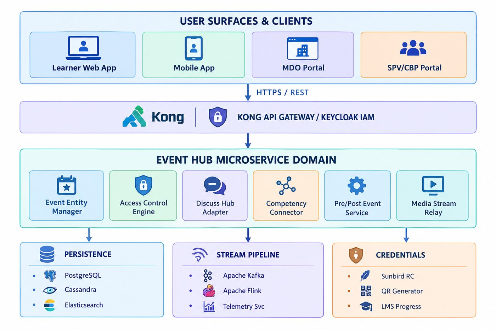

# Events Hub — Software Requirements Specification (SRS)

**Event Hub — iGOT Karmayogi Platform**

Lifecycle Scope: Q2 to Q14

## 1. Introduction

### 1.1 Purpose

This Software Requirements Specification (SRS) defines the formal functional and non-functional requirements for the Event Hub subsystem of the iGOT Karmayogi platform, consolidating its evolution from Q2 to Q14. This document provides an engineering- and verification-ready reference for Product Owners, Solution Architects, Business Analysts, Full-Stack Developers, and QA Engineers.

### 1.2 Document Scope

This specification covers the capabilities delivered and specified across the Learner Portal (Web & Mobile), MDO Portal, SPV / CBP Portal, and Platform Shared Microservices. It formalizes the requirements governing session authoring, editorial moderation, role-based access control, audience cohorting, in-session collaboration, streaming delivery, telemetry processing, video consumption percentage verification, verifiable credentialing, and post-session operational reporting.

### 1.3 Intended Audience

- **Product Management & Business Analysts:** For backlog management, scope verification, and acceptance criteria governance.
- **Solution Architects & Tech Leads:** For microservice boundaries, data schema integrity, and event streaming contracts.
- **Software Engineers (Frontend & Backend):** For implementation of user journeys, REST endpoints, and stream processing jobs.
- **Quality Assurance Engineers:** For creating automated regression test suites, boundary validations, and integration tests.
- **Nodal Officers & Departmental Administrators:** For operational workflows across administrative portals.

### 1.4 Definitions, Acronyms, and Abbreviations

- **ATI:** Administrative Training Institute.
- **CBP:** Capacity Building Provider / Provider Portal.
- **CBC:** Capacity Building Commission.
- **CTI:** Central Training Institute.
- **DO ID:** Digital Object Identifier (unique identifier in Sunbird content repository, e.g., do_...).
- **FRS:** Functional Requirements Specification.
- **iGOT:** Integrated Government Online Training.
- **MDO:** Ministry, Department, or Organization.
- **NPS:** Net Promoter Score.
- **RC:** Registry and Credentials service (Sunbird RC).
- **SPV:** Special Purpose Vehicle (Karmayogi Bharat).
- **TOC:** Table of Contents / Event Landing Details Page.
- **VOD:** Video on Demand.

### 1.5 References

- SRS — Events Hub (v1.0): Confluence Page ID: SRS - Events Hub 325746689 (14/03/2025; Authors: Venkat & Mansur).
- Q7 | FRS | Events Hub (v1.1): Confluence Page ID: Q7 | FRS | Events Hub 307396630 (07/04/2025; Author: Deepak Goswami).
- Q7 | BRD | Events Hub (v1.1): Confluence Page ID: Q7 | BRD | Events Hub 253853808 (07/04/2025; Author: Deepak Goswami).
- Sprint 22 — Event Hub Backend Technical Design: Confluence Page ID: Sprint 22 - Event Hub 293765121 (29/01/2025; Author: Sai Pradeep Ravipati; Epic: KB-7564).
- KB-10519 | Q9 | BRD | Access Control | Events Hub: Confluence Page ID: KB-10519 | Q9 | BRD | Access Control | Events Hub 421068855 (30/06/2025; Author: Prakash Kumar Srivastava).
- KB-10519 | Q9 | FRS | Access Control | Events Hub: Confluence Page ID: KB-10519 | Q9 | FRS | Access Control | Events Hub 421494793 (30/06/2025; Author: Prakash Kumar Srivastava).
- Q10 KB-1143 / KB-11643 BRD Samuhik Charcha (v1.0): Confluence Page ID: Q10 | KB- 1143| BRD | Samuhik Charcha 510918699 (22/10/2025; Author: Shakti Babbar).
- Event Hub — Samuhik Charcha (SDD / Data Dictionary): Confluence Page ID: Event Hub - Samuhik Charcha 546177039 (26/11/2025; Author: Mahesh Vakkund).
- QA Test Artifacts — Events Hub: Confluence Page IDs: Events Hub Consumption- iGOT Portal 351469632, Events Hub- MDO Portal Events Editing 380633102, Events Hub| MDO & CBP Portal 326041618.
- Deployment & Release Runbooks: Sprint 34, 38, 39, 41, 41.1 production deployment guides.

## 2. Overall Description

### 2.1 Product Perspective

Event Hub operates within the distributed microservices ecosystem of the iGOT Karmayogi platform. It interacts with upstream identity systems (Keycloak), content repositories (Sunbird Content Service), search engines (Elasticsearch), stream processors (Apache Kafka & Flink), discussion platforms (Discuss Hub), and credential engines (Sunbird RC).

### 2.2 Product Objectives

- **Federated Authoring:** Decentralize event authoring to MDOs while enforcing central taxonomy governance through SPV moderation.
- **Competency Linkage:** Standardize session tagging against the national competencies_v6 taxonomy to support formal civil service credentialing.
- **Audience Cohorting:** Enable administrators to restrict access to target cadres, designations, or organizations via Boolean Canonical Form rule sets.
- **Pedagogical Continuity:** Transform virtual sessions into lasting learning experiences through bidirectional course linking, community discussion forums, and post-session AI summarization.

### 2.3 User Classes and Roles

- **Learner:** Civil servants who discover, enroll in, stream, discuss, and complete events.
- **MDO Admin / MDO Leader:** Departmental nodal officers who create, schedule, edit drafts, cancel, and log post-event operational data for MDO events.
- **SPV Publisher:** Editorial reviewers who inspect MDO submissions, adjust mapped competency tags, and approve or reject sessions.
- **SPV Admin:** System administrators who configure platform-wide access, author sessions, and publish directly without review.

### 2.4 Operating Environment

- **Web Client:** Modern evergreen web browsers (Google Chrome 118+, Mozilla Firefox 122+, Microsoft Edge).
- **Mobile Client:** Android (API level 28+) and iOS (version 15+).
- **Server Infrastructure:** Kubernetes clusters deployed across cloud/data center infrastructure.
- **Runtime Stacks:** Java/J2EE (OpenJDK 11/17), Node.js, Angular, Python (AI services).
- **Datastores:** PostgreSQL (relational event metadata), Apache Cassandra (telemetry state and progress), Elasticsearch (catalog search).

### 2.5 System Dependencies

- **Live Streaming Bridge:** Automated bridging of Google Meet sessions to YouTube live streams requires platform streaming adapters (noted as an external dependency in Q7 FRS 307396630).
- **AI Summarization:** Asynchronous transcript summarization for Samuhik Charcha relies on the external cbp-ai-service.
- **Telemetry Streaming:** Telemetry collection and completion processing require healthy Kafka brokers and Apache Flink stream consumers.

### 2.6 Constraints

- **Virtual-Only Modality:** Physical venue management and on-premise check-in kiosks are explicitly excluded from the software design.
- **Regulatory Compliance:** Must comply with Indian government data protection guidelines and maintain audit logging across all state transitions.
- **Third-Party Messaging Apps:** Direct one-click sharing via external messaging platforms (WhatsApp, Telegram) is unsupported; sharing relies on copying verified URLs.

### 2.7 Assumptions and Open Questions

- **Assumption (Authentication):** All learners accessing custom cohort events possess active, verified profiles with populated organizational attributes.
- **Open Question (Threshold Parametrization):** The exact video consumption percentage threshold required for webinar completion is maintained in platform configuration files rather than hardcoded in specifications.
- **Open Question (AI Summary SLAs):** Target turnaround times, queue timeouts, and retry policies for post-session AI summaries remain unspecified in primary BRDs.

## 3. Functional Scope

### 3.1 Supported Event Types

| Event Type Identifier | Display Category (resourceType) | Modality (typeofEvent) | Scheduling Constraints | Course Linkage Ratio |
|---|---|---|---|---|
| Recorded Event | Webinar / Karmayogi Talks | record | Requires startDate, startTime, endDate, endTime | Optional / Multiple |
| Live Webinar | Webinar / Karmayogi Talks | live | Requires startDate, startTime, endDate, endTime | Optional / Multiple |
| Samuhik Charcha | Samuhik Charcha | live (Auto-assigned) | Requires startDate, startTime; Omits endDate, endTime | Strict 1:1 Bidirectional |
| Campaign Event | Karmayogi Saptah | live / record | Fixed campaign execution window | Linked to campaign tracks |

### 3.2 Functional Scope Boundaries

- **In-Scope:** Form-based authoring, draft auto-save, SPV moderation, canonical cohort evaluation, catalog visibility toggle, personalized calendar strips, live chat with likes/replies, watch-time telemetry calculation, verifiable Sunbird RC certificates, and post-session operational reporting.
- **Out-of-Scope:** Physical venue reservation, direct unmoderated publishing by MDOs, independent event authoring inside ATI/CTI spaces, third-party messaging integrations, and per-session custom survey builders for Samuhik Charcha.

## 4. User Roles and Permissions

| System Operation / Action | Learner | MDO Admin / Leader | SPV Publisher | SPV Admin |
|---|---|---|---|---|
| Browse Public Event Catalog & Calendar | PERMITTED | PERMITTED | PERMITTED | PERMITTED |
| Access Restricted Event TOC (Visibility Toggle ON) | PERMITTED | PERMITTED | PERMITTED | PERMITTED |
| Enroll in Restricted Event (Cohort Match) | PERMITTED | PERMITTED | PERMITTED | PERMITTED |
| Enroll in Restricted Event (Cohort Mismatch) | BLOCKED | BLOCKED | BLOCKED | BLOCKED |
| Submit Live In-Session Comments & Likes | PERMITTED | PERMITTED | PERMITTED | PERMITTED |
| Create Event Draft | DENIED | PERMITTED | DENIED | PERMITTED |
| Edit In-Progress Event Draft | DENIED | PERMITTED (Own MDO) | DENIED | PERMITTED |
| Edit Rejected Event | DENIED | PERMITTED (Own MDO) | DENIED | PERMITTED |
| Submit Event for Review (Sent_to_Publisher) | DENIED | PERMITTED (Own MDO) | DENIED | PERMITTED |
| Cancel Scheduled Event | DENIED | PERMITTED (Own MDO) | DENIED | PERMITTED |
| Edit Mapped Competency Framework Tags | DENIED | PERMITTED (Authoring) | PERMITTED (Review) | PERMITTED |
| Approve & Publish Submission to Live Catalog | DENIED | DENIED | PERMITTED | PERMITTED |
| Directly Publish Event (Bypass Review Queue) | DENIED | DENIED | DENIED | PERMITTED |
| Reject Submission with Review Remarks | DENIED | DENIED | PERMITTED | DENIED |
| Log Post-Event Metadata (Attendees, Duration) | DENIED | PERMITTED (Own MDO) | DENIED | PERMITTED |

## 5. Functional Requirements

- FR-01: Event Hub Foundation & Architecture Core
- FR-02: Event Creation & Metadata Capture
- FR-03: Event Scheduling & Lifecycle Progression
- FR-04: Editorial Review & Publishing Queue
- FR-05: Role-Based Access Control
- FR-06: Audience Cohorting & Catalog Visibility
- FR-07: Event Discovery & Search Catalog
- FR-08: Catalog Sorting & Multi-Attribute Filtering
- FR-09: Learner Enrollment & Social Sharing
- FR-10: Personalized Calendar Strip & My Learning
- FR-11: Media Streaming & Player Playback
- FR-12: In-Session Commenting & Discussion
- FR-13: Client Telemetry Capture & Emission
- FR-14: Progress Tracking & Video Consumption Gating
- FR-15: Verifiable Completion Certificates
- FR-16: Notification & Email Communications
- FR-17: National & State Learning Campaign Modules
- FR-18: Samuhik Charcha Collaborative Model
- FR-19: Participant Sentiment & NPS Collection
- FR-20: Post-Event Operations & Summary Accounting
- FR-21: Platform Shared Microservices Integration
- FR-22: Client-Side Lazy Loading & Query Optimization
- FR-23: Mobile Application Functional Delivery
- FR-24: Infrastructure Stabilization & Pipeline Scale (Q11–Q14)

## 6. Detailed Requirement Specifications

### FR-01: Event Hub Foundation and Lifecycle Core

**Requirement ID:** REQ-EH-FR01-01

**Requirement Title:** Event Lifecycle State Machine Enforcement

**Requirement Statement:** The system shall enforce a state machine for all event entities: Draft, Sent_to_Publisher, Live, Rejected, Cancelled, and Past.

**Business Rationale:** Ensures consistent governance across authoring, editorial review, publication, and completion.

**Actor / Role:** MDO Admin, SPV Publisher, SPV Admin, System Scheduler.

**Preconditions:** User is authenticated via Keycloak with an authorized administrative role.

**Trigger:** Administrative actions (save, submit, approve, reject, cancel) or system schedule transitions.

**Main Flow:**

1. Author saves incomplete details; entity enters Draft state.
2. Author submits session; schema is validated, and entity transitions to Sent_to_Publisher.
3. SPV Publisher approves session; entity transitions to Live and triggers catalog indexing.
4. Scheduled session concludes; entity transitions to Past.

**Alternative Flows:**

- Author cancels draft or scheduled session; entity transitions to Cancelled.
- SPV Publisher rejects submission with mandatory remarks; entity transitions to Rejected.

**Exception Conditions:** Transition requests from unauthorized roles return HTTP 403 Forbidden. Invalid state transitions return HTTP 400 Bad Request.

**Input Data:** Event entity payload, transition verb (submit, approve, reject, cancel).

**Expected Output:** Updated event entity with new lifecycle status, updated audit timestamp, and transition event emitted to Kafka.

**Business Rules:** DERIVED_BL_01, DERIVED_BL_02.

**Acceptance Criteria:** Verified state transitions persist in PostgreSQL/Cassandra; events in Live state are indexed in Elasticsearch.

**Applicable Portal:** MDO Portal, SPV Portal, Core Services.

**Source Reference:** SRS 325746689 §3.3.1; Sprint 22 Tech Doc 293765121.

**Related Jira Issues:** KB-395, KB-2056, KB-7564.

**Verification Status:** Verified.

### FR-02: Event Creation and Metadata Capture

**Requirement ID:** REQ-EH-FR02-01

**Requirement Title:** Event Metadata Schema Ingestion

**Requirement Statement:** The system shall capture standard event metadata: name, resourceType, typeofEvent, description, appIcon, startDate, startTime, endDate, endTime, eventHandouts, and creatorDetails.

**Business Rationale:** Ensures complete catalog records and session descriptions across all platform interfaces.

**Actor / Role:** MDO Admin, MDO Leader, SPV Admin.

**Preconditions:** User possesses MDO_ADMIN, MDO_LEADER, or SPV_ADMIN role.

**Trigger:** User opens the "Create Event" wizard.

**Main Flow:** Author enters metadata fields, uploads branding icon, provides media URLs, attaches handouts, and saves the entity.

**Alternative Flows (Draft Mode):** Incomplete metadata is saved without validating mandatory fields.

**Exception Conditions (Submission Mode):** If name, resourceType, appIcon, or startDate are missing upon submission, the form blocks the transition and highlights invalid fields.

**Input Data:** JSON object matching the Event Hub schema.

**Expected Output:** Created or updated event entity with assigned DO ID (do_...).

**Business Rules:** EVNT_HUB_BR1, DERIVED_BL_01.

**Acceptance Criteria:** Saving as draft returns HTTP 200 with partial schema; submitting without mandatory fields returns client validation errors.

**Applicable Portal:** MDO Portal, SPV Portal.

**Source Reference:** Q7 FRS 307396630 §EVNT_HUB_BR1; Sprint 22 Doc 293765121 §3.

**Related Jira Issues:** KB-7744, KB-7790, KB-7564.

**Verification Status:** Verified.

### FR-03: Event Scheduling and Competency Tagging

**Requirement ID:** REQ-EH-FR03-01

**Requirement Title:** Hierarchical Competency Model Mapping

**Requirement Statement:** The system shall allow authors and publishers to associate hierarchical competency tags (competencies_v6) from the national Karmayogi framework with event entities.

**Business Rationale:** Enables learners to acquire formal civil service competencies through verified session participation.

**Actor / Role:** MDO Admin, SPV Publisher, SPV Admin.

**Preconditions:** Karmayogi Competency Framework API is available.

**Trigger:** Author selects competency tags during event configuration or review.

**Main Flow:**

1. Author queries competency areas, themes, and sub-themes.
2. Selects matching competencyAreaIdentifier, competencyThemeIdentifier, and competencySubThemeIdentifier.
3. The system binds the competencies_v6 JSON structure to the event entity.

**Alternative Flows:** MDO author skips competency selection (optional during drafting); SPV Publisher attaches required competencies during moderation.

**Exception Conditions:** Invalid competency identifiers return HTTP 422 Unprocessable Entity.

**Input Data:** Array of competency reference objects.

**Expected Output:** Event entity updated with validated competency mappings.

**Business Rules:** EVNT_HUB_BR2, Sprint 22 Competency Schema.

**Acceptance Criteria:** Mapped competencies persist and display on the event Table of Contents page.

**Applicable Portal:** MDO Portal, SPV Portal, Learner Portal.

**Source Reference:** Sprint 22 Doc 293765121 §3; SRS 325746689 §3.2.

**Related Jira Issues:** KB-7564, KB-7939.

**Verification Status:** Verified.

### FR-04: Editorial Review and Publishing Queue

**Requirement ID:** REQ-EH-FR04-01

**Requirement Title:** SPV Publisher Moderation and Mandatory Rejection Remarks

**Requirement Statement:** The SPV Portal shall provide an inbound moderation queue for events in Sent_to_Publisher state. Publishers can approve events for publication or reject them with mandatory textual remarks.

**Business Rationale:** Enforces catalog quality and taxonomy compliance across decentralized departmental submissions.

**Actor / Role:** SPV Publisher.

**Preconditions:** Inbound event exists in Sent_to_Publisher state.

**Trigger:** Publisher selects an event from the New Requests queue and clicks "Approve" or "Reject".

**Main Flow (Approval):** Publisher verifies metadata, adjusts competency tags if needed, and clicks "Publish". The system updates the status to Live and triggers catalog indexing.

**Alternative Flow (Rejection):** Publisher clicks "Reject", enters rejection remarks in a modal dialog, and confirms. The system sets the status to Rejected and notifies the MDO author.

**Exception Conditions:** Submitting a rejection with an empty remarks field blocks the action and displays an error message.

**Input Data:** Event DO ID, moderation action, rejection remarks (if rejected).

**Expected Output:** Updated status (Live or Rejected), audit log entry, and notification event emitted.

**Business Rules:** EVNT_HUB_BR2_FR1, EVNT_HUB_BR2_FR2.

**Acceptance Criteria:** "Reject" button is disabled while remarks are empty; approved sessions index in Elasticsearch within standard SLAs.

**Applicable Portal:** SPV / CBP Portal.

**Source Reference:** Q7 FRS 307396630 §EVNT_HUB_BR2; SRS 325746689 §6.1.

**Related Jira Issues:** KB-7934, KB-8080, KB-8079.

**Verification Status:** Verified.

### FR-05: Role-Based Access Control and Permissions

**Requirement ID:** REQ-EH-FR05-01

**Requirement Title:** Portal Boundary and Operation Enforcement

**Requirement Statement:** The system shall enforce role-based access control based on Keycloak token claims. MDO Admins are restricted to managing department-scoped events, and only SPV roles can publish to the global catalog.

**Business Rationale:** Prevents unauthorized cross-departmental modifications and unmoderated catalog releases.

**Actor / Role:** Kong API Gateway, Backend Microservices.

**Preconditions:** Client includes an Authorization: Bearer <JWT> header in requests.

**Trigger:** Execution of administrative or authoring API endpoints.

**Main Flow:** Gateway inspects token roles. If the user possesses the required role, the request proceeds to the downstream service.

**Exception Conditions:** Missing token returns HTTP 401 Unauthorized. Insufficient role claims return HTTP 403 Forbidden.

**Business Rules:** EVNT_HUB_BR1, DERIVED_BL_02.

**Acceptance Criteria:** Direct publish attempts by MDO Admin credentials fail with HTTP 403 Forbidden.

**Applicable Portal:** All Portals, API Gateway.

**Source Reference:** SRS 325746689 §5, §9.3; Q7 FRS 307396630 §EVNT_HUB_BR1.

**Related Jira Issues:** KB-1708, KB-2042, KB-7744.

**Verification Status:** Verified.

### FR-06: Audience Cohorting and Catalog Visibility

**Requirement ID:** REQ-EH-FR06-01

**Requirement Title:** Boolean Canonical Form Access Rule Evaluation

**Requirement Statement:** The system shall evaluate custom audience eligibility using Boolean Canonical Form: Rules combined with OR, and Conditions within a rule combined with AND. Conditions evaluate organization, designation, verification status, and cadre group.

**Business Rationale:** Allows departments to deliver targeted sessions to specific administrative cohorts.

**Actor / Role:** Access Control Engine, Learner Portal.

**Preconditions:** Event is configured with accessMode = "Custom" and defined cohort rules.

**Trigger:** Learner accesses the event detail page or clicks "Enroll".

**Main Flow:**

1. Access Control Engine inspects the learner's Keycloak profile claims.
2. Evaluates profile attributes against the Canonical Form rule sets.
3. If any complete rule evaluates to true, enrollment is permitted.

**Alternative Flow (Visibility Toggle ON Mismatch):** Learner does not match cohort rules, but visibility is toggled ON. The TOC page renders with an "Ineligible Cohort" warning, and enrollment is blocked.

**Alternative Flow (Visibility Toggle OFF Mismatch):** Learner does not match cohort rules, and visibility is toggled OFF. The event is hidden from search results and returns HTTP 404 on direct access.

**Input Data:** Learner profile claims, event access rule set.

**Expected Output:** Boolean eligibility decision, explanatory message on mismatch.

**Business Rules:** FR-7, FR-8, FR-9, FR-10, FR-17, FR-18.

**Acceptance Criteria:** Verified matching users can enroll; verified non-matching users receive clear eligibility error modals.

**Applicable Portal:** Learner Portal, MDO Portal, SPV Portal.

**Source Reference:** KB-10519 BRD 421068855 §3; KB-10519 FRS 421494793 §2.

**Related Jira Issues:** KB-10519.

**Verification Status:** Verified.

### FR-07: Event Discovery and Search Catalog

**Requirement ID:** REQ-EH-FR07-01

**Requirement Title:** Multi-Index Elasticsearch Querying

**Requirement Statement:** The system shall provide full-text keyword search and catalog filtering across published event titles, descriptions, categories, and competency tags.

**Business Rationale:** Allows learners to quickly discover relevant virtual learning sessions across thousands of catalog records.

**Actor / Role:** Learner, Elasticsearch Search Service.

**Preconditions:** Event is in Live state and indexed in Elasticsearch.

**Trigger:** Learner inputs text into the search bar or applies catalog filters.

**Main Flow:** System executes an Elasticsearch query filtering out draft, rejected, and inaccessible sessions, returning paginated event cards.

**Input Data:** Search string, filter criteria, pagination parameters.

**Expected Output:** Array of matching event cards with metadata badges.

**Business Rules:** FR-10.2, EVNT_HUB_BR8_FR2.

**Acceptance Criteria:** Published sessions appear in search results; sessions with visibility toggled OFF do not appear for ineligible users.

**Applicable Portal:** Learner Portal (Web & Mobile).

**Source Reference:** Q7 FRS 307396630 §EVNT_HUB_BR8; Sprint 22 Doc 293765121 §2.

**Related Jira Issues:** KB-7854, KB-8679, KB-8980.

**Verification Status:** Verified.

### FR-08: Catalog Sorting and Multi-Attribute Filtering

**Requirement ID:** REQ-EH-FR08-01

**Requirement Title:** Temporal Sorting and Multi-Facet Filtering

**Requirement Statement:** The system shall sort upcoming events by start date in ascending/descending order and past events in descending order. Filtering must support category, date range, duration, and competency area.

**Business Rationale:** Provides structured views of upcoming, current, and past learning events.

**Actor / Role:** Learner, MDO Admin.

**Trigger:** User toggles sort controls or selects filter checkboxes.

**Expected Output:** Reordered and filtered list of event cards matching all selected facets.

**Business Rules:** Sprint 22 Tech Doc Search Sorting Rules.

**Acceptance Criteria:** Upcoming events sort by start date ascending by default; clearing filters restores default views.

**Applicable Portal:** Learner Portal, MDO Portal.

**Source Reference:** Sprint 22 Doc 293765121 §2; Q7 FRS 307396630 §EVNT_HUB_BR8.

**Related Jira Issues:** KB-8680, KB-11175.

**Verification Status:** Verified.

### FR-09: Learner Enrollment and Link Sharing

**Requirement ID:** REQ-EH-FR09-01

**Requirement Title:** One-Click Enrollment and Shareable Link Generation

**Requirement Statement:** The system shall provide one-click enrollment for eligible learners and generate a copyable URL for peer sharing on the platform. Direct sharing via external messaging apps is unsupported.

**Business Rationale:** Minimizes enrollment friction and supports peer-to-peer event distribution.

**Actor / Role:** Learner.

**Preconditions:** Learner meets session access control criteria.

**Trigger:** Learner clicks "Enroll" or "Share" on the event detail page.

**Main Flow (Enrollment):** Learner clicks "Enroll". The system records the enrollment in Cassandra/PostgreSQL and adds the session to their personal calendar.

**Main Flow (Sharing):** Learner clicks "Share". A modal displays the canonical event URL with a one-click "Copy Link" action.

**Business Rules:** EVNT_HUB_BR6_FR1.

**Acceptance Criteria:** Enrolled sessions show an "Enrolled" state on the detail page; copied URLs direct authenticated peers to the event TOC.

**Applicable Portal:** Learner Portal (Web & Mobile).

**Source Reference:** Q7 FRS 307396630 §EVNT_HUB_BR6; Q7 BRD 253853808 §Scope.

**Related Jira Issues:** KB-8081, KB-7924.

**Verification Status:** Verified.

### FR-10: Personalized Calendar Strip and My Learning

**Requirement ID:** REQ-EH-FR10-01

**Requirement Title:** Calendar Date Badging and Progress Aggregation

**Requirement Statement:** The Learner Portal shall feature a personalized calendar strip displaying enrolled sessions. Dates with active sessions must show a red indicator dot. Enrolled events must synchronize with My Learning.

**Business Rationale:** Helps learners manage session schedules and track learning commitments.

**Actor / Role:** Learner Portal, User Calendar Service.

**Trigger:** Learner opens the Event Hub landing page.

**Main Flow:** System queries enrolled session dates for the active month, renders the calendar strip, and applies red indicator dots to matching dates.

**Business Rules:** EVNT_HUB_BR5_FR1.

**Acceptance Criteria:** Dates with enrolled events display red indicator dots; dates without events show clean tiles; clicking a marked date filters events for that day.

**Applicable Portal:** Learner Portal (Web & Mobile).

**Source Reference:** Q7 FRS 307396630 §EVNT_HUB_BR5; SRS 325746689 §3.2.

**Related Jira Issues:** KB-8013, KB-8736, KB-9796.

**Verification Status:** Verified.

### FR-11: Media Streaming and Player Playback

**Requirement ID:** REQ-EH-FR11-01

**Requirement Title:** Media Streaming and Adaptive Bitrate Playback

**Requirement Statement:** The system shall support video playback for recorded sessions (uploaded MP4s or external YouTube streams) and provide embedded player views for live webinar feeds.

**Business Rationale:** Delivers reliable video playback across variable office network conditions.

**Actor / Role:** Learner, Media Streaming Player.

**Preconditions:** Learner is enrolled and session is live or has a recorded link.

**Trigger:** Learner clicks "Join Event" or "Watch Recording".

**Main Flow:** Player initializes the video stream (HLS, DASH, or YouTube iFrame embed) with adaptive bitrate switching and standard playback controls.

**Exception Conditions:** Unreachable media URLs display a standardized player error message with a retry option.

**Business Rules:** Q7 FRS §Dependencies, Advanced Player acceptance criteria.

**Acceptance Criteria:** YouTube embeds and platform MP4 assets stream smoothly without CORS or authentication errors.

**Applicable Portal:** Learner Portal (Web & Mobile).

**Source Reference:** Q7 FRS 307396630 §Dependencies; Sprint 22 Doc 293765121.

**Related Jira Issues:** KB-10931.

**Verification Status:** Verified.

### FR-12: In-Session Commenting and Discussion

**Requirement ID:** REQ-EH-FR12-01

**Requirement Title:** Real-Time In-Session Chat and Social Interaction

**Requirement Statement:** The system shall provide an in-session chat stream during live events, allowing learners to submit comments, reply to existing threads, like comments, and sort by Top or Recent.

**Business Rationale:** Promotes interactive engagement and peer collaboration during live broadcasts.

**Actor / Role:** Learner, Discuss Hub Adapter.

**Preconditions:** Event is currently active; learner is enrolled and authenticated.

**Trigger:** Learner posts a comment or selects a sort option in the chat pane.

**Main Flow:** Learner inputs text and clicks "Send". The comment is saved and displayed in the thread with user attribution and timestamp.

**Alternative Flows:** Learner clicks "Like" on a comment; the like count increments in real time. Learner selects "Sort by: Top"; comments reorder based on net likes.

**Business Rules:** EVNT_HUB_BR7_FR1, EVNT_HUB_BR7_FR2, EVNT_HUB_BR7_FR3.

**Acceptance Criteria:** Comments post and display without page refreshes; sorting toggles reorder threads correctly.

**Applicable Portal:** Learner Portal.

**Source Reference:** Q7 FRS 307396630 §EVNT_HUB_BR7.

**Related Jira Issues:** KB-7533, KB-7924.

**Verification Status:** Verified.

### FR-13: Client Telemetry Capture and Emission

**Requirement ID:** REQ-EH-FR13-01

**Requirement Title:** Standardized Client Telemetry Ingestion

**Requirement Statement:** The client application shall emit standardized telemetry events (START, PLAY, PAUSE, HEARTBEAT, END) enriched with User_ID, Event_ID, and timestamps to Kafka ingestion pipelines.

**Business Rationale:** Provides auditable interaction tracking for engagement reporting and completion calculation.

**Actor / Role:** Web/Mobile Client, Telemetry Pipeline.

**Trigger:** User interacts with calendar controls, event cards, detail pages, or video players.

**Input Data:** Telemetry event payloads containing user identity, session context, and interaction timestamps.

**Expected Output:** Telemetry batches validated and produced to the platform Kafka cluster.

**Business Rules:** EVNT_HUB_BR8_FR1, FR2, FR3, FR4.

**Acceptance Criteria:** Client emits heartbeat telemetry every 10–30 seconds during active playback; dropped packets trigger client-side retries.

**Applicable Portal:** Learner Portal (Web & Mobile), Telemetry Service.

**Source Reference:** Q7 FRS 307396630 §EVNT_HUB_BR8; Sprint 22 Doc 293765121.

**Related Jira Issues:** KB-8457, KB-7112.

**Verification Status:** Verified.

### FR-14: Progress Tracking and Video Consumption Gating

**Requirement ID:** REQ-EH-FR14-01

**Requirement Title:** Consumption Percentage Threshold Verification

**Requirement Statement:** The system shall calculate cumulative watch time from playback telemetry against total event duration. Session completion is granted only when watch time satisfies the configured consumption percentage threshold.

**Business Rationale:** Ensures completion credentials reflect verified content consumption rather than superficial attendance.

**Actor / Role:** Apache Flink Stream Processor, LMS Progress Store.

**Preconditions:** Telemetry events stream to the Kafka ingestion topic.

**Trigger:** Stream processor ingests playback telemetry batches.

**Main Flow:**

1. Flink job aggregates cumulative watched seconds per user and event DO ID.
2. Compares watched duration against total event duration to determine watch percentage.
3. When watch percentage meets or exceeds the configured threshold, progress updates to 100% (Completed) in Cassandra.

**Alternative Flow:** If watch time remains below the threshold, progress updates with the calculated partial percentage.

**Business Rules:** DERIVED_BL_05.

**Acceptance Criteria:** Learners meeting the watch-time threshold see their status update to "Completed" in My Learning.

**Applicable Portal:** Core Services, Learner Portal.

**Source Reference:** KB-10007, KB-9870 Acceptance Criteria.

**Related Jira Issues:** KB-10007, KB-7446.

**Verification Status:** Verified.

### FR-15: Verifiable Completion Certificates

**Requirement ID:** REQ-EH-FR15-01

**Requirement Title:** Cryptographic Certificate Generation via Sunbird RC

**Requirement Statement:** The system shall automatically issue a digitally signed, verifiable PDF certificate with a secure QR code when a learner completes an eligible webinar session.

**Business Rationale:** Provides civil servants with tamper-resistant credentials for formal training verification.

**Actor / Role:** Sunbird RC Certificate Service, LMS Engine.

**Preconditions:** Event has certificateAvailable = true; learner progress reaches 100% (Completed).

**Trigger:** Progress service emits a session completion event.

**Main Flow:**

1. Certificate service ingests the completion event.
2. Injects learner name, event title, completion date, and issuing authority into the certificate template.
3. Signs the credential, generates a verification QR code, stores the PDF asset, and attaches the certificate URL to the learner's profile.

**Input Data:** Learner ID, Event DO ID, completion timestamp, issuing authority signature keys.

**Expected Output:** PDF certificate available for download in My Learning.

**Business Rules:** DERIVED_BL_05.

**Acceptance Criteria:** Certificates generate asynchronously within standard platform SLAs; scanning the QR code resolves to the public verification endpoint.

**Applicable Portal:** Learner Portal, Sunbird RC Service.

**Source Reference:** KB-9870 Acceptance Criteria; SRS 325746689 §3.1.

**Related Jira Issues:** KB-9870.

**Verification Status:** Verified.

### FR-16: Notification and Email Communications

**Requirement ID:** REQ-EH-FR16-01

**Requirement Title:** Asynchronous Session Lifecycle Alerts

**Requirement Statement:** The system shall dispatch email and in-app notifications across key lifecycle milestones: enrollment confirmation, 24-hour and 1-hour session reminders, inbound review alerts for publishers, and approval/rejection notices (with review remarks) for authors.

**Business Rationale:** Drives attendance rates and keeps administrative users informed during review workflows.

**Actor / Role:** Notification Service, Apache Flink Job.

**Trigger:** Event lifecycle state transitions, enrollment confirmations, or scheduled timer jobs.

**Expected Output:** Populated email templates dispatched via SMTP/SMS gateways; in-app alerts published to user notification feeds.

**Business Rules:** EVNT_HUB_BR2_FR1.

**Acceptance Criteria:** Rejection alerts contain the reviewer's mandatory remarks; reminders dispatch within configured time windows.

**Applicable Portal:** Core Services, All Portals.

**Source Reference:** Q7 FRS 307396630 §EVNT_HUB_BR2; KB-1165, KB-2508.

**Related Jira Issues:** KB-1165, KB-2508.

**Verification Status:** Verified.

### FR-17: National and State Learning Campaign Modules

**Requirement ID:** REQ-EH-FR17-01

**Requirement Title:** Public Promotional Landing Pages and Offline Attendance Logging

**Requirement Statement:** The system shall support public promotional event landing pages accessible without authentication, live commenting on public TOC pages, and administrative bulk-logging of offline auditorium attendance.

**Business Rationale:** Supports mass-participation national learning campaigns (National Learning Week / Karmayogi Saptah).

**Actor / Role:** Public Visitor, Departmental Nodal Officer.

**Main Flow (Public Access):** Unauthenticated users can view campaign event details and schedules on public landing pages.

**Main Flow (Offline Attendance):** Nodal officers bulk-upload attendance CSVs for civil servants attending physical auditorium broadcasts.

**Business Rules:** NLW Campaign Specifications.

**Acceptance Criteria:** Unauthenticated users can access promotional pages; offline attendance logs update matching learner training records.

**Applicable Portal:** Learner Portal (Public Router), MDO Portal.

**Source Reference:** KB-7034, KB-7118, KB-5727.

**Related Jira Issues:** KB-5727, KB-7034, KB-7118, KB-8595, KB-9220, KB-9347.

**Verification Status:** Verified.

### FR-18: Samuhik Charcha Collaborative Model

**Requirement ID:** REQ-EH-FR18-01

**Requirement Title:** 1:1 Bidirectional Course Linking and Post-Session AI Summarization

**Requirement Statement:** The system shall support the Samuhik Charcha event format: dedicated discovery tab, 1:1 bidirectional linking with a platform course (courseLinked), automated Flink post-publish linkage, Discuss Hub thread synchronization, and post-session AI summarization comparing discussions against planned agendas. End date and time fields are omitted by system design.

**Business Rationale:** Enables cross-departmental dialogue on key policy topics tied directly to structured course curricula.

**Actor / Role:** MDO Admin, SPV Publisher, Learner, AI Summarization Service.

**Preconditions:** Category selected is Samuhik Charcha.

**Main Flow:**

1. MDO author inputs session details, meeting agenda, pre-reads, and selects one platform course (courseLinked). End date/time fields are automatically omitted.
2. SPV Publisher approves the session. A background Flink job writes the course-event linkage, and a linked Discuss Hub thread is created.
3. Session is conducted via integrated virtual meeting tools.
4. Post-session AI summarization service processes session transcripts against the initial agenda to generate an outcomes report.

**Business Rules:** BR_1 through BR_5, DERIVED_BL_03, DERIVED_BL_04.

**Acceptance Criteria:** Attempting to link multiple courses is blocked; end date/time fields are omitted; published Charchas show linked course badges.

**Applicable Portal:** MDO Portal, SPV Portal, Learner Portal.

**Source Reference:** Q10 BRD 510918699 §Scope, §BR_1–BR_5; SDD 546177039 §1.1–§2.

**Related Jira Issues:** KB-11643.

**Verification Status:** Verified.

### FR-19: Participant Sentiment and NPS Collection

**Requirement ID:** REQ-EH-FR19-01

**Requirement Title:** Post-Session Net Promoter Score (NPS) Prompt

**Requirement Statement:** The system shall present an NPS rating dialog (scale 1–10) with qualitative feedback tags to learners upon session completion or recording exit.

**Business Rationale:** Measures learner satisfaction and session quality across departments.

**Actor / Role:** Learner, Analytics Engine.

**Trigger:** Learner exits the live player or finishes a recorded session.

**Expected Output:** NPS scores and feedback tags persisted in the analytics datastore.

**Business Rules:** KB-6176 Acceptance Criteria.

**Acceptance Criteria:** Submitting feedback closes the modal and records ratings; learners can dismiss the prompt without submitting.

**Applicable Portal:** Learner Portal (Web & Mobile).

**Source Reference:** KB-6176.

**Related Jira Issues:** KB-6176.

**Verification Status:** Verified.

### FR-20: Post-Event Operations and Summary Accounting

**Requirement ID:** REQ-EH-FR20-01

**Requirement Title:** Post-Session Operational Data Ingestion

**Requirement Statement:** Following session conclusion, the MDO Portal shall require MDO Admins to record post-event operational data: noOfAttendees, eventDuration (in minutes), recordedMediaLink, and meetingSummary.

**Business Rationale:** Ensures complete historical records, archives recordings, and logs verified attendance numbers.

**Actor / Role:** MDO Admin.

**Preconditions:** Event is in Past status.

**Trigger:** MDO Admin opens the concluded session in the MDO Portal.

**Main Flow:** Admin enters actual attendee count, actual duration, pastes the recording URL, inputs a narrative summary, and clicks "Update Event".

**Input Data:** Concluded event operational metadata payload.

**Expected Output:** Event entity updated in PostgreSQL/Cassandra; recording URL published to the learner detail page for on-demand playback.

**Business Rules:** SDD 546177039 §Post-Event Setup.

**Acceptance Criteria:** Updated fields persist successfully; invalid URLs in recordedMediaLink return validation errors.

**Applicable Portal:** MDO Portal, Learner Portal.

**Source Reference:** SDD 546177039 §Post-Event Setup; SDD Process Flow §10.

**Related Jira Issues:** KB-11643.

**Verification Status:** Verified.

### FR-21: Platform Shared Microservices Integration

**Requirement ID:** REQ-EH-FR21-01

**Requirement Title:** Cross-Microservice Orchestration Contracts

**Requirement Statement:** The Event Management Service shall orchestrate actions with platform core services: Sunbird Content Service (entity persistence), Competency Service (taxonomy validation), Keycloak (token inspection), and Kafka (event streaming).

**Business Rationale:** Maintains data consistency across platform microservices.

**Actor / Role:** Event Management Service, Kong API Gateway.

**Acceptance Criteria:** Microservice interactions communicate over authenticated internal REST APIs or Kafka topics with correlation IDs.

**Applicable Portal:** Core Backend Services.

**Source Reference:** SRS 325746689 §8.2; Sprint 22 Doc 293765121.

**Related Jira Issues:** KB-8072, KB-7564.

**Verification Status:** Verified.

### FR-22: Client-Side Lazy Loading and Query Optimization

**Requirement ID:** REQ-EH-FR22-01

**Requirement Title:** Listing Pagination and Payload Consolidation

**Requirement Statement:** The Learner and MDO portals shall implement pagination/infinite scrolling for event listings and bundle metadata, competency, and enrollment status checks into single payload calls.

**Business Rationale:** Reduces initial page load times and network overhead across government networks.

**Actor / Role:** Angular Client Applications, API Gateway.

**Acceptance Criteria:** Event feeds load in pages of 10–20 cards; scrolling triggers asynchronous chunk fetching without UI blocking.

**Applicable Portal:** Learner Portal, MDO Portal.

**Source Reference:** KB-1662 Acceptance Criteria.

**Related Jira Issues:** KB-1662.

**Verification Status:** Verified.

### FR-23: Mobile Application Functional Delivery

**Requirement ID:** REQ-EH-FR23-01

**Requirement Title:** Mobile Feature Parity and Responsive Consumption

**Requirement Statement:** The mobile application shall provide feature parity with the web client for event discovery, calendar strips, video playback, in-session chat, and certificate downloads. Native device calendar syncing (.ics) is unconfirmed.

**Business Rationale:** Enables mobile learning for field personnel and traveling civil servants.

**Actor / Role:** Learner Mobile Client.

**Acceptance Criteria:** Mobile views adapt to standard screen resolutions; video player supports portrait and full-screen landscape orientations.

**Applicable Portal:** Mobile Application (Android/iOS).

**Source Reference:** SRS 325746689 §6.2, §8.2.2; Q7 FRS 307396630 §Designs.

**Related Jira Issues:** KB-7854.

**Verification Status:** Verified.

### FR-24: Infrastructure Stabilization and Pipeline Scale (Q11–Q14)

**Requirement ID:** REQ-EH-FR24-01

**Requirement Title:** High-Throughput Stream Processing Pipeline Scaling

**Requirement Statement:** The streaming telemetry pipeline shall process high-volume participant traffic without consumer lag or backpressure during mass campaigns. No new standalone functional scopes were introduced in Q11–Q14.

**Business Rationale:** Prevents delays in completion status updates and certificate generation during national learning events.

**Actor / Role:** Apache Kafka, Apache Flink Cluster.

**Preconditions:** Peak concurrent loads during campaign events.

**Main Flow:** Optimized Flink streaming topologies process telemetry batches and commit checkpoints without consumer group rebalancing failures.

**Business Rules:** Post-NLW telemetry pipeline optimization runbooks.

**Acceptance Criteria:** Zero consumer lag accumulation during high-concurrency event milestones.

**Applicable Portal:** Infrastructure / Platform Pipeline.

**Source Reference:** Deployment Guides (Sprint 34–41.1); KB-14424.

**Related Jira Issues:** KB-14424.

**Verification Status:** Verified (Infrastructure Maintenance).

## 7. Business Rules

| Rule Identifier | Category | Business Rule Statement | Trigger Condition | Enforcement Point | Source Document Reference |
|---|---|---|---|---|---|
| EVNT_HUB_BR1 | Creation | MDO and SPV users can initiate event authoring. Uploaded recorded video files (FR2) or external YouTube links (FR3) are supported. | Click "Create Event" | MDO / SPV Portal Frontend & Gateway | Q7 FRS 307396630 §EVNT_HUB_BR1 |
| EVNT_HUB_BR2 | Publishing | SPV Publishers can approve or reject MDO submissions (FR1). SPV Admins can publish directly to Live without secondary review (FR2). | Submit / Publish | SPV Portal & Event Core Service | Q7 FRS 307396630 §EVNT_HUB_BR2 |
| EVNT_HUB_BR2_FR1 | Moderation | Rejecting an event submission requires mandatory textual remarks explaining the rejection. | Click "Reject" | SPV Portal Moderation Modal | Q7 FRS 307396630 §EVNT_HUB_BR2_FR1 |
| EVNT_HUB_BR5_FR1 | Calendar | Enrolled events display on the learner calendar; active session dates show red indicator dots. | Calendar Render | Learner Portal Frontend | Q7 FRS 307396630 §EVNT_HUB_BR5_FR1 |
| EVNT_HUB_BR6_FR1 | Sharing | Learners can copy a shareable registration link to distribute to peers on the platform. Third-party messaging app sharing is unsupported. | Click "Share" | Learner Portal TOC Page | Q7 FRS 307396630 §EVNT_HUB_BR6_FR1 |
| EVNT_HUB_BR7 | Chat | Learners can post comments, reply to existing threads (FR1), like comments (FR2), and sort by Top or Recent (FR3). | In-Session Chat | Discuss Hub Integration Adapter | Q7 FRS 307396630 §EVNT_HUB_BR7 |
| EVNT_HUB_BR8 | Telemetry | System captures telemetry across calendar clicks (FR1), event cards (FR2), detail pages (FR3), and time spent on the hub (FR4). | UI / Player Actions | Telemetry Ingestion Pipeline | Q7 FRS 307396630 §EVNT_HUB_BR8 |
| FR-7 / FR-8 | Access | Cohort access evaluates Boolean Canonical Form rules: Rules combined with OR (FR-17), Conditions with AND (FR-18). | Enrollment Action | Access Control Engine | KB-10519 FRS 421494793 §2 |
| FR-9 | Access | Public mode allows open enrollment (FR-9.1); Custom mode restricts enrollment to matching cohorts (FR-9.2). | Access Evaluation | Access Control Engine | KB-10519 FRS 421494793 §2 |
| FR-10 | Access | Visibility toggle ON displays the TOC with an eligibility warning (FR-10.1); toggle OFF hides the event from search (FR-10.2). | Search / View Action | Elasticsearch Query Builder | KB-10519 FRS 421494793 §2 |
| DERIVED_BL_01 | Authoring | Mandatory field validations are bypassed when saving drafts; strict validation is enforced upon submission. | Save vs Submit | Event Hub API Gateway | Sprint 22 Doc 293765121 §1 |
| DERIVED_BL_02 | Authoring | Events can only be edited when in Draft or Rejected state; sessions in Live or Sent_to_Publisher state are read-only. | Click "Edit Event" | MDO Portal Frontend & Backend | SRS 325746689 §3.3.1 |
| DERIVED_BL_03 | Samuhik Charcha | A Samuhik Charcha session can link to at most one platform course, while a course can host multiple linked Charchas. | Course Linking | MDO Authoring Wizard | SDD 546177039 §1.3 |
| DERIVED_BL_04 | Samuhik Charcha | Selection of resourceType = "Samuhik Charcha" automatically bypasses and omits endDate and endTime fields. | Category Select | MDO Portal Frontend | SDD 546177039 §1.1 |
| DERIVED_BL_05 | Completion | Webinar completion and certificate eligibility require meeting a configured video watch percentage threshold. | Playback Telemetry | Telemetry Flink Job | KB-10007, KB-9870 |

## 8. External Interface Requirements

### 8.1 Learner Portal Interface

- **Web UI Components:** Angular-based single-page application. Provides event calendar strips, curated carousels (Featured, Trending, Recommended), category tabs, full-screen player views, in-session chat streams, and certificate download modals.
- **Client Protocol:** HTTPS REST APIs with JSON payloads; WSS/WebSocket connections for real-time live chat streams.

### 8.2 SPV / CBP Portal Interface

- **Administrative Views:** Angular dashboard featuring New Requests and Past Requests queues, rich metadata inspection views, inline video preview players, competency tag selector components, and rejection modals with mandatory text fields.

### 8.3 MDO Portal Interface

- **Authoring Views:** Multi-step wizard supporting metadata entry, media link configuration, agenda editors, pre-read file uploaders, speaker attribution fields, and post-event analytics forms.

### 8.4 Mobile Application Interface

- **Mobile Views:** Cordova/Flutter-based mobile container providing responsive event carousels, calendar views, full-screen player orientation switching, and certificate download integrations.

### 8.5 Identity and Access Management Interface

- **Keycloak IAM:** Validates JWT access tokens passed via HTTP Authorization: Bearer <token> headers. Decodes standard claims: sub (User ID), department / orgId, designation, and assigned platform roles (MDO_ADMIN, SPV_PUBLISHER, PUBLIC).

### 8.6 Content and Media Services Interface

- **Sunbird Content Service:** Internal REST interface for creating and updating digital content nodes (/content/v3/create, /content/v3/update). Manages asset DO IDs, metadata indexing, and artifact URLs.
- **Media Streaming Interface:** Renders uploaded MP4 assets via direct platform URLs or external YouTube video streams. Automated Google Meet-to-YouTube streaming bridges remained an external platform dependency.

### 8.7 Notification Services Interface

- **Communications Engine:** Ingests notification payloads from Kafka topics ([Logical Broker: Notification Events]). Dispatches transactional emails via SMTP and pushes in-app alerts to user notification feeds.

### 8.8 Learning Progress and Certificate Services Interface

- **LMS Progress Service:** Asynchronous interface writing aggregated watch times and completion status (0% to 100%) to Cassandra progress tables.
- **Sunbird RC Certificate Service:** Microservice invoked via Kafka completion triggers. Generates cryptographically signed, verifiable PDF certificates with secure verification QR codes.

## 9. Non-Functional Requirements (NFRs)

### 9.1 Performance

- **NFR-PERF-01 (API Response Times):** Standard read endpoints (calendar fetch, detail TOC view) shall return responses within 3 to 5 seconds under peak load (SRS 325746689 §9.2).
- **NFR-PERF-02 (Search Latency):** Elasticsearch keyword queries shall execute and render within 2 seconds for 95% of requests.

### 9.2 Scalability

- **NFR-SCAL-01 (Concurrent Platform Load):** The system infrastructure shall accommodate a minimum of 25,000 concurrent active users during peak production events (SRS 325746689 §9.2, §9.5).
- **NFR-SCAL-02 (Telemetry Throughput):** Telemetry pipelines shall ingest and buffer playback heartbeats during national learning campaigns without message loss or consumer lag backpressure.

### 9.3 Availability and Reliability

- **NFR-REL-01 (System Availability):** Event Hub APIs and playback routers shall maintain 99.5% operational availability.
- **NFR-REL-02 (Recovery Time):** Recovery Time Objective (RTO) for core services shall not exceed 8 hours for business-critical outages (SRS 325746689 §9.4).

### 9.4 Security and Authorization

- **NFR-SEC-01 (Authentication & Encryption):** All client-server communication must use HTTPS (TLS 1.2/1.3). Endpoints must validate Keycloak JWT access tokens.
- **NFR-SEC-02 (Vulnerability Compliance):** Codebases must maintain zero blocker/critical vulnerabilities and comply with OWASP Top 10 security standards (SRS 325746689 §9.3).

### 9.5 Auditability and Data Integrity

- **NFR-AUD-01 (State Transition Audit Trails):** Every lifecycle status change (Draft → Sent_to_Publisher → Live / Rejected) must log an immutable audit record capturing the user ID, timestamp, and review remarks (SRS 325746689 §9.3).

## 10. Use Cases

### UC-01: End-to-End MDO Event Authoring, Moderation, and Publication

**Primary Actors:** MDO Admin, SPV Publisher.

**Preconditions:** MDO Admin belongs to an active department; SPV Publisher has moderation credentials.

**Main Success Scenario:**

1. MDO Admin logs into the MDO Portal and initiates "Create Event".
2. Enters session title, selects category, inputs agenda, uploads branding icon, attaches handouts, and maps competency tags.
3. Clicks "Save as Draft". The system persists the incomplete draft without schema validation errors.
4. MDO Admin returns later, finalizes mandatory details, and clicks "Submit for Review".
5. The system validates all mandatory fields and updates the status to Sent_to_Publisher.
6. SPV Publisher views the submission in the New Requests queue in the SPV Portal.
7. Publisher previews the media link, reviews the agenda, and refines mapped competency tags.
8. Publisher clicks "Approve".
9. The system updates the status to Live, indexes the session in Elasticsearch, and triggers background Flink course-linking jobs.

**Extensions (Rejection Flow):**

- 8a. SPV Publisher clicks "Reject".
- 8b. The system displays a modal requiring rejection remarks.
- 8c. Publisher inputs remarks and confirms.
- 8d. Status updates to Rejected, and the session appears in the MDO's Rejected queue with feedback.

### UC-02: Learner Participation, Consumption Tracking, and Certification

**Primary Actors:** Learner, Streaming Player, Telemetry Processor, Certificate Engine.

**Preconditions:** Event is Live; learner satisfies audience cohort criteria.

**Main Success Scenario:**

1. Learner discovers session via the personalized calendar strip and clicks "Enroll".
2. Learner launches the embedded player at the scheduled session time.
3. Player begins streaming and emits continuous heartbeat telemetry events (START, PLAY, HEARTBEAT) to Kafka.
4. Apache Flink stream processor aggregates cumulative watched seconds against total duration.
5. Learner meets or exceeds the required watch percentage threshold.
6. Stream processor updates progress to 100% (Completed) in the LMS Cassandra datastore.
7. Sunbird RC certificate service generates a digitally signed PDF certificate with a secure QR code.
8. Learner downloads the completion certificate from My Learning.

### UC-03: Samuhik Charcha Collaborative Roundtable Setup and AI Synthesis

**Primary Actors:** MDO Admin, SPV Publisher, AI Summarization Pipeline.

**Preconditions:** MDO Admin has an approved discussion agenda.

**Main Success Scenario:**

1. MDO Admin creates an event and selects category Samuhik Charcha.
2. System sets event type to Live Event and omits end date/time fields.
3. Admin selects one platform course (courseLinked) and enters discussion pre-reads.
4. SPV Publisher approves the session. Background Flink jobs write bidirectional course linkages, and a linked Discuss Hub thread is provisioned.
5. Session concludes. MDO Admin inputs post-event metadata: actual attendee count, conduct duration, recording link, and summary.
6. AI summarization service processes session transcripts against the agenda to generate an automated learning outcomes report.
