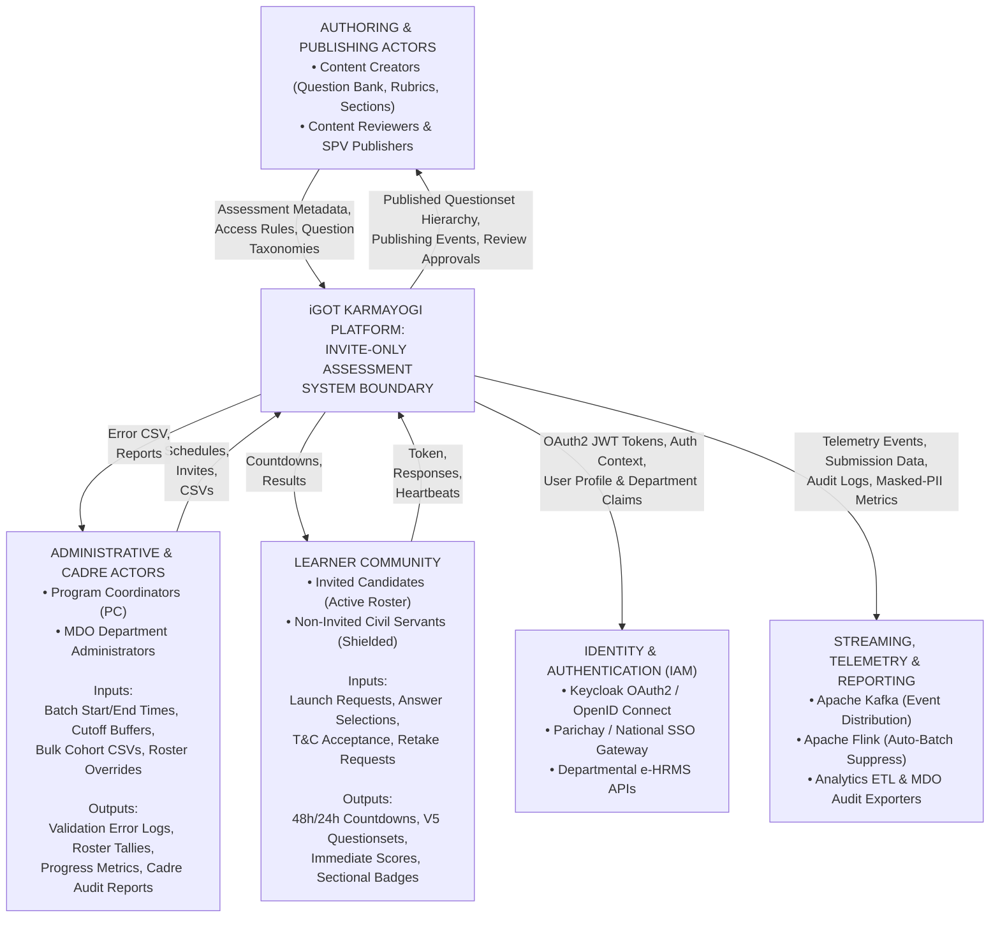
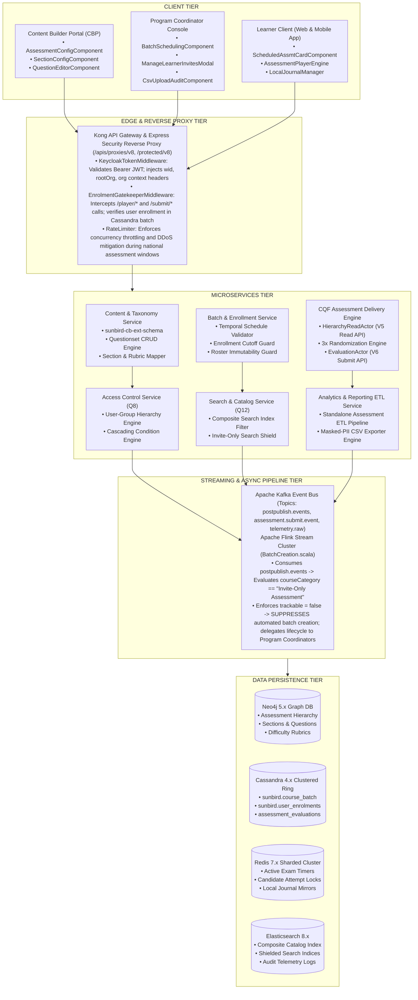
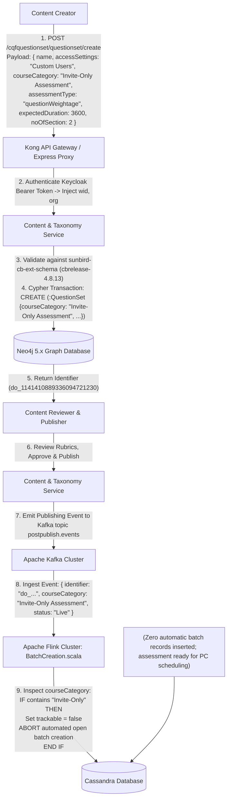
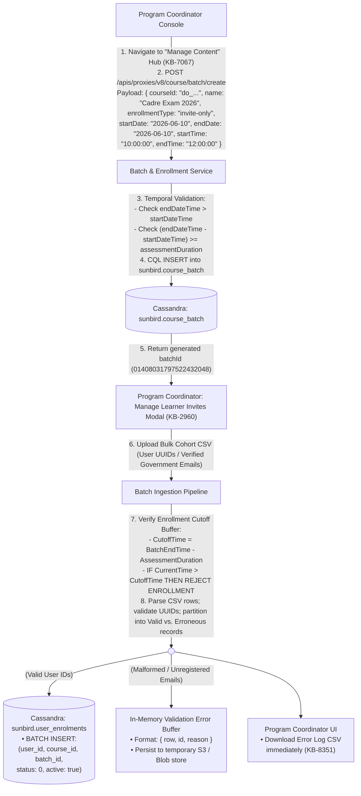
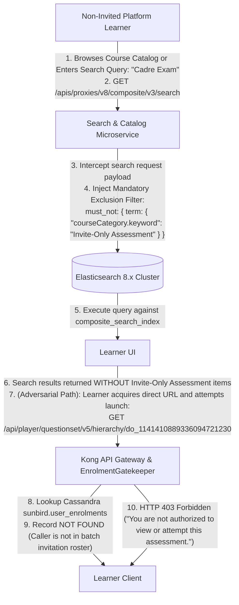

# Invite-Only Assessment — System Context Diagram Document

## 1. Document Control & Executive Summary

### 1.1 Document Control

- **Document Title:** System Context Diagram Document: Invite-Only Assessment Lifecycle & Ecosystem Integration
- **Target Platform:** iGOT Karmayogi Platform
- **Temporal Scope:** Q2 through Q13 Quarterly Releases
- **Scope Classification:** System Context, External Entity Interfaces, Boundary Transitions, and End-to-End Data Flows

### 1.2 Executive Summary

A **System Context Diagram (SCD)** establishes the structural and operational boundaries of a software system. It identifies the system under consideration, its external user personas, interacting external systems, incoming data inputs, outgoing information flows, and security trust perimeters.

Between **Q2 and Q13**, the **Invite-Only Assessment** capability on iGOT Karmayogi underwent a fundamental evolution:

- **Q2–Q4 (Uncoupled Streaming Baseline):** Transitioned from an open, auto-batched evaluation model to a decoupled, schema-enforced regime (`courseCategory: "Invite-Only Assessment"` in `sunbird-cb-ext-schema`), where Apache Flink streaming processors actively suppressed public batch provisioning.
- **Q5–Q8 (Administrative Coordination & Advanced Delivery):** Shifted batch administration and cohort ingestion from backend scripts to dedicated Program Coordinator (PC) workspaces (`KB-7067`, `KB-2960`), adding bulk CSV parsing with error logging (`KB-8351`) and V5/V6 CQF delivery engines with 3x combinatorial randomization.
- **Q9–Q11 (Temporal Precision & Synchronized Resumption):** Introduced sub-daily scheduling windows (`KB-5570` with start/end timestamps and duration buffers), dynamic countdown ribbons (48h/24h timers), single-sitting session enforcement, and hybrid LocalStorage-Redis state recovery.
- **Q12–Q13 (Enterprise Shielding & Governance):** Integrated catalog search isolation across Web and Mobile (`KB-9333`, `KB-9337`), assigned content consolidation (`KB-9789`), high-throughput Kafka telemetry handling 50,000+ concurrent submissions, and masked-PII CSV audit reporting (`KB-6378`).

This document formally maps the system context, trust boundaries, external interfaces, and directional data flows across this entire evolutionary arc.

## 2. Level 0: Enterprise System Context Diagram (The Fundamental Boundary)

At the highest level of abstraction (Level 0), the **Invite-Only Assessment Ecosystem** sits at the center of six primary interacting domains:

1. **Authoring & Publishing Actors (CBP):** Content Creators, Reviewers, and SPV Publishers.
2. **Administrative & Cadre Management Actors:** Program Coordinators (PCs) and MDO Department Admins.
3. **Learner Community:** Invited Candidates and Non-Invited Platform Learners.
4. **Identity & Directory Infrastructure:** Keycloak IAM, Government Single-Sign-On (Parichay / Jan Parichay), and Departmental HRMS/e-HRMS integrations.
5. **Streaming & Analytics Consumers:** Apache Kafka Event Bus, Apache Flink Analytics Pipelines, and National Dashboards.
6. **Regulatory & Audit Bodies:** Departmental Vigilance, Training Divisions, and Capacity Building Commission (CBC).

## 3. Historical Evolution of System Boundaries (Q2 – Q13)

The functional and technical perimeter of the Invite-Only Assessment feature expanded across four major architectural phases:

**CONTEXT BOUNDARY EVOLUTION MATRIX (Q2 – Q13)**

| Epoch | In-Scope Boundary Capabilities | External Interfaces & Systems Added | Data Ingestion / Egress Changes |
| --- | --- | --- | --- |
| **Phase 1** (Q2 – Q4) Foundational Architecture | • Authoring with Custom Users access setting. • Schema taxonomy enforcement. • Streaming auto-batch bypass via Flink BatchCreation.scala | • Content Builder Portal (CBP) • sunbird-cb-ext-schema • Kafka postpublish.events • Apache Flink post-publisher • Cassandra course_batch | • Incoming: Meta with Invite tag. • Outgoing: Flink detects tag and aborts batch DDL |
| **Phase 2** (Q5 – Q8) Administration & Delivery | • Unified cohort invite modal (KB-2960). • Immediate CSV error audits. • 3x Randomization (options, questions, pools). • Roster removal locks. | • Program Coordinator Hub ("Manage Content" - KB-7067) • CQF V5 Hierarchy Read Engine • CQF V6 Submit & Scoring Engine • Cassandra user_enrolments state check guards | • Incoming: Bulk CSV cohort files • Outgoing: Row-level error logs and sanitized V5 hierarchy |
| **Phase 3** (Q9 – Q11) Temporal Bounds & Resumption | • Sub-daily temporal scheduling (Start/End Time HH:mm:ss). • Dynamic enrollment buffers. • 48h / 24h countdown clocks. • Non-pausable single sitting. • Network disconnect recovery. | • Keycloak Session Verifier • Dynamic Countdown Banner • Redis Session Cache Cluster • Client-side HTML5 LocalStorage Journaling Service | • Incoming: HH:mm scheduling times • Outgoing: Server timestamp sync & auto-dispatched timeout payload |
| **Phase 4** (Q12 – Q13) Enterprise Shielding & Governance | • Catalog search isolation. • Mobile app catalog parity. • Assigned content workspace. • 50k concurrency resilience. • Masked-PII departmental CSVs. | • Elasticsearch Composite Search Filter Interceptor • Mobile App (Flutter/Dart) • Standalone Assessment ETL Svc • Kafka assessment.submit.event | • Incoming: Query filter requests • Outgoing: Omitted search hits; masked PII CSVs |

## 4. Level 1: Detailed Ecosystem Context Diagram

The Level 1 diagram decomposes the internal platform components, client touchpoints, network edge gateways, core microservices, streaming event buses, and distributed databases.

## 5. End-to-End Context Data Flows

### 5.1 Authoring, Publishing & Stream Pipeline Flow

The data flow initiated when an author configures an assessment under `Custom Users`, leading to schema serialization, graph persistence, and streaming auto-batch suppression.

### 5.2 Program Coordinator Scheduling & Cohort Ingestion Flow

The administrative data flow where batch boundaries, temporal constraints, and learner rosters are established.

### 5.3 Learner Consumption, Verification & Evaluation Flow

The high-stakes execution flow covering discovery isolation, instructions gating, single-sitting execution, and automated scoring.

```mermaid
flowchart TD
    ICB["Invited Candidate Browser / Mobile App"]
    LD["Learner Dashboard"]
    WC["Wall-Clock Time Reaches Start Time (10:00:00 IST)"]
    EG["Edge Gateway / Kong EnrolmentGatekeeper"]
    CQF["CQF Assessment Delivery Engine"]
    LRP["Learner Runtime Player"]
    SUB["Candidate Clicks Submit OR Assessment Timer Reaches 00:00:00"]
    EVS["CQF Evaluation Service"]
    LUI["Learner UI"]
    ICB -->|"1. Authenticate via Keycloak SSO<br/>2. GET /cbplan/v2/user/list (Fetches Assigned Content & Active Batches)"| LD
    LD -->|"3. Render #quot;Scheduled Assessments#quot; Ribbon<br/>- 48h to 24h: Display static upcoming assessment banner<br/>- #lt; 24h: Display real-time ticking clock (HH:mm:ss)<br/>- Start Assessment CTA is DISABLED"| WC
    WC -->|"4. Start Assessment CTA becomes ENABLED<br/>5. Candidate clicks Start -#gt; Displays Mandatory Instructions Modal<br/>6. Candidate checks *#quot;I have read and understood the instructions#quot;* -#gt; Clicks Launch<br/>7. GET /api/player/questionset/v5/hierarchy/{assessmentId}"| EG
    EG -->|"8. Query Cassandra sunbird.user_enrolments:<br/>- Check user_id == caller.wid AND batch_id == batchId AND active == true<br/>- IF NOT FOUND THEN RETURN HTTP 403 Forbidden"| CQF
    CQF -->|"9. Load Questionset Hierarchy from Neo4j / Redis Cache<br/>10. Execute 3x Randomization Engine:<br/>- Shuffle options within questions<br/>- Permute question sequence within sections<br/>- Sample questions from section pool<br/>11. STRIP ANSWER KEYS, rubrics, and response declarations<br/>12. Return sanitized questionset JSON with server timestamp header"| LRP
    LRP -->|"13. Initialize LocalJournalManager in HTML5 LocalStorage<br/>14. Start non-pausable exam timer (Heartbeat sync to Redis every 60s)<br/>15. Candidate answers questions / marks for review<br/>(Intermittent disconnects handled gracefully via local storage journal)"| SUB
    SUB -->|"16. Package response payload -#gt; POST /apis/protected/v8/user/evaluate/assessment/submit/v6"| EVS
    EVS -->|"17. Load Golden Answer Keys & Rubrics from Neo4j<br/>18. Deduct negative marking per incorrect answer based on configured ratio<br/>19. Compute section percentages and overall pass/fail status<br/>20. CQL INSERT into sunbird.assessment_evaluations<br/>21. Emit telemetry to Kafka topic assessment.submit.event"| LUI
    EVS -->|"22. Return HTTP 200 OK: Overall Score, Accuracy %, Sectional Performance Badges"| LUI
```

### 5.4 Search Shielding & Catalog Isolation Flow (Q12–Q13)

The mechanism ensuring non-invited learners cannot discover or access restricted assessments.

## 6. External Entities, Actors & Interface Boundary Contracts

**EXTERNAL ENTITIES AND BOUNDARY DATA FLOW CONTRACTS**

| External Entity / Actor | Interface Point | Data Flow & Protocol Description |
|---|---|---|
| **Content Creator** | Web Browser (CBP) HTTPS / REST | • Inbound: Form configuration, rubric definitions, section durations, negative marking percentages. • Outbound: Questionset identifier, validation errors. |
| **Content Publisher** | Web Browser (CBP) HTTPS / REST | • Inbound: Final approval and publish commands. Generates Kafka postpublish.events. • Outbound: Live asset status confirmation. |
| **Program Coordinator** | Web Browser (PC) HTTPS / REST | • Inbound: Sub-daily scheduling (Start/End Date/Time), duration cutoff buffers, and CSV cohort rosters. • Outbound: Batch ID, row-by-row CSV error logs, and real-time participation counters. |
| **Invited Learner** | Web / Mobile App HTTPS / REST / WS | • Inbound: Bearer token, launch request, T&C checkbox, answer selections, heartbeats, and submission payload. • Outbound: 48h/24h countdowns, sanitized V5 hierarchy, real-time timers, scores, and accuracy badges. |
| **Non-Invited Learner** | Web / Mobile App HTTPS / REST | • Inbound: Catalog search and filtered browse queries. • Outbound: Filtered catalog (Invite-Only omitted); HTTP 403 Forbidden on direct link access attempts. |
| **Keycloak IAM Gateway** | Internal Micro-services / OIDC | • Inbound: User credentials and SSO tokens. • Outbound: Signed JWT Bearer tokens with user UUID, rootOrg, and MDO departmental role bindings. |
| **MDO Leadership & CBC** | Admin Reports HTTPS / CSV ETL | • Inbound: Departmental audit extraction requests. • Outbound: Masked-PII CSV reports containing scores, time taken, attempt counts, and sectional performance. |

## 7. Security, Trust Boundaries & Access Control Architecture

The system enforces four concentric security trust boundaries to ensure test integrity and data privacy:

**CONCENTRIC TRUST BOUNDARIES**

**TRUST BOUNDARY 0: PUBLIC INTERNET**

- Candidate browsers, mobile devices, and unauthenticated network requests.
- Threat Mitigation: Cloudflare DDoS protection, TLS 1.3 encryption, and WAF rules.

**TRUST BOUNDARY 1: EDGE API GATEWAY & REVERSE PROXY**

- Kong API Gateway + Express Proxy Session Manager.
- Security Controls: Keycloak JWT token validation, rate-limiting, and RBAC context injection.

**TRUST BOUNDARY 2: INTERNAL SERVICE MESH & APPLICATION FABRIC**

- Content Service, Batch Service, CQF Assessment Delivery Engine, Access Control Service.
- Security Controls: EnrolmentGatekeeper middleware, mutual TLS (mTLS) between microservice pods, and answer key suppression at the V5 delivery layer.

**TRUST BOUNDARY 3: PERSISTENCE & DATA STORAGE RING**

- Cassandra Keyspaces, Neo4j Graph DB, Redis Cluster, Elasticsearch, and Kafka Brokers.
- Security Controls: Network isolation (Private VPC Subnets), encrypted EBS storage (AES-256), Cassandra authentication, and PII masking algorithms for audit reporting.

### Specific Threat Mitigation Patterns

1. **Answer Key Exfiltration:** Prevented at Trust Boundary 2. The `HierarchyReadActor` parses the questionset tree retrieved from Neo4j and strips `responseDeclaration`, `correctAnswer`, and scoring rubrics before serializing the JSON payload for the client tier.
2. **Direct Link Bypassing:** Prevented at Trust Boundary 2. Even if a non-invited learner obtains the assessment identifier (`do_...`), the `EnrolmentGatekeeperMiddleware` validates the caller's UUID against Cassandra `sunbird.user_enrolments`. Unauthorized attempts are rejected with `HTTP 403 Forbidden`.
3. **Client-Side Clock Alteration:** Prevented across Boundaries 1 and 2. Client devices cannot bypass test boundaries by modifying their system clock. Every API response includes a cryptographically synchronized server timestamp header (`X-Server-Timestamp`), and V6 evaluation strictly enforces closure times using the backend clock.

## 8. Requirements Traceability Matrix (System Context Scope)

| Context Requirement ID | Architectural Dimension | Jira References | Context Diagram Component Realization | Operational Status |
|---|---|---|---|---|
| **CTX-IOA-01** | Metadata Taxonomy & Auto-Batch Suppression | [KB-3958: Q4 \| Assessments Creation and Consumption](https://karmayogibharat.atlassian.net/browse/KB-3958) (Prod Deployed), [KB-3959: Q4 \| Assessments \| Assessment creation - for Invite only users](https://karmayogibharat.atlassian.net/browse/KB-3959) (Prod Deployed) | `AssessmentConfigComponent` -> Kafka -> Flink `BatchCreation.scala` | **Prod Deployed** |
| **CTX-IOA-02** | Program Coordinator Hub & Navigation | [KB-7067: Q6 \| Content Portal \| Navigation and user experience for program coordinator](https://karmayogibharat.atlassian.net/browse/KB-7067) (Prod Deployed), [KB-6276: Q6 \| Content Portal \| UI/UX Revamp](https://karmayogibharat.atlassian.net/browse/KB-6276) (KB Approved) | PC "Manage Content" Workspace -> Batch Service API | **Prod Deployed** |
| **CTX-IOA-03** | Unified Cohort Invites & CSV Error Ingestion | [KB-2960: Q3 \| Ad-Hoc Requests \| Invite-Only \| Single Button for managing User Invites.](https://karmayogibharat.atlassian.net/browse/KB-2960) (KB Approved), [KB-8351: KB-7067 \| The entries under Error tab are not displaying for unsuccessful upload immediately for Invite only Assessment and Invite only Program.](https://karmayogibharat.atlassian.net/browse/KB-8351) (Done) | `ManageLearnerInvitesModal` -> CSV Error Log Pipeline | **Prod Deployed** |
| **CTX-IOA-04** | Sub-Daily Scheduling (Start/End Time HH:mm) | [KB-5350: Q4 \| Assessments \| Assessment creation - for Invite only users with scheduling assessment](https://karmayogibharat.atlassian.net/browse/KB-5350) (Prod Deployed), [KB-5570: Invite only assessment Batch scheduling with start and end time](https://karmayogibharat.atlassian.net/browse/KB-5570) (In Progress) | Batch Service Temporal Validator -> Cassandra `course_batch` | **Prod Deployed** |
| **CTX-IOA-05** | Enrollment Cutoff Buffer Enforcement | Confluence FRS `85295123` | Buffer Validator () | **Prod Deployed** |
| **CTX-IOA-06** | Roster De-Enrollment Immutability Guards | [KB-8365: KB-7067 \| Error message displaying while removing the user who has already consumed the program/assessment is incorrect](https://karmayogibharat.atlassian.net/browse/KB-8365) (Done), [KB-8400: KB-7067 \| Error message displaying while removing the user who has already consumed the assessment is incorrect](https://karmayogibharat.atlassian.net/browse/KB-8400) (Done) | Cassandra `user_enrolments` status check (`status > 0` block) | **Prod Deployed** |
| **CTX-IOA-07** | Catalog Search Isolation & Shielding | [KB-9333: Q8 \| Implement Course Catalog Filters \| Course Catelog \| Learner Portal & Mobile App & M-Site](https://karmayogibharat.atlassian.net/browse/KB-9333) (Prod Deployed), [KB-9337: Q8 \| Course catalog \| Mobile App](https://karmayogibharat.atlassian.net/browse/KB-9337) (Open) | Elasticsearch Composite Search Filter Interceptor | **Prod Deployed** |
| **CTX-IOA-08** | Dynamic Scheduled Assessment Countdown | Confluence `802717699`, FRS `85295123` | Angular/Flutter `ScheduledAssmtCardComponent` (48h/24h) | **Prod Deployed** |
| **CTX-IOA-09** | 3x Randomization & Answer Key Stripping | Confluence SRS `87392295` | CQF `HierarchyReadActor` (Options, Sequence, Pool) | **Prod Deployed** |
| **CTX-IOA-10** | Single-Sitting Session & Network Resumption | Confluence SRS `87392295` | `LocalJournalManager` (LocalStorage) + Redis Session Cache | **Prod Deployed** |
| **CTX-IOA-11** | V6 Evaluation Submit & Negative Marking | Confluence `171704641`, `175702042` | CQF `EvaluationActor` -> Cassandra `assessment_evaluations` | **Prod Deployed** |
| **CTX-IOA-12** | Departmental Audit Reporting & PII Masking | [KB-6378: Q5 \| Content Portal \| Dashboard for content provider Need Information](https://karmayogibharat.atlassian.net/browse/KB-6378) | Standalone Assessment ETL Service -> Masked-PII CSV Exporter | **Prod Deployed** |

## 9. Operational, Telemetry & Compliance Context

**OPERATIONAL TELEMETRY & COMPLIANCE DATA FLOWS**

| Operational Stream | Ingestion Pipeline | Target Datastore & Retention |
|---|---|---|
| **Learner Execution Telemetry** (START, ASSESS, HEARTBEAT, END) | Client Player -> Express Proxy -> Kafka topic telemetry.raw | Kafka -> Flink -> Elasticsearch / S3 Cold Store (Retention: 1 Year) |
| **Evaluation Submit Events** (Final score, section marks, pass) | CQF Evaluation Service -> Kafka assessment.submit.event | Kafka -> Flink Analytics -> Cassandra DB & Dashboards (Retention: 3 Years) |
| **Administrative Audit Trail** (Roster uploads, deletes, schedules) | Batch Service -> User Management Proxy -> Cassandra Audit Table | Cassandra course_batch & Elasticsearch Audit Index (Immutable: 5 Years) |
| **Infrastructure Health Metrics** (CPU, Redis hit-rate, Kafka lag) | Prometheus Node Exporters & JVM Scrapers across Kubernetes pods | Grafana Monitoring Dashboards AlertManager (PagerDuty) |

## 10. Architectural Verification & Conclusion

### 10.1 System Context Verification Criteria

1. **Boundary Isolation Test:** Verify that unauthenticated or non-enrolled requests to `/api/player/questionset/v5/hierarchy/{id}` are rejected at the edge gateway before reaching the internal delivery engine.
2. **Search Omission Test:** Perform catalog search queries using an Elasticsearch query analyzer. Confirm that documents tagged with `courseCategory: "Invite-Only Assessment"` are omitted from response hits.
3. **Flink Pipeline Suppression Test:** Ingest a synthetic publishing event with `courseCategory: "Invite-Only Assessment"`. Verify through Kafka consumer logs that `BatchCreation.scala` aborts the batch provisioning sequence.
4. **Resumption Integrity Test:** Sever client connectivity during an active test session, wait 5 minutes, reconnect, and submit. Verify that the elapsed time decrements accurately against server clocks, interim answers are restored from the local journal, and the submission is graded without data loss.

### 10.2 Architectural Conclusion

This **System Context Diagram Document** completes the formal architectural blueprint for the **Invite-Only Assessment** capability on iGOT Karmayogi. Across the evolutionary window from **Q2 to Q13**, the feature transitioned from an uncoordinated open assessment mechanism into an enterprise-grade, multi-tenant evaluation engine.

By establishing strict schema decoupling, automated streaming batch suppression, sub-daily scheduling boundaries, 3x combinatorial randomization, fault-tolerant client-server state recovery, and catalog search isolation, the architecture delivers a robust, secure, and auditable examination infrastructure for the Indian Civil Services.
