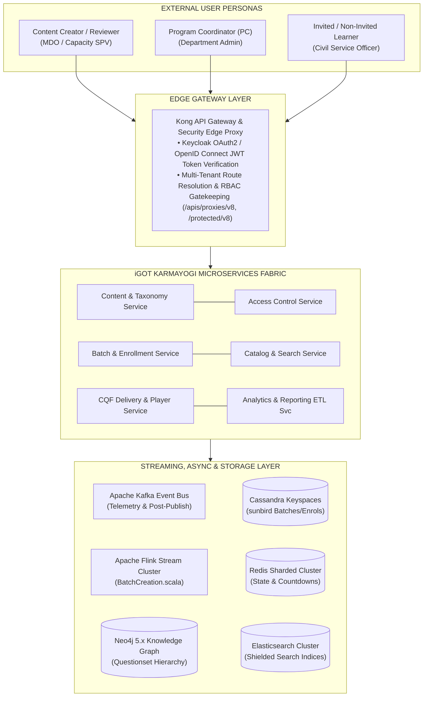
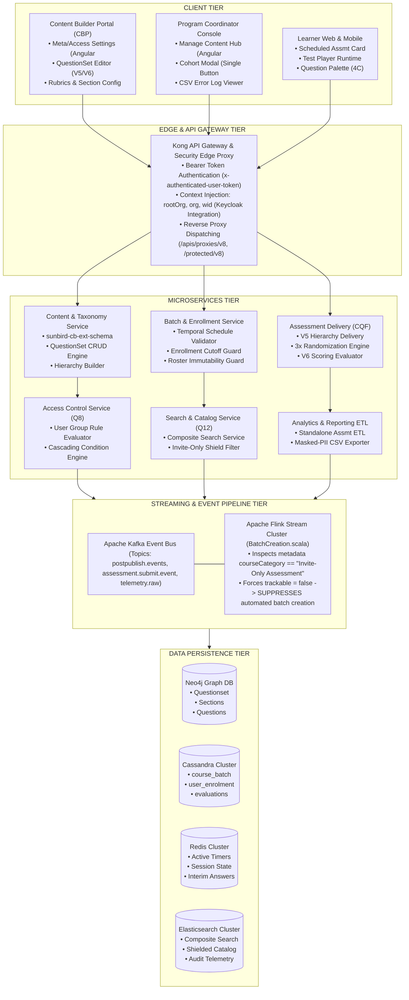
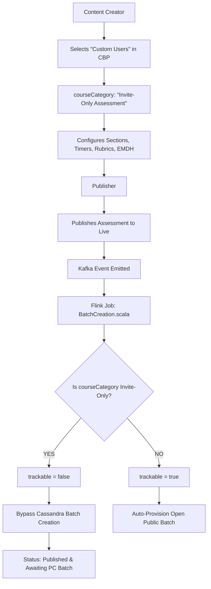
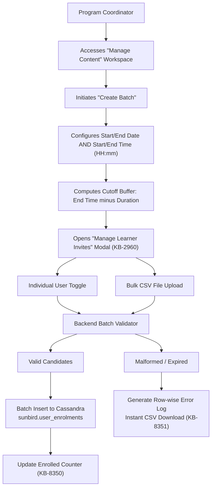
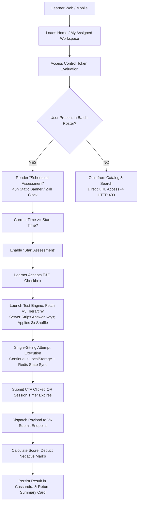
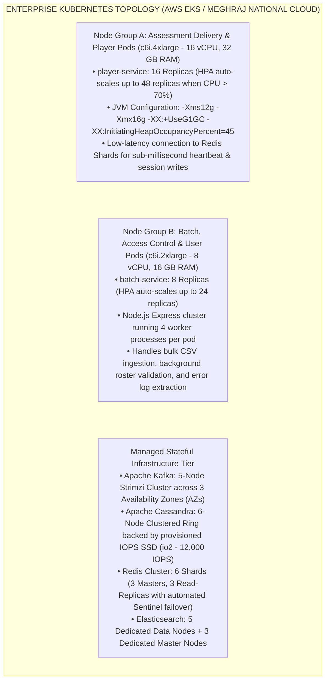

# Invite-Only Assessment — High-Level Design (HLD) Document

## 1. Document Control & Executive Summary

### 1.1 Document Control

- **Document Title:** High-Level Design for Invite-Only Assessment (Creation, Consumption & Systemic Evolution)
- **Target Platform:** iGOT Karmayogi (National Programme for Civil Services Capacity Building - NPCSCB)
- **Architectural Scope:** Q2 through Q13 Quarterly Milestones
- **Classification:** Core Platform Architecture / Technical Baseline

### 1.2 Executive Summary

The **Invite-Only Assessment** capability provides government departments, ministries, and autonomous organizations (MDOs) with a secure, highly controlled, and temporally bounded assessment framework. Historically, the iGOT Karmayogi assessment engine functioned under an open model where any published assessment automatically generated an open batch via Apache Flink streaming consumers, exposing the evaluation to universal self-enrollment and global search discovery.

Between **Q2 and Q13**, the platform underwent an architectural transformation. This HLD documents how the system was re-architected from an uncoordinated, open assessment engine into an enterprise-grade evaluation ecosystem.

**CORE ARCHITECTURAL PARADIGM SHIFT (Q2 -> Q13)**

| Dimension | Legacy Architecture (Open Model) | Target Architecture (Invite) |
|---|---|---|
| Content Metadata & Schema | Generic Standalone Assessment enum; loose access policies. | courseCategory: "Invite-Only Assessment" in ext-schema. |
| Post-Publish Streaming Pipeline | Apache Flink job provisioned auto-batch for all live items. | Flink inspects metadata; suppresses batch creation. |
| Batch Lifecycle & Governance | System-driven automated lifecycle; date-only boundaries. | Delegated to Program Coordinators; sub-daily times. |
| Discovery & Catalog Indexing | Universally indexed in Elasticsearch; browseable by all learners. | Filtered composite indices; shielded from public search. |
| Execution & State Management | In-memory client state; dropouts risked total attempt failure. | Distributed Redis + local journal; single-sitting lock. |
| Evaluation Engine & Analytics | Flat MCQ scoring; unstructured CSV exports containing raw PII. | V6 Submit API; negative marks, 3x shuffle, masked audit ETL. |

## 2. System Context & Architectural Drivers

### 2.1 System Context Diagram

The system context isolates external actors, boundary gateways, core platform microservices, streaming event infrastructure, and persistent data engines.



### 2.2 Key Architectural Drivers

1. **Zero Public Leakage (Security):** Absolute assurance that uninvited civil servants cannot discover or launch restricted cadre exams via search, direct link injection, or proxy bypassing.
2. **Synchronized Examination Windows (Temporal Precision):** Ability to configure sub-daily assessment windows (exact start and end hours/minutes) with dynamic cut-off buffers.
3. **Decoupled Governance (Operational Integrity):** Complete operational division between authoring teams (content quality, rubric mappings) and administrative teams (cohort scheduling, candidate invites).
4. **Single-Sitting Execution (Exam Integrity):** Enforcing a non-pausable, server-synchronized countdown timer with automatic response dispatch upon time expiry.
5. **Fault-Tolerant Resumption (High Availability):** Guaranteeing zero state loss for candidates in rural or low-bandwidth environments through dual client-journaling and Redis session persistence.
6. **Masked-PII Audit Compliance (Data Governance):** Compliance with national data protection standards; reports generated for department heads must mask phone numbers and email addresses.

## 3. Architectural Evolution & Progression (Q2 – Q13)

**EVOLUTION ROADMAP (Q2 - Q13)**

| Epoch | Primary Capabilities Added | Architectural Changes |
|---|---|---|
| **Q2 – Q4**<br>*Foundational Infrastructure* | • courseCategory enum addition<br>• Auto-batch suppression<br>• Initial standalone player engine<br>• Basic CSV cohort enrollment | • Modified BatchCreation.scala to evaluate metadata flags.<br>• Standardized questionset hierarchy persistence. |
| **Q5 – Q8**<br>*Authoring & Coordination Engine* | • Question Weightage (EMDH scoring)<br>• Option Weightage (psychometrics)<br>• 3x Randomization Engine<br>• Dedicated PC "Manage Content" hub<br>• In-line CSV error log downloads | • CQF V5 Read & V6 Submit APIs.<br>• Single-modal invite toggle (KB-2960).<br>• Enforced roster immutability for active/completed users. |
| **Q9 – Q11**<br>*Temporal Governance & Player* | • Sub-daily scheduling (HH:mm:ss)<br>• Enrollment cutoff buffer checks<br>• 48h / 24h countdown clocks<br>• Single-sitting session locking<br>• Auto-submit on timer expiry | • Multi-condition Access Control engine with zero-review post-publish updates.<br>• Redis session state & local journal sync for resumption. |
| **Q12 – Q13**<br>*Catalog Shielding & Analytics* | • Complete catalog search isolation<br>• Mobile App filter parity<br>• Standalone Assessment ETL<br>• Masked-PII CSV audit reports | • Elasticsearch search index suppression rules.<br>• High-throughput Kafka write tuning for 50k concurrency. |

## 4. High-Level Logical Architecture & Tier-by-Tier Decomposition



## 5. End-to-End Enterprise Workflows

### 5.1 Authoring, Validation, and Auto-Batch Suppression



### 5.2 Program Coordinator Scheduling and Roster Ingestion



### 5.3 Learner Discovery, Verification, and Consumption



## 6. Security, Authorization & Governance Architecture

**MULTI-TIER SECURITY & DATA GOVERNANCE PIPELINE**

| Security Boundary | Enforcement Mechanism | Failure / Breach Response |
|---|---|---|
| **Edge Gateway Gatekeeping** | Kong verifies signed Keycloak OAuth2 JWT tokens (wid, org). | Rejects with HTTP 401 Unauthorized. |
| **Batch Roster Authorization** | Assessment Delivery Proxy queries Cassandra user_enrolments. | Rejects with HTTP 403 Forbidden. |
| **Answer Key Protection** | CQF V5 Hierarchy Read endpoint strips answer keys and weights. | Exfiltration impossible; answers do not reach client. |
| **Catalog Shielding** | Elasticsearch composite search filter excludes Invite-Only tags. | Suppressed entirely from search results and facets. |
| **Temporal Clock Tampering** | Server header heartbeat (X-Server-Timestamp) enforces true time during V6 submit. | Client timestamps discarded; backend evaluates window. |
| **Data Privacy / PII Masking** | CSV export ETL masks email and mobile numbers (e.g., `v***@in`). | Unmasked PII never leaves secure database boundary. |

## 7. Data Architecture & Enterprise Persistence Model

### 7.1 Polyglot Persistence Architecture

**ENTERPRISE DATA PERSISTENCE TOPOLOGY**

| Store | Structural Role & Handled Entities |
|---|---|
| **Neo4j 5.x** | Deep Hierarchical Knowledge Graph:<br>`(:QuestionSet) -[:HAS_SECTION]-> (:Section) -[:CONTAINS]-> (:Question)`<br>Stores question bodies, rubric types, negative marking configs, and EMDH tags. |
| **Cassandra 4.x** | Scalable Columnar Engine (sunbird keyspace):<br>• course_batch: Batch metadata, sub-daily start/end times, and enrollment dates.<br>• user_enrolments: Roster memberships, active flags, and progress statuses.<br>• assessment_evaluations: Final scores, raw payloads, and sectional results. |
| **Redis Cluster** | In-Memory Distributed Cache:<br>• Active candidate attempt session journals and countdown timer TTL keys.<br>• Sanitized V5 question hierarchy objects for sub-millisecond retrieval. |
| **Elasticsearch** | Enterprise Discovery & Audit:<br>• composite_search_index: Public catalog index (filters out invite-only tags).<br>• telemetry_audit_index: Access logs, coordinator roster changes, and submits. |

### 7.2 Core Physical Schemas (Cassandra Keyspace: `sunbird`)

```sql
-- 1. Course & Assessment Batch Table
CREATE TABLE IF NOT EXISTS sunbird.course_batch (
    course_id text,
    batch_id text,
    name text,
    description text,
    enrollment_type text,
    start_date text,
    end_date text,
    start_time text,
    end_time text,
    enrollment_end_date text,
    created_by text,
    created_date text,
    status int,
    cert_templates map<text, frozen<map<text, text>>>,
    PRIMARY KEY (course_id, batch_id)
) WITH CLUSTERING ORDER BY (batch_id ASC);

-- 2. User Enrolment & Cohort Table
CREATE TABLE IF NOT EXISTS sunbird.user_enrolments (
    user_id text,
    course_id text,
    batch_id text,
    active boolean,
    status int,
    enrolled_date timestamp,
    completed_on timestamp,
    last_read_content_id text,
    last_read_content_status int,
    progress int,
    PRIMARY KEY ((user_id), course_id, batch_id)
);
CREATE INDEX IF NOT EXISTS idx_user_enrolment_batch ON sunbird.user_enrolments (batch_id);

-- 3. Assessment Evaluation Records Table
CREATE TABLE IF NOT EXISTS sunbird.assessment_evaluations (
    user_id text,
    assessment_id text,
    batch_id text,
    attempt_id text,
    overall_score double,
    total_marks double,
    pass_status boolean,
    time_taken_seconds int,
    section_breakdown text,
    submission_payload text,
    evaluated_on timestamp,
    PRIMARY KEY ((user_id, assessment_id), batch_id, attempt_id)
) WITH CLUSTERING ORDER BY (batch_id ASC, attempt_id DESC);
```

## 8. Integration & Interface Specifications

### 8.1 API Contract Summary

**PRIMARY REST SERVICE CONTRACTS**

| Endpoint | Method | Inbound Source -> Target Svc | Key Payload Attributes |
|---|---|---|---|
| /cqfquestionset/questionset/create | POST | CBP -> Content & Taxonomy Svc | courseCategory: "Invite-Only Assessment", assessmentType, rubrics |
| /course/batch/create | POST | PC Console -> Batch Svc | startDate, endDate, startTime, endTime |
| /course/batch/users/add | POST | PC Console -> User Management | batchId, userIds (bulk roster list) |
| /player/questionset/v5/hierarchy/{assessmentId} | GET | Learner App -> Delivery Svc | Returns sanitized tree; answer keys stripped |
| /user/evaluate/assessment/submit/v6 | POST | Learner App -> Evaluation Svc | batchId, identifier, sectional response arrays |

### 8.2 Asynchronous Kafka Event Messages

#### Post-Publish Event Payload (`postpublish.events`)

```json
{
  "eid": "BE_JOB_REQUEST",
  "ets": 1781254800000,
  "mid": "LP.1781254800000.do_1141410889336094721230",
  "actor": {
    "id": "Post Publish Processor",
    "type": "System"
  },
  "context": {
    "pdata": {
      "ver": "1.0",
      "id": "org.sunbird.platform"
    }
  },
  "edata": {
    "action": "post-publish-process",
    "iteration": 1,
    "identifier": "do_1141410889336094721230",
    "mimeType": "application/vnd.sunbird.questionset",
    "contentType": "Assessment",
    "pkgVersion": 1,
    "status": "Live",
    "courseCategory": "Invite-Only Assessment",
    "name": "Mid-Career Cadre Evaluation 2026"
  }
}
```

#### Evaluation Submission Event Payload (`assessment.submit.event`)

```json
{
  "eid": "ASSESSMENT_SUBMIT",
  "ets": 1781258400000,
  "mid": "SUBMIT.1781258400000.3de29b5c",
  "actor": {
    "id": "3de29b5c-741f-4c64-b72b-89d9e94ccf6a",
    "type": "User"
  },
  "edata": {
    "assessmentId": "do_1141410889336094721230",
    "batchId": "01408031797522432048",
    "overallScore": 88.0,
    "totalMarks": 50,
    "pass": true,
    "timeTaken": 2840,
    "sections": [
      {
        "identifier": "do_114140032038076416114",
        "sectionScore": 22,
        "pass": true
      }
    ]
  }
}
```

## 9. Deployment Topology & Scalability Architecture



## 10. Operational Monitoring, Telemetry & Non-Functional Architecture

**ENTERPRISE OBSERVABILITY & NFR ARCHITECTURE**

| Operational Domain | Telemetry & Monitoring Stack | Service Level Objective (SLO) |
| --- | --- | --- |
| **High-Concurrency Submission Load** | Prometheus scrapes JVM and Kafka consumer lag; Grafana dashboards alert on submit processing time. | Sustains **5,000 RPS** peak submission bursts; $P_{99} < 1,500\text{ ms}$. |
| **Questionset Hierarchy Read Latency** | OpenTelemetry distributed tracing monitors Kong-to-Redis lookups. | Responds within **500 ms** at $P_{95}$ via cache. |
| **Session Recovery Availability** | Redis session metrics tracking active locks and cache hit-ratio. | **99.99%** state recovery rate across network drops. |
| **Kafka Event Ingestion Integrity** | Strimzi alert manager triggers on topic lag $> 5,000$ messages. | **Zero data loss**; durable consumer group offsets. |
| **Administrative Audit Logging** | Elasticsearch audit index tracks all roster additions and removals | **100% audit compliance**; 3-year immutable log retention |

## 11. Traceability & Requirements Mapping

**REQUIREMENTS-TO-ARCHITECTURE TRACEABILITY MATRIX**

| Requirement ID | Functional & Architectural Area | Jira Reference | Design Realization |
| --- | --- | --- | --- |
| **HLD-IOA-01** | Schema & Post-Publish Auto-Batch Suppression Pipeline | [KB-3958](https://karmayogibharat.atlassian.net/browse/KB-3958), [KB-3959](https://karmayogibharat.atlassian.net/browse/KB-3959) | sunbird-cb-ext-schema, BatchCreation.scala (Flink) |
| **HLD-IOA-02** | Sub-Daily Scheduling (HH:mm) & Enrollment Cutoff Buffer Checks | [KB-5350](https://karmayogibharat.atlassian.net/browse/KB-5350), [KB-5570](https://karmayogibharat.atlassian.net/browse/KB-5570) | Batch Service temporal rules, Cassandra course_batch schema |
| **HLD-IOA-03** | Unified Cohort Modal & Bulk CSV Error Log Auditing | [KB-2960](https://karmayogibharat.atlassian.net/browse/KB-2960), [KB-7067](https://karmayogibharat.atlassian.net/browse/KB-7067), [KB-8351](https://karmayogibharat.atlassian.net/browse/KB-8351) | Single-modal UI, asynchronous CSV parser, download API |
| **HLD-IOA-04** | Active Learner Roster Protection During Live Assessment Attempts | [KB-8365](https://karmayogibharat.atlassian.net/browse/KB-8365), [KB-8400](https://karmayogibharat.atlassian.net/browse/KB-8400) | Cassandra status validation blocks de-enrollment |
| **HLD-IOA-05** | Public Catalog Search Shielding Across Web and Mobile Apps | [KB-9333](https://karmayogibharat.atlassian.net/browse/KB-9333), [KB-9337](https://karmayogibharat.atlassian.net/browse/KB-9337) | Elasticsearch composite filter excludes invite-only tags |
| **HLD-IOA-06** | Scheduled Assessment Card & 48h / 24h Real-Time Timers | Confluence FRS 85295123 | Angular/Flutter dynamic countdown rendering components |
| **HLD-IOA-07** | Single-Sitting Session Control, 3x Randomization & Auto-Submit | Confluence SRS 87392295 | Dual client LocalStorage and Redis session recovery engine |
| **HLD-IOA-08** | Multi-Tier Evaluation Engine, Negative Marks & Provider Report | Confluence 171704641, [KB-6378](https://karmayogibharat.atlassian.net/browse/KB-6378) | V6 Submit API, negative marking logic, masked-PII CSV extraction ETL |

## 12. Architectural Risks, Operational Constraints & Conclusion

### 12.1 Architectural Risks & Mitigations

- **Risk (High-Concurrency Submission Bottlenecks):** When national cohort exams conclude synchronously, thousands of candidates submit within seconds, risking database write saturation.
  - *Mitigation:* The system writes submissions to a Kafka topic (`assessment.submit.event`) while persisting the score in Cassandra. A decoupled Flink job asynchronously processes complex analytics and updates user learning paths, protecting the primary Cassandra ring.

- **Risk (Client-Side Clock Discrepancies):** Disparities between local device clocks and server time could skew countdown timers.
  - *Mitigation:* The test engine synchronizes against signed server headers (`X-Server-Timestamp`) on every heartbeat and calculates the authoritative countdown using server-relative offsets.

### 12.2 Operational Constraints

1. **Single-Sitting Execution:** An initiated assessment cannot be paused; real-world wall-clock time determines test window closure regardless of browser closure.
2. **Permanent Category Binding:** Assessments published under `Invite-Only Assessment` cannot be converted to open public assessments post-publication without creating an entirely new major version.
3. **Submission Tolerance Buffer:** Network interruptions during final auto-submission are granted a 15-minute grace period past batch closure, after which the delivery engine rejects further payloads.

### 12.3 Architecture Conclusion

The High-Level Design for **Invite-Only Assessment** demonstrates how iGOT Karmayogi evolved from an open, uncoordinated learning platform into a secure, multi-tenant evaluation ecosystem for the Indian Civil Services.

Through schema decoupling, automated batch suppression in Flink, sub-daily scheduling windows, robust 3x randomization, single-sitting state machines, and catalog shielding, the platform achieves the security, reliability, and precision required for high-stakes governmental examinations.
