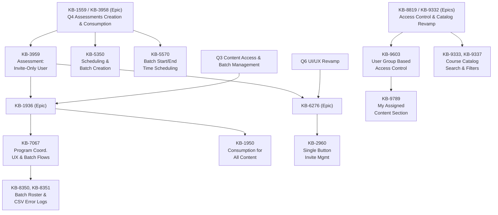
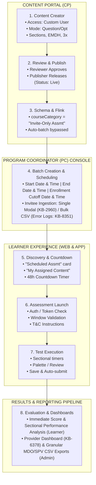
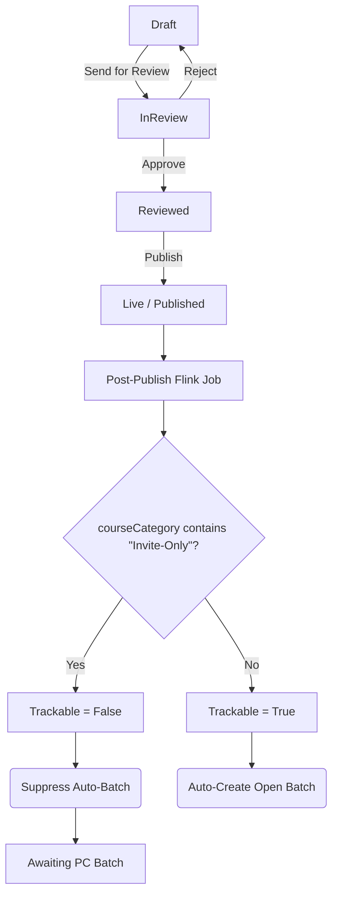
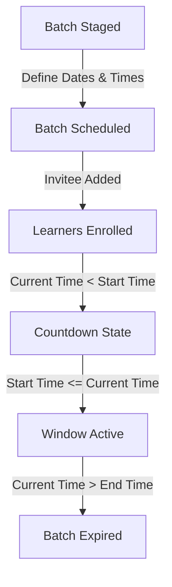
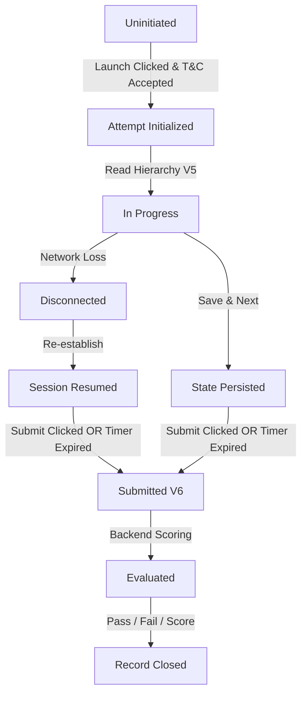
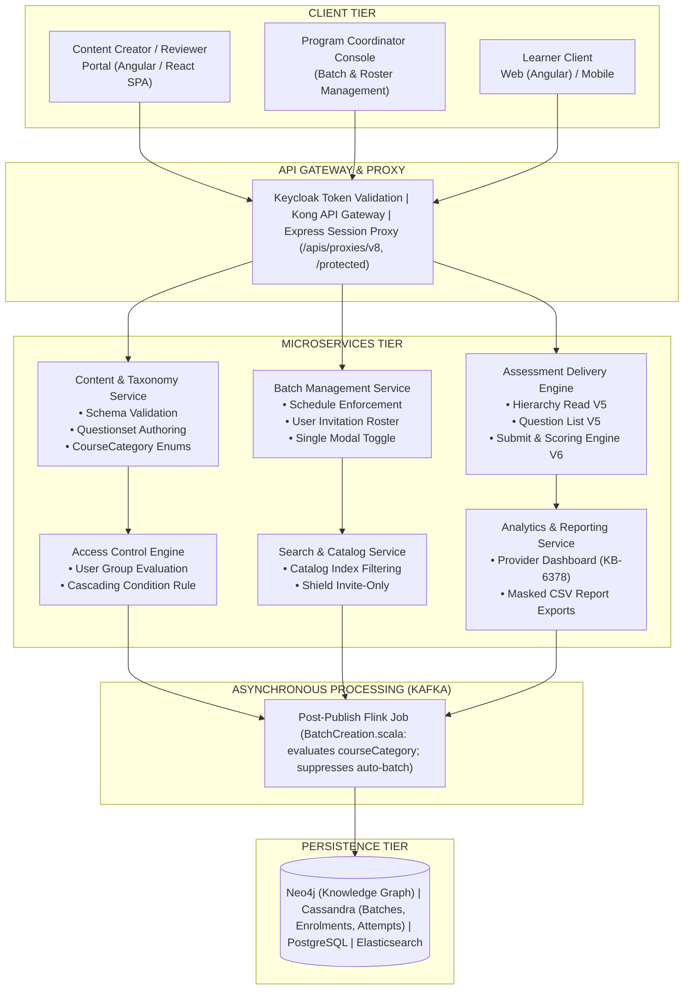
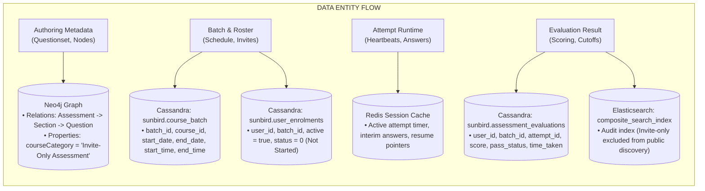

# Invite-only Assessment – Evolution and Consumption Overview Summary

**iGOT Karmayogi Platform**

## 1. Executive Summary

The **Invite-Only Assessment** capability on the iGOT Karmayogi platform addresses a vital organizational need across Ministries, Departments, and Organizations (MDOs): conducting targeted, controlled, and time-bound evaluations for specific cohorts of civil servants without exposing assessment instruments to the general public catalog.

Historically, early assessments on iGOT Karmayogi operated under an open model where any published standalone assessment generated an automated open batch via post-publish background processors, enabling universal discovery and self-enrollment. As the platform matured into departmental capacity building, cadre-controlled evaluations, and specialized psychometric/competency screening, this open model became inadequate.

Across successive product increments (**Q3, Q4, Q5, Q6, and Q8**), the platform transitioned from simple public/moderated flags to an end-to-end invite-only governance architecture:

- **Taxonomy & Metadata:** Introduced the explicit `courseCategory` enum `"Invite-Only Assessment"` in `sunbird-cb-ext-schema` ([cbrelease-4.8.13](https://github.com/sunbird-cb/sunbird-cb-ext-schema)).
- **Post-Publish Orchestration:** Modified Apache Flink streaming jobs (`BatchCreation.scala`) to deliberately suppress automated batch creation when `courseCategory` contains `"Invite-Only"`, delegating batch lifecycle strictly to Program Coordinators.
- **Administrative Scheduling & Invitation:** Empowered Program Coordinators to schedule assessment windows (start/end dates and precise times), set enrollment cutoff buffers, and manage invitee rosters using a consolidated single-action interface ([KB-2960](https://karmayogibharat.atlassian.net/browse/KB-2960), [KB-7067](https://karmayogibharat.atlassian.net/browse/KB-7067)) with bulk CSV ingestion and validation error logging.
- **Consumption & Execution:** Built a dedicated "Scheduled Assessment" card on the Learner Portal and Mobile App with dynamic countdown timers (launching 48 hours prior), supported by high-fidelity test delivery engines (V5/V6 APIs) supporting **Question Weightage** (with EMDH / Proficiency tagging, sectional time-bounds, and negative marking) and **Option Weightage** (psychometric evaluation), **3x Randomization**, and state resumption across network interruptions.
- **Access Control Evolution:** Integrated with the platform-wide User-Group Access Control framework ([KB-9603](https://karmayogibharat.atlassian.net/browse/KB-9603)), funneling discoverability into the personalized "My Assigned Content" workspace ([KB-9789](https://karmayogibharat.atlassian.net/browse/KB-9789)) while excluding restricted tests from public catalog browsing ([KB-9333](https://karmayogibharat.atlassian.net/browse/KB-9333), [KB-9337](https://karmayogibharat.atlassian.net/browse/KB-9337)).

## 2. Feature Overview

### 2.1 Definition

An **Invite-Only Assessment** is an evaluation asset created in the Content Portal (CP) under the `Custom Users` access control mode, categorized as `Invite-Only Assessment`, published without automatic batch generation, and made consumable exclusively to explicit learners designated by an authorized Program Coordinator (PC) within a strictly bounded scheduling window.

### 2.2 Business Purpose

- **Cohort Confidentiality:** Conduct screening, recruitment, departmental promotions, or competency gap assessments without leaking question banks or test existence to uninvited learners.
- **Synchronized Scheduling:** Guarantee that all eligible candidates attempt the evaluation within synchronized time windows, mitigating answer sharing and test collusion.
- **Governance Separation:** Decouple content authoring (Content Creators) from batch scheduling and cohort administration (Program Coordinators).
- **Auditable Assessment Delivery:** Deliver psychometric or proficiency-driven scoring with granular operational reporting down to per-question time spent, accuracy, and section cut-offs for departmental reporting.

### 2.3 Scope

- **Authoring Surface:** Content Portal (Web) for Content Creators, Reviewers, and Publishers.
- **Administration Surface:** Content Portal "Manage Content" / Batch Management for Program Coordinators.
- **Consumption Surface:** iGOT Learner Web Portal (Angular) and Mobile Application (Flutter/Dart).
- **Evaluation Modes:** Question Weightage (marks/proficiency) and Option Weightage (psychometric).

### 2.4 Target Roles & Key Capabilities

- **Content Creator:** Author QuestionSets, sections, marking schemes, durations, and select `Custom Users`.
- **Content Reviewer / Publisher:** Validate content quality, competency mapping, and publish the asset.
- **Program Coordinator (PC):** Configure batch schedule (Start/End Date & Time), set enrollment buffers, and invite learners individually or via CSV bulk upload.
- **Invited Learner:** View upcoming test countdown under "Scheduled Assessments" / "My Assigned Content", accept instructions, take randomized test, and review performance analytics.
- **Non-Invited Learner:** Shielded from discovering or launching the assessment; direct URL access is barred at the API gateway layer.

## 3. Feature Scope and Related Jira References



### Primary Reference Roster

| Jira Key | Issue Type | Summary | Assignee | Status | Functional Relevance |
|---|---|---|---|---|---|
| [KB-3959](https://karmayogibharat.atlassian.net/browse/KB-3959) | Story | Q4 \| Assessments \| Assessment creation - for Invite only users | Abhishek Koira | **Prod Deployed** | Core requirement introducing `Custom Users` access setting and routing batch creation to Program Coordinator. |
| [KB-5350](https://karmayogibharat.atlassian.net/browse/KB-5350) | Story | Q4 \| Assessments \| Assessment creation - for Invite only users with scheduling assessment | Abhishek Koira | **Prod Deployed** | Extended creation flow supporting explicit batch scheduling alongside user invitation workflows. |
| [KB-5570](https://karmayogibharat.atlassian.net/browse/KB-5570) | Improvement | Invite only assessment Batch scheduling with start and end time | Abhishek Koira | **In Progress** | Enhancement allowing precise HH:MM start and end time boundaries for assessment batches. |
| [KB-7067](https://karmayogibharat.atlassian.net/browse/KB-7067) | Story | Q6 \| Content Portal \| Navigation and user experience for program coordinator | Unassigned | **Prod Deployed** | UI/UX overhaul of the PC console: landing page "Manage Content" card, batch management for invite-only tests, and error log downloads. |
| [KB-3958](https://karmayogibharat.atlassian.net/browse/KB-3958) | Epic | Q4 \| Assessments Creation and Consumption | Dheeraj Singh | **Prod Deployed** | Parent Epic for modernized assessment player, question weightage, option weightage, sectional cutoffs, and 3x randomization. |
| [KB-6276](https://karmayogibharat.atlassian.net/browse/KB-6276) | Epic | Q6 \| Content Portal \| UI/UX Revamp | Monojeet Chakravorty | **KB Approved** | Portal-wide architectural redesign encompassing coordinator batch controls and creation workflows. |
| [KB-1936](https://karmayogibharat.atlassian.net/browse/KB-1936) | Epic | Q3 \| Content Portal Redesign \| Content access settings, batch management and user consumption | Dheeraj Singh | **Prod Deployed** | Foundation epic formalizing content access tiers (All Users, MDO-Specific, Custom Users) and consumption behaviors. |
| [KB-2960](https://karmayogibharat.atlassian.net/browse/KB-2960) | Epic | Q3 \| Ad-Hoc Requests \| Invite-Only \| Single Button for managing User Invites | Himanshu Gupta | **KB Approved** | Unified UI modal replacing distinct "Add" and "Remove" buttons with a single "Manage learner invites" toggle modal. |
| [KB-9603](https://karmayogibharat.atlassian.net/browse/KB-9603) | Story | Q8 \| Access Control \| User Group based Access Control | Sureshkannan | **Prod Deployed** | Formalized multi-condition access control rules; locks `Custom Users` to explicit user conditions and enables immediate application without review cycle. |
| [KB-9789](https://karmayogibharat.atlassian.net/browse/KB-9789) | Story | Q8 \| Access Control \| My Assigned Content | Sureshkannan | **Need Information** | Subsumed custom/assigned assessments into "My Assigned Content" under My Space / Learn Hub with status filter chips. |
| [KB-1950](https://karmayogibharat.atlassian.net/browse/KB-1950) | Story | Q3 \| Content Portal Redesign \| Learner consumption for all types of content | Dheeraj Singh | **Prod Deployed** | Governed TOC visibility and enrollment rules for invite-only assets when batches are absent vs present. |
| [KB-6378](https://karmayogibharat.atlassian.net/browse/KB-6378) | Story | Q5 \| Content Portal \| Dashboard for content provider | Varsha Mahuli | **Need Information** | Analytics dashboard segmenting live assessments into Open, Moderated, and Invite-Only categories with CSV download. |
| [KB-9333](https://karmayogibharat.atlassian.net/browse/KB-9333) | Story | Q8 \| Implement Course Catalog Filters \| Learner Portal & Mobile App & M-Site | Sureshkannan | **Prod Deployed** | Centralized catalog taxonomy excluding invite-only assessments from open public filters. |
| [KB-9337](https://karmayogibharat.atlassian.net/browse/KB-9337) | Story | Q8 \| Course catalog \| Mobile App | Sureshkannan | **Open** | Native mobile counterpart ensuring mobile catalog filter parity with desktop portal rules. |

## 4. Historical Evolution

```mermaid
flowchart TD
    Q3["Q3 2023-24 (Jan - Mar 2024)<br/>• Content Portal Redesign (KB-1936, KB-1950)<br/>• Access Settings introduced: #quot;All Users#quot;, #quot;MDO Specific#quot;, #quot;Custom Users#quot;<br/>• Single Button Invite Management implemented (KB-2960)"]
    Q4["Q4 2023-24 (Apr - Jun 2024)<br/>• Invite-Only Assessment formalization (KB-3958, KB-3959, KB-5350)<br/>• Ext-schema enum 'Invite-Only Assessment' added in baseline cbrelease-4.8.13<br/>• Flink BatchCreation.scala suppresses auto-batch creation for Invite-Only<br/>• Assessment scheduling (Start/End Date & Time) added (KB-5570)<br/>• Modern QuestionSet engine: Question/Option weightage, 3x Randomization, Sectional time-bounds"]
    Q5["Q5 2024-25 (Jul - Sep 2024)<br/>• CBP Admin & Content Provider Dashboards (KB-6378)<br/>• Live assessments segmented by category: Open, Moderated, Invite-Only<br/>• V5/V6 Evaluation Engine & CQF Assessment APIs deployed (KB_FRS_CP_Assessment)"]
    Q6["Q6 2024-25 (Oct - Dec 2024)<br/>• Content Portal UI/UX Revamp (KB-6276, KB-7067)<br/>• Dedicated Program Coordinator landing view under #quot;Manage Content#quot;<br/>• Bulk CSV upload error logging & roster validation fixes (KB-8350, KB-8351)"]
    Q8["Q8 2024-25 (Apr - Jun 2025)<br/>• User-Group Based Access Control (KB-9603) with cascading condition resets<br/>• #quot;My Assigned Content#quot; unified workspace (KB-9789) under My Space / Learn Hub<br/>• Centralized Catalog Filters (KB-9333, KB-9337) shielding invite-only tests from public search"]
    Q3 --> Q4
    Q4 --> Q5
    Q5 --> Q6
    Q6 --> Q8
```



### Evolution Milestone Matrix

| Quarter / Release | Primary Jira | Original Baseline | Enhancement & Architectural Shift | Business & Technical Driver | Production Status |
|---|---|---|---|---|---|
| **Q3 (Jan–Mar 2024)** | [KB-1936](https://karmayogibharat.atlassian.net/browse/KB-1936), [KB-1950](https://karmayogibharat.atlassian.net/browse/KB-1950), [KB-2960](https://karmayogibharat.atlassian.net/browse/KB-2960) | Standalone assessments were universally open; batch creation was monolithic; user invitations had separate Add/Remove buttons. | Established the three-tier access setting (`All Users`, `MDO Specific`, `Custom Users`); consolidated invite management into a single toggle modal (`Manage learner invites`). | Prevent unauthorized access; streamline coordinator invite management. | **Prod Deployed** |
| **Q4 (Apr–Jun 2024)** | [KB-3958](https://karmayogibharat.atlassian.net/browse/KB-3958), [KB-3959](https://karmayogibharat.atlassian.net/browse/KB-3959), [KB-5350](https://karmayogibharat.atlassian.net/browse/KB-5350), [KB-5570](https://karmayogibharat.atlassian.net/browse/KB-5570) | Standalone assessments automatically generated an open batch upon publishing via Flink post-publisher. | Added `Invite-Only Assessment` to `sunbird-cb-ext-schema`; updated `BatchCreation.scala` to bypass auto-batch creation; routed batch and scheduling (Start/End Date & Time) to Program Coordinators. | Departmental exams require synchronous execution windows; auto-generated public batches broke test secrecy. | **Prod Deployed** (KB-5570 In Progress) |
| **Q5 (Jul–Sep 2024)** | [KB-6378](https://karmayogibharat.atlassian.net/browse/KB-6378), CQF APIs | Assessment analytics lumped all standalone assessments together without access-tier segmentation. | Introduced Provider Dashboards tracking assessments segmented by type (*Moderated, Invite-Only, Open*); deployed V5/V6 CQF submit & result endpoints. | MDO leadership required separate tracking for private departmental assessments and masked PII data exports. | **Need Information** (APIs Live) |
| **Q6 (Oct–Dec 2024)** | [KB-6276](https://karmayogibharat.atlassian.net/browse/KB-6276), [KB-7067](https://karmayogibharat.atlassian.net/browse/KB-7067) | Program Coordinators lacked an organized workspace for non-course content; bulk invite failures were opaque. | Built "Manage Content" hub on PC landing page; added dedicated tabs for Invite-Only Assessments; introduced immediate error-log CSV downloads ([KB-8351](https://karmayogibharat.atlassian.net/browse/KB-8351)). | Improve operational efficiency for MDO coordinators executing large cadre exam enrollments. | **Prod Deployed** |
| **Q8 (Apr–Jun 2025)** | [KB-9603](https://karmayogibharat.atlassian.net/browse/KB-9603), [KB-9789](https://karmayogibharat.atlassian.net/browse/KB-9789), [KB-9333](https://karmayogibharat.atlassian.net/browse/KB-9333) | Access control filters were static; invited content was scattered across general feeds or lost if search indexing failed. | Implemented dynamic User-Group Access Control with cascading reset; unified private content discovery under "My Assigned Content"; excluded invite-only tests from public catalog. | Prevent catalog pollution; allow post-publish access modification without triggering content re-review. | **Prod Deployed** / Active |

## 5. Functional Capability Overview



### 5.1 Assessment Creation & Configuration

- **Authoring Entry Point:** Content Creator navigates to Content Portal `Create Content` -> `Assessment` card.
- **Access Setting Selection:** Creator selects `Custom Users` under Access Settings. This tags the asset with `courseCategory: "Invite-Only Assessment"` and displays an informational message indicating that batch creation and scheduling will be managed by the Program Coordinator.
- **Evaluation Frameworks:**
  - **Question Weightage:** Supports competency/marks-based evaluation. Creator configures `noOfSection` (1 to 6 sections), `questionTagging` (`Proficiency Level 1–4` or `Easy, Medium, Difficult,` `HOTS`), `minimumPassPercentage`, `negativeMarkingPercentage` (0%, 25%, 50%, 75%, 100%), and optional `sectionTimeBound` and `sectionalPassPercentage`.
  - **Option Weightage:** Designed for psychometric assessments. Implicitly defaults to 1 section; each answer choice is assigned an individual numeric weight; no pass/fail status is rendered.

- **Question Types Supported:** Single Choice MCQ, Multiple Choice MCQ, True/False, Match the Following, Fill in the Blanks (dropdown format for multi-blank; manual text field for single-blank), Paragraph-based questions (up to 5,000 characters; sub-questions grouped together), and Multimedia questions (audio/video up to 400 MB; images 320x180 px).
- **3x Randomization:** Option shuffling via combinatorial permutations, question sequence randomization within sections, and dynamic question sampling from a larger configured section bank.

### 5.2 Invitation and Access Management

- **The Six Core Identity Concepts:**
  - *Assessment Visibility:* Whether an assessment tile is rendered on a learner's UI. Invite-only tests are invisible in the public catalog and only rendered in "Scheduled Assessments" / "My Assigned Content" for explicitly invited accounts.
  - *Assessment Eligibility:* Pre-conditions defined in access control (e.g., specific user account IDs).
  - *Assessment Invitation:* The administrative act of adding an eligible user to an active batch by the Program Coordinator.
  - *Assessment Enrollment / Assignment:* Automatic population of the learner's tracking record in Cassandra `user_enrolments` upon invitation.
  - *Assessment Access Authorization:* Token and batch validation performed when the learner triggers the launch URL.
  - *Assessment Consumption:* The active runtime attempt inside the assessment player.

- **Coordinator Batch Administration:** Program Coordinator accesses the "Manage Content" hub ([KB-7067](https://karmayogibharat.atlassian.net/browse/KB-7067)) -> selects the Invite-Only Assessment -> clicks `Create Batch`.
- **Roster Management:** Managed via a single modal (`Manage learner invites` - [KB-2960](https://karmayogibharat.atlassian.net/browse/KB-2960)). Coordinators add learners individually or via bulk CSV upload. An "Errors" tab allows immediate download of validation logs for invalid email addresses or unverified IDs ([KB-8351](https://karmayogibharat.atlassian.net/browse/KB-8351)).
- **Roster Immutability During Consumption:** The system blocks removing learners who have already commenced or completed an attempt ([KB-8365](https://karmayogibharat.atlassian.net/browse/KB-8365), [KB-8400](https://karmayogibharat.atlassian.net/browse/KB-8400)).

### 5.3 Access Control and Authorization

- **Access Control Configuration** ([**KB-9603**](https://karmayogibharat.atlassian.net/browse/KB-9603)): For `Invite-Only Assessment`, the access control type is fixed to `Custom Users`, and condition options other than individual `user` are disabled.
- **Cascading Reset:** Any structural modification to top-level organizational parameters resets subordinate filters to prevent orphan rules.
- **Post-Publish Editing:** Creators/Admins can add new user groups or invitees to a live assessment without triggering a content re-review cycle. Clicking `Save Filter` stages the roster; clicking `Apply` activates immediate access.
- **Enforcement Checkpoints:** Validated at API gateway (`/apis/protected/v8/...`) using session tokens (`connect.sid`, `wid`, `x-authenticated-user-token`). Non-invited users attempting direct URL access receive a `403 Forbidden` response.

### 5.4 Assessment Discovery and Listing

- **Catalog Shielding (**[**KB-9333**](https://karmayogibharat.atlassian.net/browse/KB-9333)**,** [**KB-9337**](https://karmayogibharat.atlassian.net/browse/KB-9337)**):** The Course Catalog filter tree exposes Standalone, Competency, and Moderated Assessments. Invite-only assessments are suppressed from search indices to prevent unauthorized discovery.
- **Home Page Strip:** Displayed exclusively to invited learners under a dedicated "Scheduled Assessments" strip (positioned below the Weekly Claps / My Space area).
- **Countdown Mechanism:** A countdown banner activates 48 hours prior to `startDate` / `startTime`. Inside 24 hours, an active ticking timer displays remaining hours and minutes until test opening.
- **"My Assigned Content"** ([**KB-9789**](https://karmayogibharat.atlassian.net/browse/KB-9789)): Houses assigned assessments alongside courses and programs with status filter chips: *Not Started*, *In Progress*, and *Completed*.

### 5.5 Learner Consumption Journey

- **Terms & Instructions:** Learners view title, total duration, total question count, and instructions. The `Start Assessment` button remains disabled until the learner checks *"I have read and understood the instructions"*.
- **Question Palette & Navigation:** The player displays total questions, running timer with dynamic color coding (Green: 50–100% time remaining; Orange: 20–50%; Red: <20%), question status indicators (Answered: Green; Not Answered: Red; Marked for Review: Purple; Skipped/Unvisited: Grey), and clear response controls.
- **Section Transitions:** In sectional time-bound assessments, learners cannot transition until the section timer lapses. In manual progression mode, clicking `Next Section` prompts a confirmation popup warning that returning to previous sections is prohibited.
- **State Persistence & Resumption:** Network disconnects or browser refreshes preserve previous answers and freeze remaining duration; upon reconnection, the learner resumes from the exact question.
- **Auto-Submission:** Lapsing of the global or sectional timer automatically triggers final payload submission.

### 5.6 Evaluation and Results Processing

- **Scoring Pipeline:** Processed via V6 Submit API (`/apis/protected/v8/user/evaluate/assessment/submit/v6`). Scores are calculated on the backend based on question level definitions (`easy`, `medium`, `difficult`, `hots` / `proficiency1–4`) minus configured negative marking deductions.
- **Result Presentation:**
  - *Summary View:* Overall score, total time taken, accuracy percentage (two decimal places), correct/incorrect/blank totals, and pass/fail badge.
  - *Detailed Insights:* Section-wise breakdowns, comparative cohort analysis (for scheduled assessments), and question-level review showing time spent, chosen response, and difficulty tagging.
  - *Psychometric Mode:* Displays behavioral profiling traits without pass/fail indicators.

### 5.7 Reporting & Monitoring

- **Provider Dashboard** ([**KB-6378**](https://karmayogibharat.atlassian.net/browse/KB-6378)): CBP Admins monitor live assessment counts segmented by category (*Open, Moderated, Invite-Only*), consumption trends (30-day/custom), and question weightage distributions.
- **Operational CSV Export:** Provides granular MDO and SPV exports containing Learner ID, Name (masked PII), Assessment Name, Batch ID, Completion Status, Score, Time Taken, Sectional Scores, and Question-wise responses.

## 6. Actor and Role Matrix

| Actor / Role | Portal Surface | Creation & Authoring | Batch & Scheduling | Invitee Roster Mgmt | Test Consumption | Result & Analytics Access |
|---|---|---|---|---|---|---|
| **Content Creator** | Content Portal | Full creation & editing of questions, sections, cut-offs, and access setting (`Custom Users`). | None (delegated to PC). | Can define initial user group condition rules. | Preview mode only. | Summary view of authored content status. |
| **Content Reviewer** | Content Portal | Review questions, question weightage, and guidelines; Accept/Reject with remarks. | None. | None. | Verification preview. | Review history & audit trail. |
| **Content Publisher / SPV** | Content Portal | Final publishing authority. Triggers post-publish event pipeline. | None. | None. | Verification preview. | Full platform audit dashboard ([KB-6378](https://karmayogibharat.atlassian.net/browse/KB-6378)). |
| **Program Coordinator** | Content Portal (Manage Content) | Read-only access to published content metadata. | Creates batches, defines Start/End Date & Time, sets enrollment buffers. | Full control: Single modal toggle, bulk CSV upload, error log resolution. | None (administrative role). | Batch completion tracking, roster participation counts ([KB-8350](https://karmayogibharat.atlassian.net/browse/KB-8350)). |
| **Invited Learner** | Learner Web / Mobile App | None. | None. | None. | Unlocks scheduled test card, accepts instructions, executes attempt, retakes (if configured). | Immediate personal score, detailed question insights, completion record. |
| **Non-Invited Learner** | Learner Web / Mobile App | None. | None. | None. | **Blocked.** Test invisible; direct URL denied with `403 Forbidden`. | None. |
| **MDO Administrator / SPV** | Admin / Analytics Console | None. | Operational monitoring across department batches. | Roster audit. | None. | Full departmental CSV report download with masked PII. |

## 7. End-to-End User Journeys

```mermaid
flowchart TD
    subgraph J1["1. CONTENT CREATOR JOURNEY"]
        A1["Login to CP"] --> A2["Create Content: Assessment"]
        A2 --> A3["Set Access: #quot;Custom Users#quot;"]
        A3 --> A4["Configure Framework: Question Weightage (EMDH/Proficiency) or Option Weightage"]
        A4 --> A5["Author Sections (1-6), Section Timers, Cut-offs & 3x Randomization"]
        A5 --> A6["Send for Review"]
        A6 --> A7["Reviewer Approves"]
        A7 --> A8["Publisher Publishes"]
        A8 --> A9("Auto-batch Bypassed in Flink")
    end
    subgraph J2["2. PROGRAM COORDINATOR JOURNEY"]
        B1["Login to CP"] --> B2["Manage Content Hub (KB-7067)"]
        B2 --> B3["Select Invite-Only Assessment"]
        B3 --> B4["Create Batch: Define Start/End Date, Start/End Time & Enrollment Buffer"]
        B4 --> B5["Manage Learner Invites Modal (KB-2960)"]
        B5 --> B6["Bulk CSV Upload / Individual Toggle"]
        B5 --> B7["Roster Validated & Enrolled (KB-8350)"]
        B6 --> B8["Error Logs Tab (KB-8351)"]
    end
    subgraph J3["3. INVITED LEARNER JOURNEY"]
        C1["Login Learner Web / Mobile"] --> C2["Scheduled Assessments Ribbon / My Assigned Content"]
        C2 --> C3["Countdown Active (48h / 24h Clock)"]
        C3 --> C4["Window Opens: #quot;Start Assessment#quot; Enabled"]
        C4 --> C5["Read & Accept T&C Instructions"]
        C5 --> C6["Assessment Player: Section Timers & Palette"]
        C6 --> C7["Answer Questions / Mark for Review / Network Auto-Resume"]
        C7 --> C8["Submit Test / Auto-Submit on Timeout"]
        C8 --> C9["V6 Submit API Evaluation"]
        C9 --> C10["View Scores, Accuracy, Section Breakdown & Question Insights"]
    end
    subgraph J4["4. NON-INVITED LEARNER JOURNEY"]
        D1["Login Learner Web / Mobile"] --> D2["Browse Course Catalog / Search"]
        D1 --> D3["Assessment Suppressed from Index"]
        D2 --> D4["Direct Link Attempt"]
        D4 --> D5["403 Forbidden / Access Denied"]
    end
```



## 8. Assessment Lifecycle and State Transitions

### 8.1 Content Asset Lifecycle



### 8.2 Batch & Scheduling Lifecycle



### 8.3 Learner Attempt Lifecycle



## 9. Platform Architecture



## 10. API and Service Interaction Overview

### 10.1 Assessment Authoring & Hierarchy APIs

#### 1. Create Assessment (Questionset)

- **Endpoint:** `POST /apis/proxies/v8/cqfquestionset/questionset/create`
- **Caller:** Content Portal (Content Creator) -> Gateway -> Content Service
- **Headers:** `rootOrg: igot`, `org: dopt`, `wid: <creator_uuid>`, `Content-Type: application/json`
- **Request Payload:**

```json
{
  "request": {
    "questionset": {
      "name": "Mid-Career Cadre Evaluation 2026",
      "primaryCategory": "Course Assessment",
      "courseCategory": "Invite-Only Assessment",
      "mimeType": "application/vnd.sunbird.questionset",
      "assessmentType": "questionWeightage",
      "scoreCutoffType": "SectionLevel",
      "expectedDuration": 3600,
      "maxAssessmentRetakeAttempts": 2,
      "noOfSection": 2,
      "minimumPassPercentage": 60,
      "negativeMarkingPercentage": "25%",
      "showMarks": "Yes",
      "sectionTimeBound": "Yes",
      "sectionalPassPercentage": "Yes",
      "questionTagging": "Proficiency",
      "compatibilityLevel": 8
    }
  }
}
```

- **Response:**

```json
{
  "id": "api.create.cqfasssessment",
  "ver": "1.0",
  "responseCode": "OK",
  "result": {
    "identifier": "do_1141410889336094721230",
    "versionKey": "1726207145220"
  }
}
```

#### 2. Read Assessment Hierarchy (V5)

- **Endpoint:** `GET /api/player/questionset/v5/hierarchy/{assessmentIdentifier}`
- **Caller:** Learner Portal / Mobile Client -> Assessment Service
- **Purpose:** Fetches test structure, section definitions, and timing boundaries without revealing answer keys.

### 10.2 Batch Scheduling & Invitation APIs

#### 3. Create Assessment Batch

- **Endpoint:** `POST /apis/proxies/v8/course/batch/create`
- **Caller:** Content Portal (Program Coordinator) -> Batch Service
- **Request Payload:**

```json
{
  "request": {
    "courseId": "do_1141410889336094721230",
    "name": "Batch-01_Cadre_June2026",
    "description": "Invite-Only Batch for Ministry of Finance",
    "enrollmentType": "invite-only",
    "startDate": "2026-06-10",
    "endDate": "2026-06-10",
    "startTime": "10:00:00",
    "endTime": "12:00:00",
    "enrollmentEndDate": "2026-06-10"
  }
}
```

- **Response:** `{"responseCode": "OK", "result": {"batchId": "01408031797522432048"}}`

#### 4. Manage Learner Invites (Bulk / Toggle)

- **Endpoint:** `POST /apis/proxies/v8/course/batch/users/add`
- **Caller:** Content Portal (Program Coordinator modal - [KB-2960](https://karmayogibharat.atlassian.net/browse/KB-2960)) -> User Management Service
- **Request Payload:**

```json
{
  "request": {
    "batchId": "01408031797522432048",
    "courseId": "do_1141410889336094721230",
    "userIds": [
      "3de29b5c-741f-4c64-b72b-89d9e94ccf6a",
      "8155bb04-3b07-475a-8584-8881bc9f81bf"
    ]
  }
}
```

### 10.3 Assessment Player & Evaluation APIs

#### 5. Question List Fetch

- **Endpoint:** `POST /apis/proxies/v8/cqfquestionset/question/list`
- **Caller:** Player Runtime -> Content/Assessment Service
- **Request Payload:**

```json
{
  "assessmentId": "do_1141410889336094721230",
  "request": {
    "search": {
      "identifier": [
        "do_114140032403873792116",
        "do_114140032692936704118"
      ]
    }
  }
}
```

#### 6. Assessment Submit & Evaluate (V6)

- **Endpoint:** `POST /apis/protected/v8/user/evaluate/assessment/submit/v6`
- **Caller:** Learner Web / Mobile -> Evaluation Service
- **Request Payload:**

```json
{
  "batchId": "01408031797522432048",
  "identifier": "do_1141410889336094721230",
  "courseId": "do_1141410889336094721230",
  "isAssessment": true,
  "timeLimit": 3600,
  "children": [
    {
      "identifier": "do_114140032038076416114",
      "name": "Section A",
      "scoreCutoffType": "AssessmentLevel",
      "children": [
        {
          "identifier": "do_114140032403873792116",
          "qType": "MCQ-SCA",
          "timeSpent": 4500,
          "editorState": {
            "options": [
              {
                "index": "1",
                "selectedAnswer": true
              }
            ]
          }
        }
      ]
    }
  ]
}
```

- **Response Structure:**

```json
{
  "id": "api.submit.asssessment",
  "ver": "1.0",
  "responseCode": "OK",
  "result": {
    "pass": true,
    "overallResult": 85.5,
    "totalMarks": 50,
    "correct": 17,
    "incorrect": 3,
    "blank": 0,
    "retakeAttemptsConsumed": 1,
    "timeTakenForAssessment": 28400,
    "children": [
      {
        "identifier": "do_114140032038076416114",
        "name": "Section A",
        "sectionResult": "pass",
        "sectionMarks": 22,
        "passPercentage": 60,
        "overallResult": 88.0
      }
    ]
  }
}
```

## 11. Data Flow and Persistence



## 12. Functional Business Rules

| Rule ID | Category | Actor | Trigger / Condition | Expected Behavior | Source Reference |
|---|---|---|---|---|---|
| **BR-IOA-01** | Creation | Content Creator | `Custom Users` access setting chosen. | System sets `courseCategory` to `"Invite-Only Assessment"`. Disables auto-batch generation message; routes batching to Program Coordinator. | [KB-3959](https://karmayogibharat.atlassian.net/browse/KB-3959), Confluence `89751668` |
| **BR-IOA-02** | Publishing | Post-Publish Flink Job | Content status transitions to `Live`. | Flink job inspects `courseCategory`. If it contains `"Invite-Only"`, `trackable` is forced to `false`, bypassing automatic batch generation. | Confluence `89751668` (`BatchCreation.scala`) |
| **BR-IOA-03** | Batching | Program Coordinator | Creating batch in Manage Content. | Start Date, End Date, Start Time, and End Time are mandatory. End DateTime cannot be before Start DateTime. | [KB-5350](https://karmayogibharat.atlassian.net/browse/KB-5350), [KB-5570](https://karmayogibharat.atlassian.net/browse/KB-5570), FRS `85295123` |
| **BR-IOA-04** | Invitation | Program Coordinator | Inviting learners before test cutoff. | Coordinator can invite learners up until `End Time minus Total Duration of` `Assessment`. Invitations attempted after this buffer are rejected. | Confluence FRS `85295123` |
| **BR-IOA-05** | Roster Edit | Program Coordinator | Removing learner from batch roster. | If the learner has already initiated or completed an attempt (`status > 0`), removal is blocked with an error prompt. | [KB-7067](https://karmayogibharat.atlassian.net/browse/KB-7067), [KB-8365](https://karmayogibharat.atlassian.net/browse/KB-8365), [KB-8400](https://karmayogibharat.atlassian.net/browse/KB-8400) |
| **BR-IOA-06** | Discovery | Learner Portal | Uninvited user browsing or searching. | Assessment is excluded from public search index and catalog filters (`KB-9333`). Direct launch returns `403 Forbidden`. | [KB-9333](https://karmayogibharat.atlassian.net/browse/KB-9333), [KB-9789](https://karmayogibharat.atlassian.net/browse/KB-9789) |
| **BR-IOA-07** | Countdown | Learner Portal | Current time is within 48 hours of Start Time. | Card appears in "Scheduled Assessments" strip. Shows countdown banner; inside 24 hours, displays a ticking HH:MM:SS timer. `Start` button disabled until Start Time. | Confluence FRS `85295123`, SRS `87392295` |
| **BR-IOA-08** | Launch Gate | Invited Learner | Start Time reached; learner opens test. | `Start Assessment` button is disabled until learner checks *"I have read and understood the instructions"*. | Confluence FRS `85295123`, SRS `87392295` |
| **BR-IOA-09** | Section Time | Invited Learner | Sectional time bound enabled (`sectionTimeBound = Yes`). | Learner cannot switch sections until the section timer elapses. When section timer expires, learner is automatically moved to the next section. | Confluence FRS `85295123` |
| **BR-IOA-10** | Retake Limit | Invited Learner | Attempt completed; score rendered. | Retake button is enabled only if `retakeAttemptsConsumed < maxAssessmentRetakeAttempts` (0 to 5). If 0, no retakes allowed. | Confluence `89751668`, `175702042` |
| **BR-IOA-11** | Negative Marks | Scoring Engine | Incorrect answer submitted. | Negative marking deducted based on configured percentage (e.g. 25% of question weight deducted per wrong answer). | Confluence FRS `85295123`, `171704641` |
| **BR-IOA-12** | Access Control | Creator / MDO Admin | Updating user group in published test. | Adding new user group conditions does not require content re-review. Clicking `Apply` enforces immediate access. | [KB-9603](https://karmayogibharat.atlassian.net/browse/KB-9603) |

## 13. Desktop and Mobile Consumption Experience

| Feature Dimension | Learner Web Portal (Angular) | Learner Mobile App (Flutter / Dart) | Implementation & Behavioral Consistency |
|---|---|---|---|
| **Discovery Location** | Home Page ribbon under "Weekly Claps" / "My Space", and "My Assigned Content" strip. | Dedicated "Scheduled Assessments" tab on Home dashboard and "My Learnings" drawer. | Consistent: Both surfaces suppress invite-only tests from public catalog browsing ([KB-9333](https://karmayogibharat.atlassian.net/browse/KB-9333), [KB-9337](https://karmayogibharat.atlassian.net/browse/KB-9337)). |
| **Countdown UI** | 48h static banner; 24h real-time JavaScript countdown clock. | Push notification delivered at 24h and 1h; active native mobile timer banner. | Functionally equivalent; mobile incorporates native notification triggers. |
| **Instructions Screen** | Full-width modal; checkbox required to enable "Start Assessment" button. | Scrollable vertical layout; sticky bottom checkbox and launch button. | Identical verification gate across both viewports ([KB-4604](https://karmayogibharat.atlassian.net/browse/KB-4604), [KB-6557](https://karmayogibharat.atlassian.net/browse/KB-6557)). |
| **Question Palette** | Persistent right-hand sticky drawer displaying all question states (Green/Red/Purple/Grey). | Collapsible bottom drawer sheet accessed via a floating grid action icon. | Palette color coding logic and state machine are strictly identical. |
| **Multimedia Questions** | Embedded video/audio players (up to 400 MB) with inline controls; images 320x180 px. | Native AV player with hardware acceleration; pinch-to-zoom for diagram images. | Parity delivered under [KB-6447](https://karmayogibharat.atlassian.net/browse/KB-6447) (Web) and [KB-6558](https://karmayogibharat.atlassian.net/browse/KB-6558) (Mobile). |
| **Fill in the Blanks** | Inline dropdown elements embedded directly in HTML text markup. | Native bottom picker modal triggered by tapping the underlined blank. | Dropdown used when multiple answers exist; manual text input if single answer ([KB-6449](https://karmayogibharat.atlassian.net/browse/KB-6449), [KB-6559](https://karmayogibharat.atlassian.net/browse/KB-6559)). |
| **Submission & Results** | Rich interactive summary cards with sectional accordion and question-level review. | Native cards showing total score, accuracy %, and section tabs with back navigation. | Both invoke `/apis/protected/v8/user/evaluate/assessment/submit/v6`. |

## 14. Assessment Model Comparison

| Evaluation Dimension | Standalone Assessment (Open) | Moderated Assessment | Invite-Only Assessment | Comprehensive / APAR Assessment |
|---|---|---|---|---|
| **Access Setting** | `All Users` | `MDO Specific` | `Custom Users` | Platform Curated / Targeted |
| **Catalog Visibility** | Public (Catalog & Search Index). | Visible only to learners belonging to selected MDOs. | **Hidden from public catalog & search.** | Linked to specific annual review cycle or competency path. |
| **Batch Creation** | **Automated** (Auto-generated by post-publish Flink job). | Explicitly created by Program Coordinator. | **Explicitly created by Program Coordinator.** | Programmatic / System-generated batch. |
| **Scheduling Support** | Open perpetual batch; no fixed time boundaries. | Date bound (Open/Closed batch status). | **Strict Start & End Date AND Start & End Time.** | Fixed assessment window tied to reporting timelines. |
| **Cohort Definition** | Universal self-enrollment. | All verified/unverified users of specific MDOs. | **Explicit learner roster (Individual / CSV upload).** | Pre-assigned by competency framework or nodal officers. |
| **Enrollment Buffer** | Unrestricted. | Pre-configured last enrollment date. | **Dynamic: Allowed up to End Time minus Test Duration.** | Bound to APAR submission cut-off dates. |
| **Countdown UI** | None (instant launch). | None. | **Active 48h countdown clock on Home Page.** | Notification banner on Dashboard. |
| **Evaluation Engines** | Basic MCQ / V5 Engine. | V5 / V6 Question Weightage. | **V5 / V6 Question Weightage & Option Weightage.** | V5 / V6 Advanced Competency Scoring. |
| **PII in Reports** | Standard consumption logs. | Masked MDO reports. | **Masked CSV reports with per-question analysis.** | Formal performance appraisal records. |

## 15. Requirements Traceability Matrix

| Req ID | Requirement Summary | Primary Jira | Parent / Epic | Implementation Evidence | Current Status |
|---|---|---|---|---|---|
| **RTM-01** | Support `Custom Users` access setting for Invite-Only standalone assessments | [KB-3959](https://karmayogibharat.atlassian.net/browse/KB-3959) | [KB-3958](https://karmayogibharat.atlassian.net/browse/KB-3958) | Confluence `89751668`: `courseCategory` enum in `sunbird-cb-ext-schema` baseline `cbrelease-4.8.13`. | **Prod Deployed** |
| **RTM-02** | Suppress auto-batch creation for Invite-Only assessments in post-publish pipeline | [KB-3959](https://karmayogibharat.atlassian.net/browse/KB-3959) | [KB-3958](https://karmayogibharat.atlassian.net/browse/KB-3958) | Flink `BatchCreation.scala`: `if (StringUtils.containsIgnoreCase(course``Category, "Invite-Only")) trackable = false`. | **Prod Deployed** |
| **RTM-03** | Batch creation and assessment scheduling by Program Coordinator | [KB-5350](https://karmayogibharat.atlassian.net/browse/KB-5350) | [KB-3958](https://karmayogibharat.atlassian.net/browse/KB-3958) | Confluence FRS `85295123`: Section 1 "Scheduling and Delivery". | **Prod Deployed** |
| **RTM-04** | Precise batch scheduling with Start Time and End Time configuration | [KB-5570](https://karmayogibharat.atlassian.net/browse/KB-5570) | [KB-3958](https://karmayogibharat.atlassian.net/browse/KB-3958) | API `/course/batch/create` extended with `startTime` and `endTime` parameters. | **In Progress** |
| **RTM-05** | Single-button modal for adding/removing learner invites | [KB-2960](https://karmayogibharat.atlassian.net/browse/KB-2960) | [KB-2960](https://karmayogibharat.atlassian.net/browse/KB-2960) | Content Portal UI: Unified modal with individual user toggle switch and bulk upload. | **KB Approved** |
| **RTM-06** | Dedicated PC navigation for Invite-Only Assessment batch management | [KB-7067](https://karmayogibharat.atlassian.net/browse/KB-7067) | [KB-6276](https://karmayogibharat.atlassian.net/browse/KB-6276) | Content Portal landing page "Manage Content" hub listing invite-only assessments. | **Prod Deployed** |
| **RTM-07** | Immediate CSV error log download for unsuccessful bulk learner uploads | [KB-8351](https://karmayogibharat.atlassian.net/browse/KB-8351) | [KB-7067](https://karmayogibharat.atlassian.net/browse/KB-7067) | Dedicated Error tab in Batch Details page providing row-by-row failure reasons. | **Done** |
| **RTM-08** | Prevention of learner removal after assessment consumption has commenced | [KB-8365](https://karmayogibharat.atlassian.net/browse/KB-8365), [KB-8400](https://karmayogibharat.atlassian.net/browse/KB-8400) | [KB-7067](https://karmayogibharat.atlassian.net/browse/KB-7067) | User Management API validates enrolment progress; throws custom error prompt. | **Done** |
| **RTM-09** | Enrolled learner count update upon adding/removing invitees | [KB-8350](https://karmayogibharat.atlassian.net/browse/KB-8350) | [KB-7067](https://karmayogibharat.atlassian.net/browse/KB-7067) | Real-time participant counter cache invalidation in Cassandra batch tables. | **Done** |
| **RTM-10** | Question Weightage (EMDH / Proficiency, cutoffs, negative marking, 3x shuffle) | [KB-3958](https://karmayogibharat.atlassian.net/browse/KB-3958), [KB-3963](https://karmayogibharat.atlassian.net/browse/KB-3963) | [KB-3958](https://karmayogibharat.atlassian.net/browse/KB-3958) | Confluence FRS `85295123`, SRS `87392295`, CQF Create API `175702042`. | **Prod Deployed** |
| **RTM-11** | Option Weightage framework for psychometric evaluation | [KB-3958](https://karmayogibharat.atlassian.net/browse/KB-3958), [KB-3973](https://karmayogibharat.atlassian.net/browse/KB-3973) | [KB-3958](https://karmayogibharat.atlassian.net/browse/KB-3958) | Confluence FRS `85295123`: Option weightage questionset creation without pass/fail. | **Prod Deployed** |
| **RTM-12** | Learner discovery via "Scheduled Assessments" countdown & "My Assigned Content" | [KB-9789](https://karmayogibharat.atlassian.net/browse/KB-9789) | [KB-8819](https://karmayogibharat.atlassian.net/browse/KB-8819) | Home page strip with 48h/24h timer; Learn Hub "My Assigned Content" strip. | **Need Information** |
| **RTM-13** | Course catalog filter isolation shielding invite-only tests from public search | [KB-9333](https://karmayogibharat.atlassian.net/browse/KB-9333), [KB-9337](https://karmayogibharat.atlassian.net/browse/KB-9337) | [KB-9332](https://karmayogibharat.atlassian.net/browse/KB-9332) | Elasticsearch search filters restrict assessment search queries to open/moderated types. | **Prod Deployed** (Web) / **Open** (App) |
| **RTM-14** | Content provider reporting dashboard segmenting Open, Moderated, and Invite-Only | [KB-6378](https://karmayogibharat.atlassian.net/browse/KB-6378) | [KB-6275](https://karmayogibharat.atlassian.net/browse/KB-6275) | Confluence ticket description: CSV data point table with masked emails/mobiles. | **Need Information** |

## 16. Current-State Assessment

### Verified Working Capabilities

1. **Authoring & Schema Pipeline:** Content Creators successfully create assessments under `Custom Users`, serializing metadata with `courseCategory: "Invite-Only Assessment"` and `application/vnd.sunbird.questionset`.
2. **Automated Batch Suppression:** Post-publish Flink processors reliably detect the invite-only tag and bypass open batch generation, preventing premature access.
3. **Program Coordinator Scheduling:** Coordinators can access invite-only tests through the "Manage Content" hub and configure synchronized start/end dates and enrollment cutoff limits.
4. **Unified Learner Ingestion:** Coordinators add and un-invite candidates using the single-button modal ([KB-2960](https://karmayogibharat.atlassian.net/browse/KB-2960)), upload CSV cohorts, and inspect formatting issues via the Error Log tab ([KB-8351](https://karmayogibharat.atlassian.net/browse/KB-8351)).
5. **Robust Assessment Delivery Engine:** V5 Read and V6 Submit APIs reliably deliver complex question types, enforce sectional time-bounds, perform 3x option/question shuffling, and preserve responses across network interruptions.

### Partial / In-Progress Capabilities

1. **Precise Start/End Time Enforcement** ([**KB-5570**](https://karmayogibharat.atlassian.net/browse/KB-5570)): Currently in progress to enforce sub-daily time windows (HH:MM:SS) natively across all gateway edge proxies.
2. **Catalog Shielding on Mobile App** ([**KB-9337**](https://karmayogibharat.atlassian.net/browse/KB-9337)): While deployed on web portal ([KB-9333](https://karmayogibharat.atlassian.net/browse/KB-9333)), mobile catalog filter parity remains in `Open` status awaiting final release bundling.
3. **Consolidated "My Assigned Content" Section** ([**KB-9789**](https://karmayogibharat.atlassian.net/browse/KB-9789)): In `Need Information` status; currently, scheduled assessments appear in the dedicated Home page strip, but unified tab consolidation across courses, programs, and assessments is still stabilizing.

## 17. Gap Analysis

| Gap ID | Functional Area | Expected Behavior | Available Evidence | Identified Gap | Impact | Classification |
|---|---|---|---|---|---|---|
| **GAP-01** | Batch Scheduling | Granular start and end time boundaries (HH:MM) enforced natively by the batch service. | [KB-5570](https://karmayogibharat.atlassian.net/browse/KB-5570) is in `In Progress` status. | Date boundaries are fully enforced; sub-hour start/end time validation is currently reliant on client-side timer checks. | Minor risk of premature attempt launch if client clocks are altered. | **Requirement Not Yet Implemented** |
| **GAP-02** | Mobile Discovery | Mobile App catalog filters must mirror web portal catalog behavior. | [KB-9337](https://karmayogibharat.atlassian.net/browse/KB-9337) is in `Open` status; [KB-9333](https://karmayogibharat.atlassian.net/browse/KB-9333) is `Prod Deployed`. | Mobile catalog filtering logic lags web implementation. | Low risk; backend API gateway blocks unauthorized launch even if title appears in search. | **Requirement Not Yet Implemented** |
| **GAP-03** | Unified Hub Discovery | "My Assigned Content" section subsumes all invite-only and custom content under a single tab. | [KB-9789](https://karmayogibharat.atlassian.net/browse/KB-9789) is in `Need Information` status. | Scheduled assessments remain predominantly discoverable via the Home page strip rather than the unified assigned hub. | Minor UX fragmentation across content types. | **Potential Gap Requiring Validation** |
| **GAP-04** | Analytics Dashboard | Provider Dashboard displays live breakdown of Open, Moderated, and Invite-Only tests with CSV export. | [KB-6378](https://karmayogibharat.atlassian.net/browse/KB-6378) is in `Need Information` status. | Underlying CQF result APIs capture data, but the unified CBP Admin reporting UI tab is pending final rollout. | MDO leadership relies on backend DB query exports rather than self-service UI dashboards. | **Potential Gap Requiring Validation** |
| **GAP-05** | Communication Pipeline | Automated email/SMS notifications dispatched upon invitation and 1 hour before test window. | FRS mentions requirement; notification service triggers lack separate Jira tracking story in primary set. | Automated notification dispatch relies on generic batch enrollment events; no assessment-specific countdown triggers verified. | Reliance on departmental offline comms or platform home page banner. | **Documentation / Technical Gap** |

## 18. Dependencies and Integration Points

- `sunbird-cb-ext-schema` Repository: Schema baseline (`cbrelease-4.8.13`) defining the `Invite-Only Assessment` enum across `collection/1.0/schema.json` and `content/1.0/schema.json`.
- `knowledge-platform-jobs` (Post-Publish Processor): Apache Flink job `BatchCreation.scala` responsible for inspecting `courseCategory` and conditionally suppressing automated open batch generation.
- **Keycloak / Auth Service:** Enforces user authentication, bearer token verification, and organization ID binding (`X-AUTH-TOKEN`, `X-AUTH-USER-ORG-ID`).
- **Cassandra Persistence Layer:**
  - `sunbird.course_batch`: Stores batch schedules, start/end dates, times, and enrollment types.
  - `sunbird.user_enrolments`: Tracks learner invitation state, completion status, and attempt counts.
  - `sunbird.assessment_evaluations`: Persists raw response payloads, score percentages, and sectional outcomes.

- **Neo4j Content Graph:** Stores questionset hierarchical relationships, section nodes, question tags, and metadata definitions.
- **Redis Cache:** Maintains active assessment timers, session states, and interim answer saves for seamless network-loss recovery.
- **Elasticsearch Engine:** Enforces catalog index segregation, filtering out invite-only assessment records from open public queries.

## 19. Risks, Constraints, and Open Questions

### Risks

1. **Clock Drift on Client Devices:** If sub-hourly time validation ([KB-5570](https://karmayogibharat.atlassian.net/browse/KB-5570)) is not strictly synchronized with an NTP-backed gateway service, learners with misconfigured system clocks could experience distorted countdowns or launch rejections.
2. **Bulk Roster Scaling Limits:** Uploading massive CSV rosters (thousands of learners) during coordinator batch creation can cause gateway timeout errors if asynchronous ingestion queues are not provisioned.
3. **Assessment Re-Attempt Exploits:** In assessments with `maxAssessmentRetakeAttempts > 0`, improper validation of completed attempt status could allow candidates to re-enter tests after reviewing answer insights.

### Constraints

1. **Single-Sitting Execution:** Once a scheduled assessment begins, learners cannot pause the timer; session time continues to elapse regardless of network connectivity.
2. **Sectional Directionality:** In assessments configured with `sectionTimeBound = Yes`, learners cannot navigate backward to earlier sections once submitted or timed out.
3. **No Retrospective Batch Conversion:** A public standalone assessment cannot be converted into an invite-only assessment post-publishing; category conversion requires creating a new content version.

### Open Questions

1. *Sub-hourly scheduling enforcement:* When will [KB-5570](https://karmayogibharat.atlassian.net/browse/KB-5570) complete QA sign-off to ensure 100% backend enforcement of HH:MM start/end limits?
2. *Unified Assigned Content Timeline:* What is the target sprint for resolving the `Need Information` status on [KB-9789](https://karmayogibharat.atlassian.net/browse/KB-9789) to finalize the "My Assigned Content" discovery hub?
3. *Mobile App Catalog Parity:* When will [KB-9337](https://karmayogibharat.atlassian.net/browse/KB-9337) be merged to bring mobile catalog filters into exact parity with [KB-9333](https://karmayogibharat.atlassian.net/browse/KB-9333)?

## 20. Conclusion and Evolution Summary

The evolution of **Invite-Only Assessment** on the iGOT Karmayogi platform illustrates the platform's transition from a broad public e-learning portal into a high-security, auditable governance instrument for the Government of India.

By systematically dismantling the monolithic auto-batch architecture of early standalone assessments and replacing it with:

1. Schema-level categorization (`Invite-Only Assessment`),
2. Streaming pipeline suppression of automated batches (`BatchCreation.scala`),
3. Dedicated Program Coordinator workspaces ([KB-7067](https://karmayogibharat.atlassian.net/browse/KB-7067), [KB-2960](https://karmayogibharat.atlassian.net/browse/KB-2960)),
4. Rigorous 48-hour countdown scheduling and dynamic enrollment windows ([KB-5350](https://karmayogibharat.atlassian.net/browse/KB-5350), [KB-5570](https://karmayogibharat.atlassian.net/browse/KB-5570)),
5. High-stakes test delivery engines with 3x randomization and network resilience, and
6. Catalog shielding and assigned content consolidation ([KB-9603](https://karmayogibharat.atlassian.net/browse/KB-9603), [KB-9789](https://karmayogibharat.atlassian.net/browse/KB-9789), [KB-9333](https://karmayogibharat.atlassian.net/browse/KB-9333)),

the platform has achieved a secure and resilient paradigm for targeted civil service evaluation. Remaining work focused on granular sub-hourly scheduling ([KB-5570](https://karmayogibharat.atlassian.net/browse/KB-5570)), unified assigned content discovery ([KB-9789](https://karmayogibharat.atlassian.net/browse/KB-9789)), and mobile catalog parity ([KB-9337](https://karmayogibharat.atlassian.net/browse/KB-9337)) will complete this feature set.

## 21. Appendix

### 21.1 Complete Jira Reference Inventory

- [KB-1936](https://karmayogibharat.atlassian.net/browse/KB-1936): Q3 Content Portal Redesign | Content access settings, batch management, and user consumption (Epic).
- [KB-1950](https://karmayogibharat.atlassian.net/browse/KB-1950): Q3 Content Portal Redesign | Learner consumption for all types of content (Story).
- [KB-2960](https://karmayogibharat.atlassian.net/browse/KB-2960): Q3 Ad-Hoc Requests | Invite-Only | Single Button for managing User Invites (Epic).
- [KB-3958](https://karmayogibharat.atlassian.net/browse/KB-3958): Q4 Assessments Creation and Consumption (Epic).
- [KB-3959](https://karmayogibharat.atlassian.net/browse/KB-3959): Q4 Assessments | Assessment creation - for Invite only users (Story).
- [KB-5350](https://karmayogibharat.atlassian.net/browse/KB-5350): Q4 Assessments | Assessment creation - for Invite only users with scheduling assessment (Story).
- [KB-5570](https://karmayogibharat.atlassian.net/browse/KB-5570): Invite only assessment Batch scheduling with start and end time (Improvement).
- [KB-6276](https://karmayogibharat.atlassian.net/browse/KB-6276): Q6 Content Portal | UI/UX Revamp (Epic).
- [KB-6378](https://karmayogibharat.atlassian.net/browse/KB-6378): Q5 Content Portal | Dashboard for content provider (Story).
- [KB-7067](https://karmayogibharat.atlassian.net/browse/KB-7067): Q6 Content Portal | Navigation and user experience for program coordinator (Story).
- [KB-8350](https://karmayogibharat.atlassian.net/browse/KB-8350): Enrolled learner count update defect (Defect).
- [KB-8351](https://karmayogibharat.atlassian.net/browse/KB-8351): Error tab display for unsuccessful CSV upload (Defect).
- [KB-8365](https://karmayogibharat.atlassian.net/browse/KB-8365) / [KB-8400](https://karmayogibharat.atlassian.net/browse/KB-8400): Error message when removing user who already consumed assessment (Defect).
- [KB-9333](https://karmayogibharat.atlassian.net/browse/KB-9333): Q8 Implement Course Catalog Filters | Web & M-Site (Story).
- [KB-9337](https://karmayogibharat.atlassian.net/browse/KB-9337): Q8 Course catalog | Mobile App (Story).
- [KB-9603](https://karmayogibharat.atlassian.net/browse/KB-9603): Q8 Access Control | User Group based Access Control (Story).
- [KB-9789](https://karmayogibharat.atlassian.net/browse/KB-9789): Q8 Access Control | My Assigned Content (Story).

### 21.2 Confluence Reference Inventory

- **Confluence Page ID** `89751668`: *Standalone Assessments - Invite Only Enhancements doc.* (Technical design for schema, enum addition, and Flink batch bypass).
- **Confluence Page ID** `85295123`: *KB_FRS_CP_Assessment* (Functional Requirements Specification by Dheeraj Singh covering custom users, scheduling, 3x randomization, and CSV reporting).
- **Confluence Page ID** `87392295`: *SRS - Assessments* (Software Requirements Specification covering assessment consumption, V5/V6 APIs, Usability, Security, and NFRs).
- **Confluence Page ID** `802717699`: *Standalone Assessments UI* (Home page API integration and APAR / Training plan priority rules).
- **Confluence Page ID** `175702042`: *CQF Assessment APIs* (CURL specs for Questionset Create, Update, Read, ListEntry, and Submit).
- **Confluence Page ID** `171704641`: *Assessment V6 Submit* (CURL specs and JSON payloads for runtime evaluation and sectional response).
- **Confluence Page ID** `88408160`: *Assessment QA Sign-off* (Verification test matrix for KB-3958 and KB-3959).

### 21.3 API Reference Inventory

- `POST /apis/proxies/v8/cqfquestionset/questionset/create` — Questionset create/update endpoint.
- `GET /apis/proxies/v8/cqfquestionset/read/{assessmentId}/{contentId}/{versionKey}` — CQF questionset read endpoint.
- `POST /apis/proxies/v8/cqfquestionset/question/list` — Assessment runtime question fetch.
- `GET /api/player/questionset/v5/hierarchy/{id}` — Assessment delivery hierarchy.
- `GET /api/user/assessment/v5/retake/{id}` — Retake validation endpoint.
- `POST /apis/protected/v8/user/evaluate/assessment/submit/v6` — Final assessment submission & evaluation.
- `POST /apis/proxies/v8/course/batch/create` — Program Coordinator batch scheduling endpoint.
- `POST /apis/proxies/v8/course/batch/users/add` — Roster invitation endpoint.
- `GET /cbplan/v2/user/list` / `POST /cbplan/v2/user/list` — Learner assigned content fetch.

### 21.4 Glossary

- **CBP / CP:** Content Builder Portal / Content Portal.
- **MDO:** Ministry, Department, or Organization.
- **PC:** Program Coordinator.
- **SPV:** Special Purpose Vehicle (Karmayogi Bharat).
- **Questionset:** The composite hierarchy node representing an assessment and its sections.
- **Question Weightage:** Assessment model where marks, cut-offs, and negative markings determine a pass/fail outcome.
- **Option Weightage:** Assessment model where individual answer choices carry numeric scores to compute behavioral/psychometric traits.
- **EMDH:** Difficulty classification (Easy, Medium, Difficult, Higher Order Thinking Skills).
- **3x Randomization:** Tri-fold randomization encompassing option order permutation, intra-section question sequence shuffle, and pool sampling.
