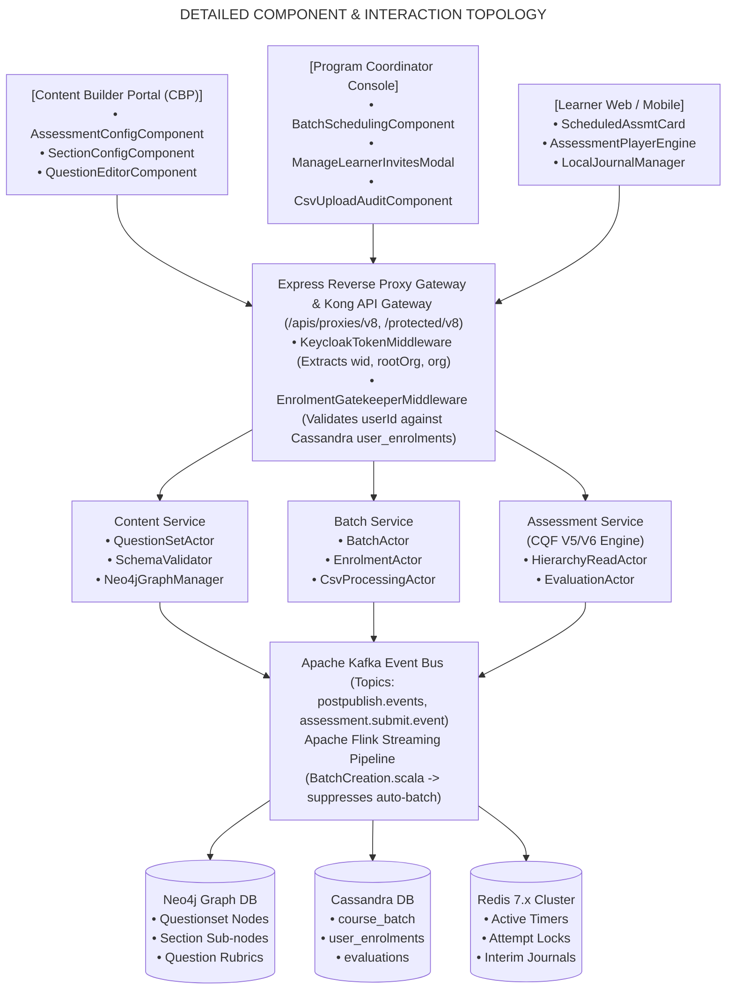

# Invite-Only Assessment — Low-Level Design (LLD) Document

## 1. Document Control & Module Scope

### 1.1 Document Overview

This Low-Level Design (LLD) specification details the concrete implementation artifacts, class structures, interface contracts, state machines, algorithmic pseudo-code, database queries, and data models governing the **Invite-Only Assessment** capability across the iGOT Karmayogi platform.

This specification details the end-to-end engineering implementation spanning:

1. **Frontend Architecture:** Content Builder Portal (Angular 14+ SPA) and Learner Runtime Client (Angular Web & Flutter/Dart Mobile).
2. **API Gateway & Proxy Middleware:** Node.js/Express session proxy and Kong reverse-proxy route enforcement.
3. **Backend Microservices:** Java/Scala microservices handling Content Authoring, Batch Scheduling, Access Control, and CQF Assessment Engine (V5/V6).
4. **Stream Processing Infrastructure:** Apache Flink jobs (`BatchCreation.scala`) within Kafka event streaming pipelines.
5. **Persistence & Cache Topologies:** Apache Cassandra 4.x columnar physical tables, Neo4j 5.x graph traversals, Redis 7.x session structures, and Elasticsearch 8.x composite search index shielding.

## 2. Microservice & Component Architecture



## 3. Frontend Architecture & Low-Level Component Design

### 3.1 Content Builder Portal (CBP) Authoring Engine (Angular 14+)

#### Component Class: `AssessmentConfigComponent`

Responsible for capturing root-level assessment metadata and enforcing `Invite-Only Assessment` taxonomy restrictions.

```typescript
import { Component, OnInit, OnDestroy } from '@angular/core';
import { FormBuilder, FormGroup, Validators, FormControl } from '@angular/forms';
import { Subject } from 'rxjs';
import { takeUntil } from 'rxjs/operators';
import { AssessmentService } from '../services/assessment.service';
import { NotificationService } from '../services/notification.service';

export interface IQuestionLevelDefinition {
  easy: number;
  medium: number;
  difficult: number;
  hots: number;
}

export interface IAssessmentMetadata {
  identifier?: string;
  name: string;
  description: string;
  courseCategory: 'Course Assessment' | 'Standalone Assessment' | 'Invite-Only Assessment';
  assessmentType: 'questionWeightage' | 'optionWeightage';
  scoreCutoffType: 'AssessmentLevel' | 'SectionLevel';
  expectedDuration: number; // in seconds
  noOfSection: number;
  minimumPassPercentage: number;
  negativeMarkingPercentage: '0%' | '25%' | '50%' | '75%' | '100%';
  showMarks: 'Yes' | 'No';
  sectionTimeBound: 'Yes' | 'No';
  maxAssessmentRetakeAttempts: number;
  questionLevelDefinition: IQuestionLevelDefinition;
  accessSettings: 'All Users' | 'MDO Specific' | 'Custom Users';
}

@Component({
  selector: 'app-assessment-config',
  templateUrl: './assessment-config.component.html',
  styleUrls: ['./assessment-config.component.scss']
})
export class AssessmentConfigComponent implements OnInit, OnDestroy {
  public configForm!: FormGroup;
  public isSubmitting = false;
  public showSectionTimeWarning = false;
  private destroy$ = new Subject<void>();

  constructor(
    private fb: FormBuilder,
    private assessmentService: AssessmentService,
    private notificationService: NotificationService
  ) {}

  public ngOnInit(): void {
    this.initForm();
    this.observeAccessSettings();
    this.observeAssessmentType();
  }

  private initForm(): void {
    this.configForm = this.fb.group({
      name: ['', [Validators.required, Validators.maxLength(120)]],
      description: ['', [Validators.maxLength(500)]],
      accessSettings: ['Custom Users', Validators.required],
      courseCategory: [{ value: 'Invite-Only Assessment', disabled: true }, Validators.required],
      assessmentType: ['questionWeightage', Validators.required],
      scoreCutoffType: ['SectionLevel', Validators.required],
      expectedDuration: [3600, [Validators.required, Validators.min(300), Validators.max(28800)]],
      noOfSection: [1, [Validators.required, Validators.min(1), Validators.max(6)]],
      minimumPassPercentage: [60, [Validators.required, Validators.min(0), Validators.max(100)]],
      negativeMarkingPercentage: ['25%', Validators.required],
      showMarks: ['Yes', Validators.required],
      sectionTimeBound: ['No', Validators.required],
      maxAssessmentRetakeAttempts: [0, [Validators.required, Validators.min(0), Validators.max(5)]],
      questionLevelDefinition: this.fb.group({
        easy: [1, [Validators.required, Validators.min(1)]],
        medium: [2, [Validators.required, Validators.min(1)]],
        difficult: [3, [Validators.required, Validators.min(1)]],
        hots: [5, [Validators.required, Validators.min(1)]]
      })
    });
  }

  private observeAccessSettings(): void {
    this.configForm.get('accessSettings')?.valueChanges
      .pipe(takeUntil(this.destroy$))
      .subscribe((setting: string) => {
        const categoryControl = this.configForm.get('courseCategory');
        if (setting === 'Custom Users') {
          categoryControl?.setValue('Invite-Only Assessment');
          this.notificationService.showInfo(
            'Invite-Only Assessment selected: Automatic batch creation will be bypassed. Program Coordinators will manage scheduling and cohorts.'
          );
        } else {
          categoryControl?.setValue('Standalone Assessment');
        }
      });
  }

  private observeAssessmentType(): void {
    this.configForm.get('assessmentType')?.valueChanges
      .pipe(takeUntil(this.destroy$))
      .subscribe((type: 'questionWeightage' | 'optionWeightage') => {
        const passPercentControl = this.configForm.get('minimumPassPercentage');
        const sectionsControl = this.configForm.get('noOfSection');
        if (type === 'optionWeightage') {
          // Psychometric evaluations enforce single section and suppress pass/fail thresholds
          passPercentControl?.disable();
          sectionsControl?.setValue(1);
          sectionsControl?.disable();
        } else {
          passPercentControl?.enable();
          sectionsControl?.enable();
        }
      });
  }

  public serializePayload(): IAssessmentMetadata {
    const rawValue = this.configForm.getRawValue();
    return {
      name: rawValue.name,
      description: rawValue.description,
      courseCategory: rawValue.courseCategory,
      assessmentType: rawValue.assessmentType,
      scoreCutoffType: rawValue.scoreCutoffType,
      expectedDuration: rawValue.expectedDuration,
      noOfSection: rawValue.noOfSection,
      minimumPassPercentage: rawValue.minimumPassPercentage,
      negativeMarkingPercentage: rawValue.negativeMarkingPercentage,
      showMarks: rawValue.showMarks,
      sectionTimeBound: rawValue.sectionTimeBound,
      maxAssessmentRetakeAttempts: rawValue.maxAssessmentRetakeAttempts,
      questionLevelDefinition: rawValue.questionLevelDefinition,
      accessSettings: rawValue.accessSettings
    };
  }

  public ngOnDestroy(): void {
    this.destroy$.next();
    this.destroy$.complete();
  }
}
```

### 3.2 Program Coordinator Scheduling & Cohort Management Interface

#### Component Class: `ManageLearnerInvitesModalComponent`

Consolidates single-button toggle management, CSV bulk cohort parsing, and instantaneous error log generation ([KB-2960: Q3 | Ad-Hoc Requests | Invite-Only | Single Button for managing User Invites.](https://karmayogibharat.atlassian.net/browse/KB-2960) (KB Approved), [KB-7067: Q6 | Content Portal | Navigation and user experience for program coordinator](https://karmayogibharat.atlassian.net/browse/KB-7067) (Prod Deployed), [KB-8351: KB-7067 | The entries under Error tab are not displaying for unsuccessful upload immediately for Invite only Assessment and Invite only Program.](https://karmayogibharat.atlassian.net/browse/KB-8351) (Done)).

```typescript
import { Component, Input, Output, EventEmitter, OnInit } from '@angular/core';
import { HttpClient } from '@angular/common/http';
import { Papa } from 'ngx-papaparse';

export interface ICsvValidationError {
  row: number;
  identifier: string;
  reason: string;
}

@Component({
  selector: 'app-manage-learner-invites-modal',
  templateUrl: './manage-learner-invites-modal.component.html',
  styleUrls: ['./manage-learner-invites-modal.component.scss']
})
export class ManageLearnerInvitesModalComponent implements OnInit {
  @Input() public batchId!: string;
  @Input() public courseId!: string;
  @Input() public batchEndDateTime!: string;
  @Input() public expectedDurationSeconds!: number;
  @Output() public rosterUpdated = new EventEmitter<number>();

  public isWindowExpired = false;
  public activeTab: 'individual' | 'bulk' | 'errors' = 'individual';
  public validationErrors: ICsvValidationError[] = [];
  public isProcessing = false;

  constructor(private http: HttpClient, private papa: Papa) {}

  public ngOnInit(): void {
    this.verifyEnrollmentCutoffBuffer();
  }

  public verifyEnrollmentCutoffBuffer(): void {
    const endTimestamp = new Date(this.batchEndDateTime).getTime();
    const durationMs = this.expectedDurationSeconds * 1000;
    const cutoffTimestamp = endTimestamp - durationMs;
    const currentTimestamp = Date.now();
    if (currentTimestamp > cutoffTimestamp) {
      this.isWindowExpired = true;
    }
  }

  public onFileUpload(event: Event): void {
    const target = event.target as HTMLInputElement;
    if (!target.files || target.files.length === 0) return;
    const file = target.files[0];
    this.isProcessing = true;
    this.validationErrors = [];
    this.papa.parse(file, {
      header: true,
      skipEmptyLines: true,
      complete: (result) => {
        this.processParsedCsv(result.data);
      },
      error: () => {
        this.isProcessing = false;
      }
    });
  }

  private processParsedCsv(rows: Array<{ userId?: string; email?: string }>): void {
    const validUserIds: string[] = [];
    rows.forEach((row, index) => {
      const rowNumber = index + 2; // Compensate for header and zero-index
      const id = (row.userId || row.email || '').trim();
      if (!id) {
        this.validationErrors.push({ row: rowNumber, identifier: 'N/A', reason: 'Empty identifier' });
      } else if (!this.isValidUuidOrEmail(id)) {
        this.validationErrors.push({ row: rowNumber, identifier: id, reason: 'Malformed UUID or Gov Email' });
      } else {
        validUserIds.push(id);
      }
    });
    if (validUserIds.length > 0 && !this.isWindowExpired) {
      this.dispatchBatchEnrollment(validUserIds);
    } else {
      this.isProcessing = false;
      if (this.validationErrors.length > 0) this.activeTab = 'errors';
    }
  }

  private isValidUuidOrEmail(val: string): boolean {
    const uuidRegex = /^[0-9a-f]{8}-[0-9a-f]{4}-[1-5][0-9a-f]{3}-[89ab][0-9a-f]{3}-[0-9a-f]{12}$/i;
    const emailRegex = /^[a-zA-Z0-9._%+-]+@[a-zA-Z0-9.-]+\.[a-zA-Z]{2,}$/;
    return uuidRegex.test(val) || emailRegex.test(val);
  }

  private dispatchBatchEnrollment(userIds: string[]): void {
    const payload = {
      request: {
        batchId: this.batchId,
        courseId: this.courseId,
        userIds: userIds
      }
    };
    this.http.post<any>('/apis/proxies/v8/course/batch/users/add', payload).subscribe({
      next: (res) => {
        this.isProcessing = false;
        this.rosterUpdated.emit(userIds.length);
      },
      error: (err) => {
        this.isProcessing = false;
        if (err.status === 400 && err.error?.params?.errmsg) {
          this.validationErrors.push({ row: 0, identifier: 'Batch Error', reason: err.error.params.errmsg });
          this.activeTab = 'errors';
        }
      }
    });
  }

  public downloadErrorCsv(): void {
    const csvContent = this.papa.unparse(this.validationErrors);
    const blob = new Blob([csvContent], { type: 'text/csv;charset=utf-8;' });
    const link = document.createElement('a');
    link.href = URL.createObjectURL(blob);
    link.setAttribute('download', `Batch_${this.batchId}_Enrollment_Errors.csv`);
    document.body.appendChild(link);
    link.click();
    document.body.removeChild(link);
  }
}
```

### 3.3 Learner Runtime Consumption Engine & Resumption Machine

#### Local Storage Resumption Service: `LocalJournalManager`

Enforces strict single-sitting persistence, answer preservation during connection dropouts, and real-time clock drift decrementing.

```typescript
import { Injectable } from '@angular/core';

export interface IAttemptJournal {
  assessmentId: string;
  batchId: string;
  serverStartTimeMs: number;
  totalDurationSeconds: number;
  lastKnownServerTimestampMs: number;
  answers: Record<string, { selectedOptionIndexes: string[]; timeSpentSeconds: number }>;
  activeSectionId: string;
  activeQuestionId: string;
  markedForReview: string[];
}

@Injectable({ providedIn: 'root' })
export class LocalJournalManager {
  private getStorageKey(assessmentId: string): string {
    return `cqf_journal_${assessmentId}`;
  }

  public initializeJournal(
    assessmentId: string,
    batchId: string,
    durationSeconds: number,
    serverTimestampMs: number
  ): IAttemptJournal {
    const existing = this.loadJournal(assessmentId);
    if (existing) return existing;
    const newJournal: IAttemptJournal = {
      assessmentId,
      batchId,
      serverStartTimeMs: serverTimestampMs,
      totalDurationSeconds: durationSeconds,
      lastKnownServerTimestampMs: serverTimestampMs,
      answers: {},
      activeSectionId: '',
      activeQuestionId: '',
      markedForReview: []
    };
    this.persist(newJournal);
    return newJournal;
  }

  public recordAnswer(
    assessmentId: string,
    questionId: string,
    options: string[],
    timeSpentSeconds: number
  ): void {
    const journal = this.loadJournal(assessmentId);
    if (!journal) return;
    journal.answers[questionId] = {
      selectedOptionIndexes: options,
      timeSpentSeconds: (journal.answers[questionId]?.timeSpentSeconds || 0) + timeSpentSeconds
    };
    this.persist(journal);
  }

  public computeRemainingTime(assessmentId: string, currentServerTimestampMs: number): number {
    const journal = this.loadJournal(assessmentId);
    if (!journal) return 0;
    const elapsedSeconds = Math.floor((currentServerTimestampMs - journal.serverStartTimeMs) / 1000);
    const remaining = journal.totalDurationSeconds - elapsedSeconds;
    return remaining > 0 ? remaining : 0;
  }

  public loadJournal(assessmentId: string): IAttemptJournal | null {
    const raw = localStorage.getItem(this.getStorageKey(assessmentId));
    if (!raw) return null;
    try {
      return JSON.parse(raw) as IAttemptJournal;
    } catch {
      return null;
    }
  }

  public purgeJournal(assessmentId: string): void {
    localStorage.removeItem(this.getStorageKey(assessmentId));
  }

  private persist(journal: IAttemptJournal): void {
    localStorage.setItem(this.getStorageKey(journal.assessmentId), JSON.stringify(journal));
  }
}
```

## 4. Backend Microservice Architecture & Low-Level Designs

### 4.1 Apache Flink Post-Publish Event Processor (`BatchCreation.scala`)

Deployed inside `knowledge-platform-jobs` on Kubernetes, this consumer intercepts Kafka publishing events and suppresses auto-batch creation.

```scala
package org.sunbird.job.postpublish.helpers

import org.apache.commons.lang3.StringUtils
import org.slf4j.LoggerFactory
import org.sunbird.job.util.CassandraUtil

trait BatchCreation {
  private[this] val logger = LoggerFactory.getLogger(classOf[BatchCreation])

  /**
   * Evaluates incoming published content metadata to determine whether
   * automatic batch provisioning is permitted.
   *
   * @param metadata Map of content metadata attributes from Neo4j/Kafka
   * @param cassandraUtil Cassandra database connectivity utility
   * @return Boolean indicating whether an open batch was provisioned
   */
  def handleBatchProvisioning(metadata: Map[String, AnyRef], cassandraUtil: CassandraUtil): Boolean = {
    val identifier: String = metadata.getOrElse("identifier", "").asInstanceOf[String]
    val courseCategory: String = metadata.getOrElse("courseCategory", "").asInstanceOf[String]
    val primaryCategory: String = metadata.getOrElse("primaryCategory", "").asInstanceOf[String]

    logger.info(s"Assessing batch creation policy for asset: $identifier | courseCategory: $courseCategory | primaryCategory: $primaryCategory")

    // RULE: Suppress automated open batch for Invite-Only Assessments
    if (StringUtils.containsIgnoreCase(courseCategory, "Invite-Only")) {
      logger.info(s"Asset $identifier is categorized as [Invite-Only Assessment]. Auto-batch creation SUPPRESSED. Batch lifecycle delegated to Program Coordinators.")
      false
    } else if (StringUtils.equalsIgnoreCase(primaryCategory, "Course Assessment") || StringUtils.equalsIgnoreCase(courseCategory, "Standalone Assessment")) {
      logger.info(s"Asset $identifier qualifies for automated public batch provisioning.")
      provisionStandardOpenBatch(identifier, metadata, cassandraUtil)
      true
    } else {
      logger.warn(s"Asset $identifier matches no auto-batch provisioning rules.")
      false
    }
  }

  private def provisionStandardOpenBatch(courseId: String, metadata: Map[String, AnyRef], cassandraUtil: CassandraUtil): Unit = {
    val batchId = s"01${System.currentTimeMillis()}"
    val query = s"""
      INSERT INTO sunbird.course_batch (course_id, batch_id, name, enrollment_type, status, created_date)
      VALUES ('$courseId', '$batchId', 'Auto Generated Open Batch', 'open', 1, toTimestamp(now()));
    """
    cassandraUtil.upsert(query)
    logger.info(s"Automated open batch $batchId successfully provisioned for course: $courseId")
  }
}
```

### 4.2 Program Coordinator Scheduling & Validation Service (Node.js/Express)

Validates sub-daily temporal windows and rejects cohort modifications if candidates have already commenced examination.

```typescript
import { Request, Response, NextFunction } from 'express';
import { CassandraClient } from '../infrastructure/cassandra.client';

export class BatchController {
  private cassandra = CassandraClient.getInstance();

  public createScheduledBatch = async (req: Request, res: Response, next: NextFunction): Promise<void> => {
    try {
      const { courseId, name, description, startDate, endDate, startTime, endTime } = req.body.request;

      // 1. Structural Validation
      if (!courseId || !startDate || !endDate || !startTime || !endTime) {
        res.status(400).json({ responseCode: 'CLIENT_ERROR', params: { errmsg: 'Missing mandatory temporal boundaries' } });
        return;
      }

      const startDateTime = new Date(`${startDate}T${startTime}+05:30`).getTime();
      const endDateTime = new Date(`${endDate}T${endTime}+05:30`).getTime();
      const currentDateTime = Date.now();

      // 2. Temporal Logic Checks
      if (startDateTime >= endDateTime) {
        res.status(400).json({ responseCode: 'CLIENT_ERROR', params: { errmsg: 'Batch End DateTime must be strictly after Start DateTime' } });
        return;
      }
      if (endDateTime <= currentDateTime) {
        res.status(400).json({ responseCode: 'CLIENT_ERROR', params: { errmsg: 'Batch End DateTime cannot be in the past' } });
        return;
      }

      const batchId = `01${Date.now()}`;
      const cql = `
        INSERT INTO sunbird.course_batch (
          course_id, batch_id, name, description, enrollment_type,
          start_date, end_date, start_time, end_time, status, created_date
        ) VALUES (?, ?, ?, ?, 'invite-only', ?, ?, ?, ?, 1, toTimestamp(now()));
      `;
      await this.cassandra.execute(cql, [courseId, batchId, name, description, startDate, endDate, startTime, endTime], { prepare: true });

      res.status(200).json({ id: 'api.course.batch.create', ver: '1.0', responseCode: 'OK', result: { batchId } });
    } catch (error) {
      next(error);
    }
  };

  public removeLearnerFromRoster = async (req: Request, res: Response, next: NextFunction): Promise<void> => {
    try {
      const { batchId, courseId, userId } = req.body.request;

      // RULE: Check if learner has already initiated or completed the assessment
      const checkCql = `SELECT status FROM sunbird.user_enrolments WHERE user_id = ? AND course_id = ? AND batch_id = ?;`;
      const record = await this.cassandra.execute(checkCql, [userId, courseId, batchId], { prepare: true });

      if (record.rows.length === 0) {
        res.status(404).json({ responseCode: 'RESOURCE_NOT_FOUND', params: { errmsg: 'User enrolment record not found' } });
        return;
      }

      const progressStatus = record.rows[0].status; // 0 = Not Started, 1 = In Progress, 2 = Completed
      if (progressStatus > 0) {
        res.status(400).json({ responseCode: 'CLIENT_ERROR', params: { errmsg: 'Cannot remove learner from roster: Assessment attempt is already in progress or completed' } });
        return;
      }

      // Safe to de-enroll
      const deleteCql = `UPDATE sunbird.user_enrolments SET active = false WHERE user_id = ? AND course_id = ? AND batch_id = ?;`;
      await this.cassandra.execute(deleteCql, [userId, courseId, batchId], { prepare: true });

      res.status(200).json({ id: 'api.course.batch.users.remove', ver: '1.0', responseCode: 'OK', result: { status: 'SUCCESS' } });
    } catch (error) {
      next(error);
    }
  };
}
```

## 5. Algorithmic Pseudo-Code & State Machines

### 5.1 The 3x Randomization Engine

Executed by `HierarchyReadActor` during hierarchy fetch to generate randomized test variations while keeping section banks deterministic across refreshes.

```text
ALGORITHM: Generate3xRandomizedAssessment
INPUT:
    rawQuestionsetHierarchy: QuestionsetNode
    userSeed: String (Concatenation of userId + batchId)
OUTPUT: sanitizedRandomizedHierarchy: QuestionsetNode

BEGIN
    // Step 1: Initialize Pseudo-Random Generator with Deterministic Seed
    prng = SecureDeterministicPRNG(userSeed)
    randomizedSections = []

    FOR EACH section IN rawQuestionsetHierarchy.sections DO
        clonedSection = section.cloneWithoutAnswers()
        allQuestions = section.questions

        // Phase 1: Question Pool Sampling (if configured)
        IF section.sampleSize > 0 AND section.sampleSize < allQuestions.length THEN
            sampledQuestions = prng.sampleWithoutReplacement(allQuestions, section.sampleSize)
        ELSE
            sampledQuestions = allQuestions
        END IF

        // Phase 2: Intra-Section Question Sequence Permutation
        IF section.shuffleQuestions == TRUE THEN
            shuffledQuestions = prng.fisherYatesShuffle(sampledQuestions)
        ELSE
            shuffledQuestions = sampledQuestions
        END IF

        // Phase 3: Intra-Question Option Permutation
        FOR EACH question IN shuffledQuestions DO
            IF question.qType IN ["MCQ-SCA", "MCQ-MCA"] AND question.shuffleOptions == TRUE THEN
                question.options = prng.fisherYatesShuffle(question.options)
            END IF

            // Strip answer declarations and rubrics
            question.stripAttribute("responseDeclaration")
            question.stripAttribute("correctAnswer")
            question.stripAttribute("rubricWeight")
        END FOR

        clonedSection.questions = shuffledQuestions
        randomizedSections.append(clonedSection)
    END FOR

    rawQuestionsetHierarchy.sections = randomizedSections
    RETURN rawQuestionsetHierarchy
END
```

### 5.2 Algorithmic Scoring & Negative Marking (V6 Submit Engine)

```text
ALGORITHM: EvaluateV6Submission
INPUT:
    submissionPayload: V6SubmitRequestPayload
    assessmentId: String
    userId: String
OUTPUT: EvaluationOutcome (overallScore, percentage, passStatus, sectionalBreakdown)

BEGIN
    // 1. Fetch Golden Answer Keys from Neo4j/Redis Cache
    goldenHierarchy = Cache.getOrLoadHierarchy(assessmentId)
    batchMeta = Cassandra.getBatch(submissionPayload.batchId)

    // 2. Validate Temporal Submission Window
    serverTime = System.currentTimeMillis()
    allowedDeadline = batchMeta.endDateTimeMs + Config.SUBMISSION_GRACE_BUFFER_MS
    IF serverTime > allowedDeadline THEN
        THROW SubmissionWindowClosedException("Exam submission window has expired")
    END IF

    totalAssessmentMarks = 0.0
    totalEarnedMarks = 0.0
    allSectionsPassed = TRUE
    sectionalResults = []

    FOR EACH goldenSection IN goldenHierarchy.sections DO
        userSection = submissionPayload.findSection(goldenSection.identifier)
        sectionTotal = 0.0
        sectionEarned = 0.0

        FOR EACH goldenQ IN goldenSection.questions DO
            questionWeight = goldenQ.marks
            sectionTotal = sectionTotal + questionWeight
            userAnswer = userSection.findQuestionAnswer(goldenQ.identifier)

            IF userAnswer IS NULL OR userAnswer.options.isEmpty() THEN
                // Question Skipped: Zero marks
                CONTINUE
            END IF

            IF userAnswer.matches(goldenQ.correctOptions) THEN
                sectionEarned = sectionEarned + questionWeight
            ELSE
                // Deduct negative marks based on configured ratio
                negativeRatio = ParseRatio(goldenSection.negativeMarkingPercentage) // e.g., 0.25
                deduction = questionWeight * negativeRatio
                sectionEarned = sectionEarned - deduction
            END IF
        END FOR

        // Floor sectional score at 0.0 to prevent carrying negative values
        IF sectionEarned < 0.0 THEN
            sectionEarned = 0.0
        END IF

        sectionPercent = (sectionEarned / sectionTotal) * 100.0
        sectionPass = (sectionPercent >= goldenSection.sectionalPassPercentage)

        IF sectionPass == FALSE THEN
            allSectionsPassed = FALSE
        END IF

        sectionalResults.append({
            sectionId: goldenSection.identifier,
            name: goldenSection.name,
            marksEarned: sectionEarned,
            marksTotal: sectionTotal,
            percentage: sectionPercent,
            passStatus: sectionPass
        })

        totalEarnedMarks = totalEarnedMarks + sectionEarned
        totalAssessmentMarks = totalAssessmentMarks + sectionTotal
    END FOR

    overallPercentage = (totalEarnedMarks / totalAssessmentMarks) * 100.0
    IF goldenHierarchy.scoreCutoffType == "SectionLevel" THEN
        finalPass = allSectionsPassed AND (overallPercentage >= goldenHierarchy.minimumPassPercentage)
    ELSE
        finalPass = (overallPercentage >= goldenHierarchy.minimumPassPercentage)
    END IF

    // 3. Persist Evaluation to Cassandra & Emit Kafka Telemetry
    attemptId = UUID.randomUUID().toString()
    Cassandra.insertEvaluationRecord(userId, assessmentId, submissionPayload.batchId, attemptId, overallPercentage, finalPass, sectionalResults)
    Kafka.publish("assessment.submit.event", {
        userId: userId,
        assessmentId: assessmentId,
        score: overallPercentage,
        pass: finalPass
    })

    RETURN {
        pass: finalPass,
        overallResult: overallPercentage,
        totalMarks: totalAssessmentMarks,
        earnedMarks: totalEarnedMarks,
        children: sectionalResults
    }
END
```

## 6. Detailed Physical Database Schemas & Queries

### 6.1 Cassandra DDL & Access Access Patterns (`sunbird` Keyspace)

```sql
-- 1. Course Batch Table: Manages sub-daily start/end times and enrollment limits
CREATE TABLE IF NOT EXISTS sunbird.course_batch (
    course_id text,
    batch_id text,
    name text,
    description text,
    enrollment_type text,
    start_date text,
    end_date text,
    start_time text,
    end_time text,
    enrollment_end_date text,
    created_by text,
    created_date text,
    status int,
    cert_templates map<text, frozen<map<text, text>>>,
    PRIMARY KEY (course_id, batch_id)
) WITH CLUSTERING ORDER BY (batch_id ASC) AND compaction = {'class': 'TimeWindowCompactionStrategy', 'compaction_window_unit': 'DAYS', 'compaction_window_size': 1};

-- 2. User Enrolment Table: Cohort roster and tracking
CREATE TABLE IF NOT EXISTS sunbird.user_enrolments (
    user_id text,
    course_id text,
    batch_id text,
    active boolean,
    status int,
    enrolled_date timestamp,
    completed_on timestamp,
    last_read_content_id text,
    last_read_content_status int,
    progress int,
    PRIMARY KEY ((user_id), course_id, batch_id)
);
CREATE INDEX IF NOT EXISTS idx_user_enrolment_batch ON sunbird.user_enrolments (batch_id);

-- 3. Assessment Evaluation Records Table
CREATE TABLE IF NOT EXISTS sunbird.assessment_evaluations (
    user_id text,
    assessment_id text,
    batch_id text,
    attempt_id text,
    overall_score double,
    total_marks double,
    pass_status boolean,
    time_taken_seconds int,
    section_breakdown text,
    submission_payload text,
    evaluated_on timestamp,
    PRIMARY KEY ((user_id, assessment_id), batch_id, attempt_id)
) WITH CLUSTERING ORDER BY (batch_id ASC, attempt_id DESC);
```

#### Optimized CQL Queries

```sql
-- Query 1: Verify learner enrollment before allowing assessment launch
SELECT active, status
FROM sunbird.user_enrolments
WHERE user_id = :userId
  AND course_id = :courseId
  AND batch_id = :batchId;

-- Query 2: Batch scheduling lookup for countdown calculation
SELECT start_date, end_date, start_time, end_time, status
FROM sunbird.course_batch
WHERE course_id = :courseId
  AND batch_id = :batchId;

-- Query 3: Coordinator Roster Fetch with Pagination
SELECT user_id, active, status, enrolled_date
FROM sunbird.user_enrolments
WHERE batch_id = :batchId;
```

### 6.2 Redis Key Topologies

| Redis Key Pattern | Data Structure | TTL | Purpose |
|---|---|---|---|
| `cqf:lock:attempt:{userId}:{assessmentId}` | `STRING` | Batch Duration | Distributed execution lock preventing concurrent multi-tab attempts. |
| `cqf:session:{userId}:{assessmentId}` | `HASH` | Batch End + 15m | Holds server-synchronized remaining duration, active section ID, and interim answers. |
| `cqf:cache:hierarchy:{assessmentId}` | `STRING` (JSON) | 24 Hours | Stripped V5 questionset tree used for delivery. |

## 7. Concrete API Payload & Schema Contracts

### 7.1 Questionset Authoring Payload

- **Endpoint:** `POST /apis/proxies/v8/cqfquestionset/questionset/create`
- **Headers:** `wid: <UUID>`, `rootOrg: igot`, `Content-Type: application/json`

```json
{
  "request": {
    "questionset": {
      "name": "Mid-Career Evaluation 2026",
      "description": "Invite-Only Exam for Civil Service Officers",
      "primaryCategory": "Course Assessment",
      "courseCategory": "Invite-Only Assessment",
      "mimeType": "application/vnd.sunbird.questionset",
      "assessmentType": "questionWeightage",
      "scoreCutoffType": "SectionLevel",
      "expectedDuration": 3600,
      "noOfSection": 2,
      "minimumPassPercentage": 60,
      "negativeMarkingPercentage": "25%",
      "showMarks": "Yes",
      "sectionTimeBound": "Yes",
      "maxAssessmentRetakeAttempts": 0,
      "questionLevelDefinition": {
        "easy": 1,
        "medium": 2,
        "difficult": 3,
        "hots": 5
      }
    }
  }
}
```

### 7.2 V6 Assessment Evaluation Submit Contract

- **Endpoint:** `POST /apis/protected/v8/user/evaluate/assessment/submit/v6`

```json
{
  "batchId": "01408031797522432048",
  "identifier": "do_1141410889336094721230",
  "courseId": "do_1141410889336094721230",
  "isAssessment": true,
  "timeLimit": 3600,
  "children": [
    {
      "identifier": "do_114140032038076416114",
      "name": "Constitutional Framework",
      "scoreCutoffType": "SectionLevel",
      "children": [
        {
          "identifier": "do_114140032403873792116",
          "qType": "MCQ-SCA",
          "timeSpent": 45,
          "editorState": {
            "options": [
              {
                "index": "1",
                "selectedAnswer": true
              }
            ]
          }
        }
      ]
    }
  ]
}
```

## 8. Requirements Traceability Matrix (LLD Scope)

| Feature / Task Dimension | Primary Jira References | Concrete Implementation Module | Unit / Integration Test Case ID | Status |
|---|---|---|---|---|
| **Schema Validation & Metadata Tagging** | [KB-3959: Q4 \| Assessments \| Assessment creation - for Invite only users](https://karmayogibharat.atlassian.net/browse/KB-3959) (Prod Deployed), `cbrelease-4.8.13` | `AssessmentConfigComponent.ts`, `schema.json` | `TC-LLD-META-01` | **Prod Deployed** |
| **Streaming Auto-Batch Suppression** | [KB-3959: Q4 \| Assessments \| Assessment creation - for Invite only users](https://karmayogibharat.atlassian.net/browse/KB-3959) (Prod Deployed), Confluence `89751668` | `BatchCreation.scala` | `TC-LLD-FLINK-01` | **Prod Deployed** |
| **Sub-Daily Temporal Batch Scheduling** | [KB-5350: Q4 \| Assessments \| Assessment creation - for Invite only users with scheduling assessment](https://karmayogibharat.atlassian.net/browse/KB-5350) (Prod Deployed), [KB-5570: Invite only assessment Batch scheduling with start and end time](https://karmayogibharat.atlassian.net/browse/KB-5570) (In Progress) | `BatchController.ts`, `course_batch` table | `TC-LLD-SCHED-01` | **Prod Deployed** |
| **Enrollment Cutoff Buffer Enforcement** | Confluence FRS `85295123` | `ManageLearnerInvitesModalComponent.ts` | `TC-LLD-BUFF-01` | **Prod Deployed** |
| **CSV Bulk Upload Error** **Auditing** | [KB-8351: KB-7067 \| The entries under Error tab are not displaying for unsuccessful upload immediately for Invite only Assessment and Invite only Program.](https://karmayogibharat.atlassian.net/browse/KB-8351) (Done) | `ManageLearnerInvitesModalComponent.ts` | `TC-LLD-CSV-01` | **Prod** **Deployed** |
| **Active Roster De-Enrollment Guards** | [KB-8365: KB-7067 \| Error message displaying while removing the user who has already consumed the program/assessment is incorrect](https://karmayogibharat.atlassian.net/browse/KB-8365) (Done), [KB-8400: KB-7067 \| Error message displaying while removing the user who has already consumed the assessment is incorrect](https://karmayogibharat.atlassian.net/browse/KB-8400) (Done) | `BatchController.ts` (`removeLearnerFromRoster`) | `TC-LLD-ROST-01` | **Prod Deployed** |
| **3x Combinatorial Randomization** | [KB-3958: Q4 \| Assessments Creation and Consumption](https://karmayogibharat.atlassian.net/browse/KB-3958) (Prod Deployed), Confluence SRS `87392295` | `HierarchyReadActor.java` | `TC-LLD-RAND-01` | **Prod Deployed** |
| **Single-Sitting Local Recovery Journal** | Confluence SRS `87392295` | `LocalJournalManager.ts` | `TC-LLD-JOUR-01` | **Prod Deployed** |
| **Algorithmic Negative Marking & Cutoffs** | Confluence `171704641`, `175702042` | `EvaluationActor.java` (`EvaluateV6Submission`) | `TC-LLD-SCOR-01` | **Prod Deployed** |
| **Catalog Search Shielding Plugins** | [KB-9333: Q8 \| Implement Course Catalog Filters \| Course Catelog \| Learner Portal & Mobile App & M-Site](https://karmayogibharat.atlassian.net/browse/KB-9333) (Prod Deployed), [KB-9337: Q8 \| Course catalog \| Mobile App](https://karmayogibharat.atlassian.net/browse/KB-9337) (Open) | Elasticsearch Composite Query Filter | `TC-LLD-SEAR-01` | **Prod Deployed** |

## 9. Comprehensive Unit & Integration Test Specifications

### 9.1 Unit Test Suite: Flink Streaming Batch Suppression

- **Test ID:** `UT-FLINK-001`
- **Class Under Test:** `org.sunbird.job.postpublish.helpers.BatchCreation`
- **Assertion:** When input map contains `courseCategory -> "Invite-Only Assessment"`, `handleBatchProvisioning` must return `false` and zero queries must be executed against Cassandra `course_batch`.

```scala
class BatchCreationSpec extends FlatSpec with Matchers with MockitoSugar {
  "BatchCreation" should "suppress batch creation when courseCategory is Invite-Only Assessment" in {
    val helper = new BatchCreation {}
    val mockCassandraUtil = mock[CassandraUtil]
    val metadata = Map[String, AnyRef](
      "identifier" -> "do_1141410889336094721230",
      "courseCategory" -> "Invite-Only Assessment",
      "primaryCategory" -> "Course Assessment"
    )

    val result = helper.handleBatchProvisioning(metadata, mockCassandraUtil)

    result should be (false)
    verify(mockCassandraUtil, never()).upsert(anyString())
  }
}
```

### 9.2 Integration Test Suite: Active Attempt De-Enrollment Block

- **Test ID:** `IT-ROSTER-002`
- **Target Endpoint:** `POST /apis/proxies/v8/course/batch/users/remove`
- **Scenario:** Attempting to un-invite a user whose Cassandra `status` is `1` (In Progress) must yield HTTP 400 with `errmsg: "Cannot remove learner from roster: Assessment attempt is already in progress or completed"`.

```javascript
describe('POST /course/batch/users/remove', () => {
  it('should reject de-enrollment for active learner attempts', async () => {
    // Seed Cassandra with user_enrolments status = 1
    await cassandraClient.execute(
      `INSERT INTO sunbird.user_enrolments (user_id, course_id, batch_id, status, active)
      VALUES ('user-test-active', 'do_123', 'batch_456', 1, true);`
    );

    const res = await request(app)
      .post('/apis/proxies/v8/course/batch/users/remove')
      .send({ request: { courseId: 'do_123', batchId: 'batch_456', userId: 'user-test-active' } });

    expect(res.status).toBe(400);
    expect(res.body.params.errmsg).toContain('Cannot remove learner from roster');
  });
});
```

<br><br>
