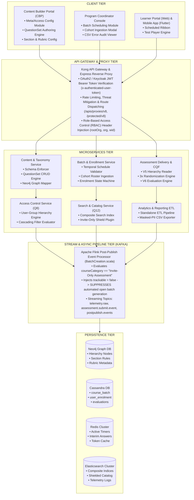
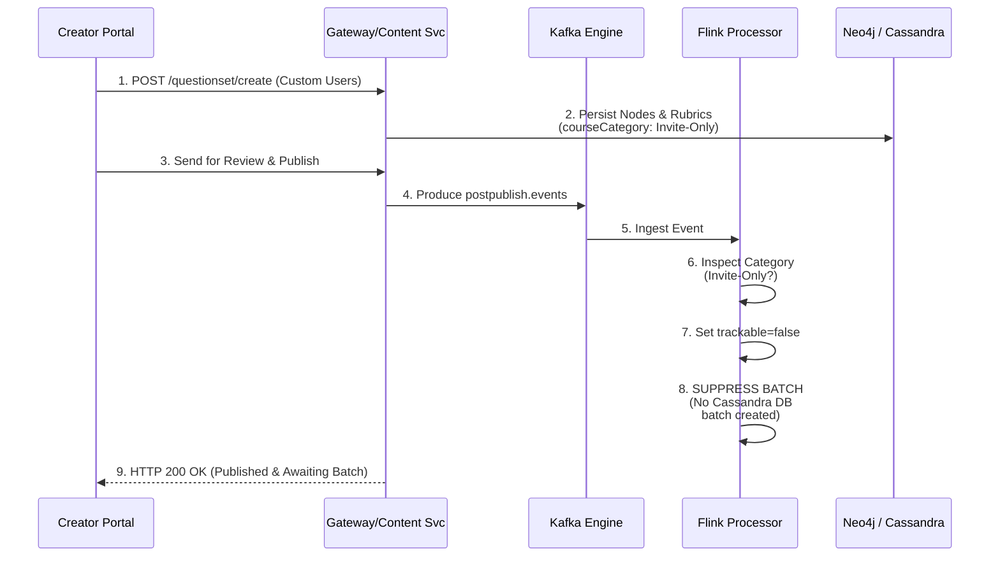
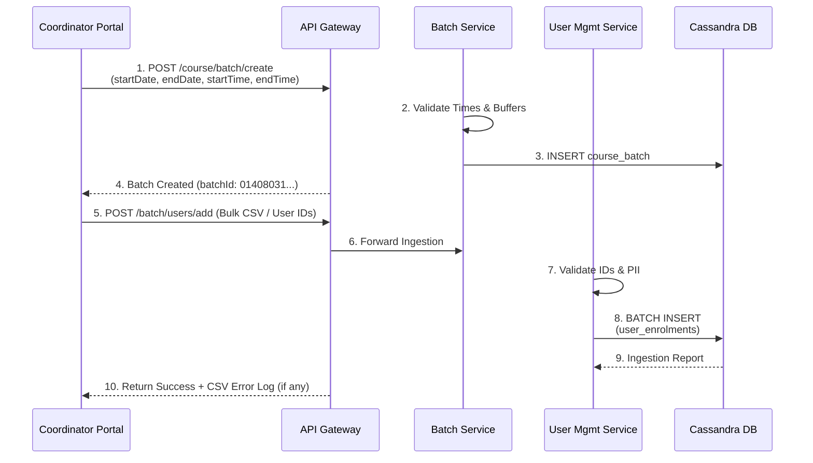
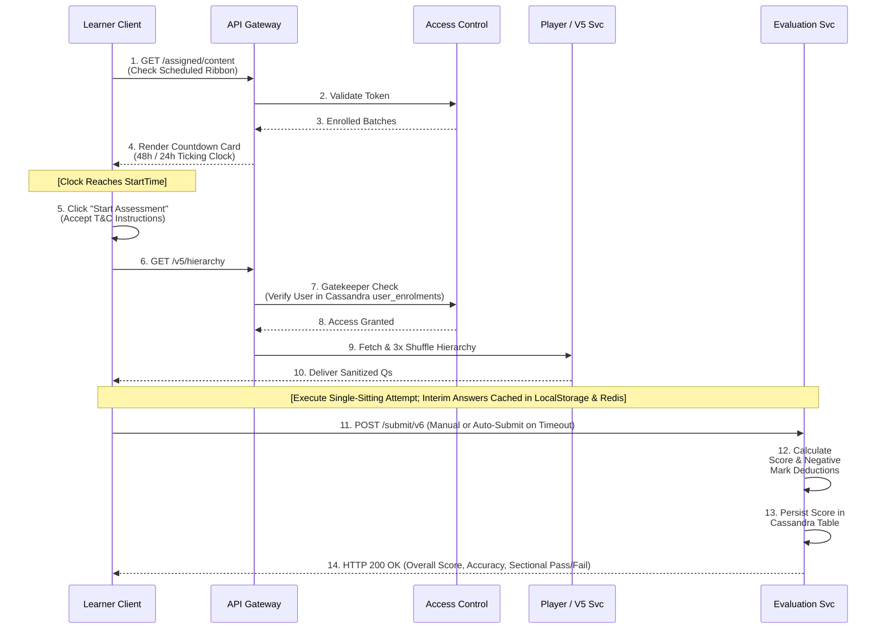
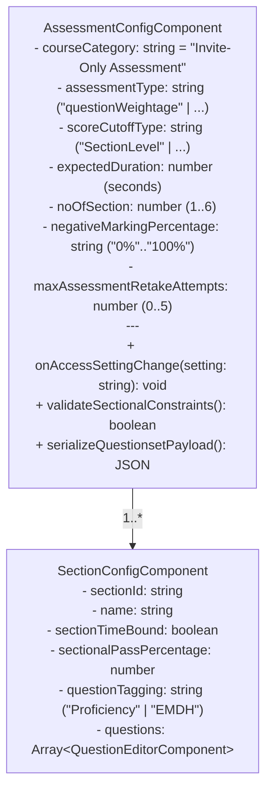
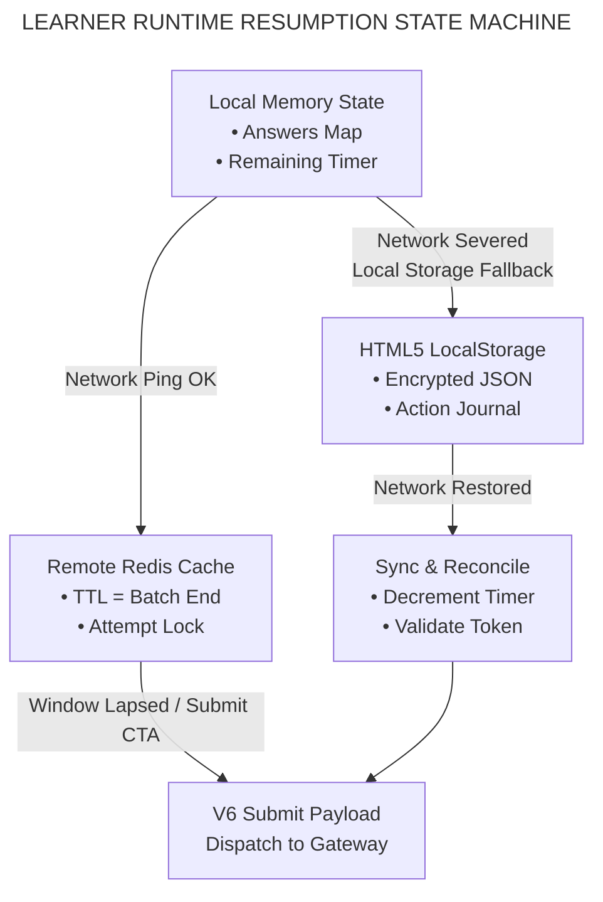
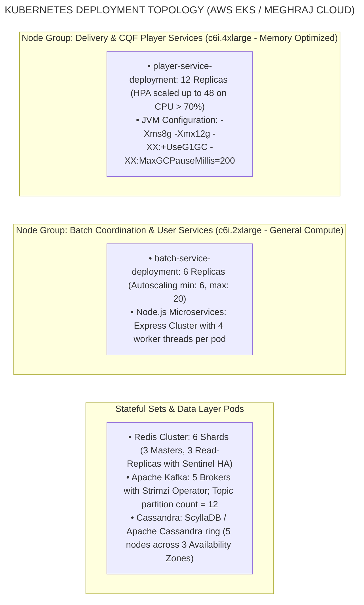

# Invite-Only Assessment — Software Design Document (SDD)

## 1. Introduction and Architectural Rationale

### 1.1 Purpose

This Software Design Document (SDD) specifies the complete architectural, component, interface, data, and deployment designs for the **Invite-Only Assessment** capability across the iGOT Karmayogi digital learning infrastructure. It details the structural evolution of the system from foundational metadata decoupling (**Q2–Q4**), through advanced authoring and batch coordination engines (**Q5–Q8**), sub-daily temporal scheduling and state persistence (**Q9–Q11**), to high-concurrency ingestion resilience, catalog shielding, and audit ETL pipelines (**Q12–Q13**).

### 1.2 Scope

This specification encompasses:

- **Authoring & Publishing Subsystems:** Content Builder Portal (CBP), Metadata Schema validation (`sunbird-cb-ext-schema`), Neo4j hierarchical graph persistence, and Apache Flink stream-processing post-publish pipeline suppression.
- **Coordination & Ingestion Subsystems:** Program Coordinator (PC) administrative hub, sub-daily scheduling engines, CSV parsing pipelines, transactional Cassandra batch tables, and cohort enrollment error logging.
- **Delivery & Consumption Subsystems:** Learner Web Portal (Angular) and Mobile Application (Flutter/Dart), dynamic countdown rendering, 3x combinatorial randomization engines, localized state caches, and V5/V6 CQF runtime evaluation APIs.
- **Access Control & Discovery Subsystems:** User-Group multi-condition rule evaluators, reverse-proxy edge gateways, Elasticsearch composite index shielding, and masked-PII reporting ETLs.

### 1.3 Architectural Design Rationale & Trade-Offs

**ARCHITECTURAL EVOLUTION & DESIGN DECISIONS**

| Legacy Baseline (Open Model) | Modern Design (Invite-Only Model) | Key Architectural Driver |
|---|---|---|
| Post-publish Flink job automatically provisions an open public batch for every published assessment. | Flink job inspects metadata courseCategory. If invite-only, batch creation is suppressed. | Decouples content creation from cohort administration; prevents test leakages. |
| Batch scheduling bounded only by calendar dates (YYYY-MM-DD). | Sub-daily scheduling with start & end timestamps (HH:mm:ss) and duration-based cutoff buffers. | Enforces synchronized civil service cadre evaluations; mitigates answer collusion. |
| Client-side state managed in memory; network loss invalidates attempts. | Hybrid Redis session cache + client LocalStorage persistence with real-time server syncing. | Fault-tolerant resumption across intermittent mobile network dropouts. |
| Public Elasticsearch indexing exposes all assessments to global catalog. | Composite search filter checks courseCategory and suppresses invite-only assets from queries. | Complete isolation of high-stakes tests from general learner catalog searches. |

## 2. System Architecture and Component Decomposition

### 2.1 Multi-Tier System Decomposition



### 2.2 Detailed Subsystem Responsibilities

#### 1. Content & Taxonomy Subsystem

- **Component ID:** `SUB-CONTENT-01`
- **Responsibilities:** Validates incoming payloads against `sunbird-cb-ext-schema`; persists question bank nodes, rubric bindings, difficulty bands (`Easy`, `Medium`, `Difficult`, `HotS`), negative marking weights, and sectional time bounds in the Neo4j Knowledge Graph; serializes assessment composite nodes (`application/vnd.sunbird.questionset`).

#### 2. Streaming Post-Publish Pipeline

- **Component ID:** `SUB-STREAM-02`
- **Responsibilities:** Ingests events from Kafka `postpublish.events`. Evaluates `courseCategory` property. Bypasses the auto-provisioning of default open batches when `courseCategory` contains `"Invite-Only Assessment"`, setting the metadata property `trackable = false`.

#### 3. Batch Coordination & Scheduling Subsystem

- **Component ID:** `SUB-BATCH-03`
- **Responsibilities:** Exposes batch configuration to authorized Program Coordinators; enforces sub-daily temporal validation (`startTime`, `endTime` in ISO 8601 / `HH:mm:ss`); computes and enforces the enrollment cutoff buffer ($\text{End Time} - \text{Duration}$); coordinates transactional user enrollments into Cassandra `sunbird.user_enrolments`.

#### 4. Access Control & Catalog Shielding Subsystem

- **Component ID:** `SUB-ACCESS-04`
- **Responsibilities:** Implements multi-condition user group rules; updates access lists post-publication without requiring content re-review; intercepts search queries to ensure invite-only assessments are suppressed from public catalog discovery.

#### 5. Assessment Delivery & Evaluation Engine (CQF)

- **Component ID:** `SUB-PLAYER-05`
- **Responsibilities:** Delivers sanitized assessment hierarchy via V5 Read APIs; executes server-side 3x randomization (option permutation, sequence shuffle, pool sampling); ingests candidate submissions via V6 Submit API; executes automated scoring against encrypted answer keys; records attempt tallies and evaluation results.

## 3. End-to-End Sequence Design

### 3.1 Content Authoring, Publishing, and Batch Suppression



### 3.2 Program Coordinator Scheduling and Cohort Ingestion



### 3.3 Learner Discovery, Verification, and Consumption Execution



## 4. Subsystem Detailed Designs

### 4.1 Content Builder Portal (CBP) Authoring Engine

#### Class / Component Structure

The CBP assessment authoring frontend is implemented as an Angular modular SPA with structural hierarchy management:

- `AssessmentConfigComponent`: Manages top-level assessment parameters, mapping `accessSettings == 'Custom Users'` to `courseCategory = 'Invite-Only Assessment'`.
- `SectionConfigComponent`: Orchestrates section definitions ($N=1\dots6$), enforcing constraints:
  - If `sectionTimeBound == true`, sets `expectedDuration` per section; disables freeform section navigation.
  - Links difficulty rubric rules (`questionLevelDefinition`: easy, medium, difficult, hots).

- `QuestionEditorComponent`: Manages specialized input components for Single Choice, Multi Choice, Match, Fill-in-the-Blanks, and Rich Media (Audio/Video up to 400 MB).



### 4.2 Stream Processing & Auto-Batch Suppression Logic

The Apache Flink streaming pipeline executes the class `BatchCreation.scala` inside the `knowledge-platform-jobs` module:

```scala
package org.sunbird.job.postpublish.helpers

import org.apache.commons.lang3.StringUtils
import org.slf4j.LoggerFactory

trait BatchCreation {
  private private[this] val logger = LoggerFactory.getLogger(classOf[BatchCreation])

  def processBatchCreation(metadata: Map[String, AnyRef]): Boolean = {
    val courseCategory = metadata.getOrElse("courseCategory", "").asInstanceOf[String]
    val identifier = metadata.getOrElse("identifier", "").asInstanceOf[String]

    logger.info(s"Evaluating batch creation pipeline for content: $identifier, Category: $courseCategory")

    // CRITICAL: Inspect category for Invite-Only Assessment
    if (StringUtils.containsIgnoreCase(courseCategory, "Invite-Only")) {
      logger.info(s"Content $identifier is tagged as Invite-Only Assessment. Suppressing automated batch creation.")
      // Suppress batch generation and return false
      false
    } else {
      logger.info(s"Content $identifier requires standard auto-batch provisioning.")
      // Invoke default open batch creation logic
      executeAutoBatchCreation(metadata)
      true
    }
  }

  def executeAutoBatchCreation(metadata: Map[String, AnyRef]): Unit = {
    // Standard platform logic for public standalone assessments
  }
}
```

### 4.3 Program Coordinator Scheduling & Temporal Logic

#### Mathematical Formulation for Cutoff Window

The batch creation service enforces validation for sub-daily scheduling parameters:<br>$$\text{Window Duration} = \text{End DateTime} - \text{Start DateTime}$$<br>$$\text{Window Duration} \ge \text{Total Assessment Duration}$$<br>$$\text{Enrollment Cutoff DateTime} = \text{End DateTime} - \text{Total Assessment Duration}$$

If a coordinator attempts to invite a candidate where:<br>$$\text{Current Timestamp} > \text{Enrollment Cutoff DateTime}$$<br>The API rejects the transaction with error code `ERR_ENROLMENT_WINDOW_EXPIRED`, preventing the enrollment of candidates who would not have sufficient time to complete the test before batch termination.

### 4.4 Learner Test Engine & Resumption Architecture

The test player runtime implements a distributed state engine:



1. **Local State Cache:** Answers, question palette status, and timers are continuously persisted to `window.localStorage.getItem('cqf_attempt_<assessmentId>')`.
2. **Server Sync:** A background heartbeat (`POST /apis/protected/v8/user/evaluate/assessment/heartbeat`) sends state to Redis every 60 seconds.
3. **Recovery Sequence:** If the page crashes or network drops, upon reboot the player loads the local journal, retrieves the server timestamp, decrements elapsed wall-clock seconds from `remainingDuration`, and resumes the session at the active question.

## 5. Interface and API Specifications

### 5.1 API Contract Index

| Endpoint | Method | Caller Service | Target Service | Auth Scope | Purpose |
|---|---|---|---|---|---|
| `/apis/proxies/v8/cqfquestionset/questionset/create` | `POST` | CBP Frontend | Content Service | Bearer (Creator) | Create or update assessment questionset. |
| `/apis/proxies/v8/course/batch/create` | `POST` | Coordinator Console | Batch Service | Bearer (Coordinator) | Provision sub-daily scheduled batch. |
| `/apis/proxies/v8/course/batch/users/add` | `POST` | Coordinator Console | User Service | Bearer (Coordinator) | Bulk enroll candidate roster via CSV. |
| `/api/player/questionset/v5/hierarchy/{id}` | `GET` | Learner Portal / App | Assessment Svc | Bearer (Learner) | Retrieve 3x randomized question structure. |
| `/apis/protected/v8/user/evaluate/assessment/submit/v6` | `POST` | Learner Portal / App | Evaluation Svc | Bearer (Learner) | Submit answers and trigger automated scoring. |

### 5.2 Granular Endpoint Specifications

#### 1. Questionset Hierarchy Read (V5)

- **Endpoint:** `GET /api/player/questionset/v5/hierarchy/{assessmentIdentifier}`
- **Security:** Keycloak JWT Bearer Token, Cassandra enrollment verification.
- **Query Parameters:** `mode=edit` (creators only) or `mode=read` (learners).
- **Response Headers:** `Cache-Control: no-store, private`, `X-Server-Timestamp: 1781254800000`.
- **Response Payload (HTTP 200 OK):**

```json
{
  "id": "api.questionset.hierarchy.read",
  "ver": "5.0",
  "responseCode": "OK",
  "result": {
    "questionset": {
      "identifier": "do_1141410889336094721230",
      "name": "Mid-Career Evaluation 2026",
      "courseCategory": "Invite-Only Assessment",
      "assessmentType": "questionWeightage",
      "expectedDuration": 3600,
      "showMarks": "Yes",
      "sectionTimeBound": "Yes",
      "children": [
        {
          "identifier": "do_114140032038076416114",
          "name": "Section A - Constitutional Law",
          "expectedDuration": 1800,
          "scoreCutoffType": "SectionLevel",
          "children": [
            {
              "identifier": "do_114140032403873792116",
              "qType": "MCQ-SCA",
              "body": "<p>Which article governs Public Service Commissions?</p>",
              "options": [
                {
                  "index": "1",
                  "body": "<p>Article 315</p>"
                },
                {
                  "index": "2",
                  "body": "<p>Article 324</p>"
                },
                {
                  "index": "3",
                  "body": "<p>Article 280</p>"
                }
              ]
            }
          ]
        }
      ]
    }
  }
}
```

*(Note: Correct answer keys, option scoring weights, and explanation hints are stripped from this payload).*

#### 2. Assessment Evaluation & Submit (V6)

- **Endpoint:** `POST /apis/protected/v8/user/evaluate/assessment/submit/v6`
- **Request Headers:** `Content-Type: application/json`, `X-Authenticated-User-Token: <JWT>`.
- **Request Payload:**

```json
{
  "batchId": "01408031797522432048",
  "identifier": "do_1141410889336094721230",
  "courseId": "do_1141410889336094721230",
  "isAssessment": true,
  "timeLimit": 3600,
  "children": [
    {
      "identifier": "do_114140032038076416114",
      "name": "Section A - Constitutional Law",
      "scoreCutoffType": "SectionLevel",
      "children": [
        {
          "identifier": "do_114140032403873792116",
          "qType": "MCQ-SCA",
          "timeSpent": 42,
          "editorState": {
            "options": [
              {
                "index": "1",
                "selectedAnswer": true
              }
            ]
          }
        }
      ]
    }
  ]
}
```

- **Response Payload (HTTP 200 OK):**

```json
{
  "id": "api.assessment.submit.v6",
  "ver": "6.0",
  "responseCode": "OK",
  "result": {
    "pass": true,
    "overallResult": 88.0,
    "totalMarks": 50,
    "correct": 22,
    "incorrect": 2,
    "blank": 1,
    "retakeAttemptsConsumed": 1,
    "timeTakenForAssessment": 2840,
    "children": [
      {
        "identifier": "do_114140032038076416114",
        "name": "Section A - Constitutional Law",
        "sectionResult": "pass",
        "sectionMarks": 22,
        "passPercentage": 60.0,
        "overallResult": 88.0
      }
    ]
  }
}
```

## 6. Data Models, Schemas, and Storage Design

### 6.1 Database Allocation Topology

| Storage Technology | Keyspace / Database | Operational Responsibility |
|---|---|---|
| Cassandra 4.x | sunbird | High-velocity batch registrations, learner enrollments, individual user attempt states, and evaluation records. |
| Neo4j 5.x Graph DB | neo4j (bolt) | Deep hierarchical trees: Questionset -> Section -> Question -> Rubric -> EMDH difficulty nodes. |
| Redis Cluster 7.x | Master-Replica Shards | Active assessment countdowns, real-time response caches, and temporary attempt locks during execution. |
| Elasticsearch 8.x | composite_search | Course catalog discovery indexes with invite-only exclusion filter rules. |

### 6.2 Cassandra Physical Schemas (`sunbird` Keyspace)

#### 1. Course Batch Table (`sunbird.course_batch`)

```sql
CREATE TABLE IF NOT EXISTS sunbird.course_batch (
    course_id text,
    batch_id text,
    name text,
    description text,
    enrollment_type text,
    start_date text,
    end_date text,
    start_time text,
    end_time text,
    enrollment_end_date text,
    created_by text,
    created_date text,
    status int,
    cert_templates map<text, frozen<map<text, text>>>,
    PRIMARY KEY (course_id, batch_id)
) WITH CLUSTERING ORDER BY (batch_id ASC) AND comment = 'Stores assessment scheduling boundaries, including sub-daily start/end times';
```

#### 2. User Enrolment Table (`sunbird.user_enrolments`)

```sql
CREATE TABLE IF NOT EXISTS sunbird.user_enrolments (
    user_id text,
    course_id text,
    batch_id text,
    active boolean,
    status int,
    enrolled_date timestamp,
    completed_on timestamp,
    last_read_content_id text,
    last_read_content_status int,
    progress int,
    PRIMARY KEY ((user_id), course_id, batch_id)
) WITH comment = 'Maintains cohort invitation status and completion progression';
CREATE INDEX IF NOT EXISTS idx_user_enrolment_batch ON sunbird.user_enrolments (batch_id);
```

#### 3. Assessment Evaluations Table (`sunbird.assessment_evaluations`)

```sql
CREATE TABLE IF NOT EXISTS sunbird.assessment_evaluations (
    user_id text,
    assessment_id text,
    batch_id text,
    attempt_id text,
    overall_score double,
    total_marks double,
    pass_status boolean,
    time_taken_seconds int,
    section_breakdown text,
    submission_payload text,
    evaluated_on timestamp,
    PRIMARY KEY ((user_id, assessment_id), batch_id, attempt_id)
) WITH CLUSTERING ORDER BY (batch_id ASC, attempt_id DESC) AND comment = 'Transactional evaluation outcomes, negative marks, and sectional performance data';
```

## 7. Business Rules and Algorithmic Logic

### 7.1 Algorithmic Evaluation Engine (V6 Submit Scoring)

```text
ALGORITHM: EvaluateAssessmentSubmission
INPUT:
    submissionPayload: AssessmentSubmitV6Request
    assessmentId: String
    userId: String
OUTPUT: EvaluationResult (overallResult, passStatus, sectionalOutcomes)

BEGIN
    // Step 1: Ingestion & Schema Verification
    hierarchyNode = Neo4j.loadCompleteHierarchy(assessmentId)
    batchRecord = Cassandra.getBatch(submissionPayload.batchId)

    // Step 2: Temporal Boundary Verification
    currentTime = System.getCurrentTime()
    IF currentTime > (batchRecord.endDateTime + Config.GRACE_PERIOD_SECONDS) THEN
        THROW SessionExpiredException("Submission received past batch closure window")
    END IF

    overallTotalMarks = 0.0
    overallEarnedMarks = 0.0
    allSectionsPassed = TRUE
    sectionalResultsList = []

    // Step 3: Iterate through Assessment Sections
    FOR EACH section IN hierarchyNode.sections DO
        subSectionPayload = submissionPayload.findSection(section.identifier)
        sectionTotalMarks = 0.0
        sectionEarnedMarks = 0.0

        // Step 4: Process Question Scoring
        FOR EACH question IN section.questions DO
            questionWeight = question.configuredMarks
            sectionTotalMarks = sectionTotalMarks + questionWeight
            userAnswer = subSectionPayload.findAnswer(question.identifier)

            IF userAnswer IS NULL OR userAnswer.isBlank() THEN
                // Skipped / Blank Question -> 0 marks
                CONTINUE
            ELSE IF userAnswer.isCorrect(question.correctAnswerKey) THEN
                sectionEarnedMarks = sectionEarnedMarks + questionWeight
            ELSE
                // Apply Negative Marking Deduction
                deductionRatio = ParsePercentage(section.negativeMarkingPercentage) // e.g. 0.25
                sectionEarnedMarks = sectionEarnedMarks - (questionWeight * deductionRatio)
            END IF
        END FOR

        // Normalize section earned marks to 0 if negative
        IF sectionEarnedMarks < 0.0 THEN
            sectionEarnedMarks = 0.0
        END IF

        sectionPercentage = (sectionEarnedMarks / sectionTotalMarks) * 100.0
        sectionPass = (sectionPercentage >= section.sectionalPassPercentage)

        IF sectionPass == FALSE THEN
            allSectionsPassed = FALSE
        END IF

        sectionalResultsList.append(CreateSectionResult(section.identifier, sectionEarnedMarks, sectionPercentage, sectionPass))
        overallEarnedMarks = overallEarnedMarks + sectionEarnedMarks
        overallTotalMarks = overallTotalMarks + sectionTotalMarks
    END FOR

    // Step 5: Overall Cutoff Calculation
    overallPercentage = (overallEarnedMarks / overallTotalMarks) * 100.0
    IF hierarchyNode.scoreCutoffType == "SectionLevel" THEN
        finalPassStatus = allSectionsPassed AND (overallPercentage >= hierarchyNode.minimumPassPercentage)
    ELSE
        finalPassStatus = (overallPercentage >= hierarchyNode.minimumPassPercentage)
    END IF

    // Step 6: Persist & Emit
    Cassandra.persistEvaluationRecord(userId, assessmentId, overallPercentage, finalPassStatus, sectionalResultsList)
    Kafka.emitTelemetry("assessment.submit.event", userId, assessmentId, overallPercentage)

    RETURN BuildResponse(overallPercentage, finalPassStatus, sectionalResultsList)
END
```

## 8. Cross-Cutting Concerns

### 8.1 Security & Threat Modeling

| Threat Vector | Mitigation Architecture |
|---|---|
| Direct URL Hijacking / Scraping | Kong Edge Proxy verifies Keycloak JWT and executes an active membership check in sunbird.user_enrolments. Non-invited users receive HTTP 403 Forbidden. |
| Answer Key Exfiltration via Network Inspection | Hierarchy Read V5 API strips responseDeclaration, correct answer indexes, and rubric weights before JSON delivery to browser/app clients. |
| Client Device Clock Manipulation | Client-side timers periodically sync against server response headers (X-Server-Timestamp). Submissions evaluate strictly against backend clock boundaries. |
| Roster Ingestion PII Leakage | Admin reporting APIs mask email and phone characters; raw storage columns encrypted via AES-256 in DB. |

### 8.2 Observability and Telemetry Pipeline

1. **Metrics:** Prometheus scrapes JVM, Redis hit/miss ratios, Cassandra write latencies, and submission throughput from `/metrics` endpoints.
2. **Alerting Thresholds:** P99 submission latency $> 2,000\text{ ms}$, or Kafka lag in `assessment.submit.event` $> 5,000$ messages triggers an automated P1 on-call incident.
3. **Audit Trails:** Administrative cohort modifications (`/batch/users/add`) log actor `wid`, target `batchId`, impacted learner UUID counts, and network IP to Elasticsearch audit indices.

## 9. Requirements-to-Design Traceability Matrix

| SRS Requirement ID | Architectural Component ID | Design Specification Reference | Implementation Status |
|---|---|---|---|
| **REQ-CREAT-01** | `SUB-CONTENT-01` | Section 4.1: `AssessmentConfigComponent` | **Verified (Prod)** |
| **REQ-CREAT-02** | `SUB-CONTENT-01` | Section 4.1: Rubric & Marking Schemes | **Verified (Prod)** |
| **REQ-CREAT-05** | `SUB-CONTENT-01`, `SUB-PLAYER-05` | Section 4.1: Section Time Bound Guards | **Verified (Prod)** |
| **REQ-CREAT-08** | `SUB-PLAYER-05` | Section 2.2: 3x Randomization Engine | **Verified (Prod)** |
| **REQ-PUB-02** | `SUB-STREAM-02` | Section 4.2: Flink `BatchCreation.scala` | **Verified (Prod)** |
| **REQ-COORD-02** | `SUB-BATCH-03` | Section 4.3: Temporal Scheduling Logic | **Verified (Prod)** |
| **REQ-COORD-04** | `SUB-BATCH-03` | Section 3.2: Unified Invitee Modal | **Verified (Prod)** |
| **REQ-COORD-05** | `SUB-BATCH-03` | Section 3.2: CSV Parsing & Error Logging | **Verified (Prod)** |
| **REQ-COORD-06** | `SUB-BATCH-03` | Section 2.2: Roster Immutability Guards | **Verified (Prod)** |
| **REQ-DISC-01** | `SUB-ACCESS-04` | Section 2.1: Elasticsearch Query Filter | **Verified (Prod)** |
| **REQ-DISC-02** | Client Tier | Section 3.3: 48h / 24h Countdown Clock | **Verified (Prod)** |
| **REQ-PLAY-01** | `SUB-PLAYER-05` | Section 4.4: Non-Pausable Session State | **Verified (Prod)** |
| **REQ-PLAY-04** | `SUB-PLAYER-05` | Section 4.4: Resumption & State Machine | **Verified (Prod)** |
| **REQ-PLAY-06** | `SUB-PLAYER-05` | Section 4.4: Auto-Submission Triggers | **Verified (Prod)** |
| **REQ-EVAL-01** | `SUB-PLAYER-05` | Section 7.1: Algorithmic Evaluation | **Verified (Prod)** |
| **REQ-REP-02** | `SUB-ACCESS-04` | Section 6.2: Masked CSV Reporting ETL | **Verified (Prod)** |

## 10. Deployment Architecture and Operational Constraints



### 10.1 Operational Performance Constraints

1. **Network Latency:** Internal microservice-to-microservice network transit time over Kubernetes overlay networks must remain below $5\text{ ms}$.
2. **Storage IOPS:** Cassandra and Redis EBS storage volumes must be provisioned with **io2 (minimum 10,000 IOPS)** to prevent I/O blocking during synchronized assessment start and submission bursts.
3. **Grace Period for Submissions:** Network dropouts during final timer expiry are allocated a backend tolerance buffer of **15 minutes** past batch closure, after which submissions are permanently locked.
