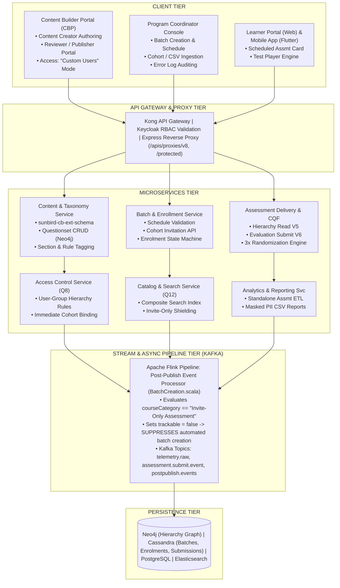
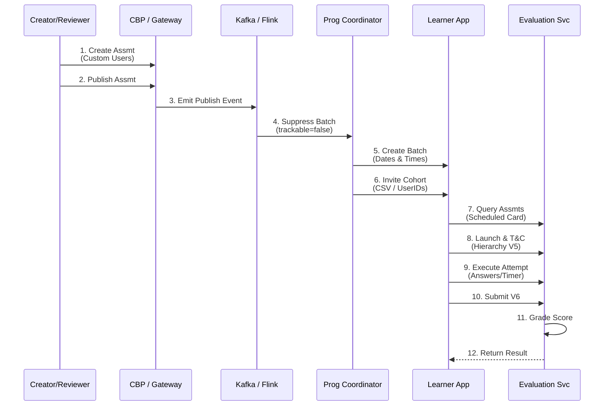

# Invite-Only Assessment — Software Requirements Specification (SRS)

## 1. Introduction

### 1.1 Purpose

This Software Requirements Specification (SRS) document details the complete functional, technical, architectural, and quality requirements for the **Invite-Only Assessment** capability on the iGOT Karmayogi platform. It captures the comprehensive feature lifecycle from its inception in **Q2**, through incremental capability enhancements across **Q3 to Q11**, to enterprise-grade analytics, governance, and search optimizations deployed through **Q12 and Q13**.

This document covers both the **Content Creation & Administration Lifecycle** (Content Builder Portal - CBP, Program Coordinator workspace) and the **Learner Consumption Lifecycle** (Learner Web Portal, Mobile Applications), detailing the frontend-to-backend data flows, microservice orchestrations, asynchronous stream processing pipelines, and data persistence layers.

### 1.2 Scope of the Feature

An **Invite-Only Assessment** is a specialized evaluation asset on iGOT Karmayogi governed under a restricted access regime (`Custom Users` / `Invite-Only`). Unlike open standalone assessments that auto-provision universal public enrollment batches upon publication, Invite-Only Assessments:

1. Enforce strict isolation from the public catalog and general search indexes.
2. Prohibit uncoordinated automatic batch creation via backend post-publishing streaming pipelines.
3. Delegate batch lifecycle and scheduling strictly to authorized Program Coordinators (PCs) and MDO Administrators.
4. Support synchronized, sub-daily scheduling windows (Start/End Date and precise Start/End Time) with enrollment cutoff buffers.
5. Deliver multi-tier evaluation models (Question Weightage with difficulty tagging, sectional time bounds, negative marking, and Option Weightage for psychometric scoring).
6. Provide high-concurrency, single-sitting execution environments on Web and Mobile with automated state persistence, 3x combinatorial randomization, and resilience against network failure.
7. Surface granular, masked-PII operational reporting for departmental performance audits.

### 1.3 Intended Audience

- **Product Managers & Solution Architects:** Reference for platform capabilities, business rule governance, and cross-quarter dependency tracking.
- **Frontend Engineers (Angular / Flutter):** Interface specifications, state management rules, question palette behaviors, and mobile parity criteria.
- **Backend & DevOps Engineers (Java / Scala / Node.js / Kubernetes):** API contracts, Keycloak authentication, Cassandra/Neo4j/Postgres schemas, and Flink streaming job logic.
- **QA & Test Automation Teams:** Verification matrix, edge case testing, and acceptance criteria validation.
- **MDO Administrators & Program Coordinators:** Operational understanding of cohort management, CSV bulk ingestion, and exam window execution.

## 2. Overall Description & System Perspective

### 2.1 System Context & High-Level Block Architecture

The Invite-Only Assessment system spans multiple distributed tiers across authoring, coordination, delivery, stream processing, and persistence.



### 2.2 User Classes and Operating Characteristics

1. **Content Creator:** Authors questions, defines difficulty bands (`Easy`, `Medium`, `Difficult`, `HotS`), configures sectional durations, cutoff thresholds, negative marking, and sets the access control type to `Custom Users`.
2. **Content Reviewer / Publisher:** Validates question bank integrity, reviews rubric mappings, and executes the formal publish action.
3. **Program Coordinator (PC) / MDO Admin:** Configures the assessment batch schedule (dates and times), sets enrollment buffers, uploads candidate cohorts via CSV, audits error logs, and tracks live completion progress.
4. **Invited Learner:** Discovers the test exclusively via personalized surfaces ("Scheduled Assessments" ribbon or "My Assigned Content"), views countdown timers, accepts test instructions, executes attempts under strict proctoring/time-bound rules, and views immediate scores.
5. **Non-Invited Learner:** Fully restricted actor. Cannot discover the assessment in catalog search; direct URL invocation results in HTTP 403 Forbidden.

## 3. Evolution Roadmap & Scope (Q2 to Q13)

```mermaid
flowchart TD
    Q2["Q2 – Q4: Foundational Infrastructure & Schema Baseline<br/>• Defined Invite-Only Assessment in sunbird-cb-ext-schema (cbrelease-4.8.13).<br/>• Altered Flink BatchCreation.scala to suppress automatic open batch generation.<br/>• Enabled core standalone assessment player for Web and Mobile runtimes."]
    Q5["Q5 – Q8: Advanced Authoring & Delivery Frameworks<br/>• Implemented Question Weightage (EMDH difficulty, sectional pass cutoffs, negative marking).<br/>• Added Option Weightage framework for non-pass/fail psychometric evaluations.<br/>• Released 3x Randomization (option permutation, intra-section question shuffle, pool sampling).<br/>• Built Program Coordinator UI (#quot;Manage Content#quot; hub) with unified invite modal & error CSV exports.<br/>• Deployed CQF Assessment V5 Hierarchy Read and V6 Evaluation Submit APIs."]
    Q9["Q9 – Q11: Targeted Access Control, Scheduling & Learner UI Modernization<br/>• Integrated User-Group Access Control with cascading reset logic.<br/>• Added precise sub-daily scheduling (Start/End Date AND Start/End Time).<br/>• Built #quot;Scheduled Assessments#quot; Home ribbon with 48h / 24h dynamic countdown timers.<br/>• Introduced #quot;My Assigned Content#quot; unified workspace with status filters (Not Started/In Progress).<br/>• Enforced Single-Sitting consumption: non-pausable timers, automated submit on window lapse."]
    Q12["Q12 – Q13: Enterprise Scale, Catalog Shielding & Governance Analytics<br/>• Catalog search isolation: filtered Elasticsearch indices shielding invite-only tests from public.<br/>• Integration with Training Plan & APAR evaluation APIs (/cbplan/v2/user/list).<br/>• Standalone Assessment Reporting ETLs with masked PII CSV downloads for MDO audit compliance.<br/>• Kafka/Flink telemetry optimizations handling synchronized 50,000+ concurrent exam submissions."]
    Q2 --> Q5
    Q5 --> Q9
    Q9 --> Q12
```



### Detailed Evolution Chronology Matrix

| Quarter Range | Primary Focus | Key Architectural / Functional Deliverables | Jira / Git Artifacts |
|---|---|---|---|
| **Q2 – Q4** | **Schema & Pipeline Baseline** | • Added `"Invite-Only Assessment"` enum to `schemas/collection/1.0/schema.json` and `schemas/content/1.0/schema.json`. - Updated Flink post-publisher `BatchCreation.scala` to bypass auto-batch creation. - Established baseline Questionset schema. | `sunbird-cb-ext-schema` (cbrelease-4.8.13), [KB-3958](https://karmayogibharat.atlassian.net/browse/KB-3958), [KB-3959](https://karmayogibharat.atlassian.net/browse/KB-3959). |
| **Q5 – Q8** | **Authoring Engine & PC Workspaces** | • Rich text authoring in CBP with media support (audio/video up to 400 MB). - Question Weightage (Easy, Medium, Difficult, HotS) & Option Weightage. - Unified invite modal (`Manage learner invites`) replacing dual buttons. - Program Coordinator "Manage Content" hub and CSV error log viewer. - Prevented removal of learners who started/completed tests. | [KB-1936](https://karmayogibharat.atlassian.net/browse/KB-1936), [KB-2960](https://karmayogibharat.atlassian.net/browse/KB-2960), [KB-5350](https://karmayogibharat.atlassian.net/browse/KB-5350), [KB-6276](https://karmayogibharat.atlassian.net/browse/KB-6276), [KB-7067](https://karmayogibharat.atlassian.net/browse/KB-7067), [KB-8351](https://karmayogibharat.atlassian.net/browse/KB-8351), [KB-8365](https://karmayogibharat.atlassian.net/browse/KB-8365). |
| **Q9 – Q11** | **Scheduling, Access Control & Player** | • Sub-daily scheduling with start and end times. - Enforced enrollment cut-off buffer (`End DateTime minus Assessment Duration`). - User-Group Based Access Control with zero-review post-publish roster updates. - 48h / 24h countdown clock on Learner Home ribbon. - Enforced single-sitting session management with auto-submit on timeout. - Network-failure state persistence and resume. | [KB-5570](https://karmayogibharat.atlassian.net/browse/KB-5570), [KB-9603](https://karmayogibharat.atlassian.net/browse/KB-9603), [KB-9789](https://karmayogibharat.atlassian.net/browse/KB-9789), Confluence FRS `85295123`, SRS `87392295`. |
| **Q12 – Q13** | **Shielding, Analytics &** **Scale** | • Elasticsearch composite search index exclusion shielding invite-only tests from public browse/filter trees. - Mobile App parity for catalog isolation. - Standalone Assessment Analytics ETL pipelines generating MDO performance dashboards. - High-throughput Kafka/Cassandra write tuning for synchronous exam submissions. | [KB-9333](https://karmayogibharat.atlassian.net/browse/KB-9333), [KB-9337](https://karmayogibharat.atlassian.net/browse/KB-9337), [KB-6378](https://karmayogibharat.atlassian.net/browse/KB-6378), Confluence `802717699`. |

## 4. Functional Requirements (End-to-End Lifecycle)

### 4.1 Assessment Authoring & Configuration (CBP Portal)

- **REQ-CREAT-01 (Access Control Mode):** The Content Creator must be provided an Access Setting selection during assessment metadata configuration. When `Custom Users` is selected:
  - The system shall automatically set `courseCategory` to `"Invite-Only Assessment"`.
  - The system shall display an advisory banner stating that batch creation, scheduling, and enrollment will be managed by the Program Coordinator.

- **REQ-CREAT-02 (Evaluation Mode Selection):** The authoring workspace shall support two distinct evaluation paradigms:
  - `questionWeightage`: Traditional academic/cadre scoring where questions are tagged with marks, cutoffs, and negative marking.
  - `optionWeightage`: Psychometric/behavioral profiling where individual options carry numeric weights and pass/fail badges are omitted.

- **REQ-CREAT-03 (Difficulty & Rubric Tagging):** Under `questionWeightage`, the system shall enforce difficulty level tagging per question (`Easy`, `Medium`, `Difficult`, `HotS` or `Proficiency Level 1–4`). Marks shall be automatically computed based on the author-configured `questionLevelDefinition` matrix.
- **REQ-CREAT-04 (Negative Marking Configuration):** The system shall allow the author to configure negative marking per question or globally across the assessment with supported ratios: `0%`, `25%`, `50%`, `75%`, and `100%`.
- **REQ-CREAT-05 (Sectional Management & Navigation Rules):**
  - Support for 1 to 6 distinct sections per assessment.
  - Section-level attributes shall include: `name`, `expectedDuration` (optional if overall test is timed), `sectionTimeBound` (`Yes`/`No`), and `sectionalPassPercentage`.
  - If `sectionTimeBound == Yes`, learners shall be prohibited from switching out of the active section until its timer elapses.

- **REQ-CREAT-06 (Question Types Supported):**
  - Single Choice MCQ (Radio button selection).
  - Multiple Choice MCQ (Checkbox selection with partial or full grading).
  - True / False.
  - Match the Following (drag-and-drop or dropdown pairing).
  - Fill in the Blanks (inline dropdowns for multi-blank; manual text field for single-blank).
  - Paragraph-based Comprehension (passage text up to 5,000 characters linked to multiple sub-questions).
  - Rich Media Questions (Audio and Video up to 400 MB; inline images scaled to 320x180 px).

- **REQ-CREAT-07 (Bulk Question Ingestion):** The portal shall provide spreadsheet-based bulk question ingestion validating question syntax, difficulty tags, option weights, and media URLs with line-by-line syntax error flagging.
- **REQ-CREAT-08 (3x Randomization Engine):** The questionset configuration shall support three independent randomization flags:
  - Dynamic question sampling from a larger section question pool.
  - Sequence permutation of questions within sections.
  - Option permutation within each MCQ item.

### 4.2 Review, Publishing & Post-Publish Pipeline

- **REQ-PUB-01 (Review Workflow):** The system shall enforce a mandatory multi-role gate: Content Creator -> Content Reviewer -> Content Publisher.
- **REQ-PUB-02 (Automated Batch Suppression):**
  - Upon publication, the event shall be emitted to Kafka topic `postpublish.events`.
  - The Apache Flink streaming processor `BatchCreation.scala` shall inspect the metadata property `courseCategory`.
  - If `courseCategory == "Invite-Only Assessment"`, the job shall explicitly set `trackable = false` and suppress the automatic generation of an open batch.
  - The published assessment status shall transition to `Live`, awaiting administrative scheduling.

### 4.3 Program Coordinator Scheduling & Cohort Management

- **REQ-COORD-01 (Dedicated Workspace):** Program Coordinators shall access an administrative workspace ("Manage Content" hub) displaying all live assessments marked as `Invite-Only Assessment`.
- **REQ-COORD-02 (Batch Scheduling Boundaries):** The PC shall configure assessment batch schedules including:
  - Batch Name and Description.
  - Start Date and End Date.
  - Start Time and End Time (format `HH:mm:ss`, timezone `Asia/Kolkata`).
  - Enrollment End Date & Time.

- **REQ-COORD-03 (Enrollment Cutoff Buffer):** The system shall compute an operational cutoff buffer:<br>$$\text{Enrollment Cutoff DateTime} = \text{Batch End DateTime} - \text{Total Assessment Duration}$$<br>The portal shall reject cohort invitations or individual user enrollments submitted after this buffer has lapsed.
- **REQ-COORD-04 (Consolidated Invitee Modal):** The PC interface shall provide a single modal (`Manage learner invites`) supporting:
  - Individual user search and toggle enrollment switch.
  - Bulk cohort ingestion via CSV file (containing `userId` or validated official email/phone).

- **REQ-COORD-05 (Error Logging & Auditing):** If a bulk CSV upload contains invalid accounts, malformed identifiers, or duplicate records, the system shall generate an error table and provide an immediate CSV download detailing row numbers and specific failure reasons.
- **REQ-COORD-06 (Roster Immutability During Execution):** The system shall block the administrative removal or de-enrollment of any learner who has already initiated or completed an attempt (`enrolment.status > 0`).

### 4.4 Learner Discovery & Pre-Assessment Phase

- **REQ-DISC-01 (Catalog Isolation):** Invite-Only Assessments shall be completely omitted from the general course catalog search and filter facets (`primaryCategory`, `contentType`, `topic`) on Web and Mobile interfaces.
- **REQ-DISC-02 (Scheduled Assessments Ribbon):** When a learner is enrolled in an active Invite-Only Assessment batch:
  - A dedicated "Scheduled Assessments" card shall appear on the Learner Home Dashboard (positioned below the Weekly Claps strip).
  - If current time is between 48 hours and 24 hours prior to `Start DateTime`, a static countdown banner shall display the upcoming test window.
  - If current time is within 24 hours of `Start DateTime`, a ticking real-time clock (`HH:mm:ss`) shall be rendered.

- **REQ-DISC-03 (My Assigned Content Integration):** The assessment shall appear within the "My Assigned Content" workspace with status badges: `Not Started`, `In Progress`, or `Completed`.
- **REQ-DISC-04 (Access Gate & Instructions Modal):**
  - Prior to `Start DateTime`, the `Start Assessment` action button shall remain in a disabled state.
  - Upon reaching `Start DateTime`, the button shall become active. Clicking it opens the mandatory Instructions Modal detailing total questions, duration, negative marking rules, and sectional constraints.
  - The `Start Assessment` CTA shall remain disabled until the learner actively checks: *"I have read and understood the instructions"*.

### 4.5 Assessment Runtime Consumption & Session Controls

- **REQ-PLAY-01 (Execution Mode - Strict Single Sitting):** Once initiated, the assessment timer runs continuously. Pausing or suspending the session is prohibited. Navigating away or closing the browser window does not pause the backend countdown.
- **REQ-PLAY-02 (Question Palette & Visual States):** The player interface shall render a persistent question palette indicating state:
  - *Answered:* Green.
  - *Not Answered:* Red.
  - *Marked for Review:* Purple.
  - *Answered & Marked for Review:* Purple with green indicator.
  - *Unvisited:* Grey.

- **REQ-PLAY-03 (Dynamic Timer Warning):** The runtime timer shall reflect dynamic warning color states:
  - *Normal (> 50% time remaining):* Green.
  - *Warning (20% – 50% time remaining):* Amber/Orange.
  - *Critical (< 20% time remaining):* Pulsing Red.

- **REQ-PLAY-04 (Interrupted Session & State Recovery):** In the event of network drop, tab closure, or browser crash, the player shall cache interim answers in `localStorage` and synchronize with Redis. Upon relaunch, the player shall restore the learner to the exact question state with remaining duration decremented by the elapsed real-world time.
- **REQ-PLAY-05 (Sectional Transition Rules):**
  - If `sectionTimeBound == Yes`, manual section switching is disabled; auto-forwarding occurs upon section timer expiry.
  - If `sectionTimeBound == No`, learners may switch sections manually, but the system shall prompt a confirmation modal warning that previous sections cannot be re-entered if configured as forward-only.

- **REQ-PLAY-06 (Auto-Submission Trigger):** Upon expiry of the global assessment timer or the final sectional timer, the player shall automatically package the existing responses, disable all input elements, display a "Time Expired" dialog, and dispatch the submission payload to the backend.

### 4.6 Evaluation, Scoring & Results

- **REQ-EVAL-01 (Automated Evaluation Pipeline):** Submissions shall be processed via the V6 Evaluation Submit API (`/apis/protected/v8/user/evaluate/assessment/submit/v6`). The backend shall cross-reference responses against the encrypted question hierarchy, deduct negative marks, and calculate sectional and overall scores.
- **REQ-EVAL-02 (Result Display Governance):**
  - If metadata `showMarks == Yes`, the learner shall immediately see total score, percentage, accuracy (correct vs. incorrect vs. blank), pass/fail badge, and section-level performance.
  - If `showMarks == No`, the player shall render a standardized acknowledgment: *"Your assessment has been submitted successfully and is under evaluation"*.
  - For `optionWeightage`, the system shall render psychological trait scores without pass/fail designations.

- **REQ-EVAL-03 (Retake Enforcement):** Retake attempts shall be governed by `maxAssessmentRetakeAttempts` (range 0 to 5). If attempts reach the configured limit, the `Retake Assessment` CTA is permanently hidden.

### 4.7 Administrative Reporting & Audit Compliance

- **REQ-REP-01 (Provider Dashboard):** CBP Administrators and Content Providers shall have access to dedicated dashboards segmenting live assessments into `Open`, `Moderated`, and `Invite-Only`.
- **REQ-REP-02 (Operational CSV Export):** Authorized MDO Admins and Program Coordinators shall be able to export granular evaluation reports containing: Learner ID, Masked Email, Masked Mobile, Batch ID, Attempt Timestamp, Total Score, Pass/Fail Status, Time Taken, and Section-wise Marks.

## 5. External Interface Requirements

### 5.1 User Interfaces

- **Responsive Layouts:** Desktop Web (Angular 14+, optimized for 1366x768 and 1920x1080) and Mobile Application (Flutter/Dart, compatible with Android 8.0+ and iOS 13+).
- **Accessibility Standards:** WCAG 2.1 Level AA compliance, supporting screen readers, keyboard navigation for question palettes, and high-contrast color toggles.

### 5.2 Hardware Interfaces

- Client devices must maintain an active internet connection (minimum 256 kbps bandwidth for text assessments; 2 Mbps for video-based questions).

### 5.3 Software & Service Interfaces

- **Identity Management:** Keycloak OAuth2 / OpenID Connect provider generating signed JWT bearer tokens (`x-authenticated-user-token`).
- **Storage Engines:** Cassandra keyspaces for batch registries and user progress; Neo4j for hierarchical question structures; PostgreSQL for transactional metadata; Redis for session states.
- **Message Broker:** Apache Kafka clusters routing streaming events across authoring, post-publishing, and telemetry pipelines.

## 6. Detailed System Architecture & Data Flows

### 6.1 End-to-End Sequence Diagram (Creation to Evaluation)



## 7. Data Models, Schemas & API Specifications

### 7.1 Schema Enhancements (`sunbird-cb-ext-schema`)

#### Assessment Metadata Definition (`schemas/questionset/1.0/schema.json`)

```json
{
  "$schema": "http://json-schema.org/draft-07/schema#",
  "type": "object",
  "properties": {
    "courseCategory": {
      "type": "string",
      "enum": [
        "Course Assessment",
        "Standalone Assessment",
        "Invite-Only Assessment",
        "Moderated Assessment"
      ]
    },
    "assessmentType": {
      "type": "string",
      "enum": [
        "questionWeightage",
        "optionWeightage"
      ]
    },
    "scoreCutoffType": {
      "type": "string",
      "enum": [
        "AssessmentLevel",
        "SectionLevel"
      ]
    },
    "expectedDuration": {
      "type": "integer",
      "description": "Total duration in seconds"
    },
    "noOfSection": {
      "type": "integer",
      "minimum": 1,
      "maximum": 6
    },
    "minimumPassPercentage": {
      "type": "number",
      "minimum": 0,
      "maximum": 100
    },
    "negativeMarkingPercentage": {
      "type": "string",
      "enum": [
        "0%",
        "25%",
        "50%",
        "75%",
        "100%"
      ]
    },
    "showMarks": {
      "type": "string",
      "enum": [
        "Yes",
        "No"
      ]
    },
    "sectionTimeBound": {
      "type": "string",
      "enum": [
        "Yes",
        "No"
      ]
    },
    "maxAssessmentRetakeAttempts": {
      "type": "integer",
      "default": 0,
      "maximum": 5
    },
    "questionLevelDefinition": {
      "type": "object",
      "properties": {
        "easy": {
          "type": "number"
        },
        "medium": {
          "type": "number"
        },
        "difficult": {
          "type": "number"
        },
        "hots": {
          "type": "number"
        }
      }
    }
  },
  "required": [
    "courseCategory",
    "assessmentType",
    "expectedDuration",
    "noOfSection"
  ]
}
```

### 7.2 Core API Contracts

#### API-01: Create Assessment Questionset

- **Endpoint:** `POST /apis/proxies/v8/cqfquestionset/questionset/create`
- **Calling Service:** CBP Client -> Content Service
- **Request Payload:**

```json
{
  "request": {
    "questionset": {
      "name": "Civil Service Mid-Career Evaluation",
      "description": "Restricted Cadre Assessment",
      "primaryCategory": "Course Assessment",
      "courseCategory": "Invite-Only Assessment",
      "mimeType": "application/vnd.sunbird.questionset",
      "assessmentType": "questionWeightage",
      "scoreCutoffType": "SectionLevel",
      "expectedDuration": 3600,
      "noOfSection": 2,
      "minimumPassPercentage": 60,
      "negativeMarkingPercentage": "25%",
      "showMarks": "Yes",
      "sectionTimeBound": "Yes",
      "maxAssessmentRetakeAttempts": 1
    }
  }
}
```

- **Response Payload (HTTP 200 OK):**

```json
{
  "id": "api.cqf.questionset.create",
  "ver": "1.0",
  "responseCode": "OK",
  "result": {
    "identifier": "do_1141410889336094721230",
    "versionKey": "1726207145220"
  }
}
```

#### API-02: Program Coordinator Batch Creation & Schedule

- **Endpoint:** `POST /apis/proxies/v8/course/batch/create`
- **Calling Service:** Program Coordinator Console -> Batch Management Service
- **Request Payload:**

```json
{
  "request": {
    "courseId": "do_1141410889336094721230",
    "name": "Batch-01_Cadre_June2026",
    "description": "Invite-Only Cohort for Department of Personnel",
    "enrollmentType": "invite-only",
    "startDate": "2026-06-10",
    "endDate": "2026-06-10",
    "startTime": "10:00:00",
    "endTime": "12:00:00",
    "enrollmentEndDate": "2026-06-10"
  }
}
```

- **Response Payload (HTTP 200 OK):**

```json
{
  "id": "api.course.batch.create",
  "ver": "1.0",
  "responseCode": "OK",
  "result": {
    "batchId": "01408031797522432048"
  }
}
```

#### API-03: Manage Learner Invites (Bulk Roster Ingestion)

- **Endpoint:** `POST /apis/proxies/v8/course/batch/users/add`
- **Calling Service:** Program Coordinator Console -> User Management Service
- **Request Payload:**

```json
{
  "request": {
    "batchId": "01408031797522432048",
    "courseId": "do_1141410889336094721230",
    "userIds": [
      "3de29b5c-741f-4c64-b72b-89d9e94ccf6a",
      "8155bb04-3b07-475a-8584-8881bc9f81bf"
    ]
  }
}
```

- **Response Payload (HTTP 200 OK):**

```json
{
  "id": "api.course.batch.users.add",
  "ver": "1.0",
  "responseCode": "OK",
  "result": {
    "response": "SUCCESS"
  }
}
```

#### API-04: Assessment Evaluation & Submit (V6)

- **Endpoint:** `POST /apis/protected/v8/user/evaluate/assessment/submit/v6`
- **Calling Service:** Learner Web / Mobile App -> Assessment Evaluation Service
- **Request Payload:**

```json
{
  "batchId": "01408031797522432048",
  "identifier": "do_1141410889336094721230",
  "courseId": "do_1141410889336094721230",
  "isAssessment": true,
  "timeLimit": 3600,
  "children": [
    {
      "identifier": "do_114140032038076416114",
      "name": "General Governance",
      "scoreCutoffType": "SectionLevel",
      "children": [
        {
          "identifier": "do_114140032403873792116",
          "qType": "MCQ-SCA",
          "timeSpent": 45,
          "editorState": {
            "options": [
              {
                "index": "1",
                "selectedAnswer": true
              }
            ]
          }
        }
      ]
    }
  ]
}
```

- **Response Payload (HTTP 200 OK):**

```json
{
  "id": "api.user.evaluate.assessment.submit",
  "ver": "6.0",
  "responseCode": "OK",
  "result": {
    "pass": true,
    "overallResult": 82.5,
    "totalMarks": 50,
    "correct": 17,
    "incorrect": 3,
    "blank": 0,
    "retakeAttemptsConsumed": 1,
    "timeTakenForAssessment": 2840,
    "children": [
      {
        "identifier": "do_114140032038076416114",
        "name": "General Governance",
        "sectionResult": "pass",
        "sectionMarks": 21,
        "passPercentage": 60,
        "overallResult": 84.0
      }
    ]
  }
}
```

## 8. Non-Functional Requirements (NFRs)

### 8.1 Performance & Throughput

- **NFR-PERF-01 (Peak Submission Ingestion):** The V6 Evaluation Submit endpoint shall support sustained loads of **5,000 requests per second (RPS)** during national cadre assessment windows without degradation of latency ($P_{99} < 1,500\text{ ms}$).
- **NFR-PERF-02 (Hierarchy Load Time):** Test question hierarchy read (`/api/player/questionset/v5/hierarchy/{id}`) shall respond within **500 ms** at $P_{95}$ via Redis read-through caching.
- **NFR-PERF-03 (Timer Precision):** Client-side timers shall synchronize against server timestamps via an HTTP heartbeat header every 60 seconds, maintaining drift within $\pm 1\text{ second}$.

### 8.2 Security & Data Privacy

- **NFR-SEC-01 (Authentication & Scope):** Every protected endpoint shall enforce Keycloak OAuth2 JWT verification. Requests lacking active sessions or valid bearer tokens shall be rejected with HTTP 401 Unauthorized.
- **NFR-SEC-02 (Authorization Shielding):** Access to assessment hierarchy and submission endpoints shall perform an immediate Cassandra `user_enrolments` lookup verifying that the caller's `userId` matches the batch invitation roster. Non-enrolled users shall receive HTTP 403 Forbidden.
- **NFR-SEC-03 (PII Masking):** In accordance with Government of India data privacy guidelines, all administrative CSV exports and analytics dashboards shall mask learner mobile numbers and email addresses (e.g., `v*l@gov.in`, `+91-**7890`).

### 8.3 Reliability & Fault Tolerance

- **NFR-REL-01 (Network Failure Resilience):** The client application shall buffer learner answer selections locally in encrypted browser storage (`localStorage`) or secure SQLite cache on mobile. If connectivity is severed, answering shall remain functional, and state shall synchronize automatically once connectivity returns.
- **NFR-REL-02 (Zero Data Loss on Crash):** System crashes during high-concurrency submission spikes shall leverage Kafka event topics as durable replay buffers, guaranteeing zero submission record loss.

### 8.4 Scalability & Concurrency

- **NFR-SCAL-01 (Horizontal Microservice Autoscaling):** Assessment delivery and evaluation pods deployed on Kubernetes (EKS) shall automatically scale based on CPU (> 70%) and Kafka lag metrics to support up to **100,000 concurrent active test takers**.

## 9. Requirements Traceability Matrix (RTM)

| Requirement ID | Description | Quarterly Genesis | Implementation Artifact | Test Case Verification ID | Status |
|---|---|---|---|---|---|
| **REQ-CREAT-01** | Support `Custom Users` mode & map to `Invite-Only Assessment` | Q4 | `sunbird-cb-ext-schema`, [KB-3959](https://karmayogibharat.atlassian.net/browse/KB-3959) | `TC-AUTH-01` | **Prod Deployed** |
| **REQ-CREAT-02** | Multi-evaluation framework (Question vs. Option Weightage) | Q4 | Confluence FRS `85295123`, [KB-3958](https://karmayogibharat.atlassian.net/browse/KB-3958) | `TC-AUTH-02` | **Prod Deployed** |
| **REQ-CREAT-05** | Sectional time bounds and passage restrictions | Q4 | [KB-3958](https://karmayogibharat.atlassian.net/browse/KB-3958), [KB-3963](https://karmayogibharat.atlassian.net/browse/KB-3963) | `TC-AUTH-05` | **Prod** **Deployed** |
| **REQ-CREAT-08** | 3x Randomization (options, sequence, question bank) | Q4 | Confluence SRS `87392295` | `TC-RAND-01` | **Prod Deployed** |
| **REQ-PUB-02** | Flink pipeline auto-batch creation suppression | Q4 | `BatchCreation.scala`, Confluence `89751668` | `TC-FLINK-01` | **Prod Deployed** |
| **REQ-COORD-02** | Sub-daily scheduling with start and end times | Q4 – Q9 | [KB-5350](https://karmayogibharat.atlassian.net/browse/KB-5350), [KB-5570](https://karmayogibharat.atlassian.net/browse/KB-5570) | `TC-SCHED-01` | **Prod Deployed** |
| **REQ-COORD-04** | Single-modal invitee management (`Manage learner invites`) | Q3 | [KB-2960](https://karmayogibharat.atlassian.net/browse/KB-2960), [KB-7067](https://karmayogibharat.atlassian.net/browse/KB-7067) | `TC-INV-01` | **Prod Deployed** |
| **REQ-COORD-05** | Instant CSV upload error log download | Q6 | [KB-8351](https://karmayogibharat.atlassian.net/browse/KB-8351) | `TC-INV-02` | **Prod Deployed** |
| **REQ-COORD-06** | Block removal of active/completed learners | Q6 | [KB-8365](https://karmayogibharat.atlassian.net/browse/KB-8365), [KB-8400](https://karmayogibharat.atlassian.net/browse/KB-8400) | `TC-INV-03` | **Prod Deployed** |
| **REQ-DISC-01** | Catalog isolation shielding invite-only tests from search | Q8 – Q12 | [KB-9333](https://karmayogibharat.atlassian.net/browse/KB-9333), [KB-9337](https://karmayogibharat.atlassian.net/browse/KB-9337) | `TC-CAT-01` | **Prod Deployed** |
| **REQ-DISC-02** | Home page Scheduled Assessment ribbon & 48h timer | Q9 | Confluence `802717699`, FRS `85295123` | `TC-DISC-01` | **Prod Deployed** |
| **REQ-PLAY-01** | Enforce single-sitting execution without pause | Q9 | Confluence SRS `87392295` | `TC-PLAY-01` | **Prod Deployed** |
| **REQ-PLAY-04** | Interrupted session answer persistence and resume | Q5 | Confluence SRS `87392295` | `TC-PLAY-02` | **Prod Deployed** |
| **REQ-PLAY-06** | Automatic submission on timer expiration | Q4 | Confluence FRS `85295123` | `TC-PLAY-03` | **Prod Deployed** |
| **REQ-EVAL-01** | V6 evaluation submit with negative marking computation | Q5 | Confluence `171704641`, `175702042` | `TC-EVAL-01` | **Prod Deployed** |
| **REQ-REP-02** | MDO performance report export with masked PII | Q12 – Q13 | [KB-6378](https://karmayogibharat.atlassian.net/browse/KB-6378), `course_categories_to_select_standalone_reports` | `TC-REP-01` | **Prod Deployed** |

## 10. Verification & Validation Criteria

### 10.1 Automated Integration & Regression Suite

1. **Pipeline Suppression Test:** Execute a publishing event for an assessment tagged with `courseCategory: "Invite-Only Assessment"`. Query Cassandra `course_batch` table to confirm zero automated batch records exist.
2. **Access Gate Test:** Attempt to call `/api/player/questionset/v5/hierarchy/{id}` using an authenticated user session not present in the batch's `user_enrolments` table. Validate that Kong API Gateway returns HTTP 403 Forbidden.
3. **Timer Expiry Test:** Simulate an active test session, fast-forward system clock past `expectedDuration`. Validate that the player immediately dispatches the V6 submission payload and blocks further user input.
4. **Sub-Daily Cutoff Test:** Create a batch with an end time of 16:00:00 and assessment duration of 3,600 seconds (1 hour). Attempt to enroll a user at 15:01:00. Confirm that the API rejects enrollment with an error code indicating that the cutoff buffer has lapsed.

## 11. Assumptions, Dependencies & Risks

### 11.1 Assumptions

1. Program Coordinators have been provisioned appropriate MDO-level organizational roles in Keycloak prior to creating batches.
2. Learners are accessing assessments via modern browsers supporting HTML5 LocalStorage, WebSockets, and ES6 JavaScript.

### 11.2 Dependencies

- **Apache Flink Deployment:** Availability of the streaming post-publish consumer running the compiled `BatchCreation.scala` logic.
- **Sunbird Ext Schema Sync:** Uniform distribution of `sunbird-cb-ext-schema` across Content Service, Taxonomy Engine, and Search indexes.

### 11.3 Risks & Mitigations

- **Risk (Client-Side Clock Tampering):** Learners altering local device clocks could attempt to extend countdowns or delay auto-submission.
  - *Mitigation:* The assessment engine synchronizes client timers via signed server headers on each heartbeat and rejects client-calculated timestamps during V6 evaluation.

- **Risk (Network Drop During Final Submission):** A connection drop at the exact moment of timer expiration could fail the submission API call.
  - *Mitigation:* The player stores the final compiled payload in persistent local storage and retries submission via exponential backoff as soon as network ping resolves, backed by a 15-minute backend grace period.
