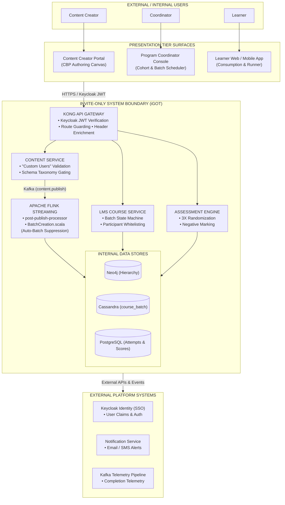
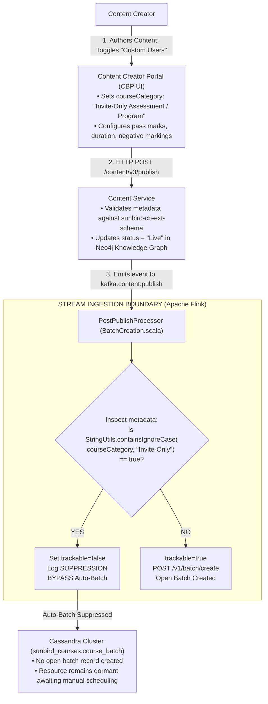
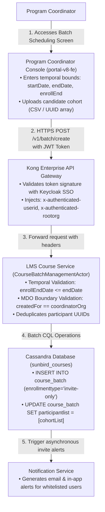
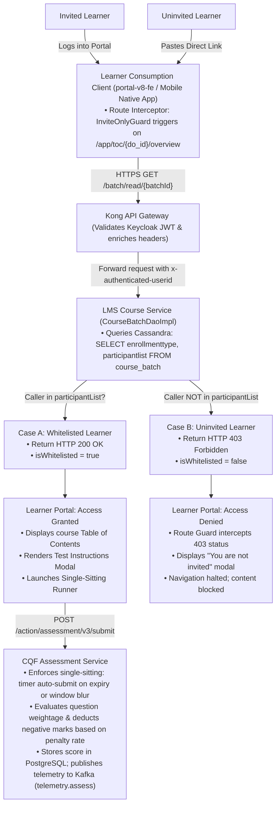
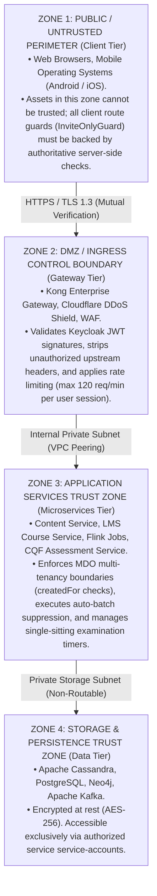

# Invite-Only Course / Batch — System Context Architecture (SCD)

## 1. Executive Summary & Context Definition

### 1.1 Executive Summary

The **Invite-Only Course / Batch** capability on the iGOT Karmayogi platform establishes an access-controlled learning and examination perimeter. In contrast to open-catalog platform courses—where published assets trigger automatic open-batch generation and allow open discovery—invite-only resources enforce an entitlement-gated boundary. Access requires explicit administrative nomination, asynchronous batch suppression in the stream ingestion layer, gateway-level route guarding, and single-sitting execution monitoring.

This System Context Document defines the operational perimeter, external actors, neighboring enterprise platforms, data flow boundaries, and trust zones from **Quarter 2 (Q2)** through **Quarter 13 (Q13)**.

### 1.2 System Boundary & Scope

The system boundary encompasses the functional and technical services responsible for:

1. **Creation & Ingestion Boundary:** Content Creator authoring, "Custom Users" classification, metadata validation against `sunbird-cb-ext-schema`, and Flink streaming auto-batch suppression.
2. **Administrative & Scheduling Boundary:** Program Coordinator cohort definitions, calendar window enforcement, and Cassandra participant whitelisting (`participantList`).
3. **Learner Consumption Boundary:** Keycloak session authentication, gateway header injection, route-guard deep-link interception ("You are not invited" modal), and fullscreen single-sitting assessment execution.
4. **Platform & External Integration Boundary:** Keycloak Single Sign-On (SSO), Kafka telemetry streaming, Cassandra cohort storage, Neo4j graph nodes, and SMS/Email notification dispatch.

## 2. Evolution of System Context & Boundaries (Q2 – Q13)

**SYSTEM CONTEXT EVOLUTION (Q2 - Q13)**

| RELEASE WINDOW | BOUNDARY EXPANSION | BOUNDARY DELTAS & EXTERNAL INTERFACES |
|---|---|---|
| Q2 – Q4<br>(KB-453) | Core LMS Batch Access Boundary | • Scope: Course collections only.<br>• Actor Interface: Course Mentor / Admin.<br>• New Boundary: enrollmentType enum ("open" vs "invite-only") in Cassandra.<br>• Limitation: Courses publicly searchable. |
| Q5 – Q7<br>(KB-2960) | Blended Cohort & Venue Boundary | • Scope: Physical & blended training.<br>• Actor Interface: Program Coordinator.<br>• New Boundary: batchAttributes map for physical venues, seats, and offline sync.<br>• Certificate service binding to cohorts. |
| Q8 – Q10<br>(KB-2968, KB-3959, PRD 89751668) | Event Stream & Assessment Gating | • Scope: Standalone Question Sets.<br>• Boundary: Flink post-publish processor intercepts Kafka events to suppress automatic open-batch instantiation.<br>• CQF Runner Boundary: 3X option randomization & negative mark deduction. |
| Q11 – Q13<br>(KB-1072, KB-6276) | Route Guarding & Unified Feeds | • Scope: Deep links & tenant isolation.<br>• Client Boundary: Angular router catches 403 Forbidden -> "Not Invited" modal.<br>• Multi-MDO createdFor tenancy checks.<br>• Elasticsearch query suppression boundary. |

## 3. High-Level System Context Diagrams (C4 Level 1)

### 3.1 Global Enterprise System Context Diagram

The Level 1 Context Diagram illustrates the platform perimeter, primary human actors, external enterprise systems, and primary integration boundaries.



## 4. Specialized Lifecycle Context Diagrams

### 4.1 Authoring & Ingestion Context Diagram (Creation Flow)

This diagram details the interaction perimeter during the authoring, publishing, and auto-batch suppression lifecycle.



### 4.2 Cohort Scheduling Context Diagram (Administration Flow)

This diagram captures the Program Coordinator's boundary interactions when activating batches and whitelisting civil servants.



### 4.3 Learner Consumption & Gating Context Diagram (Consumption Flow)

This diagram shows the runtime boundary enforcement when learners attempt access via dashboards or direct URLs.



## 5. Actor-to-Boundary Interaction Matrix

| Actor / Entity | Classification | Interaction Boundary | Protocols & Formats | Security Context |
|---|---|---|---|---|
| **Content Creator** | Internal Human Actor | CBP Authoring Canvas Content Service | HTTPS / REST / JSON | Authenticated via Keycloak (`CONTENT_CREATOR` role). |
| **SPV Content Reviewer** | Internal Human Actor | CBP Review Worklist Publishing Engine | HTTPS / REST / JSON | Role: `CONTENT_REVIEWER` / `PUBLISHER`. |
| **Program Coordinator** | Internal Human Actor | Coordinator Console Course Service | HTTPS / REST / JSON | Scoped to target MDO via `x-authenticated-rootorg`. |
| **Invited Learner** | End User Human Actor | Learner Web/App Gateway LMS | HTTPS / REST / JSON | Bearer JWT; whitelisted in `participantList`. |
| **Uninvited Learner** | End User Human Actor | Deep Link Gateway Route Guard | HTTPS / REST / JSON | Authenticated; rejected with `403 Forbidden`. |
| **Apache Flink Engine** | Internal System Actor | Kafka Broker Post-Publish Processor | Kafka Consumer API | Network isolation within backend cluster. |
| **Keycloak SSO** | External Identity Service | Client / Gateway Auth Endpoints | OpenID Connect (OIDC) / OAuth2 | Public key verification for JWT validation. |
| **Notification Service** | External Core Service | Course Service Notification Dispatcher | Kafka Event / REST | Inter-service mutual TLS (mTLS). |

## 6. External System Interface Specifications

### 6.1 Interface 1: Keycloak Identity Service (Authentication)

- **Direction:** Inbound to Kong API Gateway / Outbound from Presentation Clients.
- **Protocol:** HTTPS / OIDC.
- **Payload Format:** Cryptographically signed RS256 JWT tokens.
- **Data Transferred:** User UUID (`sub`), email, organizational hierarchy (`rootOrgId`), assigned platform roles (`roles`).
- **Boundary Rules:** Tokens expire after 15 minutes of inactivity; Kong verifies signature against Keycloak JWKS endpoint before routing downstream.

### 6.2 Interface 2: Content Streaming Pipeline (Apache Kafka)

- **Direction:** Outbound from `content-service` Inbound to `post-publish-processor`.
- **Protocol:** Kafka Protocol (Binary over TCP).
- **Topic Name:** `{{env}}.content.publish.request`.
- **Payload Structure:**

```json
{
  "eid": "BE_JOB_REQUEST",
  "ets": 1793358000000,
  "mid": "LP.1793358000000.89a2b1c3",
  "actor": {
    "id": "Post Publish Processor",
    "type": "System"
  },
  "context": {
    "pdata": {
      "id": "org.sunbird.platform",
      "ver": "1.0"
    }
  },
  "edata": {
    "identifier": "do_1140166196245217281288",
    "action": "post-publish-process",
    "iteration": 1,
    "mimeType": "application/vnd.sunbird.questionset",
    "contentType": "Assessment",
    "metadata": {
      "courseCategory": "Invite-Only Assessment",
      "trackable": true,
      "negativeMarkingPercentage": "25"
    }
  }
}
```

### 6.3 Interface 3: Cassandra Persistence Store (`sunbird-course-service`)

- **Direction:** Internal Microservice Storage Layer.
- **Protocol:** CQL binary protocol v4.
- **Keyspace:** `sunbird_courses`.
- **Tables Accessed:** `course_batch`, `user_enrolments`.
- **Boundary Rules:** Queries execute with `ConsistencyLevel.QUORUM`. Write operations use prepared statements to append candidate UUIDs to Cassandra `list<text>`.

### 6.4 Interface 4: Elasticsearch Faceted Search

- **Direction:** Outbound from Content & Course Services Elasticsearch.
- **Protocol:** HTTP REST over port 9200.
- **Index:** `composite-search`, `course-batch`.
- **Boundary Rules:** Content where `courseCategory` contains `"Invite-Only"` is tagged with `visibility: "Private"`. Search queries execute with mandatory filter clauses omitting private items unless the query payload includes an authenticated `userId` present in that batch index.

## 7. Security Trust Zones & Perimeter Defense



## 8. Traceability Matrix: Tasks & Evolution Milestones to Context Boundaries

| Milestone / Task ID | Evolution Phase | Focus Boundary Area | Design Artifact & Enforcement Boundary | Traceability Reference |
|---|---|---|---|---|
| `TSK-SCD-01` | Q2 – Q4 | Core LMS Batch Boundary | Cassandra `participantList` column in `course_batch` table. | [KB-453: Q2 \| CBP Publishing \| CQS and Self Curation should be removed for content creator, content reviewer and publisher for invite only and curated program](https://karmayogibharat.atlassian.net/browse/KB-453) (Prod Deployed) |
| `TSK-SCD-02` | Q5 – Q7 | Blended Scheduling Boundary | `batchAttributes` map for physical venue quotas and calendar windows. | [KB-2960: Q3 \| Ad-Hoc Requests \| Invite-Only \| Single Button for managing User Invites.](https://karmayogibharat.atlassian.net/browse/KB-2960) (KB Approved) |
| `TSK-SCD-03` | Q8 – Q10 | Flink Stream Suppression | `BatchCreation.scala` detects `"Invite-Only"` and sets `trackable = false`. | [Standalone Assessments -Invite Only Enhancements doc.](https://karmayogibharat.atlassian.net/wiki/spaces/TES/pages/89751668/) / [KB-3959: Q4 \| Assessments \| Assessment creation - for Invite only users](https://karmayogibharat.atlassian.net/browse/KB-3959) (Prod Deployed) |
| `TSK-SCD-04` | Q8 – Q10 | Assessment Engine Boundary | CQF Single-sitting timer and 3X option/question randomization. | [KB-3959: Q4 \| Assessments \| Assessment creation - for Invite only users](https://karmayogibharat.atlassian.net/browse/KB-3959) (Prod Deployed) |
| `TSK-SCD-05` | Q11 – Q13 | Client Navigation Boundary | Angular `InviteOnlyGuard` intercepting direct URLs with HTTP 403 modal. | [KB-1072: Q2 \| Ad-Hoc Requests \| Data Request for Content-Competency Mapping of the Moderated Courses and invite-only Programs.](https://karmayogibharat.atlassian.net/browse/KB-1072) (To Do) |
| `TSK-SCD-06` | Q11 – Q13 | Multi-MDO Tenancy Boundary | `createdFor` tenancy checks in Course Service; search query suppression. | [KB-6276: Q6 \| Content Portal \| UI/UX Revamp](https://karmayogibharat.atlassian.net/browse/KB-6276) (KB Approved) |
