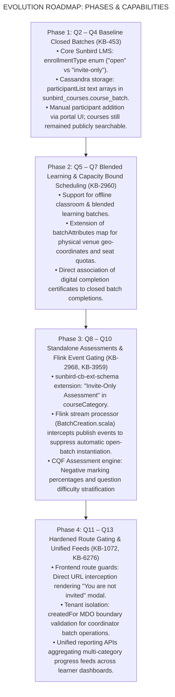
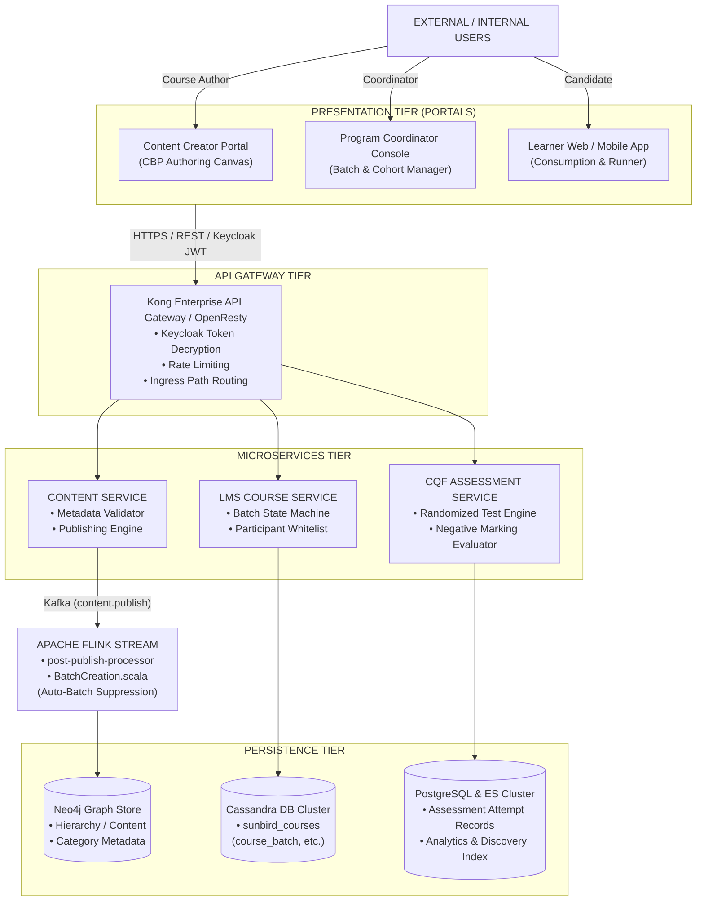
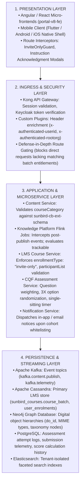
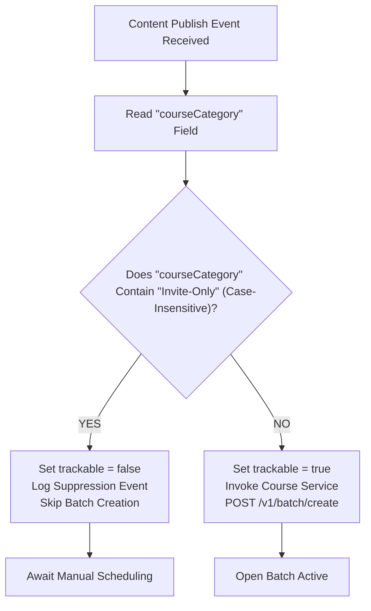
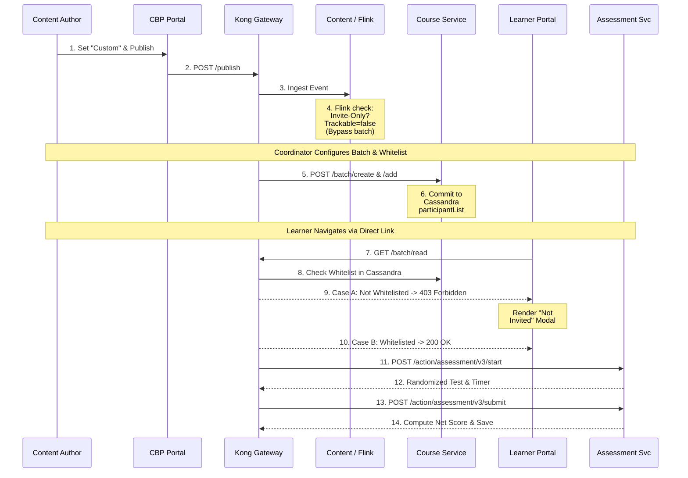
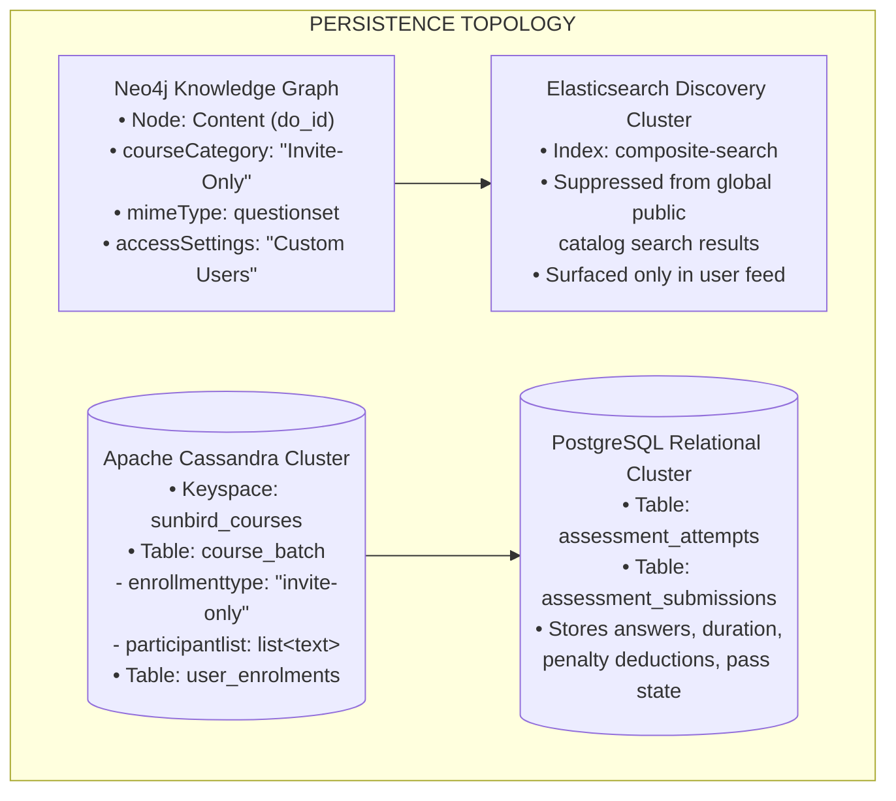
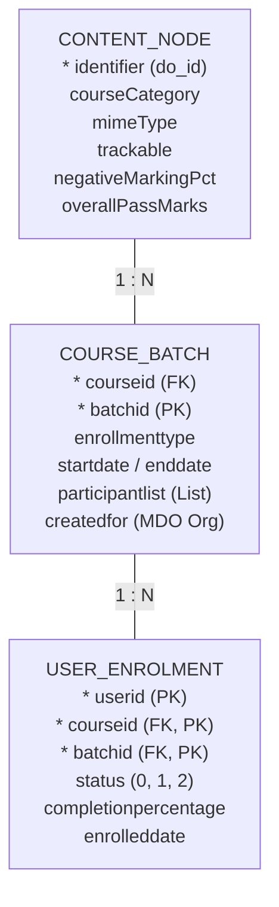
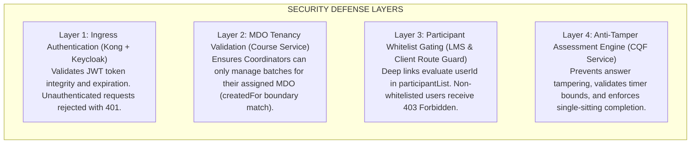

# Invite-Only Course / Batch — High-Level Design (HLD)

## 1. Executive Summary & Architectural Scope

### 1.1 Executive Summary

The **Invite-Only Course / Batch** subsystem on the iGOT Karmayogi platform provides a secure, entitlement-gated access control architecture for civil services learning programs and high-stakes standalone assessments. Unlike standard platform courses—which are publicly discoverable and support self-enrollment—invite-only resources require explicit administrative nomination, automated batch suppression at the ingestion tier, defense-in-depth routing validation, and restricted single-sitting assessment consumption.

This High-Level Design (HLD) defines the global system topology, component boundaries, asynchronous event processing pipelines, data storage models, and cross-tier network interactions from **Quarter 2 (Q2)** through **Quarter 13 (Q13)**.

### 1.2 System Scope

The architecture spans three core resource domains:

1. **Invite-Only Courses:** Full hierarchical course collections gated at the root catalog level, requiring cohort-specific batch assignment.
2. **Invite-Only Batches:** Discrete, schedule-bounded cohorts configured under standard or blended programs with explicit participant whitelisting (`participantList`).
3. **Standalone Invite-Only Assessments:** Decoupled evaluation modules authored with randomized question weightage, negative marking penalties, and auto-batch suppression, delivered through a single-sitting examination runner.

## 2. Evolutionary Architecture Progression (Q2 – Q13)



## 3. High-Level Architectural Diagrams & System Topologies

### 3.1 System Context Diagram (Level 0 / Level 1)

The context diagram depicts external actors, user surfaces, the API gateway, and platform core services.



### 3.2 Multi-Tier Layered Architecture

The platform enforces a four-tier architecture separating presentation, gateway routing, service orchestration, and polyglot persistence:



## 4. End-to-End Enterprise Flow: Creation to Consumption

The end-to-end lifecycle spans four coordinated stages: Authoring & Categorization, Ingestion & Batch Suppression, Cohort Scheduling, and Gated Consumption.

```mermaid
flowchart TD
    subgraph S1["STAGE 1: AUTHORING (CBP)"]
        A1["• Content Creator sets Access: #quot;Custom Users#quot;.<br/>• Schema marks: courseCategory: #quot;Invite-Only Assessment#quot; or #quot;Invite-Only Program#quot;.<br/>• Defines pass marks, duration & negative marks.<br/>• Submits for Review."]
        O1["Drafting Complete"]
        A1 --> O1
    end
    subgraph S2["STAGE 2: INGESTION (FLINK)"]
        A2["• SPV Approves & Publishes<br/>• Kafka event published to content.publish topic.<br/>• Flink BatchCreation.scala detects #quot;Invite-Only#quot;.<br/>• Auto-batch creation bypassed (trackable=false).<br/>• Content node written to Neo4j graph store."]
        O2["Auto-Batch Suppressed"]
        A2 --> O2
    end
    subgraph S3["STAGE 3: SCHEDULING (COORD)"]
        A3["• Program Coordinator opens Scheduling Console.<br/>• Configures active window: startDate / endDate.<br/>• Uploads Candidate Cohort (CSV or UUID list).<br/>• LMS persists whitelist in Cassandra participantList.<br/>• Notifications triggered."]
        O3["Cohort Whitelisted"]
        A3 --> O3
    end
    subgraph S4["STAGE 4: CONSUMPTION (LEARNER)"]
        A4["• Invited Learner logs in#59; course appears in feed.<br/>• Uninvited Learner attempts direct link navigation.<br/>• Guard calls batch/read.<br/>• Uninvited: 403 Forbidden -#gt; #quot;Not Invited#quot; modal.<br/>• Invited: Acknowledges modal -#gt; Starts exam."]
        O4["Single-Sitting Exam Done"]
        A4 --> O4
    end
```



## 5. Subsystem Component Design

### 5.1 Authoring & Ingestion Subsystem (CBP to Flink)

#### Functional Flow & Responsibilities

1. **Access Setting Selection:** The Content Creator Portal provides an authoring toggle between public access (`All Users`) and restricted access (`Custom Users`).
2. **Taxonomy Schema Ingestion:** The `content-service` enforces schema constraints from `sunbird-cb-ext-schema`. For assessments, the schema validates:
  - `negativeMarkingPercentage`
  - `randomization`
  - `questionLevelDefinition`: JSON map with integer weightages across `easy`, `medium`, `tough`, `hard`, and `hot`.

3. **Flink Stream Pipeline Interception:** When a published content event lands on `kafka.content.publish`, the Apache Flink `post-publish-processor` runs `BatchCreation.scala`:



### 5.2 Cohort Scheduling Subsystem (Coordinator to LMS)

#### Functional Flow & Responsibilities

1. **Batch Instantiation:** Because automated batch generation was bypassed by Flink, the Program Coordinator explicitly instantiates a batch via the scheduling UI.
2. **Scheduling Validations:** The backend enforces temporal validity rules:
  - must match the coordinator's authorized MDO organization identifier.

3. **Cohort Whitelisting Ingestion:** The coordinator uploads participant identifiers (email/UUID list). The system parses and deduplicates records, invoking `POST /apis/proxies/v8/learner/course/v1/batch/participants/add`. The list is committed directly to Cassandra:

```sql
UPDATE sunbird_courses.course_batch
SET participantlist = participantlist + ['usr_id_01', 'usr_id_02'],
    updateddate = '2026-10-30 16:30:00+0530'
WHERE courseid = 'do_1140166196245217281288'
  AND batchid = '0139872149817234';
```

### 5.3 Consumption & Gating Subsystem (Learner to Engine)

#### Functional Flow & Responsibilities

1. **Search Catalog Filtering:** The Elasticsearch search query pipeline filters out any content where `courseCategory` contains `"Invite-Only"`, unless the learner's `userId` matches an active batch enrollment.
2. **Deep-Link Route Guarding** (`InviteOnlyGuard`): When a learner navigates directly to a URL (e.g., `/app/toc/do_1140166196245217281288/overview`), the client router executes a pre-activation check against the LMS:
  - **Invited Learner:** `userId` exists in `participantList`. System returns `200 OK`; TOC and player render normally.
  - **Uninvited Learner:** `userId` not found in `participantList`. System returns `403 Forbidden`; router halts navigation and renders the **"You are not invited"** modal.

3. **Single-Sitting Assessment Execution:**
  - Once launched, the CQF service creates an active attempt session with an immutable start timestamp.
  - Questions and multiple-choice options undergo seed-based 3X randomization.
  - Pausing is prohibited; navigating away or closing the tab submits the exam automatically.
  - Final score computation applies negative marking:

## 6. End-to-End Sequence Diagram



## 7. Data Architecture & Persistence Topology



### 7.1 Primary Entity Relationships



## 8. Network, Security, and Infrastructure Architecture

### 8.1 Network Ingress & Gateway Routing

All traffic from web and mobile clients routes through standard ingress controllers to the Kong Enterprise API Gateway:

- **SSL/TLS Termination:** TLS 1.3 enforced at Kong ingress.
- **Authentication Plugin:** Intercepts incoming `Authorization: Bearer <JWT>` tokens, validates signatures against Keycloak public keys, and decodes user identity claims.
- **Header Enrichment:** Kong injects verified claims into downstream request headers:
  - `x-authenticated-userid`: Civil servant user UUID.
  - `x-authenticated-rootorg`: Tenant MDO organization identifier.

### 8.2 Security & Access Control Policies



## 9. Traceability Matrix & Architectural Invariants

| Invariant / Requirement | Description | Enforcing Component | Persistence Target |
|---|---|---|---|
| **INV-01: Zero Public Discovery** | Invite-only content must not appear in open public catalog search queries. | `content-service` / Elasticsearch filter | `composite-search` index |
| **INV-02: Auto-Batch Suppression** | Ingestion pipeline must bypass open batch generation for invite-only assets. | `post-publish-processor` (`BatchCreation.scala`) | Kafka stream event state |
| **INV-03: Temporal Scheduling** | Enrollment and consumption must strictly respect `startDate` and `endDate`. | `sunbird-course-service` | `sunbird_courses.course_batch` |
| **INV-04: Deep-Link Gating** | Uninvited learners accessing direct URLs must be blocked with an informative modal. | `portal-v8-fe` (`InviteOnlyGuard`) & Course Service | Client router state |
| **INV-05: Single-Sitting Integrity** | Assessments cannot be paused or restarted after initiation. | `cqf-assessment-service` | PostgreSQL `assessment_attempts` |
| **INV-06: Strict Negative Marking** | Penalties must deduct from score based on configured percentage. | `cqf-assessment-service` scoring engine | PostgreSQL `assessment_submissions` |
