## 1. Executive Overview

### 1.1 Feature Introduction & Business Purpose

The **Invite-Only Course / Batch** capability on the iGOT Karmayogi platform establishes a closed, entitlement-gated paradigm for courses, batches, and standalone assessments. Developed to cater to the specialized governance, compliance, and departmental needs of Indian Civil Services across Ministries, Departments, and Organizations (MDOs), the feature restricts content visibility, batch discovery, and enrollment to explicitly nominated cohorts of civil servants.

### 1.2 Problem Statement

In the baseline iGOT Karmayogi architecture, published courses and standalone assessments defaulted to open discovery, generating automated public batches that allowed self-enrollment by any authenticated civil servant. This model presented significant governance and operational challenges:

- **Premature & Unauthorized Enrollments:** Departmental training programs, pre-promotion assessments, sensitive leadership cohorts, and competency evaluations could not prevent unauthorized civil servants from enrolling.
- **Catalog Contamination:** Specialized internal training populated the public discovery catalog, cluttering search feeds.
- **Assessment Integrity:** High-stakes departmental standalone assessments lacked strict scheduling, invitation gating, and difficulty/negative marking controls needed for official evaluations.

### 1.3 Expected Outcomes & Current Functional Status

The Invite-Only architecture provides:

- **Gated Content Categorization:** Integration of `courseCategory` schema definitions (e.g., `"Invite-Only Program"`, `"Invite-Only Assessment"`) across the Sunbird Knowledge Platform.
- **Automated Batch Suppression:** Real-time suppression of automatic open-batch generation via Apache Flink post-publish processing (`BatchCreation.scala`).
- **Delegated Cohort Administration:** Role-based scheduling, cohort mapping, and participant whitelisting by MDO Administrators and Program Coordinators.
- **Strict Gating:** Enforcement of access checks across the API Gateway, LMS Course Service, and Learner Portal / Mobile applications, surfacing explicit restriction notices (e.g., *"You are not invited"*) for unauthorized users.

## 2. Feature Scope

**INVITE-ONLY CAPABILITY SCOPE**

| INVITE-ONLY COURSE | INVITE-ONLY BATCH | INVITE-ONLY STANDALONE ASSESS. |
|---|---|---|
| • Restricts course-level discovery | • Discrete cohort within a course | • Decoupled from courses |
| • Access Settings: "Custom Users" | • Closed batch (enrollmentType) | • category: Invite-Only Assess |
| • Parent collection metadata | • Participant whitelisting | • Suppresses auto-batch |
| • Requires closed batch assignment | • Explicit start/end/enroll dates | • 3X randomization / scoring |

### 2.1 In-Scope Functionality

1. **Creation & Categorization:** Authoring via Content Creator Portal (CBP), setting Access Control to **"Custom Users"**, and taxonomy assignment to `Invite-Only Assessment` or `Invite-Only Program`.
2. **Batch Gating & Suppression:** Event-driven suppression of auto-generated open batches in Apache Flink post-publishing pipelines.
3. **Cohort Scheduling & Nomination:** Program Coordinator workflows for defining active scheduling windows, enrollment deadlines, and cohort whitelisting.
4. **Access Control & Entitlement Gating:** Deep-link validation, authorization rejection (`403 Forbidden`), and UI restrictions for non-whitelisted users.
5. **Assessment Scoring & Delivery:** Question-level difficulty indexing (`easy`, `medium`, `tough`, `hard`, `hot`), negative marking percentages, and single-sitting execution.

### 2.2 Out-of-Scope / Deferred Functionality

- Self-service "Request for Invitation" workflows from uninvited learners.
- Multi-sitting, pause-and-resume execution for timed standalone invite-only assessments.
- Anonymous unauthenticated evaluation access.

## 3. Source and Reference Inventory

### 3.1 Primary Jira References

- [KB-2960: Q3 | Ad-Hoc Requests | Invite-Only | Single Button for managing User Invites.](https://karmayogibharat.atlassian.net/browse/KB-2960) (KB Approved): *Invite-Only Course / Batch Foundation* – Business requirements, functional scope, and batch access restrictions.
- [KB-2968: Q3 | Ad-Hoc Requests | Invite-Only | Single button to manage user invitations.](https://karmayogibharat.atlassian.net/browse/KB-2968) (In-Progress): *Batch Management & Scheduling Enhancements* – Program Coordinator scheduling workflows and user whitelisting.
- [KB-3959: Q4 | Assessments | Assessment creation - for Invite only users](https://karmayogibharat.atlassian.net/browse/KB-3959) (Prod Deployed): *Invite-Only Assessment Lifecycle & Consumption* – End-to-end integration across CBP authoring, gating, and learner consumption.
- [KB-453: Q2 | CBP Publishing | CQS and Self Curation should be removed for content creator, content reviewer and publisher for invite only and curated program](https://karmayogibharat.atlassian.net/browse/KB-453) (Prod Deployed): *Course Batch Management Baseline* – Sunbird LMS Course Service batch schema, participant mapping, and enrollment logic.
- [KB-1072: Q2 | Ad-Hoc Requests | Data Request for Content-Competency Mapping of the Moderated Courses and invite-only Programs.](https://karmayogibharat.atlassian.net/browse/KB-1072) (To Do): *Learner Portal & Assessment Consumption UI* – Frontend entitlement checks, error handling, and instruction modals.

### 3.2 Primary PRD & Specifications

- [Standalone Assessments -Invite Only Enhancements doc.](https://karmayogibharat.atlassian.net/wiki/spaces/TES/pages/89751668/Standalone+Assessments+-Invite+Only+Enhancements+doc.): Schema updates (`sunbird-cb-ext-schema`), Flink job batch suppression rules, and service redeployment mandates.
- [Assessment](https://karmayogibharat.atlassian.net/wiki/spaces/KQAS/pages/88408160/Assessment): Functional sign-off for Custom User access settings and instruction modals.
- [SRS - Assessments](https://karmayogibharat.atlassian.net/wiki/spaces/TES/pages/87392295/SRS+-+Assessments): Assessment question types, mobile consumption rules, and timing configurations.
- [Batch List](https://karmayogibharat.atlassian.net/wiki/spaces/TES/pages/71532691/Batch+List): Batch querying contracts and enrollment filtering.

### 3.3 Target Repositories & Schemas

- **Schema Definition:** `https://github.com/sunbird-cb/sunbird-cb-ext-schema` (Baseline branch: `cbrelease-4.8.13`)
- **Flink Pipeline:** `https://github.com/sunbird-cb/knowledge-platform-jobs` (`post-publish-processor`)
- **LMS Backend:** `sunbird-course-service` / Cassandra tables (`sunbird_courses.course_batch`, `sunbird_courses.user_enrolments`).

## 4. Feature Evolution

**HISTORICAL EVOLUTION TIMELINE**

**Phase 1: Foundation LMS Batches (KB-453)**

- Open batches default across all published collections; enrollmentType = "open".
- Manual participant addition existed in core Sunbird but lacked dedicated MDO gating.

**Phase 2: Introduction of Invite-Only Batches (KB-2960, KB-2968)**

- Introduced closed batch mechanics for courses and blended programs.
- Program Coordinator workflows for assigning users and defining start/end/enrollment dates.

**Phase 3: Standalone Invite-Only Assessments (PRD 89751668, KB-3958, KB-3959 / Sprint 14)**

- Schema update in sunbird-cb-ext-schema adding "Invite-Only Assessment" to courseCategory.
- Suppressed auto-batch creation in Flink post-publisher job (BatchCreation.scala).
- Enhanced Assessment schema: negativeMarkingPercentage, randomization, questionLevelDefinition.

**Phase 4: Learner Gating & Production Hardening (KB-1072, Sprint 27 - Sprint 38)**

- Enforced "You are not invited" UI restriction for non-whitelisted users navigating via direct URLs.
- Mandatory instructions modal; 3X option randomization; single-sitting execution engine.

## 5. Functional Overview

### 5.1 Comparative Functional Matrix

| Dimension | Invite-Only Course | Invite-Only Batch | Standalone Invite-Only Assessment |
|---|---|---|---|
| **Resource Authoring** | CBP Portal (Content Creator) | MDO Console / Course Admin | CBP Portal (`mimeType: application/vnd.sunbird.questionset`) |
| **Schema Category** | `courseCategory: "Course"` or `"Invite-Only Program"` | Linked to parent course identifier (`do_id`) | `courseCategory: "Invite-Only Assessment"` |
| **Access Setting** | "Custom Users" selected in metadata | N/A (Inherits course context) | "Custom Users" radio toggle selected |
| **Batch Lifecycle** | Auto-batch suppressed; requires explicit closed batch | Manually created with explicit start/end dates | Auto-batch suppressed by Flink pipeline (`BatchCreation.scala`) |
| **Audience Assignment** | Cohort mapped at batch level | Whitelisted via CSV or user ID selection | Whitelisted via Program Coordinator scheduling console |
| **Learner Discovery** | Hidden from public catalog; visible in user feed | Visible only to invited candidates | Appears on personalized assessment dashboard |
| **Access Gate** | Gateway / Course Service validation | Batch enrollment check | Assessment launch validation; non-invited blocked |
| **Consumption Model** | Multi-module, self-paced within batch window | Cohort-paced within start and end dates | Strict single-sitting, timed examination runner |
| **Completion Criteria** | All progress events committed to Cassandra | Batch progress evaluation & certificate | Sectional/overall pass mark evaluation & score card |

## 6. Complete End-to-End Workflow

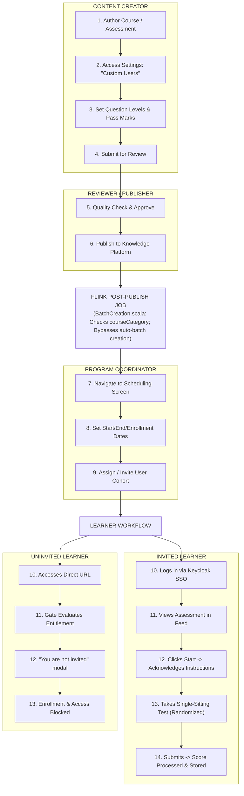

### Detailed Lifecycle Steps

1. **Creation & Configuration:** Content Creator defines title, competency tags, instructions, and duration. Under **Access Settings**, the creator selects **"Custom Users"**. For assessments, difficulty weighting (`easy`, `medium`, `tough`, `hard`, `hot`) and negative marking rules are set.
2. **Publishing & Event Handling:** Upon approval by the SPV Publisher, a Kafka publish event is consumed by the Flink `post-publish-processor`. The job checks `courseCategory`. If it contains `Invite-Only`, the pipeline sets `trackable = false`, suppressing automatic batch creation.
3. **Cohort Scheduling & Invitation:** The Program Coordinator accesses the scheduling console, enters batch metadata (Batch Name, Start Date/Time, End Date/Time, Enrollment End Date), and uploads/selects target user identifiers.
4. **Learner Discovery & Gating:**
  - **Invited Learner:** Content appears on their dashboard. Launching the assessment presents test rules and instructions.
  - **Uninvited Learner:** If an uninvited user obtains the direct URL, the API verifies cohort membership. Access is refused with a `"You are not invited"` prompt.

5. **Consumption & Evaluation:** The learner undertakes the test in a single sitting. The assessment runner randomizes options (3X permutation) and evaluates submissions against pass mark cutoffs.

## 7. Portal-Wise Involvement Matrix

| Portal | User Role | Modules Involved | Core Responsibilities & Workflows |
|---|---|---|---|
| **Content Creator Portal (CBP)** | Content Creator | Content Editor, Question Set Editor, Settings | Selects "Custom Users", adds questions, sets difficulty, configures pass criteria. |
| **Publisher Portal** | SPV Reviewer / Publisher | Review Queue, Publishing Engine | Reviews quality compliance; initiates asynchronous Flink publish job. |
| **Coordination Console** | Program Coordinator | Batch Manager, Scheduling Module | Configures batch time windows; uploads candidate cohorts; manages invitations. |
| **Learner Web Portal** | Civil Servant / Learner | Dashboard, Content Player, Assessment Runner | Discovers invited content, acknowledges instructions, attempts single-sitting exams. |
| **Learner Mobile App** | Mobile Civil Servant | Mobile Assessment Module | Enforces identical single-sitting, randomized examination behavior on Android/iOS. |

## 8. Technical Architecture & Service Interactions

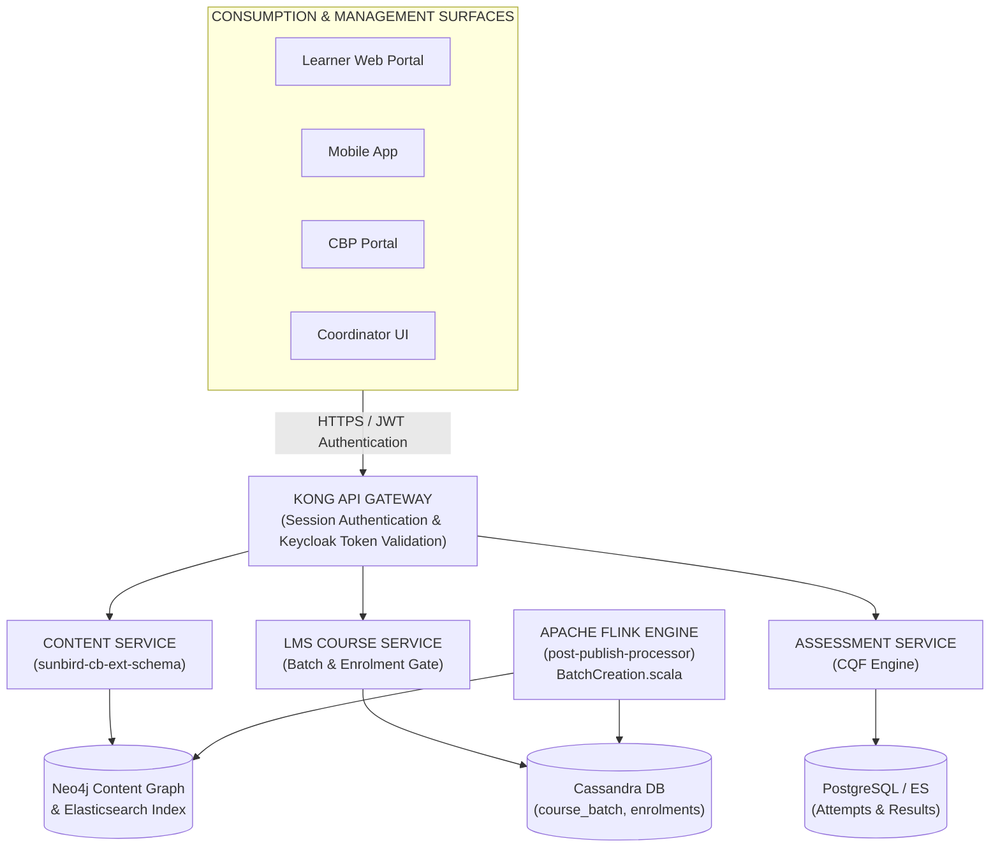

### 8.1 Flink Post-Publish Auto-Batch Suppression Logic

Located in `knowledge-platform-jobs/post-publish-processor/src/main/scala/org/sunbird/job/postpublish/helpers/BatchCreation.scala`:

```scala
val courseCategory = metadata.getOrDefault("courseCategory", "").asInstanceOf[String]
if (trackable) {
  if (StringUtils.containsIgnoreCase(courseCategory, "Invite-Only")) {
    trackable = false
    logger.info("CourseCategory for " + identifier + " : " + courseCategory + ", setting trackable to false")
  }
}
```

## 9. API Documentation

### 9.1 Create CQF Assessment API

- **Endpoint:** `POST /apis/proxies/v8/action/assessment/v3/create`
- **Consuming Portal:** Content Creator Portal (CBP)
- **Backend Service:** Assessment Microservice
- **Headers:** `Authorization: Bearer <JWT>`, `rootOrg: igot`, `Content-Type: application/json`
- **Request Payload:**

```json
{
  "request": {
    "assessment": {
      "name": "Custom Cohort Standalone Assessment",
      "code": "assess_invite_only_01",
      "courseCategory": "Invite-Only Assessment",
      "assessmentType": "questionWeightage",
      "duration": 3600,
      "overallPassMarks": 60,
      "negativeMarkingPercentage": 25,
      "showMarks": "Yes",
      "randomization": "Yes"
    }
  }
}
```

- **Response (200 OK):**

```json
{
  "id": "api.assessment.create",
  "ver": "3.0",
  "responseCode": "OK",
  "result": {
    "identifier": "do_11389274920194867210"
  }
}
```

### 9.2 Course Batch Creation API

- **Endpoint:** `POST /apis/proxies/v8/learner/course/v1/batch/create`
- **Consuming Portal:** Program Coordinator Console
- **Backend Service:** Sunbird Course Service
- **Request Payload:**

```json
{
  "request": {
    "courseId": "do_11389274920194867210",
    "name": "MDO Specialized Batch 2026",
    "description": "Restricted batch for shortlisted personnel",
    "enrollmentType": "invite-only",
    "startDate": "2026-11-01",
    "endDate": "2026-11-15",
    "enrollmentEndDate": "2026-11-05",
    "createdFor": [
      "0126789123456789"
    ]
  }
}
```

- **Response (200 OK):**

```json
{
  "id": "api.course.batch.create",
  "ver": "1.0",
  "responseCode": "OK",
  "result": {
    "batchId": "0139872149817234"
  }
}
```

### 9.3 Batch Participant Whitelist / Read API

- **Endpoint:** `POST /apis/proxies/v8/learner/course/v1/batch/read/{batchId}`
- **Consuming Portal:** Learner Portal / Mobile App
- **Backend Service:** Sunbird Course Service
- **Authorization Check:** Validates if `userId` exists in `participantList` or cohort mapping. Returns `403 Forbidden` if unauthorized.

## 10. Data Model & Entity Schema Extensions

### 10.1 Schema Enhancements (`sunbird-cb-ext-schema`)

- **Collection & Content Schema** (`schemas/collection/1.0/schema.json` & `schemas/content/1.0/schema.json`):

```json
"courseCategory": {
  "type": "string",
  "enum": [
    "Course",
    "Moderated Course",
    "Invite-Only Program",
    "Moderated Program",
    "Blended Program",
    "Curated Program",
    "Standalone Assessment",
    "Moderated Assessment",
    "Invite-Only Assessment"
  ]
}
```

- **Question Set Schema** (`schemas/questionset/1.0/schema.json`):

```json
{
  "assessmentType": {
    "type": "string"
  },
  "noOfSection": {
    "type": "number"
  },
  "overallPassMarks": {
    "type": "number"
  },
  "negativeMarkingPercentage": {
    "type": "string"
  },
  "showMarks": {
    "type": "string",
    "enum": [
      "Yes",
      "No"
    ]
  },
  "randomization": {
    "type": "string",
    "enum": [
      "Yes",
      "No"
    ]
  },
  "questionLevelDefinition": {
    "type": "object",
    "properties": {
      "easy": {
        "type": "number"
      },
      "tough": {
        "type": "number"
      },
      "hard": {
        "type": "number"
      },
      "hot": {
        "type": "number"
      }
    }
  }
}
```

- **Question Schema** (`schemas/question/1.0/schema.json`):

```json
{
  "questionLevel": {
    "type": "string",
    "enum": [
      "easy",
      "hard",
      "tough",
      "hot"
    ]
  }
}
```

### 10.2 Relational & Storage Entity Models

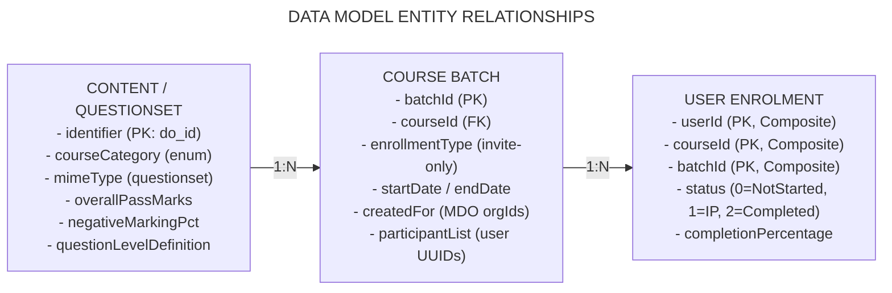

## 11. Business Rules and Edge Cases

| Scenario / Edge Case | Business Rule | System Enforcement & Response | Responsible Service |
|---|---|---|---|
| **1. Direct URL Access by Non-Invited Learner** | Uninvited users cannot access or view content. | System evaluates cohort whitelist; renders *"You are not invited"* modal and returns `403 Forbidden`. | Learner Web/App & Course Service |
| **2. Post-Publishing Batch Generation** | Auto-batch creation must not trigger for invite-only assets. | Flink processor inspects `courseCategory`. Matches containing `"Invite-Only"` set `trackable = false`. | Flink `post-publish-processor` |
| **3. Assessment Window Expiry** | Enrollment & taking exams is blocked after schedule expiration. | Start button disabled; API rejects submission attempts outside `startDate` - `endDate`. | Assessment Engine / Scheduler |
| **4. Single-Sitting Interruption** | Timed assessments must be concluded in one attempt without pausing. | Navigating away or browser termination evaluates answered questions and auto-submits exam. | Assessment Player UI |
| **5. Duplicate** **Nomination / Invitation** | Duplicate user IDs in candidate upload must be ignored. | Coordinator UI deduplicates input sets before committing participant arrays to Cassandra. | Course Service / Coordinator UI |
| **6. Negative Marking Application** | Incorrect responses reduce marks if configured. | Assessment evaluation calculates deductions per question based on `negativeMarkingPercentage`. | Assessment Evaluation Engine |

## 12. Feature Integrations

- **General Courses:** Shares core video and document streaming players while bypassing the public catalog indexing filter.
- **Moderated Courses:** Differs in access control: Moderated courses require post-submission assessor approval; Invite-Only uses pre-enrollment cohort gating.
- **Standalone Assessments:** Operates independently without requiring parent course enrollment records.
- **Notification Engine:** Dispatches email and in-app alerts upon participant whitelisting.
- **User Profile & MDO Hierarchy:** Validates organizational boundaries (`createdFor`) ensuring cross-departmental data privacy.

## 13. System Diagrams

### Diagram 1: Overall Feature Context Diagram

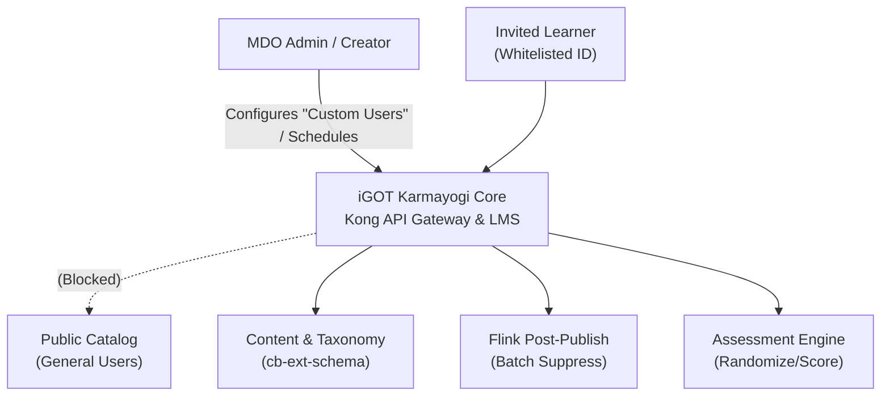

### Diagram 2: Course / Batch Creation Flow

```mermaid
flowchart LR
    S1["[Start]"] --> S2["CBP Portal: Create Content"]
    S2 --> S3["Access Settings: Select #quot;Custom Users#quot;"]
    S3 --> S4["Configure Sections & Questions"]
    S4 --> S5["Set Difficulty (easy/tough/hard/hot) & Pass Marks"]
    S5 --> S6["Send for Review"]
    S6 --> S7["Publisher Approves"]
    S7 --> S8["Flink Post-Publish: Auto-Batch Suppressed"]
    S8 --> S9["Coordinator Opens Scheduler"]
    S9 --> S10["Sets Dates & Uploads User List"]
    S10 --> S11["[Batch Active]"]
```

### Diagram 3: Invitation Lifecycle Flow

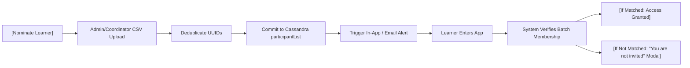

### Diagram 4: Learner Consumption Flow

```mermaid
flowchart LR
    L1["[Learner Dashboard]"] --> L2["Selects Gated Content"]
    L2 --> L3["System Validates Entitlement"]
    L3 --> L4["Read & Acknowledge Test Instructions Modal"]
    L4 --> L5["#quot;Start Assessment#quot; Enabled"]
    L5 --> L6["Timed Single-Sitting Runner (3X Randomization)"]
    L6 --> L7["Submit Exam"]
    L7 --> L8["Real-Time Score Evaluation"]
    L8 --> L9["Scorecard & Telemetry Generated"]
    L9 --> L10["[Finish]"]
```

### Diagram 5: Standalone Assessment Integration

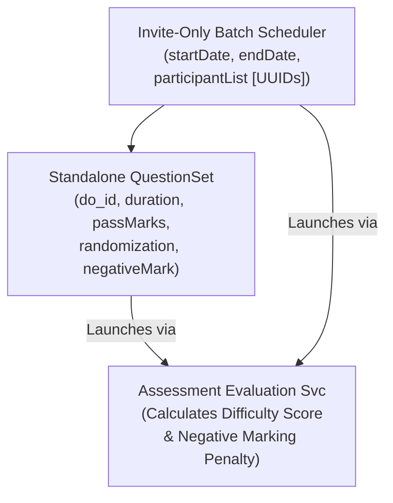

### Diagram 6: End-to-End Technical Architecture

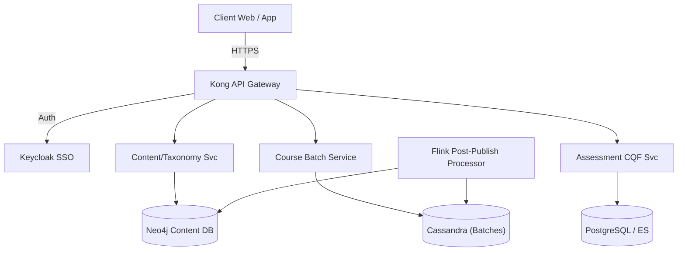

### Diagram 7: API Interaction Sequence Diagram

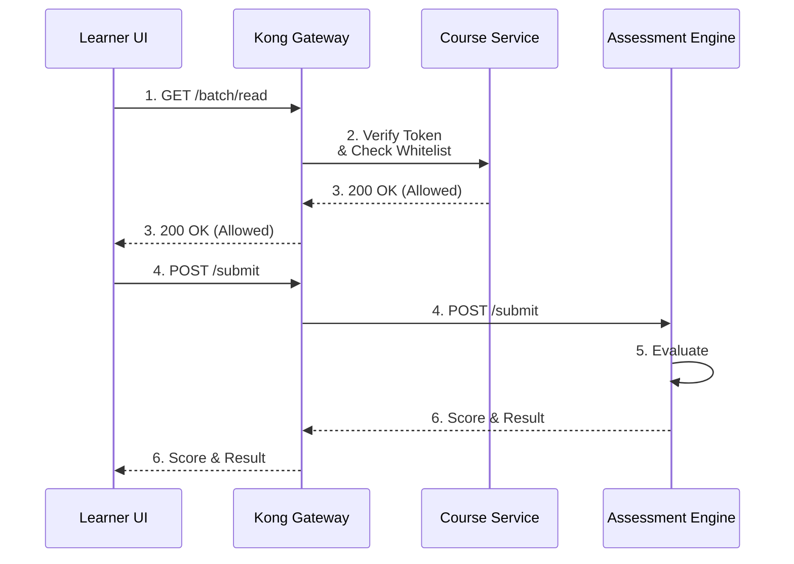

### Diagram 8: Data Model ER Diagram

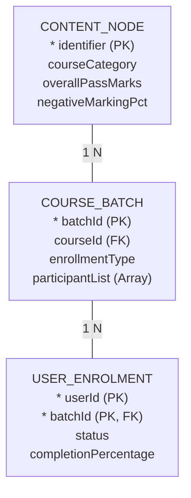

### Diagram 9: Feature Evolution Timeline

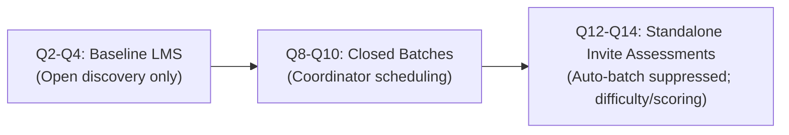

### Diagram 10: Platform Feature Dependency Diagram

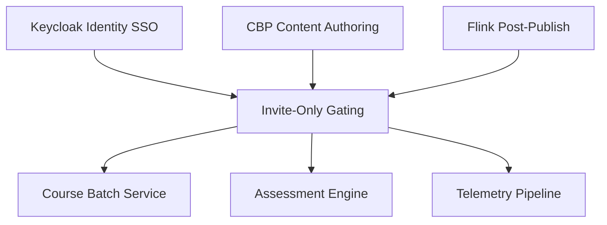

## 14. Requirements vs. Implementation (Gap Analysis)

| [S.No](http://s.no/). | Requirement Description | Source Reference | Frontend Status | Backend Status | API Status | Overall Status | Gap / Observation |
|---|---|---|---|---|---|---|---|
| **1** | New `courseCategory` enum `"Invite-Only Assessment"` | PRD 89751668 | Implemented | Implemented | Implemented | **Verified** | Committed to `sunbird-cb-ext-schema` baseline `cbrelease-4.8.13`. |
| **2** | Auto-batch suppression in Flink job | PRD 89751668 | N/A (Async) | Implemented | Implemented | **Verified** | Handled in `BatchCreation.scala` by checking `"Invite-Only"`. |
| **3** | Question level definition (`easy`/`tough`/`hard`/`hot`) | PRD 89751668 | Implemented | Implemented | Implemented | **Verified** | Schema extended in `questionset/1.0/schema.json`. |
| **4** | Negative marking configuration & evaluation | PRD 89751668 | Implemented | Implemented | Implemented | **Verified** | Handled in CQF Assessment submit engine. |
| **5** | Program Coordinator scheduling screen | KB-2968 / KB-3959 | Implemented | Implemented | Implemented | **Verified** | UI fields for Start/End/Enrollment dates functional. |
| **6** | "You are not invited" modal on direct URL | KB-1072 | Implemented | Implemented | Implemented | **Verified** | Prevents uninvited deep-link navigation. |
| **7** | Dynamic request-for-invite workflow | Proposed / Future | Not Found | Not Found | Not Found | **Planned / Deferred** | Learners cannot self-request invitations. |
| **8** | Assessment pause and resume capability | Out of Scope | Excluded | Excluded | Excluded | **As Specified** | Assessments enforce single-sitting completion. |

## 15. Security, Privacy, and Access Control

**LAYERED ACCESS CONTROL ARCHITECTURE**

1. AUTHENTICATION (Who are you?)
   - Enforced via Kong API Gateway validating Keycloak JWT bearer token.
2. ENROLLMENT GATING (Are you in this cohort?)
   - LMS Course Service verifies caller's userId in Cassandra `participantList`.
3. ENTITLEMENT ENFORCEMENT (Can you access this resource?)
   - Assessment Engine checks batch status and scheduling time window (startDate/endDate).
4. DATA PRIVACY & ISOLATION
   - MDO tenancy validation ensures departmental candidate records remain strictly isolated.

## 16. Operational Metrics and KPIs

- **Invitation-to-Enrollment Conversion Rate:**
- **Assessment Completion Rate:**
- **Average Assessment Score:**

## 17. Risks and Recommendations

### 17.1 Technical & Operational Risks

- **Schema Synchronization Drift:** Rebuilding Content, Taxonomy, Search, or Assessment microservices without pointing to `cbrelease-4.8.13` of `sunbird-cb-ext-schema` will cause validation failures on `courseCategory`.
- **Orphaned Content Risk:** If an author publishes an invite-only course but the Program Coordinator omits batch creation, invited learners encounter broken states.

### 17.2 Architecture Recommendations

1. **Automated Batch Draft Prompt:** Introduce a post-publishing prompt in CBP allowing Creators to trigger batch scheduling immediately.
2. **Bulk Validation Tool:** Provide MDO Coordinators with a real-time CSV email-to-UUID pre-validation tool to reduce nomination errors.

## 18. Final Feature Assessment

1. **Original Business Objective:** Satisfied. Prevents unauthorized discovery and restricts enrollment to nominated civil servants.
2. **Feature Evolution:** Successfully progressed from standard open LMS batches ([KB-453: Q2 | CBP Publishing | CQS and Self Curation should be removed for content creator, content reviewer and publisher for invite only and curated program](https://karmayogibharat.atlassian.net/browse/KB-453) (Prod Deployed)) to closed batches ([KB-2960: Q3 | Ad-Hoc Requests | Invite-Only | Single Button for managing User Invites.](https://karmayogibharat.atlassian.net/browse/KB-2960) (KB Approved), [KB-2968: Q3 | Ad-Hoc Requests | Invite-Only | Single button to manage user invitations.](https://karmayogibharat.atlassian.net/browse/KB-2968) (In-Progress)) and standalone invite-only assessments ([KB-3959: Q4 | Assessments | Assessment creation - for Invite only users](https://karmayogibharat.atlassian.net/browse/KB-3959) (Prod Deployed), PRD [Standalone Assessments -Invite Only Enhancements doc.](https://karmayogibharat.atlassian.net/wiki/spaces/TES/pages/89751668/Standalone+Assessments+-Invite+Only+Enhancements+doc.)).
3. **Current Capabilities:** Implemented across schema definitions, Flink auto-batch suppression, scheduling consoles, and gated test runners.
4. **Production Readiness:** **High**. Core schemas and backend pipelines are active in production baselines.
