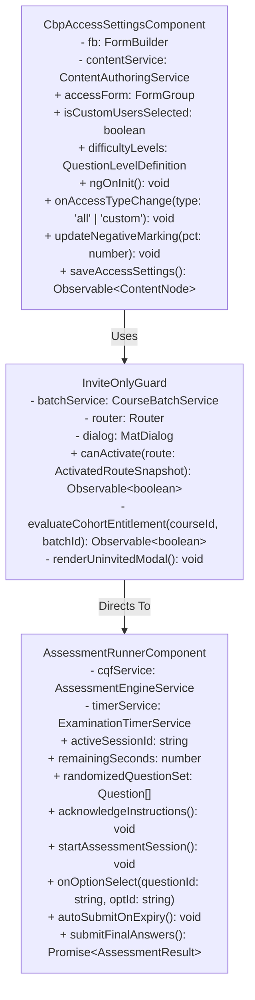
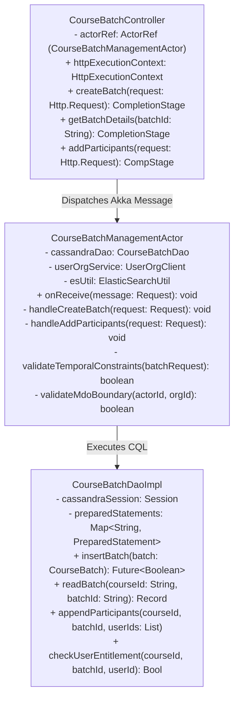
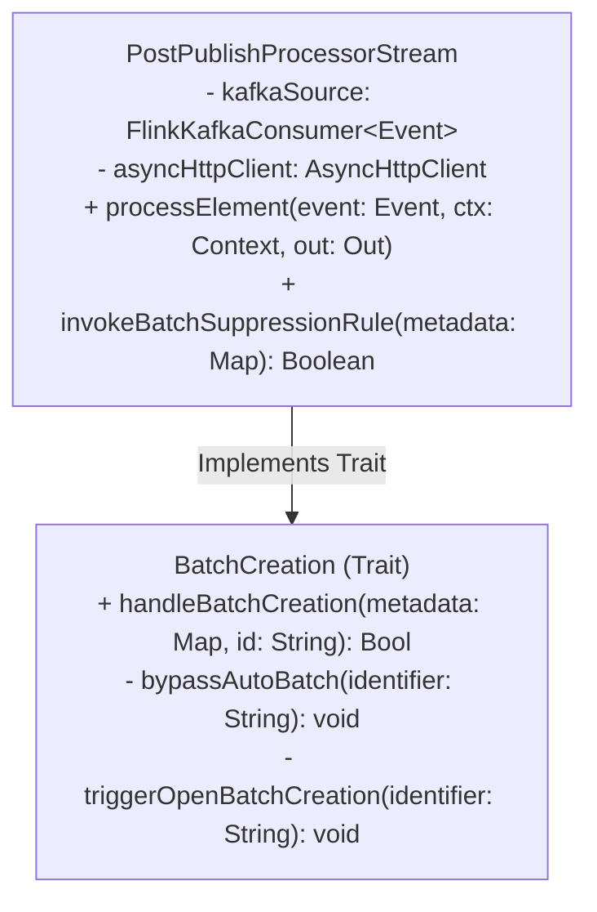
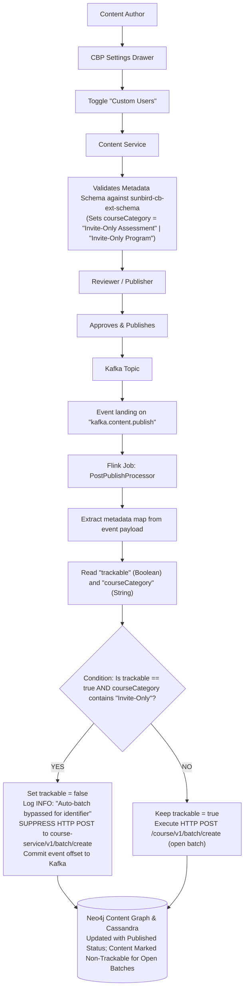
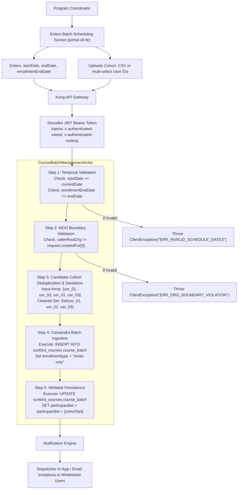
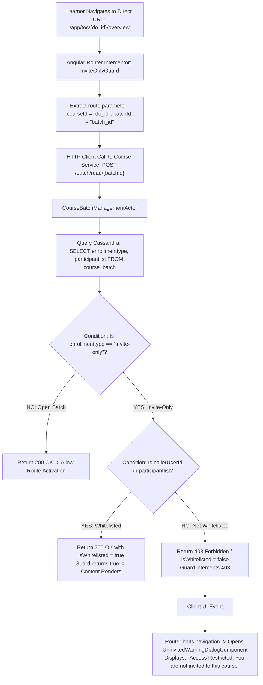

# Invite-Only Course / Batch — Low-Level Design (LLD)

## 1. Introduction & Scope

### 1.1 Purpose

This Low-Level Design (LLD) document specifies the concrete class structures, actor routines, algorithmic step-by-step logic, database query structures, data structures, and state transitions that implement the **Invite-Only Course / Batch** and **Invite-Only Standalone Assessment** capabilities across the iGOT Karmayogi platform. It details both creation and consumption flows from **Quarter 2 (Q2) to Quarter 13 (Q13)**, bridging frontend presentation components down to database execution.

### 1.2 System Context & Traceability References

- [KB-453: Q2 | CBP Publishing | CQS and Self Curation should be removed for content creator, content reviewer and publisher for invite only and curated program](https://karmayogibharat.atlassian.net/browse/KB-453) (Prod Deployed)**:** Course Batch Management Baseline (LMS Course Service actor hierarchy, Cassandra `course_batch` schema, `participantList` collection logic).
- [KB-2960: Q3 | Ad-Hoc Requests | Invite-Only | Single Button for managing User Invites.](https://karmayogibharat.atlassian.net/browse/KB-2960) (KB Approved)**:** Invite-Only Course / Batch Foundation (Blended program scheduling, `batchAttributes` map serialization, seat quotas).
- [KB-2968: Q3 | Ad-Hoc Requests | Invite-Only | Single button to manage user invitations.](https://karmayogibharat.atlassian.net/browse/KB-2968) (In-Progress)**:** Batch Management & Scheduling Enhancements (Program Coordinator batch scheduling actor logic, candidate deduplication, temporal constraint enforcement).
- [KB-3959: Q4 | Assessments | Assessment creation - for Invite only users](https://karmayogibharat.atlassian.net/browse/KB-3959) (Prod Deployed)**:** Invite-Only Assessment Lifecycle & Consumption (CBP authoring settings drawer, CQF assessment runner, single-sitting state machine, negative marking evaluation).
- [KB-1072: Q2 | Ad-Hoc Requests | Data Request for Content-Competency Mapping of the Moderated Courses and invite-only Programs.](https://karmayogibharat.atlassian.net/browse/KB-1072) (To Do)**:** Learner Portal & Assessment Consumption UI (Angular route guard `InviteOnlyGuard`, HTTP 403 interceptor, uninvited warning dialog).
- [KB-6276: Q6 | Content Portal | UI/UX Revamp](https://karmayogibharat.atlassian.net/browse/KB-6276) (KB Approved)**:** Target audience MDO metadata enforcement, unified multi-category user feed aggregation (`/cbplan/v2/user/list`), and faceted search suppression.
- [Standalone Assessments -Invite Only Enhancements doc.](https://karmayogibharat.atlassian.net/wiki/spaces/TES/pages/89751668/)**:** `sunbird-cb-ext-schema` baseline `cbrelease-4.8.13`, Flink `BatchCreation.scala` stream suppression, 3X option randomization.

## 2. Evolutionary Architecture & Component Deltas (Q2 – Q13)

**LOW-LEVEL EVOLUTIONARY ROADMAP (Q2 - Q13)**

| PHASE / TIMELINE | CORE ACTORS & COMPONENTS | LOW-LEVEL IMPLEMENTATION DELTAS |
|---|---|---|
| Q2 – Q4<br>(KB-453) | • CourseBatchManagementActor<br>• CassandraBatchDao<br>• BatchOperationsController | • Added enrollmentType enum parsing ("open" vs "invite-only").<br>• participantList stored as list&lt;text&gt;.<br>• Enforced membership checks on enroll. |
| Q5 – Q7<br>(KB-2960) | • BlendedBatchSchedulerActor<br>• VenueQuotaValidator<br>• CertificateBindingHelper | • batchAttributes map&lt;text,text&gt; added for offline venue & session scheduling.<br>• Added batch-level certificate template criteria mapping. |
| Q8 – Q10<br>(KB-2968, KB-3959, PRD 89751668) | • BatchCreation.scala (Flink)<br>• CqpAssessmentEngineActor<br>• RandomizationSeedGenerator<br>• NegativeMarkingCalculator | • Flink pipeline stream interception: StringUtils.containsIgnoreCase(courseCategory, "Invite-Only").<br>• CQF Single-sitting state machine.<br>• Fisher-Yates 3X option permutation. |
| Q11 – Q13<br>(KB-1072, KB-6276) | • InviteOnlyGuard (Angular)<br>• UserFeedAggregationService<br>• TargetAudienceValidatorActor<br>• ElasticSearchFilterBuilder | • Client route interception: blocks direct URL navigation with 403 error dialog.<br>• Target MDO createdFor org isolation.<br>• Faceted search index suppression rules. |

## 3. Class & Component Structures

### 3.1 Frontend Presentation Components (`portal-v8-fe`)



### 3.2 Backend Service & Actor Hierarchy (`sunbird-course-service`)



### 3.3 Streaming Pipeline Component (`knowledge-platform-jobs`)



## 4. Flow Diagrams & Algorithmic Step-by-Step Logic

### 4.1 Authoring & Flink Auto-Batch Suppression Flow

#### Flow Diagram



#### Algorithmic Step-by-Step Execution: Auto-Batch Suppression

1. **Event Ingestion:** Flink streaming consumer deserializes `PublishEvent` from Kafka partition.
2. **Metadata Inspection:**
  ```scala
  val metadata: util.Map[String, AnyRef] = event.getMap("metadata")
  val identifier: String = event.getString("identifier")
  var trackable: Boolean = metadata.getOrDefault("trackable", java.lang.Boolean.TRUE).asInstanceOf[Boolean]
  val courseCategory: String = metadata.getOrDefault("courseCategory", "").asInstanceOf[String]
  ```
3. **Pattern Evaluation:**
  - Invoke `StringUtils.containsIgnoreCase(courseCategory, "Invite-Only")`.
  - If `true`:
    - Mutate runtime flag: `trackable = false`.
    - Emit audit log: `logger.info(s"CourseCategory for $identifier is '$courseCategory'. Auto-batch creation bypassed.")`.
    - Terminate batch creation branch for this execution node.

  - If `false`:
    - Construct standard payload: `{"courseId": identifier, "enrollmentType": "open", "name": "Auto Batch"}`.
    - Execute asynchronous HTTP POST against `sunbird-course-service`.

### 4.2 Cohort Scheduling & Participant Ingestion Flow

#### Flow Diagram



#### Algorithmic Step-by-Step Execution: Batch Ingestion & Validation

1. **Input Payload Parsing:** Actor receives `Request` object containing `courseId`, `startDate`, `endDate`, `enrollmentEndDate`, `createdFor`, and `userIds`.
2. **Temporal Constraint Checking:**<br><br>If , return HTTP `400 Bad Request` with message `"Enrollment end date cannot exceed batch end date"`.
3. **MDO Tenancy Authorization Check:**
  - Extract caller organization identifier: .
  - Extract payload target: .
  - If and caller does not possess platform super-admin role, abort and return HTTP `403 Forbidden`.

4. **Cassandra Write Pipeline:**
  - Prepare CQL batch statement.
  - Bind variables: `courseid`, `batchid`, `enrollmenttype = "invite-only"`, `participantlist = cohortList`.
  - Commit with `ConsistencyLevel.QUORUM`.

### 4.3 Learner Route Gating & Direct URL Interception Flow

#### Flow Diagram



#### Algorithmic Step-by-Step Execution: Route Guard Gating

1. **Route Activation Request:** Learner clicks deep link or pastes `/app/toc/do_1140166196245217281288/overview`.
2. **Token Extraction:** Guard retrieves active Keycloak session token from local browser storage; extracts `sub` claim (`userId`).
3. **Entitlement API Query:**
  - Client invokes `/apis/proxies/v8/learner/course/v1/batch/read/{batchId}` with user token.
  - Downstream microservice queries Cassandra table `sunbird_courses.course_batch`.

4. **Boundary Verification:**
  - If `enrollmenttype == "invite-only"` and `userId` `participantlist`:
    - Server returns HTTP `403 Forbidden` (`{"responseCode": "UNAUTHORIZED", "result": {"isWhitelisted": false}}`).
    - Guard catches `403` status.
    - Invokes `MatDialog.open(UninvitedWarningDialogComponent)`.
    - Emits `Observable.of(false)` to cancel Angular route activation.

### 4.4 Assessment Consumption, 3X Randomization & Scoring Flow

#### Flow Diagram



```mermaid
flowchart TD
    IL["Invited Learner"] --> A1["Clicks #quot;Start Assessment#quot;"]
    A1 --> A2["Acknowledges Rules Modal"]
    A2 --> CQF["CQF Assessment Service"]
    CQF --> P1["POST /action/assessment/v3/start"]
    P1 --> S1["Step 1: Initialize Single-Sitting Session<br/>Create row in PostgreSQL: assessment_attempts<br/>Set status = #quot;IN_PROGRESS#quot;, start_time = NOW(), duration_seconds = 3600"]
    S1 --> S2["Step 2: 3X Randomization Algorithm<br/>Retrieve raw Question Set from Neo4j (Q1, Q2, Q3... Qn)<br/>Apply Seeded Fisher-Yates Shuffle on Question Order<br/>For each Question:<br/>Apply Seeded Fisher-Yates Shuffle on Options (A, B, C, D)"]
    S2 --> S3["Step 3: Stream Session Payload to Client<br/>Render Fullscreen Examination Runner with Non-Pausable Countdown Timer"]
    S3 --> LS["Learner Submits or Timer Expires"]
    LS --> EV["CQF Assessment Evaluation Engine"]
    EV --> P2["POST /action/assessment/v3/submit"]
    P2 --> E1["Step 1: Prevent Late Submissions<br/>Validate: (submission_time - start_time) #lt;= (duration_seconds + 30s grace)"]
    E1 --> E2["Step 2: Calculate Question Weightage & Penalty Deductions<br/>Initialize: totalScore = 0.0<br/>For each submitted answer:<br/>If answer == correct:<br/>totalScore += questionWeight<br/>Else if answer == incorrect:<br/>penalty = questionWeight * (negativeMarkingPercentage / 100.0)<br/>totalScore -= penalty"]
    E2 --> E3["Step 3: Evaluate Cut-Off<br/>percentage = (totalScore / maxScore) * 100.0<br/>passStatus = percentage #gt;= overallPassMarks ? #quot;PASSED#quot; : #quot;FAILED#quot;"]
    E3 --> E4["Step 4: Finalize Attempt Record<br/>UPDATE assessment_attempts SET status = #quot;COMPLETED#quot;, score = totalScore, pass_status = passStatus<br/>Commit Telemetry Event to Kafka (telemetry.assess)"]
```

#### Algorithmic Step-by-Step Execution: Negative Marking & Option Permutation

1. **Seed Initialization & Permutation (Fisher-Yates Shuffle):**
  ```typescript
  function randomizeQuestionSet<T>(items: T[], userSeed: number): T[] {
    const shuffled = [...items];
    let currentSeed = userSeed;
    for (let i = shuffled.length - 1; i > 0; i--) {
      currentSeed = (currentSeed * 9301 + 49297) % 233280;
      const rnd = currentSeed / 233280;
      const j = Math.floor(rnd * (i + 1));
      [shuffled[i], shuffled[j]] = [shuffled[j], shuffled[i]];
    }
    return shuffled;
  }
  ```
2. **Mathematical Evaluation Model:**<br>Let:
  - be the set of correctly answered questions.
  - be the set of incorrectly answered questions.
  - be the assigned weight for question .
  - be `negativeMarkingPercentage` configured by the author ().

  

## 5. Low-Level Database Queries & Physical Data Structures

### 5.1 Cassandra Prepared Statements (`sunbird-course-service`)

#### 1. Batch Insertion Prepared Statement

```sql
INSERT INTO sunbird_courses.course_batch (
    courseid, batchid, name, description, enrollmenttype, startdate, enddate, enrollmentenddate,
    createdfor, mentors, participantlist, batchattributes, status, createddate, updateddate
) VALUES (?, ?, ?, ?, ?, ?, ?, ?, ?, ?, ?, ?, ?, ?, ?);
```

#### 2. Cohort Participant Append Statement

```sql
UPDATE sunbird_courses.course_batch
SET participantlist = participantlist + ?, updateddate = ?
WHERE courseid = ? AND batchid = ?;
```

#### 3. Participant Entitlement Verification Statement

```sql
SELECT enrollmenttype, participantlist, startdate, enddate, status
FROM sunbird_courses.course_batch
WHERE courseid = ? AND batchid = ?;
```

### 5.2 PostgreSQL Assessment Data Definition (`cqf-assessment-service`)

```sql
CREATE TABLE assessment_attempts (
    attempt_id UUID PRIMARY KEY DEFAULT gen_random_uuid(),
    assessment_id VARCHAR(64) NOT NULL,
    batch_id VARCHAR(64) NOT NULL,
    user_id VARCHAR(128) NOT NULL,
    session_status VARCHAR(24) NOT NULL,  -- 'INITIALIZED', 'IN_PROGRESS', 'SUBMITTED', 'TIMED_OUT'
    started_at TIMESTAMP WITH TIME ZONE NOT NULL DEFAULT NOW(),
    submitted_at TIMESTAMP WITH TIME ZONE,
    duration_seconds INT NOT NULL,
    negative_marking_percentage INT NOT NULL DEFAULT 0,
    raw_score NUMERIC(6, 2),
    final_percentage NUMERIC(5, 2),
    pass_status VARCHAR(16),  -- 'PASSED', 'FAILED'
    responses_payload JSONB NOT NULL,
    CONSTRAINT uk_user_assessment_batch UNIQUE (user_id, assessment_id, batch_id)
);
CREATE INDEX idx_attempt_user_batch ON assessment_attempts (user_id, batch_id);
CREATE INDEX idx_attempt_assessment ON assessment_attempts (assessment_id);
```

## 6. Implementation Task Breakdown & Engineering Workstreams

**ENGINEERING TASK BREAKDOWN**

| TASK ID | REPOSITORY / WORKSTREAM | TARGET ESTIMATE | DELIVERABLE ARTIFACT / OUTCOME |
|---|---|---|---|
| TSK-01 | `sunbird-cb-ext-schema`<br>Schema Ingestion | Sprint 12 (Q8) | Commit `Invite-Only Assessment` enum in `questionset/1.0/schema.json`. |
| TSK-02 | `knowledge-platform-jobs`<br>Apache Flink Job Engine | Sprint 14 (Q9) | Implement suppression logic inside `BatchCreation.scala`. |
| TSK-03 | `sunbird-course-service`<br>LMS Actor & Cassandra DAO | Sprint 18 (Q10) | Update `CourseBatchManagementActor` for bulk participant append. |
| TSK-04 | `portal-v8-fe`<br>Client Routing & Modals | Sprint 24 (Q11) | Develop `InviteOnlyGuard` route guard and `UninvitedWarningDialog`. |
| TSK-05 | `cqf-assessment-service`<br>Assessment Engine Backend | Sprint 28 (Q12) | Implement Fisher-Yates 3X shuffle and negative marking penalty evaluation. |
| TSK-06 | `portal-v8-fe`<br>Learner Feed Aggregation | Sprint 32 (Q13) | Integrate unified user feed API `/cbplan/v2/user/list`. |

## 7. Traceability Matrix & Low-Level Invariants

| Low-Level Invariant | Invariant Details | Enforcing Class / File | Persistence Target |
|---|---|---|---|
| `LLD-INV-01` | Bypasses auto-batch if `courseCategory` contains `"Invite-Only"`. | `BatchCreation.scala` | Kafka Publish Event State |
| `LLD-INV-02` | Batch dates must satisfy . | `CourseBatchManagementActor.java` | Cassandra `course_batch` |
| `LLD-INV-03` | `participantList` stores deduplicated candidate UUIDs. | `CourseBatchDaoImpl.java` | Cassandra `participantlist` column |
| `LLD-INV-04` | Intercepts direct URL navigation for non-whitelisted users with HTTP 403. | `InviteOnlyGuard.ts` | Angular Client Router |
| `LLD-INV-05` | Assessment attempts cannot be paused or restarted. | `assessment-engine.service.ts` | Postgres `assessment_attempts` |
| `LLD-INV-06` | Deducts negative marks from raw score based on configured percentage. | `AssessmentEvaluationHelper.java` | Postgres `raw_score` calculation |
