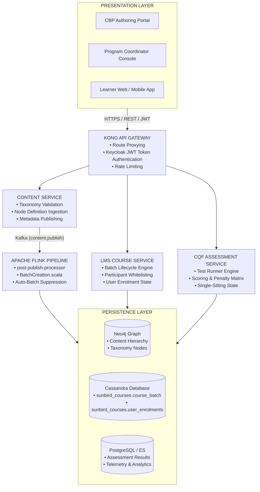
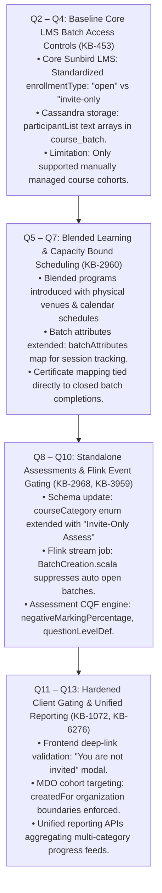
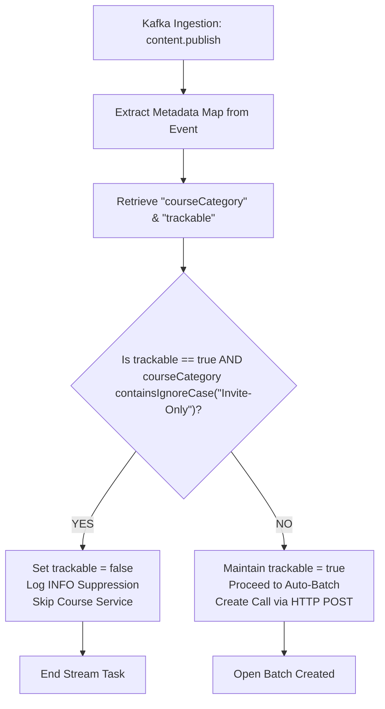
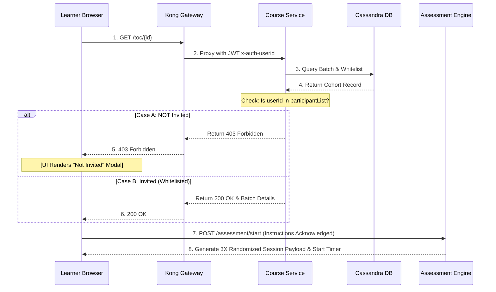

# Invite-Only Course / Batch — Software Design Description (SDD)

## Evolution of Invite-Only Course / Batch Lifecycle & Consumption Architecture (Q2 – Q13)

### iGOT Karmayogi Platform

## 1. Introduction

### 1.1 Purpose

This Software Design Description (SDD) provides the complete structural, behavioral, data, and interface design for the **Invite-Only Course / Batch** capability across the iGOT Karmayogi ecosystem. It establishes the architectural baseline connecting requirements established in the SRS across development phases from **Quarter 2 (Q2)** through **Quarter 13 (Q13)**.

### 1.2 Scope

This document covers low-level component designs, database persistence schemas, asynchronous streaming pipelines, synchronous RESTful API flows, frontend gating workflows, and assessment execution engines for:

1. **Invite-Only Courses & Programs:** Full-hierarchy course collections configured for restricted departmental consumption.
2. **Invite-Only Batches:** Cohort-level access gating, scheduling bounds, participant whitelisting, and enrollment management.
3. **Standalone Invite-Only Assessments:** Decoupled examination modules requiring auto-batch suppression, candidate whitelisting, single-sitting execution, question difficulty indexing, and negative marking penalty calculation.

### 1.3 Architectural Design Constraints & Principles

- **Zero Public Discovery:** Invite-only assets must be suppressed from public search indexes unless explicitly associated with the requesting learner.
- **Asynchronous Batch Suppression:** Content publishing pipelines must deterministically intercept and suppress open-batch creation events based on metadata taxonomy.
- **Defense-in-Depth Gating:** Authorization must be enforced at the API Gateway, LMS microservices, and client presentation layers to prevent bypass via direct URL navigation.
- **Stateless Token-Based Verification:** Microservices authenticate sessions via Keycloak JWT claims, propagating organizational (`rootOrg`) and subject identifiers (`userId`) down the service call graph.

## 2. System Architecture & Context

### 2.1 Multi-Tier Platform Topology

The Invite-Only subsystem bridges Content Authoring (CBP), Knowledge Graph ingestion, Flink Stream Processing, Cassandra cohort persistence, and Learner Consumption clients.



### 2.2 Microservice Decomposition Matrix

| Microservice | Technology Stack | Architectural Responsibility |
|---|---|---|
| `portal-v8-fe` | Angular / Node.js BFF | CBP authoring interfaces, Program Coordinator batch management UI, learner consumption player, and direct URL gating modals. |
| `kong-api-gateway` | Kong / OpenResty / Lua | Ingress routing, SSL termination, Keycloak token decoding, session header injection (`x-authenticated-userid`). |
| `content-service` | Play Framework / Java / Scala | Ingestion and validation of content metadata against `sunbird-cb-ext-schema`. |
| `post-publish-processor` | Apache Flink / Scala | Stream processing on `kafka.content.publish`. Intercepts publish events and suppresses auto-batch generation for `Invite-Only` categories. |
| `sunbird-course-service` | Play Framework / Java / Cassandra | Lifecycle management of course batches, cohort whitelisting (`participantList`), and enrollment state tracking. |
| `cqf-assessment-service` | Node.js / Express / Postgres | Question set rendering, 3X option/question randomization, single-sitting timer tracking, and negative marking penalty calculation. |

## 3. Evolutionary Architecture Progression (Q2 – Q13)

### 3.1 Historical Evolution Decomposition



### 3.2 Evolution Stage Architectural Delta

| Release Window | Architecture Delta | Breaking Changes / Migrations | Key Jira / PRD Artifacts |
|---|---|---|---|
| **Q2 – Q4** | Added `enrollmentType = "invite-only"` checking in LMS Course Service. | Migration of `course_batch` schema to support `participantList` column in Cassandra. | [KB-453: Q2 \| CBP Publishing \| CQS and Self Curation should be removed for content creator, content reviewer and publisher for invite only and curated program](https://karmayogibharat.atlassian.net/browse/KB-453) (Prod Deployed) |
| **Q5 – Q7** | Introduced `batchAttributes` map for blended programs (physical location, seat quotas, session timings). | Deserialization compatibility added for JSON maps inside Cassandra text fields. | [KB-2960: Q3 \| Ad-Hoc Requests \| Invite-Only \| Single Button for managing User Invites.](https://karmayogibharat.atlassian.net/browse/KB-2960) (KB Approved) |
| **Q8 – Q10** | Event-driven batch suppression in `knowledge-platform-jobs`. Introduced assessment difficulty indexing and negative scoring. | Updated `sunbird-cb-ext-schema` to baseline `cbrelease-4.8.13`. Added conditional check in Flink `BatchCreation.scala`. | [KB-2968: Q3 \| Ad-Hoc Requests \| Invite-Only \| Single button to manage user invitations.](https://karmayogibharat.atlassian.net/browse/KB-2968) (In-Progress), [KB-3959: Q4 \| Assessments \| Assessment creation - for Invite only users](https://karmayogibharat.atlassian.net/browse/KB-3959) (Prod Deployed), [Standalone Assessments -Invite Only Enhancements doc.](https://karmayogibharat.atlassian.net/wiki/spaces/TES/pages/89751668/) |
| **Q11 – Q13** | Hardened client route guards. Introduced unified user feed APIs filtering out uninvited content across search nodes. | Client-side Angular routing interceptors updated to catch `403 Forbidden` from batch-read endpoints. | [KB-1072: Q2 \| Ad-Hoc Requests \| Data Request for Content-Competency Mapping of the Moderated Courses and invite-only Programs.](https://karmayogibharat.atlassian.net/browse/KB-1072) (To Do), [KB-6276: Q6 \| Content Portal \| UI/UX Revamp](https://karmayogibharat.atlassian.net/browse/KB-6276) (KB Approved) |

## 4. Component Design: Creation & Publishing Pipeline

### 4.1 Content Creator Portal (CBP) Component

- **Package / Module:** `portal-v8-fe/src/app/modules/cbp/authoring`
- **Responsibilities:**
  - Render the **Access Settings** UI drawer allowing the author to select between `All Users` (Public) and `Custom Users` (Invite-Only).
  - Enforce metadata schema consistency: When `Custom Users` is selected, serialize `courseCategory: "Invite-Only Program"` (for collections) or `courseCategory: "Invite-Only Assessment"` (for question sets).
  - Capture assessment parameters: `duration`, `overallPassMarks`, `negativeMarkingPercentage`, `randomization`, and `questionLevelDefinition`.

### 4.2 Stream Processing & Auto-Batch Suppression Component

- **Repository:** `knowledge-platform-jobs`
- **Artifact:** `post-publish-processor`
- **Execution Engine:** Apache Flink Stream Operator
- **Source Topic:** `{{env}}.content.publish.request`
- **Target Behavior:** In standard workflows, the post-publish pipeline invokes the LMS Course Service to automatically instantiate an open batch (`enrollmentType: "open"`). For Invite-Only assets, this process is suppressed.

#### Low-Level Logic Flow (`BatchCreation.scala`)



#### Low-Level Code Extract

```scala
package org.sunbird.job.postpublish.helpers

import org.apache.commons.lang3.StringUtils
import org.slf4j.LoggerFactory
import java.util

trait BatchCreation {
  private val logger = LoggerFactory.getLogger(classOf[BatchCreation])

  def handleBatchCreation(metadata: util.Map[String, AnyRef], identifier: String): Boolean = {
    var trackable = metadata.getOrDefault("trackable", java.lang.Boolean.TRUE).asInstanceOf[Boolean]
    val courseCategory = metadata.getOrDefault("courseCategory", "").asInstanceOf[String]

    if (trackable) {
      if (StringUtils.containsIgnoreCase(courseCategory, "Invite-Only")) {
        trackable = false
        logger.info(s"CourseCategory for $identifier is '$courseCategory'. Setting trackable to false. Auto-batch creation bypassed.")
      }
    }
    trackable
  }
}
```

## 5. Component Design: Batch Management & Scheduling

### 5.1 Program Coordinator Scheduling Module

- **Module Path:** `portal-v8-fe/src/app/modules/program-coordinator/batch-management`
- **Key Operations:**
  - Instantiate batches against published digital object identifiers (`do_id`) where auto-batch was suppressed.
  - Set temporal bounds: `startDate`, `endDate`, and `enrollmentEndDate` (`enrollmentEndDate <= endDate`).
  - Cohort Whitelisting: Read CSV or multi-select inputs, validate UUIDs against the User Service, and format payload arrays for Cassandra persistence.

### 5.2 LMS Course Service Batch Controller

- **Artifact:** `sunbird-course-service`
- **Controller:** `org.sunbird.course.controller.CourseBatchController`
- **Actor Implementation:** `CourseBatchManagementActor.java`
- **Responsibilities:**
  - Validate caller permissions: The coordinator must possess `CONTENT_CREATOR`, `COURSE_MENTOR`, or `PROGRAM_COORDINATOR` roles for the target `createdFor` organization.
  - Execute Cassandra prepared statements to persist batch metadata and candidate whitelist arrays in `sunbird_courses.course_batch`.

## 6. Component Design: Learner Consumption & Entitlement Gating

### 6.1 Gating Sequence & Direct URL Navigation Flow

The system applies defense-in-depth access controls to block uninvited learners accessing via direct URL navigation (`/app/toc/{do_id}/overview`).



### 6.2 Assessment Execution & Scoring Engine (CQF Service)

- **Execution Invariants:**
  - **Strict Single-Sitting:** Once initiated via `/action/assessment/v3/start`, the server creates an active attempt session in PostgreSQL. No pause-and-resume is permitted.
  - **Option Randomization:** The engine applies a deterministic seed-based Fisher-Yates shuffle to both questions and choice options.
  - **Negative Marking Algorithm:**

## 7. Data Models & Persistence Design

### 7.1 Schema Registry Structure (`sunbird-cb-ext-schema`)

```text
schemas/
├── collection/1.0/schema.json   # Extended: "Invite-Only Program"
├── content/1.0/schema.json      # Extended: "Invite-Only Assessment"
├── questionset/1.0/schema.json  # Assessment metadata properties
└── question/1.0/schema.json     # questionLevel taxonomy
```

#### JSON Schema Extension Snippet (`questionset/1.0/schema.json`)

```json
{
  "properties": {
    "courseCategory": {
      "type": "string",
      "enum": [
        "Course",
        "Moderated Course",
        "Invite-Only Program",
        "Standalone Assessment",
        "Invite-Only Assessment"
      ]
    },
    "assessmentType": {
      "type": "string",
      "default": "questionWeightage"
    },
    "negativeMarkingPercentage": {
      "type": "string",
      "enum": [
        "0",
        "25",
        "33",
        "50",
        "100"
      ]
    },
    "randomization": {
      "type": "string",
      "enum": [
        "Yes",
        "No"
      ]
    },
    "questionLevelDefinition": {
      "type": "object",
      "properties": {
        "easy": {
          "type": "number"
        },
        "medium": {
          "type": "number"
        },
        "tough": {
          "type": "number"
        },
        "hard": {
          "type": "number"
        },
        "hot": {
          "type": "number"
        }
      },
      "additionalProperties": false
    }
  }
}
```

### 7.2 Cassandra Physical Storage Model

**CASSANDRA DATA DESIGN**

**TABLE: sunbird_courses.course_batch**

|  |  |  |
| --- | --- | --- |
| \* courseid | `text` | (Partition Key) |
| \* batchid | `text` | (Clustering Key) |
| name | `text` | |
| description | `text` | |
| enrollmenttype | `text` | "invite-only" (Mandatory for restricted cohorts) |
| startdate | `text` | ISO-8601 Date String |
| enddate | `text` | ISO-8601 Date String |
| enrollmentenddate | `text` | Cut-off date string |
| createdfor | `list<text>` | Target MDO / Organizational unit UUIDs |
| mentors | `list<text>` | Program coordinator user UUIDs |
| participantlist | `list<text>` | Whitelisted Candidate User UUIDs |
| batchattributes | `map<text, text>` | Additional cohort parameters (venues, slots) |
| status | `int` | 0: Unannounced, 1: In-Progress, 2: Completed |

1:N

**TABLE: sunbird_courses.user_enrolments**

|  |  |  |
| --- | --- | --- |
| \* userid | `text` | (Partition Key) |
| \* courseid | `text` | (Clustering Key 1) |
| \* batchid | `text` | (Clustering Key 2) |
| active | `boolean` | Enrollment state flag |
| status | `int` | 0: Not started, 1: In-progress, 2: Completed |
| completionpercentage | `int` | |
| enrolleddate | `timestamp` | |
| issued_certificates | `list<map<text, text>>` | |

## 8. Interface Specifications & Low-Level API Designs

### 8.1 API Specification: Create Invite-Only Batch

```http
POST /apis/proxies/v8/learner/course/v1/batch/create HTTP/1.1
Host: karmayogi.gov.in
Authorization: Bearer <Keycloak_JWT>
Content-Type: application/json
Accept: application/json
```

#### Request Payload

```json
{
  "request": {
    "courseId": "do_1140166196245217281288",
    "name": "Audit & Accounts Executive Evaluation 2026",
    "description": "Restricted departmental cohort for nominated officers.",
    "enrollmentType": "invite-only",
    "startDate": "2026-11-01",
    "endDate": "2026-11-15",
    "enrollmentEndDate": "2026-10-31",
    "createdFor": [
      "0130928639935938560"
    ],
    "mentors": [
      "usr_coord_89218312"
    ],
    "batchAttributes": {
      "sessionType": "Proctored Examination",
      "sittingQuota": "Single Attempt"
    }
  }
}
```

#### Response Payload (200 OK)

```json
{
  "id": "api.course.batch.create",
  "ver": "v1",
  "ts": "2026-10-30T16:25:00.120Z",
  "params": {
    "resmsgid": "89b3df90-128a-48d6-9fc2-0b2a7593c7d1",
    "status": "successful"
  },
  "responseCode": "OK",
  "result": {
    "batchId": "0139872149817234",
    "response": "SUCCESS"
  }
}
```

### 8.2 API Specification: Add Members to Batch Whitelist

```http
POST /apis/proxies/v8/learner/course/v1/batch/participants/add HTTP/1.1
Host: karmayogi.gov.in
Authorization: Bearer <Keycloak_JWT>
Content-Type: application/json
```

#### Request Payload

```json
{
  "request": {
    "batchId": "0139872149817234",
    "courseId": "do_1140166196245217281288",
    "userIds": [
      "712020:2b1926b8-ba53-4277-9b45-3508667c6b3d",
      "712020:7eaa65f0-0629-4e52-81ae-bc758dc50377",
      "712020:bd5d4858-728c-48af-b6ce-d145510884ee"
    ]
  }
}
```

#### Low-Level SQL Update Invoked on Cassandra

```sql
UPDATE sunbird_courses.course_batch
SET participantlist = participantlist + ['712020:2b1926b8-ba53-4277-9b45-3508667c6b3d', '712020:7eaa65f0-0629-4e52-81ae-bc758dc50377', '712020:bd5d4858-728c-48af-b6ce-d145510884ee'],
    updateddate = '2026-10-30 16:25:00+0530'
WHERE courseid = 'do_1140166196245217281288'
  AND batchid = '0139872149817234';
```

## 9. Frontend Component & Routing Design

### 9.1 Angular Route Guard Architecture (`InviteOnlyGuard`)

Direct route access to courses and assessments is gated by the client router using an authorization guard before initializing the player runtime.

```typescript
import { Injectable } from '@angular/core';
import { CanActivate, ActivatedRouteSnapshot, RouterStateSnapshot, Router } from '@angular/router';
import { Observable, of } from 'rxjs';
import { map, catchError } from 'rxjs/operators';
import { CourseBatchService } from '@sunbird-cb/collection';
import { MatDialog } from '@angular/material/dialog';
import { UninvitedWarningDialogComponent } from './uninvited-warning-dialog.component';

@Injectable({ providedIn: 'root' })
export class InviteOnlyRouteGuard implements CanActivate {
  constructor(
    private batchService: CourseBatchService,
    private router: Router,
    private dialog: MatDialog
  ) {}

  canActivate(route: ActivatedRouteSnapshot, state: RouterStateSnapshot): Observable<boolean> {
    const courseId = route.params['courseId'] || route.queryParams['courseId'];
    const batchId = route.params['batchId'] || route.queryParams['batchId'];

    return this.batchService.verifyBatchEntitlement(courseId, batchId).pipe(
      map(response => {
        if (response && response.isWhitelisted) {
          return true;
        }
        this.renderNotInvitedDialog();
        return false;
      }),
      catchError(err => {
        if (err.status === 403 || err.status === 401) {
          this.renderNotInvitedDialog();
        } else {
          this.router.navigate(['/app/error/500']);
        }
        return of(false);
      })
    );
  }

  private renderNotInvitedDialog(): void {
    this.dialog.open(UninvitedWarningDialogComponent, {
      disableClose: true,
      data: {
        title: 'Access Restricted',
        message: 'You are not invited to this course/assessment. Please contact your MDO Program Coordinator.'
      }
    });
  }
}
```

## 10. Traceability Matrix (Requirements to Design Components)

| SRS Requirement ID | Requirement Summary | SDD Component / Implementation Unit | Verification Target |
|---|---|---|---|
| `FR-CBP-01` | "Custom Users" setting sets `courseCategory` | `portal-v8-fe/src/app/modules/cbp/authoring` | Metadata inspection on publish event |
| `FR-FLK-02` | Flink suppresses auto open-batch creation | `post-publish-processor` / `BatchCreation.scala` | Integration test on Kafka stream topic |
| `FR-ADM-02` | Temporal scheduling constraints on batches | `sunbird-course-service` / `CourseBatchManagementActor` | Unit test validating `enrollmentEndDate <= endDate` |
| `FR-ADM-03` | Whitelisting candidate cohort | `sunbird_courses.course_batch` (`participantList`) | Cassandra CQL collection append validation |
| `FR-LRN-03` | Direct URL navigation access gating | `InviteOnlyRouteGuard` & LMS `batch/read` endpoint | End-to-end automated UI test verifying modal display |
| `FR-ASM-02` | Strict single-sitting assessment attempt | `cqf-assessment-service` / Timer state machine | Automated runner termination on window blur/tab close |
| `FR-ASM-04` | Negative marking and difficulty scoring | `cqf-assessment-service` evaluation engine | Unit mathematical validation across penalty boundaries |
