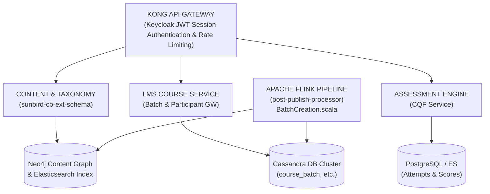

# Invite-Only Course / Batch — Software Requirements Specification (SRS)

## 1. Introduction

### 1.1 Purpose

This Software Requirements Specification (SRS) establishes the authoritative functional, technical, interface, data, and quality requirements for the **Invite-Only Course / Batch** ecosystem on the iGOT Karmayogi platform. Spanning releases from Quarter 2 (Q2) through Quarter 13 (Q13), this document provides end-to-end architectural traceability across the entire lifecycle: authoring, event-driven batch suppression, cohort scheduling, entitlement verification, restricted consumption, and reporting.

### 1.2 Scope of the System

The Invite-Only architecture provides a closed-access governance paradigm for digital courses, blended learning programs, and standalone examinations across Indian Ministries, Departments, and Organizations (MDOs). The system governs:

1. **Creation & Taxonomy Control:** Authoring courses, programs, and question sets with gated categories (`"Invite-Only Program"`, `"Invite-Only Assessment"`) and access controls set to `"Custom Users"`.
2. **Automated Batch Suppression:** Bypassing standard platform open-batch generation within Apache Flink stream pipelines (`BatchCreation.scala`).
3. **Cohort Administration:** Program Coordinator workflows for manual cohort mapping, user whitelisting, and strict scheduling windows.
4. **Entitlement-Gated Consumption:** Hard boundary enforcement at the API Gateway, LMS Course Service, and client applications (Web and Mobile), preventing unauthorized enrollment and blocking uninvited direct-link access.
5. **Assessment Execution:** Single-sitting execution, option permutation, question difficulty weighting, and negative marking for standalone invite-only exams.

### 1.3 Definitions, Acronyms, and Abbreviations

| Term / Acronym | Definition |
|---|---|
| **CBP** | Content Creator Portal (authoring surface for courses, collections, and question sets). |
| **CQF** | Competency Qualification Framework / Assessment Service. |
| **Do_ID** | Digital Object Identifier (unique identifier in the Neo4j Knowledge Graph, e.g., `do_11389...`). |
| **ES** | Elasticsearch (distributed search and analytics engine for batch and content discovery). |
| **Flink** | Apache Flink (stream processing engine executing `knowledge-platform-jobs`). |
| **MDO** | Ministry, Department, or Organization (tenant boundary within the civil services). |
| **ParticipantList** | Array of authorized User UUIDs persisted within `course_batch` records in Cassandra. |
| **TOC** | Table of Contents (course hierarchy, module, and resource tree rendered on the client). |
| **Trackable** | Content metadata flag indicating whether progress tracking and batch creation are enabled. |

### 1.4 References & Traceability

- [KB-453: Q2 | CBP Publishing | CQS and Self Curation should be removed for content creator, content reviewer and publisher for invite only and curated program](https://karmayogibharat.atlassian.net/browse/KB-453) (Prod Deployed)**:** Course Batch Management Baseline (LMS Course Service batch schema, participant mapping).
- [KB-2960: Q3 | Ad-Hoc Requests | Invite-Only | Single Button for managing User Invites.](https://karmayogibharat.atlassian.net/browse/KB-2960) (KB Approved)**:** Invite-Only Course / Batch Foundation (Restricted batch requirements and access controls).
- [KB-2968: Q3 | Ad-Hoc Requests | Invite-Only | Single button to manage user invitations.](https://karmayogibharat.atlassian.net/browse/KB-2968) (In-Progress)**:** Batch Management & Scheduling Enhancements (Program Coordinator scheduling and cohort mapping).
- [KB-3959: Q4 | Assessments | Assessment creation - for Invite only users](https://karmayogibharat.atlassian.net/browse/KB-3959) (Prod Deployed)**:** Invite-Only Assessment Lifecycle & Consumption (CBP authoring, gating, and consumption).
- [KB-1072: Q2 | Ad-Hoc Requests | Data Request for Content-Competency Mapping of the Moderated Courses and invite-only Programs.](https://karmayogibharat.atlassian.net/browse/KB-1072) (To Do)**:** Learner Portal & Assessment Consumption UI (Entitlement checking and error modals).
- [Standalone Assessments -Invite Only Enhancements doc.](https://karmayogibharat.atlassian.net/wiki/spaces/TES/pages/89751668/Standalone+Assessments+-Invite+Only+Enhancements+doc.)**:** Schema updates, Flink job batch suppression rules, and service redeployment mandates.
- [Batch List](https://karmayogibharat.atlassian.net/wiki/spaces/TES/pages/71532691/Batch+List)**:** Contracts for batch querying and enrollment filtering.

## 2. Overall Description

### 2.1 Product Perspective & Context

The Invite-Only subsystem sits at the intersection of Content Authoring, Knowledge Platform Pipelines, LMS Batch Management, and Learner Consumption.



### 2.2 User Classes and Characteristics

- **Content Creator:** Authors instructional material or question sets in CBP; defines access configurations (`"Custom Users"`).
- **Content Reviewer / Publisher:** Reviews pedagogical quality; approves publish events triggering the Kafka Flink pipeline.
- **Program Coordinator / MDO Admin:** Configures operational delivery dates, defines participant whitelists, and schedules cohort access.
- **Learner (Civil Servant):** Consumes courses and attempts assessments; discovers authorized content in personal learning dashboards.
- **System / Auditor:** Tracks compliance, completion telemetry, and cohort metrics across MDOs.

### 2.3 Operating Environment

- **Infrastructure:** Kubernetes-orchestrated microservices on cloud infrastructure.
- **Data Storage:** Cassandra (LMS batches, progress), Neo4j (content graph), PostgreSQL (assessment state), Elasticsearch (discovery indexes).
- **Message Broker & Stream:** Apache Kafka and Apache Flink.
- **Client Run-times:** Responsive Web (Angular / React) and Mobile App (Flutter / Android / iOS).

## 3. Historical Evolution Roadmap (Q2 to Q13)

**EVOLUTIONARY ROADMAP MATRIX (Q2 - Q13)**

| QUARTER / PHASE | CAPABILITY FOCUS | TECHNICAL & ARCHITECTURAL IMPLEMENTATIONS |
|---|---|---|
| Q2 – Q4 (KB-453) | Baseline Batch Controls & Explicit Whitelisting | • Implementation of enrollmentType: "invite-only"<br>• Cassandra storage of participantList arrays<br>• Removal of public self-enrollment endpoints |
| Q5 – Q7 (KB-2960) | Blended Programs, Capacity & Certificate Attachments | • Addition of batchAttributes (session details)<br>• Introduction of physical venue geo-coordinates<br>• Direct binding of cert_templates to batches |
| Q8 – Q10 (KB-2968, KB-3959) | Standalone Assessments & Flink Stream Gating | • Extension of sunbird-cb-ext-schema enums<br>• Flink BatchCreation.scala checks for StringUtils.containsIgnoreCase("Invite-Only")<br>• Negative marking & difficulty level schemas |
| Q11 – Q13 (KB-1072, KB-6276) | Targeted Audience Controls, Direct Link Gating & Unified Progress Aggregation | • Target audience MDO metadata enforcement<br>• Direct URL gating: "You are not invited" modal<br>• Unified APIs: /cbplan/v2/user/list<br>• Multi-category reporting faceted search |

### 3.1 Phase Details

- **Q2 – Q4 (Foundation):** Introduced closed batch controls ([KB-453: Q2 | CBP Publishing | CQS and Self Curation should be removed for content creator, content reviewer and publisher for invite only and curated program](https://karmayogibharat.atlassian.net/browse/KB-453) (Prod Deployed)). Standard courses could be restricted by creating batches with `enrollmentType = "invite-only"`.
- **Q5 – Q7 (Blended Learning):** Expanded invite-only cohorts to blended courses ([KB-2960: Q3 | Ad-Hoc Requests | Invite-Only | Single Button for managing User Invites.](https://karmayogibharat.atlassian.net/browse/KB-2960) (KB Approved)), requiring venue locations, capacity capping, and offline session tracking.
- **Q8 – Q10 (Standalone Assessments & Flink Suppression):** Solved auto-batch contamination ([KB-2968: Q3 | Ad-Hoc Requests | Invite-Only | Single button to manage user invitations.](https://karmayogibharat.atlassian.net/browse/KB-2968) (In-Progress), [KB-3959: Q4 | Assessments | Assessment creation - for Invite only users](https://karmayogibharat.atlassian.net/browse/KB-3959) (Prod Deployed)). The schema introduced `Invite-Only Assessment`, and the Flink pipeline intercepted events to suppress automatic open batch generation.
- **Q11 – Q13 (Hardening & Unified Consumption):** Added direct URL protection ([KB-1072: Q2 | Ad-Hoc Requests | Data Request for Content-Competency Mapping of the Moderated Courses and invite-only Programs.](https://karmayogibharat.atlassian.net/browse/KB-1072) (To Do)), MDO organizational targeting, instruction modals, and unified enrollment aggregation.

## 4. Specific Functional Requirements

### 4.1 Functional Area 1: Content & Assessment Authoring (CBP Portal)

- `FR-CBP-01` Access Control Gating:
  - The CBP interface shall provide an **Access Settings** selector with options: `All Users` and `Custom Users`.
  - When `Custom Users` is selected, the platform shall assign the content metadata field `courseCategory` to `"Invite-Only Program"` or `"Invite-Only Assessment"`.

- `FR-CBP-02` Taxonomy Validation:
  - The Content Service shall reject publish requests if `courseCategory` does not conform to the extended `sunbird-cb-ext-schema` baseline.

- `FR-CBP-03` Standalone Assessment Configuration:
  - For `Invite-Only Assessment` question sets, authors shall configure:
    - `duration` (in seconds),
    - `overallPassMarks` (percentage cut-off),
    - `negativeMarkingPercentage` (`0%`, `25%`, `33%`, `50%`, `100%`),
    - `randomization` (`Yes`/`No` for question and option permutations),
    - `questionLevelDefinition` (distribution across `easy`, `medium`, `tough`, `hard`, `hot`).

### 4.2 Functional Area 2: Event-Driven Batch Lifecycle (Apache Flink & Backend)

- `FR-FLK-01` Publish Event Interception:
  - The `post-publish-processor` Flink streaming pipeline shall intercept publish events from the `kafka.content.publish` topic.

- `FR-FLK-02` Auto-Batch Suppression Logic:
  - In `BatchCreation.scala`, the system shall evaluate the `courseCategory` metadata attribute.
  - If `courseCategory` contains the case-insensitive substring `"Invite-Only"`, the job shall set `trackable = false` and suppress calls to `course-service/v1/batch/create`.

```scala
// BatchCreation.scala Implementation Rule
val courseCategory = metadata.getOrDefault("courseCategory", "").asInstanceOf[String]
if (trackable) {
  if (StringUtils.containsIgnoreCase(courseCategory, "Invite-Only")) {
    trackable = false
    logger.info(s"CourseCategory for $identifier : $courseCategory, setting trackable to false")
  }
}
```

### 4.3 Functional Area 3: Batch Management & Scheduling (Program Coordinator Console)

- `FR-ADM-01` Manual Batch Instantiation:
  - The Coordinator Console shall permit authorized MDO Administrators to manually initiate batches for courses or assessments where automatic batching was suppressed.

- `FR-ADM-02` Temporal Scheduling Constraints:
  - The system shall require the following mandatory timestamp parameters:
    - `startDate` (Batch launch timestamp),
    - `endDate` (Batch conclusion timestamp),
    - `enrollmentEndDate` (Cut-off timestamp; must satisfy `enrollmentEndDate <= endDate`).

- `FR-ADM-03` Participant Whitelisting:
  - Administrators shall upload or select cohorts via:
    - Individual user UUID selection,
    - Bulk CSV upload (containing validated user email/UUID entries),
    - Organizational department-wide mapping (`createdFor` org arrays).

  - The backend shall persist the validated cohort in Cassandra table `sunbird_courses.course_batch` under the `participantList` column.

### 4.4 Functional Area 4: Learner Discovery & Entitlement Gating (Learner Portal / Mobile)

- `FR-LRN-01` Search Catalog Suppression:
  - Elasticsearch search queries executed by general learners shall exclude courses/assessments flagged as `Invite-Only` unless the querying `userId` belongs to an assigned batch.

- `FR-LRN-02` Dashboard Provisioning:
  - When a learner's `userId` is committed to an invite-only batch, the resource shall automatically populate their personal learning feed.

- `FR-LRN-03` Direct URL Navigation Gating:
  - If an uninvited learner navigates directly to `/app/toc/{do_id}/overview` or `/app/assessment/{do_id}`, the frontend shall invoke the batch entitlement check.
  - If the learner is not present in `participantList`, the client shall block content rendering and display a non-dismissible modal stating: *"You are not invited to this course/assessment."*

### 4.5 Functional Area 5: Assessment Consumption & Execution Engine

- `FR-ASM-01` Test Instructions Modal:
  - Before launching an invite-only assessment, the learner must acknowledge an instructions modal detailing duration, pass marks, negative marking, and the single-sitting requirement.

- `FR-ASM-02` Single-Sitting Enforcement:
  - The assessment runner shall prohibit pause-and-resume workflows. Navigating away, closing the tab, or timer expiration shall trigger automatic test submission.

- `FR-ASM-03` Permutation & Randomization:
  - If `randomization: "Yes"` is configured, the runner shall apply a 3X seed-based shuffle to questions and option choices per learner attempt.

- `FR-ASM-04` Scoring & Penalty Computation:
  - The CQF engine shall calculate the final score:

## 5. External Interface Requirements

### 5.1 User Interfaces

- **CBP Authoring Interface:** Dedicated settings drawer providing the "Custom Users" toggle and assessment penalty inputs.
- **MDO Scheduling Screen:** Date/time pickers for scheduling windows, cohort upload controls, and participant tables.
- **Learner Player & Assessment Interface:** Responsive, fullscreen examination mode with persistent countdown timer, section navigation, and submission confirmation.

### 5.2 API Interface Specifications

#### API-01: Create CQF Invite-Only Assessment

- **Protocol / Method:** `HTTPS POST`
- **Path:** `/apis/proxies/v8/action/assessment/v3/create`
- **Consuming Client:** CBP Authoring Portal
- **Request Headers:**
  - `Authorization: Bearer <Keycloak_JWT>`
  - `rootOrg: igot`
  - `Content-Type: application/json`

- **Request Payload:**

```json
{
  "request": {
    "assessment": {
      "name": "Civil Services Specialized Evaluation 2026",
      "code": "assess_invite_spec_2026",
      "courseCategory": "Invite-Only Assessment",
      "assessmentType": "questionWeightage",
      "duration": 5400,
      "overallPassMarks": 65,
      "negativeMarkingPercentage": "25",
      "showMarks": "Yes",
      "randomization": "Yes",
      "questionLevelDefinition": {
        "easy": 10,
        "medium": 15,
        "tough": 15,
        "hard": 5,
        "hot": 5
      }
    }
  }
}
```

- **Response (200 OK):**

```json
{
  "id": "api.assessment.create",
  "ver": "3.0",
  "responseCode": "OK",
  "result": {
    "identifier": "do_1140166196245217281288"
  }
}
```

#### API-02: Create Invite-Only Batch

- **Protocol / Method:** `HTTPS POST`
- **Path:** `/apis/proxies/v8/learner/course/v1/batch/create`
- **Consuming Client:** Program Coordinator Console
- **Request Payload:**

```json
{
  "request": {
    "courseId": "do_1140166196245217281288",
    "name": "Executive Leadership Cohort - Batch A",
    "description": "Nominated cohort for Senior Joint Secretaries",
    "enrollmentType": "invite-only",
    "startDate": "2026-11-01",
    "endDate": "2026-11-30",
    "enrollmentEndDate": "2026-10-31",
    "createdFor": [
      "0130928639935938560"
    ],
    "mentors": [
      "usr_coord_89218312"
    ],
    "batchAttributes": {
      "sessionDetails": {
        "sessionType": "Online",
        "duration": "1.5h"
      }
    }
  }
}
```

- **Response (200 OK):**

```json
{
  "id": "api.course.batch.create",
  "ver": "1.0",
  "responseCode": "OK",
  "result": {
    "batchId": "0139872149817234"
  }
}
```

#### API-03: Batch Participant Read / Entitlement Check

- **Protocol / Method:** `HTTPS POST`
- **Path:** `/apis/proxies/v8/learner/course/v1/batch/read/{batchId}`
- **Consuming Client:** Learner Web Portal / Mobile App
- **Validation Logic:** Server evaluates caller's `userId` against `participantList`. Returns HTTP `403 Forbidden` if unauthorized.

## 6. Data Requirements & Storage Models

### 6.1 Schema Definitions (`sunbird-cb-ext-schema`)

```text
schemas/
├── collection/1.0/schema.json   --> courseCategory enum extended
├── content/1.0/schema.json      --> "Invite-Only Program", "Invite-Only Assessment"
├── questionset/1.0/schema.json  --> negativeMarkingPercentage, randomization, questionLevelDefinition
└── question/1.0/schema.json     --> questionLevel: ["easy", "hard", "tough", "hot"]
```

### 6.2 Cassandra Database Architecture

#### Table 1: `sunbird_courses.course_batch`

```sql
CREATE TABLE sunbird_courses.course_batch (
    courseid text,
    batchid text,
    name text,
    description text,
    enrollmenttype text,  -- "invite-only" | "open"
    startdate text,
    enddate text,
    enrollmentenddate text,
    createdfor list<text>,  -- Tenant/MDO org IDs mentors list<text>, participantlist list<text>,
    -- Whitelisted user UUIDs batchattributes map<text, text>,
    status int,  -- 0: Unannounced, 1: In-Progress, 2: Completed
    createddate text,
    updateddate text,
    PRIMARY KEY (courseid, batchid)
);
```

#### Table 2: `sunbird_courses.user_enrolments`

```sql
CREATE TABLE sunbird_courses.user_enrolments (
    userid text,
    courseid text,
    batchid text,
    active boolean,
    completionpercentage int,
    status int,  -- 0: Not started, 1: In-progress, 2: Completed issued_certificates list<map<text, text>>,
    enrolleddate timestamp,
    lastreadcontentid text,
    lastreadcontentstatus int,
    PRIMARY KEY (userid, courseid, batchid)
);
```

## 7. Non-Functional Requirements (System Qualities)

### 7.1 Performance & Scalability

- `NFR-PERF-01` Gateway Latency: The Kong API Gateway and LMS Course Service entitlement checks shall evaluate cohort membership in under **80 milliseconds** at percentile ().
- `NFR-PERF-02` Concurrent Assessment Capacity: The assessment submission and evaluation engine shall support at least **15,000 concurrent submissions per minute** during civil service examinations without data loss.

### 7.2 Security & Access Control

- `NFR-SEC-01` Hard Boundary Enforcement: Access to course modules and assessment items shall be enforced server-side. Client-side URL spoofing shall be rejected with `403 Forbidden`.
- `NFR-SEC-02` Tenant Isolation: Coordinators shall only view or invite candidates within their designated organizational boundary (`createdFor` org match).

### 7.3 Data Consistency

- `NFR-DAT-01` Cassandra to Elasticsearch Indexing: Writes to `sunbird_courses.course_batch` must reflect in the Elasticsearch `course-batch` index within **1 second** via Akka event streaming.

## 8. Verification & Traceability Matrix

| Requirement ID | Requirement Description | Source Reference | Verifying Component | Verification Method |
|---|---|---|---|---|
| `FR-CBP-01` | "Custom Users" setting sets `courseCategory` | [KB-3959: Q4 \| Assessments \| Assessment creation - for Invite only users](https://karmayogibharat.atlassian.net/browse/KB-3959) (Prod Deployed) | CBP Web UI | Inspection & System Test |
| `FR-FLK-02` | Flink suppresses auto-batch creation | [Standalone Assessments -Invite Only Enhancements doc.](https://karmayogibharat.atlassian.net/wiki/spaces/TES/pages/89751668/) | `post-publish-processor` | Automated Integration Test |
| `FR-ADM-02` | Coordinator scheduling constraints | [KB-2968: Q3 \| Ad-Hoc Requests \| Invite-Only \| Single button to manage user invitations.](https://karmayogibharat.atlassian.net/browse/KB-2968) (In-Progress) | Course Batch Service | Unit & Contract Test |
| `FR-LRN-03` | Direct URL gating ("You are not invited") | [KB-1072: Q2 \| Ad-Hoc Requests \| Data Request for Content-Competency Mapping of the Moderated Courses and invite-only Programs.](https://karmayogibharat.atlassian.net/browse/KB-1072) (To Do) | Learner Portal / Mobile | Automated End-to-End Test |
| `FR-ASM-02` | Single-sitting assessment enforcement | [KB-3959: Q4 \| Assessments \| Assessment creation - for Invite only users](https://karmayogibharat.atlassian.net/browse/KB-3959) (Prod Deployed) | Assessment Runner UI | User Journey Validation |
| `FR-ASM-04` | Scoring with negative marking deduction | [Standalone Assessments -Invite Only Enhancements doc.](https://karmayogibharat.atlassian.net/wiki/spaces/TES/pages/89751668/) | Assessment CQF Engine | Mathematical Unit Test |
