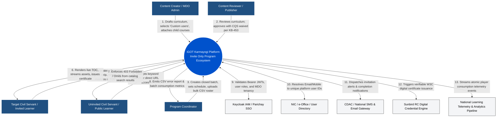
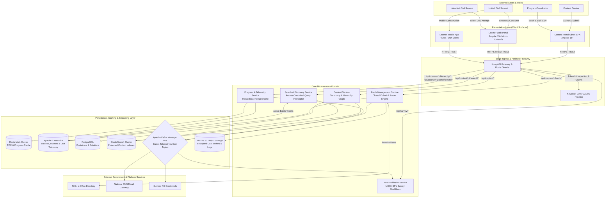
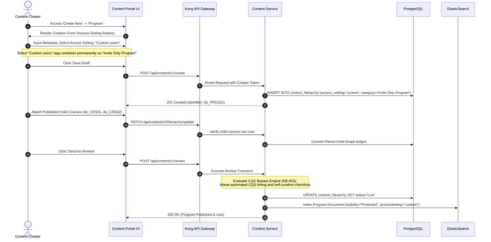
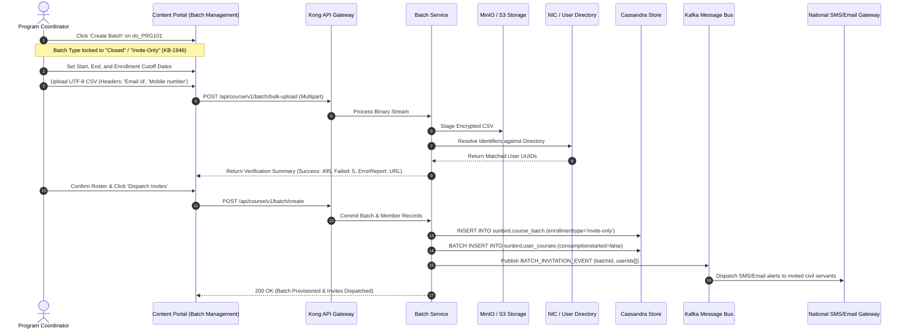
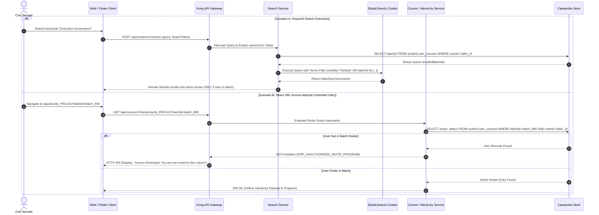
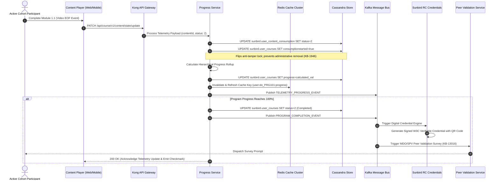
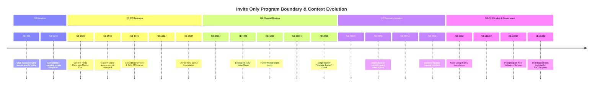

# Invite-Only Program — System Context Diagram & Boundary Specification

### 1.2 Purpose and Scope

This System Context Document establishes the functional, structural, operational, and integration boundaries for the **Invite Only Program** across the iGOT Karmayogi platform. It maps:

1. External user personas and actors interacting across authoring, coordination, and consumption surfaces.
2. Ingress and perimeter security boundaries (Keycloak, API Gateway, Route Guards).
3. Core internal domain services and microservice boundaries.
4. Upstream and downstream enterprise dependencies (e-Office, NIC, SMS/Email dispatchers, Sunbird RC Credentialing, Kafka telemetry streaming, and ElasticSearch discovery).
5. The evolutionary shift in system context from early unsegregated catalogs (Q2) to an enterprise-governed closed-cohort engine (Q13).

## 2. Global Enterprise Context (Level 0 – System Boundary)

The Level 0 Context Diagram isolates the **iGOT Karmayogi Digital Learning Infrastructure** as a single black-box system, defining all inbound and outbound interactions with human actors, external enterprise directories, government infrastructure, and credentialing networks.

## 3. Detailed Enterprise Context (Level 1 – Subsystem Decomposition)

The Level 1 Context Diagram opens the system boundary, illustrating how external actors and third-party systems interact with discrete frontend presentation layers, security gateways, core backend services, and persistence tiers.

## 4. End-to-End Contextual Workflows across Boundaries

### 4.1 Program Creation, CQS Bypass & Review Flow (Content Portal to Backend)

### 4.2 Closed Batch Creation, Bulk CSV Roster Ingestion & Notification Flow

### 4.3 Catalog Search Isolation vs. Direct Access Route Guard Flow

### 4.4 Curriculum Consumption, Telemetry Aggregation & Credentialing Flow

## 5. Subsystem Boundary Responsibilities & Interface Contracts

**SUBSYSTEM BOUNDARY RESPONSIBILITY MATRIX**

| Subsystem Boundary | Core Architectural Responsibilities | External Protocols |
|---|---|---|
| Ingress & Security Boundary (Kong / Keycloak) | JWT Bearer Token introspection & claim decoding RBAC role verification (CREATOR, COORD, PUBLIC) Zero-Trust route interception on `/hierarchy/*` | HTTPS / TLS 1.3 OAuth2 / OIDC mTLS |
| Authoring Boundary (Content Service) | Program container creation & taxonomy stamping Enforcing "custom" access setting immutability CQS bypass & self-curation waiver (KB-453) | REST / JSON SQL (PostgreSQL) ElasticSearch Index |
| Batch & Roster Boundary (Batch Service) | Mandatory closed batch creation Temporal invariant evaluation (Dates) Asynchronous multi-threaded bulk CSV ingestion Anti-tamper consumption de-enrollment lock | REST / JSON CQL (Cassandra) Multipart / S3 Buffer Kafka Event Producer |
| Discovery Boundary (Search Service) | Intercepting incoming search queries Dynamic terms filter injection via batch tokens Dynamic faceted content count aggregations | REST / JSON ElasticSearch DSL CQL (Cache Lookup) |
| Consumption Boundary (Progress Service) | Two-column (Desktop) & single-column (Mobile) TOC Leaf telemetry ingestion & hierarchical rollups Multi-tier Redis caching for p95 &lt; 800ms loads 100% milestone triggers (Certs & Peer Surveys) | REST / WebSockets Redis RESP CQL (Cassandra) Kafka Event Producer |

## 6. External Boundary Dependencies & Integration Matrix

| External Dependency | Integration Type | Direction | Data Exchange / Payload Highlights | Failure Impact & Fallback Policy |
|---|---|---|---|---|
| **Keycloak IAM / Parichay** | REST / OIDC | Inbound / Outbound | Validates caller session; decodes `userId`, `roles`, and `rootOrgId` claims. | **Critical Failure:** 401 Unauthorized; platform access blocked. No fallback. |
| **NIC / National Directory** | REST / HTTPS | Outbound | Translates bulk CSV `Email id` and `Mobile number` to platform user UUIDs. | **Degraded Mode:** CSV rows marked unresolvable; error CSV generated; manual search fallback. |
| **National SMS / Email GW** | Kafka Consumer | Outbound | Delivers batch invitation links, schedule alerts, and survey completion reminders. | **Non-Critical:** Events queued in Kafka topic; silent enrollment preserved in Home Strips. |
| **Sunbird RC Credentialing** | Kafka Consumer | Outbound | Ingests `PROGRAM_COMPLETION_EVENT`; issues W3C signed PDF credentials with QR code. | **Asynchronous Retry:** Events held in Kafka consumer group; certificate dispatch re-attempted. |
| **Flink Analytics** **Pipeline** | Kafka Consumer | Outbound | Continuous streaming of atomic `user_content_consumption` state updates for MDO dashboards. | **Event Buffering:** Telemetry buffered in Kafka broker partitions; zero data loss during pipeline spikes. |

## 7. Evolutionary Context Progression (Q2 to Q13)

### Contextual Shifts across Horizons

1. **Pre-Q3 vs. Post-Q3 Horizon:** In Q2, the program shared unsegregated boundaries with public courses, leading to accidental self-enrollments. In Q3, the system boundary decoupled open and closed content via the `accessSettings.userAccess = "custom"` classification and mandatory closed-batch rules.
2. **Pre-Q7 vs. Post-Q7 Horizon:** Prior to Q7, search indexing lacked user-level entitlement filtering, exposing metadata to uninvited civil servants. In Q7, a query interceptor was placed between the Gateway and ElasticSearch to inject user batch tokens, ensuring zero-leakage catalog discovery.
3. **Q8–Q13 Scaling Horizon:** High-volume national capacity drives required moving progress evaluation from synchronous database operations to multi-tier Redis caching (`KB-15282`) and Kafka-driven asynchronous survey and certificate pipelines.

## 8. Requirements Traceability Matrix (RTM)

| Requirement ID | Jira Reference | Context Boundary / Subsystem | Ingress / Egress Interface | Architectural Verification Method |
|---|---|---|---|---|
| **CTX-CREAT-01** | `KB-1945` | Content Authoring Boundary | `POST /api/content/v1/create` | Form schema test: Assert `accessSettings.userAccess = "custom"` |
| **CTX-CQS-01** | `KB-453` | Review & Curation Boundary | Review Workflow State Engine | Integration test: Assert CQS calculation is bypassed |
| **CTX-BATCH-01** | `KB-1946` | Batch Management Boundary | `POST /api/course/v1/batch/create` | Contract test: Reject any payload with `enrollmentType = "open"` |
| **CTX-BULK-01** | `KB-1946` | Batch Roster Boundary | `POST /api/course/v1/batch/bulk-upload` | Stress test: 5,000-row CSV upload with syntax verification |
| **CTX-LOCK-01** | `KB-1946` | Data Governance Boundary | `sunbird.user_courses` table | Invariant test: Block removal when `consumptionStarted = true` |
| **CTX-UX-UNIFY** | `KB-2960`, `KB-2968` | Content Portal UI Boundary | `Manage Invites` Unified Modal | UI end-to-end Cypress test on unified roster management |
| **CTX-SRCH-01** | `KB-7869`, `KB-7870` | Discovery Boundary | `POST /api/content/v1/search` | Query evaluation test: Assert uninvited user receives 0 results |
| **CTX-FACET-01** | `KB-7871`, `KB-7872` | Catalog Aggregation Boundary | ElasticSearch Facet Aggregations | API functional test: Assert facet count reflects active entitlements |
| **CTX-TOC-DESK** | `KB-1582` | Desktop Web Boundary | `GET /api/course/v1/hierarchy/*` | Visual regression test: Assert two-column split layout |
| **CTX-TOC-MOBL** | `KB-1587`, `KB-4282` | Mobile Client Boundary | Flutter Native Gateway API | Mobile Appium test: Assert single-column collapsible layout |
| **CTX-PERF-01** | `KB-15282` | Caching & Performance Boundary | Redis Multi-Cluster Cache | Distributed Locust load test () |
| **CTX-SURV-01** | `KB-13016`, `KB-13017` | Governance & Survey Boundary | Kafka Topic `program.completion` | Event integration test: Verify peer survey notification dispatch |
