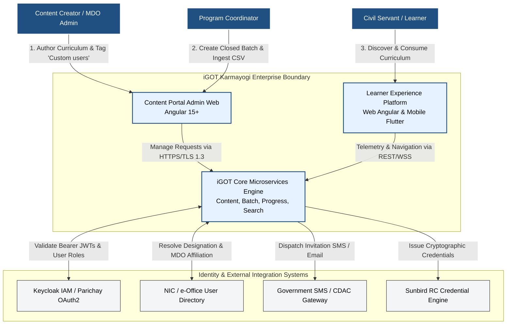
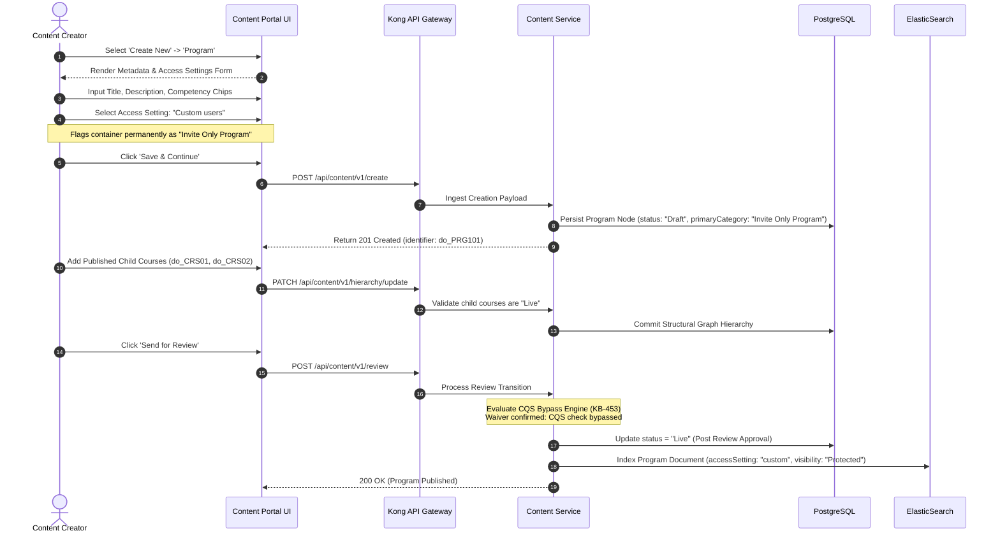
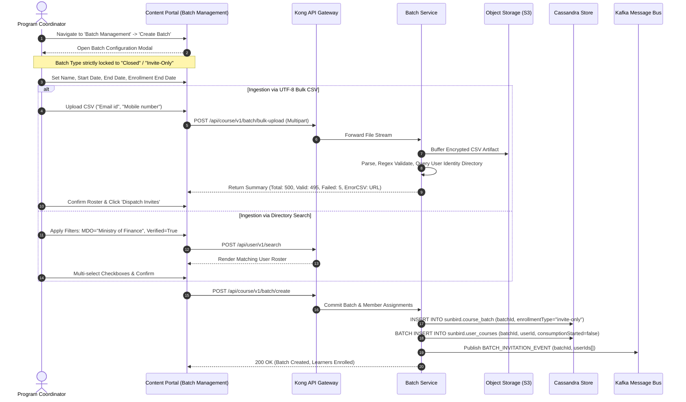
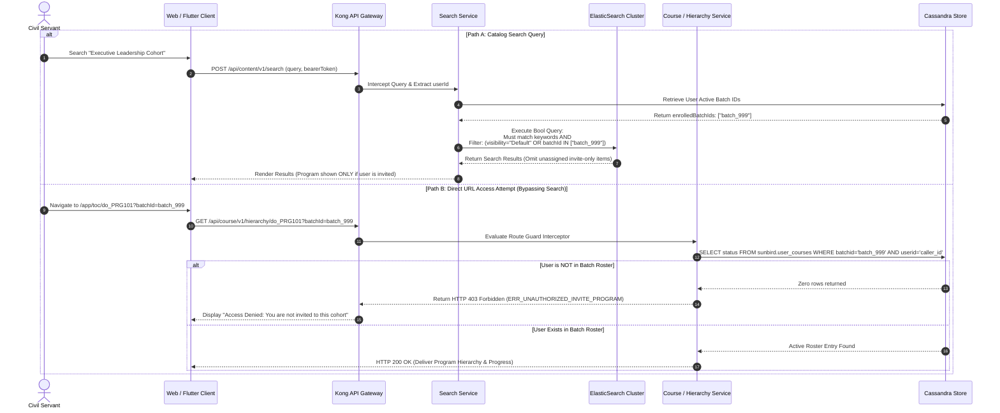
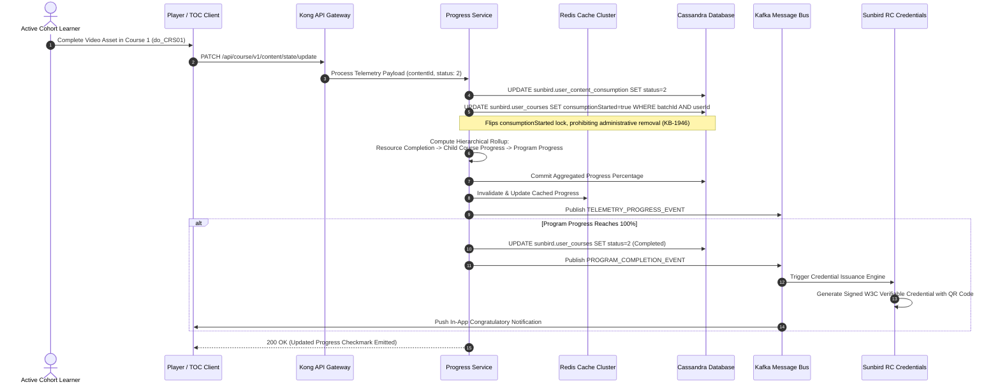
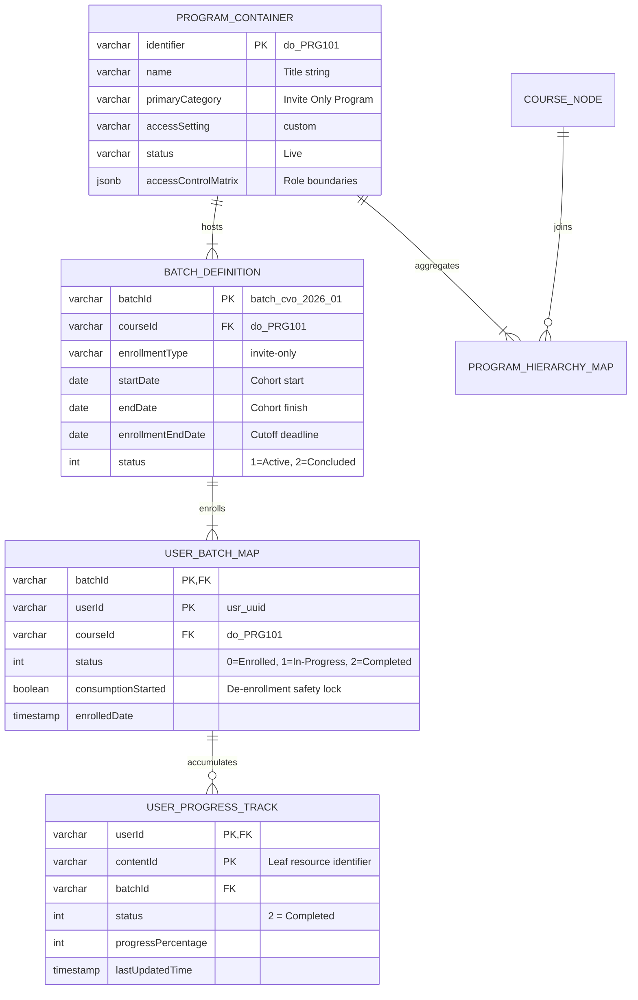
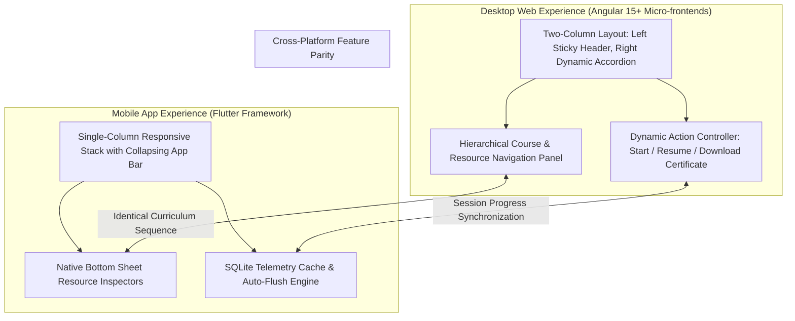
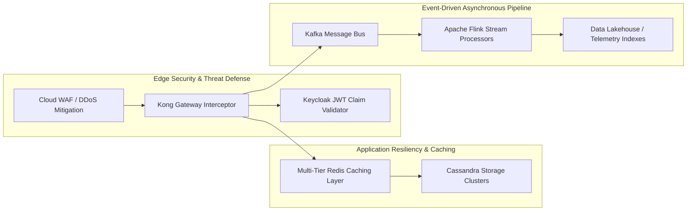
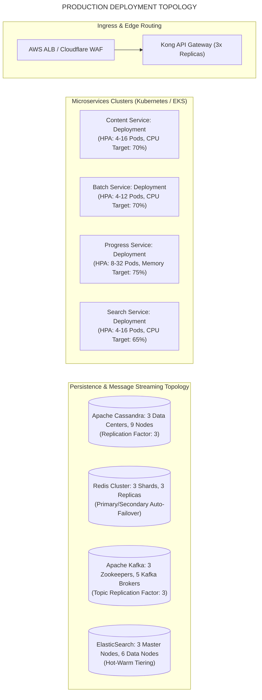

# Invite-Only Program — High-Level Design (HLD) Document

### 1.2 Purpose and Scope

This High-Level Design (HLD) defines the structural, interface, persistence, security, and deployment models governing the **Invite Only Program** across the iGOT Karmayogi digital infrastructure. It addresses the end-to-end lifecycle across:

1. **Administrative Creation & Curation:** Authoring in the Content Portal (CP), "Custom users" taxonomy classification, sub-course association, and automated quality score (CQS) waiver.
2. **Batch Governance & Learner Allocation:** Closed batch instantiation, calendar window enforcement, directory user search, UTF-8 CSV ingestion, and consumption-state deletion locking.
3. **Discovery & Access Governance:** Multi-layer defense-in-depth isolation across API Gateways, Keycloak IAM, ElasticSearch query-time security filters, and homepage channel bookmarking.
4. **Curriculum Delivery & Consumption:** Responsive two-column (Desktop) and single-column (Mobile Flutter) Table of Contents (TOC), unified content player orchestration, telemetry aggregation, and verifiable digital credential generation.

## 2. Architectural Drivers, Design Principles & Invariants

**ARCHITECTURAL DESIGN PRINCIPLES**

| 1. Zero Trust Isolation | 2. Mandatory Closed Cohorts | 3. Audit-Grade Immutability |
|---|---|---|
| Direct URLs & search queries strictly validated at Gateway | Open enrollment is blocked; batch membership required. | Once progress &gt; 0%, learner cannot be uninvited or purged. |
| **4. Asynchronous High-Volume** | **5. Sub-Second Delivery** | **6. Decoupled Processing** |
| Bulk CSV parsing offloaded to background worker queues. | Redis multi-tier caching ensures p95 TOC load &lt; 800ms. | Progress telemetry, notifications, & certificates flow via Kafka bus. |

### 2.1 Core Architectural Invariants

- **Invariant 1 (Taxonomy Immutability):** An aggregate container saved with `accessSettings.userAccess = "custom"` permanently locks its `primaryCategory` to `"Invite Only Program"`. It cannot be mutated back to `"All Users"` or `"MDO specific"`.
- **Invariant 2 (Batch Structural Lock):** The Batch Service rejects any batch creation request for an Invite Only Program where `enrollmentType != "invite-only"`.
- **Invariant 3 (Audit Integrity / Anti-Tamper Lock):** If a learner has consumed of any child course within a batch, database deletion triggers are hard-blocked to protect national civil service training logs (`KB-1946`).
- **Invariant 4 (Zero Metadata Leakage):** Unauthorized users executing search queries or catalog browses receive zero metadata or syllabus details regarding invite-only containers (`Q7 FRS Search Listing`).

## 3. System Context & Enterprise Ecosystem (Level 1)



## 4. Logical & Component Architecture (Level 2)

```mermaid
graph TB
    subgraph "Presentation Layer (Client Surfaces)"
        WEB_LP[Learner Web Portal<br/>Angular / Micro-frontends]
        MBL_LP[Mobile App Client<br/>Dart / Flutter Engine]
        CP_UI[Content Portal Workspace<br/>Creation, Review & Batch Admin]
    end
    subgraph "Edge & Ingress Infrastructure"
        ALB[AWS ALB / Nginx Reverse Proxy]
        KONG[Kong API Gateway<br/>JWT Auth & Rate Limiting]
    end
    subgraph "Application Microservices Layer"
        CS[Content Service<br/>Taxonomy & Hierarchy]
        BS[Batch Service<br/>Closed Cohorts & Roster Engine]
        PS[Progress Service<br/>Telemetry Aggregator & Rollup]
        SS[Search Service<br/>NLP & ES Query Interceptor]
        NS[Notification Service<br/>Dispatch Orchestrator]
        VS[Validation / Survey Service<br/>Peer Validation Workflows]
    end
    subgraph "Distributed Caching & Event Bus"
        REDIS[(Redis Multi-Cluster<br/>TOC & Progress Cache)]
        KAFKA{Apache Kafka Message Bus<br/>Telemetry & Ingestion Topics}
    end
    subgraph "Enterprise Persistence Stores"
        CASS[(Apache Cassandra<br/>Batch Rosters & Progress Maps)]
        PG[(PostgreSQL Cluster<br/>Containers, Channels, Metadata)]
        ES[(ElasticSearch Cluster<br/>Protected Content Indexes)]
        S3[(MinIO / AWS S3<br/>Bulk CSV Buffers & Artifacts)]
    end
    WEB_LP --> ALB
    MBL_LP --> ALB
    CP_UI --> ALB
    ALB --> KONG
    KONG -->|Route /api/content/*| CS
    KONG -->|Route /api/course/v1/batch/*| BS
    KONG -->|Route /api/course/v1/content/state/*| PS
    KONG -->|Route /api/content/v1/search/*| SS
    KONG -->|Route /api/survey/*| VS
    CS --> PG
    CS --> ES
    BS --> CASS
    BS --> PG
    BS --> S3
    BS --> KAFKA
    PS --> REDIS
    PS --> CASS
    PS --> KAFKA
    SS --> ES
    KAFKA --> NS
    KAFKA --> PS
    VS --> PG
```



### 4.1 Microservice Component Responsibilities

- **Content Service** (`CS`): Manages recursive node structures for Program collections. Stamps metadata, manages review transitions, and implements CQS evaluation waivers per `KB-453`.
- **Batch Service** (`BS`): Enforces closed enrollment, validates temporal invariants (), executes multi-criteria user filtering, processes bulk CSV ingestion, and maintains user cohort maps.
- **Progress Service** (`PS`): Ingests atomic player telemetry events via REST and Kafka. Computes hierarchical percentage rollups across courses and program nodes. Interacts with Redis to deliver sub-800ms TOC payload performance (`KB-15282`).
- **Search Service** (`SS`): Sits before ElasticSearch. Strips out unassigned invite-only programs from results unless the user's active batch tokens match index access parameters (`Q7 FRS Search Listing`).

## 5. End-to-End Subsystem Workflows & Sequence Designs

### 5.1 Subsystem 1: Program Creation & Review Lifecycle (Content Portal)



### 5.2 Subsystem 2: Closed Batch Instantiation & Bulk Learner Ingestion



### 5.3 Subsystem 3: Discovery, ElasticSearch Isolation & Direct Access Security



### 5.4 Subsystem 4: Consumption, Telemetry Aggregation & Certification



## 6. Detailed Data Architecture & Persistence Schemata

The storage architecture implements a polyglot persistence model to handle structured governance data alongside high-throughput telemetry streams:



### 6.1 Cassandra Persistence Specifications

#### 1. Batch Definition Table (`sunbird.course_batch`)

```sql
CREATE TABLE sunbird.course_batch (
    courseid text,
    batchid text,
    name text,
    description text,
    enrollmenttype text,
    -- Strictly enforced as 'invite-only' startdate date, enddate date, enrollmentenddate date,
    status int,  -- 1: Active, 2: Completed, 3: Expired
    createdby text,
    createddate timestamp,
    updateddate timestamp,
    PRIMARY KEY ((courseid), batchid)
) WITH CLUSTERING ORDER BY (batchid ASC);
```

#### 2. User Batch Enrollment & Safety Lock Table (`sunbird.user_courses`)

```sql
CREATE TABLE sunbird.user_courses (
    batchid text,
    userid text,
    courseid text,
    active boolean,
    enrolleddate timestamp,
    status int,  -- 0: Enrolled, 1: In Progress, 2: Completed
    consumptionstarted boolean,
    -- Anti-tamper fla
);
locks unenrollment if true completedon timestamp, progress int, PRIMARY KEY ((batchid), userid) ) WITH CLUSTERING ORDER BY (userid ASC);
```

#### 3. Leaf Telemetry Tracking Table (`sunbird.user_content_consumption`)

```sql
CREATE TABLE sunbird.user_content_consumption (
    userid text,
    batchid text,
    courseid text,
    contentid text,
    status int,  -- 1: Incomplete, 2: Complete
    progress int,  -- 0 to 100
    lastaccesstime timestamp,
    lastcompletedtime timestamp,
    PRIMARY KEY ((userid), batchid, contentid)
);
```

## 7. User Experience & Client Application Architecture



### 7.1 Desktop Layout Specifications (`KB-1582`)

- **Two-Column Split Layout:** Desktop view isolates metadata on the left and learning tasks on the right.
  - **Left Column (35% Width - Sticky):** High-resolution artwork, parent program title, issuing MDO badge, duration chips, competency pills, overall cohort progress bar, and primary dynamic CTA (`Start Learning` / `Resume Learning` / `Download Certificate`).
  - **Right Column (65% Width - Scrollable):** Sequential sub-course cards rendered as expandable accordion sections. Each child course expands to expose its leaf resources (video players, PDFs, interactive HTML, standalone assessments) with individual completion checkmarks.

### 7.2 Mobile Application Specifications (`KB-1587`, `KB-4282`)

- **Single-Column Responsive View:** Program banner transitions into a compact collapsed navigation bar upon vertical scroll.
- **Native Bottom Sheets:** Tapping a child course launches a native bottom sheet containing asset breakdowns, module durations, and completion markers.
- **Offline Resilience:** Telemetry generated in low-connectivity environments queues locally in SQLite and pushes via exponential backoff once network connectivity is re-established.

## 8. Cross-Cutting Concerns: Security, Scalability & Performance



### 8.1 Security & Access Enforcement Specifications

1. **Zero Trust Gateway Validation:** All incoming requests targeting `/api/course/v1/hierarchy/*` or player asset streams undergo token inspection. Kong forwards caller claims to backend services where database queries verify the user's presence in `sunbird.user_courses`.
2. **PII Sanitization for Bulk Rosters:** CSV files uploaded for batch creation are encrypted at rest with AES-256 via SSE-KMS. Temporary buffers on disk are deleted within 60 minutes of ingestion processing.

### 8.2 Performance & Scalability Benchmarks

- **Concurrent Learner Capacity:** Architected to support **25,000 Concurrent Users (CCU)** streaming course assets during nationwide administrative capacity-building drives without service degradation (`SRS - Karma Programs` §9.2).
- **Latency Service Level Objectives (SLOs):**
  - Catalog Search Query Processing: .
  - Table of Contents (TOC) Payload Generation: (served via Redis cache).
  - Leaf Telemetry Flush & Progress Ingestion: .

## 9. Comprehensive Requirements vs. Architecture Traceability

| Requirement ID | Jira Reference | High-Level Architecture Component | Structural Design Solution | Verification Method |
|---|---|---|---|---|
| **REQ-CREAT-01** | `KB-1945` | Content Service (`CS`) | Form selection of "Custom users" sets `primaryCategory = "Invite Only Program"` and `accessSettings.userAccess = "custom"`. | Unit & Integration Test |
| **REQ-CQS-BYPASS** | `KB-453` | Curation Engine | Bypass rule implemented in Content Service review lifecycle; skips CQS thresholding. | Automated Pipeline Test |
| **REQ-BATCH-01** | `KB-1946` | Batch Service (`BS`) | Rejects batch requests where `enrollmentType != "invite-only"`; enforces closed enrollment. | API Contract Validation |
| **REQ-BULK-02** | `KB-1946` | Roster Ingestion Engine | S3-buffered, asynchronous CSV validation engine checking email/mobile syntax and user registry mapping. | Stress Ingestion Testing |
| **REQ-UX-UNIFY** | `KB-2960`, `KB-2968` | Content Portal Angular UI | Unified "Manage Invites" modal consolidating search, bulk upload, and roster views. | Manual UAT / Cypress |
| **REQ-LOCK-01** | `KB-1946` | Cassandra `user_courses` | `consumptionStarted` flag prevents user deletion once progress . | Security Audit & Data Invariant Tests |
| **REQ-SRCH-MASK** | `KB-7869`, `KB-7870` | Search Service & ElasticSearch | Real-time query-time security filter injects user batch tokens into ES boolean query. | Automated Query Verification |
| **REQ-CAT-FACET** | `KB-7871`, `KB-7872` | Catalog Aggregator | Dynamic faceted counts evaluate caller entitlements before returning facet totals. | Functional Regression Test |
| **REQ-TOC-DESK** | `KB-1582` | Desktop Web Micro-frontend | Two-column split layout with sticky left metadata pane and dynamic right curriculum accordion. | Visual Regression / Cypress |
| **REQ-TOC-MOBL** | `KB-1587`, `KB-4282` | Flutter Mobile Client | Single-column responsive layout with collapsing app bar and native bottom sheets. | Native Mobile Automation (Appium) |
| **REQ-PERF-01** | `KB-15282` | Redis & Progress Service | Distributed multi-tier caching reduces TOC read latency to under peak loads. | Distributed Locust Load Tests |
| **REQ-SURV-TRIG** | `KB-13016`, `KB-13017` | Kafka & Survey Engine | 100% completion event triggers Kafka message that prompts peer validation surveys. | End-to-End Integration Test |

## 10. Operational Considerations, Deployment Topology & Infrastructure



### 10.1 Observability, Telemetry & Audit Trails

- **Prometheus & Grafana Metrics:** Service runtimes expose Prometheus metrics on `/metrics`, tracking:
  - `batch_creation_total{type="invite-only"}`
  - `bulk_upload_processing_seconds_bucket`
  - `toc_request_latency_seconds_bucket`
  - `anti_tamper_lock_rejection_total`

- **Audit Logging:** Administrative roster updates (invitations, revocations, and rejected deletions) stream to centralized Elasticsearch logging indices with user UUIDs and timestamps for security compliance.
