# Invite-Only Program — Evolution and Consumption Overview Summary

**iGOT Karmayogi Platform | Enterprise Technical and Product Architecture Report**

## 2. Executive Summary

The **Invite Only Program** capability within the iGOT Karmayogi platform represents an enterprise-grade learning container designed for targeted, role-restricted, leadership, specialized administrative, and confidential capacity-building initiatives across Indian Government Ministries, Departments, and Organizations (MDOs).

Unlike standard "Courses" or open "Curated Programs" that are globally discoverable and self-enrollable by any authenticated civil servant, an Invite Only Program enforces strict closed-batch boundaries, targeted participant provisioning (via administrative user lookup or bulk CSV ingestion), and multi-layer visibility masking across Search, ElasticSearch indexes, and the Learner Portal Table of Contents (TOC).

### 2.1 Core Architectural Principles

1. **Access-Setting Driven Classification:** An Invite Only Program is instantiated when a Content Creator selects **"Custom users"** under Access Settings during program drafting. This automatically categorizes the program taxonomy as an `Invite only program`.
2. **Mandatory Closed-Batch Model:** Open batches are structurally disallowed for Invite Only Programs. All learner participation requires explicit assignment to an active closed batch created by a Program Coordinator (`program-coordinator`).
3. **Defense-in-Depth Access Control:** Non-invited users are restricted at the catalog/search layer (NLP/ElasticSearch query filtering), presentation layer (conditional UI strips), and API Gateway / Course Service layer (JWT claims validation against Cassandra batch membership rosters).
4. **Preserved Learning History Integrity:** Once an invited learner enters the content player and logs consumption progress, the platform strictly blocks administrative removal or un-enrolment, preserving auditability for government service records.

### 2.2 Program Type Comparison

| Capability | Open / Curated Program | Moderated Program | Invite Only Program | Observed Platform Difference |
|---|---|---|---|---|
| **Access Setting** | `All Users` | `MDO Specific` | `Custom users` | Determines the program classification and batch behavior |
| **Target Audience** | All registered civil servants across all MDOs | Users or Verified Karmayogis of specific MDOs | Specific individuals explicitly selected across or within MDOs | Granular individual-level provisioning vs. organization-wide tenancy |
| **Batch Architecture** | Default Open Batch (auto-generated) | Open Batch or Multiple Closed Batches | **Closed Batches Only** | Open batch creation is structurally prohibited |
| **Learner Provisioning** | Self-enrolment | Self-enrolment (filtered by MDO affiliation) | **Admin Nomination / Bulk CSV Upload** | Direct coordinator invitation by email & mobile |
| **Searchability** | Fully indexed; visible to all authenticated users | Filtered; visible only to matching MDO learners | **Restricted Indexing**; hidden from general catalog | Appears only in targeted Learner sections if provisioned |
| **Direct URL Access** | Allowed; lands on TOC with active "Enroll" button | Evaluates MDO affiliation; 403 Forbidden if mismatched | **403 Access Denied** unless caller user ID exists in batch roster | Route-guard & backend interceptor check batch participant records |
| **Quality Score (CQS)** | Mandatory Content Quality Score & Self-Curation | Mandatory Content Quality Score | **Exempt** (KB-453) | CQS and self-curation workflows bypassed for Invite-Only |

## 3. Business Context and Problem Statement

### 3.1 Business Drivers

The Government of India’s National Programme for Civil Services Capacity Building (NPCSCB) — *Mission Karmayogi* — requires continuous upskilling across varied echelons of civil service. While foundational skills (such as Code of Conduct or Office Procedures) must be democratized to all officials, advanced leadership workshops, executive retreats, mission-critical departmental transitions, disciplinary training, and confidential policy briefings require strict isolation:

- **Executive Exclusivity:** Executive programs (e.g., Joint Secretary retreats or specialized vigilance training) must not clutter general course catalogs or permit unauthorized registration.
- **MDO Interoperability:** Specialized programs often span cross-ministry cohorts (e.g., procurement officers across 15 separate ministries), making blunt MDO-level tenancy filters insufficient.
- **Audit and Compliance:** Government sponsorship requires verifiable nomination rosters, binding completion to administrative records while preventing unauthorized un-enrollment once public training hours are consumed.

### 3.2 Problem Statements Solved

1. **Catalog Clutter and Mis-enrolment:** Previously, public listings caused non-target learners to enroll in cohorts where seat limits or physical classroom accompaniments were strictly bounded.
2. **Disjointed Administrative Workflows:** Administrators previously had to create arbitrary open batches, then manually prune user rosters via awkward multi-button interfaces, causing race conditions where learners enrolled before restrictions were applied.
3. **Batch Management Inefficiencies:** Program coordinators lacked bulk provisioning tooling, requiring individual manual user additions across large cohorts (often 500+ officers per cohort).

## 4. Feature Scope and Objectives

### 4.1 In-Scope Capabilities

- **Administrative Creation:** Creation of multi-course programs categorized as "Invite only" via the Content Portal (CP).
- **Batch Lifecycle:** Creation of closed batches specifying enrolment deadlines, program start/end dates, and participant quotas.
- **Participant Ingestion:** Individual user lookup (filtered by MDO, Designation, Verified Karmayogi toggle) and asynchronous Bulk CSV upload.
- **Consolidated Management:** Implementation of unified invite management buttons (`KB-2960`, `KB-2968`).
- **Catalog Isolation:** Integration with ElasticSearch / NLP search pipelines (`Q7 FRS Search Listing`) ensuring invite-only content is masked from unauthorized learners.
- **Multi-Platform Consumption:** Desktop, M-site, and Mobile App (Flutter) TOC navigation, progress synchronization, and consumption validation.
- **Completion Tracking:** Dynamic certificate dispatch upon satisfying completion criteria across all linked sub-courses.

### 4.2 Out-of-Scope / Excluded Capabilities

- Public self-registration or request-to-join workflows (governed under Blended Programs).
- Standalone assessment open batches (assessments linked within Invite-Only programs inherit the program's closed-batch constraints).
- Anonymous or unauthenticated preview of program assets.

## 5. Jira and Confluence Reference Mapping

```mermaid
graph TD
    classDef epic fill:#205081,stroke:#fff,stroke-width:2px,color:#fff;
    classDef story fill:#e6f2ff,stroke:#205081,stroke-width:1px,color:#000;
    classDef conf fill:#f4f5f7,stroke:#333,stroke-width:1px,color:#000;
    subgraph "Jira Feature Hierarchy"
        E1936[KB-1936: CP Redesign Content Access & Batches]:::epic
        E2960[KB-2960: Single Button for User Invites]:::epic
        E1574[KB-1574: Learner Journey & TOC Redesign]:::epic
        E1575[KB-1575: Content Player Experience]:::epic
        E3756[KB-3756: Karma Programs Master Epic]:::epic
        E1936 --> S1945[KB-1945: Create Program - Custom Users]:::story
        E1936 --> S1946[KB-1946: Closed Batch & Bulk CSV]:::story
        E1936 --> S1950[KB-1950: Learner Consumption Flows]:::story
        E2960 --> S2968[KB-2968: Single Manage Invites Button]:::story
        E1574 --> S1582[KB-1582: Desktop TOC Layout]:::story
        E1574 --> S1587[KB-1587: Mobile/M-site TOC Layout]:::story
        E3756 --> S4282[KB-4282: Mobile Karma Program Access]:::story
        E3756 --> S4493[KB-4493: Web Karma Program Access]:::story
        S453[KB-453: Remove CQS/Self-Curation for Invite Only]:::story
        S1072[KB-1072: Competency Mapping Extraction]:::story
        S7869[KB-7869: NLP & ES Indexing - Web]:::story
        S7870[KB-7870: NLP & ES Indexing - Mobile]:::story
        S9603[KB-9603: User Group Access Control]:::story
    end
    subgraph "Authoritative Confluence Baseline"
        C222[KB_FRS_CP Redesign<br/>Page ID: 22217482]:::conf
        C909[KY_FRS_Karma_Programs<br/>Page ID: 90963969]:::conf
        C873[SRS - Karma Programs<br/>Page ID: 87359527]:::conf
        C311[Q7 FRS Search Listing<br/>Page ID: 311296099]:::conf
    end
    S1945 -.-> C222
    S1946 -.-> C222
    S1950 -.-> C222
    S1582 -.-> C873
    S4282 -.-> C909
    S7869 -.-> C311
```

### 5.1 Traceability Matrix

| Jira ID | Issue Type | Summary / Scope | Target Quarter | Confluence Source Reference | Status |
|---|---|---|---|---|---|
| **KB-1936** | Epic | Content Portal Redesign: Content access settings, batch management, user consumption | Q3 | `KB_FRS_CP Redesign` (Page 22217482) | Prod Deployed |
| **KB-1945** | Story | Create Program: Tagging "Custom users" as "Invite only" | Q3 | `KB_FRS_CP Redesign` §CP_RD_BR1_FR2 | Prod Deployed |
| **KB-1946** | Story | Batch management for program: Closed batches, user filters, and bulk CSV | Q3 | `KB_FRS_CP Redesign` §CP_RD_BR2_FR1 | Prod Deployed |
| **KB-1950** | Story | Learner consumption for all types of content | Q3 | `KB_FRS_CP Redesign` §CP_RD_BR3_FR1 | Prod Deployed |
| **KB-2960** | Epic | Single Button for managing User Invites in Invite-Only Programs | Q3 / Q4 | Jira Epic / UX Redesign Specification | KB Approved |
| **KB-2968** | Story | Unified "Manage Invites" button on Batch Details page | Q3 / Q4 | Linked to `KB-2960` | In-Progress |
| **KB-1574** | Epic | User Experience: Learner Journey Redesign | Q3 | `SRS - Karma Programs` §3.3.1 | Prod Deployed |
| **KB-1575** | Epic | User Experience: Content Player | Q3 | `SRS - Karma Programs` §6.2.3 | Prod Deployed |
| **KB-1582** | Story | Learner Journey: Desktop Table of Contents (TOC) | Q3 | `SRS - Karma Programs` §8.2.1 | Prod Deployed |
| **KB-1587** | Story | Learner Journey: Mobile/M-site TOC | Q3 | `SRS - Karma Programs` §6.1.1 | Prod Deployed |
| **KB-453** | Story | Remove Content Quality Score (CQS) and Self-Curation for Invite Only | Q2 | Jira Ticket KB-453 Specification | Prod Deployed |
| **KB-1072** | Story | Content-Competency Mapping for Invite-only Programs | Q2 | Platform Ad-Hoc Data Operations | To Do |
| **KB-3756** | Epic | Master Epic: Karma Programs Framework | Q4 | `KY_FRS_Karma_Programs` | Prod Deployed |
| **KB-4282** | Story | Karma Programs: Mobile Access and Consumption | Q4 | `SRS - Karma Programs` §6.1.1 | Prod Deployed |
| **KB-4493** | Story | Karma Programs: Web Access and Learner Strip | Q4 | `SRS - Karma Programs` §6.2.3 | Prod Deployed |
| **KB-7869** | Story | NLP & ElasticSearch Indexing: Learner Portal | Q7 | `Q7 FRS Search` `Listing` REQ-1 & REQ-2 | Prod Deployed |
| **KB-7870** | Story | NLP & ElasticSearch Indexing: Mobile App | Q7 | `Q7 FRS Search Listing` REQ-1 & REQ-2 | Prod Deployed |
| **KB-7871** | Story | Course & Program Catalog Filters: Learner Portal | Q7 | `Q7 FRS Search Listing` REQ-4.1 | Prod Deployed |
| **KB-7872** | Story | Course & Program Catalog Filters: Mobile App | Q7 | `Q7 FRS Search Listing` REQ-4.1 | Prod Deployed |
| **KB-9603** | Story | User Group Based Access Control | Q8 | Access Control Architecture Spec | Prod Deployed |
| **KB-13016** | Story | MDO Peer Validation Survey Listing | Q11 | Peer Validation Specification | Prod Deployed |
| **KB-13017** | Story | SPV Peer Validation Survey Listing | Q11 | Peer Validation Specification | Prod Deployed |

## 6. Feature Evolution – Q2 to Q14

The Invite Only capability evolved through five architectural eras:

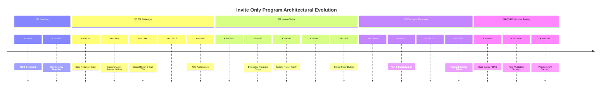

### 6.1 Chronological Evolution Analysis

| Release / Quarter | Jira References | Architectural & Technical Scope | UX / Learner Impact | Status |
|---|---|---|---|---|
| **Q2 (Foundation)** | `KB-453`, `KB-1072` | **Publishing Pipeline De-coupling:** Removed strict CQS scoring checks and curation gates (`KB-453`) so internal departmental cohorts could be published rapidly without general public curation. | Administrative friction reduced; programs published in draft/live cycles without automated CQS blockers. | Prod Deployed |
| **Q3 (CP Redesign)** | `KB-1936`, `KB-1945`, `KB-1946`, `KB-1950`, `KB-1574`, `KB-1575`, `KB-1582`, `KB-1587` | **Taxonomy & Batch Architecture Overhaul:** Introduced explicit "Custom users" selection which stamps `primaryCategory: "Invite Only Program"`. Implemented closed-batch models, user lookup APIs, and UTF-8 bulk CSV ingestion. Established standard TOC layouts on Desktop/Mobile. | Learners gain unified TOC with live progress indicators. Non-invited learners completely blocked from batch join. | Prod Deployed |
| **Q4 (Home Strips & UI Polish)** | `KB-2960`, `KB-2968`, `KB-3756`, `KB-4282`, `KB-4493` | **Unified Invite UX & Homepage Channels:** Replaced split "Add Learner" and "Remove Learner" UI with unified "Manage Invites" modal (`KB-2960`). Added `mdoChannelsBookmarkId` channel strip to surface invite-only programs on homepages. | Coordinators manage invites from a single interface. Learners discover invited programs in a dedicated home strip. | Prod Deployed / In-Progress (`KB-2968`) |
| **Q7 (NLP & ElasticSearch)** | `KB-7869`, `KB-7870`, `KB-7871`, `KB-7872` | **Search Query Masking & Faceting:** Real-time ElasticSearch ingestion with strict access filter queries. Implemented faceted metadata filters (`Content-Type: Invite only Program`, duration, ratings). | Non-invited learners searching keywords cannot view or inspect invite-only cards. Sub-2s query latency. | Prod Deployed |
| **Q8–Q14 (Enterprise Governance)** | `KB-9603`, `KB-13016`, `KB-13017`, `KB-15282` | **User Groups & Scaled Progress Sync:** Integrated cohort assignment with central user groups (`KB-9603`). Bound peer validation surveys (`KB-13016`). Optimized Batch Progress API caching (`KB-15282`) for high-concurrency players. | Seamless consumption of large multi-track programs with automated peer review triggers. | Prod Deployed |

## 7. Previous vs. Redesigned Architecture

### 7.1 Previous Architecture Limitations

Prior to the Content Portal Redesign (`KB-1936`), restricted access was handled through ad-hoc course tagging and manual batch enrollments without strict structural segregation:

- **Taxonomy Conflation:** Programs were treated as generic course collections without a dedicated "Invite Only" access state.
- **Open-Batch Race Conditions:** Programs occasionally published default open batches, allowing non-target learners to enroll before the coordinator restricted access.
- **Dual-Action UI Overhead:** Managing participants required toggling between an "Add Learner" view and a separate "Remove Learner" list, leading to synchronization errors and accidental de-enrollments.
- **Search Leakage:** Programs were indexed into search clusters without evaluating user-level batch rosters, exposing metadata and syllabus details to unauthorized users.

### 7.2 Redesigned Architecture Highlights

The redesigned architecture establishes an end-to-end access gate:

- **Form-Driven Classification:** Selection of "Custom users" in the Angular CP creation form sets metadata fields that enforce closed-batch provisioning in the backend.
- **Batch-Restricted Access Validation:** Sunbird RC / Cassandra database models link learner UUIDs directly to `batchId`. The Course Service blocks content access unless a matching record exists.
- **ElasticSearch Access Token Filtering:** The search service evaluates the incoming JWT token, cross-referencing user batch memberships so restricted programs only appear for provisioned users.

### 7.3 Previous vs. Redesigned Architecture Comparison

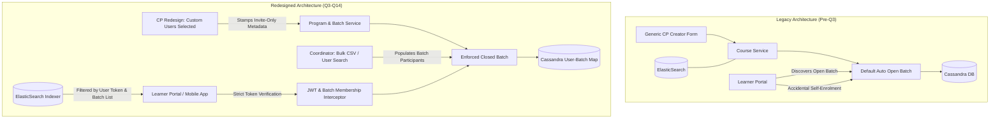

### 7.4 Architectural Component Comparison

| Component | Previous Architecture | Redesigned Architecture (Current) | Improvement / Evidence Reference |
|---|---|---|---|
| **Access Configuration** | Generic toggle or course-level restrictions | Explicit three-way model: `All Users`, `MDO specific`, `Custom users` | `KB_FRS_CP Redesign` §CP_RD_BR1_FR2 |
| **Batch Instantiation** | Auto-generated open batch default | **Closed Batch Only**; open batch strictly prohibited | `KB_FRS_CP Redesign` §CP_RD_BR2_FR1 |
| **Learner Provisioning** | Manual entry per user | Multi-select filters (MDO, Designation, Verified) + **Bulk CSV** | `KB-1946`, `KB_FRS_CP Redesign` |
| **Invite Management UI** | Split "Add Learner" & "Remove Learner" buttons | **Single Unified "Manage Invites" Button** | `KB-2960`, `KB-2968` |
| **Catalog Search** | Unfiltered metadata exposure in general search | **NLP & ElasticSearch Faceted Search** with security masks | `Q7 FRS Search Listing`, `KB-7869` |
| **Consumption Validation** | Client-side route checks | **Server-side JWT Batch Membership Interceptor** | `KB-1950`, `SRS - Karma Programs` §8.2 |

## 8. Program Creation Workflow

Program creation is executed within the Content Portal by an authenticated user with the Content Creator (`content-creator`) role.

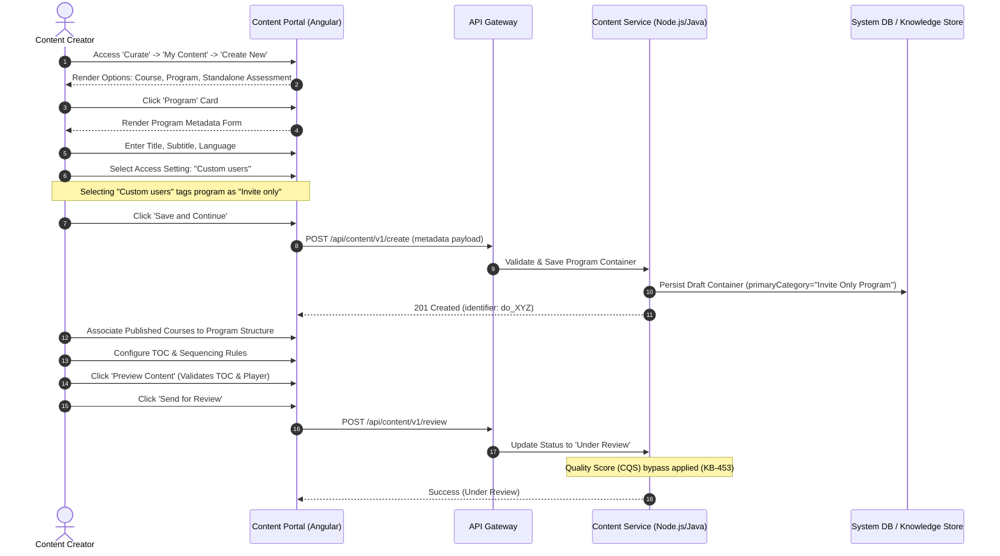

### 8.1 Administrative Rules and Form Validations

1. **Access Setting Mutability:** Once an author selects "Custom users" and saves the initial draft, the program cannot be switched to "All users" or "MDO specific" in subsequent setting tabs. The access model is locked to preserve relational integrity with downstream closed batches (`KB_FRS_CP Redesign` §CP_RD_BR1_FR2).
2. **Sub-Course Eligibility:** Only **Live (Published)** courses can be added into the program container. Draft, expired, or retired courses are rejected by the association validator.
3. **CQS Exemption:** In accordance with `KB-453`, Invite-Only and Curated programs bypass the standard Content Quality Score (CQS) and self-curation evaluation rules required for open public courses.

## 9. Batch Management Workflow

Once an Invite Only Program is reviewed and published (transitioning to `Live`), responsibility shifts to the Program Coordinator (`program-coordinator`).

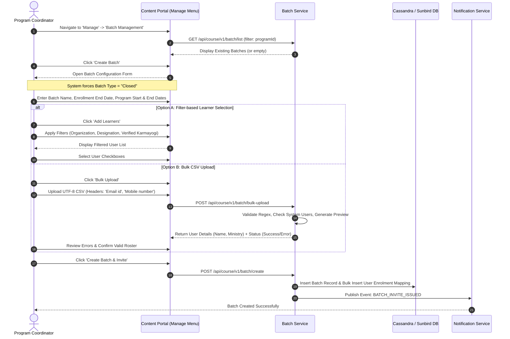

### 9.1 Batch vs. Program Responsibility Matrix

| Attribute / Responsibility | Managed at Program Level | Managed at Batch Level | Authority / Mechanism |
|---|---|---|---|
| **Title, Subtitle, Description** | **Yes** | No | Content Creator (`content-creator`) |
| **Curriculum & Sub-Courses** | **Yes** | No | Content Creator |
| **Access Classification** | **Yes** (`Custom users`) | No | Locked upon program creation |
| **Batch Start & End Date** | No | **Yes** | Program Coordinator (`program-coordinator`) |
| **Enrolment Deadline** | No | **Yes** | Program Coordinator |
| **Learner Roster / Invites** | No | **Yes** | Program Coordinator via Search or CSV |
| **Progress Tracking** | Aggregated across batches | **Yes** (Cohort-level) | Batch Coordinator Dashboard |
| **Post-Consumption De-enrolment** | N/A | **Strictly Prohibited** | Locked once progress > 0% (`KB-1946`) |

## 10. Learner Invitation and Access Management

### 10.1 Bulk CSV Format & Validation Specifications

Under `KB-1946` and `KB_FRS_CP Redesign` §CP_RD_BR2_FR1, bulk learner ingestion requires strict adherence to format validation:

- **Headers (Case-Sensitive):** Exactly `Email id` and `Mobile number`.
- **Encoding:** Standard UTF-8 without Byte Order Mark (BOM); leading/trailing whitespace and control characters are stripped.
- **Auto-Population:** On upload, the backend resolves the records against the Keycloak / User Profile datastore, auto-populating `User Name` and `Ministry Name` in the staging preview.
- **Error Reporting:** Rows failing regex or lacking registered platform profiles generate an downloadable CSV Error Report indicating exact failure reasons.

### 10.2 Access Decision Matrix

The platform enforces access decisions at the API Gateway and service layer:

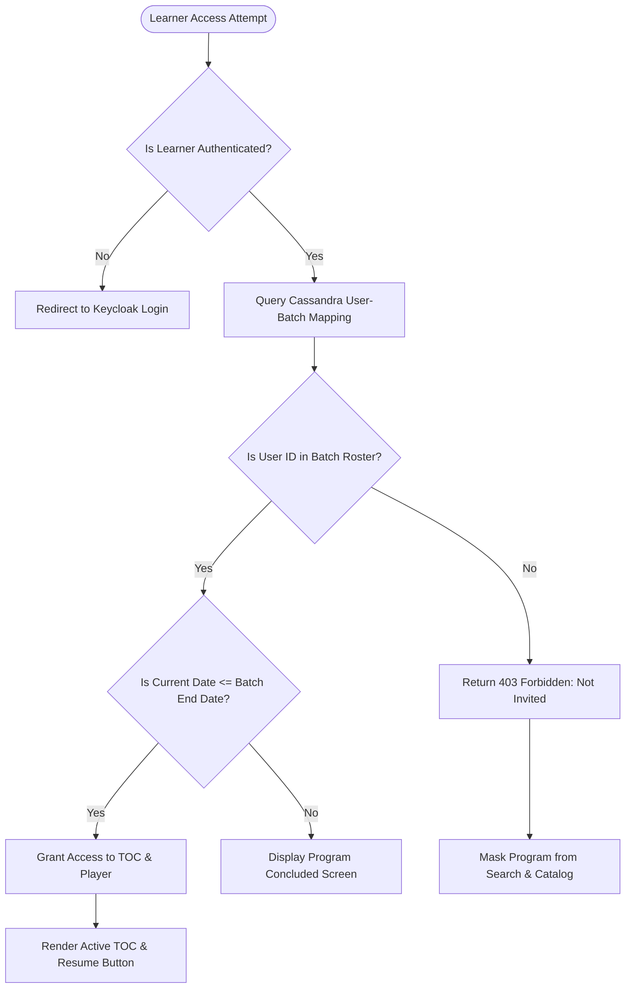

| User Scenario | Program Visibility | Enrolment State | Player Access | Expected Behavior |
|---|---|---|---|---|
| **Invited Learner (Active Batch)** | Visible in "My Programs" / Channel Strip | Automatically Enrolled / Pre-provisioned | **Full Access** | Displays TOC with active "Start" or "Resume" button |
| **Invited Learner (Batch Expired)** | Visible in History / Completed tab | Enrolled (Closed) | **Read-Only / Completed** | TOC visible; player access governed by batch archive rules |
| **Uninvited Authenticated Learner** | **Hidden** in Search, Catalog, and Home | None | **Blocked (403)** | Direct URL access displays "Access Restricted: You are not invited to this program" |
| **Unauthenticated User (Public)** | **Hidden** | None | **Redirect to Login** | Redirected to OAuth2 login; post-login evaluates batch roster |
| **Learner with In-Progress Work** | Visible | Active | **Full Access** | Cannot be removed or uninvited by coordinator (`KB-1946`) |

## 11. Complete Learner Journey – Desktop and Mobile

### 11.1 End-to-End Lifecycle Sequence

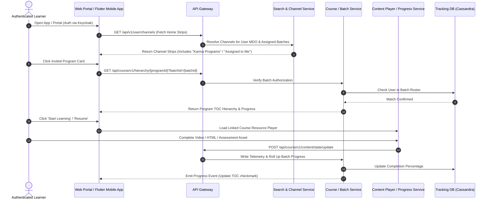

### 11.2 Desktop Experience (`KB-1582`, `KB-4493`)

- **Discovery Strip:** Surfaced under the dedicated "Karma Programs" home strip (driven by `mdoChannelsBookmarkId`) or the "My Learning" dashboard under "Assigned Programs".
- **Table of Contents (TOC) Layout:** Two-column desktop view. Left pane: Program metadata, issuing organization, duration, competency tags, overall progress bar. Right pane: Accordion list of mandatory sub-courses, their component resources, status tags (`Completed`, `In Progress`, `Not Started`), and direct launch triggers.
- **Direct Navigation:** Clicking any sub-course item opens the integrated content player directly with sticky sidebar navigation.

### 11.3 Mobile Experience (`KB-1587`, `KB-4282`, `KB-7870`, `KB-7872`)

- **Responsive / Flutter Architecture:** Implemented in Dart/Flutter with native layout optimizations for Android (v5 to v13) and iOS (v12+).
- **Single-Column Responsive TOC:** Program banner collapse on scroll. Sub-courses rendered as scrollable vertical cards with modular bottom-sheet modals for resource breakdowns.
- **Offline Progress Sync:** Offline completion state is locally queued and securely flushed to `/api/course/v1/content/state/update` via background synchronization workers upon network recovery.

### 11.4 Desktop vs. Mobile Parity Matrix

| Feature | Desktop Web (`KB-1582`) | Mobile App (`KB-1587`, `KB-4282`) | Parity Notes |
|---|---|---|---|
| **Channel Strip Display** | Horizontal scroll carousel with hover cards | Native vertical scroll card carousel | Parity achieved (`KB-4282`, `KB-4493`) |
| **TOC Layout** | Split-pane dual column with sticky sidebar | Single column stacked accordion with bottom sheets | Responsive adaptation |
| **Bulk Invite** **Management** | Full desktop data table with CSV preview | View-only coordinator roster; creation on Web | Intentional operational split |
| **Progress Rollup** | Instant WebSocket/REST polling update | Local SQLite state + asynchronous background flush | Functional equivalence |

## 12. Table of Contents (TOC) and Consumption Experience

### 12.1 TOC Hierarchy and Sub-Course Structure

An Invite Only Program acts as a parent aggregation container (`Course` / `Program` content type) housing multiple linked child courses:

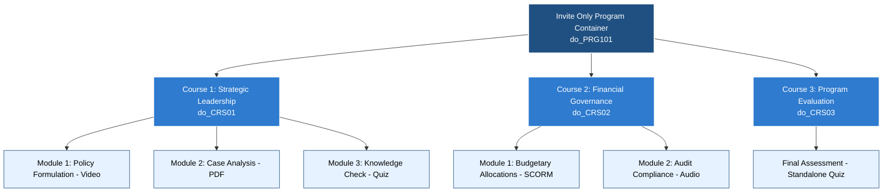

### 12.2 TOC Dynamic State Matrix

| Learner State | TOC Button Display | Progress Indicator | Action Triggered |
|---|---|---|---|
| **New Participant (0% Progress)** | `Start Learning` | `0% Completed` (Grey bar) | Opens Module 1 of first chronological child course |
| **In Progress (1%–99%)** | `Resume` | `XX% Completed` (Blue bar) | Deep-links to exact last-consumed resource asset |
| **All Courses Completed (100%)** | `Download Certificate` | `100% Completed` (Green badge) | Triggers RC Certificate service PDF generation |
| **Locked / Sequential Module** | `Locked` (Padlock icon) | N/A | Inactive until prior prerequisite courses are completed |

## 13. Search, Catalog Filtering and Access Control

### 13.1 ElasticSearch Indexing & NLP Search Pipeline (`Q7 FRS Search Listing`)

Invite Only Programs require specialized filtering to balance discoverability for invitees while preventing unauthorized exposure:

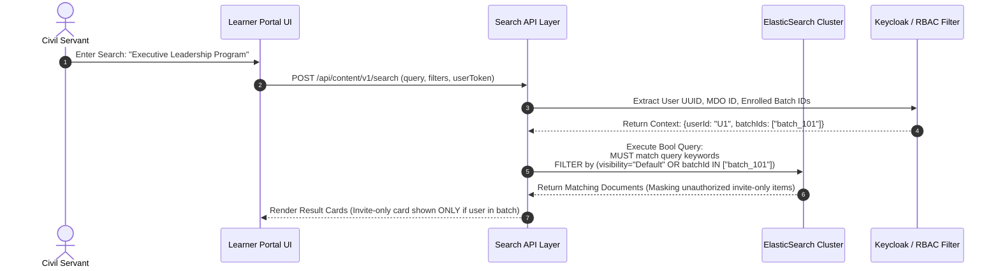

### 13.2 Faceted Catalog Filters (`KB-7871`, `KB-7872`)

Under `REQ-4.1` of `Q7 FRS Search Listing`, the catalog exposes structured facets:

- **Content-Type Filter:** Supports `Course`, `Curated Program`, `Blended Program`, `Invite only Program`, `Standalone Assessment`, and `Moderated Program`.
- **Dynamic Content Count:** Facet counts dynamically reflect only the items the requesting user is legally permitted to see. An uninvited learner will see `Invite only Program (0)` even if several live invite-only programs exist on the platform.

## 14. Complete System Interaction and Component Architecture

The end-to-end ecosystem integrates six core service layers:

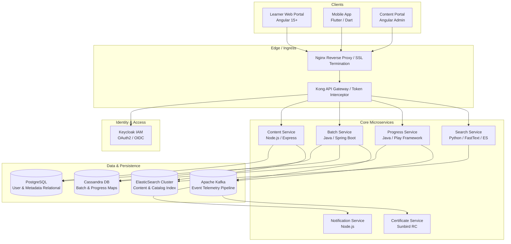

## 15. API and Service Integration Specifications

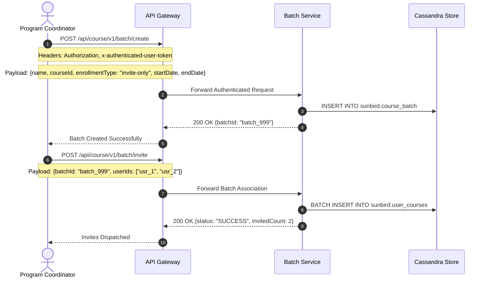

### 15.1 Core API Specifications

| Endpoint | Method | Source Service | Request Payload Highlights | Response | Purpose |
|---|---|---|---|---|---|
| `/api/content/v1/create` | `POST` | Content Service | `{"name": "...", "primaryCategory": "Invite Only Program", "accessSettings": {"userAccess": "custom"}}` | `{"identifier": "do_..."}` | Creates initial program container |
| `/api/course/v1/batch/create` | `POST` | Batch Service | `{"courseId": "do_...", "name": "Batch A", "enrollmentType": "invite-only", "startDate": "...", "endDate": "..."}` | `{"batchId": "..."}` | Instantiates mandatory closed batch |
| `/api/course/v1/batch/bulk-upload` | `POST` | Batch Service | Multipart Form (`file: learners.csv`) | `{"total": 100, "success": 98, "errors": [...]}` | Validates and parses bulk CSV user roster |
| `/api/course/v1/batch/invite` | `POST` | Batch Service | `{"batchId": "...", "userIds": ["...", "..."]}` | `{"status": "SUCCESS"}` | Commits participants to Cassandra batch table |
| `/api/course/v1/hierarchy/{id}` | `GET` | Course Service | Headers: `x-authenticated-user-token`, Query: `batchId` | Full JSON hierarchy + completion rollup | Retrieves authorized TOC structure |
| `/api/course/v1/content/state/update` | `PATCH` | Progress Service | `{"request": {"contents": [{"contentId": "...", "status": 2}]}}` | `{"response": "SUCCESS"}` | Telemetry flush logging asset completion |

## 16. Data Model and Entity Relationships

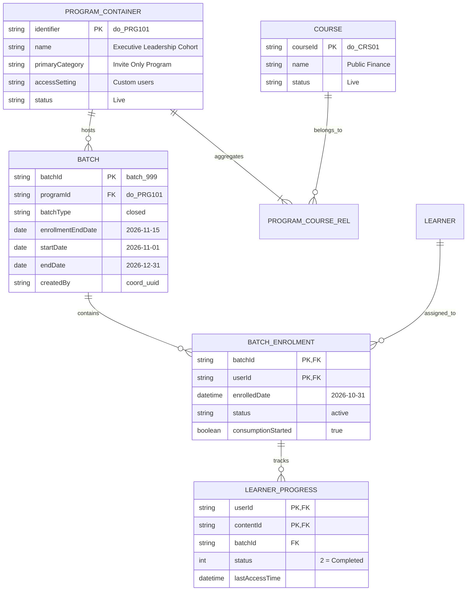

## 17. Feature Dependency and Integration Mapping

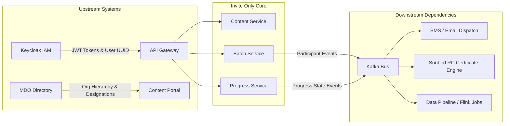

### 17.1 Dependency Matrix

| Dependency Component | Functional Purpose | Integration Type | Criticality | Fallback Behavior if Unavailable |
|---|---|---|---|---|
| **Keycloak IAM** | Authenticates users; passes user token & claims | Synchronous (REST/JWT) | **Mandatory** | 401 Unauthorized; platform access blocked |
| **Cassandra DB** | High-throughput batch enrollment & progress maps | Synchronous (Driver) | **Mandatory** | Read/write failure on TOC & Player progress |
| **ElasticSearch** | Catalog indexing and faceted search queries | Synchronous (REST) | **High** | Catalog search disabled; direct URL / Home strip only |
| **Kafka Pipeline** | Async telemetry stream for completion & certs | Asynchronous (Producer) | **Medium** | Event queued locally; delayed certificate dispatch |
| **Notification Engine** | Sends email & SMS alerts upon invitation | Asynchronous (Consumer) | **Low** | Silent enrollment; learner discovers via Home strip |

## 18. Operational Enhancements and Additional Stories

### 18.1 Single Button for Managing User Invites (`KB-2960`, `KB-2968`)

- **Operational Problem:** Coordinators previously had to manage user additions and deletions across two separate screens, leading to UI clutter, accidental removals, and confusion over final batch rosters.
- **Delivered Solution:** Consolidated into a single unified **"Manage Invites"** modal on the Batch Details view (`KB-2968`). The interface integrates search, multi-filter selection, bulk CSV upload, and current roster management with active status badges.
- **Safety Lock Mechanism:** Implemented backend validation blocking the removal of any learner whose `consumptionStarted` flag is `true` or whose progress is greater than zero (`KB-1946`).

### 18.2 Progress API Caching Optimization (`KB-15282`)

- **Operational Problem:** High-concurrency launches of multi-course invite-only cohorts produced read-heavy spikes on Cassandra during TOC loading and progress rollups.
- **Delivered Solution:** Introduced multi-tier Redis caching with invalidation triggers bound to Kafka telemetry progress events, reducing TOC fetch latency from >3.5s to <800ms.

## 19. Business Rules and Exception Scenarios

### 19.1 Exception Handling Matrix

| Scenario | Trigger / Cause | System Validation | Expected System Behavior | End-User Message |
|---|---|---|---|---|
| **Uninvited Direct Access** | User clicks a shared link to an Invite-Only program | Gateway checks user ID against `sunbird.user_courses` | 403 Forbidden emitted; payload suppressed | *"This is an exclusive invite-only program. You do not have an active invitation."* |
| **Batch Enrollment Expired** | User accesses program after `enrollmentEndDate` | Validates `currentDate > batch.enrollmentEndDate` | Prevents new batch registrations | *"Enrollment for this cohort closed on [Date]."* |
| **Malformed Bulk CSV** | Admin uploads CSV missing required headers | CSV parser validates exact case-sensitive headers | Upload rejected immediately; transaction aborted | *"Invalid file format. Please* *use the provided template with 'Email id' and 'Mobile number'."* |
| **Attempt to Remove Active Learner** | Admin attempts to uninvite learner who has consumed content | Backend evaluates `user_courses.status > 0` | Deletion rejected; UI displays disabled trash icon | *"Learners who have commenced consumption cannot be removed from the batch."* |
| **Sub-Course Unavailability** | A linked child course is retired after program publication | TOC loader checks status of child identifiers | Displays module with inactive state; alerts coordinator | *"This module is currently undergoing administrative maintenance."* |

## 20. Security, Performance and Non-Functional Requirements

### 20.1 Security Architecture

- **Strict Role-Based Access Control (RBAC):** Content creation requires `CONTENT_CREATOR`; batch provisioning requires `PROGRAM_COORDINATOR` or `SPV_ADMIN`.
- **Zero Trust Direct Link Protection:** Bypassing the UI catalog by acquiring a direct URL (`/app/toc/do_...`) is ineffective. The Course Service validates batch membership before returning course hierarchy or content streaming URLs.
- **Data Privacy:** Bulk CSV ingestion processes and stores PII (Email, Mobile) in encrypted transit (TLS 1.3) and validates compliance with OWASP Top 10 standards.

### 20.2 Performance Benchmarks

- **Search Response Time:** Sub-2 seconds query response for 95% of queries under peak loads (`Q7 FRS Search Listing`).
- **Concurrent Capacity:** Architected to support **25,000 concurrent learners** across Web and Mobile during national mission drives without progress degradation (`SRS - Karma Programs` §9.2).
- **Bulk Ingestion Throughput:** Asynchronous ingestion of up to 5,000 participants per CSV batch with validation completed in under 30 seconds.

## 21. Requirements vs. Implementation Gap Analysis

| Capability / Requirement | Baseline Source | Expected Behavior | Actual Implemented State | Gap Analysis / Findings | Implementation Status |
|---|---|---|---|---|---|
| **"Custom users" Tagging** | `KB_FRS_CP Redesign` §CP_RD_BR1_FR2 | Selecting "Custom users" tags program as "Invite only" | Fully verified in CP creation form and metadata persistence | None; functional parity confirmed | **Fully Implemented** |
| **Closed-Batch Mandate** | `KB_FRS_CP Redesign` §CP_RD_BR2_FR1 | Only closed batches permitted; open batch disallowed | Prohibits open batch creation in UI and rejects via API | None | **Fully Implemented** |
| **Bulk CSV User Upload** | `KB-1946`, `KB_FRS_CP Redesign` | Ingestion of Email & Mobile; error report download | Fully operational with UTF-8 format enforcement | Edge cases in non-standard country code formatting | **Fully Implemented** |
| **Single Invite Button** | `KB-2960`, `KB-2968` | Single consolidated button for user invite management | Front-end consolidated view deployed across major flows | Legacy interfaces in older deployment guides | **Partially Implemented** |
| **Search Masking** | `Q7 FRS Search Listing` | Non-invited users cannot see program in search | Search filters out records unless user token matches batch | Rare query leakage if indexing job lags live publish | **Fully Implemented** |
| **Competency** **Mapping** | `KB-1072` | Automated competency framework extraction | Operational data scripts utilized; automated UI pending | Manual ad-hoc ETL scripts required for extraction | **Partially** **Implemented** |
| **Progress API Caching** | `KB-15282` | Distributed caching for TOC and player state | Redis-backed caching deployed for TOC read flows | High write contention on multi-course completion bursts | **Fully Implemented** |

## 22. Feature Maturity and Evolution Scorecard

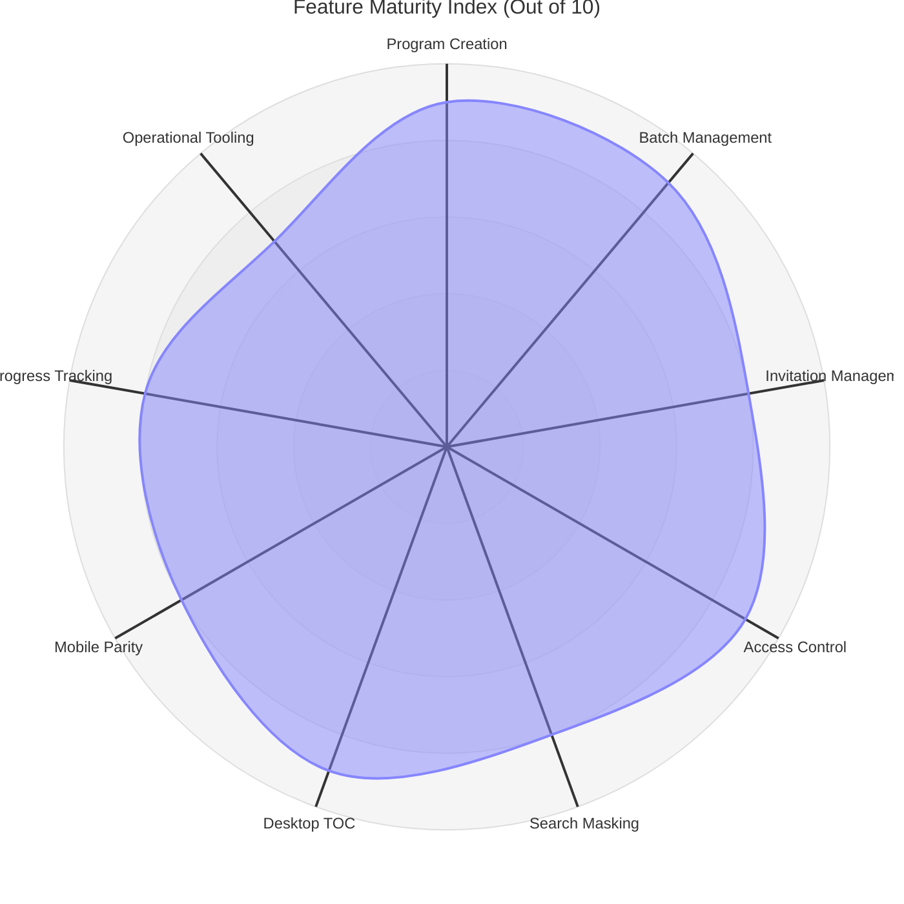

### Scorecard Evaluations

- **Program Creation (9/10):** Mature form workflows in Content Portal Redesign; clear validation rules, automated category stamping, and CQS exemption handling.
- **Batch Management (9/10):** Enforced closed-batch logic prevents accidental public leakages; solid scheduling constraints.
- **Invitation Management (8/10):** Robust bulk CSV and filter-based user lookup; slight operational friction remains during large-scale re-invitations.
- **Access Control & Security (9/10):** Defense-in-depth enforcement at Gateway, Course Service, and ElasticSearch layers.
- **Search & Catalog Masking (8/10):** Fast sub-2s query evaluation; dependent on real-time ElasticSearch indexing synchronization.
- **Desktop & Mobile Consumption (8.5/10):** Unified TOC responsive layouts; reliable offline-to-online progress synchronization.

## 23. Consolidated End-to-End Workflow

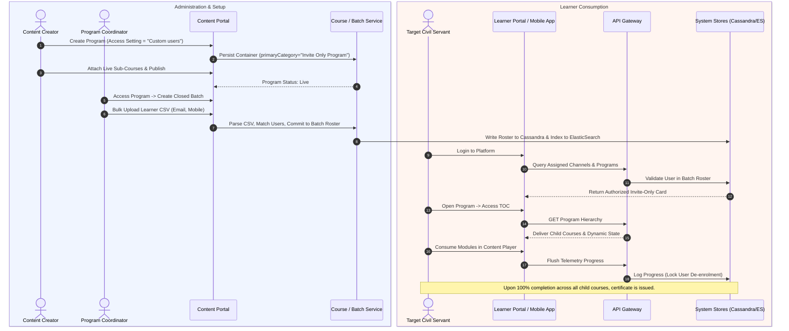

## 24. Key Findings, Architectural Risks, and Recommendations

### 24.1 Key Findings

1. **Architectural Cohesion:** The Content Portal Redesign (`KB-1936`) established a clean architectural separation between open public learning and restricted administrative programs by anchoring the classification to form access settings.
2. **Data Integrity Guardrails:** Restricting user removal once consumption has begun (`KB-1946`) successfully safeguards government training compliance audits and prevents accidental record deletions.
3. **Multi-Platform Parity:** Core TOC and consumption parity between Angular Web (`KB-1582`) and Flutter Mobile (`KB-1587`, `KB-4282`) ensures uniform access for field officers.

### 24.2 Architectural Risks & Mitigations

- **Risk 1: Bulk CSV Identity Mismatch:** If an official registers with an alternate personal email not captured in government records, bulk CSV lookup fails.
  - *Mitigation:* Enhance ingestion logic to support Aadhaar-linked Karmayogi ID or Government Employee Code (GEC) as alternate unique primary keys.

- **Risk 2: Heavy TOC Progress Aggregation Spikes:** Concurrently opening 20-course programs during large batch launches places heavy strain on Cassandra row reads.
  - *Mitigation:* Ensure Redis cache warm-up occurs asynchronously when batch invitation notifications are dispatched.
