# Invite-Only Program — Low-Level Design (LLD) Specification

### 1.2 Design Scope and Objectives

This document provides the detailed, class-level, sequence-level, state-transition, and data-access design for the **Invite Only Program** across the iGOT Karmayogi digital learning infrastructure. It focuses strictly on system structures, behavioral models, architectural patterns, schemas, and algorithms without presenting raw programming language source code.

## 2. Low-Level Component Architecture & Detailed Class Designs

### 2.1 Content Service: Program Authoring & CQS Bypass Pipeline

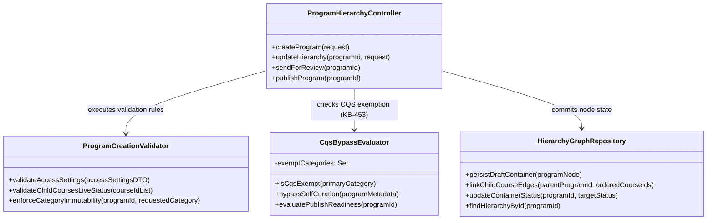

#### Detailed Class Specifications

1. `ProgramHierarchyController`
  - **Role:** REST Controller exposing administrative authoring actions within the Content Portal.
  - **Key Operations:**
    - `createProgram(request)`: Ingests the initial program metadata container, triggers validation, and assigns a unique platform identifier (`do_...`).
    - `updateHierarchy(programId, request)`: Connects published child courses into an ordered sequential curriculum.
    - `sendForReview(programId)`: Triggers lifecycle evaluation and routes the program to the review state.
    - `publishProgram(programId)`: Moves the program container to `Live` status and indexes it into the search cluster.

2. `ProgramCreationValidator`
  - **Role:** Enforces data integrity and business invariants during program authoring (`KB-1945`).
  - **Key Operations:**
    - `validateAccessSettings(accessSettingsDTO)`: Checks that `userAccess` is set to `"custom"`. Rejects any payload setting it to `"all"` or `"mdo"`.
    - `validateChildCoursesLiveStatus(courseIdList)`: Queries the content store to ensure all child courses are published and `Live`. Blocks draft, retired, or expired items.
    - `enforceCategoryImmutability(programId, requestedCategory)`: Prevents changing an established `Invite Only Program` container to another category.

3. `CqsBypassEvaluator`
  - **Role:** Evaluates whether content quality linting is required (`KB-453`).
  - **Key Operations:**
    - `isCqsExempt(primaryCategory)`: Returns `true` if `primaryCategory` is `"Invite Only Program"` or `"Curated Program"`.
    - `bypassSelfCuration(programMetadata)`: Bypasses standard self-curation checklists and marks quality evaluation as waived for internal and restricted cohorts.

### 2.2 Batch Management Service: Closed Batches & Roster Ingestion

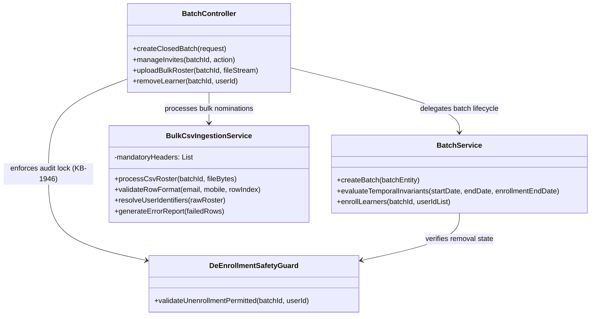

#### Detailed Class Specifications

1. `BatchController`
  - **Role:** REST interface for Program Coordinators to configure cohorts, upload rosters, and inspect participant status (`KB-2960`, `KB-2968`).
  - **Key Operations:**
    - `createClosedBatch(request)`: Instantiates a cohort where `enrollmentType` is locked to `"invite-only"`.
    - `manageInvites(batchId, action)`: Unified endpoint for adding and removing participants from an active cohort.
    - `uploadBulkRoster(batchId, fileStream)`: Receives multi-part CSV uploads and routes them to asynchronous background workers.
    - `removeLearner(batchId, userId)`: Evaluates eligibility and deletes unstarted nominations.

2. `BulkCsvIngestionService`
  - **Role:** Multi-threaded asynchronous parsing and identity resolution engine (`KB-1946`).
  - **Key Operations:**
    - `processCsvRoster(batchId, fileBytes)`: Validates UTF-8 encoding, ensures presence of case-sensitive headers (`Email id`, `Mobile number`), parses records, and resolves user accounts against the national directory.
    - `generateErrorReport(failedRows)`: Creates a downloadable CSV detailing row-by-row syntax errors and unregistered identifiers.

3. `DeEnrollmentSafetyGuard`
  - **Role:** Enforces the anti-tamper consumption lock protecting national training records (`KB-1946`).
  - **Key Operations:**
    - `validateUnenrollmentPermitted(batchId, userId)`: Queries the participant tracking table. If `consumptionStarted` is `true` or progress is greater than , it blocks the removal request and raises an exception.

### 2.3 Search & Discovery Service: Query-Time Interceptors & Facet Aggregators

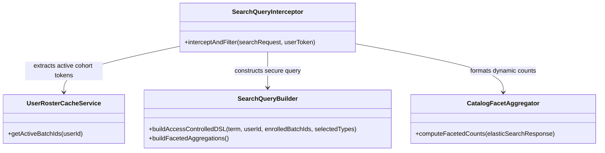

#### Detailed Class Specifications

1. `SearchQueryInterceptor`
  - **Role:** Intercepts incoming search and catalog listing requests at the gateway boundary.
  - **Key Operations:**
    - `interceptAndFilter(searchRequest, userToken)`: Extracts user claims from the verified JWT, retrieves active batch IDs, and applies access constraints before querying the index.

2. `SearchQueryBuilder`
  - **Role:** Assembles ElasticSearch boolean DSL queries that prevent catalog leakage (`KB-7869`, `KB-7870`).
  - **Key Operations:**
    - `buildAccessControlledDSL(...)`: Injects an access filter requiring that matching documents either have public visibility (`userAccess = "all"`) or belong to an Invite Only Program whose batch ID matches one of the user's active batch enrollments.
    - `buildFacetedAggregations()`: Configures aggregation buckets for content-type facets (`KB-7871`, `KB-7872`).

### 2.4 Progress Service: Hierarchical Rollup & Telemetry Engine

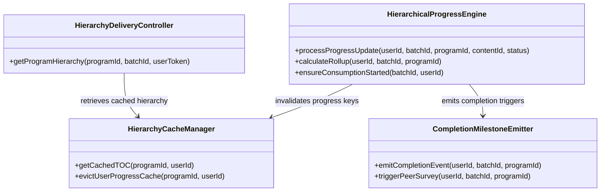

#### Detailed Class Specifications

1. `HierarchicalProgressEngine`
  - **Role:** Ingests atomic content player telemetry and computes progress rollups across courses and program containers (`KB-1950`).
  - **Key Operations:**
    - `processProgressUpdate(...)`: Commits leaf progress, flips the `consumptionStarted` audit flag to `true`, and calculates composite progress across child courses.
    - `calculateRollup(...)`: Evaluates percentage completion across all mandatory leaf resources and child courses.

2. `HierarchyCacheManager`
  - **Role:** Manages the multi-tier Redis cache cluster to sustain high-concurrency loads (`KB-15282`).
  - **Key Operations:**
    - `getCachedTOC(programId, userId)`: Fetches pre-computed structural hierarchy and merges active user progress, returning responses with .
    - `evictUserProgressCache(programId, userId)`: Invalidates user progress cache keys upon receiving telemetry events.

## 3. End-to-End Dynamic Interaction & Sequence Models

### 3.1 Subsystem Sequence 1: Program Authoring & Publishing

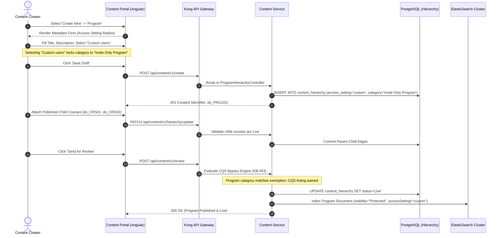

### 3.2 Subsystem Sequence 2: Closed Batch Creation & Bulk Ingestion

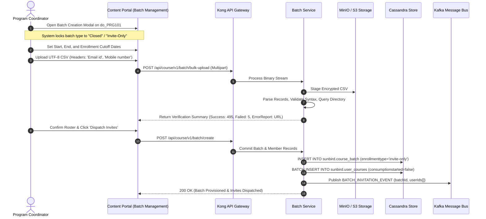

### 3.3 Subsystem Sequence 3: Zero-Leakage Search & Direct Access Guard

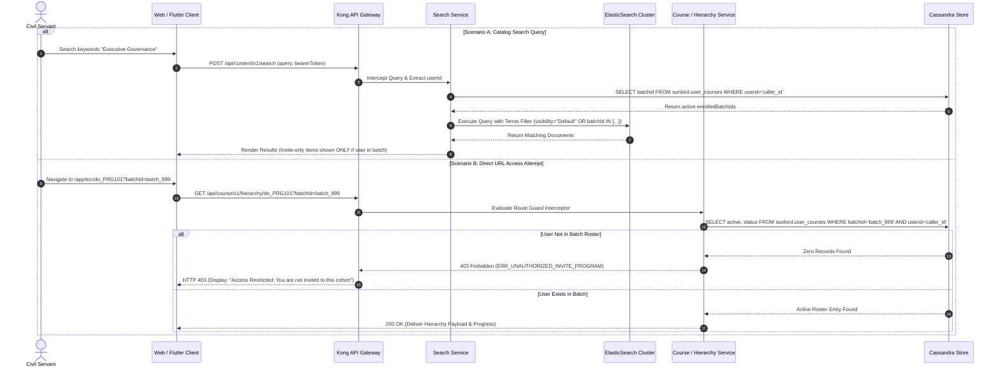

### 3.4 Subsystem Sequence 4: Curriculum Consumption, Telemetry & Certification

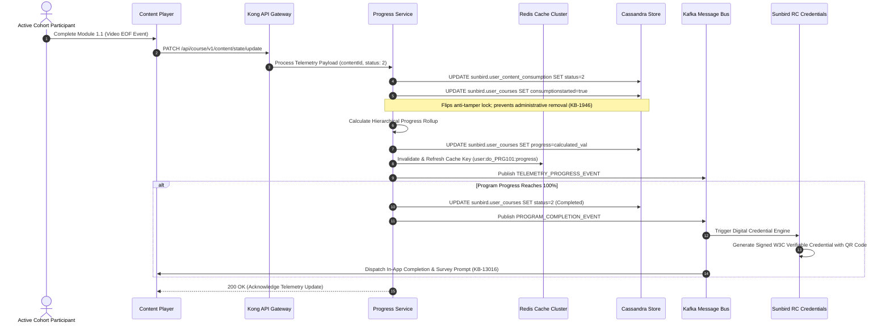

## 4. Frontend Architecture & User Interface Design

### 4.1 Angular 15+ Micro-Frontend Architecture (Desktop Web)

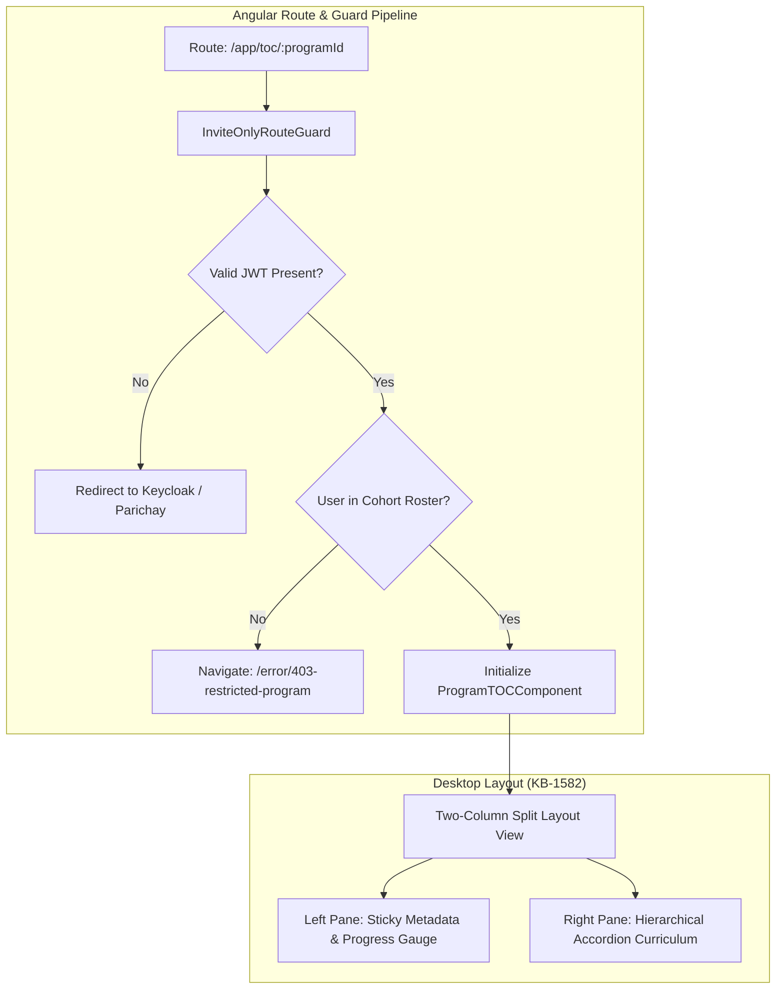

#### Detailed Layout Specifications

- **Left Column (35% Width - Sticky):**
  - Displays parent program banner, issuing MDO badge, duration, and competency chips.
  - Embeds the composite cohort progress gauge ().
  - Dynamic CTA Button states:
    - If Progress `Start Program`
    - If `Resume Learning` (deep-links directly to the last active resource)
    - If Progress `Download Certificate`

- **Right Column (65% Width - Scrollable):**
  - Displays sequential child courses as expandable accordion containers.
  - Expanding a child course exposes its underlying video, PDF, SCORM, and assessment resources with completion status badges.

### 4.2 Flutter Mobile Application Architecture (Mobile App & M-Site)

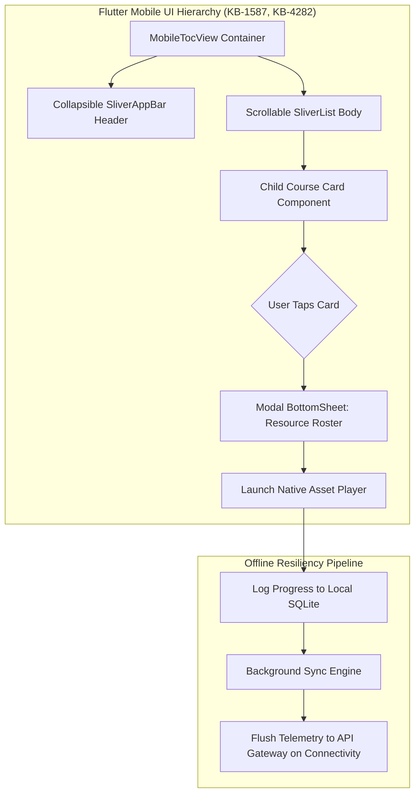

#### Detailed Mobile Specifications

- **Viewport Adaptations:** Responsive single-column layout optimized for Android and iOS form factors.
- **Header Collapse:** Program banner collapses into a compact sticky navigation bar upon downward scrolling.
- **Modular Bottom Sheets:** Tapping a child course opens a native bottom sheet displaying lesson resources, asset durations, and individual completion checkmarks.
- **Offline Telemetry Queuing:** Telemetry generated in low-connectivity environments queues locally in SQLite and pushes via exponential backoff once network connectivity is restored.

## 5. Low-Level Database Access Models & Storage Schemas

### 5.1 Cassandra Multi-Cluster Schemas & Partition Key Strategies

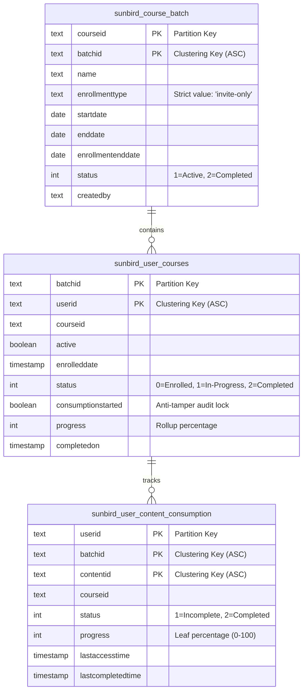

#### Query Execution Mechanics & Partition Routing

1. **Roster Membership Verification Query:**
  - **Target:** `sunbird.user_courses`
  - **Filter:** `WHERE batchid = ? AND userid = ?`
  - **Execution Plan:** Directly targets partition `batchid` and executes a binary search on clustering key `userid`. Avoids wide-partition scans; .

2. **Consumption Anti-Tamper Check & Flag Flip:**
  - **Target:** `sunbird.user_courses`
  - **Update Logic:** Evaluates `consumptionstarted`. If `false`, updates `consumptionstarted = true` alongside progress mutations.

3. **Leaf Progress Commit:**
  - **Target:** `sunbird.user_content_consumption`
  - **Filter:** `WHERE userid = ? AND batchid = ? AND contentid = ?`
  - **Execution Plan:** Direct partition write targeting `userid`, clustered by `(batchid, contentid)` with `LOCAL_QUORUM` consistency.

### 5.2 Redis Distributed Caching Architecture (`KB-15282`)

**Multi-Tier Redis Key Topologies & Lifecycle Policies**

| | 1. Structural Program TOC Cache | 2. User Cohort Progress Cache |
|---|---|---|
| Key Format | `program:{programId}:hierarchy:v{version}` | `user:{userId}:prog:{programId}:progress` |
| Content | Compressed JSON tree structure of program container and child courses. | Aggregated progress percentage integer (0 to 100). |
| TTL | 86,400 Seconds (24 Hours) | 14,400 Seconds (4 Hours) |
| Invalidation Policy | Program Publisher publishes a new structural version. | Progress Service consumes a valid telemetry state update event. |

## 6. Interface Contracts & Communication Protocols

### 6.1 RESTful Endpoint Specifications

#### 1. Bulk CSV Learner Roster Ingestion

- **Endpoint:** `POST /api/course/v1/batch/bulk-upload`
- **Transport:** HTTPS / TLS 1.3
- **Content-Type:** `multipart/form-data`
- **Authentication:** `Bearer <JWT>`, `x-authenticated-user-token: <JWT>`
- **Parameters:** `batchId` (form field), `file` (binary stream, `.csv`)
- **CSV Format Contract:**
  - Strict UTF-8 encoding.
  - Mandatory headers: `Email id,Mobile number`.

- **Success Response** (`200 OK`):
  - Returns JSON containing total records parsed, count of successfully staged users, count of failed records, and a pre-signed URL to a downloadable error report if failures occurred.

- **Error Response** (`400 Bad Request`):
  - Triggered when mandatory headers are missing or misspelled (`ERR_BULK_CSV_SCHEMA_INVALID`).

#### 2. Program Hierarchy with Batch Access Guard

- **Endpoint:** `GET /api/course/v1/hierarchy/{programId}?batchId={batchId}`
- **Authentication:** Valid session Bearer token.
- **Response Behaviors:**
  - **200 OK:** User is an active member of the specified batch. Returns the structured program tree, child course nodes, and computed user progress percentages.
  - **403 Forbidden:** User is not in the cohort roster. Body returns `ERR_UNAUTHORIZED_INVITE_PROGRAM`, and access to child course nodes is withheld.

### 6.2 Asynchronous Kafka Event Contracts

**Kafka Topic Architecture & Message Contracts**

| Topic | Partition Key | Payload Schema | Downstream Consumers |
|---|---|---|---|
| 1. `karmayogi.batch.invitation` | `batchId` | `{ batchId: string, programId: string, userIds: string[], timestamp: number }` | Notification Service (SMS / Email), ElasticSearch Index Synchronizer |
| 2. `karmayogi.telemetry.progress` | `userId` | `{ userId: string, batchId: string, programId: string, progress: number }` | Redis Cache Invalidation Worker, Platform Analytics Engine (Flink) |
| 3. `karmayogi.program.completion` | `userId` | `{ userId: string, batchId: string, programId: string, completedOn: string }` | Sunbird RC Certificate Generator, MDO/SPV Peer Survey Dispatcher |

## 7. Business Rules, State Transitions & Exception Handling

### 7.1 Program & Batch State Transitions

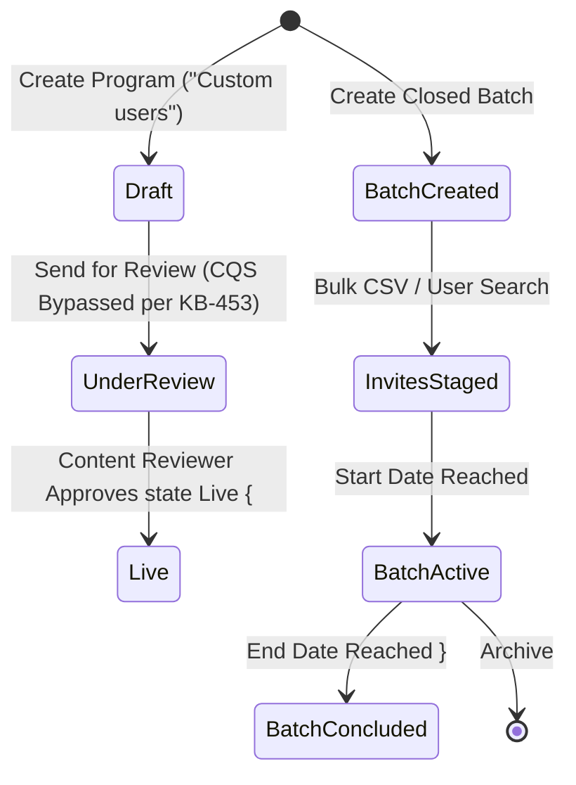

### 7.2 Exception Handling Catalog

| Exception Code | HTTP Status | Trigger Condition | System Handling & Recovery Action |
|---|---|---|---|
| `ERR_INVALID_ACCESS_SETTING` | `400` | Author attempts to create an Invite Only Program without `userAccess: "custom"`. | Aborts transaction; highlights invalid form control in Angular UI. |
| `ERR_CATEGORY_IMMUTABLE` | `409` | Author attempts to change `primaryCategory` away from `"Invite Only Program"`. | Blocks update; returns existing metadata state. |
| `ERR_CANNOT_REMOVE_ACTIVE_LEARNER` | `409` | Coordinator attempts to delete a participant whose progress is (`KB-1946`). | Rejects deletion query; preserves Cassandra row; renders warning modal in UI. |
| `ERR_UNAUTHORIZED_INVITE_PROGRAM` | `403` | Uninvited user attempts direct URL access to `/api/course/v1/hierarchy/*`. | Suppresses structural payload; emits security audit log; renders 403 route view. |
| `ERR_BULK_CSV_SCHEMA_INVALID` | `400` | CSV upload lacks case-sensitive headers `Email id` and `Mobile number`. | Aborts ingestion stream; returns schema error details to client. |
| `ERR_BATCH_ENROLLMENT_EXPIRED` | `422` | Attempt to enroll a learner after the recorded `batch.enrollmentEndDate`. | Blocks association; prompts coordinator to adjust enrollment deadline. |

## 8. Requirements Traceability Matrix (RTM)

| Requirement ID | Jira Reference | Low-Level Component / Handler | Target Storage / Table | Verification Strategy |
|---|---|---|---|---|
| **REQ-CREAT-01** | `KB-1945` | `ProgramHierarchyController`, `ProgramCreationValidator` | PostgreSQL `content_hierarchy` | Controller unit & form validation tests |
| **REQ-CQS-BYPASS** | `KB-453` | `CqsBypassEvaluator` | N/A (State transition waiver) | Integration test on review state transition |
| **REQ-BATCH-01** | `KB-1946` | `BatchController`, `BatchService` | Cassandra `sunbird.course_batch` | API contract test verifying closed batch lock |
| **REQ-BULK-02** | `KB-1946` | `BulkCsvIngestionService` | S3 buffer & Cassandra `user_courses` | Concurrency test with 5,000-row CSV upload |
| **REQ-UX-UNIFY** | `KB-2960`, `KB-2968` | `BatchController`, Angular Modal Component | Cassandra `user_courses` | Cypress UI end-to-end test on unified modal |
| **REQ-LOCK-01** | `KB-1946` | `DeEnrollmentSafetyGuard` | Cassandra `user_courses` | Invariant test blocking active user removal |
| **REQ-SRCH-MASK** | `KB-7869`, `KB-7870` | `SearchQueryInterceptor`, `SearchQueryBuilder` | ElasticSearch catalog index | Automated query test verifying zero discovery leakage |
| **REQ-CAT-FACET** | `KB-7871`, `KB-7872` | `CatalogFacetAggregator` | ElasticSearch aggregations | API functional test asserting facet count equals 0 |
| **REQ-TOC-DESK** | `KB-1582` | `DesktopTocComponent` (Angular) | Redis cache & Cassandra store | Visual regression and layout verification tests |
| **REQ-TOC-MOBL** | `KB-1587`, `KB-4282` | `MobileTocView` (Flutter Bloc) | SQLite cache & Gateway APIs | Native mobile driver automation tests |
| **REQ-PERF-01** | `KB-15282` | `HierarchyCacheManager`, `HierarchicalProgressEngine` | Redis cluster (`user:prog:progress`) | Distributed load test () |
| **REQ-SURV-TRIG** | `KB-13016`, `KB-13017` | `CompletionMilestoneEmitter` | Kafka topic `karmayogi.program.completion` | Kafka consumer integration test |
