# Invite-Only Program — Software Design Description (SDD)

### 1.3 System Overview & Design Purpose

This Software Design Description (SDD) specifies the technical architecture, microservice decomposition, internal data structures, UML sequence models, interface contracts, and low-level data access patterns for the **Invite Only Program** feature on the iGOT Karmayogi platform.

The system addresses the end-to-end lifecycle across:

1. **Administrative Creation & Curation:** Authoring in the Content Portal (CP), "Custom users" taxonomy classification, sub-course association, and automated quality score (CQS) waiver.
2. **Batch Governance & Learner Allocation:** Closed batch instantiation, calendar window enforcement, directory user search, UTF-8 CSV ingestion, and consumption-state deletion locking.
3. **Discovery & Access Governance:** Multi-layer defense-in-depth isolation across API Gateways, Keycloak IAM, ElasticSearch query-time security filters, and homepage channel bookmarking.
4. **Curriculum Delivery & Consumption:** Responsive two-column (Desktop) and single-column (Mobile Flutter) Table of Contents (TOC), unified content player orchestration, telemetry aggregation, and verifiable digital credential generation.

## 2. Architectural Design & System Decomposition

### 2.1 Layered Architecture Overview

The platform enforces a layered, microservices-driven architecture with zero-trust validation at the perimeter:

```mermaid
flowchart TD
    subgraph PL["Presentation Layer"]
        P1["Content Portal (Angular 15+ Admin SPA)"]
        P2["Learner Web Portal (Angular 15+ Micro-frontends)"]
        P3["Learner Mobile Client (Dart / Flutter Cross-Platform Engine)"]
    end
    subgraph GW["Ingress, API Gateway & Security Perimeter"]
        G1["AWS Application Load Balancer / Nginx Edge Proxy"]
        G2["Kong API Gateway (OAuth2 Token Verification, Rate Limiting, Route Guard Interceptors)"]
        G3["Keycloak IAM (OIDC Claims, Role RBAC: CONTENT_CREATOR, PROGRAM_COORDINATOR, PUBLIC)"]
    end
    subgraph CORE["Core Microservices Layer"]
        C1["Content Service (Node.js / Express)<br/>Taxonomy & Hierarchy Graph Engine<br/>CQS Bypass Middleware (KB-453)"]
        C2["Batch Management Service (Java / Spring Boot)<br/>Closed Cohort & Scheduling Controller<br/>User Allocation & Bulk CSV Parsing Engine (KB-1946)"]
        C3["Progress Service (Java / Play)<br/>Telemetry Aggregator (KB-1950)<br/>Multi-Tier Progress Cache Engine"]
        C4["Search & Discovery Service (Python / FastText / ES)<br/>Query Interceptor & Token Extraction<br/>Access-Controlled ES Query Builder (KB-7869)"]
        C5["Certificate Service (Sunbird RC)<br/>W3C Credential Generator & Signer"]
        C6["Peer Validation Service (Node.js)<br/>MDO / SPV Survey Trigger Engine (KB-13016)"]
    end
    subgraph DATA["Data Persistence, Streaming & Caching Layer"]
        D1[("Apache Cassandra 4.x: Batch definitions (course_batch), user rosters (user_courses),<br/>and leaf consumption maps (user_content_consumption).")]
        D2[("PostgreSQL 14+: Relational container definitions, access control settings, MDO structures.")]
        D3[("Redis Multi-Cluster: Distributed read cache for TOC hierarchy and rollup progress (KB-15282).")]
        D4[("ElasticSearch 8.x: Full-text search and catalog indexes with access filter queries.")]
        D5[("Apache Kafka 3.x: Distributed event bus (telemetry.assess, batch.invitation, survey.event)")]
        D6[("MinIO / AWS S3: Encrypted staging storage for bulk CSV uploads and error logs.")]
    end
    PL -->|"HTTPS / TLS 1.3"| GW
    GW -->|"mTLS / Internal API Routing"| CORE
    CORE --> DATA
```

## 3. Detailed Component & Class Designs

### 3.1 Content Portal Authoring & Program Packaging (`Content Service`)

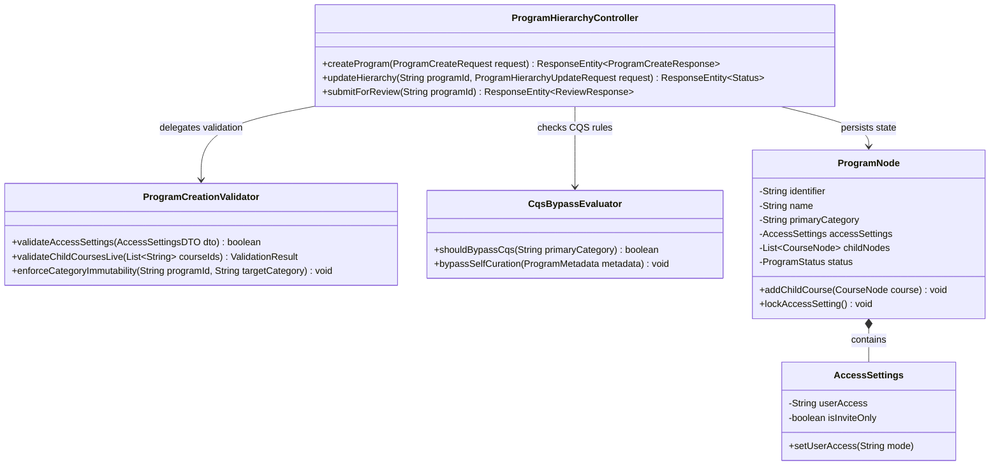

#### Component Operation: CQS & Self-Curation Exemption (`KB-453`)

When the `submitForReview` method is executed, `CqsBypassEvaluator` checks `primaryCategory`:

- If `primaryCategory == "Invite Only Program"`, the system skips the standard CQS automated linting pipeline and marks `cqsEvaluationSkipped = true`.
- The program transitions to `Under Review` without calculating quality scores or blocking authoring progression.

### 3.2 Batch Governance & Bulk Allocation Engine (`Batch Service`)

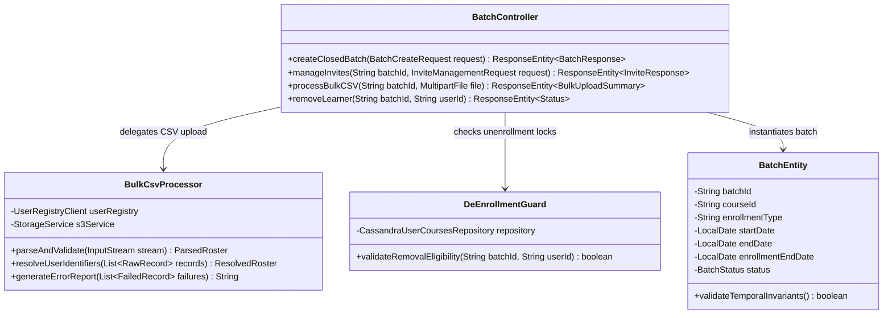

#### Component Operation: Anti-Tamper Consumption De-enrollment Lock (`KB-1946`)

Before `removeLearner` commits a roster removal:

1. `DeEnrollmentGuard` queries `sunbird.user_courses` for `(batchId, userId)`.
2. If `consumptionStarted == true` or `status > 0`, the system aborts execution and throws `IllegalLearnerStateException("ERR_CANNOT_REMOVE_ACTIVE_LEARNER")`.
3. The learner's record remains committed to the batch to preserve official training compliance records.

### 3.3 Discovery, Search Isolation & ElasticSearch Query Interception (`Search Service`)

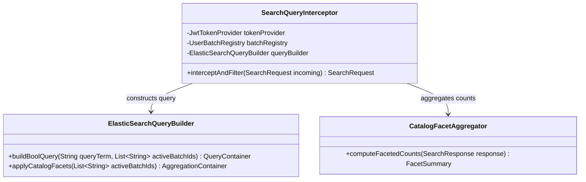

#### Component Operation: Defense-in-Depth ElasticSearch Query Building (`Q7 FRS Search Listing`)

To ensure uninvited users receive no discovery leakage:

```python
def build_access_controlled_query(query_term: str, user_id: str, enrolled_batch_ids: list) -> dict:
    return {
        "query": {
            "bool": {
                "must": [
                    {"multi_match": {"query": query_term, "fields": ["name^3", "description"]}}
                ],
                "filter": [
                    {"term": {"status.keyword": "Live"}},
                    {
                        "bool": {
                            "should": [
                                # Public items are open to everyone
                                {"term": {"accessSettings.userAccess.keyword": "all"}},
                                # Invite-only items require active batch membership
                                {
                                    "bool": {
                                        "must": [
                                            {"term": {"primaryCategory.keyword": "Invite Only Program"}},
                                            {"terms": {"batches.batchId.keyword": enrolled_batch_ids}}
                                        ]
                                    }
                                }
                            ],
                            "minimum_should_match": 1
                        }
                    }
                ]
            }
        }
    }
```

### 3.4 Curriculum Delivery, Table of Contents & Progress Engine (`Progress Service`)

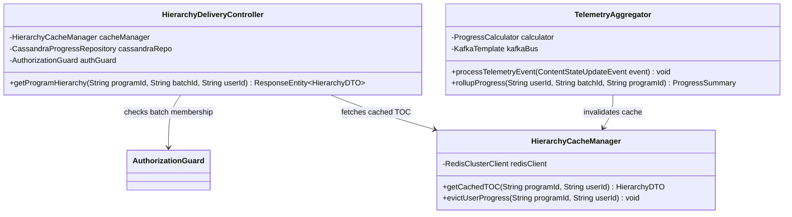

#### Component Operation: Hierarchical Rollup Formula (`KB-1950`)

The hierarchical progress state is evaluated on each content consumption update:<br><br><br>*(where is the count of mandatory resources in child course , and is the count of child courses within the program container).*

## 4. End-to-End Dynamic Interaction & Sequence Models

### 4.1 Subsystem Sequence 1: Program Creation & Review Transition

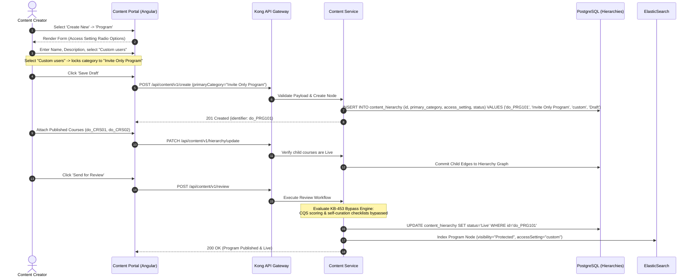

### 4.2 Subsystem Sequence 2: Batch Instantiation & Bulk Learner Ingestion

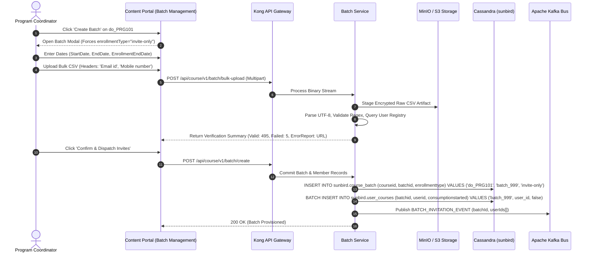

### 4.3 Subsystem Sequence 3: Zero-Leakage Search & Direct Access Route Guard

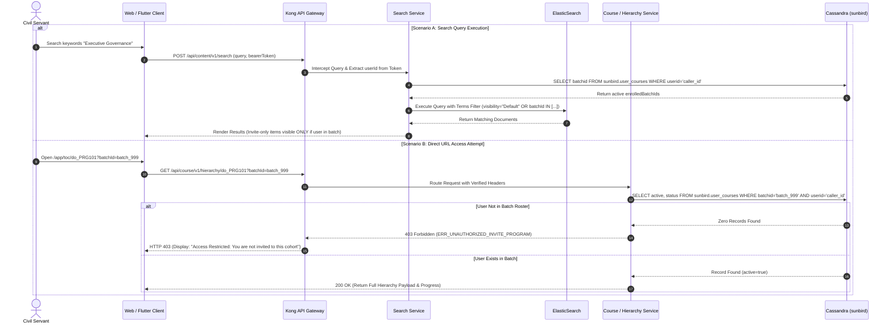

### 4.4 Subsystem Sequence 4: Curriculum Consumption, Telemetry & Certification

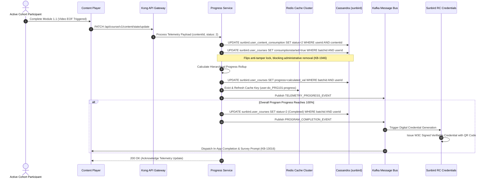

## 5. Detailed Data Design & Persistence Specifications

The data architecture combines Cassandra for high-velocity telemetry, PostgreSQL for transactional configuration, and ElasticSearch for search indexing:

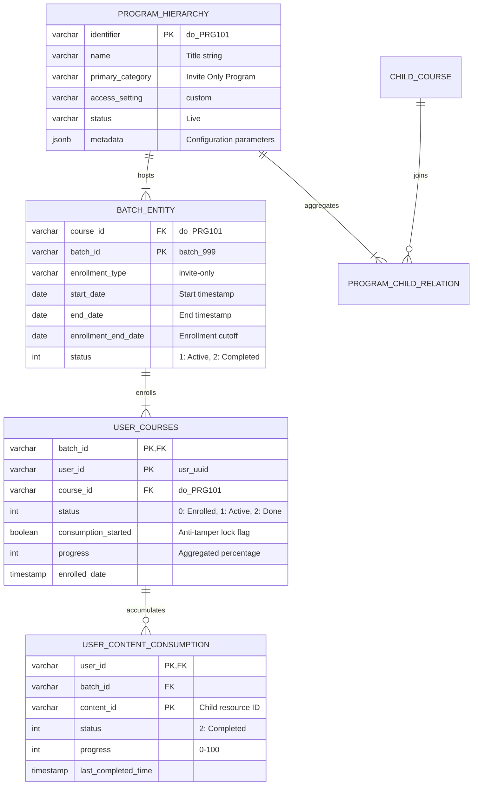

### 5.1 Cassandra DDL Schemata

#### 1. Batch Definition Table (`sunbird.course_batch`)

```sql
CREATE TABLE sunbird.course_batch (
    courseid text,
    batchid text,
    name text,
    description text,
    enrollmenttype text,
    -- Enforced value: 'invite-only' startdate date, enddate date, enrollmentenddate date,
    status int,  -- 1: Active, 2: Completed, 3: Expired
    createdby text,
    createddate timestamp,
    updateddate timestamp,
    PRIMARY KEY ((courseid), batchid)
) WITH CLUSTERING ORDER BY (batchid ASC) AND compaction = {'class': 'SizeTieredCompactionStrategy'} AND default_time_to_live = 0;
```

#### 2. User Cohort Roster & Safety Lock Table (`sunbird.user_courses`)

```sql
CREATE TABLE sunbird.user_courses (
    batchid text,
    userid text,
    courseid text,
    active boolean,
    enrolleddate timestamp,
    status int,  -- 0: Enrolled, 1: In-Progress, 2: Completed
    consumptionstarted boolean,
    -- Anti-tamper fla
);
locks unenrollment when true completedon timestamp, progress int, 1 PRIMARY KEY ((batchid), userid) ) WITH CLUSTERING ORDER BY (userid ASC) AND comment = 'Maintains cohort participant state and anti-tamper flags';
```

#### 3. Leaf Resource Consumption Table (`sunbird.user_content_consumption`)

```sql
CREATE TABLE sunbird.user_content_consumption (
    userid text,
    batchid text,
    courseid text,
    contentid text,
    status int,  -- 1: Incomplete, 2: Completed
    progress int,
    -- Resource completion percentage (0 to 100)
    lastaccesstime timestamp,
    lastcompletedtime timestamp,
    PRIMARY KEY ((userid), batchid, contentid)
) WITH CLUSTERING ORDER BY (batchid ASC, contentid ASC);
```

## 6. Client Architecture & User Interface Design

### 6.1 Desktop Web Experience (`KB-1582`)

The desktop Table of Contents (TOC) is implemented in Angular 15+ using a split-pane layout:

```text
+----------------------------------------------------------------------------------------------------+
| Desktop TOC Split-Pane Architecture (Angular 15+)                                                  |
+----------------------------------------------------+-----------------------------------------------+
| Left Pane (35% Width - Sticky)                     | Right Pane (65% Width - Scrollable)           |
|                                                    |                                               |
| [ Program Banner Artwork ]                         | V Course 1: Leadership Foundations (100%)     |
| Title: Executive Governance Programme 2026         |   |-- Module 1.1: Ethics in Governance [x]    |
| Issuing Body: DoPT / Karmayogi Bharat              |   |-- Module 1.2: Case Study Analysis [x]     |
| Total Duration: 18 Hours | 4 Child Courses         |   `-- Module 1.3: Knowledge Assessment [x]    |
| Competencies: Policy Analysis, Public Finance      |                                               |
|                                                    | > Course 2: Public Financial Systems (40%)    |
| Overall Cohort Progress Gauge:                     |   |-- Module 2.1: Budget Frameworks [x]       |
| [====================>     ] 45%                   |   `-- Module 2.2: Auditing Mechanisms [ ]     |
|                                                    |                                               |
| Dynamic Primary CTA Button:                        | > Course 3: Procurement & GeM Rules (Locked)  |
| [ RESUME LEARNING ]                                |                                               |
| (Deep-links to Course 2, Module 2.2)               | > Course 4: Strategic Public Capstone(Locked) |
+----------------------------------------------------+-----------------------------------------------+
```

### 6.2 Mobile Application Experience (`KB-1587`, `KB-4282`)

- **Framework:** Dart / Flutter cross-platform architecture.
- **Layout:** Single-column responsive layout where the header collapses into a compact app bar on vertical scroll.
- **Bottom Sheets:** Child courses render as expandable cards; tapping launches a native bottom sheet containing resource breakdowns, durations, and streaming controls.
- **Offline Telemetry Queuing:** Telemetry generated in low-connectivity environments queues locally in SQLite and pushes via exponential backoff once network connectivity is restored.

## 7. Interface & API Specifications

### 7.1 Microservice REST Contracts

#### Contract 1: Program Container Creation

- **Endpoint:** `POST /api/content/v1/create`
- **Headers:** `Authorization: Bearer <JWT>`, `Content-Type: application/json`
- **Request Payload:**
  ```json
  {
    "request": {
      "content": {
        "name": "Specialized Vigilance Administration Programme",
        "description": "Executive capacity building cohort for Chief Vigilance Officers.",
        "contentType": "Program",
        "primaryCategory": "Invite Only Program",
        "mimeType": "application/vnd.ekstep.content-collection",
        "accessSettings": {
          "userAccess": "custom"
        },
        "framework": "igot-karmayogi-framework"
      }
    }
  }
  ```
- **Response Status:** `201 Created`
- **Response Payload:** `{"id": "api.content.create", "result": {"identifier": "do_2139485739201"}}`

#### Contract 2: Mandatory Closed Batch Creation

- **Endpoint:** `POST /api/course/v1/batch/create`
- **Request Payload:**
  ```json
  {
    "request": {
      "courseId": "do_2139485739201",
      "name": "CVO Cohort Autumn 2026",
      "description": "Mandatory closed batch for nominated vigilance officials.",
      "enrollmentType": "invite-only",
      "startDate": "2026-11-01",
      "endDate": "2026-12-15",
      "enrollmentEndDate": "2026-10-31",
      "createdBy": "coord_uuid_88192"
    }
  }
  ```
- **Response Status:** `200 OK`
- **Response Payload:** `{"result": {"batchId": "batch_cvo_2026_01"}}`

#### Contract 3: Asynchronous Bulk CSV Roster Ingestion

- **Endpoint:** `POST /api/course/v1/batch/bulk-upload`
- **Payload:** Multipart form-data containing binary CSV (`file: roster.csv`) with headers `Email id,Mobile number`.
- **Response Payload:**
  ```json
  {
    "id": "api.batch.bulk.upload",
    "ver": "v1",
    "result": {
      "totalRecords": 500,
      "successfulRecords": 495,
      "failedRecords": 5,
      "errorReportUrl": "https://storage.igotkarmayogi.gov.in/reports/errors/err_batch_cvo_01.csv"
    }
  }
  ```

#### Contract 4: Program Hierarchy with Batch Access Guard

- **Endpoint:** `GET /api/course/v1/hierarchy/{programId}?batchId={batchId}`
- **Headers:** `x-authenticated-user-token: <JWT>`
- **Status Codes:**
  - `200 OK`: User is authorized; returns structural JSON with rollup progress.
  - `403 Forbidden`: User is not in batch roster (`ERR_UNAUTHORIZED_INVITE_PROGRAM`).

## 8. Cross-Cutting Concerns: Security, Scalability & Performance

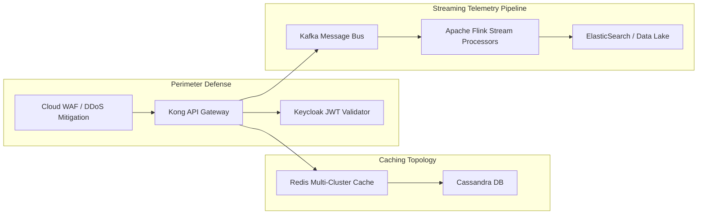

### 8.1 Security & Threat Mitigation

1. **Zero-Trust URL Route Guard:** All calls to `/api/course/v1/hierarchy/*` undergo token validation. The Gateway extracts the user UUID, and backend interceptors verify presence in `sunbird.user_courses` before serving syllabus or streaming tokens.
2. **PII Protection in CSV Buffers:** Uploaded CSVs are stored in MinIO/S3 using SSE-KMS encryption. Disk buffers are purged within 60 minutes of batch ingestion.

### 8.2 Performance Engineering & Latency Budgets

- **TOC Cache Performance** (`KB-15282`): Multi-tier Redis caching targets for TOC payload reads under a peak load of 25,000 concurrent users.
- **Search Execution:** Access-controlled ElasticSearch boolean queries target .
- **Telemetry Throughput:** Player state flushes via `/api/course/v1/content/state/update` target .

## 9. Requirements Traceability Matrix (RTM)

| Requirement ID | Jira Reference | SDD Component / Class Model | Data Store & Structural Design Solution | Verification Method |
|---|---|---|---|---|
| **REQ-CREAT-01** | `KB-1945` | `ProgramHierarchyController` | Sets `primaryCategory = "Invite Only Program"`; persists to PostgreSQL hierarchy tables. | Integration Test |
| **REQ-CQS-BYPASS** | `KB-453` | `CqsBypassEvaluator` | Skips CQS quality linting during review state transition. | Unit Pipeline Test |
| **REQ-BATCH-01** | `KB-1946` | `BatchController` | Enforces `enrollmenttype = 'invite-only'` in Cassandra `course_batch`. | API Contract Test |
| **REQ-BULK-02** | `KB-1946` | `BulkCsvProcessor` | Parses UTF-8 CSV with regex validation; buffers raw files in S3. | Stress Ingestion Test |
| **REQ-UX-UNIFY** | `KB-2960`, `KB-2968` | `BatchController` | Implements consolidated `Manage Invites` workspace. | Cypress UAT |
| **REQ-LOCK-01** | `KB-1946` | `DeEnrollmentGuard` | Evaluates `consumptionstarted` flag in Cassandra; blocks removal if progress . | Automated Invariant Test |
| **REQ-SRCH-MASK** | `KB-7869`, `KB-7870` | `SearchQueryInterceptor` | Injects active batch IDs into ElasticSearch boolean filter queries. | Automated Query Verification |
| **REQ-CAT-FACET** | `KB-7871`, `KB-7872` | `CatalogFacetAggregator` | Evaluates caller entitlements before returning faceted counts. | Regression Suite |
| **REQ-TOC-DESK** | `KB-1582` | `HierarchyDeliveryController` | Renders two-column split-pane desktop TOC layout. | Visual Regression Test |
| **REQ-TOC-MOBL** | `KB-1587`, `KB-4282` | `Flutter TOC Engine` | Renders single-column responsive layout with bottom-sheet modals. | Appium Mobile Test |
| **REQ-PERF-01** | `KB-15282` | `HierarchyCacheManager` | Redis multi-cluster caching reduces TOC fetch latency to . | Locust Distributed Load Test |
| **REQ-SURV-TRIG** | `KB-13016`, `KB-13017` | `TelemetryAggregator` | Emits Kafka completion events triggering post-program peer surveys. | End-to-End System Test |
