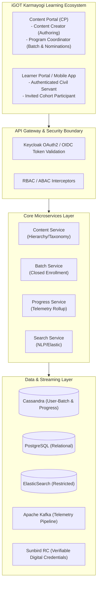
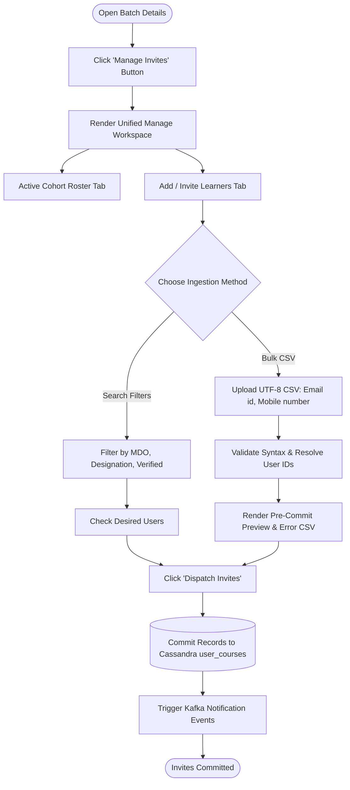
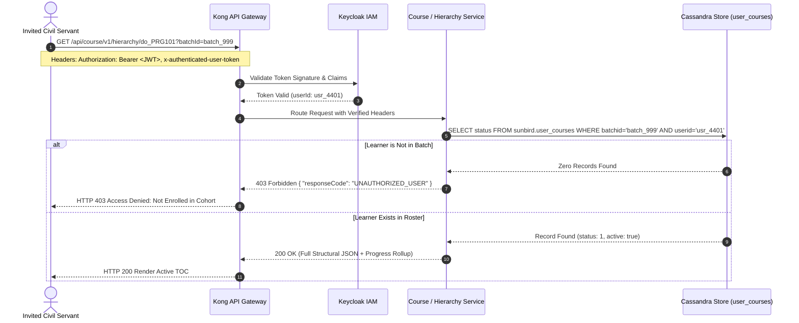
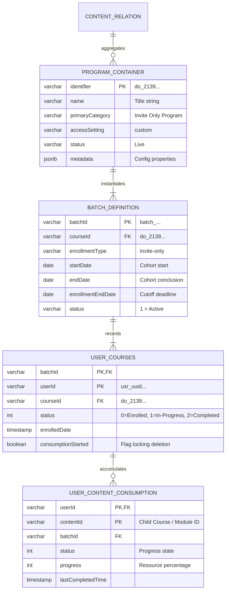

# Invite-Only Program — Software Requirements Specification (SRS)

## 2. Introduction & Purpose

### 2.1 Purpose of the Specification

This Software Requirements Specification (SRS) defines the end-to-end functional, structural, interface, performance, and security requirements governing the **Invite Only Program** across the iGOT Karmayogi digital learning infrastructure. It documents the evolution of the feature from initial ad-hoc curation rules in **Q2** through extensive redesigns in **Q3/Q4**, catalog isolation in **Q7**, and scalable consumption frameworks in **Q8–Q13**.

### 2.2 System Scope

The Invite Only Program is a specialized enterprise container within the iGOT Karmayogi platform that aggregates multiple published courses into an integrated curriculum intended for nominated, restricted, or leadership-track civil servants. Access is strictly controlled via closed batches, administrative nominations, and batch rosters, preventing unauthorized public registration and masking restricted curricula from public catalogs.



### 2.3 Product & Regulatory Terminology

- **MDO:** Ministry, Department, and Organization under the Government of India.
- **SPV:** Special Purpose Vehicle (Karmayogi Bharat) managing platform operations.
- **Closed Batch:** A cohort container where membership is strictly bounded by administrative provisioning; open public registration is programmatically prohibited.
- **Custom Users:** The administrative access setting within the Content Portal that permanently stamps the program container as an `Invite Only Program`.
- **CQS (Content Quality Score):** The platform's automated quality index; explicitly bypassed for Invite Only programs per `KB-453`.
- **TOC (Table of Contents):** The structural curriculum viewer rendering the nested hierarchy of child courses, progress meters, and dynamic player triggers.

## 3. Overall System Description & Evolution (Q2–Q13)

### 3.1 Chronological Evolution Traceability (Q2 to Q13)

The Invite Only Program evolved from an unsegregated content classification into an enterprise, policy-governed cohort delivery engine across five distinct implementation phases:

```mermaid
flowchart TD
    Q2["Q2: Policy Baseline<br/>- KB-453: Content Quality Score (CQS) & Self-Curation bypassed for closed/internal programs.<br/>- KB-1072: Ad-hoc content-competency framework mapping initiated."]
    Q3["Q3: Content Portal & Consumption Redesign<br/>- KB-1936: Master Epic for CP Access Settings, Batch Architecture, and User Consumption.<br/>- KB-1945: Introduction of #quot;Custom users#quot; access classification tagging #quot;Invite Only Program#quot;.<br/>- KB-1946: Enforced Closed-Batch architecture, MDO/Designation filters, and Bulk CSV upload.<br/>- KB-1950, KB-1574, KB-1582, KB-1587: Unified desktop and mobile Table of Contents (TOC)."]
    Q4["Q4: Channel Surfacing & Administrative Streamlining<br/>- KB-3756, KB-4493, KB-4282: Homepage channel strips (mdoChannelsBookmarkId) for invited items.<br/>- KB-2960, KB-2968: Consolidated #quot;Manage Invites#quot; single-button modal replacing split UI."]
    Q7["Q7: Discovery Isolation & Search Governance<br/>- KB-7869, KB-7870: Search indexing query filters ensuring uninvited users cannot discover items.<br/>- KB-7871, KB-7872: Multi-faceted catalog filters with dynamic user-entitlement count resolution."]
    Q8["Q8–Q13: Scalability, RBAC Governance & Post-Program Auditing<br/>- KB-9603: Cohort assignment mapped to pre-configured User Groups.<br/>- KB-13016, KB-13017: Automated post-completion MDO/SPV Peer Validation Survey triggers.<br/>- KB-15282: Distributed multi-tier Redis caching on Progress APIs for high-concurrency players."]
    Q2 --> Q3
    Q3 --> Q4
    Q4 --> Q7
    Q7 --> Q8
```



## 4. User Classes, Actors & Access Roles

| Actor / Role | Interface / Portal | Primary Functional Responsibilities | Authentication & RBAC Scope |
|---|---|---|---|
| **Content Creator** (`content-creator`) | Content Portal (CP) | Authors program metadata, selects "Custom users", arranges child course sequencing, submits for review. | Role: `CONTENT_CREATOR` Scope: Draft & Submit |
| **Content Reviewer / Publisher** (`content-reviewer`) | Content Portal (CP) | Inspects curriculum structure, verifies child course states, approves and publishes program to `Live`. | Role: `CONTENT_REVIEWER` Scope: Publish / Reject |
| **Program Coordinator** (`program-coordinator`) | Content Portal / Manage | Configures closed batches, executes user searches, uploads bulk CSV rosters, monitors cohort telemetry. | Role: `PROGRAM_COORDINATOR` Scope: Batch Management |
| **Invited Learner** | Learner Web / Mobile App | Discovers assigned programs in Home Strips, accesses TOC, streams learning assets, earns credentials. | Role: `PUBLIC` / Civil Servant Scope: Token bound to Batch |
| **Uninvited Learner** | Learner Web / Mobile App | Global user attempting catalog search or direct URL access; subject to access-denial guards. | Role: `PUBLIC` Scope: Zero batch association |
| **SPV / Platform Operations** | Management Console | System auditing, batch error log inspection, competency extraction (`KB-1072`), cache invalidation. | Role: `SYSTEM_ADMIN` / `SPV_ADMIN` Scope: Platform Wide |

## 5. Detailed Functional Requirements

### 5.1 Module 1: Program Creation & Lifecycle (Content Portal)

#### Requirement ID: `FR-PC-01` – Content Type & Container Taxonomy

- **Description:** The system shall allow authorized Content Creators to instantiate an aggregate learning container specifically typed as a Program.
- **Pre-conditions:** User possesses an active session with the `CONTENT_CREATOR` role.
- **Specification:**
  - The system shall provide an authoring path under `Curate -> My Content -> Create New -> Program`.
  - The program container shall support standard metadata: Title, Subtitle, Description, Language, Target Competency Mapping, and Thumbnail Artworks.
  - The system shall assign a unique system-generated identifier formatted as a Sunbird DO identifier (e.g., `do_2139...`).

- **Source:** `KB-1936`, `KB_FRS_CP Redesign` §CP_RD_BR1_FR1.

#### Requirement ID: `FR-PC-02` – "Custom Users" Access Setting Classification

- **Description:** Access setting configuration must dictate downstream batching and visibility rules.
- **Specification:**
  - During creation, the system shall render a mandatory "Access Settings" configuration presenting three mutually exclusive radio options:
    - `All Users`
    - `MDO specific`
    - `Custom users`

  - Selecting `Custom users` shall permanently stamp the container's structural metadata:
    - `primaryCategory = "Invite Only Program"`
    - `accessSettings.userAccess = "custom"`

  - **Immutability Guard:** Once the draft program is saved with `Custom users`, the system shall disable transitioning the setting to `All Users` or `MDO specific` to prevent schema corruption of downstream batch structures.

- **Source:** `KB-1945`, `KB_FRS_CP Redesign` §CP_RD_BR1_FR2.

#### Requirement ID: `FR-PC-03` – Child Course Association & Hierarchy Construction

- **Description:** An Invite Only Program shall function as a composite container aggregating published courses.
- **Specification:**
  - The Content Creator shall be permitted to associate one or more child courses (`Course`) to form the program curriculum.
  - **Eligibility Validation:** The system shall restrict selection strictly to courses currently in the `Live` (published) status. Draft, expired, or retired courses shall be programmatically rejected with an explanatory notification.
  - The system shall record the parent-child relationship in the system graph:<br>$$\text{Program Container} \xrightarrow{\text{aggregates}} [\text{Course}_1, \text{Course}_2, \dots, \text{Course}_n]$$
  - The Content Creator shall be able to reorder child courses sequentially.

- **Source:** `KB-1945`, `KY_FRS_Karma_Programs` §3.1.

#### Requirement ID: `FR-PC-04` – CQS & Self-Curation Exemption Engine

- **Description:** Invite Only Programs shall bypass general open-catalog quality evaluation gates.
- **Specification:**
  - When a program with `primaryCategory = "Invite Only Program"` is submitted via `Send for Review`, the Content Service shall evaluate the bypass flag.
  - The system shall bypass Content Quality Score (CQS) calculations and waive mandatory self-curation checklists.
  - The container shall transition directly from `Draft` to `Under Review` without triggering automated rejection rules associated with low CQS scores.

- **Source:** `KB-453`, Production Baseline Q2.

### 5.2 Module 2: Batch Management & Scheduling

#### Requirement ID: `FR-BM-01` – Mandatory Closed-Batch Instantiation

- **Description:** Batches generated for Invite Only Programs must strictly enforce closed membership.
- **Pre-conditions:** Program status is `Live`. User possesses `PROGRAM_COORDINATOR` or `MDO_ADMIN` role.
- **Specification:**
  - The system shall provide a `Create Batch` interface within the `Batch Management` tab of the program.
  - The system shall lock the batch enrollment type to `closed` (`enrollmentType: "invite-only"`).
  - The system shall hide and programmatically forbid the creation of an `open` batch for any program stamped as `Invite Only Program`.

- **Source:** `KB-1946`, `KB_FRS_CP Redesign` §CP_RD_BR2_FR1.

#### Requirement ID: `FR-BM-02` – Batch Temporal Boundaries & Scheduling Rules

- **Description:** Batches must enforce strict scheduling windows for enrollment and learning consumption.
- **Specification:**
  - The Program Coordinator shall specify three mandatory date parameters:
    - **Enrollment End Date:** The cutoff timestamp after which no new participants can be invited or admitted.
    - **Batch Start Date:** The timestamp from which invited learners are permitted to launch child course players.
    - **Batch End Date:** The timestamp marking official conclusion of the cohort.

  - **Validation Invariants:**<br>$$\text{Current Date} \le \text{Enrollment End Date} \le \text{Batch End Date}$$<br>$$\text{Batch Start Date} \le \text{Batch End Date}$$
  - If $\text{Current Date} > \text{Enrollment End Date}$, the user invitation interface shall lock to read-only.

- **Source:** `KB-1946`, `SRS - Karma Programs` §8.2.

### 5.3 Module 3: Learner Nomination & Bulk Ingestion

#### Requirement ID: `FR-LN-01` – Filter-Based Interactive User Selection

- **Description:** The system shall allow manual search and selection of platform learners for batch assignment.
- **Specification:**
  - The coordinator interface shall provide a directory search powered by Keycloak/PostgreSQL User Registry.
  - Search filters shall include:
    - Target Ministry / Department / Organization (MDO) dropdown.
    - User Designation hierarchy.
    - `Verified Karmayogi` boolean toggle (restricting selection strictly to Aadhaar/e-Office verified civil servants).

  - The coordinator shall select individual or multi-select learner checkboxes to stage them for batch invitation.

- **Source:** `KB-1946`, `KB_FRS_CP Redesign` §CP_RD_BR2_FR1.

#### Requirement ID: `FR-LN-02` – Asynchronous Bulk CSV Roster Ingestion

- **Description:** High-volume cohort onboarding shall be supported through structured CSV ingestion.
- **Specification:**
  - The system shall accept a CSV file containing user identity pairs with the exact case-sensitive header row:

`Email id,Mobile number`

1. File requirements:
  - Character Encoding: Strict UTF-8 without Byte Order Mark (BOM).
  - Maximum capacity per upload: 5,000 participant records per transaction.

2. **Ingestion & Validation Lifecycle:**
  - The backend shall parse rows, apply regex validation on email and 10-digit Indian mobile formats (`^[6-9]\d{9}$`).
  - The system shall query the User Registry to resolve accounts matching either identifier.
  - The system shall generate a pre-commit verification table displaying: `User Name`, `Matched Email`, `Matched Mobile`, `Resolved Ministry`, and `Validation Status`.

3. **Error Handling & Reporting:** Invalid rows (e.g., unregistered users, malformed syntax) shall be captured into an auto-generated downloadable CSV error log detailing the row number and exact failure reason. Valid rows shall proceed without blocking.

- **Source:** `KB-1946`, `KB_FRS_CP Redesign` §CP_RD_BR2_FR1.

#### Requirement ID: `FR-LN-03` – Consolidated "Manage Invites" Interface

- **Description:** Unification of learner provisioning and de-provisioning workflows.
- **Specification:**
  - The Batch Details view shall expose a single, consolidated action button labeled `Manage Invites`.
  - Activating this action shall open a unified workspace supporting:
    - Viewing the active cohort roster.
    - Adding users via search or Bulk CSV.
    - Revoking pending invitations for learners who have not yet commenced training.

  - This requirement deprecates legacy interfaces where "Add Learner" and "Remove Learner" were managed via fragmented screens.

- **Source:** `KB-2960`, `KB-2968`.



#### Requirement ID: `FR-LN-04` – Anti-Tamper Consumption De-enrollment Lock

- **Description:** Protection of learner training records and government audit trails.
- **Specification:**
  - When a Program Coordinator attempts to remove a learner from an active batch, the system shall evaluate the learner's tracking record in Cassandra (`sunbird.user_courses`).
  - **Audit Lock Rule:** If the learner's progress percentage is greater than zero ($> 0%$) or if the `consumptionStarted` flag is `true`, the system shall block the deletion request.
  - The interface shall render the removal control (trash icon) in a disabled state, accompanied by a warning tooltip: *"Learners who have commenced consumption cannot be removed from this program cohort."*

- **Source:** `KB-1946`, `KB_FRS_CP Redesign` §CP_RD_BR2_FR1.

### 5.4 Module 4: Discovery, Search & Catalog Masking

#### Requirement ID: `FR-DS-01` – Catalog Search Masking & ElasticSearch Query Filtering

- **Description:** Unauthorized discovery of private programs must be blocked at the search engine layer.
- **Specification:**
  - When an authenticated user executes a full-text or NLP search query on the Learner Web Portal or Mobile App, the Search API shall intercept the incoming request.
  - The Search API shall extract the caller's `userId` from the verified JWT token and query the user's active batch associations.
  - The ElasticSearch query payload shall apply an isolation filter:<br>$$\text{Visibility Filter} = (\text{visibility} = \text{"Default"}) \lor (\text{batchId} \in [\text{User's Enrolled Batches}])$$
  - Invite Only Programs for which the requesting learner does not hold an explicit batch roster entry shall be omitted from the search response payload.

- **Source:** `KB-7869`, `KB-7870`, `Q7 FRS Search Listing` REQ-1 & REQ-2.

#### Requirement ID: `FR-DS-02` – Faceted Catalog Filters & Dynamic Result Counts

- **Description:** Catalog filter counters must not disclose the existence of unauthorized invite-only programs.
- **Specification:**
  - The platform catalog shall provide a structured `Content-Type` facet filter supporting:
    - `Course`
    - `Curated Program`
    - `Blended Program`
    - `Invite only Program`
    - `Standalone Assessment`

  - The numerical count displayed adjacent to `Invite only Program` shall strictly represent the count of authorized, active programs mapped to the caller.
  - For uninvited civil servants, the facet count shall return `0`, and selecting the filter shall yield an empty state: *"No assigned programs found."*

- **Source:** `KB-7871`, `KB-7872`, `Q7 FRS Search Listing` REQ-4.1.

#### Requirement ID: `FR-DS-03` – Dedicated Learner Homepage Channel Strips

- **Description:** Invited civil servants shall discover assigned cohorts directly upon dashboard initialization.
- **Specification:**
  - The Learner Web Portal and Mobile App homepages shall query the Channel Configuration Service using the learner's organizational context (`mdoChannelsBookmarkId`).
  - If the user has active invite-only batch enrollments, the system shall render a dedicated horizontal card carousel titled **"Assigned Programs"** or **"Karma Programs"**.
  - Program cards shall display: Program Title, Issuing MDO, Number of Child Courses, Cohort Completion Deadline, and Live Progress Bar.

- **Source:** `KB-3756`, `KB-4493`, `KB-4282`, `SRS - Karma Programs` §6.2.3.

### 5.5 Module 5: Table of Contents (TOC) & Consumption Engine

#### Requirement ID: `FR-TC-01` – Two-Column Split Architecture (Desktop Web)

- **Description:** Layout and interaction specification for desktop browser environments.
- **Specification:**
  - Accessing an authorized program shall launch the desktop TOC layout (`KB-1582`).
  - **Left-Hand Metadata Pane (Sticky):**
    - High-resolution program banner and issuing agency badge.
    - Aggregated duration and competency chips.
    - Overall Cohort Progress Gauge ($0\text{--}100%$).
    - Primary Action CTA:
      - If Progress $= 0% \implies$ `Start Program`
      - If $0% < \text{Progress} < 100% \implies$ `Resume Learning`
      - If Progress $= 100% \implies$ `Download Certificate`

  - **Right-Hand Curriculum Pane:**
    - Chronological list of child courses rendered as collapsible accordion sections.
    - Sub-course metadata: course title, duration, individual completion checkmark.
    - Expandable nested resource list showing underlying video, SCORM, PDF, and assessment modules.

- **Source:** `KB-1582`, `SRS - Karma Programs` §8.2.1.

**Desktop TOC Architecture (KB-1582)**

| Left Pane: Program Overview (Sticky) | Right Pane: Structured Curriculum Hierarchy |
|---|---|
| [ Program Banner Artwork ] | V [Course 1: Leadership Foundations] (100%) |
| Title: Executive Governance Cohort 2026 | ├─ Module 1.1: Public Ethics (Video) [x] |
| Issuing Body: DoPT / Karmayogi Bharat | ├─ Module 1.2: Case Study (PDF) [x] |
| Total Duration: 18 Hours \| 4 Courses | └─ Module 1.3: Knowledge Quiz (SCORM) [x] |
| Competencies: Policy Analysis, Public Finance | |
| | &gt; [Course 2: Financial Governance] (40%) |
| Overall Progress: `[=========> ]` 45% | ├─ Module 2.1: Budget Coding (Video) [x] |
| | └─ Module 2.2: Auditing Frameworks [ ] |
| [ RESUME LEARNING Button ] | |
| (Deep-links to Course 2, Module 2.2) | &gt; [Course 3: Procurement & GeM] (Locked |
| | &gt; [Course 4: Strategic Capstone] (Locked |

#### Requirement ID: `FR-TC-02` – Responsive Single-Column Architecture (Mobile App / M-Site)

- **Description:** Layout specification for Flutter-based mobile applications and responsive mobile web.
- **Specification:**
  - The mobile interface shall consolidate the TOC into a single vertically scrollable viewport (`KB-1587`, `KB-4282`).
  - The program header shall collapse into a compact sticky navigation bar upon downward scrolling to maximize viewport real estate for course content.
  - Tapping a child course card shall slide open an app-native bottom sheet displaying resource assets, individual duration, and streaming status.

- **Source:** `KB-1587`, `KB-4282`, `SRS - Karma Programs` §6.1.1.

#### Requirement ID: `FR-TC-03` – Deep-Link State Recovery ("Resume Learning")

- **Description:** Seamless resumption of learning across sessions and devices.
- **Specification:**
  - When an active participant activates `Resume Learning`, the client shall query the Progress Service for the user's latest telemetric bookmark.
  - The system shall bypass the root TOC and immediately launch the content player directly into the specific child course, module, and timestamp/page where the user last logged telemetry.
  - Cross-platform state synchronization: A session paused on Mobile Flutter shall resume at the identical offset when accessed via Desktop Web.

- **Source:** `KB-1582`, `KB-1587`, `KB-1950`.

### 5.6 Module 6: Telemetry Rollup, Progress & Certification

#### Requirement ID: `FR-TR-01` – Hierarchical Telemetry Aggregation Engine

- **Description:** Rollup of atomic resource completions into course-level and program-level progress.
- **Specification:**
  - Atomic completion events emitted by resource players (video EOF, SCORM `cmi.core.lesson_status = "completed"`, PDF last-page read) shall push state updates via:<br>`PATCH /api/course/v1/content/state/update`
  - The Progress Service shall execute a bottom-up hierarchical rollup:<br>$$\text{Child Course Progress } P_c = \frac{\sum_{i=1}^{m} \text{Resource}*i \text{ completed}}{m} \times 100$$*<br>*$$\text{Program Container Progress } P*{\text{program}} = \frac{\sum_{j=1}^{n} P_{c_j}}{n}$$<br>*(where $m$ is the count of mandatory resources in course $j$, and $n$ is the count of child courses in the program).*
  - State persistence shall write synchronously to Cassandra `sunbird.user_content_consumption` and publish an asynchronous progress event to Kafka topic `telemetry.assess`.

- **Source:** `KB-1950`, `SRS - Karma Programs` §8.2.

#### Requirement ID: `FR-TR-02` – High-Concurrency Progress Caching Optimization

- **Description:** Caching layer to mitigate database contention during mass cohort launches.
- **Specification:**
  - To support high concurrent loads without degrading Cassandra performance, the Progress API shall implement a multi-tier Redis caching topology.
  - Read requests to `/api/course/v1/hierarchy/{programId}` shall resolve user progress records from Redis cache with a target cache-hit latency under 800 milliseconds.
  - Cache Invalidation Rule: Receipt of a valid progress state write on Kafka shall trigger targeted eviction of the corresponding `user:program:progress` cache key.

- **Source:** `KB-15282`, Release Q12–Q13 Optimization.

#### Requirement ID: `FR-TR-03` – Digital Credential Issuance & Post-Program Survey Binding

- **Description:** Verifiable credential dispatch and survey triggers upon program completion.
- **Specification:**
  - When $P_{\text{program}} = 100%$, the system shall mark batch enrollment status as `Completed` in Cassandra.
  - The Batch Service shall dispatch an issuance trigger to Sunbird RC Certificate Service, generating a tamper-proof digital certificate with an embedded cryptographic verification QR code.
  - **Peer Validation Survey Trigger:** In compliance with `KB-13016` and `KB-13017`, achieving $100%$ completion shall automatically generate a survey notification prompting the participant and their reporting supervisor to complete the MDO/SPV Peer Validation Survey.

- **Source:** `KB-13016`, `KB-13017`, `SRS - Karma Programs` §11.1.

## 6. External Interface Requirements

### 6.1 Application Programming Interfaces (RESTful Web Services)



#### API-01: Create Program Container

- **Endpoint:** `POST /api/content/v1/create`
- **Headers:** `Authorization: Bearer <admin_token>`, `Content-Type: application/json`
- **Payload Structure:**
  ```json
  {
    "request": {
      "content": {
        "name": "Specialized Vigilance Administration Programme",
        "description": "Executive capacity building cohort for Chief Vigilance Officers.",
        "contentType": "Program",
        "primaryCategory": "Invite Only Program",
        "mimeType": "application/vnd.ekstep.content-collection",
        "accessSettings": {
          "userAccess": "custom"
        },
        "framework": "igot-karmayogi-framework"
      }
    }
  }
  ```
- **Response Status:** `201 Created`
- **Response Payload:** `{"id": "api.content.create", "result": {"identifier": "do_2139485739201"}}`

#### API-02: Create Mandatory Closed Batch

- **Endpoint:** `POST /api/course/v1/batch/create`
- **Payload Structure:**
  ```json
  {
    "request": {
      "courseId": "do_2139485739201",
      "name": "CVO Cohort Autumn 2026",
      "description": "Mandatory closed batch for nominated vigilance officials.",
      "enrollmentType": "invite-only",
      "startDate": "2026-11-01",
      "endDate": "2026-12-15",
      "enrollmentEndDate": "2026-10-31",
      "createdBy": "coord_uuid_88192"
    }
  }
  ```
- **Response Status:** `200 OK`
- **Response Payload:** `{"result": {"batchId": "batch_cvo_2026_01"}}`

#### API-03: Asynchronous Bulk CSV Roster Ingestion

- **Endpoint:** `POST /api/course/v1/batch/bulk-upload`
- **Payload:** Multipart form-data containing binary CSV attachment (`file: nominative_roster.csv`)
- **Response Structure:**
  ```json
  {
    "id": "api.batch.bulk.upload",
    "ver": "v1",
    "result": {
      "totalRecords": 250,
      "successfulRecords": 248,
      "failedRecords": 2,
      "errorReportUrl": "https://storage.igotkarmayogi.gov.in/reports/errors/err_batch_cvo_2026_01.csv"
    }
  }
  ```

#### API-04: Enforce Batch Authorization on Hierarchy Retrieval

- **Endpoint:** `GET /api/course/v1/hierarchy/{programId}?batchId={batchId}`
- **Security Validation:** Interceptor evaluates `user_courses` membership before serializing child node properties.
- **Error Response:** `403 Forbidden` if calling account is not present in the active roster.

## 7. Data Storage Models & Persistence Architecture

The persistence architecture leverages a distributed hybrid topology combining Cassandra for high-velocity telemetry, PostgreSQL for transactional configuration, and ElasticSearch for search indexing.



### 7.1 Database Table Definitions

#### Table: `sunbird.course_batch` (Cassandra Column Family)

- `batchid`: `text` (Primary Key)
- `courseid`: `text` (Indexed - Program Container ID)
- `name`: `text`
- `enrollmenttype`: `text` (Strict Value: `"invite-only"`)
- `startdate`: `date`
- `enddate`: `date`
- `enrollmentenddate`: `date`
- `status`: `int` (`1` = Created/Active, `2` = Completed, `3` = Expired)
- `createdby`: `text`

#### Table: `sunbird.user_courses` (Cassandra Column Family)

- `batchid`: `text` (Partition Key)
- `userid`: `text` (Cluster Key)
- `courseid`: `text`
- `enrolleddate`: `timestamp`
- `active`: `boolean`
- `status`: `int` (`0` = Enrolled, `1` = In-Progress, `2` = Completed)
- `consumptionstarted`: `boolean` (Default: `false`; flipped to `true` upon first player telemetry)

## 8. Non-Functional Requirements (NFRs)

### 8.1 Information Security & Access Governance

- **Zero Trust URL Interception:** The platform shall enforce backend authorization interceptors on all hierarchy, TOC, and content playback endpoints. Knowing or sharing a direct program URL (`https://igotkarmayogi.gov.in/app/toc/do_...`) shall not grant access to uninvited users; requests lacking valid batch membership shall terminate with `HTTP 403 Forbidden`.
- **Transport Security:** All communications across Web, Mobile, API Gateways, and Internal Microservices shall mandate TLS 1.3 encryption.
- **PII Redaction in Bulk Uploads:** Nominative CSV files uploaded for batch creation shall be encrypted in object storage with server-side SSE-KMS keys. Temporary processing buffers shall purge plain-text CSV records within 60 minutes of ingestion completion.

### 8.2 System Performance & Scalability Benchmarks

- **Concurrent Learner Throughput:** The Table of Contents (TOC) service and Content Player APIs shall sustain a minimum concurrency of **25,000 Concurrent Users (CCU)** during nationwide administrative learning drives without elevating error rates above $0.05%$.
- **Response Latency Thresholds:**
  - Catalog Search & NLP Query Response: $\le 2.0\text{ seconds}$ at the 95th percentile ($p95$).
  - Table of Contents (TOC) Initial Payload Render: $\le 800\text{ ms}$ ($p95$) leveraging Redis cache.
  - Telemetry Progress Update Execution: $\le 300\text{ ms}$ ($p99$).

- **Batch Ingestion Capacity:** The bulk user upload engine shall process and validate a 5,000-user CSV file in under $30\text{ seconds}$ end-to-end.

### 8.3 Reliability & Operational Fault Tolerance

- **Offline Telemetry Queuing (Mobile App):** The Flutter mobile application shall implement a local SQLite telemetry cache. In the event of network disruption during playback, completion milestones shall queue locally and automatically flush via exponential backoff upon network restoration.
- **Telemetry Idempotency:** The Progress Service shall process state update messages idempotently, ensuring that duplicated network requests do not corrupt progress percentages or trigger duplicate certificates.

## 9. Business Rules, Constraints & Exception Handling

### 9.1 Core Business Rule Catalog

1. **BR-INV-01 (Creation Exclusivity):** An Invite Only Program must aggregate at least one live child course before it can be submitted for review.
2. **BR-INV-02 (Batch Integrity):** A program tagged as `primaryCategory = "Invite Only Program"` cannot instantiate open batches. Any API payload containing `enrollmentType: "open"` for such programs shall be rejected by the Batch Service with `HTTP 400 Bad Request`.
3. **BR-INV-03 (Immutability of Consumption):** A participant who has consumed $> 0%$ of any child course within a batch cannot be uninvited, removed, or transferred from the batch roster.
4. **BR-INV-04 (Expiration Cutoff):** Access to the content player shall lock at 23:59:59 IST on the recorded `batch.endDate`. Learners accessing the program after this boundary shall be restricted to a read-only view of their completion status and certificates.

### 9.2 Exception Handling Matrix

| Exception Trigger | System Interception Point | Internal Fault Code | User-Facing Notification / Handling |
|---|---|---|---|
| Direct URL access by uninvited civil servant | API Gateway / Hierarchy Filter | `ERR_UNAUTHORIZED_INVITE_PROGRAM` | Modal Display: *"Access Restricted. This learning initiative is strictly by nomination. Please contact your MDO Coordinator."* |
| Attempt to add open batch to invite-only container | Batch Service Schema Validator | `ERR_INVALID_BATCH_TYPE_INVITE_ONLY` | Admin Toast: *"Open batches cannot be created for an Invite Only Program. Only closed batches are permitted."* |
| CSV upload with malformed or missing headers | Batch CSV Ingestion Parser | `ERR_BULK_CSV_SCHEMA_INVALID` | Ingestion Modal: *"Invalid CSV headers. Please ensure the file contains exactly 'Email id' and 'Mobile number'."* |
| Attempt to delete active participant with progress | User Batch Management Service | `ERR_CANNOT_REMOVE_ACTIVE_LEARNER` | Admin Modal: *"Deletion Denied: This official has already started consumption. Training history cannot be deleted."* |
| Network disconnect during mobile video playback | Flutter Mobile Player Controller | `WARN_OFFLINE_TELEMETRY_QUEUED` | Sub-banner: *"Offline mode active. Your training progress is saved locally and will sync once connected."* |

## 10. Requirements Traceability Matrix (RTM)

| Requirement ID | Summary Description | Source Jira ID | Confluence Specification | Target Release | Test Case Verification ID |
|---|---|---|---|---|---|
| `FR-PC-01` | Program Container Instantiation | `KB-1936` | `KB_FRS_CP Redesign` §CP_RD_BR1_FR1 | Q3 | `TC-CP-PROG-001` |
| `FR-PC-02` | "Custom users" Access Setting | `KB-1945` | `KB_FRS_CP Redesign` §CP_RD_BR1_FR2 | Q3 | `TC-CP-ACCESS-002` |
| `FR-PC-03` | Child Course Hierarchy Association | `KB-1945` | `KY_FRS_Karma_Programs` §3.1 | Q3 | `TC-CP-TREE-003` |
| `FR-PC-04` | CQS & Self-Curation Exemption | `KB-453` | Jira Ticket Specification | Q2 | `TC-CQS-BYPASS-001` |
| `FR-BM-01` | Mandatory Closed Batch Creation | `KB-1946` | `KB_FRS_CP Redesign` §CP_RD_BR2_FR1 | Q3 | `TC-BM-CLOSED-001` |
| `FR-BM-02` | Batch Temporal Invariant Enforcement | `KB-1946` | `SRS - Karma Programs` §8.2 | Q3 | `TC-BM-DATES-002` |
| `FR-LN-01` | MDO & Designation Filter User Search | `KB-1946` | `KB_FRS_CP Redesign` §CP_RD_BR2_FR1 | Q3 | `TC-LN-SEARCH-001` |
| `FR-LN-02` | Asynchronous Bulk CSV Roster Ingestion | `KB-1946` | `KB_FRS_CP Redesign` §CP_RD_BR2_FR1 | Q3 | `TC-LN-CSV-002` |
| `FR-LN-03` | Consolidated Single-Button Invites | `KB-2960`, `KB-2968` | Redesign UX Specification | Q4 | `TC-LN-UNIFIED-003` |
| `FR-LN-04` | Anti-Tamper Consumption De-enrollment | `KB-1946` | `KB_FRS_CP Redesign` §CP_RD_BR2_FR1 | Q3 | `TC-LN-LOCK-004` |
| `FR-DS-01` | Catalog Masking & ES Query Filtering | `KB-7869`, `KB-7870` | `Q7 FRS Search Listing` REQ-1 & 2 | Q7 | `TC-SRCH-MASK-001` |
| `FR-DS-02` | Dynamic Faceted Catalog Counters | `KB-7871`, `KB-7872` | `Q7 FRS Search` `Listing` REQ-4.1 | Q7 | `TC-CAT-COUNT-002` |
| `FR-DS-03` | Dedicated Homepage Channel Strips | `KB-3756`, `KB-4493` | `SRS - Karma Programs` §6.2.3 | Q4 | `TC-HOME-STRIP-001` |
| `FR-TC-01` | Desktop Two-Column Split TOC Layout | `KB-1582` | `SRS - Karma Programs` §8.2.1 | Q3 | `TC-TOC-DESK-001` |
| `FR-TC-02` | Mobile Responsive Single-Column TOC | `KB-1587`, `KB-4282` | `SRS - Karma Programs` §6.1.1 | Q3/Q4 | `TC-TOC-MOBL-002` |
| `FR-TC-03` | Deep-Link Resumption Engine | `KB-1950` | `KB_FRS_CP Redesign` §CP_RD_BR3_FR1 | Q3 | `TC-RESUME-001` |
| `FR-TR-01` | Hierarchical Progress Rollup Engine | `KB-1950` | `SRS - Karma Programs` §8.2 | Q3 | `TC-PROG-ROLL-001` |
| `FR-TR-02` | High-Concurrency Redis Progress Cache | `KB-15282` | Performance Engineering Baseline | Q12/Q13 | `TC-PERF-CACHE-001` |
| `FR-TR-03` | Post-Completion Peer Survey Triggers | `KB-13016`, `KB-13017` | Peer Validation FRS | Q11 | `TC-SURV-TRIG-001` |

## 11. Verification, Testing & Acceptance Criteria

### 11.1 Core Test Scenarios (Acceptance Gates)

1. **Scenario 1: Access Isolation Verification (Security Acceptance Gate)**
  - *Action:* An uninvited civil servant logs into the platform and performs an NLP query matching the exact title of an active Invite Only program; simultaneously attempts to browse directly to its URL.
  - *Pass Criteria:* Search results must omit the program card. Accessing the direct URL must return an authorized access-denied page without exposing program syllabus, authoring MDO, or child course streaming tokens.

2. **Scenario 2: Bulk CSV Ingestion & Reconciliation**
  - *Action:* Program Coordinator uploads a UTF-8 CSV containing 1,000 records (950 valid registered users, 30 unregistered emails, 20 malformed phone numbers).
  - *Pass Criteria:* 950 users enrolled into Cassandra batch rosters within 10 seconds. Ingestion modal displays detailed breakdown and provides downloadable error report containing the exact 50 rejected rows.

3. **Scenario 3: Consumption Anti-Tamper Enforcement**
  - *Action:* An invited official launches Course 1 and completes Module 1.1 ($P_c = 25%$). Coordinator attempts to delete the official from the batch roster via the "Manage Invites" console.
  - *Pass Criteria:* The backend returns an error (`ERR_CANNOT_REMOVE_ACTIVE_LEARNER`). UI displays disabled deletion control with policy warning. Roster entry remains intact in database.

4. **Scenario 4: High-Concurrency TOC Load Endurance**
  - *Action:* Load testing infrastructure injects 25,000 concurrent simulated learners requesting TOC endpoints for a 10-course Invite Only program.
  - *Pass Criteria:* Redis cache hit ratio exceeds $92%$. System $p95$ latency remains $\le 800\text{ ms}$. Error rate remains $< 0.05%$. Zero database connection drops.
