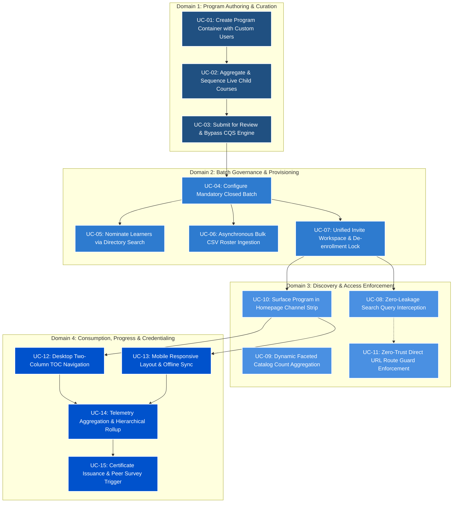
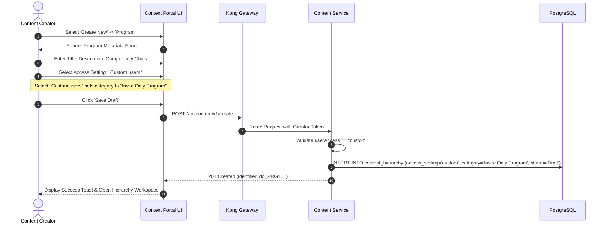
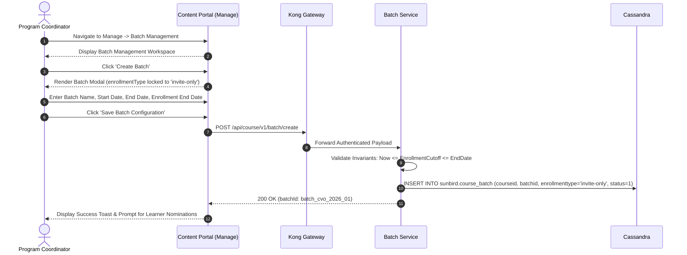
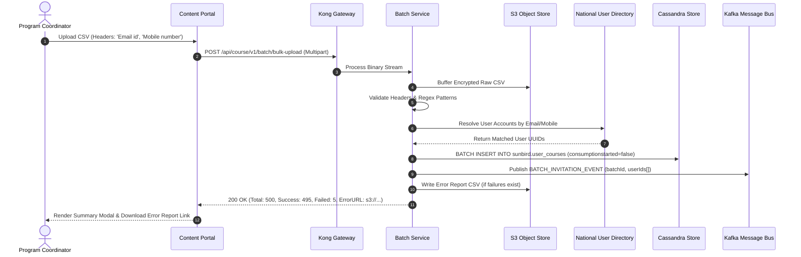
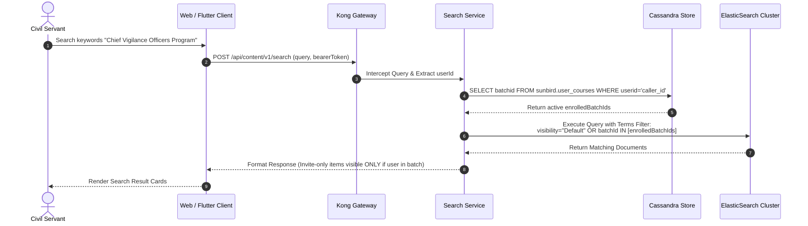
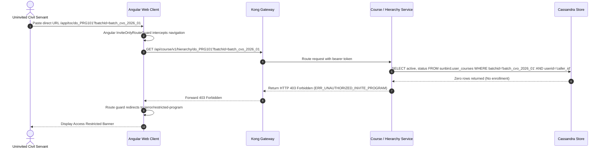
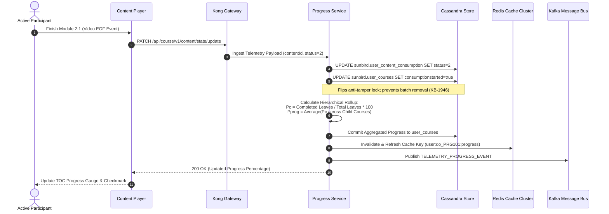
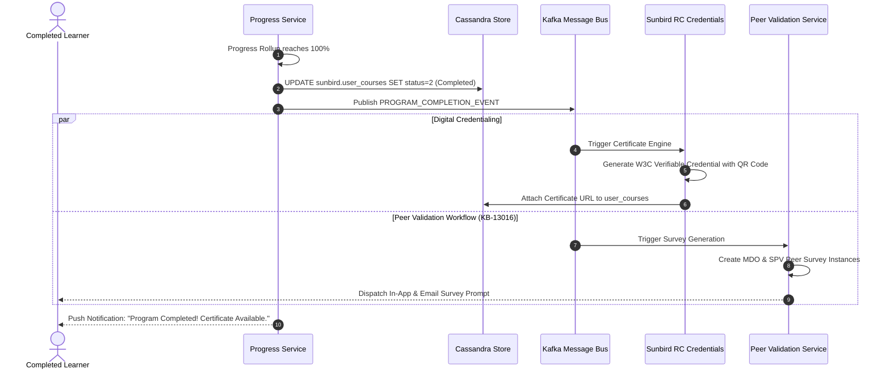

# Invite-Only Program — Use Cases

### 1.2 Purpose and Scope

This document specifies the comprehensive suite of **Generic and System Use Cases** governing the **Invite Only Program** across the iGOT Karmayogi digital infrastructure. It details the functional, operational, technical, and exception paths covering:

- **Administrative & Editorial Lifecycle:** Program creation, access setting configuration, child course aggregation, and automated CQS waiver.
- **Batch Governance & Learner Provisioning:** Closed-batch creation, temporal invariant enforcement, multi-criteria user directory searches, asynchronous bulk CSV ingestion, and anti-tamper de-enrollment locking.
- **Discovery, Search Isolation & Access Control:** ElasticSearch query interception, faceted catalog counters, homepage channel strips, and zero-trust direct URL route guards.
- **Curriculum Consumption & Certification:** Desktop two-column split TOC, Flutter mobile responsive layout, hierarchical progress rollups, high-concurrency Redis caching, verifiable digital credentialing, and post-program peer review surveys.

## 2. Actor Catalog & Use Case Domain Map

### 2.1 Actor Taxonomy

| Actor Identifier | Actor Name / Role | Portal / Surface | Role Responsibilities & System Boundaries |
|---|---|---|---|
| **ACT-01** | **Content Creator** | Content Portal (CP) | Creates program containers, selects "Custom users", arranges child course sequences, submits for review. |
| **ACT-02** | **Content Reviewer / Publisher** | Content Portal (CP) | Audits curriculum structure, verifies child course states, approves program to `Live` (waiving CQS). |
| **ACT-03** | **Program Coordinator** | Content Portal (Manage) | Creates closed batches, sets temporal schedules, nominates learners via search or bulk CSV, monitors cohorts. |
| **ACT-04** | **Invited Civil Servant (Learner)** | Learner Web / Mobile App | Discovers assigned cohorts in Home Strips, accesses TOC, streams assets, earns verifiable certificates. |
| **ACT-05** | **Uninvited Civil Servant (Public)** | Learner Web / Mobile App | Platform user attempting catalog discovery or direct URL access; subject to 403 access guards. |
| **ACT-06** | **Platform Admin / SPV Operations** | Management Console | System auditing, batch error log inspection, competency framework mapping (`KB-1072`), cache management. |
| **SYS-01** | **Keycloak IAM / Parichay** | Identity Boundary | Validates OAuth2 / OIDC JWT tokens, user claims, roles, and MDO tenancy affiliations. |
| **SYS-02** | **Kong API Gateway** | Perimeter Edge | Enforces rate limits, validates bearer tokens, routes API traffic, intercepts unauthenticated calls. |
| **SYS-03** | **ElasticSearch & Search Service** | Discovery Boundary | Performs full-text NLP queries, executes terms-filter access masking, computes dynamic facet counts. |
| **SYS-04** | **Sunbird RC Credential Engine** | Credentialing Boundary | Ingests completion events, generates W3C-compliant tamper-proof digital certificates with QR codes. |
| **SYS-05** | **Kafka Message Bus & Flink Engine** | Streaming Boundary | Buffers asynchronous telemetry, orchestrates notification dispatch, feeds data pipelines. |

### 2.2 Global Use Case Hierarchy Diagram

## 3. Domain 1: Program Authoring & Editorial Lifecycle

### 3.1 UC-01: Create Program Container with "Custom Users" Access Setting

- **Primary Actor:** Content Creator (**ACT-01**)
- **Supporting Systems:** Content Portal UI, Kong Gateway (**SYS-02**), Content Service, PostgreSQL
- **Scope / Context:** Inception of an aggregate learning container intended for restricted cohorts (`KB-1945`, `KB_FRS_CP Redesign`).
- **Pre-conditions:** Creator possesses an active session with the `CONTENT_CREATOR` role.
- **Post-conditions:** A program container exists in `Draft` status in PostgreSQL with `primaryCategory = "Invite Only Program"` and `accessSettings.userAccess = "custom"`.

#### Main Success Scenario (MSS):

1. Content Creator logs into the Content Portal and navigates to `Curate -> My Content -> Create New -> Program`.
2. System presents the Program Metadata & Configuration Form.
3. Content Creator enters basic details (Title, Subtitle, Description, Language, Target Competencies).
4. Content Creator navigates to the **Access Settings** section and selects the radio button for **"Custom users"**.
5. System displays helper text: *"Selecting 'Custom users' marks this program as an Invite Only Program. Only nominated learners across designated closed batches can access this content."*
6. Content Creator clicks **"Save Draft"**.
7. Content Portal transmits `POST /api/content/v1/create` to the API Gateway.
8. Content Service validates that `accessSettings.userAccess` is `"custom"`, stamps `primaryCategory` as `"Invite Only Program"`, assigns a unique identifier (`do_...`), and persists the record to PostgreSQL.
9. System confirms container creation and navigates the Creator to the Curriculum Packaging Workspace.

#### Extensions (Alternative & Exception Flows):

- **4a. Creator attempts to select "All Users" or "MDO specific" after initial draft creation:**
  - 4a1. Content Service evaluates container immutability invariants (`FR-PC-02`).
  - 4a2. System disables the radio group or rejects the patch with `409 Conflict` (`ERR_CATEGORY_IMMUTABLE`).
  - 4a3. UI presents a modal: *"The access setting for an Invite Only Program is locked once established to preserve batch integrity."*

### 3.2 UC-02: Aggregate & Sequence Published Child Courses

- **Primary Actor:** Content Creator (**ACT-01**)
- **Supporting Systems:** Content Portal UI, Content Service, PostgreSQL
- **Scope / Context:** Building the multi-course curriculum hierarchy under the parent program container (`KB-1945`, `KY_FRS_Karma_Programs`).
- **Pre-conditions:** Program container exists in `Draft` state; target child courses are published and in `Live` status.
- **Post-conditions:** Program container contains an ordered graph of child courses.

#### Main Success Scenario (MSS):

1. Creator opens the Curriculum Builder tab within the draft program workspace.
2. System renders the course selection modal with search, MDO filter, and competency matching.
3. Creator searches for published courses and selects target courses (e.g., `do_CRS01`, `do_CRS02`, `do_CRS03`).
4. Creator uses drag-and-drop handles to define the sequential learning path: $$\text{Program Container} \xrightarrow{\text{aggregates}} [\text{Course}_1 \to \text{Course}_2 \to \text{Course}_3]$$
5. Creator clicks **"Save Curriculum Hierarchy"**.
6. Content Service validates that each referenced course is currently `Live`.
7. System commits child edges to PostgreSQL and updates the hierarchy version.

#### Extensions (Alternative & Exception Flows):

- **6a. Creator selects a course currently in "Draft" or "Under Review" status:**
  - 6a1. Content Service validation catches non-live course IDs.
  - 6a2. System rejects the save transaction with `400 Bad Request` (`ERR_CHILD_COURSE_NOT_LIVE`).
  - 6a3. UI flags the invalid course card with an error badge: *"Only published (Live) courses can be added to an Invite Only Program."*

### 3.3 UC-03: Submit for Review & Bypass Content Quality Score (CQS)

- **Primary Actor:** Content Creator (**ACT-01**), Content Reviewer (**ACT-02**)
- **Supporting Systems:** Content Portal, Content Service, Review Workflow Engine
- **Scope / Context:** Workflow transition from draft to published, enforcing quality score exemptions for closed cohorts (`KB-453`).
- **Pre-conditions:** Program container aggregates at least one valid live child course.
- **Post-conditions:** Program container transitions to `Live` status and is indexed into ElasticSearch with `visibility = "Protected"`.

#### Main Success Scenario (MSS):

1. Content Creator verifies curriculum preview and clicks **"Send for Review"**.
2. Content Service intercepts the transition and invokes the `CqsBypassEvaluator`.
3. System verifies that `primaryCategory` equals `"Invite Only Program"`.
4. Automated CQS scoring calculations and mandatory self-curation checklists are bypassed per policy `KB-453`.
5. Container status updates to `Under Review`, notifying the designated Content Reviewer.
6. Content Reviewer audits the curriculum structure and clicks **"Approve & Publish"**.
7. System updates status to `Live` in PostgreSQL and publishes the metadata document to ElasticSearch with `accessSetting: "custom"` and `visibility: "Protected"`.

## 4. Domain 2: Batch Governance & Learner Provisioning

### 4.1 UC-04: Configure Mandatory Closed Batch

- **Primary Actor:** Program Coordinator (**ACT-03**)
- **Supporting Systems:** Content Portal (Manage), Kong Gateway (**SYS-02**), Batch Service, Cassandra
- **Scope / Context:** Instantiation of a closed cohort container with strict scheduling rules (`KB-1946`, `KB_FRS_CP Redesign`).
- **Pre-conditions:** Target program status is `Live`. Coordinator possesses `PROGRAM_COORDINATOR` role for the issuing MDO.
- **Post-conditions:** A closed batch record is created in Cassandra `sunbird.course_batch` with `enrollmentType = "invite-only"`.

#### Main Success Scenario (MSS):

1. Program Coordinator navigates to `Manage -> Batch Management` and selects the target Live program.
2. Coordinator clicks **"Create Batch"**.
3. System opens the Batch Configuration Modal. The **Enrollment Type** field is locked to **"Closed / Invite-Only"**; open enrollment options are hidden.
4. Coordinator enters cohort parameters:
  - Batch Name (e.g., *"Chief Vigilance Officers Cohort 2026"*).
  - Enrollment End Date (cutoff deadline for admitting learners).
  - Program Start Date (timestamp from which assets can be launched).
  - Program End Date (timestamp marking cohort conclusion).

5. Coordinator clicks **"Save Batch Configuration"**.
6. Batch Service validates temporal invariants: $$\text{Current Date} \le \text{Enrollment End Date} \le \text{Batch End Date}$$ $$\text{Batch Start Date} \le \text{Batch End Date}$$
7. Batch Service writes the batch record to Cassandra `sunbird.course_batch` with `enrollmenttype = "invite-only"`.
8. System displays confirmation and opens the learner nomination workspace.

#### Extensions (Alternative & Exception Flows):

- **6a. Coordinator sets Enrollment End Date past the Program End Date:**
  - 6a1. Batch Service detects temporal violation.
  - 6a2. System rejects the payload with `400 Bad Request` (`ERR_INVALID_BATCH_DATES`).
  - 6a3. UI displays error text: *"Enrollment cutoff date cannot be later than the program conclusion date."*

### 4.2 UC-05: Nominate Learners via Directory Search

- **Primary Actor:** Program Coordinator (**ACT-03**)
- **Supporting Systems:** Content Portal UI, Keycloak / User Directory (**SYS-01**), Batch Service, Cassandra
- **Scope / Context:** Manual search and nomination of platform learners using organizational filters (`KB-1946`).
- **Pre-conditions:** Closed batch exists in active status.

#### Main Success Scenario (MSS):

1. Coordinator accesses the **"Add Learners"** section in the batch workspace.
2. Coordinator applies search filters:
  - Target Ministry / Department / Organization (e.g., *"Ministry of Finance"*).
  - Designation (e.g., *"Deputy Secretary"*).
  - Toggle: **"Verified Karmayogi Only"** (Aadhaar / e-Office verified).

3. System queries the User Directory and displays matching profiles.
4. Coordinator selects individual or group checkboxes and clicks **"Invite Selected Learners"**.
5. Batch Service executes a batch insert to Cassandra `sunbird.user_courses`: $$\text{INSERT INTO } sunbird.user_courses \text{ (batchid, userid, active=true, status=0, consumptionstarted=false)}$$
6. System publishes an invitation event to Kafka topic `karmayogi.batch.invitation`.
7. System displays confirmation: *"XX learners successfully added to the batch roster."*

### 4.3 UC-06: Asynchronous Bulk CSV Roster Ingestion

- **Primary Actor:** Program Coordinator (**ACT-03**)
- **Supporting Systems:** Content Portal, Kong Gateway (**SYS-02**), Batch Service, MinIO/S3, Cassandra, Kafka (**SYS-05**)
- **Scope / Context:** Scalable cohort onboarding via CSV file ingestion (`KB-1946`, `KB_FRS_CP Redesign`).
- **Pre-conditions:** Batch exists; file adheres to mandatory schema.
- **Post-conditions:** Valid users are enrolled in Cassandra; error logs are generated for invalid rows.

#### Main Success Scenario (MSS):

1. Coordinator clicks **"Bulk Upload"** within the batch workspace.
2. System displays CSV template requirements: UTF-8 encoding, max 5,000 rows, mandatory case-sensitive headers: `Email id,Mobile number`.
3. Coordinator selects and uploads `cvo_nominees.csv`.
4. Portal streams the file to `POST /api/course/v1/batch/bulk-upload`.
5. Batch Service stages the file in encrypted object storage (S3/MinIO) and spawns an asynchronous processing worker.
6. Worker validates email and mobile syntax regex (`^[6-9]\d{9}$`) and resolves identities against the User Directory.
7. System executes batch writes to Cassandra `sunbird.user_courses` for all resolved accounts with `consumptionstarted = false`.
8. System publishes `BATCH_INVITATION_EVENT` messages to Kafka, notifying downstream SMS/Email dispatchers.
9. Coordinator receives a summary modal: *"500 records processed: 495 enrolled successfully, 5 failed."* Download link provided for error details.

#### Extensions (Alternative & Exception Flows):

- **3a. CSV header row is misspelled (e.g.,** `Email_ID, Phone`):
  - 3a1. Bulk parser detects missing mandatory headers.
  - 3a2. Upload terminates immediately with `400 Bad Request` (`ERR_BULK_CSV_SCHEMA_INVALID`).
  - 3a3. UI presents an error: *"Invalid CSV headers. File must contain exact headers: 'Email id' and 'Mobile number'."*

### 4.4 UC-07: Unified Invite Workspace & Anti-Tamper De-Enrollment Lock

- **Primary Actor:** Program Coordinator (**ACT-03**)
- **Supporting Systems:** Content Portal UI, Batch Service, Cassandra
- **Scope / Context:** Consolidated participant roster management and audit-grade protection against learner deletion (`KB-2960`, `KB-2968`, `KB-1946`).
- **Pre-conditions:** Active batch with provisioned learners.

#### Main Success Scenario (MSS):

1. Coordinator accesses the Batch Details view and clicks the unified **"Manage Invites"** button.
2. System launches the consolidated modal displaying the active cohort roster, search filters, and upload tools in a single interface.
3. Coordinator locates a learner who has not started the program and clicks the remove action (trash icon).
4. System verifies that `consumptionstarted == false` and `progress == 0`.
5. System marks the record inactive in Cassandra `sunbird.user_courses` (`active = false`).
6. UI updates the roster count and displays: *"Learner nomination successfully revoked."*

#### Extensions (Alternative & Exception Flows):

- **4a. Coordinator attempts to remove a learner who has consumed content (progress > 0%):**
  - 4a1. Batch Service queries `sunbird.user_courses` and finds `consumptionstarted == true` or `status > 0`.
  - 4a2. De-enrollment Safety Guard blocks the request and throws `409 Conflict` (`ERR_CANNOT_REMOVE_ACTIVE_LEARNER`).
  - 4a3. UI keeps the deletion icon disabled and renders a warning tooltip: *"Learners who have commenced consumption cannot be removed from this program cohort."*

## 5. Domain 3: Discovery, Search Isolation & Access Control

### 5.1 UC-08: Zero-Leakage Search Query Interception

- **Primary Actor:** Uninvited Civil Servant (**ACT-05**), Invited Civil Servant (**ACT-04**)
- **Supporting Systems:** Learner Web/Mobile, Kong Gateway (**SYS-02**), Search Service (**SYS-03**), ElasticSearch, Cassandra
- **Scope / Context:** Full-text and NLP search query isolation preventing unauthorized discovery (`KB-7869`, `KB-7870`, `Q7 FRS Search Listing`).
- **Pre-conditions:** Users are authenticated via Keycloak.
- **Post-conditions:** Search results display invite-only programs strictly to invited learners; uninvited users receive zero matching results.

#### Main Success Scenario (MSS - Invited Learner):

1. Invited Civil Servant enters the exact program title in the search bar: *"Chief Vigilance Officers Program"*.
2. Client transmits `POST /api/content/v1/search` with the user's bearer token.
3. Search Service intercepts the request, decodes `userId`, and fetches active batch enrollments from Cassandra cache (`batch_cvo_2026_01`).
4. Search Service constructs an ElasticSearch query with an access filter: $$\text{Filter} = (\text{accessSettings.userAccess} = \text{"all"}) \lor (\text{batches.batchId} \in [\text{"batch_cvo_2026_01"}])$$
5. ElasticSearch returns the matching program document.
6. Client displays the program card tagged with an "Assigned" badge.

#### Extensions (Alternative & Exception Flows):

- **1a. Uninvited Civil Servant searches for the identical title:**
  - 1a1. Search Service resolves the user's active batch enrollments; `batch_cvo_2026_01` is not present in the list.
  - 1a2. ElasticSearch evaluates the access filter; the program is excluded from the result set.
  - 1a3. Client renders standard search results without disclosing the existence of the invite-only program.

### 5.2 UC-09: Dynamic Faceted Catalog Count Aggregation

- **Primary Actor:** Civil Servant / Learner (**ACT-04**, **ACT-05**)
- **Supporting Systems:** Learner Portal, Search Service (**SYS-03**), ElasticSearch
- **Scope / Context:** Dynamic catalog facet counters reflecting only authorized content (`KB-7871`, `KB-7872`).

#### Main Success Scenario (MSS):

1. Learner opens the Course & Program Catalog.
2. System executes a faceted aggregation query across content categories: `Course`, `Curated Program`, `Blended Program`, `Invite only Program`.
3. ElasticSearch computes facet counts constrained by the user's active batch memberships.
4. For an uninvited user, the facet count for `Invite only Program` resolves to `(0)`.
5. For an invited user, the facet count dynamically resolves to the number of active invite-only programs assigned to that user (e.g., `Invite only Program (1)`).
6. Selecting the facet filter renders only authorized program cards.

### 5.3 UC-10: Surface Program in Dedicated Homepage Channel Strip

- **Primary Actor:** Invited Civil Servant (**ACT-04**)
- **Supporting Systems:** Learner Web / Mobile Client, Channel Configuration Service, PostgreSQL
- **Scope / Context:** Direct surfacing of assigned programs on learner home dashboards (`KB-3756`, `KB-4493`, `KB-4282`).
- **Pre-conditions:** Learner has an active enrollment in a live invite-only batch.

#### Main Success Scenario (MSS):

1. Learner logs into the Web Portal or Flutter Mobile App.
2. Homepage client queries the channel service using the user's organizational context (`mdoChannelsBookmarkId`).
3. System identifies active invite-only batch enrollments and renders a dedicated carousel strip titled **"Assigned Programs"** or **"Karma Programs"**.
4. The strip displays program cards showing title, issuing MDO, child course counts, completion deadline, and a live progress gauge.
5. Learner clicks the card and navigates directly to the Table of Contents (TOC).

### 5.4 UC-11: Zero-Trust Direct URL Route Guard Enforcement

- **Primary Actor:** Uninvited Civil Servant (**ACT-05**)
- **Supporting Systems:** Learner Web (Angular), Kong Gateway (**SYS-02**), Course/Hierarchy Service, Cassandra
- **Scope / Context:** Perimeter protection preventing unauthorized access via pasted or shared URLs.
- **Pre-conditions:** Uninvited user obtains a direct link: `https://igotkarmayogi.gov.in/app/toc/do_PRG101?batchId=batch_cvo_2026_01`.

#### Main Success Scenario (MSS - Access Denied):

1. Uninvited user pastes the direct program URL into a browser window.
2. Angular router invokes the `InviteOnlyRouteGuard`.
3. Client issues a validation call: `GET /api/course/v1/hierarchy/do_PRG101?batchId=batch_cvo_2026_01`.
4. Hierarchy Service queries Cassandra `sunbird.user_courses` for the calling user's ID.
5. System finds zero matching records for the specified batch.
6. Hierarchy Service returns `403 Forbidden` with error code `ERR_UNAUTHORIZED_INVITE_PROGRAM`.
7. Route guard catches the 403 response, suppresses curriculum data, and redirects the browser to `/error/restricted-program`.
8. User sees an explanatory banner: *"Access Restricted: This program is accessible by administrative invitation only. Please contact your MDO Coordinator."*

## 6. Domain 4: Curriculum Consumption, Telemetry & Certification

### 6.1 UC-12: Desktop Two-Column Split TOC Navigation

- **Primary Actor:** Invited Civil Servant (**ACT-04**)
- **Supporting Systems:** Learner Web Portal (Angular), Hierarchy Service, Redis Cache
- **Scope / Context:** Structured curriculum browsing and deep-link resumption on desktop screens (`KB-1582`, `KB-1950`).
- **Pre-conditions:** User is an authorized cohort participant.

#### Main Success Scenario (MSS):

1. Learner clicks an assigned program card from the homepage carousel.
2. Web Portal loads the desktop two-column split layout:
  - **Left Pane (35% Width - Sticky):** High-resolution artwork, program title, issuing MDO badge, duration chips, overall cohort progress gauge, and primary action CTA.
  - **Right Pane (65% Width - Scrollable):** Sequential list of child courses rendered as collapsible accordion sections.

3. System evaluates user progress:
  - If Progress $= 0% \implies$ CTA displays **"Start Program"**.
  - If $0% < \text{Progress} < 100% \implies$ CTA displays **"Resume Learning"**.
  - If Progress $= 100% \implies$ CTA displays **"Download Certificate"**.

4. Learner clicks **"Resume Learning"**.
5. Client retrieves the latest telemetric bookmark and opens the content player directly at the last active module and playback offset.

### 6.2 UC-13: Mobile Responsive Layout & Offline Progress Synchronization

- **Primary Actor:** Invited Civil Servant (**ACT-04**)
- **Supporting Systems:** Learner Mobile App (Flutter), Mobile Gateway, SQLite Local DB, Progress Service
- **Scope / Context:** Native mobile consumption with offline telemetry resilience (`KB-1587`, `KB-4282`).

#### Main Success Scenario (MSS):

1. Learner opens the program on the Flutter mobile app.
2. Layout renders as a responsive single-column stack with a collapsible header.
3. Learner taps a child course card; system slides open a native bottom sheet displaying underlying modules, durations, and completion markers.
4. Learner starts a video lesson. During playback, device enters an area with no network connectivity.
5. Player reaches video completion ($100%$ watched).
6. Flutter client catches network failure, writes the completion event to local SQLite cache, and shows a toast: *"Progress saved locally. Will sync when back online."*
7. Upon network restoration, background synchronization workers flush cached telemetry to `PATCH /api/course/v1/content/state/update`.
8. Progress Service processes the queued update and updates the server-side progress state.

### 6.3 UC-14: Telemetry Aggregation & Hierarchical Rollup

- **Primary Actor:** Active Learner (**ACT-04**)
- **Supporting Systems:** Content Player, Kong Gateway (**SYS-02**), Progress Service, Redis Cluster, Cassandra, Kafka (**SYS-05**)
- **Scope / Context:** Real-time bottom-up rollup from leaf resource events to program-level progress (`KB-1950`, `KB-15282`).
- **Pre-conditions:** Learner consumes content assets within an active batch.

#### Main Success Scenario (MSS):

1. Learner finishes a mandatory learning asset (e.g., video end-of-file, SCORM completion, assessment submission).
2. Content Player emits telemetry: `PATCH /api/course/v1/content/state/update`.
3. Progress Service marks resource status as `2` (Completed) in Cassandra `sunbird.user_content_consumption`.
4. System sets `consumptionstarted = true` in `sunbird.user_courses` (activating the anti-tamper de-enrollment lock).
5. Hierarchical Progress Engine calculates percentage rollups: $$\text{Child Course Progress } P_c = \frac{\text{Completed Leaf Resources}}{\text{Total Leaf Resources}} \times 100$$ $$\text{Program Container Progress } P_{\text{program}} = \frac{\sum_{j=1}^{n} P_{c_j}}{n}$$
6. Progress Service commits $P_{\text{program}}$ to Cassandra `sunbird.user_courses`.
7. Cache Manager updates the active Redis cache key (`user:userId:prog:programId:progress`), ensuring subsequent TOC read requests resolve with $p95 < 800\text{ ms}$ (`KB-15282`).
8. Progress Service emits a telemetry event to Kafka and returns `200 OK` to the player.

### 6.4 UC-15: Verifiable Certificate Issuance & Post-Program Survey Trigger

- **Primary Actor:** Active Learner (**ACT-04**), Peer Validator / Supervisor
- **Supporting Systems:** Progress Service, Kafka (**SYS-05**), Sunbird RC (**SYS-04**), Peer Validation Service
- **Scope / Context:** Milestone completion handling, credential dispatch, and post-training surveys (`KB-13016`, `KB-13017`).
- **Pre-conditions:** Learner achieves $100%$ aggregate progress across all child courses within the active batch window.

#### Main Success Scenario (MSS):

1. Hierarchical Progress Engine evaluates $P_{\text{program}} = 100%$.
2. Progress Service marks batch status as `2` (Completed) in Cassandra `sunbird.user_courses`.
3. System publishes `PROGRAM_COMPLETION_EVENT` to Kafka topic `karmayogi.program.completion`.
4. Sunbird RC Credential Engine consumes the event and generates a tamper-proof digital certificate featuring the issuing MDO seal and a verifiable cryptographic QR code.
5. Peer Validation Service consumes the event and creates survey tasks per `KB-13016` and `KB-13017`:
  - Learner is prompted to complete a Program Effectiveness Feedback Survey.
  - Learner's designated reporting officer is notified to complete a 30-day post-training behavioral impact survey.

6. Learner TOC updates: CTA switches to **"Download Certificate"**, and survey prompts appear in the notification drawer.

## 7. Business Rules, Invariants & Exception Governance

**CORE SYSTEM INVARIANTS & BUSINESS RULES**

| Rule Identifier | Formal Specification & System Invariant Rule |
|---|---|
| BR-INV-01 | Category Immutability: Selecting "Custom users" sets primaryCategory to "Invite Only Program". Once saved, this setting cannot be changed. |
| BR-INV-02 | Child Course Publishing Guard: A program cannot aggregate child courses that are in Draft, Under Review, or Retired state; all children must be Live. |
| BR-INV-03 | CQS Waiver Policy: Programs tagged as "Invite Only Program" bypass automated Content Quality Score thresholds and self-curation checklists (KB-453). |
| BR-INV-04 | Mandatory Closed Cohort: The Batch Service rejects any batch creation request where enrollmentType != "invite-only". Open batches are prohibited. |
| BR-INV-05 | Temporal Boundaries: The system enforces that: Current Date &lt;= Enrollment End Date &lt;= Batch End Date, and Start &lt;= End Date. |
| BR-INV-06 | Anti-Tamper Consumption Lock: If a learner logs progress &gt; 0% or consumptionStarted == true, administrative un-enrollment is blocked (KB-1946). |
| BR-INV-07 | Zero-Leakage Catalog Discovery: Uninvited users receive 0 search results and a facet count of (0) for invite-only programs (Q7 FRS Search Listing). |
| BR-INV-08 | Zero-Trust Direct Access: Direct URL access without a valid batch roster record terminates with HTTP 403 Forbidden. |

### 7.1 Consolidated Exception Handling Matrix

| Fault Code | HTTP Status | Triggering Scenario | System Response & User Feedback |
|---|---|---|---|
| `ERR_ACCESS_SETTING_INVALID` | `400` | Author attempts to create an invite-only container without `userAccess: "custom"`. | Transaction aborted; Angular UI highlights the required access radio button. |
| `ERR_CATEGORY_IMMUTABLE` | `409` | Author attempts to change `primaryCategory` after initial draft save. | Hierarchy update rejected; modal warns that access settings are locked. |
| `ERR_CHILD_COURSE_NOT_LIVE` | `400` | Author attaches a course that is not in `Live` status. | Curriculum update blocked; invalid course cards flagged with error badges. |
| `ERR_INVALID_BATCH_DATES` | `400` | Enrollment cutoff is scheduled after the batch end date. | Batch creation rejected; UI indicates invalid date ranges. |
| `ERR_BULK_CSV_SCHEMA_INVALID` | `400` | CSV upload lacks case-sensitive headers `Email id` and `Mobile number`. | Upload rejected; client displays required header format instructions. |
| `ERR_CANNOT_REMOVE_ACTIVE` | `409` | Coordinator attempts to uninvite a learner who has started consumption. | Deletion blocked; UI shows disabled delete icon with compliance tooltip. |
| `ERR_UNAUTHORIZED_INVITE_PROG` | `403` | Uninvited user attempts direct URL navigation to `/app/toc/do_...`. | Access blocked; browser redirects to standard restricted program error page. |

## 8. Requirements Traceability Matrix (RTM)

| Use Case Identifier | Source Jira Reference | Primary Subsystem / Service | Target Database / Persistence Entity | Verification Method |
|---|---|---|---|---|
| **UC-01** | `KB-1945` | Content Service | PostgreSQL `content_hierarchy` | Form validation & API contract tests |
| **UC-02** | `KB-1945` | Content Service | PostgreSQL hierarchy edges | Curriculum tree persistence integration tests |
| **UC-03** | `KB-453` | Curation Engine | Workflow transition engine | Review state transition verification tests |
| **UC-04** | `KB-1946` | Batch Service | Cassandra `sunbird.course_batch` | API contract test verifying closed-batch lock |
| **UC-05** | `KB-1946` | Batch Service | Cassandra `sunbird.user_courses` | User directory integration & roster commit tests |
| **UC-06** | `KB-1946` | Batch Service / S3 | S3 buffer & Cassandra `user_courses` | Concurrency test with 5,000-row CSV upload |
| **UC-07** | `KB-2960`, `KB-2968` | Content Portal UI / Batch | Cassandra `sunbird.user_courses` | Cypress UI end-to-end tests & anti-tamper tests |
| **UC-08** | `KB-7869`, `KB-7870` | Search Service | ElasticSearch catalog index | Automated query evaluation verifying zero leakage |
| **UC-09** | `KB-7871`, `KB-7872` | Catalog Aggregator | ElasticSearch aggregations | API functional tests asserting facet count equals 0 |
| **UC-10** | `KB-3756`, `KB-4493` | Channel Config Service | PostgreSQL channel configs | Homepage carousel rendering regression tests |
| **UC-11** | `KB-1950` | Kong Gateway / Route Guard | Cassandra `sunbird.user_courses` | Direct URL penetration & access-denial tests |
| **UC-12** | `KB-1582` | Learner Web Portal | Redis cache & Cassandra store | Desktop two-column visual regression tests |
| **UC-13** | `KB-1587`, `KB-4282` | Flutter Mobile Client | SQLite local cache & Gateway | Flutter integration tests with simulated network drops |
| **UC-14** | `KB-15282` | Progress Service | Redis cluster & Cassandra store | Distributed load test ($25\text{k CCU}, p95 \le 800\text{ms}$) |
| **UC-15** | `KB-13016`, `KB-13017` | Kafka / Survey / Sunbird RC | Kafka topics & Sunbird RC registry | Kafka consumer integration & certificate audits |
